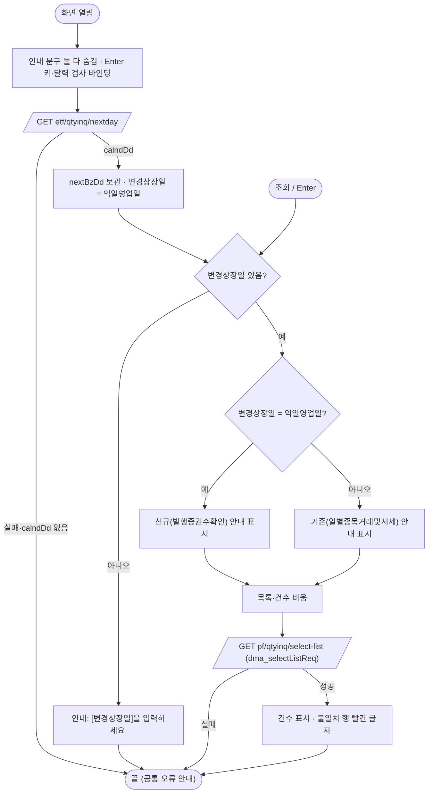

# ULDSTF09322 변경상장 수량조회 — 업무 분석 및 전환 내역

| 항목 | 내용 |
|---|---|
| AS-IS 원본 | `ULDSTF09322.xml` — W-Craft 1차 변환본(`meta_asisFileNm="ULDSTF09322.gfm"`, 원본 gfm 은 저장소에 없음)에 **API 적용까지 마친 개발 사본**. 업무 로직은 이 스크립트와 남은 옛 코드 주석(`listingCommon.do` queryId 등)으로 분석했다. 반입 `conversion/conversion-front/ui/ULDSTF09322/ULDSTF09322.xml` (pf 묶음 21본 중 하나) |
| 신규 API 명세 | 없음 — **화면에 적용된 `/api/...` 경로·method·dataCollection keyInfo 를 명세로 간주**(사용자 결정 2026-10-29 준용). §5 는 "화면 적용 API ↔ AS-IS(주석에 남은 옛 호출)" 대응표로 쓴다. `api_spec_check` 는 SKIP(형식 검사 A07·A08 만) |
| TO-BE | `conversion/conversion-front/ui-tobe/ULDSTF09322.xml` (메뉴 본화면). **2026-10-30 전환** — 1단계: 캡처 없음 → 기존 마크업 정비(마크업 전용, 사본 `$CLAUDE_JOB_DIR/tmp/ULDSTF09322_stage1.xml`), 2단계: 이 결과서대로 스크립트 재전환. 게이트: `gate_screen --pcc stf`·`scan_mixed_compare`·`publish_gate --pcc stf --before {1단계} --allow P20`·`api_spec_check`(SKIP)·`init_binding_check`·`wsxml_lint` 0/0, `convert.py` 고정점 |
| 퍼블리싱 파일 | 화면 폴더 `ULDSTF09322.xml` 의 body 를 1단계 기준으로 했다. publish 원본 `conversion/publish/상장/상장처리(대내)/ULDSTF09322.xml` 과의 차이는 breadcrumb 목업·제목·하단 [닫기]·그리드 번호 열 머리뿐 — [닫기]는 본화면 규칙으로 옮기지 않았다 |
| 화면 캡처 | 없음 — 가이드 §13.2 1단계는 선례 ULDBNS30400 처럼 "캡처 없음, 기존 마크업 정비" |
| 업무공통 | gcc: `$c.win.setEnterKeyEvent`·`$c.date.checkCalendarFormat`·`$c.data.downloadGridViewExcel`·`$c.sbm.executeDynamic`·`$c.exception.handleError`. pcc(stf): `$c.stf.fillGridHeaderTotalCnt`. 게이트는 `--pcc stf` |
| 작성 | Inswave / 2026-10-30 |

참고 양식: [websquare_gfm_conversion.md](../../../md/websquare_gfm_conversion.md) — 특히 §1.4 업무 프로세스 흐름. Gauce 대응은 [gfm_business_analysis_guide.md](../../../md/gfm_business_analysis_guide.md) 를 함께 따랐다. pf 21본 공통 계약서(§1)에서 호출 관계가 없는 독립 화면이다.

---

## 1. 화면 개요

상장 담당자가 **상장형 수익증권(PF)의 변경상장 수량을 운용사 신고분과 예탁원 수신분으로 대조**하는 조회 화면이다.

1. 열리면 익일영업일을 받아 변경상장일에 넣고 바로 조회한다.
2. 변경상장일 기준으로 종목별 운용사 신고(변경전 상장증권수 / 변경후 설정·환매·변경분·상장증권수)와 예탁원 수신(같은 항목)을 나란히 보여 주고, 일치여부가 「불일치」면 빨간 글자로 표시한다.
3. 조회일이 익일영업일이면 예탁원 수신은 「발행증권수확인(신규)」 데이터 기준, 아니면 「일별종목거래및시세(기존)」 데이터 기준 — 그 안내 문구를 바꿔 보인다.
4. [엑셀다운로드]로 목록을 내려받는다.

### 1.1 호출 화면

해당 없음 — 메뉴 본화면(`sub_contents`).

### 1.2 호출 규약 (부모 → 이 화면) / 반환 규약

해당 없음(메뉴 화면). 진입 파라미터를 읽지 않는다.

### 1.3 이 화면이 여는 하위 팝업

없음.

### 1.4 업무 프로세스 흐름

| 업무 | 시작 | 2~5구역 함수 순서 |
|---|---|---|
| 1. 진입 | 화면 열림 | `onpageload` → `init` → `selectNextBzDd` → `search` → `applyComment` → `selectList` |
| 2. 조회 | [조회]·Enter | `btn_Search_onclick` → `search` → `applyComment` → `selectList` |
| 3. 일치여부 표시 | 셀 그리기 | `fmtCompare`(customFormatter) |
| 4. 엑셀 | [엑셀다운로드] | `btn_Excel_onclick` → `excelDown` |

#### 화면 간 흐름

해당 없음 — 다른 화면을 열거나 다른 화면이 여는 일이 없다.

#### 업무 1·2: 진입·조회

| 단계 | 내용 | 근거 |
|---|---|---|
| 1 | 익일영업일 조회 뒤 변경상장일 설정·조회 — 원본은 응답 body 를 `?.` 없이 읽었다 | 원본 :62-80 |
| 2 | 익일영업일 여부로 안내 문구 전환. 원본은 이 비교로 queryId(신규 임시 / 기존)도 골랐다 — 화면 적용 API 는 날짜만 보낸다(§10 #1) | 원본 :81-114 |

#### 화면 모드 상태 전이

해당 없음.

---

## 2. 화면 구성 및 데이터 정의

### 2.1 화면 구성 (AS-IS 요소 → TO-BE 컴포넌트)

| 영역 | AS-IS | TO-BE | 비고 |
|---|---|---|---|
| (빈 그룹) | `position:absolute;top:450px` 빈 `xf:group` | 삭제 | 퍼블리싱 잔재 |
| 머리 | `pfm_pageFrame1`(contentHeader) | `pfmContentHeader` | id 를 다른 화면과 같게 |
| 조회조건 | `panel_Top` / `label_2_top` 변경상장일 / `tbx_changeListDd`(달력, `dma_selectListReq.changeListDate`) / `btn_Search` | 같음. colgroup 4칸(td colspan 3) → 2칸 | `hierarchy`·`orgid`·`userData2` 잔재 제거, 규칙 37 바인딩 |
| 목록 머리 | `edt_TotalCnt_1`(총 n 건) + `btn_Excel` | 같음 | |
| 목록 | `grd_List`(`dlt_selectListRes`, 3줄 머리, `style="height:153px"`, `caption1`·`header1`·`gBody1`) | `grd_List` `gvw row10`, 같은 3줄 머리 | 열은 아래 |
| 하단 안내 | `lab_comment_new`·`lab_comment`(인라인 `display:none`)·`label_6`(인라인 배경) — 클래스 없는 그룹 | `btnbox > lt` 안 `txt_info` 3개, 인라인 스타일 제거 | 표시 여부는 스크립트(§6.2) |
| [닫기] | 주석 `btn_Close_onclick`(`$c.frame.CloseFrame`) | 옮기지 않음 | 본화면 |

**그리드 머리** (AS-IS id → TO-BE id): 1줄 `h_ISU_CD`→`h_isuCd`(종목코드, 3줄 병합) · `h_ISU_KOR_ABBRV`→`h_isuKorAbbrv`(종목명) · `column1`→`h_krxGrp`(운용사 신고, 5칸) · `column4`→`h_ksdGrp`(예탁원 수신, 5칸) · `h_COMPARE`→`h_compare`(일치여부, 3줄 병합) / 2줄 `column2`→`h_krxBfGrp`(변경전) · `column3`→`h_krxAfGrp`(변경후 4칸) · `column5`→`h_ksdBfGrp` · `column6`→`h_ksdAfGrp` / 3줄 `h_KRX_BF_LIST_SHRS`·`h_KRX_ESTB_SHRS`·`h_KRX_REPUR_SHRS`·`h_KRX_MODIFY_SHRS`·`h_KRX_LIST_SHRS`·`h_KSD_BF_ISU_SHRS`·`h_KSD_ESTB_SHRS`·`h_KSD_REPUR_SHRS`·`h_KSD_MODIFY_SHRS`·`h_KSD_ISU_SHRS` → 같은 이름 camelCase(`h_krxBfListShrs` …).
- 본문 수량 10열에 `dataType="number" displayFormat="#,###"`(원본은 형식 없이 원시 값). `compare` 열은 `customFormatter="scwin.fmtCompare"`.
- 원본 머리 `h_KSD_ESTB_SHRS`·`h_KSD_REPUR_SHRS` 의 `mask:XXXX-XX-XX` 는 수량 열에 잘못 붙은 W-Craft 잔재 — 날짜가 아니라 규칙 46 대상이 아니다(§8 #5).

### 2.2 데이터 정의 (DataCollection)

| DataCollection | 용도 | 키 (name) | 비고 |
|---|---|---|---|
| `dma_selectListReq` | select-list 요청 | `bzCalndDd` 영업일 · `changeListDate` 변경상장일 | `changeListDate` 는 달력 바인딩, `bzCalndDd` 는 조회 때 달력 값을 넣는다(개발 사본 그대로 — 두 키에 같은 날짜) |
| `dlt_selectListRes` | select-list 응답 | `isuCd` 종목코드 · `isuKorAbbrv` 종목명 · `krxBfListShrs`·`krxEstbShrs`·`krxRepurShrs`·`krxModifyShrs`·`krxListShrs`(운용사 변경전 상장증권수·설정증권수·환매증권수·변경분·변경후 상장증권수) · `ksdBfIsuShrs`·`ksdEstbShrs`·`ksdRepurShrs`·`ksdModifyShrs`·`ksdIsuShrs`(예탁원 같은 항목) — 이상 number · `compare` 일치여부 | 개발 사본의 name 은 「상장증권수」·「설정증권수」·「환매증권수」·「변경분」이 운용사·예탁원에 똑같이 겹쳐 구분이 안 되어 「운용사/예탁원 + 변경전/변경후」를 붙였다(키·dataType 은 그대로) |
| (없음) | nextday 응답 | `body.calndDd` | target 없이 응답에서 바로 읽는다(개발 사본 그대로) |

## 3. 로딩 (`scwin.onpageload` → `scwin.init`)

1. `onpageload` 는 `scwin.init()` 만 부른다(예외는 `handleError`).
2. `init`: 안내 문구 둘 다 숨김 → `$c.win.setEnterKeyEvent(panel_Top, scwin.btn_Search_onclick)`(규칙 22) · `$c.date.checkCalendarFormat(tbx_changeListDd, "yyyyMMdd")`(규칙 37) → `await selectNextBzDd()` → 받았으면 변경상장일에 넣고 `await search()`.
- 원본 `btn_Excel.show("")` 는 버튼이 원래 보이므로 옮기지 않았다. 원본 `fn_SetHeader` 는 Gauce 헤더 조회 주석만 남은 빈 함수 — 옮기지 않았다.
- 원본 전역 `fr_MktId`·`strQueryId`·`vScrenID` 는 쓰는 곳이 없어(queryId 는 화면 적용 API 로 대체) 옮기지 않았다.

## 4. 컴포넌트 이벤트

| 컴포넌트 · 이벤트 | AS-IS | TO-BE 핸들러 → 함수 |
|---|---|---|
| `btn_Search` onclick (+ Enter) | `btn_Search_onclick` → `fn_list_sync` | 같은 이름 → `search` |
| `btn_Excel` onclick | `btn_Excel_onclick` → `fn_ExcelDown` | 같은 이름 → `excelDown` |
| (달력 이미지) | `btn_changeListDd_onclick` → `popUpCalendar2`(그 버튼은 body 에 없음) | 삭제 — `w2:inputCalendar` 가 대신 |
| (서브미션) | `sbm_dts_List`·`sbm_dts_getDate` 의 `dts_List_OnLoadError`·`dts_List_OnLoadCompleted`·`dts_getDate_OnLoadError`·`dts_getDate_OnLoadCompleted`(정의는 모두 주석) | 삭제 — 빈 서브미션 2개도 제거(`executeDynamic` 으로 대체됨) |
| body `onpageunload` | `scwin.onpageunload`(빈 함수) | 삭제 |

## 5. 서버 통신

| # | 용도 | 화면 적용 API (명세 대용) | AS-IS(주석에 남은 옛 호출) | 요청 | 응답 → target |
|---|---|---|---|---|---|
| 5.1 | 익일영업일 | `GET /api/listing/lstproc/etf/qtyinq/nextday` | `listingCommon.do?method=listGeneral&queryId=lds.stf.lstmgt.mktverif.date.select` (`dts_getDate`) | 없음 | 없음 — `body.calndDd` 직접 |
| 5.2 | 수량 대조 목록 | `GET /api/listing/lstproc/pf/qtyinq/select-list` | `listingCommon.do?…&queryId=lds.stf.pf.lstlst.select.chglist.recv.newtempcount`(익일영업일) / `…recv.count`(그 밖) + `{P}param01~03 = 변경상장일` (`dts_List`) | `ref : "dma_selectListReq"` (`bzCalndDd`·`changeListDate`) | `dlt_selectListRes=body` |

### 5.1 익일영업일 (`scwin.selectNextBzDd`)
`success` 이고 `body.calndDd` 가 있으면 `scwin.nextBzDd` 에 담고 true. 경로가 ETF 수량조회(`etf/qtyinq`)인 것은 개발 사본 그대로다(§10 #2).

### 5.2 목록 (`scwin.selectList`)
목록·건수를 비우고 `bzCalndDd` 에 변경상장일을 넣어 보낸다. `gridview : "grd_List"`. 성공하면 `fillGridHeaderTotalCnt(건수, edt_TotalCnt_1)`. 원본은 조회일이 익일영업일인지로 쿼리를 골랐다 — 서버가 같은 기준으로 고르는지 확인(§10 #1).

## 6. 일반 함수

### 6.1 조회 (`scwin.search`)
변경상장일이 비면 "[변경상장일]을 입력하세요." 후 달력 포커스(원본은 빈 값으로도 조회 — §8 #4). 있으면 `applyComment` → `selectList`.

### 6.2 안내 문구 (`scwin.applyComment`)
변경상장일 = 익일영업일이면 `lab_comment_new`(신규) 표시·`lab_comment` 숨김, 아니면 반대(원본 `fn_list_sync` 앞부분).

### 6.3 일치여부 글자색 (`scwin.fmtCompare`)
customFormatter — 「불일치」면 `this.setCellClass(rowIndex, colIndex, "red")`, 아니면 `removeCellClass`. 값은 그대로 돌려준다(규칙 40·43). 원본은 머리 `h_COMPARE` 의 `userData2` 에 Gauce `color:{decode(COMPARE,'일치','#000000','불일치','#FF0033', …)}` 로 적혀 W-Craft 변환 뒤 동작하지 않았다(§8 #6).

### 6.4 엑셀 (`scwin.excelDown`)
`downloadGridViewExcel(grd_List, { fileName : getProgramId() + "_상장형 수익증권 변경상장 수량_" + yyyyMMddHHmmss + ".xlsx", sheetName : "sheet1" })`(규칙 42). 0건 안내는 공통 함수(원본 "해당데이터가 없습니다. 조회후 다운받으십시요." 직접 안내 대체). 원본 `doLogSave` 주석은 옮기지 않았다.

## 7. 업무 코드 · 메시지 목록

| 구분 | 값 | 의미 |
|---|---|---|
| 일치여부 | `일치` · `불일치` | 불일치 빨간 글자(`red`) |
| 안내 | "※ 예탁원 수신 데이터 : 상장형 수익증권 발행증권수확인(신규) 데이터 기준 조회" | 조회일 = 익일영업일 |
| 안내 | "※ 예탁원 수신 데이터 : 일별종목거래및시세(기존) 데이터 기준 조회" | 그 밖 |
| 안내 | "증권수는 TU단위로 표시된 값임" | 늘 표시 |
| 메시지 | "[변경상장일]을 입력하세요." | 조회 |

## 8. 원본 특이사항 · 결함

| # | 내용 | 결정 |
|---|---|---|
| 1 | 빈 절대 위치 그룹(`top:450px`), contentHeader id `pfm_pageFrame1` | 정리 |
| 2 | 빈 서브미션 `sbm_dts_List`·`sbm_dts_getDate`(핸들러는 주석) | 삭제 |
| 3 | 익일영업일 응답 body 를 `?.` 없이 읽어, body 가 없으면 TypeError | 고침 |
| 4 | 빈 변경상장일로도 조회 | 고침 → 안내 후 중단 |
| 5 | 수량 머리 2개에 `mask:XXXX-XX-XX` | 날짜 아님 — 무시 |
| 6 | 일치여부 색이 Gauce `decode` 문자열로 머리 `userData2` 에 남아 동작 안 함 | 고침 → customFormatter + `red` class |
| 7 | 수량 열에 표시 형식 없음 | 고침 → `#,###` |
| 8 | dataList name 이 운용사·예탁원·변경전/후에 같은 이름 | 정리(키는 그대로) |
| 9 | `popUpCalendar2`(없는 버튼), 빈 `fn_SetHeader`, 빈 `onpageunload`, W-Craft 마커·include 주석 | 삭제 |

## 9. 전환 내역 (AS-IS → TO-BE)

| AS-IS | TO-BE | 비고 |
|---|---|---|
| `scwin.onpageload` | `scwin.onpageload` | `handleError` |
| `scwin.onpageunload` | 삭제 | 빈 함수 |
| `scwin.init` | `scwin.init` | Enter·달력 바인딩, 조회 await |
| `scwin.fn_getDate` | `scwin.selectNextBzDd` + `scwin.init` 3) | |
| `scwin.fn_list_sync` | `scwin.search` · `scwin.applyComment` · `scwin.selectList` | 빈 날짜 검사 |
| `scwin.fn_SetHeader` | 삭제 | 빈 함수 |
| `scwin.fn_ExcelDown` | `scwin.excelDown` | 규칙 42 |
| `scwin.btn_Search_onclick` | 같은 이름 | |
| `scwin.btn_Excel_onclick` | 같은 이름 | |
| `scwin.btn_changeListDd_onclick` | 삭제 | Gauce 달력 잔재 |
| (주석) `scwin.btn_Close_onclick`·`scwin.dts_*` 4개 | 옮기지 않음 | |
| (신규) | `scwin.fmtCompare` | 규칙 43 |
| 전역 `vScrenID`·`fr_MktId`·`strQueryId`·`strBzCalndDd` | `scwin.nextBzDd` + 상수 `scwin.COMPARE_CLASS` | |

- publicInfo: 정의한 10함수 전부. 전역·상수는 등재하지 않는다.
- 게이트: `gate_screen`·`scan_mixed_compare`(A 0·B 0)·`publish_gate --before 1단계 --allow P20`(P22·P24 는 스크립트 전환분)·`api_spec_check`(SKIP)·`init_binding_check`·`wsxml_lint` 0/0, `convert.py` 고정점.

## 10. 남은 작업 (TODO)

1. **신규/기존 데이터 선택** — 원본은 조회일이 익일영업일이면 신규 임시 테이블(`…newtempcount`), 아니면 기존 테이블(`…count`) 쿼리를 골랐다. 화면 적용 API 는 날짜(`bzCalndDd`·`changeListDate`)만 보낸다 — 서버가 같은 기준으로 고르는지 확인. 안 고르면 구분 키(예: 익일영업일 여부)를 더해야 한다.
2. **익일영업일 경로** — `/api/listing/lstproc/etf/qtyinq/nextday`(ETF 수량조회 경로)를 쓴다. PF 전용 경로가 따로 있는지 확인.
3. **요청 키 중복** — `bzCalndDd`·`changeListDate` 에 같은 날짜가 간다. 서버가 어느 키를 쓰는지 확인해 하나로 줄일 수 있다.
4. **엑셀 옵션** — 원본 다운로드는 파일명만 지정했다. 3줄 머리가 엑셀에 그대로 나오는지 실화면 확인.
