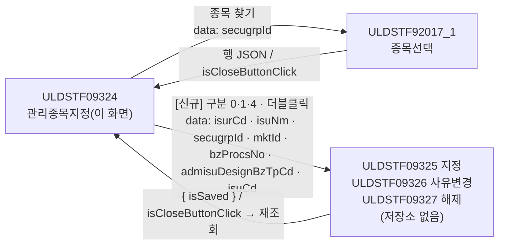
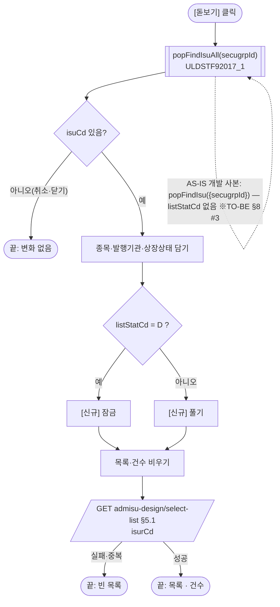
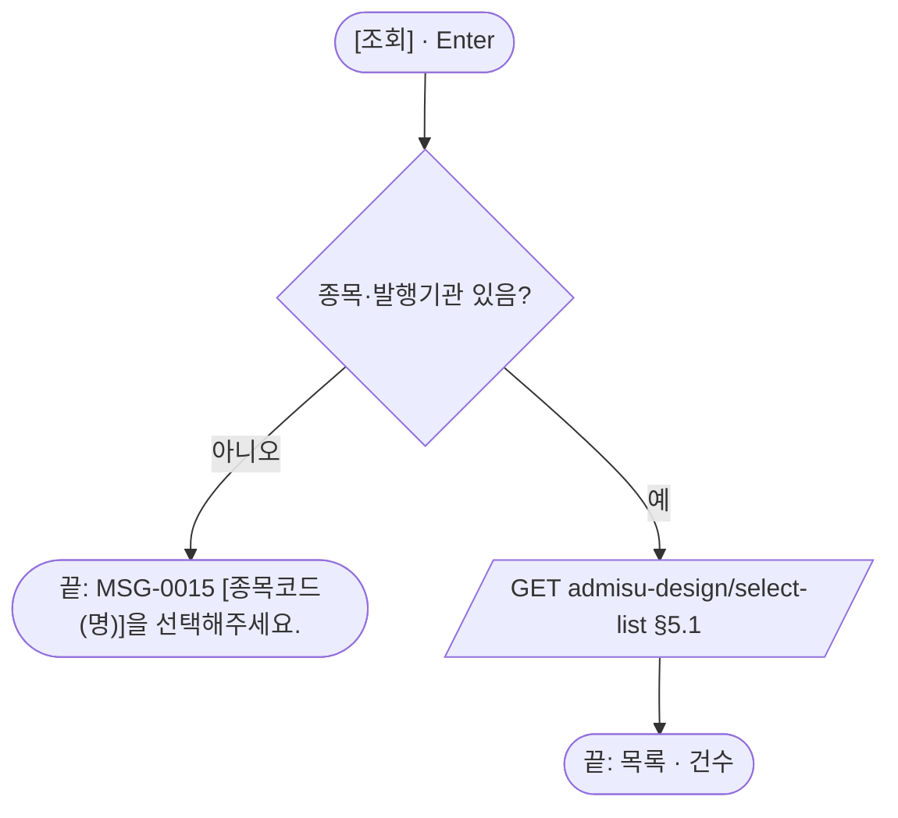
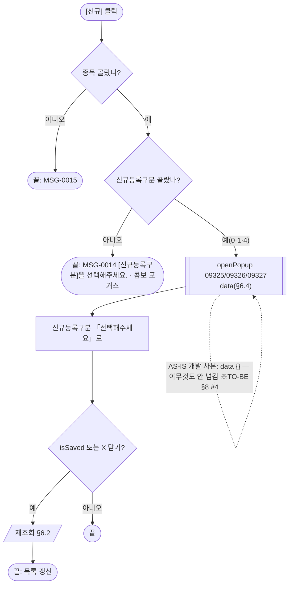
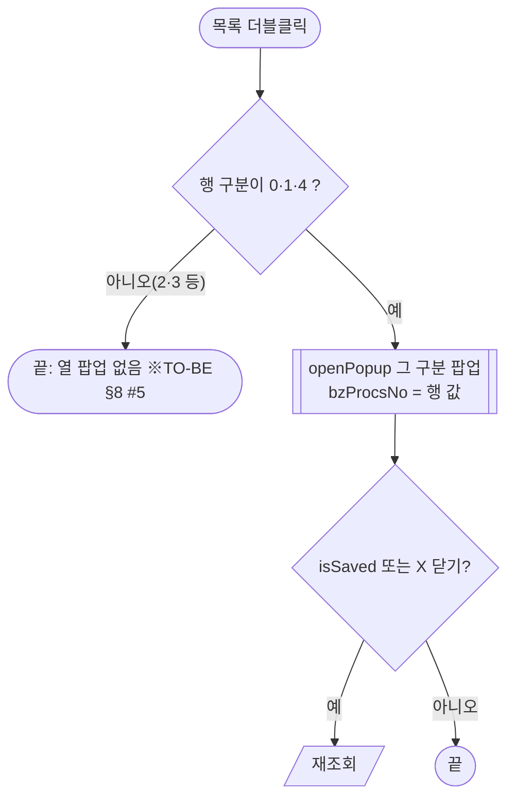
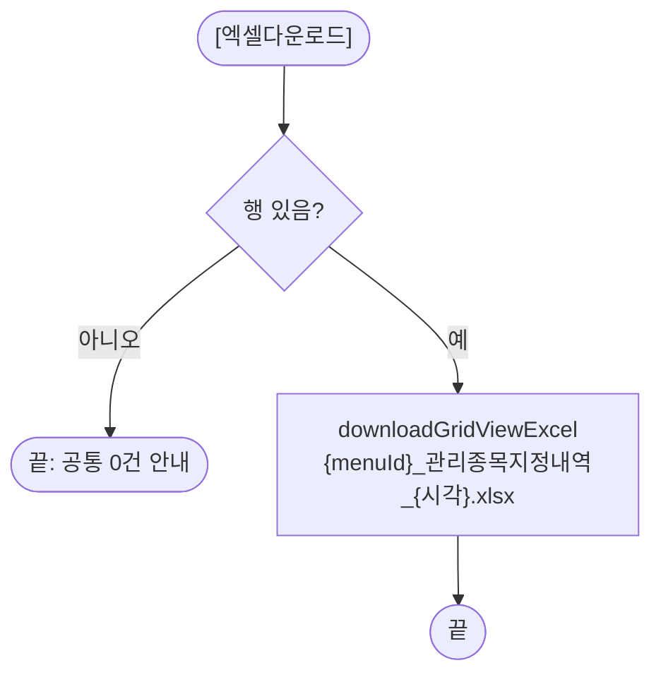
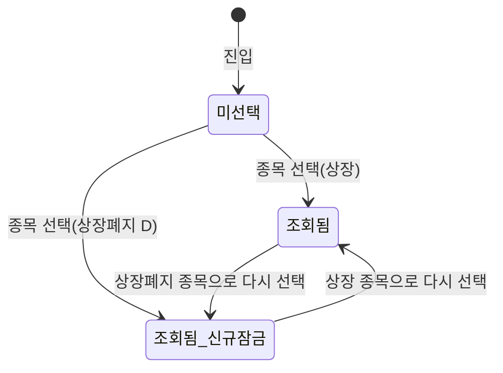

# ULDSTF09324 관리종목지정 — 업무 분석 및 전환 내역

| 항목 | 내용 |
|---|---|
| AS-IS 원본 | `ULDSTF09324.xml` — W-Craft 1차 변환본(`meta_asisFileNm="ULDSTF09324.gfm"`, 원본 gfm 은 저장소에 없음)에 **API 적용까지 마친 개발 사본**. 업무 로직은 이 스크립트와 남은 옛 코드 주석으로 분석했다. 반입 `conversion/conversion-front/ui/ULDSTF09324/ULDSTF09324.xml` (pf 묶음 21본 중 하나). **이 파일은 XML 이 깨져 있다** — 그리드 머리글 `value="공시검토 여부"` 의 `<` 미이스케이프(306행, §8 #1) |
| 신규 API 명세 | 없음 — **화면에 적용된 `/api/...` 경로·method·dataCollection keyInfo 를 명세로 간주**(사용자 결정 2026-10-29 준용, pf 계약서). §5 는 "화면 적용 API ↔ AS-IS(주석에 남은 옛 호출)" 대응표. `api_spec_check` 는 SKIP(형식 검사 A07·A08 만) |
| TO-BE | `conversion/conversion-front/ui-tobe/ULDSTF09324.xml` (메뉴 본화면 — 배포 경로 `/ui/lst/pf/ULDSTF09324.xml` 가정, 하위 팝업 원본 리터럴 `/ui/lst/pf/` 기준). **2026-10-30 전환** — 1단계: 캡처 없음 → 기존 마크업 정비(마크업 전용, 사본 `$CLAUDE_JOB_DIR/tmp/ULDSTF09324_stage1.xml`), 2단계: 이 결과서대로 스크립트 재전환. 게이트: `gate_screen --pcc stf`·`scan_mixed_compare`·`publish_gate --pcc stf --before {1단계} --allow P20`·`api_spec_check`(SKIP)·`init_binding_check`·`wsxml_lint` 0/0, `convert.py` 고정점 |
| 퍼블리싱 파일 | 화면 폴더 `ULDSTF09324.xml` 의 body 를 1단계 기준으로 했다. publish 원본 `conversion/publish/상장/상장처리(대내)/ULDSTF09324.xml` 은 참고만 — 개발 사본과 라벨 구성이 같다(페이지 머리만 publish 는 breadcrumb 목업) |
| 화면 캡처 | 없음 — 가이드 §13.2 1단계는 선례 ULDBNS30400 처럼 "캡처 없음, 기존 마크업 정비" |
| 업무공통 | pcc: `$c.lc.getGlbValue`·`$c.lc.popFindIsuAll`·`$c.stf.getMessageParam`. gcc: `$c.win.setEnterKeyEvent`·`$c.win.openPopup`·`$c.win.getProgramId`·`$c.data.downloadGridViewExcel`·`$c.sbm.executeDynamic`·`$c.exception.handleError`. 게이트는 `--pcc stf` |
| 작성 | Inswave / 2026-10-30 |

참고 양식: [websquare_gfm_conversion.md](../../../md/websquare_gfm_conversion.md) — §1.4 업무 프로세스 흐름, §6.5 getPar/setPar 전환. Gauce 대응은 [gfm_business_analysis_guide.md](../../../md/gfm_business_analysis_guide.md). 호출·반환 키는 pf 21본 공통 계약서(§2 「외부·미보유 팝업」 09325·09326·09327)를 따른다. 같은 꼴 선례는 `ui-tobe/ULDSTF08035.xml`(관리종목지정 우려예고 — 등록 팝업 계약 제안·재조회).

---

## 1. 화면 개요

상장 담당자가 **상장형 수익증권(PF) 종목의 관리종목 지정·사유변경·해제 내역을 보고, 새로 등록하는** 메뉴 화면이다.

1. [종목 찾기]로 PF 종목을 고르면 그 종목의 발행기관 기준 관리종목지정 내역을 조회한다(진입 시 조회 없음).
2. 상장폐지 종목(상장상태 `D`)이면 [신규]를 잠근다.
3. 하단 신규등록구분(관리종목지정 0 · 사유변경 1 · 해제 4)을 고르고 [신규]를 누르면 그 구분의 등록 팝업을 연다. 목록 행을 더블클릭하면 그 행의 구분 팝업을 수정용으로 연다.
4. [엑셀다운로드]로 목록을 내려받는다.

### 1.1 호출 화면 (메뉴)

메뉴에서 여는 본화면이다(body `sub_contents`). 이 화면을 여는 다른 화면은 없다(pf 계약서 §1).

### 1.2 호출 규약 (부모 → 이 화면) / 반환 규약

해당 없음 — 메뉴 본화면. 원본의 하단 [닫기](`img_Close` → 주석 처리된 `window.close()`)는 본화면이라 옮기지 않았다(§8 #7).

### 1.3 이 화면이 여는 하위 팝업

| 팝업 | AS-IS 호출 (getPar/setPar) | 넘기는 `data` (TO-BE) | 받는 결과 / 취소 판정 |
|---|---|---|---|
| ULDSTF92017_1 종목선택(pcc `$c.lc.popFindIsuAll`) | 주석 `$c.lcp.popFindIsuAll(fr_SecuGrpId)` + `fn_GetParIsur`(arr[0] "" · [1] 종목명 · [2] 증권그룹) / `fn_SetParIsur`(`ISU_CD`·`ISU_KOR_NM`·`ISUR_CD`·`LIST_STAT_CD`, `DBCLICKYN` 이 `Y` 일 때만) → 개발 사본은 `$c.lc.popFindIsu({ secugrpId })`(92017) | `{ secugrpId }` | 행 JSON `isuCd`·`isuKorNm`·`isurCd`·`listStatCd` / `isCloseButtonClick` 또는 `isuCd` 빈 값이면 취소 |
| ULDSTF09325 관리종목지정 (620×370) | 주석 `CreateDialogFrame("DLG_0", "../pf/ULDSTF09325.gfm", …)` + `fn_GetParNew`/`fn_GetParUpdate` → 개발 사본 `openPopup("/ui/lst/pf/ULDSTF09325.xml", opts, {})` | `{ isurCd, isuNm, secugrpId, mktId, bzProcsNo, admisuDesignBzTpCd, isuCd }` (§6.4) | `{ isSaved }` / `isSaved` 이거나 X 닫기(`isCloseButtonClick`)면 재조회 |
| ULDSTF09326 관리종목지정 사유변경 (620×520) | 같음 (`DLG_1`) | 같음 | 같음 |
| ULDSTF09327 관리종목지정 해제 (620×450) | 같음 (`DLG_2`) | 같음 | 같음 |

- 09325·09326·09327 은 **저장소에 없다** — data 키·반환은 pf 계약서의 제안이다(§10 #1).
- 크기는 원본 `CreateDialogFrame` 주석 값(620×370 / 620×520 / 620×450). 개발 사본은 셋 다 600×640.

### 1.4 업무 프로세스 흐름

흐름은 AS-IS(개발 사본) 동작을 기준으로 그렸다. 점선과 `※TO-BE` 는 전환본에서 바뀌는 곳이다(근거는 §8).

| # | 업무 | 시작 (사용자 동작·진입 조건) | 끝 (결과) | 주요 함수 | 관련 절 |
|---|---|---|---|---|---|
| 1 | 진입 | 메뉴에서 엶 | 빈 화면, 조회 영역 Enter 키 연결 | `scwin.onpageload` → `scwin.init` | §3 |
| 2 | 종목 찾기·조회 | [돋보기] `btn_FindIsu` | 종목·발행기관 지정, 내역 표시, 상장폐지면 [신규] 잠금 | `scwin.openIsuPopup` → `scwin.search` → `scwin.selectList` | §6.1, §6.2, §5.1 |
| 3 | 조회 | [조회] `btn_Search` / 조회 영역 Enter | 내역 다시 표시 | `scwin.btn_Search_onclick` → `scwin.validateSearch` → `scwin.search` | §6.3 |
| 4 | 신규 등록 | 신규등록구분 선택 + [신규] `btn_New` | 등록 팝업 → 저장·닫기면 재조회 | `scwin.writeNew` → `scwin.openRegPopup` | §6.4, §6.6 |
| 5 | 수정 | 목록 더블클릭 `grd_List` | 그 행 구분 팝업 → 저장·닫기면 재조회 | `scwin.openDetail` → `scwin.openRegPopup` | §6.5, §6.6 |
| 6 | 엑셀 | [엑셀다운로드] `btn_Excel` | 목록 xlsx | `scwin.excelDown` | §6.7 |

#### 화면 간 흐름

#### 업무 2: 종목 찾기·조회

| # | 단계 | 주체 | 내용 | 분기 · 메시지 | 관련 절 |
|---|---|---|---|---|---|
| 1 | 종목 선택 | 사용자 | 92017_1 에서 PF 종목 더블클릭 | 취소면 끝 | §6.1 |
| 2 | 상장상태 | 화면 | `listStatCd === "D"` → `btn_New.setDisabled(true)` | 원본 이미지 교체(`img.src`)는 삭제 | §6.1 |
| 3 | 조회 | 서버 | 발행기관코드로 관리종목지정 내역 | — | §5.1 |
| 4 | 건수 | 화면 | `tbx_totCnt` 에 행 수 | — | §6.2 |

#### 업무 3: 조회

#### 업무 4: 신규 등록

#### 업무 5: 수정(더블클릭)

| # | 단계 | 주체 | 내용 | 분기 · 메시지 | 관련 절 |
|---|---|---|---|---|---|
| 1 | 구분 | 화면 | 행 `admisuDesignBzTpCd` | 0·1·4 외면 끝 | §6.5 |
| 2 | data | 화면 | `bzProcsNo` = 행 값(개발 사본은 `"bz_procs_no"` 로 읽어 늘 빈 값) | — | §8 #4 |

#### 업무 6: 엑셀

#### 화면 모드 상태 전이

## 2. 화면 구성 및 데이터 정의

### 2.1 화면 구성

| 영역 | AS-IS 요소 | TO-BE 컴포넌트 (바인딩) | 설명 |
|---|---|---|---|
| 머리 | `pfm_pageFrame1` (contentHeader) | `pfmContentHeader` | 공통 화면 머리 |
| 조회 | `panel_Top`(schbox) | `panel_Top` | Enter 키 영역(규칙 22) |
| 조회 | `label_6` 「종목코드(명)」 | `label_6` (`req`) | 필수 표시 |
| 조회 | `txb_ISU_CD`(ref `dma_listReq.isuCd`, `search="start"`) | `txb_ISU_CD` (`dma_search.isuCd`) | 읽기 전용 |
| 조회 | `txb_ISU_NM`(바인딩 없음) | `txb_ISU_NM` (`dma_search.isuNm`) | 읽기 전용 |
| 조회 | `btn_iSU_CD`(돋보기) | `btn_FindIsu` | 종목 찾기 |
| 조회 | `img_Search` [조회] | `btn_Search` | |
| 목록 | `panel_page`(건수) | `tbx_totCnt` | 총 n 건 |
| 목록 | `img_Excel` [엑셀다운로드] | `btn_Excel` | |
| 목록 | `grd_List`(dataList `dlt_listRes`, `caption1`·`header1`·`gBody1`) | `grd_List`(`dlt_list`, `cap_List`·`hdr_List`·`gbd_List`) | 머리글 id `DSC_YN` 등 대문자 → `h_` + camelCase |
| 목록 | 머리글 `DSC_YN`·`MKTACT_ENFORCE_DD`·`ADMISU_DESIGN_BZ_TP_NM`·`ISU_NM`·`ADMISU_RSN_NM`·`CHG_RSN_CONTN`·`ADMISU_DESIGN_GRND_REGUL_NM`·`REMK`·`LST_EMP_NM`·`BZ_PROCS_NO` | `h_dscYn` … `h_bzProcsNo` | 시행일 열은 원본 `mask:XXXX-XX-XX` → `dataType="date" displayFormat="yyyy-MM-dd"`(규칙 46) |
| 하단 | `label_3` 「신규등록구분」 | `label_3` | |
| 하단 | `cmb_RegistTyp`(항목 `(null)^선택해주세요,0,1,4`) | `cmb_RegistTyp` (`chooseOption` 「선택해주세요」 + 0·1·4) | 빈 값이 미선택 |
| 하단 | `img_Regist` [신규] | `btn_New` (`btn_cm pt`) | 규칙 41 |
| 하단 | `img_Close` [닫기] | (옮기지 않음) | 본화면 — §8 #7 |

### 2.2 데이터 정의

| TO-BE | 종류 | 키(컬럼) | 출처 / 용도 |
|---|---|---|---|
| `dma_search` | dataMap(화면 전용) | `isuCd` 종목코드, `isuNm` 종목명 | 종목 찾기 결과. AS-IS `dma_listReq`(isuCd 만, 요청에 쓰이지 않음) 대체 |
| `dlt_list` | dataList | `dftYn` 기안여부, `dscYn` 공시여부, `bzProcsNo` 업무처리번호, `isurCd` 발행기관코드, `mktactEnforceDd` 변경상장일(시행일), `admisuDesignBzTpCd` 구분코드, `admisuDesignBzTpNm` 구분, `isuCd` 종목코드, `isuNm` 종목명, `admisuRsnNm` 지정사유, `bfchgDelistBasDdContn` 변경전 유의사항, `afchgDelistBasDdContn` 변경후 유의사항, `chgRsnContn` 변경/해제 사유, `admisuDesignGrndRegulNm` 근거규정, `remk` 기타, `lstEmpNm` 최종처리자 | 화면 적용 API `admisu-design/select-list` 응답 — 개발 사본 `dlt_listRes` 키 그대로(id 만 개명) |
| `scwin.isurCd` | 전역 | — | 조회 조건 발행기관코드(원본 `vIsurCd`) |
| `scwin.listStatCd` | 전역 | — | 상장상태(원본 `vLIST_STAT_CD`, 초기값 `"Y"` → TO-BE `""`) |
| `scwin.secugrpId` / `scwin.mktId` | 전역 | — | PF / 사용자 시장(원본 `fr_SecuGrpId`·`fr_MktId`) |

- 원본 전역 `fn_GetPar`·`fn_SetPar`·`spacYN`·`vScrenID`·`chkRowIndex`·`hist_bz_procs_no` 는 쓰는 곳이 없어 옮기지 않았다(규칙 1·§9).

## 3. 로딩 (`scwin.onpageload` → `scwin.init`)

1. **증권그룹·사용자 시장** — `scwin.secugrpId = $c.lc.getGlbValue("SECUGRP_ID_PF")`, `scwin.mktId = session market`(원본 전역 선언부).
2. **조회 영역 Enter 키** — `$c.win.setEnterKeyEvent(panel_Top, scwin.btn_Search_onclick)`(규칙 22).
3. 달력 없음(규칙 37 대상 없음). 초기 조회 없음. 원본 `init` 의 `PanelToGroupBox` 는 주석이라 옮기지 않았다.

## 4. 컴포넌트 이벤트

| TO-BE 컴포넌트 | 이벤트 | TO-BE 핸들러 | 동작 (호출 함수) | AS-IS |
|---|---|---|---|---|
| `btn_FindIsu` | onclick | `scwin.btn_FindIsu_onclick` | `scwin.openIsuPopup` | `btn_iSU_CD` onclick `scwin.btn_iSU_CD_onclick` |
| `btn_Search` | onclick | `scwin.btn_Search_onclick` | `scwin.validateSearch` → `scwin.search` | `img_Search` onclick `scwin.img_Search_onclick` |
| `btn_New` | onclick | `scwin.btn_New_onclick` | `scwin.writeNew` | `img_Regist` onclick `scwin.img_Regist_onclick` |
| `grd_List` | oncelldblclick | `scwin.grd_List_oncelldblclick` | `scwin.openDetail` | `grd_List` oncelldblclick `scwin.grd_List_OnDblClick` |
| `btn_Excel` | onclick | `scwin.btn_Excel_onclick` | `scwin.excelDown` | `img_Excel` onclick `scwin.img_Excel_onclick` |
| (없음) | — | — | — | `img_Close` onclick `scwin.img_Close_onclick`(정의 주석 — 미정의 핸들러), body `scwin.gform_onload`(미정의)·`scwin.onpageunload`(빈 함수) — 옮기지 않음 |
| (없음) | — | — | — | `dlt_listRes_OnLoadCompleted`(Gauce 이벤트 이름 — 연결 없음) → `scwin.search` 끝의 건수 표시로 |

## 5. 서버 통신

| # | 용도 | AS-IS | TO-BE (화면 적용 API) |
|---|---|---|---|
| 5.1 | 관리종목지정 내역 조회 | 주석 `/pf/administrativeIssue.do?…&method=searchAdministrativeIssue&DIV_IDX=DIV_IDX_ADMISU_LIST&TRS_IDX=TRS_IDX_SELECT&ISUR_CD=` | `GET /api/listing/lstproc/pf/admisu-design/select-list` |

### 5.1 관리종목지정 내역 조회 (`scwin.selectList`)

| 항목 | 내용 |
|---|---|
| `id` | `sbm_selectList` (개발 사본 `sbm_selectOneIsuInfo`) |
| `method` / `action` | `get` / `/api/listing/lstproc/pf/admisu-design/select-list` — 개발 사본은 `"…?isurCd=" + scwin.vIsurCd` 로 이어 붙였다 → 전체 경로 리터럴 + requestData(규칙 38) |
| `ref` / `requestData` | `{ isurCd }` |
| `target` / `gridview` | `dlt_list=body` / `grd_List`(규칙 44) |
| 선행 / 순서 | `scwin.search` 가 목록·건수를 비운 뒤 |
| 후처리 | 건수 `tbx_totCnt` (원본 `fillGridHeaderTotalCnt(rowcount, panel_page)`) |
| 실패 처리 | 공통 오류 안내, `false` 반환 → 빈 목록 유지 |
| 중복 실행 | `result.skipped` 면 건너뜀 |

- 개발 사본에 남은 `debugger;` 는 지웠다. 원본이 보내던 `SCREN_ID`·`SCREN_PROCES_TP_CD`·`DIV_IDX`·`TRS_IDX` 는 화면 적용 API 에 없어 보내지 않는다.

## 6. 일반 함수

### 6.1 종목 찾기 (`scwin.openIsuPopup`)

* **로직:** `$c.lc.popFindIsuAll({ secugrpId })`(92017_1, 상장폐지 종목 포함) → 취소(`isCloseButtonClick`·`isuCd` 빈 값)면 끝 → `dma_search.isuCd/isuNm`, `scwin.isurCd`, `scwin.listStatCd` → `btn_New.setDisabled(listStatCd === "D")` → `scwin.search`.
* 원본은 `popFindIsuAll` + `fn_SetParIsur`(`DBCLICKYN` 이 Y 일 때만 반영하고 **취소해도 `fn_search`**). 개발 사본 `popFindIsu({ secugrpId })` 는 92017 이 `listStatCd` 를 돌려주지 않아 잠금이 동작하지 않았고 secugrpId 자리에 객체를 넘겼다(§8 #3).

### 6.2 조회 (`scwin.search`)

* **로직:** `dlt_list.removeAll()` · 건수 0 → `scwin.selectList(scwin.isurCd)` → 성공이면 건수.

### 6.3 조회 조건 확인 (`scwin.validateSearch`)

* **Return:** 종목코드와 발행기관코드가 있으면 `true`, 없으면 MSG-0015 「[종목코드(명)]을 선택해주세요.」 후 `false`. 원본 `img_Search`(vIsurCd)·`img_Regist`(txb_ISU_CD) 판정을 합쳤다.

### 6.4 신규 (`scwin.writeNew`) · 팝업 data (`scwin.getPopupData`)

* **writeNew:** `validateSearch` → `cmb_RegistTyp.getValue()` 빈 값이면 MSG-0014 + 포커스 → `scwin.openRegPopup(구분, getPopupData(-1, 구분))`. 원본 `cmb_RegistTyp.BindColVal`(Gauce) → `getValue()`.
* **getPopupData(rowIndex, designBzTpCd):** 원본 `fn_GetParNew`/`fn_GetParUpdate` 의 `arrPar` → 키

  | arrPar | TO-BE 키 | 신규 | 수정 |
  |---|---|---|---|
  | [0] | `isurCd` | `scwin.isurCd` | 같음 |
  | [1] | `isuNm` | 종목명 | 같음 |
  | [2] | `secugrpId` | PF | 같음 |
  | [3] | `mktId` | 사용자 시장 | 같음 |
  | [4] | `bzProcsNo` | `""` | 행 `bzProcsNo` (원본 대문자·snake `"bz_procs_no"` 결함 정정) |
  | [5] | `admisuDesignBzTpCd` | 콤보 값 | 행 `admisuDesignBzTpCd` (원본 `"ADMISU_DESIGN_BZ_TP_CD"` 결함 정정) |
  | [6] | `isuCd` | 종목코드 | 같음 |

### 6.5 수정 (`scwin.openDetail`)

* **로직:** 행 `admisuDesignBzTpCd` 가 `scwin.REG_POPUP` 에 없으면(2·3 등) 끝 → `scwin.openRegPopup(구분, getPopupData(rowIndex, 구분))`. 개발 사본은 `getRowPosition()` 행을 읽었다 → 더블클릭한 `rowIndex`.

### 6.6 등록 팝업 (`scwin.openRegPopup`)

* **로직:** `scwin.REG_POPUP[구분]` 으로 id·제목·크기 → `openPopup("/ui/lst/pf/" + id + ".xml", { type : "pageFramePopup" }, data)` await → `cmb_RegistTyp.setSelectedIndex(0)`(원본 그대로) → `isSaved || isCloseButtonClick` 이면 `scwin.search`(원본은 재조회 없음 — pf 계약서 §2 재조회 규약).
* 제목은 개발 사본 문구. 원본 주석은 `fn_getSecuGrpNm(PF) + " 관리종목지정"` 인데 pcc `getSecuGrpNm` 에 PF 분기가 없어 앞부분이 빈 값이다(§8 #6).

### 6.7 엑셀 (`scwin.excelDown`)

* `$c.data.downloadGridViewExcel(grd_List, { fileName : getProgramId() + "_관리종목지정내역_" + yyyyMMddHHmmss + ".xlsx", sheetName : "sheet1" })`(규칙 42). 0건 안내는 공통(`_hasDownloadData`)이 한다 — 원본 `NO_EXCEL_DATA`(맨 이름, 정의 없음) 대체. 원본 `doLogSave(…, SCREN_PROCS_TP_CD_07)` 은 삭제(doLogSave 제거 확정).

## 7. 업무 코드 · 메시지 목록

| 구분 | 값 | 의미 |
|---|---|---|
| 신규등록구분 `admisuDesignBzTpCd` | 0 | 관리종목지정 → ULDSTF09325 |
| | 1 | 관리종목지정 사유변경 → ULDSTF09326 |
| | 2 · 3 | 사유및상장폐지기준일변경 · 상장폐지기준일변경 — 원본 주석에만 있음, 팝업 없음 |
| | 4 | 관리종목지정 해제 → ULDSTF09327 |
| 상장상태 `listStatCd` | D | 상장폐지 → [신규] 잠금 |
| 메시지 | MSG-0015 | [종목코드(명)]을 선택해주세요. |
| | MSG-0014 | [신규등록구분]을 선택해주세요. |
| | (공통) | 엑셀 0건 안내 — `downloadGridViewExcel` |

## 8. 원본 특이사항 · 결함

| # | 원본에서 실제로 일어나는 일 (근거) | 전환본 처리 |
|---|---|---|
| 1 | 개발 사본 XML 이 깨져 있다 — 그리드 머리글 `value="공시검토 여부"`(306행)의 `<` 미이스케이프 → 화면이 열리지 않음 | **고침** — `&lt;br/&gt;` + 그리드 `escape="false"` |
| 2 | 하단 [닫기] 핸들러 `scwin.img_Close_onclick` 정의가 주석, body `scwin.gform_onload` 미정의 | **옮기지 않음** |
| 3 | 개발 사본 `popFindIsu({ secugrpId })` — pcc 는 secugrpId 문자열을 받고, 92017 은 `listStatCd` 를 돌려주지 않아 상장폐지 잠금이 늘 꺼짐. 취소 판정 `typeof res.isuCd != 'undefined'` | **고침** — 원본(주석)대로 `popFindIsuAll({ secugrpId })`(92017_1), 취소는 `isCloseButtonClick`·`isuCd` 빈 값 |
| 4 | 하위 팝업에 `data = {}` — 원본 `fn_GetParNew/Update` 값을 넘기지 않음. 수정 키를 `"bz_procs_no"`·`"ADMISU_DESIGN_BZ_TP_CD"` 로 읽어 늘 빈 값 | **고침** — §6.4 키로 넘긴다 |
| 5 | 이력 행의 구분이 2·3 이면 원본은 `"/ui/lst/pf/.xml"` 을 연다(urlId 빈 값) | **고침** — 열지 않음, §10 #2 |
| 6 | pcc `getSecuGrpNm("PF")` 는 빈 문자열(PF 분기 없음) — 원본 제목·엑셀 이름 앞부분이 비어 있었다 | 유지(결과가 같음) — 고정 이름 「관리종목지정내역」, pcc 보강은 §10 #4 |
| 7 | 본화면에 [닫기] 버튼 | **옮기지 않음**(본화면 닫기 삭제 — pf 계약서 §4.4-12) |
| 8 | `fn_SetParIsur` 는 취소해도 `fn_search`, `img.src` 이미지 교체, `debugger` | 취소면 아무것도 안 함 · 이미지 교체·debugger 삭제 |
| 9 | 원본은 팝업이 닫힌 뒤 다시 조회하지 않음 | **바꿈** — `isSaved`·X 닫기면 재조회(pf 계약서 §2) |

## 9. 전환 내역 (AS-IS → TO-BE)

| AS-IS | TO-BE |
|---|---|
| `scwin.onpageload` → `scwin.init`(빈 함수) | `scwin.onpageload` → `scwin.init`(증권그룹·시장·Enter 키) |
| `scwin.onpageunload` | 삭제(빈 함수) |
| `scwin.fn_search` | `scwin.selectList` + `scwin.search` |
| `scwin.fn_GetParIsur` / `scwin.fn_SetParIsur` | `scwin.openIsuPopup`(popFindIsuAll + await 반환) |
| `scwin.fn_GetParUpdate` / `scwin.fn_GetParNew` | `scwin.getPopupData` |
| `scwin.fn_newpre_create_frame` | `scwin.openRegPopup` |
| `scwin.img_Excel_onclick` | `scwin.btn_Excel_onclick` → `scwin.excelDown` |
| `scwin.img_Search_onclick` | `scwin.btn_Search_onclick` (+ `scwin.validateSearch`) |
| `scwin.dlt_listRes_OnLoadCompleted` | `scwin.search` 의 건수 표시 |
| (주석) `scwin.dlt_listRes_OnLoadError` — `$c.stf.alert_error` | 삭제(규칙 0 — 주석, 실패 안내는 공통) |
| `scwin.img_Close_onclick`(주석) | 삭제 |
| `scwin.img_Regist_onclick` | `scwin.btn_New_onclick` → `scwin.writeNew` |
| `scwin.grd_List_OnDblClick` | `scwin.grd_List_oncelldblclick` → `scwin.openDetail` |
| `scwin.btn_iSU_CD_onclick` | `scwin.btn_FindIsu_onclick` |
| 전역 `fr_SecuGrpId`·`fr_MktId`·`vIsurCd`·`vLIST_STAT_CD` | `scwin.secugrpId`·`scwin.mktId`·`scwin.isurCd`·`scwin.listStatCd` |
| 전역 `fn_GetPar`·`fn_SetPar`·`spacYN`·`vScrenID`·`chkRowIndex`·`hist_bz_procs_no` | 삭제(쓰는 곳 없음, 규칙 1) |
| `dma_listReq`·`dlt_listRes` | `dma_search`·`dlt_list` |

- publicInfo: 정의한 16함수 전부. 게이트 결과는 머리 표.

## 10. 남은 작업 (TODO)

1. **등록 팝업 09325·09326·09327** — 저장소에 없다. 경로 `/ui/lst/pf/{ID}.xml`(원본 리터럴)·data 키(§6.4)·반환 `{ isSaved }` 는 pf 계약서 제안이다. 팝업 전환 때 이 계약으로 수신·반환하는지 맞춘다.
2. **구분 2·3 이력** — 서버 이력에 구분 2·3(사유및상장폐지기준일변경 등)이 오는지, 오면 어느 팝업으로 열지 확인(지금은 열지 않음).
3. **조회 조건** — 화면 적용 API 가 발행기관코드(`isurCd`)로 조회한다. 같은 발행기관의 다른 종목 내역까지 나오는 것이 의도인지 확인(종목 기준이면 `isuCd` 를 함께 보내야 함).
4. **pcc `getSecuGrpNm`** — PF 분기 추가 여부(제목·엑셀 이름 앞부분).
5. **배포 경로** — `/ui/lst/pf/ULDSTF09324.xml` 가정.
