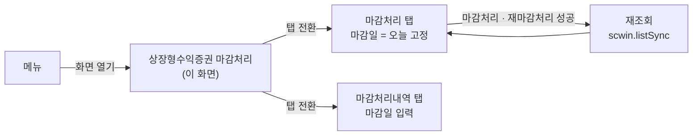
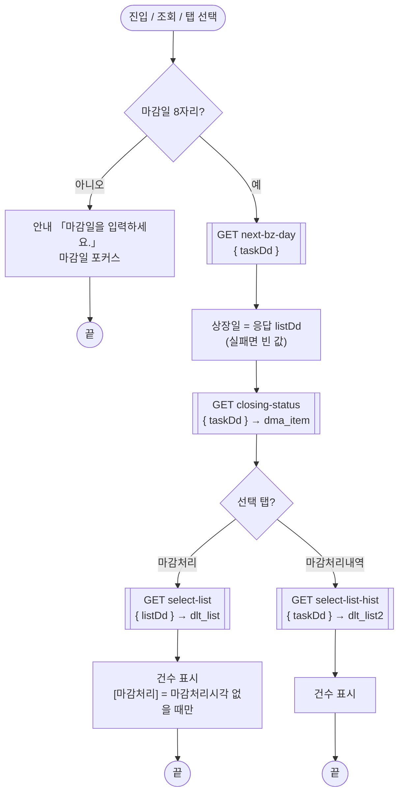
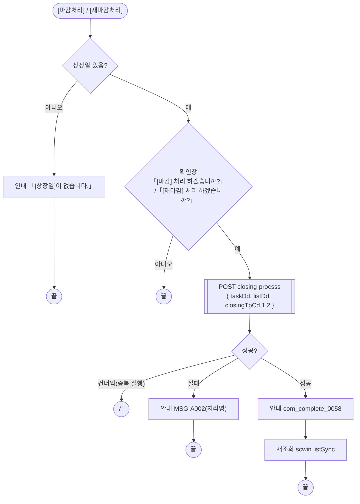
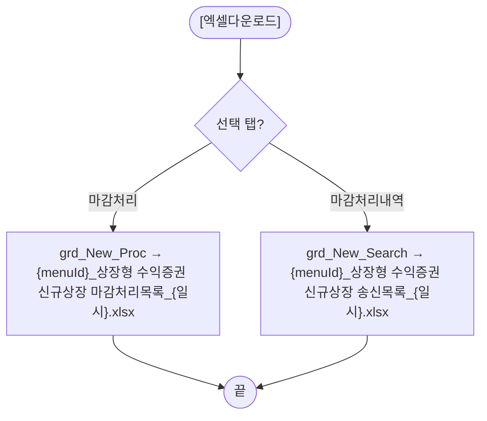
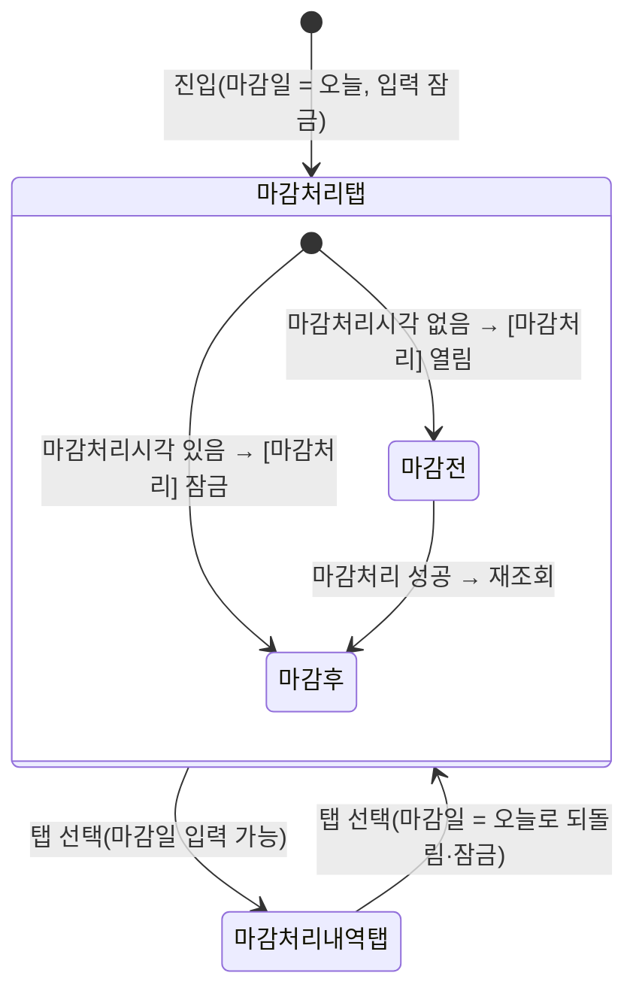

# ULDSTF09330 상장형수익증권 마감처리 — 업무 분석 및 전환 내역

| 항목 | 내용 |
|---|---|
| AS-IS 원본 | `ULDSTF09330.xml` — W-Craft 1차 변환본(`meta_asisFileNm="ULDSTF09330.gfm"`, 원본 gfm 은 저장소에 없음)에 **API 적용까지 마친 개발 사본**. 업무 로직은 이 스크립트로 분석했다. **메뉴 본화면**(`sub_contents`, 팝업 아님), 탭 2개 「마감처리」·「마감처리내역」 |
| 신규 API 명세 | 없음 — **화면에 적용된 `/api/...` 경로·method·dataCollection keyInfo 를 명세로 간주**(사용자 결정 2026-10-29 준용). 적용 API 5종(`/api/listing/lstproc/pf/new-listing-closing/` 아래): `GET next-bz-day`·`GET closing-status`·`GET select-list`·`GET select-list-hist`·`POST closing-procsss`. §5 는 「화면 적용 API ↔ 개발 사본 호출」 대응표. `api_spec_check` 는 SKIP(A07·A08 형식 검사만) |
| 화면 캡처 | 없음 |
| 퍼블리싱 파일 | 화면 폴더 `ULDSTF09330.xml` 의 body 를 1단계 기준으로 했다(선례 ULDBNS30400 「캡처 없음, 기존 마크업 정비」). publish 원본 `conversion/publish/상장/상장처리(대내)/ULDSTF09330.xml` 은 참고만 했다 — 라벨·구성은 같고 publish 원본에만 breadcrumb 목업과 페이지 제목이 있다(§10 #7) |
| TO-BE | `conversion/conversion-front/ui-tobe/ULDSTF09330.xml` (배포 경로 `/ui/lst/pf/ULDSTF09330.xml` — pf 묶음 원본 리터럴 기준, §10 #6). 1단계: 기존 마크업 정비(본화면 `sub_contents` + contentHeader, 조회조건 `schbox`, 탭 2개(`alwaysDraw="true"`) 각 그리드 + 총건수·엑셀, 하단 [재마감처리]·[마감처리] — [닫기] 없음), 2단계: 스크립트 재전환 |
| 묶음 계약 | pf 21본 공통 계약서(잡 임시 `pf_contracts.md`) — 이 화면은 **호출 관계가 없는 독립 화면**(계약서 §1). 공통 결정 §4(결과서 표기·중복 id·규칙 42·46·48) |
| 업무공통 | gcc: `$c.sbm.executeDynamic`·`$c.date`(`checkCalendarFormat`·`getServerDateTime`)·`$c.win`(`alert`·`confirm`·`setEnterKeyEvent`·`getProgramId`)·`$c.data`(`getMessage`·`downloadGridViewExcel`)·`$c.session.getUserInfo`·`$c.util.isEmpty`·`$c.exception.handleError`. pcc(`cm/pcc/stf`): `$c.stf.getMessageParam`·`fillGridHeaderTotalCnt`. 게이트는 `--pcc stf` |
| 선례 | `ULDSTF70016`·`ULDSTF08200`(마감처리 — 같은 탭 2개 구조, `alwaysDraw` + init 제어, 규칙 45 예외) |
| 작성 | Inswave / 2026-10-30 |

참고 양식: [websquare_gfm_conversion.md](../../../../md/websquare_gfm_conversion.md) — §1.4 업무 프로세스 흐름. 같은 마감 업무 [ULDSTF70016.md](../ULDSTF70016/ULDSTF70016.md) 의 구성(탭 상태·버튼 상태·엑셀)을 따랐다.

---

## 1. 화면 개요

상장 담당자가 **상장형 수익증권 신규상장 종목의 당일 마감**(다음 영업 상장일에 상장할 종목 데이터 확정·송신)을 처리하고, 지난 마감일의 **마감처리내역(송신목록)** 을 확인하는 메인 화면이다.

1. 화면을 열면 마감일 = 오늘로 「마감처리」 탭을 조회한다. 마감일의 다음 영업 상장일이 상장일이 되고, 그날 상장하는 신규상장 목록이 나온다. 위쪽에는 마감상태(마감자·마감처리시각·파일전송 시작/종료)가 보인다.
2. 아직 마감 전(마감처리시각 없음)이면 [마감처리]로 마감한다. 운영자(사용자구분 `1`)는 [재마감처리]로 다시 마감할 수 있다.
3. 「마감처리내역」 탭에서는 마감일을 골라 그날의 송신목록을 본다.
4. 두 탭 모두 [엑셀다운로드]로 그리드를 파일로 받는다.

### 1.1 호출 화면 (0본)

메뉴에서 직접 여는 메인 화면이다. pf 21본·`conversion/publish`·`conversion/sample-front` 에서 이 화면ID 를 부르는 화면은 없다(계약서 §1 — 독립 화면).

### 1.2 호출 규약 (부모 → 이 화면) / 반환 규약

해당 없음 — 메인 화면이라 받는 파라미터·돌려주는 값이 없다. 탭은 이 화면 안의 `MaxTab_01`. 세션 값 `usrTpCd`(사용자구분, 원본 `scwin.pUsrTpCd`)를 쓴다.

### 1.3 이 화면이 여는 하위 팝업

해당 없음 — 하위 팝업이 없다(달력은 `w2:inputCalendar` 내장).

### 1.4 업무 프로세스 흐름

| # | 업무 | 시작 (사용자 동작·진입 조건) | 끝 (결과) | 주요 함수 | 관련 절 |
|---|---|---|---|---|---|
| 1 | 조회(마감처리 대상) | 화면 진입 / [조회]·Enter / 「마감처리」 탭 선택 | 상장일·마감상태·신규상장 목록·[마감처리] 상태 | `scwin.listSync` → `selectNextBzDay` → `selectClosingStatus` → `selectList` | §3, §5.1~§5.3 |
| 2 | 마감처리 | [마감처리] (마감 전에만 열림) | 완료 안내 → 재조회 | `scwin.closing(1)` → `scwin.closingProcess` | §5.5, §6.4 |
| 3 | 재마감처리 | [재마감처리] (운영자만 보임) | 완료 안내 → 재조회 | `scwin.closing(2)` → `scwin.closingProcess` | §5.5, §6.4 |
| 4 | 마감처리내역 조회 | 「마감처리내역」 탭 선택 / [조회]·Enter | 상장일·마감상태·송신목록 | `scwin.listSync` → `selectHist` | §5.4 |
| 5 | 엑셀다운로드 | 두 탭의 [엑셀다운로드] | 선택 탭 그리드를 파일로 | `scwin.excelDown` | §6.6 |

#### 화면 간 흐름

하위 팝업은 없다.

#### 업무 1: 조회 (마감처리 대상) — 업무 4 도 같은 흐름에서 탭만 다르다

| 단계 | 처리 | 함수 |
|---|---|---|
| 1 | 마감일 확인(8자리) | `scwin.validateSearch` |
| 2 | 다음 영업 상장일 → `dma_search.listDd` | `scwin.selectNextBzDay` |
| 3 | 마감상태 → `dma_item` | `scwin.selectClosingStatus` |
| 4 | 탭별 목록·건수, 마감처리 탭이면 버튼 상태 | `scwin.selectList` / `scwin.selectHist`, `scwin.applyTrSendButton` |

#### 업무 2·3: 마감처리 / 재마감처리

#### 업무 5: 엑셀다운로드

#### 화면 모드 상태 전이 (마감일·버튼)

[재마감처리]는 상태와 관계없이 운영자에게만 보이고 열린다(§6.3).

---

## 2. 화면 구성 및 데이터 정의

### 2.1 화면 구성

| 영역 | AS-IS (개발 사본) | TO-BE | 비고 |
|---|---|---|---|
| 머리 | `pfmContentHeader` | 같음 | 본화면 contentHeader |
| 조회조건 | `panel_Top`(schbox) — 마감일 `edt_TASK_DD`, 상장일 `edt_LIST_DD`(readOnly), 마감자 `txb_APPROV_EMP_NM`, 마감처리시각 `txb_BZ_CLS_TM`, 파일전송시작 `txb_TRNSM_STRT_TM`, 파일전송종료 `txb_TRNSM_END_TM`, 라벨 `label_1`·`label_2`·`label_3`·`label_4`·`label_6`·`label_7` | 같은 id. 마감일·상장일은 `dma_search` 바인딩, 마감상태 4칸은 `dma_item` 바인딩(readOnly) | 조회 버튼 `btn_Search` |
| 탭 | `MaxTab_01` — `panel_1`「마감처리」/`panel_2`「마감처리내역」, 본문 `panel_1_01`·`panel_2_01` | 같은 id, `ev:onchange`, 본문 `alwaysDraw="true"` | 원본 `ev:ontabclick` |
| 마감처리 탭 | 제목 `label_12`, 건수 `edt_New_Proc_TotalCnt`, `btn_ProcExcel`, 그리드 `grd_New_Proc`, 안내 `label_5`(TU 단위), `btn_ReTrSend`·`btn_TrSend`, 숨은 `btn_ProcClose` | 같은 id, `btn_ProcClose` 삭제 | §8 #6 |
| 마감처리내역 탭 | 제목 `label_10`, 건수 `edt_New_Search_TotalCnt`, `btn_SearchExcel`, 그리드 `grd_New_Search`, 숨은 `btn_SearchClose` | 같은 id, `btn_SearchClose` 삭제 | §8 #6 |

마크업 정비(1단계): W-Craft 잔재 속성(`hierarchy`·`orgid`·`userData2`·`src`·`cursor`·`meta_snippet*`) 제거, 버튼 `type="button"`, 그리드 `readOnly`·`focusMode="row"`, 그리드 자동 id `caption1`·`header1`·`gBody1`(두 그리드 중복, WS120)을 `header_grd_New_Proc`·`gBody_grd_New_Proc`·`header_grd_New_Search`·`gBody_grd_New_Search` 로(캡션 id 는 빈 값), 숨은 [닫기] 2개 삭제. 숫자 입력칸은 없다(규칙 48 대상 없음 — 마감상태 4칸은 시각·이름).

### 2.2 데이터 정의

| DataCollection | 키 | 출처 | 쓰임 |
|---|---|---|---|
| `dma_search` (신설) | `taskDd` 마감일, `listDd` 상장일 | 화면 전용 | 달력 바인딩, 조회·처리 요청 값 |
| `dma_item` | `bzClsTm` 업무마감시간, `trnsmStrtTm` 파일전송시작, `trnsmEndTm` 파일전송종료, `approvEmpNm` 마감자 | `closing-status` 응답(개발 사본 그대로) | 마감상태 표시, [마감처리] 상태 |
| `dlt_list` | `bzProcsNo`·`isuCd`·`listDd`·`isuSrtCd`·`isuKorNm`·`isuKorAbbrv`·`isuEngNm`·`isuEngAbbrv`·`listShrs`(number)·`isuPrc`(number)·`isuEngSymbl`·`declSpd`(number)·`etfReplicaMethdTpCd`·`etfReplicaMethdTpNm`·`mktpartcNo`·`earngDistrBasMmdd`·`taxTpCd`·`taxTpNm`·`pfLstNav`(number) | `select-list` 응답(그대로) | 마감처리 탭 그리드 |
| `dlt_list2` | `dlt_list` 에서 `bzProcsNo` 를 뺀 18키 | `select-list-hist` 응답(그대로) | 마감처리내역 탭 그리드 |

`next-bz-day` 응답은 target 없이 `body.listDd` 만 꺼내 `dma_search.listDd` 에 넣는다(개발 사본과 같음).

### 2.3 그리드 컬럼 대응 (개발 사본 → TO-BE)

| AS-IS 머리 id / 본문 id | TO-BE 머리 id / 본문 id | 변경 |
|---|---|---|
| `h_NO` / `NO`(hidden, 데이터 없음) | (삭제) | 행 번호는 `rowNumVisible` 이 보인다 |
| `h_BZ_PROCS_NO` / `bzProcsNo` | `h_bzProcsNo` / 같음 | 머리 id camelCase |
| `h_ISU_CD` / `isuCd` | `h_isuCd` / 같음 | |
| `h_ISU_KOR_NM` / `isuKorNm` | `h_isuKorNm` / 같음 | |
| `h_isuKorAbbrv`·`h_isuEngNm`·`h_isuEngAbbrv` | 같음 | |
| `h_LIST_DD` / `listDd` (`displayFormat="####-##-##"`) | `h_listDd` / `listDd` `dataType="date" displayFormat="yyyy-MM-dd"` | 규칙 46(텍스트 마스크 금지) |
| `h_listShrs`·`h_isuPrc` / `#,###` | 같음 | |
| `h_PF_LST_NAV`(탭 1)·`h_ETF_LST_NAV`(탭 2) / `pfLstNav` | `h_pfLstNav` / 같음 | 두 탭 머리 id 통일 |
| `h_declSpd` / `declSpd` | 같음 | |
| `h_etfReplicaMethdTpCd` / 탭 1 `etfReplicaMethdTpCd`(코드)·탭 2 `etfReplicaMethdTpNm` | `h_etfReplicaMethdTpNm` / `etfReplicaMethdTpNm`(두 탭) | §8 #4 — 탭 1 이 코드를 보이던 것을 명칭으로 |
| `h_mktpartcNo`·`h_earngDistrBasMmdd` | 같음 | 분배기준일은 월일 4자리(`…Mmdd`)라 규칙 46 대상 아님 |
| `h_과세유형` / `taxTpNm` | `h_taxTpNm` / 같음 | 한글 id 정정 |

---

## 3. 로딩 (`scwin.onpageload` → `scwin.init`)

`scwin.onpageload` 는 `scwin.init()` 호출만 한다. `scwin.init` 순서(원본 `scwin.init` 과 같다):

1. 세션 `usrTpCd` → `scwin.usrTpCd`(원본 `scwin.pUsrTpCd` 전역).
2. init 바인딩(규칙 22·37): `$c.date.checkCalendarFormat(edt_TASK_DD, "yyyyMMdd")`·`checkCalendarFormat(edt_LIST_DD, "yyyyMMdd")`(읽기 전용 달력도 — 선례 05923), `$c.win.setEnterKeyEvent(panel_Top, scwin.btn_Search_onclick)`.
3. 버튼 초기 상태 — `btn_TrSend` 잠금(마감상태 조회 뒤 정함), `scwin.applyReTrSendButton()`(운영자만).
4. `scwin.applyTabMode(0)` — 마감일 = 서버 날짜(`getServerDateTime("yyyyMMdd")`), 입력 잠금. 원본은 `MaxTab_01.setSelectedTabIndex(0)` 후 탭 0 이면 잠금.
5. `await scwin.listSync()` — 원본 `scwin.fn_list_sync()`(await 없음).

탭 본문은 `alwaysDraw="true"` 라 처음부터 그려져 있어, 탭 안 버튼(`btn_TrSend`·`btn_ReTrSend`)을 init 에서 제어한다(규칙 45 예외, 선례 08200·70016).

---

## 4. 컴포넌트 이벤트

| AS-IS | TO-BE | 동작 |
|---|---|---|
| `MaxTab_01` `ev:ontabclick` → `scwin.MaxTab_01_ontabclick(tabId, index)` | `ev:onchange` → `scwin.MaxTab_01_onchange` | 탭 상태(`applyTabMode`) → 재조회 |
| `btn_Search` → `scwin.btn_Search_onclick` | 같음 (+ 조회 영역 Enter) | `listSync` |
| `btn_TrSend` → `scwin.btn_TrSend_onclick` → `fn_trsend` | 같음 → `scwin.closing(1)` | §6.4 |
| `btn_ReTrSend` → `scwin.btn_ReTrSend_onclick` → `fn_re_trsend` | 같음 → `scwin.closing(2)` | §6.4 |
| `btn_ProcExcel` → `scwin.btn_ProcExcel_onclick` → `fn_ExcelDown` | 같음 → `scwin.excelDown` | §6.6 |
| `btn_SearchExcel` → `scwin.btn_SearchExcel_onclick` → `fn_ExcelDown` | 같음 → `scwin.excelDown` | §6.6 |
| `btn_ProcClose`·`btn_SearchClose` → `scwin.btn_ProcClose_onclick`·`scwin.btn_SearchClose_onclick`(정의 없음) | (삭제) | §8 #6 |
| body `ev:onpageunload="scwin.onpageunload"`(정의 없음) | (삭제) | §8 #7 |

---

## 5. 서버 통신

#### 화면 적용 API ↔ 개발 사본 호출

| API (화면 적용, 명세로 간주) | 요청 | 응답 → | 개발 사본 함수 | TO-BE 함수 |
|---|---|---|---|---|
| `GET /api/listing/lstproc/pf/new-listing-closing/next-bz-day` | `{ taskDd }` | `body.listDd` → `dma_search.listDd` | `nextBzSearch` | `scwin.selectNextBzDay` |
| `GET …/closing-status` | `{ taskDd }` | `dma_item=body` | `closingSttsSearch` | `scwin.selectClosingStatus` |
| `GET …/select-list` | `{ listDd }` | `dlt_list=body` | `fn_list_sync`(탭 0) | `scwin.selectList` |
| `GET …/select-list-hist` | `{ taskDd }` | `dlt_list2=body` | `fn_list_sync`(탭 1) | `scwin.selectHist` |
| `POST …/closing-procsss` | `{ taskDd, listDd, closingTpCd }` | (정의 없음) | `fn_trsend`·`fn_re_trsend` | `scwin.closingProcess` |

모든 action 은 전체 경로 리터럴(규칙 38), `getContextPath()` 없음(규칙 39). 요청 값은 `executeDynamic(opts, requestData)` 로 넘긴다(개발 사본과 같은 꼴). 경로 끝 `closing-procsss`(s 3개)는 화면에 적용된 그대로 둔다(§10 #3).

### 5.1 다음 영업 상장일 (`scwin.selectNextBzDay`)
- 상장일을 먼저 비우고 조회, 성공이면 `body.listDd` 를 넣는다. 실패면 빈 값으로 남아 마감처리가 막힌다(§6.4 상장일 확인).

### 5.2 마감상태 (`scwin.selectClosingStatus`)
- `dma_item.setEmptyValue()` 후 조회(원본과 같음). 응답이 없으면 4칸이 비고 [마감처리]가 열린다.

### 5.3 마감처리 탭 목록 (`scwin.selectList`)
- 목록을 비우고 조회 → 건수 `edt_New_Proc_TotalCnt`(`$c.stf.fillGridHeaderTotalCnt`) → `scwin.applyTrSendButton()`. 원본은 성공일 때만 건수·버튼을 정했다 — TO-BE 는 실패해도 건수 0·버튼은 마감상태 기준(앞 조회 행이 남지 않게, §8 #5).

### 5.4 마감처리내역 탭 목록 (`scwin.selectHist`)
- 목록을 비우고 조회 → 건수 `edt_New_Search_TotalCnt`.

### 5.5 마감·재마감 (`scwin.closingProcess`)
- 요청 `{ taskDd, listDd, closingTpCd }` — `closingTpCd` 는 숫자 1(마감)·2(재마감), 원본 그대로.
- 중복 실행이면 건너뜀(`result.skipped`). 실패면 `MSG-A002`(처리명) 안내(원본은 실패 안내 없음 — §8 #3). 성공이면 `com_complete_0058` 안내 후 재조회(원본은 재조회를 기다리지 않고 안내).

---

## 6. 일반 함수

### 6.1 조회 전 확인 (`scwin.validateSearch`)
- 마감일이 8자리가 아니면 「마감일을 입력하세요.」 안내 후 포커스. 원본에는 없다 — 「마감처리내역」 탭은 마감일을 직접 지울 수 있어 빈 값 조회를 막는다(※TO-BE 보강).

### 6.2 탭 상태 (`scwin.applyTabMode`)
- 탭 0: 마감일 = 서버 날짜, 입력 잠금. 탭 1: 입력 가능(값은 유지). 원본 `MaxTab_01_ontabclick` 과 같다.

### 6.3 버튼 상태 (`scwin.applyTrSendButton`·`scwin.applyReTrSendButton`)
- [마감처리]: `dma_item.bzClsTm` 이 비었을 때만 연다(원본 `getObjectValue(txb_BZ_CLS_TM) == ""`).
- [재마감처리]: `usrTpCd === "1"`(운영자)면 보이고 열림, 아니면 숨기고 잠금. 원본은 목록 조회마다 다시 정했지만 세션 값이라 init 에서 한 번만 정한다.

### 6.4 마감·재마감 (`scwin.closing`)
- 처리명 `scwin.procJob` = 「마감처리」/「재마감처리」(원본 `fn_trsend` 는 `procJob` 을 정하지 않았다).
- 상장일이 비면 「[상장일]이 없습니다.」(※TO-BE 보강 — 선례 70016). 확인창 문구는 원본 그대로.

### 6.5 (해당 없음 — getPar/setPar·팝업 없음)

### 6.6 엑셀다운로드 (`scwin.excelDown`)
- 선택 탭 그리드 하나. 파일명 `{menuId}_{원본 이름}_{yyyyMMddHHmmss}.xlsx`(규칙 42), 원본 이름 「상장형 수익증권 신규상장 마감처리목록」/「상장형 수익증권 신규상장 송신목록」, 시트명 「리스트」. 0건 안내는 공통 함수.

---

## 7. 업무 코드 · 메시지 목록

| 구분 | 값 | 쓰는 곳 |
|---|---|---|
| 사용자구분 | `1` 운영자 | §6.3 |
| 마감 구분코드 `closingTpCd` | `1` 마감, `2` 재마감 | §5.5 |
| 탭 | 0 「마감처리」 / 1 「마감처리내역」 | §6.2 |
| 메시지 | `com_complete_0058` (`$c.data.getMessage`) | §5.5 성공 |
| 메시지 | `MSG-A002` [처리명] 처리 실패 | §5.5 실패(※TO-BE) |
| 문구 | 「마감일을 입력하세요.」 | §6.1 |
| 문구 | 「[상장일]이 없습니다.」 | §6.4 |
| 확인창 | 「[마감] 처리 하겠습니까?」 / 「[재마감] 처리 하겠습니까?」 | §6.4 |

---

## 8. 원본 특이사항 · 결함

| # | 내용 | 결정 |
|---|---|---|
| 1 | `fn_trsend` 의 `res = await $c.win.confirm(...)` — 선언 없는 전역 대입, `var` 다수 | 고침 — `const`·`await confirm` 결과로 판정 |
| 2 | `fn_list_sync` 를 `await` 없이 부름(init·처리 성공 뒤) — 재조회 전에 완료 안내가 먼저 뜸 | 고침 — `await` |
| 3 | 처리 실패 시 안내 없음, 연속 클릭 중복 전송 가능 | 고침 — `MSG-A002`, 중복 실행 건너뜀 |
| 4 | 마감처리 탭 그리드 「복제유형」 열이 코드(`etfReplicaMethdTpCd`)를 보임(내역 탭은 명칭) | 고침 — 명칭 `etfReplicaMethdTpNm`(§10 #5 확인) |
| 5 | 조회 실패 시 앞 목록·건수가 남음 | 고침 — 조회 전 목록 비움 |
| 6 | 숨은 [닫기] `btn_ProcClose`·`btn_SearchClose` 의 핸들러가 정의돼 있지 않음 | 옮기지 않음 — 본화면 [닫기] 제거(계약서 §4.4-12) |
| 7 | body `ev:onpageunload="scwin.onpageunload"` 정의 없음, `scwin.vScrenID`·`scwin.procJob`(정의만) 미사용 | 삭제 / `procJob` 은 처리명으로 사용 |
| 8 | 그리드 자동 id `caption1`·`header1`·`gBody1` 두 그리드 중복(WS120), 머리 id 한글 `h_과세유형` | 고침 — §2.1·§2.3 |
| 9 | 숨은 `NO` 열(데이터 없음)과 `rowNumVisible` 행 번호 중복 | 삭제 |
| 10 | `listDd` 텍스트 마스크 `####-##-##` | 고침 — 규칙 46 |
| 11 | 엑셀 파일명에 화면ID 리터럴 `ULDSTF09330_` | 고침 — `getProgramId()`(규칙 42) |
| 12 | `$c.stf.setObjectValue`·`getObjectValue`, `==` 비교 | 바인딩(`dma_search`·`dma_item`)·`===` |

---

## 9. 전환 내역 (AS-IS → TO-BE)

| AS-IS | TO-BE | 비고 |
|---|---|---|
| 전역 `scwin.vScrenID` | (삭제) | 미사용 |
| 전역 `scwin.procJob` | `scwin.procJob` | 처리명 |
| 전역 `scwin.pUsrTpCd` | `scwin.usrTpCd` | init 에서 세션 |
| (없음) | 상수 `scwin.TAB_PROC`·`scwin.TAB_HIST`·`scwin.USR_TP_OPERATOR`·`scwin.CLOSING_TP_CLS`·`scwin.CLOSING_TP_RECLS` | 리터럴에 이름 |
| `scwin.onpageload` → `scwin.init` | 같음 | §3 |
| `scwin.MaxTab_01_ontabclick` | `scwin.MaxTab_01_onchange` + `scwin.applyTabMode` | §4, §6.2 |
| `scwin.fn_list_sync` | `scwin.listSync` → `scwin.selectList` / `scwin.selectHist` | §5 |
| `scwin.nextBzSearch` | `scwin.selectNextBzDay` | §5.1 |
| `scwin.closingSttsSearch` | `scwin.selectClosingStatus` | §5.2 |
| `scwin.fn_trsend`·`scwin.fn_re_trsend` | `scwin.closing(1|2)` → `scwin.closingProcess` | §5.5, §6.4 |
| `scwin.buttonTrSend` | `scwin.applyTrSendButton` + `scwin.applyReTrSendButton` | §6.3 |
| `scwin.fn_ExcelDown` | `scwin.excelDown` | §6.6 |
| `scwin.btn_Search_onclick`·`btn_TrSend_onclick`·`btn_ReTrSend_onclick`·`btn_ProcExcel_onclick`·`btn_SearchExcel_onclick` | 같은 이름(try/catch + `handleError`) | §4 |
| (없음) | `scwin.validateSearch` | §6.1 |

- publicInfo: 정의한 20함수 전부. 전역 상수·상태는 등재하지 않는다.
- 게이트: `gate_screen --pcc stf`·`scan_mixed_compare`(A 1건: `taskDd.length !== 8` 숫자 비교 — 의도)·`publish_gate --before 1단계 사본 --allow P20`·`api_spec_check`(명세 SKIP, A07·A08 통과)·`init_binding_check`·`wsxml_lint` 0/0, `convert.py` 고정점.

---

## 10. 남은 작업 (TODO)

1. **처리 응답** — `closing-procsss` 응답 정의가 화면에 없다. 성공은 `success` 로만 판정 — 업무 결과 코드가 따로 오는지 확인.
2. **조회 응답 0건·실패** — `next-bz-day` 가 실패하거나 `listDd` 가 비면 목록 조회를 빈 상장일로 보낸다(원본과 같음). 서버가 빈 값을 어떻게 받는지 확인.
3. **경로 철자** — `closing-procsss`(s 3개)는 개발 사본에 적용된 그대로다. 서버 경로가 `closing-process` 라면 고쳐야 한다.
4. **재마감 대상** — 재마감 요청도 `{ taskDd, listDd, closingTpCd: 2 }` — 원본 그대로. 재마감이 마감처리시각을 지우는지(→ [마감처리] 다시 열림) 서버 동작 확인.
5. **복제유형 열** — 마감처리 탭을 명칭으로 바꿨다(§8 #4). 업무상 코드를 봐야 했다면 되돌린다.
6. **배포 경로** — `/ui/lst/pf/ULDSTF09330.xml` 는 pf 묶음 원본 리터럴 기준 가정.
7. **퍼블리싱본 차이** — publish 원본의 breadcrumb·페이지 제목(`pgtbox`)은 contentHeader 로 대체, W-Craft 잔재 속성·숨은 [닫기] 제거. 캡처를 받으면 다시 대조.
8. **세션 키** — `$c.session.getUserInfo("usrTpCd")` 는 개발 사본 그대로.
9. **실화면 확인** — `alwaysDraw="true"` 탭에서 init 의 버튼 제어, 탭 전환 시 마감일 잠금/해제, 날짜 열 서버 값 8자리 여부(규칙 46).
