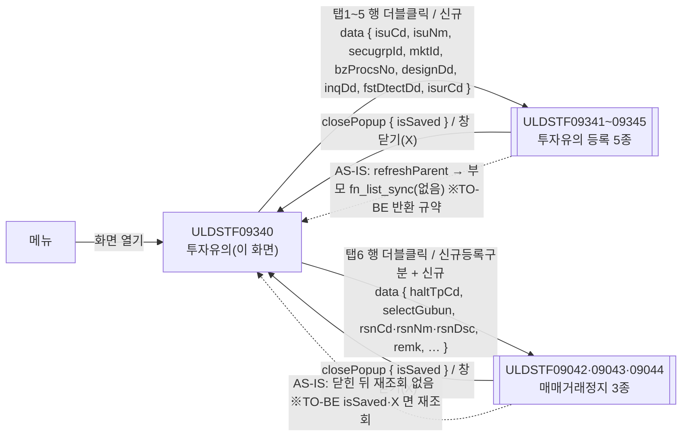
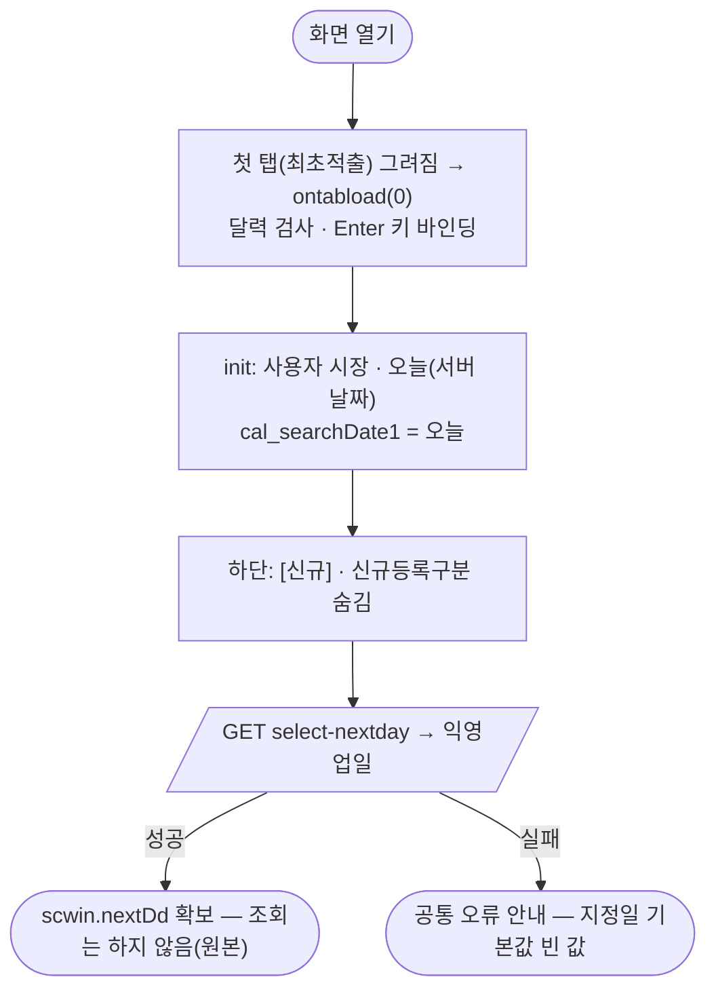
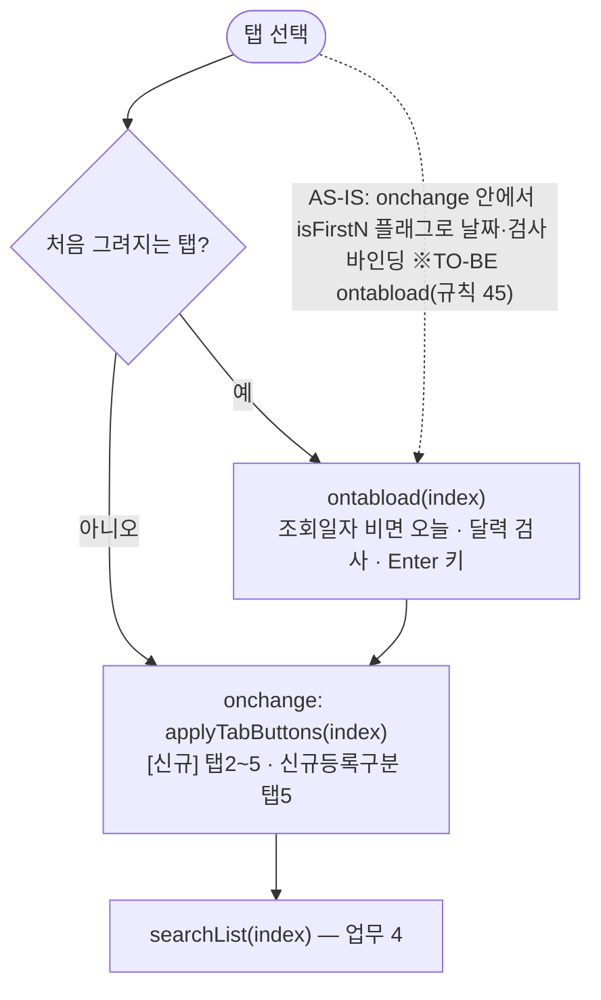
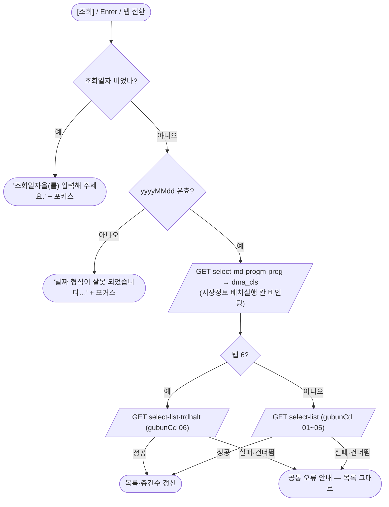
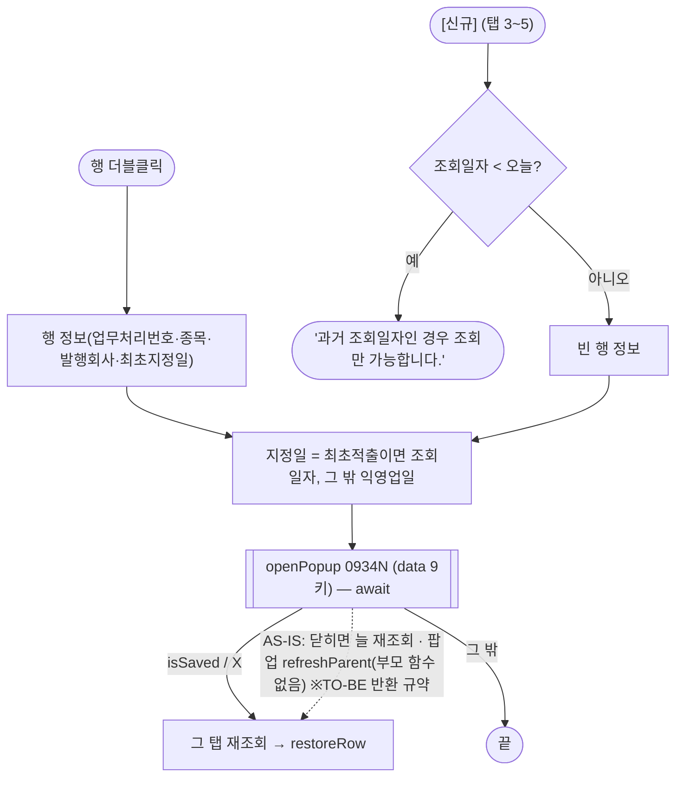
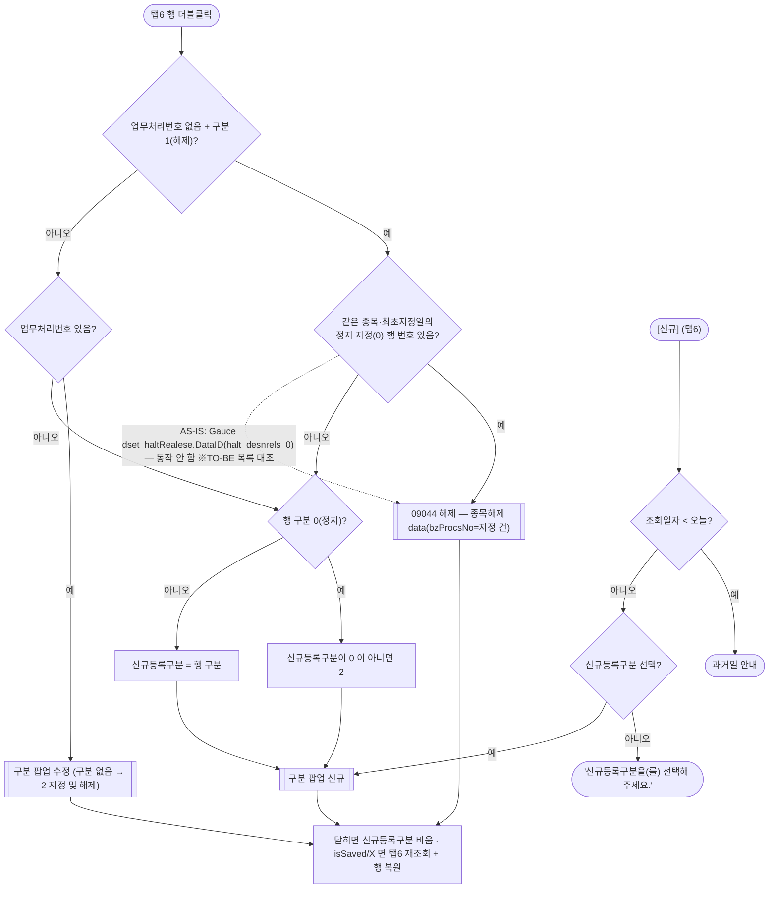
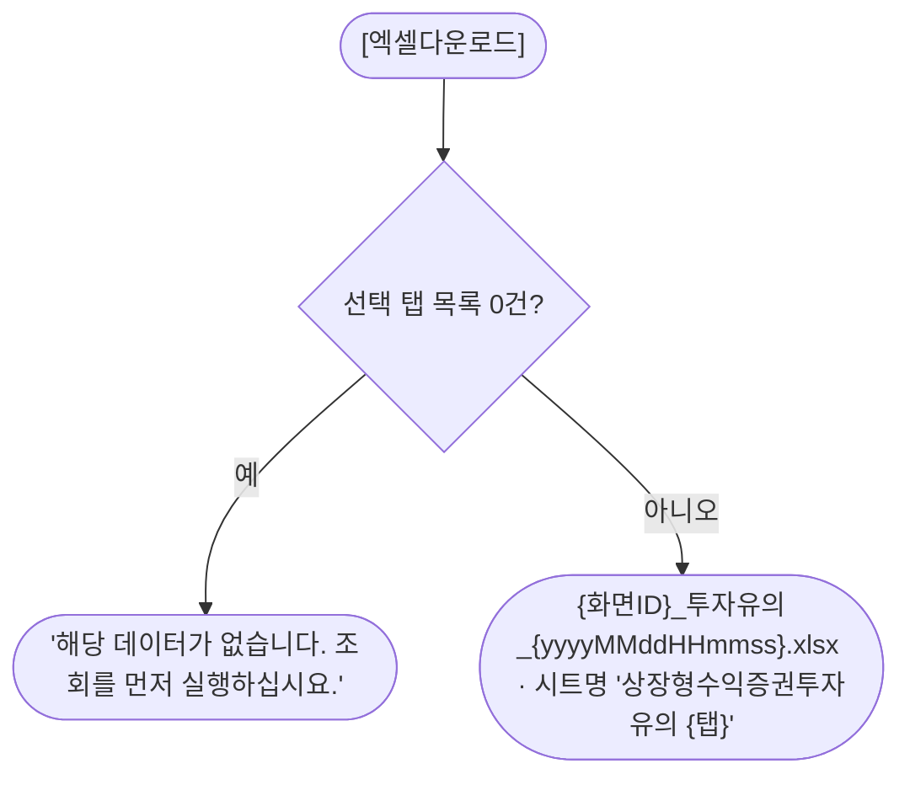

# ULDSTF09340 투자유의(상장형수익증권) — 업무 분석 및 전환 내역

| 항목 | 내용 |
|---|---|
| AS-IS 원본 | `ULDSTF09340.xml` — W-Craft 1차 변환본(`meta_asisFileNm="ULDSTF09340.gfm"`, 원본 gfm 은 저장소에 없음)에 **API 적용까지 마친 개발 사본**(2026-09-15 배성우). 업무 로직은 이 스크립트와 남은 옛 코드 주석(`arrPar[0..16]` 배열, Gauce `DataID` 조회 등)으로 분석했다. **메뉴 본화면**(팝업 아님) |
| 신규 API 명세 | 없음 — **화면에 적용된 `/api/...` 경로·method·dataCollection keyInfo 를 명세로 간주**(사용자 결정 2026-10-29 준용 — pf 공통 계약 §4.2). 적용 API 4종: `GET /api/listing/lstproc/pf/invst-warn/select-nextday`(익영업일), `GET …/select-md-progm-prog`(마감·진행상태), `GET …/select-list`(투자유의 5종 목록), `GET …/select-list-trdhalt`(매매거래정지 목록). §5 는 「화면 적용 API ↔ AS-IS」 대응표. `api_spec_check` 는 SKIP(A07·A08 형식 검사만 통과) |
| 화면 캡처 | 없음 |
| 퍼블리싱 파일 | 화면 폴더 `ULDSTF09340.xml` 의 body 를 1단계 기준으로 했다. publish 원본 `conversion/publish/상장/상장처리(대내)/ULDSTF09340.xml` 은 참고만 했다 — 레이아웃은 같고 id 만 다르다(publish `edt_search_date_N`·`pan_Cmd_N`·`img_Search_N`·`img_Excel`·`dts_N` ↔ 개발 사본 `cal_searchDateN`·`pan_cmdN`·`btn_searchN`·`btn_excel`·`dlt_selectListN`, TO-BE 는 개발 사본 id). 1단계는 선례 ULDBNS30400 처럼 「캡처 없음, 기존 마크업 정비」 — §2.1 |
| TO-BE | `conversion/conversion-front/ui-tobe/ULDSTF09340.xml` (배포 경로 `/ui/lst/pf/ULDSTF09340.xml` — 묶음 원본 리터럴 `/ui/lst/pf/` 기준). **2026-10-30 재전환** — 1단계: 기존 마크업 정비(본화면 `sub_contents` + contentHeader, 탭 6개 각각 조회조건 `schbox` + 목록 그리드, 탭 위 총건수·엑셀, 하단 시장정보 배치실행·신규등록구분·[신규]), 2단계: 이 결과서대로 스크립트 재전환. 게이트: `gate_screen --pcc stf`, `scan_mixed_compare`(A 9 숫자 비교·B 0), `publish_gate --pcc stf --before {1단계 사본} --allow P20`, `api_spec_check`(SKIP), `init_binding_check`, `wsxml_lint` 0/0, `convert.py` 고정점 |
| 묶음 계약 | pf 21본 공통 계약서(잡 임시 `pf_contracts.md`) — 09341~09345·09042~09044 data/반환 키(§2), 재조회 규약(`isSaved || isCloseButtonClick`), 공통 결정 §4. 이 화면은 **부모 쪽**이다 |
| 업무공통 | pcc(`cm/pcc/stf`): `$c.lc.getSecuGrpNm`. gcc: `$c.date`(`getServerDateTime`·`checkCalendarFormat`)·`$c.validate.isValidDate`·`$c.data`(`getMessage`·`downloadGridViewExcel`)·`$c.session.getUserInfo`·`$c.util.isEmpty`·`$c.win`(`alert`·`openPopup`·`setEnterKeyEvent`·`getProgramId`)·`$c.sbm.executeDynamic`·`$c.exception.handleError` |
| 작성 | Inswave / 2026-10-30 |

참고 양식: [websquare_gfm_conversion.md](../../../../md/websquare_gfm_conversion.md) — §1.4 업무 프로세스 흐름, §6.5 getPar/setPar 전환. 탭 컴포넌트 제어는 규칙 45(선례 [ULDSTF05950](../ULDSTF05950/ULDSTF05950.md)), 부모 쪽 재조회·행 복원은 kindstk 메뉴 본화면 [ULDSTF05100.md](../ULDSTF05100/ULDSTF05100.md) 의 결정을 따랐다.

---

## 1. 화면 개요

상장 담당자가 **상장형수익증권(PF) 투자유의** 대상 종목을 단계별로 찾아보고 등록 팝업으로 들어가는 메뉴 본화면이다. 이 화면은 저장하지 않는다.

1. 탭 6개 — **최초적출 · 지정예고 · 지정 · 지정연장 · 지정해제 · 매매거래정지 및 정지해제** — 마다 조회일자로 목록을 조회한다. 탭을 바꾸면 그 탭을 다시 조회한다. 첫 화면은 조회하지 않는다(원본 그대로).
2. 조회할 때마다 먼저 그날의 **마감·진행상태**를 받아 하단 「시장정보 배치실행」 칸에 보여 준다.
3. 투자유의 탭(1~5)의 행을 **더블클릭**하거나 **[신규]**(지정·지정연장·지정해제 탭에서 보임)를 누르면 그 탭의 등록 팝업(ULDSTF09341~09345)을 연다.
4. **매매거래정지** 탭은 행의 정지해제구분·업무처리번호와 하단 **[신규등록구분]** 으로 매매거래정지 팝업 3종(ULDSTF09042 지정 및 해제·09043 지정·09044 해제)을 고른다.
5. 팝업이 저장하고 닫히거나 창 닫기(X)로 닫히면 그 탭을 다시 조회하고 연 행을 다시 선택한다. [엑셀다운로드]는 선택된 탭 목록을 내려받는다.

### 1.1 호출 화면 (메뉴)

- 메뉴로 연다. 저장소에서 이 화면을 여는 다른 화면은 없다.
- 증권그룹은 `PF`(상장형수익증권) 고정(원본 `scwin.fr_SecuGrpId = "PF"`).

### 1.2 호출 규약 (부모 → 이 화면) / 반환 규약

해당 없음 — 메뉴 본화면이라 받는 파라미터·반환값이 없다.

### 1.3 이 화면이 여는 하위 팝업

| 팝업 | AS-IS 호출 (getPar · 부모 직접 참조) | 넘기는 `data` (TO-BE) | 받는 결과 / 취소 판정 |
|---|---|---|---|
| `ULDSTF09341` 최초적출 (800×650) · `ULDSTF09342` 지정예고 (800×650) · `ULDSTF09343` 지정 (1000×600) · `ULDSTF09344` 지정연장 (800×650) · `ULDSTF09345` 지정해제 (800×650) — 모두 `/ui/lst/pf/`, `frameModal:"top"`, `pageFramePopup` | `grd_N_oncelldblclick`·`btn_regist_onclick` → `fn_GetParNew`/`fn_GetParUpdate` 로 평면 객체를 채워 `fn_new_create_frame_1~5(param)` → `openPopup`. 닫힌 뒤 **늘** `btn_searchN_onclick` 재조회. 팝업은 저장 뒤 `scwin.refreshParent()` 로 부모 `fn_list_sync` 를 불렀는데 이 화면엔 그 함수가 없다(동작 안 함 — 계약 §4.4 #10) | `{ isuCd, isuNm, secugrpId, mktId, bzProcsNo, designDd, inqDd, fstDtectDd, isurCd }` — 계약 §2 「09341~09345」. 원본 `fr_MktId` → **`mktId`**. 신규면 `bzProcsNo`·종목 키 `""` | `{ isSaved }`. **`isSaved === true` 또는 `isCloseButtonClick === true` 면 그 탭 재조회 + 행 복원** — §6.4 |
| `ULDSTF09043` 매매거래정지 지정 (850×800) · `ULDSTF09044` 매매거래정지 해제 (850×900) · `ULDSTF09042` 매매거래정지 지정 및 해제 (850×900) — `/ui/lst/pf/` | `fn_new_create_frame_trdHalt(arg)`·`fn_update_create_frame_trdHalt(arg, startDd)` — `arg`(0 지정·1 해제·2 지정및해제·3 지정→해제)로 팝업을 고르고 함수 안에서 `fn_GetParNewTrdHalt`/`fn_GetParUpdateTrdHalt` 로 data 를 **다시** 만든다. 닫힌 뒤 `sbx_registType` 만 초기화(재조회 없음). 신규·수정 높이가 서로 뒤바뀜(09044 820↔900, 09042 900↔820) | 신규 `{ isurCd, isurNm, secugrpId, mktId, bzProcsNo:"", haltTpCd, gubun, selectGubun:"3", fstDtectDd, designDd, inqDd, rsnCd:"424", rsnNm, rsnDsc:"", remk, isuCd, isuNm }` / 수정 같은 키에서 `rsn*`·`remk` 없음, `bzProcsNo`=행 값 / 종목해제 `{ …, bzProcsNo:정지 지정 건 번호, haltTpCd:"1", remk:안내 문구, openTyp:"new" }` — 계약 §2 「09042·09043·09044」 키 정정(`select_gubun`→`selectGubun`, `fr_MktId`→`mktId`, `arrRsn1/2/3`→`rsnCd/rsnNm/rsnDsc`, 해제 `arrRsn1/2`→`remk`/`openTyp`) | `{ isSaved }`. 닫히면 `sbx_registType` 비움 + **`isSaved`·`isCloseButtonClick` 이면 매매거래정지 탭 재조회 + 행 복원** — §6.5 |

### 1.4 업무 프로세스 흐름

흐름은 AS-IS(개발 사본) 동작 기준이다. 점선과 `※TO-BE` 는 전환본에서 바뀌는 곳이다(근거 §8).

| # | 업무 | 시작 (사용자 동작·진입 조건) | 끝 (결과) | 주요 함수 | 관련 절 |
|---|---|---|---|---|---|
| 1 | 진입·로딩 | 메뉴에서 화면 열기 | 첫 탭 조회일자 = 오늘, 익영업일 확보(조회는 안 함) | `scwin.onpageload` → `scwin.init` → `scwin.selectNextDay` | §3 |
| 2 | 탭 로드 | 탭을 처음 선택(첫 탭은 화면 열 때) | 조회일자 기본값·달력 검사·Enter 키 바인딩 | `scwin.MaxTab_1_ontabload` | §3·§4 |
| 3 | 탭 전환 | 다른 탭 선택 | 하단 버튼 갱신 + 그 탭 조회 | `scwin.MaxTab_1_onchange` → `scwin.applyTabButtons` → `scwin.searchList` | §4·§6.1 |
| 4 | 조회 | [조회] / 조회 영역 Enter | 마감상태·목록·건수 표시 / 입력 안내 | `scwin.btn_searchN_onclick` → `scwin.searchList` → `scwin.selectList`(→ `scwin.selectClsStatus`) | §5·§6.2 |
| 5 | 투자유의 등록·수정 | 탭 1~5 행 더블클릭 / [신규](탭 3~5) | 09341~09345 → (저장·X) 재조회·행 복원 / 과거일 안내 | `scwin.grd_N_oncelldblclick`·`scwin.btn_regist_onclick` → `scwin.openNew` → `scwin.openWarnPopup` → `scwin.restoreRow` | §6.3·§6.4 |
| 6 | 매매거래정지 등록·수정·해제 | 탭 6 행 더블클릭 / [신규등록구분]+[신규] | 09042~09044 → (저장·X) 재조회·행 복원 / 구분 미선택 안내 | `scwin.grd_6_oncelldblclick` → `scwin.openHaltFromRow` / `scwin.openHaltNew` → `scwin.openHaltPopup` | §6.5 |
| 7 | 엑셀 | [엑셀다운로드] | 선택 탭 목록 xlsx / 0건 안내 | `scwin.btn_excel_onclick` → `scwin.excelDown` | §6.6 |

#### 화면 간 흐름

#### 업무 1: 진입·로딩

| 단계 | 주체 | 동작 | 분기·예외 | 근거 |
|---|---|---|---|---|
| 1 | 엔진 | 첫 탭 본문을 그리고 `ontabload(0)` — init 보다 먼저 | 이 시점엔 오늘을 몰라 조회일자는 init 이 넣는다 | 규칙 45 |
| 2 | 화면 | `scwin.mktId`(세션 market)·`scwin.todayDd`(`getServerDateTime()`)·`cal_searchDate1` | — | 원본 `fr_MktId`·`fn_today_dd` |
| 3 | 화면 | `applyTabButtons(0)` | — | 원본 `init` 의 `btn_regist.hide()`·`sbx_registType.hide()` |
| 4 | 서버 | `select-nextday` | 실패는 공통 안내 | §5.1 |

#### 업무 2·3: 탭 로드 · 탭 전환

| 단계 | 주체 | 동작 | 분기·예외 | 근거 |
|---|---|---|---|---|
| 1 | 엔진 | `setActiveTab` 이 본문을 그린 뒤(`ontabload`) `onchange` 를 부른다 | 이미 그린 탭은 `ontabload` 없음 | 엔진 판독 123370~123460행 |
| 2 | 화면 | 조회일자 기본값(`setDefaultDate`)·`checkCalendarFormat`(규칙 37)·`setEnterKeyEvent(pan_cmdN)`(규칙 22) | 첫 탭은 init 이 날짜 | §3 |
| 3 | 화면 | `applyTabButtons`·`searchList` | 조회일자 검증 탈락이면 안내 후 끝 | §6.1·§6.2 |

#### 업무 4: 조회

| 단계 | 주체 | 동작 | 분기·예외 | 근거 |
|---|---|---|---|---|
| 1 | 화면 | 빈 값 → `com_req_input`, 형식 오류 → `com_date_compare_0014` | 원본은 버튼 경로가 형식 검사만 먼저 해 빈 값도 형식 안내였다 | §8 #7 |
| 2 | 서버 | 마감·진행상태 `{ progsDd, trdDd }` | 실패해도 목록 조회는 진행(원본 순서) | §5.2 |
| 3 | 서버 | 목록 `{ trdDd, secugrpId:"PF", gubunCd }` | `skipped`·실패면 `false` | §5.3 |
| 4 | 화면 | `tbx_totCnt` = 행 수 | — | — |

#### 업무 5: 투자유의 등록·수정 (탭 1~5)

| 단계 | 주체 | 동작 | 분기·예외 | 근거 |
|---|---|---|---|---|
| 1 | 화면 | 행 정보 또는 빈 값 → `buildWarnParam` | 업무처리번호 있으면 수정(원본 `fn_GetParUpdate`), 없으면 신규(`fn_GetParNew`) — 키 구성은 같다 | §6.4 |
| 2 | 팝업 | `await openPopup` | — | 계약 §2 |
| 3 | 화면 | 재조회 + 같은 종목·번호 행 선택 | 신규 버튼은 행 선택 안 함 | §6.4·§6.7 |

#### 업무 6: 매매거래정지 (탭 6)

| 단계 | 주체 | 동작 | 분기·예외 | 근거 |
|---|---|---|---|---|
| 1 | 화면 | 종목해제 판정·지정 건 번호 찾기(`findHaltDesignBzProcsNo`) | 못 찾으면 신규 해제로(원본 흐름) | §8 #4 |
| 2 | 화면 | 구분 → 팝업(`HALT_POPUPS`) | 구분이 없으면 신규등록구분 안내(원본은 빈 ID 로 열었음) | §8 #6 |
| 3 | 팝업 | `await openPopup` | — | 계약 §2 |
| 4 | 화면 | `sbx_registType` 비움 → 재조회·행 복원 | 원본은 재조회 없음 | §6.5 |

#### 업무 7: 엑셀

---

## 2. 화면 구성 및 데이터 정의

### 2.1 화면 구성 (AS-IS 요소 → TO-BE 컴포넌트)

| 영역 | AS-IS (개발 사본 id) | TO-BE | 설명 |
|---|---|---|---|
| 머리 | `pfmContentHeader`(contentHeader) | `pfmContentHeader` | 본화면 contentHeader 유지. 바깥 그룹의 `ev:onpageload="scwin.gform_onload"`(정의 없음)·`userData2` 제거 |
| 탭 위 | `tbx_totCnt`(총 n 건), `btn_excel`(`src`·`text`·`cursor` 잔재) | `tbx_totCnt`, `btn_excel`(`btn_cm download`, `type="button"`) | 탭 공용 건수·엑셀 |
| 탭 | `MaxTab_1`(`userData2` 잔재), `panel_1`~`panel_6`, 본문 `panel_1_01`~`panel_6_01` | 같은 id, 본문 `alwaysDraw` 기본(처음 선택 때 그림) | 2단계에서 `ev:onchange`·`ev:ontabload` |
| 탭별 조회조건 | `pan_cmd1`~`pan_cmd6`(`schbox`), 라벨 `lbl_search_date_1`~`lbl_search_date_6`, 달력 `cal_searchDate1`~`cal_searchDate6`, 버튼 `btn_search1`~`btn_search6` | 같은 id. 라벨 `class="req"`(필수), colgroup 4칸 + `colspan 3` → 2칸으로 단순화, 달력 표준 속성 | 조회일자 1개 |
| 탭별 목록 | `grd_1`~`grd_6`(`caption1`·`header1`·`gBody1` 이 **6개 그리드에서 중복**, 머리 열 id 대문자 `DSC_YN`·`ISU_CD`·`ISU_NM`·`FST_DTEC_DD`·`DESIGN_DD`·`LST_EMP_NM`·`BZ_PROCS_NO`·`ADD_YN`, 탭6 `COM_NM`·`HALT_DESNRELS_TP_NM`·`TRD_HALT_STRT_DD`·`TRD_HALT_END_DD_DTL`, `orgid`·`hierarchy`·`style height`·`userData2`·`asisType`) | `grd_1`~`grd_6`, `caption1`~`caption6`(값 「{탭} 목록」)·`header1`~`header6`·`gBody1`~`gBody6`, 머리 열 `h_{키}{그리드번호}`(예 `h_dscYn1`), 본문 `readOnly`, 날짜 열 규칙 46 | 열 구성은 §2.2 |
| 하단 왼쪽 | `lbl_1`(「시장정보 배치실행 :」), `ibx_clsDtl`(읽기 전용) | `lbl_clsDtl`, `ibx_clsDtl` — 2단계에서 `ref="data:dma_cls.clsYn"` | 원본은 스크립트로 `setValue` |
| 하단 오른쪽 | `tbx_registType`(「신규등록구분」), `sbx_registType`(첫 항목 값 `"(null)"`, `item=` 잔재), `btn_regist`(`btn_cm`) | `tbx_registType`, `sbx_registType`(`chooseOption` 「선택해주세요」 + 2·0·1), `btn_regist`(**`btn_cm pt`**, 규칙 41) | 매매거래정지 신규 구분 |
| (옮기지 않음) | 숨김 그룹 `txb_TotCnt_2`~`txb_TotCnt_6` | 삭제 | 스크립트가 쓰지 않는 잔재 |

- id 전수(범위 표기를 풀어 씀): `caption1` · `header1` · `gBody1` · `caption2` · `header2` · `gBody2` · `caption3` · `header3` · `gBody3` · `caption4` · `header4` · `gBody4` · `caption5` · `header5` · `gBody5` · `caption6` · `header6` · `gBody6` · `panel_1` · `panel_1_01` · `pan_cmd1` · `lbl_search_date_1` · `cal_searchDate1` · `btn_search1` · `grd_1` · `dlt_selectList1` · `panel_2` · `panel_2_01` · `pan_cmd2` · `lbl_search_date_2` · `cal_searchDate2` · `btn_search2` · `grd_2` · `dlt_selectList2` · `panel_3` · `panel_3_01` · `pan_cmd3` · `lbl_search_date_3` · `cal_searchDate3` · `btn_search3` · `grd_3` · `dlt_selectList3` · `panel_4` · `panel_4_01` · `pan_cmd4` · `lbl_search_date_4` · `cal_searchDate4` · `btn_search4` · `grd_4` · `dlt_selectList4` · `panel_5` · `panel_5_01` · `pan_cmd5` · `lbl_search_date_5` · `cal_searchDate5` · `btn_search5` · `grd_5` · `dlt_selectList5` · `panel_6` · `panel_6_01` · `pan_cmd6` · `lbl_search_date_6` · `cal_searchDate6` · `btn_search6` · `grd_6` · `dlt_selectList6` · 숨김 `txb_TotCnt_2` · `txb_TotCnt_3` · `txb_TotCnt_4` · `txb_TotCnt_5` · `txb_TotCnt_6`.

### 2.2 데이터 정의 (DataCollection)

화면에 적용된 keyInfo 를 그대로 쓴다(명세 대용). 개발 사본의 `name` 자리표(`name1`·`name2`·`name3`·`name4`·`name5`·`name6`·`name7`·`name8`·`name9`·`name10`·`name11`·`name12`·`name13`·`name16`·`name17`·`name18`)는 그리드 머리글·업무 의미로 한글 명칭을 채웠다(키·dataType 은 그대로).

| ID | 종류 | 키 (dataType 모두 text) | 용도 |
|---|---|---|---|
| `dma_cand` | dataMap | `nextDd` 익영업일 | `select-nextday` 응답 → `scwin.nextDd` |
| `dma_cls` | dataMap | `batClsYn` 배치마감여부 · `regClsYn` 등록마감여부 · `clsYn` 시장정보 배치실행 여부 | `select-md-progm-prog` 응답. `clsYn` → `ibx_clsDtl` 바인딩 |
| `dlt_selectList1`~`dlt_selectList5` | dataList | `trdDd` 거래일자 · `isuCd` 종목코드 · `isuNm` 종목명 · `fstDtecDd` 최초지정일 · `bzProcsNo` 업무처리번호 · `etpInvstwarnDesignCd` ETP투자유의지정코드 · `fstDesignDd` 최초지정일자 · `designDd` 지정일 · `dscYn` 공시검토여부 · `isurCd` 발행회사코드 · `lstEmpNm` 최종처리자 · `addYn` 구분 | `select-list` 응답(gubunCd 01~05) — 그리드 `grd_1`~`grd_5` |
| `dlt_selectList6` | dataList | 위 키 + `isurNm` 발행회사 · `haltDesnrelsTpCd` 정지해제구분코드 · `haltDesnrelsTpNm` 정지해제구분 · `trdHaltStrtDd` 매매거래정지일 · `trdHaltEndDdDtl` 매매거래해제일(상세) · `trdHaltReleasBzProcsNo` 매매거래정지해제 업무처리번호 | `select-list-trdhalt` 응답 — `grd_6` |

그리드 열(머리글 → 키):

| 그리드 | 열 |
|---|---|
| `grd_1`~`grd_5` | 공시검토여부 `dscYn`(60) · 종목코드 `isuCd`(150) · 종목명 `isuNm`(300, 왼쪽) · 최초지정일 `fstDtecDd`(100, 날짜) · {최초적출일·지정예고일·지정일·지정연장일·지정해제일} `designDd`(100, 탭5 106, 날짜) · 최종처리자 `lstEmpNm` · 업무처리번호 `bzProcsNo` · 구분 `addYn` |
| `grd_6` (`autoFitMinWidth 1330`) | 공시검토여부 `dscYn` · 종목코드 `isuCd` · 종목명 `isuNm` · 발행회사 `isurNm`(164) · 구분 `haltDesnrelsTpNm`(68) · 최초지정일 `fstDtecDd`(날짜) · 매매거래정지일 `trdHaltStrtDd`(80, 날짜) · 매매거래해제일 `trdHaltEndDdDtl`(150, 원시 값) · 최종처리자 `lstEmpNm` · 업무처리번호 `bzProcsNo`(150) · 구분 `addYn` |

- **날짜 열(규칙 46)**: AS-IS 마스크 `XXXX-XX-XX` 가 있던 `fstDtecDd`·`designDd`·`trdHaltStrtDd` 를 `dataType="date" displayFormat="yyyy-MM-dd"` 로. 개발 사본 gBody 의 `inputType="calendar"`(표시 전용인데 달력 편집기)는 `inputType="text"` 로 바꿨다. `trdHaltEndDdDtl` 은 마스크가 없고 id 가 `Dtl` 로 끝나(상세 문구일 수 있음) 원시 값 그대로 — §10 #6.
- 탭6 `TRD_HALT_*` 머리글의 `&lt;/br&gt;`(잘못된 닫는 태그)는 `&lt;br/&gt;` 로 고쳤다. 행 배경 `bgcolor:{decode(currow…)}` 잔재는 지웠다(줄무늬는 공통 CSS).

---

## 3. 로딩 (`scwin.onpageload` → `scwin.init`)

`scwin.onpageload` 는 `scwin.init()` 호출만 갖는다(try/catch → `$c.exception.handleError`). 탭 본문 안 바인딩은 규칙 45 대로 `scwin.MaxTab_1_ontabload` 에 둔다.

| 순서 | 동작 | await | 근거 |
|---|---|---|---|
| (먼저) | `MaxTab_1_ontabload(0)` — `checkCalendarFormat(cal_searchDate1)`·`setEnterKeyEvent(pan_cmd1, scwin.btn_search1_onclick)` | — | 첫 탭은 tabControl 초기화 때 그려져 init 보다 먼저(규칙 45). 원본 `init` 의 `setEnterKeyEvent(pan_cmd1~6)` 6건은 그려지지 않은 탭(2~6)에도 걸려 있었다(§8 #8) |
| 1 | `scwin.mktId = $c.session.getUserInfo("market")`, `scwin.todayDd = $c.date.getServerDateTime()`, `cal_searchDate1.setValue(todayDd)` | — | 원본 `fr_MktId`(스크립트 로드 시점)·`fn_today_dd` |
| 2 | `scwin.applyTabButtons(0)` — [신규]·신규등록구분 숨김 | — | 원본 `btn_regist.hide()`·`sbx_registType.hide()`·`tbx_registType.setValue("")` |
| 3 | `await scwin.selectNextDay()` | 예 — 지정일 기본값이 이 값 | 원본 `fn_cal_dd` |

- 첫 화면은 **조회하지 않는다** — 원본 `init` 도 조회 호출이 없다(주석 `MaxTab_1.setSelectedTabIndex(0)`). 사용자가 [조회] 또는 탭 전환으로 조회한다.
- 탭 2~6 은 처음 선택될 때 `ontabload` 가 조회일자(비어 있으면 오늘)·달력 검사(규칙 37)·Enter 키(규칙 22)를 건다(원본 `onchange` 의 `isFirstN` 분기).

---

## 4. 컴포넌트 이벤트

| AS-IS 바인딩 | TO-BE 핸들러 | 동작 |
|---|---|---|
| body `ev:onpageload` | `scwin.onpageload` | §3 |
| body `ev:onpageunload` → `scwin.onpageunload`(빈 함수) | (삭제) | 할 일 없음 |
| 바깥 그룹 `ev:onpageload="scwin.gform_onload"`(정의 없음) | (삭제) | 잔재 |
| (없음) | `MaxTab_1` `ev:ontabload` → `scwin.MaxTab_1_ontabload` | 탭 로드 바인딩(규칙 45) |
| `MaxTab_1` onchange → `scwin.MaxTab_1_onchange` | `scwin.MaxTab_1_onchange` | `applyTabButtons` + `searchList` |
| `btn_search1`~`btn_search6` onclick → `scwin.btn_search1_onclick`~`scwin.btn_search6_onclick` | 같은 이름 | `searchList(0~5)` |
| `grd_1`~`grd_5` oncelldblclick → `scwin.grd_1_oncelldblclick`~`scwin.grd_5_oncelldblclick` | 같은 이름 | `openWarnPopup(index, rowIndex)` |
| `grd_6` oncelldblclick → `scwin.grd_6_oncelldblclick` | 같은 이름 | `openHaltFromRow(rowIndex)` |
| `btn_regist` onclick → `scwin.btn_regist_onclick` | 같은 이름 | `openNew` |
| `btn_excel` onclick → `scwin.btn_excel_onclick` | 같은 이름 | `excelDown` |
| 그리드 `userData2` 의 `ondblclick:grd_N_OnDblClick`, 탭 `onselchanged:MaxTab_1_OnSelChanged` | (삭제) | Gauce 잔재(정의 없음) |

---

## 5. 서버 통신

화면에 적용된 API 를 명세로 본다(머리 표). AS-IS(Gauce) 의 옛 호출은 주석으로 남은 `listingCommon.do?method=listGeneral`(오늘 날짜 `invstwarn_today_dd`, 종목해제 `halt_desnrels_0`)이다.

| 화면 적용 API | method | 요청 | 응답 target | AS-IS | TO-BE 함수 |
|---|---|---|---|---|---|
| `/api/listing/lstproc/pf/invst-warn/select-nextday` | GET | 없음 | `dma_cand=body` | `fn_cal_dd` | `scwin.selectNextDay` (§5.1) |
| `/api/listing/lstproc/pf/invst-warn/select-md-progm-prog` | GET | `{ progsDd, trdDd }` | `dma_cls=body` | `fn_invstwarn_cls` | `scwin.selectClsStatus` (§5.2) |
| `/api/listing/lstproc/pf/invst-warn/select-list` | GET | `{ trdDd, secugrpId:"PF", gubunCd:"01"~"05" }` | `dlt_selectList1`~`5=body`, `gridview: grd_1`~`grd_5` | `fn_search_1`~`fn_search_5` | `scwin.selectList` (§5.3) |
| `/api/listing/lstproc/pf/invst-warn/select-list-trdhalt` | GET | `{ trdDd, secugrpId:"PF", gubunCd:"06" }` | `dlt_selectList6=body`, `gridview: grd_6` | `fn_search_6` | `scwin.selectList` (§5.3) |
| (옛) `listingCommon.do … invstwarn_today_dd.select` | — | — | — | `fn_today_dd` 주석 | 삭제 — `$c.date.getServerDateTime()`(개발 사본이 이미 대체) |
| (옛) `listingCommon.do … invstwarn.halt_desnrels_0.select` + `dset_haltRealese.DataID`·`reset` | — | `isuCd`·`fstDtectDd` | — | `grd_6_oncelldblclick` 종목해제 분기(**실행 코드로 남음**, `dset_haltRealese` 미정의) | 대응 API 없음 → `scwin.findHaltDesignBzProcsNo`(목록 대조)로 대체 — §8 #4, §10 #1 |

### 5.1 익영업일 (`scwin.selectNextDay`)

- `executeDynamic({ id:"sbm_nextDay", method:"get", action:".../select-nextday", target:"dma_cand=body", isProcessMsg:false })`.
- 성공이면 `scwin.nextDd = dma_cand.get("nextDd")`(원본 `scwin.calDd`). `skipped`·실패면 `false` — 지정일 기본값이 빈 값으로 팝업에 간다(원본과 같음).

### 5.2 마감·진행상태 (`scwin.selectClsStatus`)

- `executeDynamic({ id:"sbm_cls", method:"get", action:".../select-md-progm-prog", target:"dma_cls=body", isProcessMsg:false }, { progsDd : trdDd, trdDd : trdDd })`.
- `ibx_clsDtl` 이 `dma_cls.clsYn` 에 바인딩돼 있어 응답만 받으면 표시된다(원본 `ibx_clsDtl.setValue(dma_cls.get("clsYn"))`).
- 원본은 탭 index 로 조회일자 달력을 골랐다 — TO-BE 는 조회하는 탭의 값을 인자로 받는다.

### 5.3 탭 목록 (`scwin.selectList`)

- `await scwin.selectClsStatus(trdDd)` 를 먼저(원본 순서 — 결과와 상관없이 목록 조회).
- `executeDynamic({ id:"sbm_selectList{n}", method:"get", action:".../select-list"(탭6 `.../select-list-trdhalt`), target:"dlt_selectList{n}=body", gridview:"grd_{n}", isProcessMsg:false }, { trdDd, secugrpId:"PF", gubunCd })` — `gridview` 는 id 만(규칙 44), action 은 전체 경로 리터럴(규칙 38).
- 후처리: `tbx_totCnt` = 그 탭 `dlt.getRowCount()`. `skipped`·실패면 `false`(목록 그대로, 공통 안내).
- 원본 6개 함수(`fn_search_1`~`fn_search_6`)는 구분코드·목록·그리드만 달랐다 — 탭 정보표(`scwin.TABS`)로 하나로 합쳤다.

---

## 6. 일반 함수

### 6.1 하단 버튼 (`scwin.applyTabButtons`)

- [신규] `btn_regist`: 탭 index ≥ 2(지정·지정연장·지정해제·매매거래정지)에서 보이고, 최초적출·지정예고에서는 숨긴다(원본 그대로).
- 신규등록구분 `tbx_registType`(라벨)·`sbx_registType`(콤보): 매매거래정지 탭에서만 보인다. 원본은 라벨을 `setValue("")` 로 늘 비워 라벨이 한 번도 보이지 않았다 — §8 #9.

### 6.2 조회 검증 (`scwin.searchList`)

| 검사 | 조건 | 메시지 | 후처리 |
|---|---|---|---|
| 필수 | 조회일자 빈 값 | `com_req_input`(「조회일자」) — 「조회일자을(를) 입력해 주세요.」 | 달력 포커스, `false` |
| 형식 | `$c.validate.isValidDate(값)` 거짓(yyyyMMdd 8자리·실존 날짜) | `com_date_compare_0014` — 「날짜 형식이 잘못 되었습니다. 확인 후 수정해 주세요.」 | 달력 포커스, `false` |

- 통과하면 `scwin.selectList(index, 조회일자)`.
- 원본은 `$c.validate.isValidDate(v, format = "YYYYMMDD")` 로 불러 암묵적 전역 `format` 을 만들었다 — §8 #7.

### 6.3 신규 (`scwin.openNew`)

- 선택 탭의 조회일자가 오늘보다 이전이면 「과거 조회일자인 경우 조회만 가능합니다.」 안내 후 멈춤(원본은 `alert` 를 `await` 하지 않았다). 빈 조회일자도 이 안내에 걸린다(원본 그대로).
- 매매거래정지 탭 → `scwin.openHaltNew(조회일자)`(§6.5), 그 밖 → `scwin.openWarnPopup(index, -1)`(§6.4).

### 6.4 투자유의 팝업 (`scwin.openWarnPopup` · `scwin.buildWarnParam` · `scwin.getRowInfo` · `scwin.getEmptyInfo`) — getPar → `openPopup` data + `await`

- 행 정보: `getRowInfo(index, rowIndex)` — `bzProcsNo`·`isuCd`·`isuNm`·`isurCd`·`fstDtectDd`(행 `fstDtecDd`). 신규 버튼은 `getEmptyInfo()`(원본 `btn_regist_onclick` 의 전역 비우기).
- 지정일 기본값: [최초적출] 은 조회일자, 그 밖은 익영업일 `scwin.nextDd`(원본 `designDd = inqDd` / `scwin.calDd`).
- data(`buildWarnParam`, 계약 §2): `isuCd`·`isuNm`·`secugrpId`("PF")·`mktId`(원본 `fr_MktId`)·`bzProcsNo`(신규 "")·`designDd`·`inqDd`(조회일자)·`fstDtectDd`·`isurCd`. 원본 `fn_GetParNew`/`fn_GetParUpdate` 는 `bzProcsNo` 만 달랐다.
- 열기: `await $c.win.openPopup("/ui/lst/pf/" + 화면ID + ".xml", { id, popupName: "상장형수익증권 투자유의종목 " + 탭이름, width, height, frameModal:"top", type:"pageFramePopup" }, data)` — 크기는 원본 그대로(09343 만 1000×600).
- 닫힌 뒤: `res?.isSaved === true || res?.isCloseButtonClick === true` 이면 `searchList(index)` → `restoreRow(index, bzProcsNo, isuCd, rowIndex)`. 원본은 닫히면 무조건 재조회했다.

| AS-IS (`fn_GetParNew/Update` 키) | TO-BE data 키 | 값 |
|---|---|---|
| `isuCd` · `isuNm` | 같음 | 행(신규 "") |
| `secugrpId` | 같음 | `"PF"` |
| `fr_MktId` | **`mktId`** | 세션 market |
| `bzProcsNo` | 같음 | 행 / 신규 "" |
| `designDd` · `inqDd` · `fstDtectDd` · `isurCd` | 같음 | 위 규칙 |

### 6.5 매매거래정지 팝업 (`scwin.openHaltNew` · `scwin.openHaltFromRow` · `scwin.findHaltDesignBzProcsNo` · `scwin.buildHaltNewParam` · `scwin.buildHaltUpdateParam` · `scwin.buildHaltReleaseParam` · `scwin.openHaltPopup`)

- **[신규]**(`openHaltNew`): `sbx_registType` 이 비면 `com_req_select`(「신규등록구분」) 안내 + 포커스(원본 `getSelectedIndex() === 0`). 고르면 그 구분으로 신규 data.
- **행 더블클릭**(`openHaltFromRow`) — 원본 분기 그대로:
  1. 업무처리번호가 없고 구분 1(해제) → **종목해제**: 같은 종목·최초지정일의 정지 지정(구분 0) 행에서 업무처리번호를 찾아(`findHaltDesignBzProcsNo`) 09044 를 종목해제 data 로 연다. 못 찾으면 ③ 신규 해제(원본도 번호가 비면 신규로 갔다).
  2. 업무처리번호가 있으면 **수정** — 구분이 비면 2(지정 및 해제, 원본 「임시 방어로직」). 원본의 「구분 1 + 정지일 있음 → 3」 은 팝업이 09044 로 같아 따로 두지 않는다.
  3. 업무처리번호가 없으면 **신규** — 정지(0) 행은 신규등록구분이 0 이 아니면 2 로 바꾸고, 그 밖은 행 구분을 신규등록구분에 넣고 그 구분으로 연다.
- **팝업 고르기**(`openHaltPopup`): `HALT_POPUPS` — 0 `ULDSTF09043` 850×800 · 1 `ULDSTF09044` 850×900 · 2 `ULDSTF09042` 850×900(원본 신규·수정 높이 불일치를 계약 §2 로 통일). 구분이 표에 없으면 신규등록구분 안내(원본은 화면 ID 가 비어 `/ui/lst/pf/.xml` 을 열었다 — §8 #6).
- 닫힌 뒤: `sbx_registType.setValue("")`(원본 `setSelectedIndex(0)`) → `isSaved`·`isCloseButtonClick` 이면 탭6 재조회 + `restoreRow`. 원본은 재조회하지 않았다.

| data 키 | 신규(`buildHaltNewParam`) | 수정(`buildHaltUpdateParam`) | 종목해제(`buildHaltReleaseParam`) | AS-IS |
|---|---|---|---|---|
| `isurCd` · `isurNm` | 행(신규 버튼 "") | 행 | 행 | 같음 |
| `secugrpId` · `mktId` | `"PF"` · 세션 market | 같음 | 같음 | `secugrpId` · **`fr_MktId`** |
| `bzProcsNo` | `""` | 행 | 정지 지정 건 번호 | 같음 |
| `haltTpCd` | 신규등록구분 | 행 구분(빈 값 → `"2"`) | `"1"` | 같음 |
| `gubun` · `selectGubun` | `""` · `"3"` | 같음 | 같음 | `gubun` · **`select_gubun`** |
| `fstDtectDd` · `designDd` · `inqDd` | 행 · 익영업일 · 조회일자 | 같음 | 같음 | 같음 |
| `rsnCd` · `rsnNm` · `rsnDsc` | `"424"` · `"투자유의종목(상장형 수익증권)"` · `""` | — | — | **`arrRsn1` · `arrRsn2` · `arrRsn3`** |
| `remk` | 구분별 기본 문구(`HALT_REMK`) | — | 해제 안내 문구 | `remk` / 해제 **`arrRsn1`** |
| `openTyp` | — | — | `"new"` | 해제 **`arrRsn2`** |
| `isuCd` · `isuNm` | 행 | 행 | 행 | 같음(해제 경로엔 없었음) |

### 6.6 엑셀 (`scwin.excelDown`)

- 선택 탭 목록이 0건이면 `com_search_0010`(「해당 데이터가 없습니다. 조회를 먼저 실행하십시요.」, `await`).
- `$c.data.downloadGridViewExcel(그 탭 그리드, { fileName : $c.win.getProgramId() + "_투자유의_" + yyyyMMddHHmmss + ".xlsx", sheetName : "상장형수익증권투자유의 " + 탭이름 })` — 파일명 규칙 42(원본 `"ULDSTF09340_투자유의_" + 시각`, 확장자 없음). 원본 6분기 `if` 는 탭 정보로 합쳤다.

### 6.7 그 밖 보조 함수

| 함수 | 내용 |
|---|---|
| `scwin.getTabComp(index)` | 탭의 `{ cal, grd, dlt }`. 탭 본문은 처음 선택될 때 그려지므로 그 탭이 그려진 뒤에만 부른다(조회·팝업·엑셀은 모두 선택된 탭) |
| `scwin.setDefaultDate(cal)` | 오늘을 알고 달력이 비어 있으면 오늘로 |
| `scwin.restoreRow(index, bzProcsNo, isuCd, rowIndex)` | 재조회 목록에서 종목코드·업무처리번호가 같은 행 → 같은 종목 첫 행(신규 등록 뒤 번호가 생김) → 원래 행 번호 순으로 선택. 신규 버튼(-1)은 선택하지 않음 |

---

## 7. 업무 코드 · 메시지 목록

| 구분 | 값 |
|---|---|
| 증권그룹 `secugrpId` | `PF` 상장형수익증권(고정) |
| 탭 구분코드 `gubunCd` | `01` 최초적출 · `02` 지정예고 · `03` 지정 · `04` 지정연장 · `05` 지정해제 · `06` 매매거래정지 및 정지해제 |
| 정지해제구분 `haltDesnrelsTpCd` / 신규등록구분 | `0` 매매거래정지 지정 · `1` 매매거래정지 해제 · `2` 매매거래정지 및 정지해제(지정 및 해제). 원본 내부값 `3`(지정→해제)은 1 과 같은 팝업 |
| 선택 구분 `selectGubun` | `1` 종목 · `2` 발행회사 · `3` 전체(늘 3) |
| 매매거래정지 사유 | `424` 투자유의종목(상장형 수익증권) |
| 메시지 | `com_req_input`(조회일자) · `com_date_compare_0014` · `com_req_select`(신규등록구분) · `com_search_0010` · 「과거 조회일자인 경우 조회만 가능합니다.」 |
| 비고 기본 문구 | 0 지정: 「상기 종목은 시장상황급변 등으로 … 단일가매매로 거래가 재개됩니다.」 · 1 해제: 「상기 종목은 매매거래정지 사유가 해소됨에 따라 … 거래가 재개됩니다.」 · 2 지정 및 해제: 「상기 종목은 투자유의종목 지정단위기간(3매매거래일)이 … 연장될 수 있습니다.」(전문은 TO-BE `scwin.HALT_REMK`) |

---

## 8. 원본 특이사항 · 결함

| # | 내용 | 결정 |
|---|---|---|
| 1 | `scwin.vScrenID`·`scwin.fn_GetPar`·`scwin.fn_SetPar`·`scwin.select_gubun` 선언만 있고 쓰지 않음, `isFirst1`~`isFirst6` 플래그 | 옮기지 않음 — `isFirstN` 은 `ontabload`(탭마다 1회)로 대체 |
| 2 | 팝업 인자를 전역 `scwin.isurCd`·`isurNm`·`isuCd`·`isuNm`·`vBzProcsNo`·`fstDtectDd`·`inqDd`·`designDd` 에 넣고 `fn_GetPar*` 가 다시 읽음 | 고침 — 행 정보 객체를 인자로 넘긴다(`getRowInfo`) |
| 3 | 투자유의 팝업이 저장 뒤 부르는 부모 `fn_list_sync` 가 이 화면에 없다(팝업 `refreshParent` 동작 안 함) | 고침 — 반환 규약 `isSaved || isCloseButtonClick` 로 재조회(계약 §4.4 #10) |
| 4 | 종목해제 분기의 Gauce `dset_haltRealese.DataID = …halt_desnrels_0…; reset()` — `dset_haltRealese` 가 정의돼 있지 않아 실행 시 오류. 대응 API 가 화면에 없다 | 고침(대체) — 같은 목록의 정지 지정(구분 0)·같은 종목·같은 최초지정일 행 업무처리번호(`findHaltDesignBzProcsNo`). 못 찾으면 원본 흐름대로 신규 해제. §10 #1 |
| 5 | 종목해제·신규 경로에서 `fn_GetParRelease`/`fn_GetParNewTrdHalt` 로 만든 data 를 버리고, 팝업 여는 함수가 `fn_GetParUpdateTrdHalt`/`fn_GetParNewTrdHalt` 로 **다시** 만들어 넘김 — 해제 안내 문구·`"new"` 가 팝업에 가지 않았다. 수정 경로의 구분은 더블클릭 행이 아니라 `getRowPosition()` 행 | 고침 — 호출 쪽에서 만든 data 를 그대로 넘긴다(`openHaltPopup(haltTpCd, data, …)`), 구분은 더블클릭 행 |
| 6 | 구분이 빈 행을 신규로 열면 `switch` 에 맞는 경우가 없어 `popId=""` → `/ui/lst/pf/.xml` | 고침 — 신규등록구분 안내 |
| 7 | 조회 검사: [조회] 경로는 `isValidDate(v, format = "YYYYMMDD")`(암묵적 전역 `format` 생성)를 먼저 해 빈 값도 형식 안내, 탭 전환 경로는 빈 값 검사만. `== ""` 느슨한 비교 | 고침 — 두 경로 모두 빈 값 → 형식 순(`searchList`), `isValidDate(v)` |
| 8 | `init` 이 `setEnterKeyEvent(pan_cmd1~6)` 을 한꺼번에 — 탭 2~6 본문은 아직 그려지지 않았다. 달력 검사는 탭 1 만 init, 나머지는 `onchange` 첫 회 | 고침 — `ontabload` 에서 탭마다(규칙 45) |
| 9 | `tbx_registType`(「신규등록구분」 라벨)을 모든 탭에서 `setValue("")` — 라벨이 한 번도 안 보임 | 고침 — 매매거래정지 탭에서 콤보와 함께 보이고 그 밖엔 숨김 |
| 10 | 매매거래정지 팝업 신규·수정 높이 뒤바뀜(09044 820/900, 09042 900/820) | 고침 — 계약 §2 로 통일(09042 900·09043 800·09044 900) |
| 11 | 매매거래정지 팝업이 닫힌 뒤 재조회 없음 | 고침 — 반환 규약 |
| 12 | 그리드 6개가 `caption1`·`header1`·`gBody1` id 중복, 머리 열 id 대문자, gBody 날짜 열 `inputType="calendar"`, 머리글 `&lt;/br&gt;` | 고침(§2.1·§2.2) |
| 13 | `sbx_registType` 첫 항목 값이 문자열 `"(null)"`(`item=` 속성 잔재와 이중 정의) | 고침 — `chooseOption`(값 "") |
| 14 | `btn_regist_onclick` 의 과거일 `alert` 에 `await` 없음, 엑셀 0건 `alert` 도 같음 | 고침 — `await` |
| 15 | `fn_search_1`~`fn_search_6`·`fn_new_create_frame_1`~`fn_new_create_frame_5`·엑셀 6분기가 값만 다른 복붙 | 정리 — 탭 정보표(`scwin.TABS`)로 합침 |
| 16 | 숨김 입력 `txb_TotCnt_2`~`txb_TotCnt_6`, Gauce `userData2`·`src`·`cursor`·`orgid`·`hierarchy` 잔재, 바깥 그룹 `ev:onpageload="scwin.gform_onload"`(정의 없음) | 옮기지 않음 |
| 17 | `fn_GetParNewTrdHalt` 의 `return arrPar.length` — 객체라 `undefined` | 옮기지 않음 |

---

## 9. 전환 내역 (AS-IS → TO-BE)

| AS-IS | TO-BE |
|---|---|
| `scwin.onpageload` | `scwin.onpageload` → `scwin.init` |
| `scwin.onpageunload` | 삭제(빈 함수) |
| `scwin.init` | `scwin.init`(+ 탭 바인딩은 `scwin.MaxTab_1_ontabload`) |
| `scwin.fn_today_dd` | `scwin.init` 안 `$c.date.getServerDateTime()` |
| `scwin.fn_cal_dd` | `scwin.selectNextDay` |
| `scwin.fn_invstwarn_cls` | `scwin.selectClsStatus` |
| `scwin.fn_search` | `scwin.searchList` |
| `scwin.fn_search_1` · `scwin.fn_search_2` · `scwin.fn_search_3` · `scwin.fn_search_4` · `scwin.fn_search_5` · `scwin.fn_search_6` | `scwin.searchList` → `scwin.selectList`(탭 index) |
| `scwin.fn_new_create_frame_1` · `scwin.fn_new_create_frame_2` · `scwin.fn_new_create_frame_3` · `scwin.fn_new_create_frame_4` · `scwin.fn_new_create_frame_5` | `scwin.openWarnPopup` |
| `scwin.fn_new_create_frame_6` | `scwin.openHaltNew` |
| `scwin.fn_new_create_frame_trdHalt` · `scwin.fn_update_create_frame_trdHalt` | `scwin.openHaltPopup` |
| `scwin.fn_GetParNew` · `scwin.fn_GetParUpdate` | `scwin.buildWarnParam`(+ `scwin.getRowInfo`·`scwin.getEmptyInfo`) |
| `scwin.fn_GetParNewTrdHalt` | `scwin.buildHaltNewParam` |
| `scwin.fn_GetParUpdateTrdHalt` | `scwin.buildHaltUpdateParam` |
| `scwin.fn_GetParRelease` + Gauce `dset_haltRealese` | `scwin.buildHaltReleaseParam` + `scwin.findHaltDesignBzProcsNo` |
| `scwin.grd_1_oncelldblclick` ~ `scwin.grd_5_oncelldblclick` | 같은 이름 → `scwin.openWarnPopup` |
| `scwin.grd_6_oncelldblclick` | 같은 이름 → `scwin.openHaltFromRow` |
| `scwin.MaxTab_1_onchange` | `scwin.MaxTab_1_onchange`(+ `scwin.applyTabButtons`·`scwin.setDefaultDate`) |
| `scwin.btn_search1_onclick` ~ `scwin.btn_search6_onclick` | 같은 이름 → `scwin.searchList` |
| `scwin.btn_regist_onclick` | 같은 이름 → `scwin.openNew` |
| `scwin.btn_excel_onclick` | 같은 이름 → `scwin.excelDown` |
| (없음) | `scwin.getTabComp` · `scwin.restoreRow` — §6.7 |
| `scwin.fr_SecuGrpId` · `scwin.fr_MktId` · `scwin.calDd` · `scwin.todayDd` | `scwin.SECUGRP_ID` · `scwin.mktId` · `scwin.nextDd` · `scwin.todayDd` |
| `scwin.vScrenID` · `scwin.fn_GetPar` · `scwin.fn_SetPar` · `scwin.select_gubun` · `scwin.isurCd` · `scwin.isurNm` · `scwin.isuCd` · `scwin.isuNm` · `scwin.vBzProcsNo` · `scwin.fstDtectDd` · `scwin.inqDd` · `scwin.designDd` · `scwin.isFirst1`~`scwin.isFirst6` | 삭제(§8 #1·#2) |

- publicInfo: 정의한 함수 전부(내부 helper 없음). 전역 상수·상태는 등재하지 않는다.
- 핸들러·플래그 전수: `scwin.btn_search1_onclick` · `scwin.btn_search2_onclick` · `scwin.btn_search3_onclick` · `scwin.btn_search4_onclick` · `scwin.btn_search5_onclick` · `scwin.btn_search6_onclick` · `scwin.grd_1_oncelldblclick` · `scwin.grd_2_oncelldblclick` · `scwin.grd_3_oncelldblclick` · `scwin.grd_4_oncelldblclick` · `scwin.grd_5_oncelldblclick` · `scwin.grd_6_oncelldblclick` · `scwin.isFirst1` · `scwin.isFirst2` · `scwin.isFirst3` · `scwin.isFirst4` · `scwin.isFirst5` · `scwin.isFirst6`.
- TO-BE 전역(1구역, publicInfo 미등재): `scwin.SECUGRP_ID` · `scwin.POPUP_PATH` · `scwin.HALT_RSN_CD` · `scwin.HALT_RSN_NM` · `scwin.SELECT_GUBUN_ALL` · `scwin.TAB_HALT` · `scwin.TAB_NEW_FROM` · `scwin.TABS` · `scwin.HALT_POPUPS` · `scwin.HALT_REMK` · `scwin.mktId` · `scwin.todayDd` · `scwin.nextDd`.
- 게이트: `gate_screen --pcc stf` OK · `scan_mixed_compare`(A 9: `index === 0` 등 숫자 비교 — 의도, B 0) · `publish_gate --before 1단계 사본 --allow P20`(P22·P24 는 스크립트 전환분) · `api_spec_check`(명세 SKIP, A07·A08 통과) · `init_binding_check`(`ontabload` 바인딩 인정) · `wsxml_lint` 0/0, `convert.py` 고정점.

---

## 10. 남은 작업 (TODO)

1. **종목해제 업무처리번호** — 원본 Gauce `halt_desnrels_0` 조회(종목·최초지정일로 정지 지정 건 번호)에 대응하는 API 가 없다. TO-BE 는 같은 목록에서 찾으므로, 지정 건이 그 조회일자 목록에 없으면 신규 해제로 열린다. 서버에 지정 건 조회 API 가 필요한지, 또는 해제 행에 지정 건 번호(`trdHaltReleasBzProcsNo` 등)를 내려 줄 수 있는지 확인.
2. **팝업 계약 대조** — 09341~09345(묶음 A)·09042~09044(묶음 B)가 계약 §2 키(`mktId`·`selectGubun`·`rsnCd/rsnNm/rsnDsc`·`remk`·`openTyp`)로 받고 저장 성공 후 `{ isSaved }` 를 넘기는지 최종 대조.
3. **첫 화면 조회** — 원본처럼 열기만 하고 조회하지 않는다. 첫 탭을 자동 조회해야 하는지 업무 확인.
4. **[신규] 노출 탭** — 최초적출·지정예고 탭은 [신규]가 숨겨져 있다(원본). 두 단계는 행 더블클릭으로만 등록하는 것이 맞는지 확인.
5. **수정 경로 구분 정규화** — 구분이 빈 수정 건은 09042 를 열고 data `haltTpCd` 도 `"2"` 로 보낸다(원본은 빈 값 그대로). 09042 수신부와 대조.
6. **날짜 열 서버 값** — `fstDtecDd`·`designDd`·`trdHaltStrtDd` 가 8자리 `yyyyMMdd` 인지(규칙 46), `trdHaltEndDdDtl` 의 값 형식(날짜인지 상세 문구인지).
7. **익영업일 실패** — `select-nextday` 가 실패하면 지정일 기본값이 빈 값으로 팝업에 간다(원본과 같음). 팝업이 빈 값을 막는지 확인.
8. **실화면 확인** — 첫 탭 `ontabload` 가 `onpageload` 보다 먼저 오는지, 처음 여는 탭에서 `ontabload` 가 `onchange` 보다 먼저인지(엔진 판독 기준 — 이 리포는 실렌더 불가).
9. **배포 경로** — `/ui/lst/pf/ULDSTF09340.xml` 은 묶음 원본 리터럴 기준 가정.
