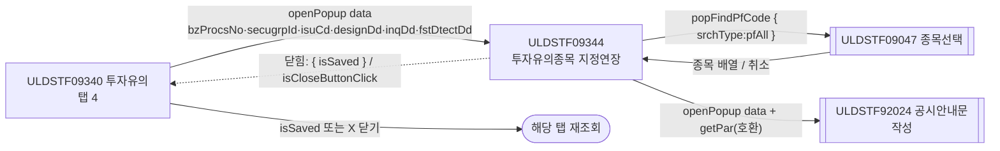
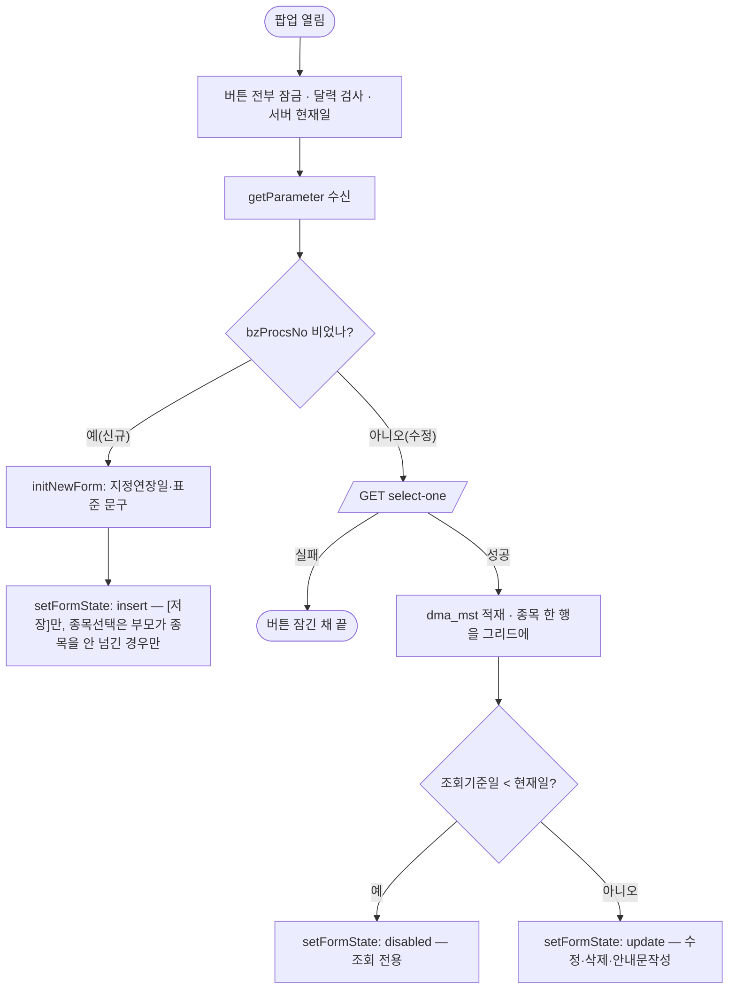
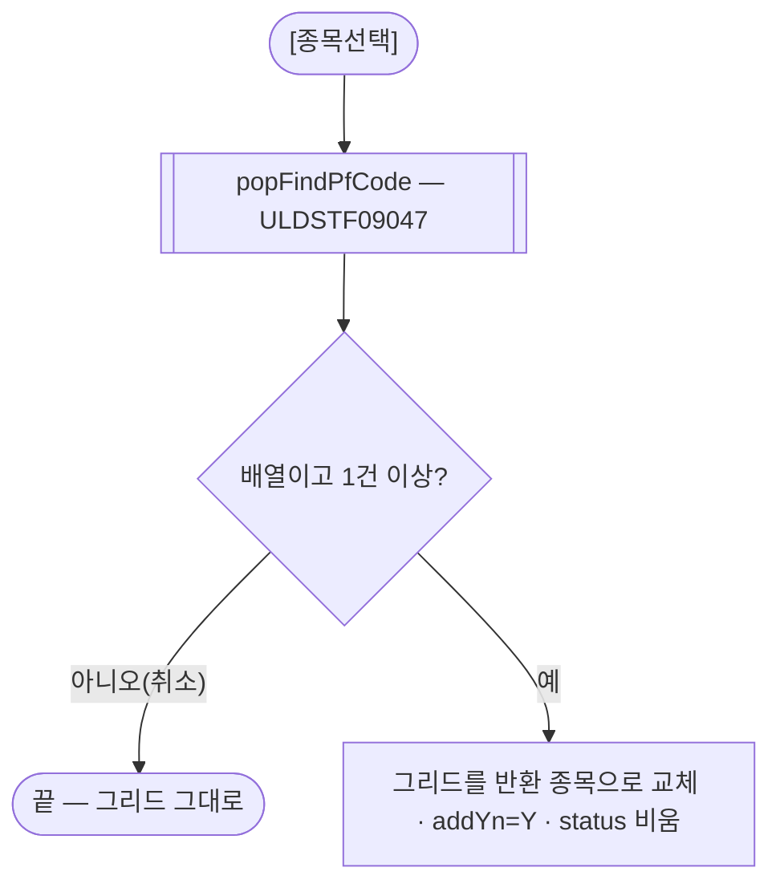
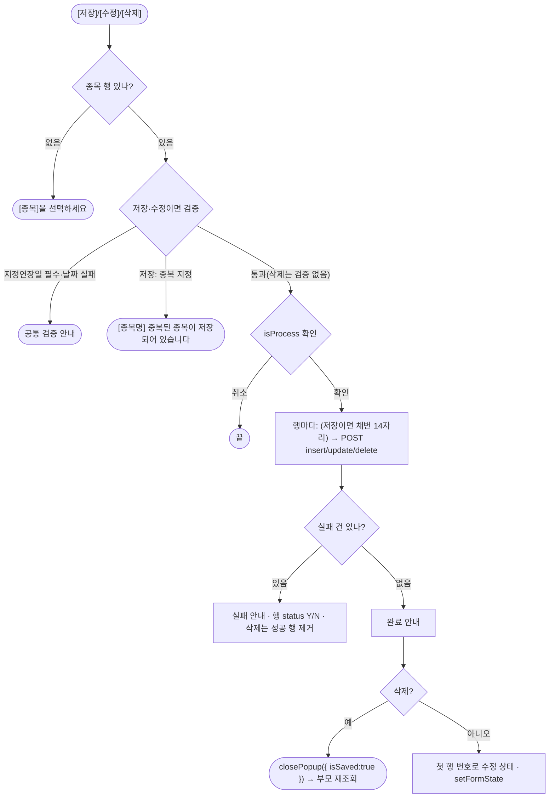
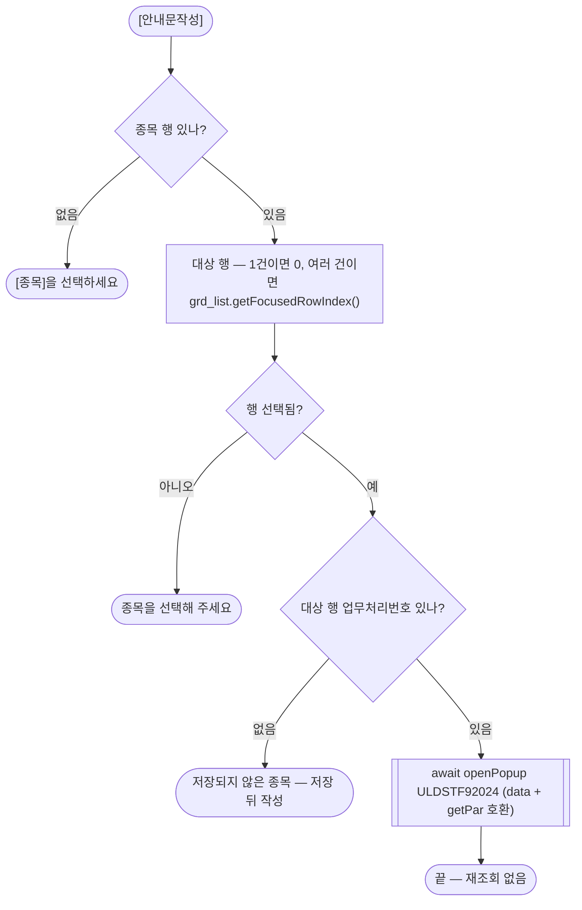
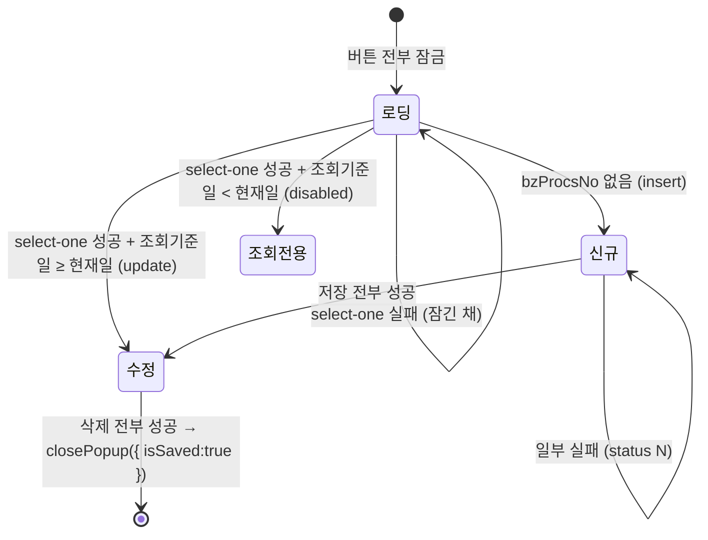

# ULDSTF09344 (팝업)투자유의종목 지정연장 — 업무 분석 및 전환 내역

| 항목 | 내용 |
|---|---|
| AS-IS 원본 | `ULDSTF09344.xml` — W-Craft 1차 변환본(원본 gfm 은 저장소에 없음)에 **API 적용까지 마친 개발 사본**. 개발 사본이 이미 현대식으로 작성됨(`meta_asisFileNm="ULDSTF05320.gfm"` — ETN 대응본 기준 작성, 2026-09-18 JSDoc·`scwin.init`·`handleError`·`$c.data.getParameter()` 수신 적용). 업무 로직은 이 스크립트와 주석으로 분석했다. 반입 `conversion/conversion-front/ui/ULDSTF09344/ULDSTF09344.xml` (pf 묶음) |
| 신규 API 명세 | 없음 — **화면에 적용된 `/api/...` 경로·method·dataCollection keyInfo 를 명세로 간주**(사용자 결정 2026-10-29 준용). §5 는 "화면 적용 API" 정리. `api_spec_check` 는 SKIP(A07·A08 형식 검사만) |
| TO-BE | `conversion/conversion-front/ui-tobe/ULDSTF09344.xml` (배포 경로 `/ui/lst/pf/ULDSTF09344.xml` — 부모 09340 원본 리터럴, 계약서 §2). **2026-10-30 정비** — 1단계: 캡처 없음 → 기존 마크업 정비(사본 `$CLAUDE_JOB_DIR/tmp/ULDSTF09344_stage1.xml`), 2단계: 스크립트 정비. 게이트: `gate_screen --pcc stf`·`scan_mixed_compare`(A 6건 — `getRowCount() === 0`·`length !== 14`·`=== 1`·`row < 0` 등 숫자 비교, 의도)·`publish_gate --before {1단계} --allow P20`(P22·P24 는 스크립트 전환분)·`api_spec_check`(SKIP)·`init_binding_check`·`wsxml_lint` 0/0, `convert.py` 고정점 |
| 퍼블리싱 파일 | 화면 폴더 `ULDSTF09344.xml` 의 body 를 1단계 기준으로 했다(선례 ULDBNS30400 "캡처 없음, 기존 마크업 정비"). **publish 원본 없음**(`conversion/publish/` 에 이 ID 가 없다) |
| 화면 캡처 | 없음 |
| 업무공통 | pcc(`cm/pcc/stf`): `$c.lc.popFindPfCode`(ULDSTF09047)·`$c.lc.isProcess`·`$c.stf.getNewBzProcNo`. gcc: `$c.data.getParameter`·`$c.data.getMessage`·`$c.date.checkCalendarFormat`·`$c.date.getServerDateTime`·`$c.validate.validateDataCollect`·`$c.util.setButtonState`·`$c.util.isEmpty`·`$c.win.alert`·`$c.win.openPopup`·`$c.win.closePopup`·`$c.sbm.executeDynamic`·`$c.exception.handleError`. 게이트는 `--pcc stf` |
| 같은 계열 | 투자유의 5본 — ULDSTF09341 최초적출 · 09342 지정예고 · 09343 지정 · 09344 지정연장 · 09345 지정해제. 다섯 화면은 독립 파일이며(공통 함수로 묶지 않음, 계약서 §4.3) 같은 구조다 — 화면별 차이는 지정구분코드·라벨·신규 기본 문구·팝업 크기뿐 |
| 작성 | Inswave / 2026-10-30 |

참고 양식: [websquare_gfm_conversion.md](../../../md/websquare_gfm_conversion.md) — §1.4, §6.5. 호출·반환 키는 pf 공통 계약서(§2 「09341~09345 투자유의 5종」, 공통 규칙의 재조회 규약)를 따른다.

---

## 1. 화면 개요

상장형 수익증권(및 ETN·ETF) 투자유의 담당자가 **투자유의(ULDSTF09340) 탭 4에서 [신규] 또는 목록 더블클릭으로 여는 입력 팝업**이다. 투자유의종목 **지정연장**(지정구분코드 `04`)를 종목 단위로 등록·수정·삭제하고 공시안내문을 작성한다.

1. 부모가 넘긴 업무처리번호가 없으면 **신규** — 지정연장일(부모가 넘긴 지정일, 없으면 현재일)과 지정연장사유·투자유의사항·기타의 표준 문구를 채우고, [종목선택]으로 고른 종목들을 그리드에 담아 [저장]한다. 종목마다 업무처리번호를 채번해 한 건씩 저장한다.
2. 업무처리번호가 있으면 **수정** — 상세를 조회해 그 종목 한 행과 입력값을 보여 주고 [수정]·[삭제]·[안내문작성]을 연다. 조회기준일이 현재일보다 앞이면 조회 전용(버튼 전부 잠금).
3. [삭제]가 전부 성공하면 팝업을 닫는다. 닫힌 뒤 부모가 해당 탭을 다시 조회한다.
4. [안내문작성]은 공시안내문작성 팝업(ULDSTF92024, 서식 `69809`)을 연다.

### 1.1 호출 화면 (1본)

| 부모 | 여는 함수 | 크기 | 근거 |
|---|---|---|---|
| ULDSTF09340 투자유의 (탭 4) | `scwin.fn_new_create_frame_4` — 신규 `fn_GetParNew`, 수정(목록 더블클릭) `fn_GetParUpdate` | 800×650 | `ui/ULDSTF09340/ULDSTF09340.xml:451-527`(열기)·`:639-680`(파라미터) |

### 1.2 호출 규약 (부모 → 이 화면) / 반환 규약

**받는 값** — `$c.data.getParameter()` 평면 객체(개발 사본 그대로, 계약서 §2)

| 키 | 09340 출처 | 이 화면에서 |
|---|---|---|
| `bzProcsNo` | 신규 `""` / 수정 `scwin.vBzProcsNo` | `scwin.bzProcsNo` — **비어 있으면 신규** |
| `secugrpId` | `scwin.fr_SecuGrpId` | 조회 조건, 상장업무유형코드 선택(`LIST_BZ_TP_CD` EN 716·EF 750·PF 816) |
| `isuCd` | 부모 목록에서 고른 종목 | 신규에서 종목선택 가능 여부 판정 — 부모가 종목을 넘기면 종목선택을 잠근다 |
| `designDd` | `scwin.designDd` | 신규 지정연장일 기본값(없으면 현재일) |
| `inqDd` | `scwin.inqDd` | 조회기준일 — 저장 전문 `basDd`, 중복 확인 기준일, 지난 날짜면 조회 전용 |
| `fstDtectDd` | `scwin.fstDtectDd` | 이미 지정된 종목(addYn≠Y)의 최초지정일 |
| `isuNm`·`isurCd`·`mktId` | 부모가 함께 보냄 | **읽지 않는다**(보내도 무해). 부모 키 `fr_MktId` 는 계약서 §2 대로 `mktId` 로 정정(부모 묶음 몫) |

**반환** — 닫힐 때 `{ isSaved : true }`(삭제 전부 성공 시 스스로 닫음). 그 밖에는 X 닫기로 `{ isCloseButtonClick : true }`. 부모는 `res?.isSaved === true || res?.isCloseButtonClick === true` 면 해당 탭을 다시 조회한다(계약서 공통 규칙 — kindstk 규약 재사용). 개발 사본의 `scwin.refreshParent`(부모 `fn_list_sync` 직접 호출)는 **부모 09340 에 그 함수가 없어** 원래도 동작하지 않던 코드라 없앴다(§8 #1). 저장·수정 성공 여부는 `scwin.isSaved` 로 남긴다.

### 1.3 이 화면이 여는 하위 팝업

| 팝업 | 넘기는 `data` | 받는 결과 / 취소 판정 |
|---|---|---|
| ULDSTF09047 종목선택(PF) — `$c.lc.popFindPfCode`(800×650) | `{ srchType : "pfAll" }` | 고른 종목 **배열**(`getInsertedJSON`, `isuCd`·`isuNm`·`isurCd`·`comNm` …). X 닫기면 `{ isCloseButtonClick }` 객체 → **배열이 아니거나 빈 배열이면 취소**(§8 #3) |
| ULDSTF92024 공시안내문작성(745×820, `pageFramePopup`) | `{ formCd:"69809", bzProcsNo, isurCd, mktId:"1", isu:[대상 행], mst:[마스터] }` + 호환용 `scwin.getPar`(§6.7) | 반환 없음 — 닫힐 때까지 `await`, 원본처럼 재조회하지 않음 |

### 1.4 업무 프로세스 흐름

#### 화면 간 흐름

#### 업무 1: 진입 (신규 / 수정)

| 단계 | 동작 | 함수 | 결과서 |
|---|---|---|---|
| 1 | 버튼 잠금·`checkCalendarFormat(edt_DesignDd)`·현재일 | `scwin.init` | §3 |
| 2 | 파라미터 수신 | `scwin.init` | §1.2 |
| 3 | 신규 기본값 | `scwin.initNewForm` | §6.1 |
| 4 | 수정 조회 | `scwin.selectOne` | §5.1 |
| 5 | 버튼·종목선택 상태 | `scwin.setFormState` | §6.2 |

#### 업무 2: 종목선택

#### 업무 3: 저장 · 수정 · 삭제

| 단계 | 동작 | 함수 | 결과서 |
|---|---|---|---|
| 1 | 검증 — 종목 행·지정연장일 필수/날짜(공통)·신규 중복 확인 | `scwin.validate`·`scwin.checkDuplicate` | §6.3·§5.2 |
| 2 | 확인 | `$c.lc.isProcess(I/U/D)` | §7 |
| 3 | 행마다 채번·전송 | `scwin.processRows`·`scwin.saveOne`·`scwin.copyRowToMap` | §6.4·§5.3·§6.5 |
| 4 | 결과 안내·닫기·상태 | `scwin.processRows` | §6.4 |

#### 업무 4: 공시안내문작성

#### 화면 모드 상태 전이

---

## 2. 화면 구성 및 데이터 정의

### 2.1 화면 구성 (AS-IS 요소 → TO-BE 컴포넌트)

| AS-IS id | 종류 | TO-BE id | 비고 |
|---|---|---|---|
| `panel_Main` | `pop_contents` | `panel_Main` | 팝업 컨테이너. `meta_snippet*` 잔재 제거, **contentHeader(`pfmContentHeader`) 추가**(팝업 필수) |
| `panel_1` | `tblbox`(8칸 colgroup) | `panel_1` | 입력 표. 공통 검증 대상 범위. `w2:summary` 「투자유의종목 지정연장 입력」 |
| `label_isu` | textbox「1. 지정연장종목」 | `label_isu` | |
| `img_SetIsuCd` | trigger「종목선택」(th 안) | `img_SetIsuCd` | `src`·`hierarchy`·`orgid`·`cursor` 잔재 제거, `type="button"` |
| `grd_list` | gridView(`dlt_isuTemp`) | `grd_list` | 열 `isuCd`(종목코드)·`isuNm`(종목명)·`bzProcsNo`(업무처리번호), 머리 `h_isuCd`·`h_isuNm`·`h_bzProcsNo` |
| `header1` / `gBody1` | 그리드 머리·본문 id | `h_list` / `b_list` | 자동 id 를 고유 id 로(계약서 §4.4 — 같은 계열 화면들의 자동 id 정리와 같은 규칙) |
| `label_designdd` | textbox「2. 지정연장일」 | `label_designdd` | |
| `edt_DesignDd` | inputCalendar | `edt_DesignDd` | `dma_mst.designDd`, 규칙 37 `checkCalendarFormat` |
| `label_rsn` | textbox「3. 지정연장사유」 | `label_rsn` | |
| `txa_Rsn` | textarea | `txa_Rsn` | `dma_mst.designRsn` |
| `label_4` | textbox「4. 투자유의사항」 | `label_4` | |
| `txa_InvstwarnContn` | textarea | `txa_InvstwarnContn` | `dma_mst.etpInvstwarnContn` |
| `label_5` | textbox「5. 기타」 | `label_5` | |
| `txa_Remk` | textarea | `txa_Remk` | `dma_mst.misc` |
| `grpBtnBox` | `btnbox` > `rt` | `grpBtnBox` | 규칙 41 — [안내문작성] \| [삭제]-[수정]-[저장](`pt`) |
| `btn_dscl` | trigger「안내문작성」 | `btn_dscl` | 일반 버튼 `btn_cm` |
| `btn_delete` | trigger「삭제」 | `btn_delete` | `btn_cm pt`(개발 사본 `btn_cm `) |
| `btn_update` | trigger「수정」 | `btn_update` | `btn_cm pt` |
| `btn_save` | trigger「저장」 | `btn_save` | `btn_cm pt` |

- 숫자 입력칸 없음(규칙 48 해당 없음), 그리드 날짜 열 없음(규칙 46 해당 없음), 조회 영역(`schbox`) 없음(규칙 22 Enter 키 해당 없음).
- 하단 [닫기] 는 원래 없다(팝업 닫기 금지 규칙 충족).

### 2.2 데이터 정의 (DataCollection)

| id | 종류 | 키 (name) | 용도 |
|---|---|---|---|
| `dma_mst` | dataMap | `bzProcsNo`(업무처리번호)·`isuCd`(종목코드)·`isuNm`(종목명)·`isurCd`(발행기관코드)·`etpInvstwarnDesignCd`(투자유의종목지정구분코드)·`fstDesignDd`(최초지정일)·`designDd`(지정일)·`designRsn`(지정사유)·`etpInvstwarnContn`(투자유의사항)·`misc`(기타)·`addYn`(신규지정여부)·`basDd`(기준일)·`lstEmpNm`(최종담당자명)·`dscYn`(공시여부)·`listBzTpCd`(상장업무유형코드) — 전부 text | 상세 조회 응답(`target dma_mst=body`) 겸 저장·수정·삭제 전문(`ref dma_mst`). 입력 항목 바인딩 |
| `dlt_isuTemp` | dataList | `isuCd`(종목코드)·`isurCd`(발행기관코드)·`isuNm`(종목명)·`bzProcsNo`(업무처리번호)·`status`(처리결과(Y 성공/N 실패))·`comNm`(발행기관명)·`addYn`(신규지정여부) | 처리 대상 종목(그리드). 종목선택 반환 또는 상세 조회 종목 한 행 |
| `dma_chk` | dataMap | `dupChk`(중복여부) | 중복 지정 확인 응답 |

키는 개발 사본의 keyInfo 를 그대로 쓴다(명세 대용 — 변경 없음).

---

## 3. 로딩 (`scwin.onpageload` → `scwin.init`)

- `scwin.onpageload` 는 `scwin.init()` 만 부르고 예외를 `$c.exception.handleError` 로 넘긴다.
- `scwin.init` 단계(순서·await 근거):
  1. `$c.util.setButtonState("grpBtnBox", "disabled", scwin.BTN_MAP)` — **로딩 동안 버튼 잠금**(개발 사본에는 없음: 상세 조회가 실패하면 버튼이 XML 기본값(전부 활성)으로 남던 결함, §8 #5).
  2. `$c.date.checkCalendarFormat(edt_DesignDd, "yyyyMMdd")` — 단일 달력(규칙 37). `scwin.curDate = $c.date.getServerDateTime("yyyyMMdd")`.
  3. `$c.data.getParameter() ?? {}` 로 §1.2 키 수신.
  4. 업무처리번호가 없으면 `scwin.initNewForm()` → `scwin.setFormState()` 후 끝.
  5. 있으면 `await scwin.selectOne()` — 조회가 끝나야 버튼 상태를 정할 수 있어 await.
- `init_*` 분리 없음(규칙: 초기화는 `scwin.init` 하나).

---

## 4. 컴포넌트 이벤트

| 컴포넌트 | 이벤트 | TO-BE 핸들러 | 동작 |
|---|---|---|---|
| body | `onpageload` | `scwin.onpageload` | §3 |
| `img_SetIsuCd` | onclick | `scwin.img_SetIsuCd_onclick` | 종목선택 팝업 → 그리드 교체(§1.3, 업무 2) |
| `btn_save` | onclick | `scwin.btn_save_onclick` | `scwin.save` |
| `btn_update` | onclick | `scwin.btn_update_onclick` | `scwin.update` |
| `btn_delete` | onclick | `scwin.btn_delete_onclick` | `scwin.remove` |
| `btn_dscl` | onclick | `scwin.btn_dscl_onclick` | `scwin.writeDscl` |

핸들러마다 `try/catch` + `$c.exception.handleError(ex, { context : "ULDSTF09344.{핸들러}" })`.

---

## 5. 서버 통신

화면 적용 API(명세 대용) — 모두 `$c.sbm.executeDynamic`, action 은 전체 경로 리터럴(규칙 38), `getContextPath()` 없음(규칙 39).

| # | 용도 | method · 경로 | 요청 | 응답 | 함수 |
|---|---|---|---|---|---|
| 5.1 | 상세 조회 | `GET /api/listing/lstproc/pf/invst-warn/select-one` | `{ secugrpId, gubunCd : "04", bzProcsNo }` | `dma_mst=body` | `scwin.selectOne` |
| 5.2 | 중복 지정 확인 | `GET /api/listing/lstproc/pf/invst-warn/select-duplicate` | `{ etpInvstwarnDesignCd : "04", basDd : inqDd, isuCd }` (행마다) | `dma_chk=body` (`dupChk === "Y"` 면 중복) | `scwin.checkDuplicate` |
| 5.3 | 저장·수정·삭제 | `POST /api/listing/lstproc/pf/invst-warn/insert` · `…/update` · `…/delete` (`application/json`) | `ref dma_mst`(행마다 `copyRowToMap` 으로 채움) | 응답 정의 없음 — `responseJSON.success === true` 로 판정 | `scwin.saveOne` |
| (pcc) | 업무처리번호 채번 | `$c.stf.getNewBzProcNo()` | — | 14자리 문자열 | `scwin.processRows` |

### 5.1 상세 조회 (`scwin.selectOne`)
`dma_mst.setEmptyValue()` 뒤 조회. `success` 가 아니면 그대로 끝난다(버튼은 §3 잠금 상태 유지). 성공하면 `scwin.bzProcsNo` 를 응답 값으로 맞추고, 응답 종목을 `dlt_isuTemp` 한 행으로 둔 뒤 `scwin.setFormState()`. 통신 오류는 공통 오류 핸들러가 안내하고 예외를 던진다.

### 5.2 중복 지정 확인 (`scwin.checkDuplicate`)
신규 저장 검증에서만 부른다. 행마다 순차 조회해 하나라도 `dupChk === "Y"` 면 「[종목명] 중복된 종목이 저장되어 있습니다.」 안내 후 `true`.

### 5.3 저장·수정·삭제 (`scwin.saveOne`)
- 처리구분 `I`/`U`/`D` → action 경로를 **전체 리터럴 3개 중에서 고른다**(개발 사본은 `"/api/…/invst-warn/" + svcId` 조립 — 규칙 38 위반, §8 #6).
- 성공한 행에만 업무처리번호를 기록하고(실패한 신규 행에 번호가 남으면 재시도 때 수정 건으로 오판) `scwin.isSaved = true`. 행 `status` 에 Y/N.
- 중복 실행: 버튼 상태(`setFormState`)와 확인창으로 막는다. 전송은 for + await 순차.

---

## 6. 일반 함수

### 6.1 신규 기본값 (`scwin.initNewForm`)
`dma_mst.setEmptyValue()`·`dlt_isuTemp.removeAll()` 뒤 지정연장일(`designDd` — 부모 값, 없으면 현재일)과 표준 문구를 넣는다(개발 사본 문구 그대로):

- `designRsn`(3. 지정연장사유): 「투자유의종목 지정단위기간(3매매거래일) 장종료시 실시간 괴리율이 ⏎ 규정상 관리의무 비율을 1일 이상 초과에 해당」
- `etpInvstwarnContn`(4. 투자유의사항): 「투자유의종목 지정이 연장됨에 따라 지정연장일부터 새로운 투자유의종목 지정단위기간이 ⏎ 시작됩니다. 투자유의종목 지정단위기간 중 장종료시 실시간 괴리율이 규정상 의무범위를 ⏎ 1일 이상 초과하는 경우 투자유의종목 지정이 재연장될 수 있습니다. ⏎ 또한, 지정단위기간 종료일의 장종료시 실시간 괴리율이 규정상 의무범위의 3배를 이상인 경우 ⏎ 매매거래가 정지될 수 있습니다.」
- `misc`(5. 기타): 「-」

### 6.2 상태 (`scwin.setFormState`)
- 신규(업무처리번호 없음) → `insert`([저장]만). 종목선택은 **신규이면서 부모가 종목을 넘기지 않은 경우만** 연다.
- 수정 → `update`([수정]·[삭제]·[안내문작성], 저장 제외). 종목선택 잠금.
- 조회기준일 < 현재일 → `disabled`(전부 잠금), 종목선택 잠금.
- 개발 사본 주석은 「수정: 종목선택 가능」이었지만 코드는 잠근다 — 코드대로 두고 주석을 고쳤다(§8 #7).

### 6.3 검증 (`scwin.validate`)
공통: 종목 행 0건이면 「[종목]을 선택하세요.」 + `img_SetIsuCd` 포커스. `$c.validate.validateDataCollect(panel_1, { fields : { edt_DesignDd : { required, format:"date", name:"지정연장일" } } })`. 업무: 신규(`I`)면 `checkDuplicate`.

### 6.4 다건 처리 (`scwin.processRows`)
행마다 순차 — 신규는 `getNewBzProcNo` 채번(14자리 아니면 「업무처리번호생성」 실패 안내·status N·다음 행). 한 건이라도 실패하면 실패 안내, 삭제는 성공 행을 뒤에서부터 지운다(변환기가 `setBroadcast(false)`…`(true, true)` 로 감쌈). 전부 성공하면 완료 안내, 삭제는 `await $c.win.closePopup({ isSaved : true })`, 저장·수정은 첫 행 번호로 수정 상태.

### 6.5 행 → 전문 (`scwin.copyRowToMap`)
그리드 행의 `bzProcsNo`·`isuCd`·`isuNm`·`isurCd`·`addYn` + 고정값 `etpInvstwarnDesignCd`(`04`)·`listBzTpCd`(증권그룹별)·`basDd`(조회기준일)·`fstDesignDd`(addYn Y 면 이번 지정일, 아니면 `fstDtectDd`).

### 6.6 공시안내문 data (`scwin.getDsclData`)
대상 행의 `bzProcsNo`·`isurCd` 와 서식 `69809`·시장 `"1"`, 종목 `[대상 행]`, 마스터 `[dma_mst + 대상 행 종목 정보]`(다건 처리 뒤 `dma_mst` 에는 마지막 행이 남아 있어 대상 행으로 덮는다).

### 6.7 부모 ↔ 팝업 파라미터 전달 (getPar/setPar → `$c.win.openPopup` + `await`) — 필수
- **부모 → 이 화면**: 이미 `openPopup` data + `$c.data.getParameter()`(§1.2). 반환은 `{ isSaved }`/`isCloseButtonClick`(§1.2).
- **이 화면 → 하위 팝업**: 09047 은 `popFindPfCode` 가 `openPopup` + `await`(§1.3). 92024 는 `await $c.win.openPopup("/ui/listingcommon/ULDSTF92024.xml", …, scwin.getDsclData(row))`(`scwin.writeDscl`).
- **가이드 §6.5 예외 — 호환용 `scwin.getPar(arr, dltIsu, dltMst)`·`scwin.fillDataList`**: 92024 전환본(sample-front)은 아직 부모의 `scwin.getPar` 를 이름으로 불러 값을 받는다. 선례 05232·05918·kindstk 05103 처럼 `getDsclData` 를 `arr[0..3]`(서식·업무처리번호·발행기관·시장 — **4칸**, 원본 arr[4]·arr[5] 근거 없음)과 원천 dataList 2개에 채운다. 대상 행은 `scwin.dsclRow`. 92024 가 `getParameter()` 수신으로 바뀌면 둘 다 지운다(§10).

---

## 7. 업무 코드 · 메시지 목록

| 구분 | 값 | 쓰는 곳 |
|---|---|---|
| 지정구분코드 | `04` 지정연장 (계열: 01 최초적출·02 지정예고·03 지정·04 지정연장·05 지정해제) | `scwin.DESIGN_CD` — 조회 `gubunCd`·중복 확인·전문 |
| 상장업무유형코드 | EN `716` · EF `750` · PF `816` | `scwin.LIST_BZ_TP_CD` |
| 공시안내문 | 서식 `69809`, 시장 `"1"` | `scwin.DSCL_FORM_CD`·`scwin.DSCL_MKT_ID` |
| 처리구분 | `I` 저장 · `U` 수정 · `D` 삭제 | `scwin.trJob` |
| 처리결과 | `status` `Y` 성공 · `N` 실패 | 그리드 행 |
| 신규지정여부 | `addYn` `Y`(이번에 새로 지정) | `copyRowToMap` 최초지정일 |
| 메시지 | `MSG-A006`(`$c.lc.isProcess` — 「[저장/수정/삭제] 처리를 하시겠습니까?」), `com_complete_0096`(「$[0] 되었습니다.」), `com_complete_0151`(실패 — 「업무처리번호생성」/작업명), 화면 문구 「[종목]을 선택하세요.」·「종목을 선택해 주세요.」·「[종목명] 중복된 종목이 저장되어 있습니다.」·「저장되지 않은 종목입니다. 저장한 뒤 안내문을 작성하세요.」(신규, §8 #4) | |

---

## 8. 원본 특이사항 · 결함

| # | 내용 | 결정 |
|---|---|---|
| 1 | `scwin.refreshParent` 가 부모 `fn_list_sync` 를 직접 부름 — 부모 09340 에 그 함수가 **없어** 동작하지 않던 코드(계약서 §4.4 #10) | **삭제** — 반환 `{ isSaved }` / X 닫기로 부모가 재조회(§1.2) |
| 2 | `grd_list.getRowIndex()` — gridView 에 없는 메서드(엔진의 `getRowIndex` 는 card 계열·dataList 식 객체 것). 종목이 2건 이상일 때 [안내문작성]에서 TypeError | **고침** — `grd_list.getFocusedRowIndex()` |
| 3 | 종목선택 취소 판정 `isEmpty(result)` — 09047 은 X 닫기 때 `{ isCloseButtonClick }` 객체를 돌려줘 비어 있지 않음 → 그 객체를 종목 한 행으로 넣음 | **고침** — 배열이 아니거나 빈 배열이면 취소 |
| 4 | [안내문작성]이 「추후 편집기 적용예정(TODO)」 안내만 띄움 | **고침** — 92024 를 실제로 연다(§6.7). 저장되지 않은 행(일부 실패한 다건 저장 뒤)은 안내하고 막는다 |
| 5 | 로딩 중 버튼 기본값이 전부 활성 — 상세 조회 실패 시 그대로 남음 | **고침** — init 첫 단계에서 `disabled` |
| 6 | 저장·수정·삭제 action 을 `"/api/…/invst-warn/" + svcId` 로 조립 | **고침** — 전체 경로 리터럴 3개 중 선택(규칙 38) |
| 7 | `setFormState` 주석 「수정: 종목선택 가능」 ↔ 코드는 잠금 | 코드 유지, 주석 정정 |
| 8 | 그리드 자동 id `header1`·`gBody1` | `h_list`·`b_list`(계약서 §4.4) |
| 9 | 트리거의 `src`·`text`·`hierarchy`·`orgid`·`cursor`, `meta_snippet*` 잔재, 삭제 버튼 class `"btn_cm "`(끝 공백) | 정리 — 규칙 41 로 `btn_cm pt` |
| 10 | `scwin.screenId` — 정의만 있고 쓰지 않음 | 삭제 |

---

## 9. 전환 내역 (AS-IS → TO-BE)

| AS-IS(개발 사본) | TO-BE | 비고 |
|---|---|---|
| `scwin.onpageload` | `scwin.onpageload` | 그대로 |
| `scwin.init` | `scwin.init` | 버튼 잠금·`checkCalendarFormat`(규칙 37) 추가, 서버일 형식 명시 |
| `scwin.initNewForm` | `scwin.initNewForm` | 그대로(변환기가 5구역으로 배치) |
| `scwin.img_SetIsuCd_onclick` | `scwin.img_SetIsuCd_onclick` | 취소 판정 정정(§8 #3), 주석 처리된 파라미터 잔재 제거 |
| `scwin.btn_save_onclick`·`btn_update_onclick`·`btn_delete_onclick`·`btn_dscl_onclick` | 같은 이름 | 그대로 |
| `scwin.selectOne` | `scwin.selectOne` | 그대로 |
| `scwin.checkDuplicate` | `scwin.checkDuplicate` | 그대로 |
| `scwin.saveOne` | `scwin.saveOne` | action 리터럴(§8 #6), `scwin.isSaved` 기록 |
| `scwin.setFormState` | `scwin.setFormState` | 주석 정정 |
| `scwin.validate`·`scwin.save`·`scwin.update`·`scwin.remove` | 같은 이름 | 그대로 |
| `scwin.processRows` | `scwin.processRows` | `refreshParent` 호출 삭제, 삭제 성공 시 `closePopup({ isSaved : true })` + await |
| `scwin.copyRowToMap` | `scwin.copyRowToMap` | 그대로 |
| `scwin.writeDscl` | `scwin.writeDscl` + `scwin.getDsclData` | 92024 실제 호출(§8 #4), `getFocusedRowIndex`(§8 #2) |
| `scwin.refreshParent` | 삭제 | §8 #1 |
| (없음) | `scwin.getPar`·`scwin.fillDataList` | 92024 호환용 임시(§6.7) |
| `scwin.screenId` | 삭제 | 미사용 |
| (없음) | `scwin.isSaved`·`scwin.dsclRow`·`scwin.DSCL_FORM_CD`·`scwin.DSCL_MKT_ID` | 반환·92024 |

- head: `meta_screenId`·`meta_screenName`「(팝업)투자유의종목 지정연장」·`meta_desc`(끝 「(원본 W-Craft 변환본, 업무 분석 ULDSTF09344.md)」)·`meta_author`·`meta_date`, `<title>`. W-Craft 메타(`meta_convertType` 등)·`meta_screenDesc`·`meta_type`·`historyInfo` 제거.
- publicInfo: 정의한 22함수 전부(변수·상수 미등재).
- 마크업: contentHeader 추가(팝업 필수), 규칙 41 버튼 class, 자동 id 정리. 레이아웃·라벨·컴포넌트 id 는 그대로.
- 게이트: 머리 표 TO-BE 칸.

---

## 10. 남은 작업 (TODO)

1. **부모 09340 계약** — 부모 묶음(C)이 계약서 §2 대로 data(`fr_MktId` → `mktId` 정정 포함)를 넘기고, 닫힌 뒤 `isSaved || isCloseButtonClick` 이면 탭 4 를 재조회하는지 대조. 이 화면이 읽는 키는 §1.2 6개뿐.
2. **92024 수신부** — 92024 는 아직 부모 `scwin.getPar` 계약이다. `getParameter()` 수신으로 바뀌면 `scwin.getPar`·`scwin.fillDataList` 삭제. 경로 `/ui/listingcommon/ULDSTF92024.xml` 은 conversion-front 선례 기준(개발 사본 주석의 `/ui/lst/common/` 아님).
3. **92024 arr 길이** — 원본 arr[4]·arr[5] 근거가 없어 4칸(서버가 본문 생성)으로 두었다. 서식 69809 가 본문 문구(arr[4])나 공시제목(arr[5])을 받아야 하는지 확인.
4. **92024 원천 자료 키** — 종목·마스터 dataList 에 camelCase 키(`isuCd`·`designRsn` 등)로 넘긴다. 서식 69809 가 기대하는 컬럼명(대문자 AS-IS 이름일 수 있음) 확인.
5. **저장·수정·삭제 응답** — 응답 정의가 없어 `success` 만으로 판정한다. 서버가 업무 실패를 `success:true` + 별도 코드로 돌려주는지 확인.
6. **채번 경로** — `$c.stf.getNewBzProcNo` 가 주식 변경상장 채번 경로를 부른다. 투자유의도 같은 채번인지 확인(kindstk 와 같은 미결).
7. **수정 모드 입력 잠금** — 조회 전용(조회기준일 경과)이어도 입력칸은 잠그지 않는다(개발 사본과 같음, 버튼만 잠금). 잠글지 업무 확인.
8. **안내문작성 전 미저장 변경 확인** — 선례(05918 `MSG-0022`)처럼 고친 입력을 저장하지 않고 안내문을 작성하는 경우를 막을지 확인(개발 사본에 없음).
9. **신규 안내 문구** — 「저장되지 않은 종목입니다. 저장한 뒤 안내문을 작성하세요.」는 이번에 새로 둔 화면 문구다. 표준 메시지 코드로 바꿀지 확인.
