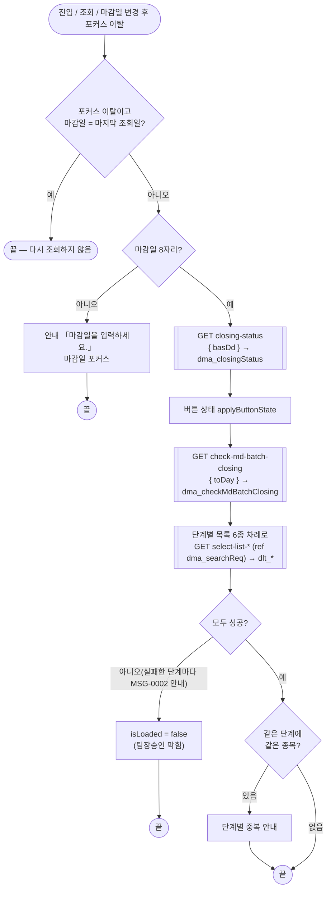
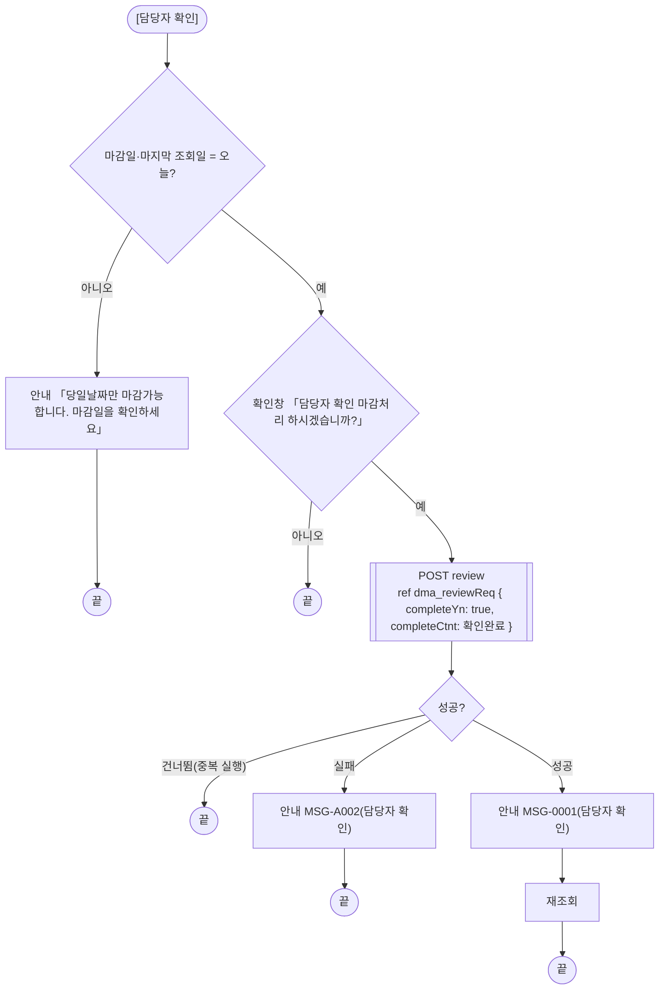
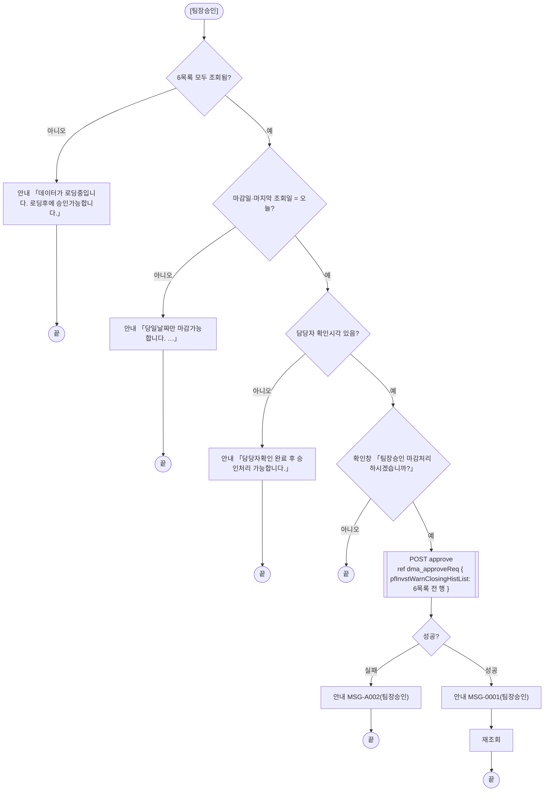
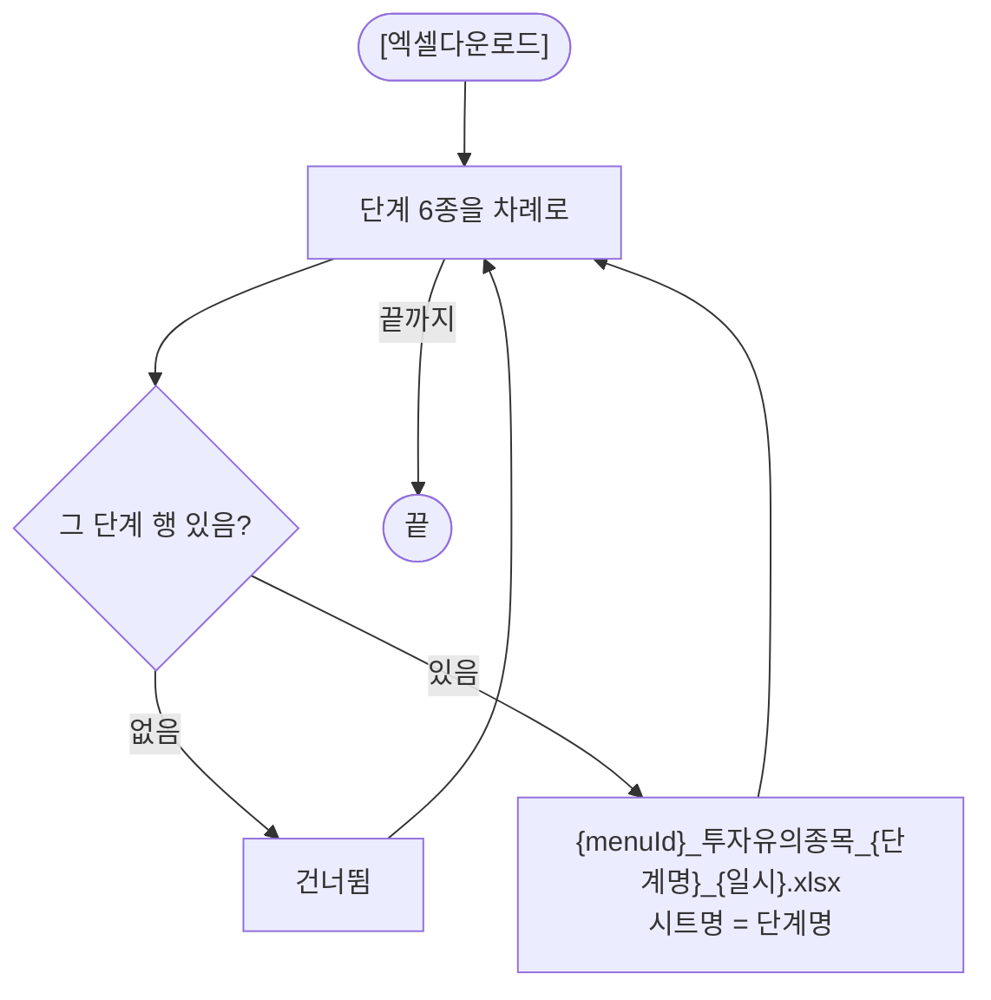
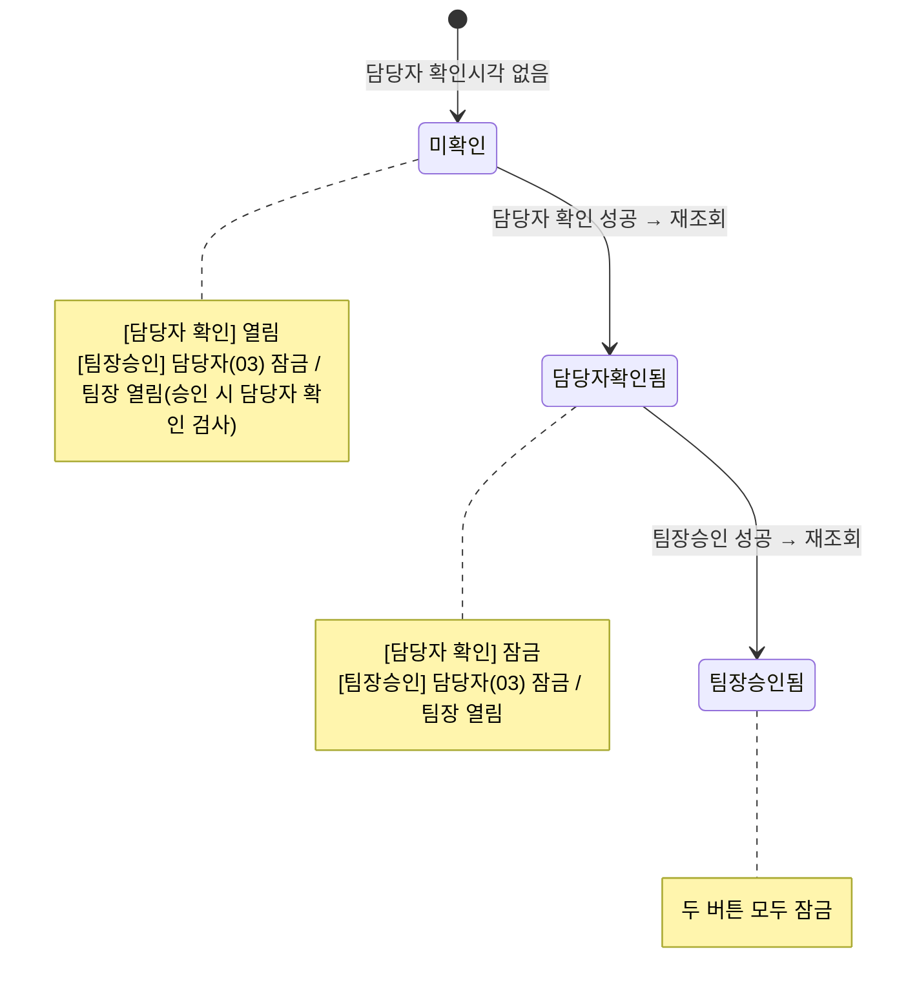

# ULDSTF09350 투자유의 마감처리 — 업무 분석 및 전환 내역

| 항목 | 내용 |
|---|---|
| AS-IS 원본 | `ULDSTF09350.xml` — W-Craft 1차 변환본(`meta_asisFileNm="ULDSTF09350.gfm"`, 원본 gfm 은 저장소에 없음)에 **API 적용까지 마친 개발 사본**. 업무 로직은 이 스크립트와 남은 옛 코드 주석(`urlcond`·`SCREN_PROCS_TP_CD`·`trSetHeader` 등)으로 분석했다. **메뉴 본화면**(`sub_contents`, 팝업 아님). 개발 사본에 `scwin.init` 이 없고 로딩 로직이 `scwin.onpageload` 안에 있었다(§8 #1) |
| 신규 API 명세 | 없음 — **화면에 적용된 `/api/...` 경로·method·dataCollection keyInfo 를 명세로 간주**(사용자 결정 2026-10-29 준용). 적용 API 10종(`/api/listing/lstproc/pf/invst-warn/` 아래): 조회 `GET closing-status`·`GET check-md-batch-closing`·단계별 목록 `GET select-list-first-detect`·`select-list-noti`·`select-list-extn`·`select-list-design`·`select-list-release`·`select-list-trd-halt`, 처리 `POST review`·`POST approve`. §5 는 「화면 적용 API ↔ 개발 사본 호출」 대응표. `api_spec_check` 는 SKIP(A07·A08 형식 검사만) |
| 화면 캡처 | 없음 |
| 퍼블리싱 파일 | 화면 폴더 `ULDSTF09350.xml` 의 body 를 1단계 기준으로 했다(선례 ULDBNS30400 「캡처 없음, 기존 마크업 정비」). publish 원본 `conversion/publish/상장/상장처리(대내)/ULDSTF09350.xml` 은 참고만 했다 — 라벨·구성은 같고 publish 원본에만 breadcrumb 목업·페이지 제목이 있다(§10 #7) |
| TO-BE | `conversion/conversion-front/ui-tobe/ULDSTF09350.xml` (배포 경로 `/ui/lst/pf/ULDSTF09350.xml` — pf 묶음 원본 리터럴 기준, §10 #6). 1단계: 기존 마크업 정비(본화면 `sub_contents` + contentHeader, 조회조건 `schbox`, 단계별 그리드 6개 + 총건수, 엑셀 1개, 하단 시장정보 배치실행 + [담당자 확인]·[팀장승인] — [닫기] 없음), 2단계: 스크립트 재전환 |
| 묶음 계약 | pf 21본 공통 계약서(잡 임시 `pf_contracts.md`) — 이 화면은 **호출 관계가 없는 독립 화면**(계약서 §1). 공통 결정 §4(결과서 표기·결함 #11·#12·규칙 42·46) |
| 업무공통 | gcc: `$c.sbm.executeDynamic`·`$c.date`(`checkCalendarFormat`·`getServerDateTime`)·`$c.win`(`alert`·`confirm`·`setEnterKeyEvent`·`getProgramId`)·`$c.data.downloadGridViewExcel`·`$c.session.getUserInfo`·`$c.util.isEmpty`·`$c.exception.handleError`. pcc(`cm/pcc/stf`): `$c.stf.getMessageParam`·`fillGridHeaderTotalCnt`. 게이트는 `--pcc stf` |
| 선례 | `ULDSTF70016`·`ULDSTF08200`(마감처리 — 담당자 확인·팀장승인, 버튼 상태 규칙·처리 결과 판정) |
| 작성 | Inswave / 2026-10-30 |

참고 양식: [websquare_gfm_conversion.md](../../../../md/websquare_gfm_conversion.md) — §1.4 업무 프로세스 흐름. 같은 마감 업무 [ULDSTF70016.md](../ULDSTF70016/ULDSTF70016.md) 의 결정(처리 결과 판정·당일 확인)을 따랐다.

---

## 1. 화면 개요

상장형 수익증권 **투자유의종목의 단계별 당일 처리 대상**(최초적출·지정예고·지정연장·지정·지정해제·매매거래정지)을 한 화면에서 확인하고, 담당자 확인 → 팀장승인 순서로 **당일 마감**하는 메인 화면이다.

1. 화면을 열면 마감일 = 오늘로 조회한다. 위쪽에 마감상태(담당자·팀장 이름과 확인시각), 아래쪽에 단계별 그리드 6개와 시장정보 배치실행 여부가 나온다.
2. 같은 단계에 같은 종목이 두 번 이상 있으면 단계별로 안내한다.
3. 마감일이 오늘일 때만 담당자가 [담당자 확인], 팀장이 [팀장승인]으로 마감한다. 팀장승인은 6개 단계 목록의 전 행을 보낸다.
4. [엑셀다운로드]는 행이 있는 단계마다 파일 하나씩 내려받는다.

### 1.1 호출 화면 (0본)

메뉴에서 직접 여는 메인 화면이다. pf 21본·`conversion/publish`·`conversion/sample-front` 에서 이 화면ID 를 부르는 화면은 없다(계약서 §1 — 독립 화면). 개발 사본의 [닫기](`btn_Close` → `closePopup`)는 body 에서 주석 처리돼 있었다(§8 #8).

### 1.2 호출 규약 (부모 → 이 화면) / 반환 규약

해당 없음 — 메인 화면이라 받는 파라미터·돌려주는 값이 없다. 개발 사본의 `scwin.fn_GetPar, scwin.fn_SetPar;` 선언은 쓰이지 않는 잔재다(§8 #9). 세션 값 `jobtitl`(직책, 원본 `scwin.pJobTitl`)을 쓴다.

### 1.3 이 화면이 여는 하위 팝업

해당 없음 — 하위 팝업이 없다. 원본 달력 아이콘 `img_ConfirmDate` → `popUpCalendar2`(Gauce 달력)는 `w2:inputCalendar` 내장 달력으로 대체(계약서 §4.1).

### 1.4 업무 프로세스 흐름

| # | 업무 | 시작 (사용자 동작·진입 조건) | 끝 (결과) | 주요 함수 | 관련 절 |
|---|---|---|---|---|---|
| 1 | 조회 | 화면 진입 / [조회]·Enter / 마감일 변경 후 포커스 이탈 | 마감상태·배치 여부·단계별 6목록·건수·버튼 상태·중복 안내 | `scwin.listSync` → `selectClosingStatus` → `selectBatchStatus` → `selectStepList` ×6 → `checkDupList` | §3, §5.1~§5.3, §6.7 |
| 2 | 담당자 확인 | [담당자 확인] | 완료 안내 → 재조회 | `scwin.review` → `scwin.reviewTrs` | §5.4, §6.3 |
| 3 | 팀장승인 | [팀장승인] | 완료 안내 → 재조회 | `scwin.approve` → `scwin.approveTrs` | §5.5, §6.4 |
| 4 | 엑셀다운로드 | [엑셀다운로드] | 행 있는 단계마다 파일 | `scwin.excelDown` | §6.6 |

#### 화면 간 흐름

하위 팝업은 없다.

#### 업무 1: 조회

| 단계 | 처리 | 함수 |
|---|---|---|
| 1 | 마감일 확인(8자리) | `scwin.validateSearch` |
| 2 | 마감상태 → 버튼 상태 | `scwin.selectClosingStatus` → `scwin.applyButtonState` |
| 3 | 시장정보 배치실행 여부(최종마감여부 `clsYn` 표시) | `scwin.selectBatchStatus` |
| 4 | 단계별 목록 6종·건수 | `scwin.selectStepList`(`scwin.STEP_LIST` 순서) |
| 5 | 모두 성공하면 중복 종목 점검 | `scwin.checkDupList` → `scwin.hasDupIsu` |

#### 업무 2: 담당자 확인

#### 업무 3: 팀장승인

#### 업무 4: 엑셀다운로드

#### 화면 모드 상태 전이 (버튼)

---

## 2. 화면 구성 및 데이터 정의

### 2.1 화면 구성

| 영역 | AS-IS (개발 사본) | TO-BE | 비고 |
|---|---|---|---|
| 머리 | `pfm_pageFrame1`(contentHeader) | `pfmContentHeader` | 표준 id |
| 조회조건 | `panel_Top`(schbox) — 마감일 `edt_ConfirmDate`(`dma_searchReq.trdDd`, `ev:onblur`), 담당자 확인시각 `txb_CONFRM_DDTM`, 담당자명 `txb_CHRG_EMP_NM`, 팀장 승인시각 `txb_APPROV_DDTM`, 팀장명 `txb_APPROVR_EMP_NM`, 라벨 `label_2`·`label_3`·`label_4`·`label_5`·`label_6` | 같은 id, 마감상태 4칸은 `dma_closingStatus` 바인딩(readOnly) | 조회 버튼 `btn_Search` |
| 단계 1 최초적출 | 제목 `label_10`, 건수 `txb_cnt1`, 엑셀 `btn_Excel`, 그리드 `grd_List1` | 같은 id | 엑셀은 6단계 공용 |
| 단계 2 지정예고 | `label_1`, `txb_cnt2`, `grd_List2` | 같은 id | |
| 단계 3 지정연장 | `label_7`, `txb_cnt3`, `grd_List3` + 안내 `label_8`「※ EXTURE+ 확인 필요 단계」 | 같은 id | |
| 단계 4 지정 | `label_12`, `txb_cnt4`, `grd_List4` | 같은 id | |
| 단계 5 지정해제 | `label_11`, `txb_cnt5`, `grd_List5` | 같은 id | |
| 단계 6 매매거래정지 | `label_9`, `txb_cnt6`, `grd_List6` | 같은 id | |
| 하단 | 라벨 `lbl_1`「시장정보 배치실행 :」, `txb_ClsDtl`(입력 가능, 스크립트 `setValue`), `btn_Revw`「담당자 확인」, `btn_BosApv`「팀장승인」, 주석 처리된 `btn_Close` | 같은 id, `txb_ClsDtl` 은 readOnly + `dma_checkMdBatchClosing.clsYn` 바인딩, [닫기] 없음 | §8 #8 |

마크업 정비(1단계): W-Craft 잔재 속성(`hierarchy`·`orgid`·`userData2`·`src`·`cursor`·`text`·`meta_snippet*`) 제거, 버튼 `type="button"`, 건수 `w2:textbox` → `w2:span`(titbox count 관례), 그리드 `readOnly`·`focusMode="row"`, `grd_List2` style 오타(`height: 153px;l`) 정정, 그리드 자동 id `caption1`·`caption2`·`caption3`·`caption4`·`caption5`·`caption6`·`header1`·`header2`·`header3`·`header4`·`header5`·`header6`·`gBody1`·`gBody2`·`gBody3`·`gBody4`·`gBody5`·`gBody6` → `header_grd_ListN`·`gBody_grd_ListN`(캡션 id 빈 값). 숫자 입력칸은 없다(규칙 48 대상 없음).

### 2.2 데이터 정의

| DataCollection | 키 | 출처 | 쓰임 |
|---|---|---|---|
| `dma_searchReq` | `trdDd` 거래일(=마감일) | 단계별 목록 요청 ref(개발 사본 그대로) | 마감일 달력 바인딩 |
| `dma_closingStatus` | `chrgEmpNm` 담당자명, `approvTeamleadrEmpNm` 팀장명, `chrgApprovTm` 담당자 확인시각, `teamleadrApprovTm` 팀장 확인시각 | `closing-status` 응답 | 마감상태 표시, 버튼 상태, 팀장승인 전 확인 |
| `dma_checkMdBatchClosing` | `batClsYn` 배치완료여부, `regClsYn` 정규장마감여부, `clsYn` 최종마감여부 | `check-md-batch-closing` 응답 | `clsYn` 만 하단 표시 |
| `dlt_firstDetect`·`dlt_noti`·`dlt_extn`·`dlt_design`·`dlt_release`·`dlt_trdhalt` | `designDd` 지정일자, `releasDd` 해제일자, `isuCd` 종목코드, `isuKorNm` 종목약명, `empNm` 최종처리자, `disclsYn` 공시제출 여부, `fstDesignDd` 최초지정일자, `disclsDd` 공시일자, `etpInvstwarnDesignCd` ETP투자유의지정코드, `bzProcsNo` 업무처리번호, `taskDd` 거래일, `addYn` 구분 | 단계별 목록 응답(6종 같은 구성) | 그리드 6개, 팀장승인 요청 |
| `dma_reviewReq` | `completeYn` 결과, `completeCtnt` 결과내용 | `review` 요청 ref | 담당자 확인 |
| `dma_approveReq` | `pfInvstWarnClosingHistList`(json) 투자유의종목 마감처리 | `approve` 요청 ref | 팀장승인 |

keyInfo `name` 의 「종목코드,」 끝 쉼표 오타만 정정했다(id·dataType 은 그대로).

### 2.3 그리드 컬럼 대응 (개발 사본 → TO-BE, 6개 그리드 공통)

| AS-IS 머리 id / 본문 id | TO-BE 머리 id / 본문 id | 변경 |
|---|---|---|
| `DESIGN_DD_H` / `designDd` (`displayFormat="####-##-##"`) | `h_designDd` / `designDd` `dataType="date" displayFormat="yyyy-MM-dd"` | 규칙 46. 머리 값은 단계별(최초적출일·지정예고일·지정연장일·지정일·지정해제일·매매거래정지일) |
| `RELEAS_DD_H` / `releasDd`(그리드 6만, AS-IS mask `XXXX-XX-XX`) | `h_releasDd` / `releasDd` `dataType="date" displayFormat="yyyy-MM-dd"` | 규칙 46(마스크 열) |
| `HALT_DESNRELS_TP_NM_H` / `HALT_DESNRELS_TP_NM`(그리드 6, hidden) | (삭제) | 응답에 없는 키(대문자) — §8 #10 |
| `ISU_CD_H` / `isuCd` | `h_isuCd` / 같음 | |
| `ISU_KOR_NM_H` / `isuKorNm` | `h_isuKorNm` / 같음 | |
| `EMP_NM_H` / `empNm` | `h_empNm` / 같음 | |
| `DISCLS_YN_H` / `disclsYn` | `h_disclsYn` / 같음 | |
| `ADD_YN_H` / `ADD_YN`(hidden) | `h_addYn` / `addYn`(hidden) | 대문자 본문 id 는 `addYn` 키를 못 읽음 — §8 #10 |

---

## 3. 로딩 (`scwin.onpageload` → `scwin.init`)

`scwin.onpageload` 는 `scwin.init()` 호출만 한다(개발 사본은 로딩 로직이 `onpageload` 안에 있었다 — 규칙: init 하나). `scwin.init` 순서:

1. 세션 `jobtitl` → `scwin.jobTitl`(원본 `scwin.pJobTitl`).
2. init 바인딩(규칙 22·37): `$c.date.checkCalendarFormat(edt_ConfirmDate, "yyyyMMdd")`, `$c.win.setEnterKeyEvent(panel_Top, scwin.btn_Search_onclick)`.
3. 버튼 초기 상태 — `btn_Revw`·`btn_BosApv` 잠금(마감상태 조회 뒤 정함).
4. 마감일 = 서버 날짜(`dma_searchReq.trdDd`) → `await scwin.listSync()`.
   개발 사본은 `listSync` 뒤 건수 6개를 다시 넣었는데, TO-BE 는 단계마다 조회 직후 건수를 넣는다(§5.3).

---

## 4. 컴포넌트 이벤트

| AS-IS | TO-BE | 동작 |
|---|---|---|
| `btn_Search` → `scwin.btn_Search_onclick` | 같음 (+ 조회 영역 Enter) | `listSync` |
| `edt_ConfirmDate` `ev:onblur` → `scwin.edt_ConfirmDate_onkillfocus` | `scwin.edt_ConfirmDate_onblur` | 마감일이 마지막 조회일과 다를 때만 `listSync`(§8 #7) |
| `btn_Excel` → `scwin.btn_Excel_onclick` | 같음 | `excelDown` |
| `btn_Revw` → `scwin.btn_Revw_onclick` → `revw` | 같음 → `scwin.review` | §6.3 |
| `btn_BosApv` → `scwin.btn_BosApv_onclick` → `aprv` | 같음 → `scwin.approve` | §6.4 |
| `scwin.btn_Close_onclick`(body 버튼은 주석) | (삭제) | §8 #8 |
| `scwin.img_ConfirmDate_onclick`(`popUpCalendar2`, 컴포넌트 없음) | (삭제) | 내장 달력 |
| `scwin.onpageunload`(빈 함수) | (삭제) | |

---

## 5. 서버 통신

#### 화면 적용 API ↔ 개발 사본 호출

| API (화면 적용, 명세로 간주) | 요청 | 응답 → | 개발 사본 함수 | TO-BE 함수 |
|---|---|---|---|---|
| `GET /api/listing/lstproc/pf/invst-warn/closing-status` | `{ basDd }` | `dma_closingStatus=body` | `clslogSync`(쿼리 `?basDd=` 이어 붙이기) | `scwin.selectClosingStatus` |
| `GET …/check-md-batch-closing` | `{ toDay }` | `dma_checkMdBatchClosing=body` | `getJungBoBatch`(쿼리 `?toDay=` 이어 붙이기) | `scwin.selectBatchStatus` |
| `GET …/select-list-first-detect` | ref `dma_searchReq` `{ trdDd }` | `dlt_firstDetect=body` | `listDtl("01")` | `scwin.selectStepList(STEP_LIST[0])` |
| `GET …/select-list-noti` | 〃 | `dlt_noti=body` | `listDtl("02")` | `STEP_LIST[1]` |
| `GET …/select-list-extn` | 〃 | `dlt_extn=body` | `listDtl("04")` | `STEP_LIST[2]` |
| `GET …/select-list-design` | 〃 | `dlt_design=body` | `listDtl("03")` | `STEP_LIST[3]` |
| `GET …/select-list-release` | 〃 | `dlt_release=body` | `listDtl("05")` | `STEP_LIST[4]` |
| `GET …/select-list-trd-halt` | 〃 | `dlt_trdhalt=body` | `listDtl("06")` | `STEP_LIST[5]` |
| `POST …/review` | ref `dma_reviewReq` | (정의 없음) | `trsRevw` | `scwin.reviewTrs` |
| `POST …/approve` | ref `dma_approveReq` | (정의 없음, 개발 사본 주석 `trs_aprv=body.content`) | `trsAprv` | `scwin.approveTrs` |

모든 action 은 전체 경로 리터럴(규칙 38) — 단계별 6종은 `scwin.STEP_LIST` 항목의 `sbmOptions` 안에 리터럴로 둔다. `getContextPath()` 없음(규칙 39). 개발 사본의 쿼리스트링 이어 붙이기(`"…closing-status?basDd=" + 값`)는 `executeDynamic(opts, { basDd })` 로 바꿨다(규칙 38 — 경로 조립 금지).

### 5.1 마감상태 (`scwin.selectClosingStatus`)
- `dma_closingStatus.setEmptyValue()` 후 조회 → `scwin.applyButtonState()`(원본 `dts_sendLog_OnLoadCompleted` → `buttonSetDis`).

### 5.2 시장정보 배치실행 (`scwin.selectBatchStatus`)
- 비운 뒤 조회. `clsYn` 은 하단 `txb_ClsDtl` 에 바인딩으로 보인다(원본 `txb_ClsDtl.setValue(clsYn)`).

### 5.3 단계별 목록 (`scwin.selectStepList`)
- 목록을 비우고 조회 → 그 단계 건수 표시(`$c.stf.fillGridHeaderTotalCnt`). 공통 `executeDynamic` 이 옵션 객체를 고치므로(target 등) `STEP_LIST` 의 옵션은 사본(`{ ...step.sbmOptions }`)으로 넘긴다. 실패하면 `MSG-0002` 안내(원본 `dlt_*_OnLoadError`)하고 `false`.
- `scwin.listSync` 는 6종을 원본 순서(최초적출·지정예고·지정연장·지정·지정해제·매매거래정지)로 차례로 부르고, 모두 성공해야 `scwin.isLoaded = true` → 중복 점검.
- 개발 사본의 `nowOld`(오늘이 아니거나 팀장 마감 뒤면 「OLD」) 분기는 두 갈래가 같은 경로를 불러 차이가 없다(옛 쿼리 조건 `ETP_INVSTWARN_CD`·`LIST_BZ_TP_CD` 는 주석) — 옮기지 않고 §10 #3 에 올린다.

### 5.4 담당자 확인 (`scwin.reviewTrs`)
- 요청 `dma_reviewReq` = `{ completeYn: true, completeCtnt: "확인완료" }`(개발 사본 그대로).
- 중복 실행 건너뜀. 실패면 `MSG-A002`(담당자 확인), 성공이면 `MSG-0001`(담당자 확인) 후 재조회. 개발 사본은 결과를 보지 않고 늘 성공 처리했다(§8 #3).

### 5.5 팀장승인 (`scwin.approveTrs`)
- 요청 `dma_approveReq.pfInvstWarnClosingHistList` = 6목록 `getAllJSON()` 을 이어 붙인 배열(원본은 `getRowJSON` 반복 — 같은 결과).
- 결과 처리는 §5.4 와 같다(처리명 「팀장승인」).

---

## 6. 일반 함수

### 6.1 조회 전 확인 (`scwin.validateSearch`)
- 마감일이 8자리가 아니면 「마감일을 입력하세요.」 안내 후 포커스(원본 `dateErrCheck` — `true` 를 돌려주면 중단하던 것을 `false` 반환으로 뒤집음).

### 6.2 당일 확인 (`scwin.checkIsClose`)
- 마감일과 마지막 조회일(`scwin.searchDd`, 원본 `vSearchDate`)이 모두 서버 날짜와 같아야 마감 가능. 아니면 「당일날짜만 마감가능합니다. 마감일을 확인하세요」(원본 `chkIsClose`).

### 6.3 담당자 확인 (`scwin.review`)
- 처리명 「담당자 확인」 → 당일 확인 → 확인창 「담당자 확인 마감처리 하시겠습니까?」 → `reviewTrs`(원본 `revw`).

### 6.4 팀장승인 (`scwin.approve`)
- 6목록 조회 완료(`scwin.isLoaded`, 원본 `loading1~6`) → 당일 확인 → 담당자 확인시각(`dma_closingStatus.chrgApprovTm`, 원본 `txb_CONFRM_DDTM.getValue()`) 확인 → 확인창 → `approveTrs`(원본 `aprv`).

### 6.5 버튼 상태 (`scwin.applyButtonState`)
- [담당자 확인]: 담당자 확인시각이 없을 때만 열림(직책 무관).
- [팀장승인]: 담당자(직책 `03`)는 늘 잠금, 그 밖(팀장)은 팀장 확인시각이 없을 때 열림. 원본 `buttonSetDis` 와 같다(그림 교체 주석 `setBackgroundImage` 는 옮기지 않음).

### 6.6 엑셀다운로드 (`scwin.excelDown`)
- 행이 있는 단계마다 파일 하나. 파일명 `{menuId}_투자유의종목_{단계명}_{yyyyMMddHHmmss}.xlsx`(규칙 42), 시트명 = 단계명. 개발 사본의 옵션 `type: 40` 은 공통 함수 값(0·1·2)이 아니라 빼고 기본값(1, 화면 표시값)을 쓴다(§8 #11).

### 6.7 중복 종목 점검 (`scwin.checkDupList`·`scwin.hasDupIsu`)
- 단계마다 종목코드가 두 번 이상이면 「투자유의종목 {단계명} 단계에 중복된 종목이 있습니다. 확인하시기 바랍니다.」(원본 문구 6종을 단계명으로 묶음).
- 원본 `loopDataSet` 은 대문자 키 `ISU_CD`(늘 `undefined`)와 1부터 세는 행 번호를 써서 **행이 2개 이상이면 늘 중복으로 안내**했다 — `isuCd` 키로 고침(§8 #4).

---

## 7. 업무 코드 · 메시지 목록

| 구분 | 값 | 쓰는 곳 |
|---|---|---|
| 직책코드 | `03` 담당자 (그 밖 = 팀장) | §6.5 |
| 단계 | 01 최초적출, 02 지정예고, 04 지정연장, 03 지정, 05 지정해제, 06 매매거래정지 (원본 `listDtl` type, 옛 `ETP_INVSTWARN_CD`) | §5.3 |
| 메시지 | `MSG-0001` 성공적으로 처리되었습니다(처리명) | §5.4·§5.5 성공 |
| 메시지 | `MSG-A002` [처리명] 처리 실패 | §5.4·§5.5 실패 |
| 메시지 | `MSG-0002` (조회 오류) | §5.3 실패 |
| 문구 | 「마감일을 입력하세요.」 | §6.1 |
| 문구 | 「당일날짜만 마감가능합니다. 마감일을 확인하세요」 | §6.2 |
| 문구 | 「데이터가 로딩중입니다. 로딩후에 승인가능합니다.」 | §6.4 |
| 문구 | 「담당자확인 완료 후 승인처리 가능합니다.」 | §6.4 |
| 문구 | 「투자유의종목 {단계명} 단계에 중복된 종목이 있습니다. 확인하시기 바랍니다.」 | §6.7 |
| 확인창 | 「담당자 확인 마감처리 하시겠습니까?」 / 「팀장승인 마감처리 하시겠습니까?」 | §6.3, §6.4 |

---

## 8. 원본 특이사항 · 결함

| # | 내용 | 결정 |
|---|---|---|
| 1 | `scwin.init` 없음 — 로딩 로직이 `scwin.onpageload` 안 | 고침 — `scwin.init` 하나로 |
| 2 | `procJob` 을 선언 없이 전역으로 씀(`revw`·`aprv`·`trs_*_OnFail`) | 고침 — `scwin.procJob` |
| 3 | `trsRevw`·`trsAprv` 가 결과를 보지 않고 늘 `trs_*_OnSuccess`(성공 안내·재조회), `trs_*_OnFail` 은 부르는 곳 없음 | 고침 — `success` 판정, 실패 `MSG-A002` |
| 4 | `loopDataSet` 이 대문자 키 `ISU_CD`·1부터 세는 행 번호 → 행 2개 이상이면 늘 「중복된 종목」 안내 | 고침 — `isuCd`, `Set` 비교 |
| 5 | `listSync` 가 `listDtl("03")`(지정) 뒤 `dlt_extn_OnLoadCompleted`, `listDtl("04")`(지정연장) 뒤 `dlt_design_OnLoadCompleted` 를 부르는 등 순서가 엇갈림(건수는 각 목록 기준이라 결과는 같음), `loading1~6` 플래그·`closeLoading` 은 순차 await 라 의미 없음 | 정리 — `STEP_LIST` 한 순서, `isLoaded` 하나 |
| 6 | 쿼리스트링 이어 붙이기 `closing-status?basDd=`·`check-md-batch-closing?toDay=` | 고침 — requestData(규칙 38) |
| 7 | 마감일 `onkillfocus` 마다 조회 — 값이 그대로여도 포커스만 빠지면 다시 조회 | 고침 — 마지막 조회일과 다를 때만(마감일을 바꾸고 바로 [조회]를 누르면 원본처럼 두 번 조회될 수 있다 — §10 #9) |
| 8 | 본화면 [닫기] `btn_Close` → `closePopup`(body 는 주석) | 옮기지 않음(계약서 §4.4-12) |
| 9 | `scwin.fn_GetPar, scwin.fn_SetPar;`·`scwin.loading1, …;` 쉼표 식 선언, `scwin.secugrpId`·`scwin.secugrpNm`(주석에서만 사용), 주석 `trSetHeader`(gauceSystemierAdaptor) | 삭제 |
| 10 | 그리드 본문 대문자 id `ADD_YN`(키는 `addYn`), 응답에 없는 `HALT_DESNRELS_TP_NM`(hidden) | 고침 — `addYn` / 삭제 |
| 11 | 엑셀 옵션 `type: 40`(무효값), 파일명에 menuId 없음 | 고침 — 기본값, 규칙 42 |
| 12 | `buttonSetNoData`(부르는 곳 없음, `setBackgroundImage`) | 삭제 |
| 13 | `img_ConfirmDate_onclick` → `popUpCalendar2`(Gauce, 컴포넌트 없음) | 삭제 — 내장 달력 |
| 14 | 그리드 자동 id `caption1~6`·`header1~6`·`gBody1~6`, 머리 id `DESIGN_DD_H` 등 6개 그리드 반복, `####-##-##` 마스크, `grd_List2` style 오타 | 고침 — §2.1·§2.3, 규칙 46 |
| 15 | `txb_ClsDtl` 이 입력 가능 칸 | 고침 — readOnly + 바인딩 |
| 16 | 하단 처리 버튼은 담당자 확인·팀장승인뿐(규칙 41 의 취소·삭제·수정·저장·신규 아님) | 유지 — 같은 `rt` 에 원본 순서 |

---

## 9. 전환 내역 (AS-IS → TO-BE)

| AS-IS | TO-BE | 비고 |
|---|---|---|
| `scwin.secugrpId`·`scwin.secugrpNm`·`scwin.fn_GetPar`·`scwin.fn_SetPar`·`scwin.loading1`·`loading2`·`loading3`·`loading4`·`loading5`·`loading6` | (삭제) / `scwin.isLoaded` | §8 #5·#9 |
| `scwin.vSearchDate` | `scwin.searchDd` | |
| `scwin.pJobTitl` | `scwin.jobTitl` | init 에서 세션 |
| 전역 `procJob` | `scwin.procJob` | §8 #2 |
| (없음) | 상수 `scwin.JOBTITL_CHRG`, `scwin.STEP_LIST`(단계 6종 표) | 1구역 |
| `scwin.onpageload`(로딩 로직 포함) | `scwin.onpageload` → `scwin.init` | §3 |
| `scwin.onpageunload` | (삭제) | 빈 함수 |
| `scwin.btn_Search_onclick`·`btn_Excel_onclick`·`btn_Revw_onclick`·`btn_BosApv_onclick` | 같은 이름 | §4 |
| `scwin.edt_ConfirmDate_onkillfocus` | `scwin.edt_ConfirmDate_onblur` | §8 #7 |
| `scwin.btn_Close_onclick`·`scwin.img_ConfirmDate_onclick` | (삭제) | §8 #8·#13 |
| `scwin.dlt_firstDetect_OnLoadError`·`dlt_firstDetect_OnLoadCompleted`·`dlt_noti_OnLoadCompleted`·`dlt_noti_OnLoadError`·`dlt_extn_OnLoadCompleted`·`dlt_extn_OnLoadError`·`dlt_design_OnLoadCompleted`·`dlt_design_OnLoadError`·`dlt_release_OnLoadCompleted`·`dlt_release_OnLoadError`·`dlt_trdhalt_OnLoadCompleted`·`dlt_trdhalt_OnLoadError` | `scwin.selectStepList` 후처리 | §5.3 |
| `scwin.listDtl(type, nowOld)` | `scwin.selectStepList(step)` + `scwin.STEP_LIST` | §5.3 |
| `scwin.clslogSync` + `scwin.dts_sendLog_OnLoadCompleted` | `scwin.selectClosingStatus` | §5.1 |
| `scwin.getJungBoBatch` | `scwin.selectBatchStatus` | §5.2 |
| `scwin.trsRevw` + `scwin.trs_revw_OnSuccess`·`scwin.trs_revw_OnFail` | `scwin.reviewTrs` | §5.4 |
| `scwin.trsAprv` + `scwin.trs_aprv_OnSuccess`·`scwin.trs_aprv_OnFail` | `scwin.approveTrs` | §5.5 |
| `scwin.trSetHeader`(주석) | (삭제) | |
| `scwin.listSync` | `scwin.listSync` | §5 |
| `scwin.dateErrCheck` | `scwin.validateSearch` | §6.1 |
| `scwin.chkIsClose` | `scwin.checkIsClose` | §6.2 |
| `scwin.revw` / `scwin.aprv` | `scwin.review` / `scwin.approve` | §6.3·§6.4 |
| `scwin.buttonSetDis` | `scwin.applyButtonState` | §6.5 |
| `scwin.buttonSetNoData` | (삭제) | §8 #12 |
| `scwin.closeLoading` + `scwin.checkDupList` + `scwin.loopDataSet` | `scwin.checkDupList` + `scwin.hasDupIsu` | §6.7 |
| `scwin.excelDown` | `scwin.excelDown` | §6.6 |

- publicInfo: 정의한 21함수 전부. 전역 상수·상태(`STEP_LIST` 등)는 등재하지 않는다.
- 게이트: `gate_screen --pcc stf`·`scan_mixed_compare`(A 2건: `trdDd.length !== 8`·`getRowCount() === 0` 숫자 비교 — 의도)·`publish_gate --before 1단계 사본 --allow P20`·`api_spec_check`(명세 SKIP, A07·A08 통과)·`init_binding_check`·`wsxml_lint` 0/0, `convert.py` 고정점.

---

## 10. 남은 작업 (TODO)

1. **담당자 확인 요청** — `dma_reviewReq` 의 `completeYn: true`(boolean, keyInfo 는 text)·`completeCtnt: "확인완료"` 는 개발 사본 그대로. 서버가 담당자 사번을 세션으로 처리하는지(옛 `EMP_NO` 주석) 확인.
2. **처리 응답** — `review`·`approve` 응답 정의가 화면에 없다. 성공은 `success` 로만 판정 — 업무 결과 코드가 따로 오는지 확인.
3. **이력 조회 구분** — 개발 사본 `nowOld`(마감일이 오늘이 아니거나 팀장 마감 뒤면 이력 조회) 구분이 API 에 없다. 같은 `select-list-*` 를 `trdDd` 로 부르므로 서버가 거래일로 현재/이력을 가르는지 확인.
4. **요청 키 이름** — 같은 마감일을 목록은 `trdDd`, 마감상태는 `basDd`, 배치 여부는 `toDay` 로 보낸다(개발 사본 그대로). 서버 키 확인.
5. **팀장승인 요청 내용** — 6목록 전 행(숨김 열 포함 12키)을 보낸다. 서버가 필요한 키만 쓰는지, 0건 단계도 괜찮은지 확인.
6. **배포 경로** — `/ui/lst/pf/ULDSTF09350.xml` 는 pf 묶음 원본 리터럴 기준 가정.
7. **퍼블리싱본 차이** — publish 원본 breadcrumb·페이지 제목은 contentHeader 로 대체, W-Craft 잔재 속성 제거, 건수 span 화. 캡처를 받으면 다시 대조.
8. **세션 키** — `$c.session.getUserInfo("jobtitl")` 는 개발 사본·선례 70016 과 같은 가정.
9. **실화면 확인** — 날짜 열 서버 값 8자리 여부(규칙 46), 엑셀 여러 파일 연속 다운로드가 브라우저에서 막히지 않는지, 중복 안내가 여러 단계면 안내창이 차례로 뜨는 것이 괜찮은지, 마감일을 바꾸고 바로 [조회]를 누를 때 포커스 이탈 조회와 겹치는지(§8 #7).
