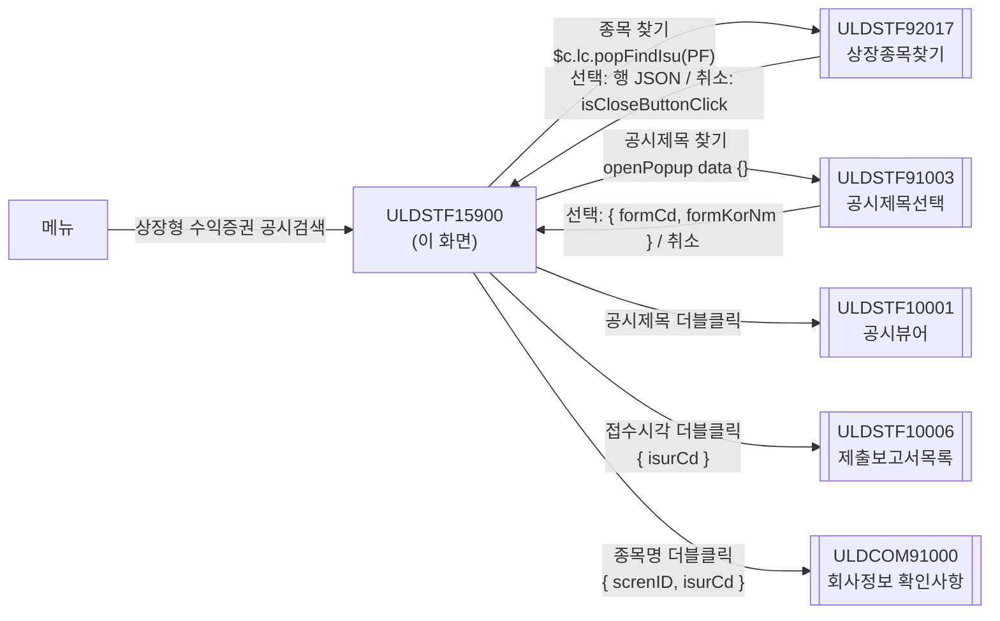
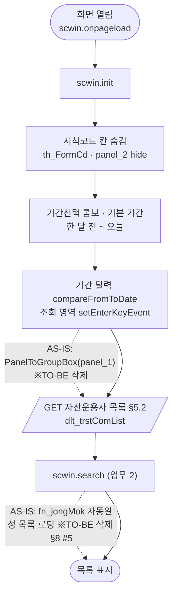
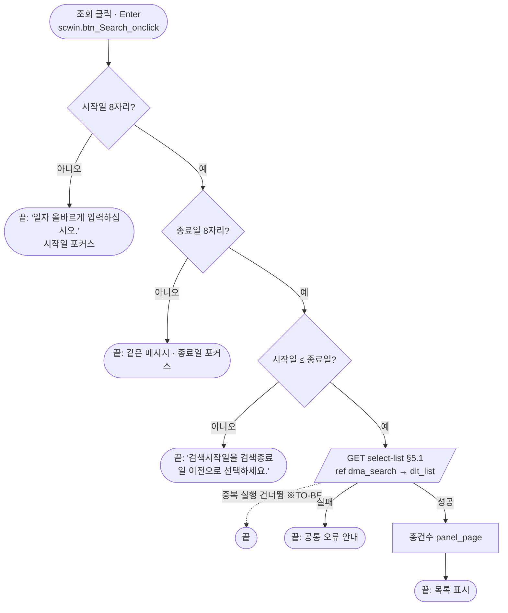
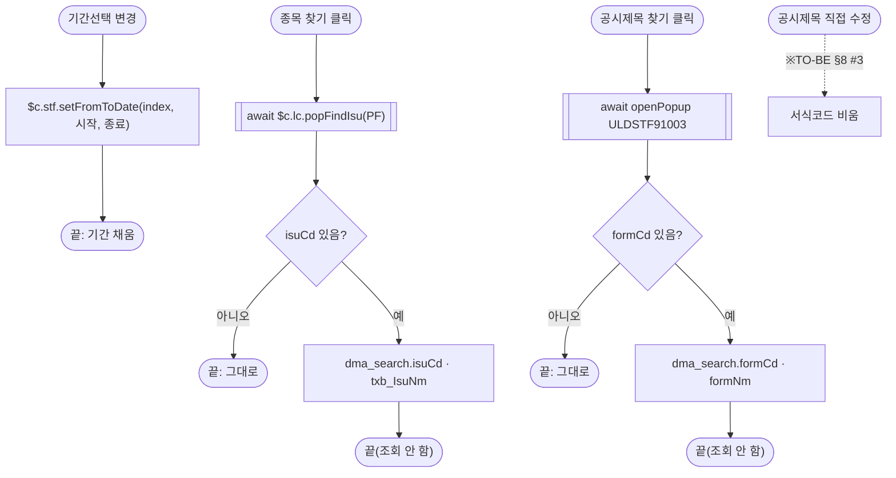
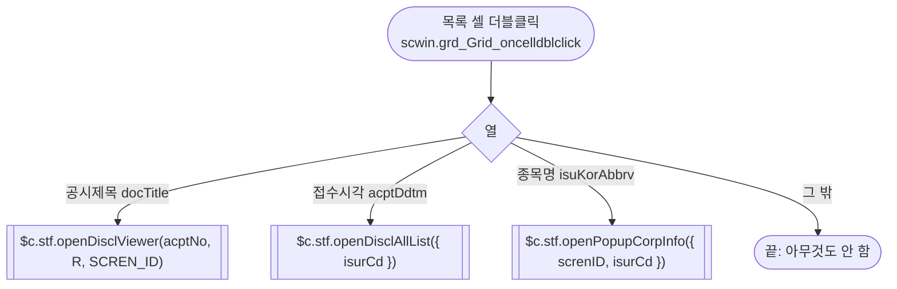
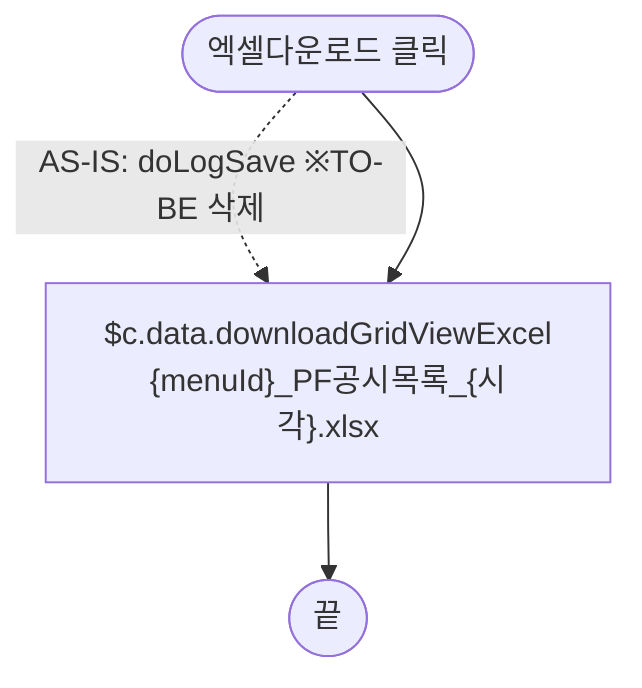

# ULDSTF15900 상장형 수익증권 공시검색 — 업무 분석 및 전환 내역

| 항목 | 내용 |
|---|---|
| AS-IS | `ULDSTF15900.gfm` (Gauce/X-Internet, 1270×750 메인 화면 — 원본 주석 "PF공시검색(상장형수익증권)") — 반입 `conversion/conversion-front/ui/ULDSTF15900/ULDSTF15900.gfm` |
| 신규 API 명세 | `ULDSTF15900_API.md` — 블록 2종: ① 목록 조회 `GET /api/discls/dsclsrch/detailed-dscl/pf/select-list`(AS-IS `/DsclSearchPF.do?method=listPFDsclSrch`), ② 자산운용사 목록 조회 — **경로가 ①과 같은 `GET /api/discls/dsclsrch/detailed-dscl/pf/select-list`**(AS-IS `/CodeAction.do?method=listTrstComPF`, 명세 복사 오류로 보임 — §10 #1). 머리의 화면ID 가 `[ULDSTF15900_API]` 로 적혀 `api_spec_check` 는 두 블록을 A06(다른 화면 대상)으로 본다(§10 #6). §2.2·§5 는 명세 기준(가이드 §0.3·§5) |
| TO-BE | `conversion/conversion-front/ui-tobe/ULDSTF15900.xml` (배포 경로 미정 — §10 #5). **2026-10-30 전환** — 1단계: 캡처 기준 퍼블리싱(마크업 전용, 사본 `$CLAUDE_JOB_DIR/tmp/ULDSTF15900_stage1.xml`), 2단계: 이 결과서대로 스크립트 전환. 게이트: `gate_screen --pcc stf`·`scan_mixed_compare`·`publish_gate --pcc stf --before {1단계} --allow P20`·`api_spec_check`(A06 INFO 2건)·`init_binding_check`·`wsxml_lint` 0/0 통과, `convert.py` 고정점 |
| 퍼블리셔 XML | 화면 폴더의 `ULDSTF15900.xml`(W-Craft 1차 스크립트 내장, `conversion/publish/공시/공시처리(대내)/ULDSTF15900.xml` 과 같은 계열) — 본화면(`sub_contents`) 꼴, 조회조건 3행 표 + 총건수·엑셀 + 그리드. `txb_IsuCd` 는 `w2:autoComplete`, 그리드 열 id 는 AS-IS 대문자, 서식코드는 표 안 표(`panel_2`). **캡처를 따라** 정리했다(§2.1, §10 #7) |
| 화면 캡처 | `ULDSTF15900.png` (조회 결과 0건 화면 — 공시기간 2026-09-29 ~ 2026-10-29, 자산운용사 "전체", 하단 총건수·[엑셀저장]) → TO-BE 는 가이드 §13.2 퍼블리싱본부터 만들었다 |
| 업무공통 | pcc(`cm/pcc/stf`): `$c.stf`(`setFromToDate`·`openDisclViewer`·`openDisclAllList`·`openPopupCorpInfo`), `$c.lc`(`popFindIsu`·`glb.SECUGRP_ID_PF`). gcc: `$c.data`(`comboCbDataSetPeriod`·`downloadGridViewExcel`)·`$c.date`(`getServerDateTime`·`addMonth`·`compareFromToDate`)·`$c.win`(`setEnterKeyEvent`·`openPopup`·`alert`·`getProgramId`)·`$c.util.isEmpty`·`$c.sbm.executeDynamic`·`$c.exception.handleError`. 게이트는 `--pcc stf` |
| 작성 | Inswave / 2026-10-30 |

참고 양식: [websquare_gfm_conversion.md](../../../md/websquare_gfm_conversion.md) — 특히 §1.4 업무 프로세스 흐름, §5 「API 명세 적용」, §6.5 getPar/setPar 전환. Gauce 대응은 [gfm_business_analysis_guide.md](../../../md/gfm_business_analysis_guide.md) §5·§6 을 함께 따랐다. 조회 화면 골격은 선례 [ULDSTF05100.md](../completed/ULDSTF05100/ULDSTF05100.md)(기간선택 콤보·기간 달력·엑셀), 종목 팝업은 [ULDSTF05807.md](../completed/ULDSTF05807/ULDSTF05807.md)를 따랐다.

---

## 1. 화면 개요

공시 담당자가 **상장형 수익증권(PF) 공시**를 찾는 조회 전용 메인 화면이다. 종목코드, 공시기간(배포일시 기준), 공시제목(서식), 자산운용사로 걸러 공시 목록(종목·상장여부·공시제목·접수/처리/배포시각·자산운용사·처리팀·담당자)을 보여 준다.

1. 화면을 열면 공시기간을 "한 달 전 ~ 오늘" 로 두고 자산운용사 콤보를 채운 뒤 **바로 조회**한다.
2. 조건을 바꿔 [조회](또는 조회 영역 Enter)하면 다시 조회한다. 공시기간은 [기간선택]으로 1주일~2년을 한 번에 채울 수 있다.
3. 목록에서 **공시제목**을 더블클릭하면 공시뷰어, **접수시각**은 그 회사의 제출보고서목록, **종목명**은 회사정보 확인사항 팝업을 연다.
4. [엑셀다운로드]로 목록을 내려받는다.

### 1.1 호출 화면 (0본)

- 이 화면을 여는 화면은 저장소에 없다(`grep -rl ULDSTF15900` — 이 폴더와 퍼블리셔 XML 2본뿐). 메뉴에서 바로 여는 **메인 화면**으로 본다. 진입 파라미터는 없다.

### 1.2 호출 규약 (부모 → 이 화면) / 반환 규약

- 해당 없음 — 메뉴 화면이라 받는 파라미터·돌려주는 값이 없다. 원본 전역 `gDepCd`·`gEmpNo`·`gLdMktTp` 는 선언만 있고 쓰지 않는다(§8 #6).

### 1.3 이 화면이 여는 하위 팝업

| 팝업 | AS-IS 호출 (getPar/setPar) | 넘기는 `data` (TO-BE) | 받는 결과 (`closePopup`) / 취소 판정 |
|---|---|---|---|
| AS-IS `ULDCOM00003` 종목검색창 → TO-BE `ULDSTF92017` 상장종목찾기 (750×800) | `JongmokSearch(txb_IsuCd, txb_IsuNm, SECUGRP_ID_PF, js_market, "A")`(`stockSearch.js`) — 고른 종목코드·명을 입력란에 직접 넣는다. 조회는 하지 않는다 | pcc `$c.lc.popFindIsu($c.lc.glb.SECUGRP_ID_PF)` → `{ secugrpId : "PF" }`. `js_market`·`"A"` 는 넘기지 않음(§10 #3) | 선택 행 JSON(`isuCd`·`isuKorNm`). 취소·닫기는 `{ isCloseButtonClick }` → **`result.isuCd` 가 비면 그대로 둔다** |
| `ULDSTF91003` 공시제목선택 (690×570) | `frame.CreateDialogFrame("FORMLIST", "/common/ULDSTF91003.gfm", "공시제목선택 ", 100, 10, 690, 570, "window")` — 팝업이 `frame.opener.txb_FormCd`·`txb_FormNm` 에 서식코드(`FORM_CD`)·서식명(`FORM_KOR_NM`)을 직접 넣는다(퍼블리셔 91003 의 `grd_DocList_OnDblClick`) | `await $c.win.openPopup("/ui/dis/common/ULDSTF91003.xml", { id : "ULDSTF91003", popupName : "공시제목선택", width : 690, height : 570, type : "pageFramePopup" }, {})` — 경로·반환은 제안(§10 #4) | `{ formCd, formKorNm }`(91003 원본 `FORM_CD`·`FORM_KOR_NM` 의 camelCase, 제안). **`result.formCd` 가 비면 그대로 둔다** |
| `ULDSTF10001` 공시뷰어 (browserPopup) | `fn_OpenDisclViewer(gAcptNo, "R", vScrenID)` | pcc `$c.stf.openDisclViewer(acptNo, "R", "ULDSTF15900.xml")` | 반환 없음 |
| `ULDSTF10006` 제출보고서목록 | `fn_OpenDisclAllList()` — 전역 `gIsurCd` 를 읽는다 | pcc `$c.stf.openDisclAllList({ isurCd, isDigitalYn : false })` | 반환 없음 |
| `ULDCOM91000` 회사정보 확인사항 | `fn_PopupCorpInfo()` — 전역 `gIsurCd` 를 읽는다 | pcc `$c.stf.openPopupCorpInfo({ screnID : "ULDSTF15900.xml", isurCd })` | 반환 없음 |

### 1.4 업무 프로세스 흐름

흐름은 AS-IS 동작을 기준으로 그렸다. 점선과 `※TO-BE` 는 전환본에서 바뀌는 곳이다(근거는 §8).

| # | 업무 | 시작 (사용자 동작·진입 조건) | 끝 (결과) | 주요 함수 | 관련 절 |
|---|---|---|---|---|---|
| 1 | 진입·로딩 | 메뉴에서 화면을 엶 | 기본 조건으로 목록 표시 | `scwin.onpageload` → `scwin.init` → `scwin.selectTrstComList` → `scwin.search` | §3, §5.2 |
| 2 | 조회 | [조회] `btn_Search` · 조회 영역 Enter | 목록·총건수 표시 | `scwin.btn_Search_onclick` → `scwin.search` → `scwin.validateSearch` → `scwin.selectList` | §5.1, §6.1 |
| 3 | 기간선택 | `cmb_PeriodTp` 변경 | 시작·종료일 채움 | `scwin.cmb_PeriodTp_onviewchange` | §4 |
| 4 | 종목 찾기 | [종목 찾기] `img_Isu_Srh` | 종목코드·명 채움 | `scwin.img_Isu_Srh_onclick` → `scwin.openIsuPopup` | §6.2 |
| 5 | 공시제목 찾기 | [공시제목 찾기] `img_FindForm` | 공시제목·서식코드 채움 | `scwin.img_FindForm_onclick` → `scwin.openFormPopup` | §6.3 |
| 6 | 상세 팝업 | 목록 셀 더블클릭 | 공시뷰어·제출보고서목록·회사정보 팝업 | `scwin.grd_Grid_oncelldblclick` → `scwin.openRowPopup` | §6.4 |
| 7 | 엑셀 | [엑셀다운로드] `btn_Excel` | 목록 엑셀 파일 | `scwin.btn_Excel_onclick` → `scwin.excelDown` | §6.6 |

#### 화면 간 흐름



AS-IS 는 종목검색창·공시제목선택 창이 이 화면의 입력란에 값을 직접 넣었다. TO-BE 는 `await` 반환값으로 이 화면이 채운다(가이드 §6.5).

#### 업무 1: 진입·로딩



| # | 단계 | 주체 | 내용 | 분기 · 메시지 | 관련 절 |
|---|---|---|---|---|---|
| 1 | 서식코드 숨김 | 화면 | AS-IS `showObj(panel_2, false)` → `th_FormCd.hide()`·`panel_2.hide()` | — | §2.1 |
| 2 | (장식) | 화면 | AS-IS `PanelToGroupBox(panel_1)` | 삭제 — 퍼블리싱 마크업 | §2.1 |
| 3 | 기본 기간 | 화면 | AS-IS `fn_SetCode` — `edt_FromDate` 한 달 전, `edt_ToDate` 오늘 → `dma_search.dateS/dateE` | — | §3 |
| 4 | 자산운용사 콤보 | 서버 | AS-IS `dts_TrstComList` `/CodeAction.do?method=listTrstComPF&For=R`(비동기 Reset) → `GET` 명세 ② | 실패는 공통 오류 안내 | §5.2 |
| 5 | 기간선택 콤보 | 화면 | AS-IS `Combo_CBDataSetPeriod(cmb_PeriodTp)` → `$c.data.comboCbDataSetPeriod` | — | §3 |
| 6 | 첫 조회 | 화면 | AS-IS `fn_CheckCond()` → `scwin.search()` | — | §6.1 |
| 7 | 종목 자동완성 | 화면 | AS-IS `fn_jongMok(txb_IsuCd, txb_IsuNm, SECUGRP_ID_PF, "0", "A")` — 종목 전체 목록을 `MxDataSet_jong_mok` 에 읽어 입력 중 필터 | 삭제(§8 #5, §10 #3) | §2.1 |

#### 업무 2: 조회



| # | 단계 | 주체 | 내용 | 분기 · 메시지 | 관련 절 |
|---|---|---|---|---|---|
| 1 | 검증 | 화면 | AS-IS `fn_CheckCond` — `getObjectValue(edt_FromDate).length < 8`, 종료일 같음, `compareFromToDate2` | 메시지 §7 | §6.1 |
| 2 | 조회 | 서버 | AS-IS `fn_Search` — `dts_DsclList.DataID = /DsclSearchPF.do?...` + `ShowWin(grd_Grid)` → `GET` 명세 ① | 실패: 원본 `OnLoadError` → `alert_error` + `CloseWin`, TO-BE 공통 오류 안내 | §5.1 |
| 3 | 건수 | 화면 | AS-IS `OnLoadCompleted` → `CloseWin(rowcount)`·`FillGridHeaderTotalCnt(rowcount, panel_page)` → `panel_page.setValue(getRowCount())` | `errorMsg` 분기는 공통 오류 핸들러가 대신 | §5.1 |

#### 업무 3~5: 기간선택 · 종목 찾기 · 공시제목 찾기



#### 업무 6: 상세 팝업



AS-IS 는 더블클릭마다 `fn_setContnId(row)` 로 전역 `gAcptNo`·`gMainFormCd`·`gFormVer`·`gIsurCd` 를 채운 뒤 팝업 함수가 전역을 읽었다. TO-BE 는 행에서 바로 읽어 인자·data 로 넘긴다(전역 삭제 — §9).

#### 업무 7: 엑셀



#### 화면 모드 상태 전이

해당 없음 — 조회 전용이라 모드가 없다.

---

## 2. 화면 구성 및 데이터 정의

### 2.1 화면 구성 (AS-IS 요소 → TO-BE 컴포넌트)

TO-BE 는 본화면 `sub_contents` + contentHeader(`pfmContentHeader`) 아래 조회 영역(`schbox#panel_1`, 3행 4열 표) · 목록 머리(`titbox` 총건수·엑셀) · 그리드(`gvwbox`) 순서다(캡처와 같음).

| 영역 | AS-IS 요소 (id · 종류) | TO-BE 컴포넌트 | 바인딩 | 비고 |
|---|---|---|---|---|
| 조회 | `panel_1` (panel, `PanelToGroupBox`) | `schbox#panel_1` | — | 장식 함수 삭제, Enter 키 영역 |
| | `label_1` "종목코드(명)" | `w2:textbox#label_1` | — | |
| | `txb_IsuCd` (textbox, maxlength 20) | `xf:input#txb_IsuCd` (maxlength 20) | `dma_search.isuCd`, `ev:onblur` | 퍼블리셔의 `w2:autoComplete` 대신 입력란 — 원본 자동완성 데이터 API 없음(§8 #5, §10 #7) |
| | `txb_IsuNm` (textbox, readonly) | `xf:input#txb_IsuNm` readOnly | (바인딩 없음 — 조회조건 아님) | |
| | `img_Isu_Srh` (image 돋보기) | `xf:trigger#img_Isu_Srh` `btn_cm icon search` | `ev:onclick` | |
| | `lbl_tmp_5` "자산운용사" / `cmb_TrstCom` (mxcombo, `dts_TrstComList`) | `xf:select1#cmb_TrstCom` (chooseOption "전체") | `dma_search.trstComIsurCd`, itemset `dlt_trstComList` | 캡처의 "전체" |
| | `lbl_tmp_1` "공시기간" | `w2:textbox#lbl_tmp_1` | — | |
| | `edt_FromDate`·`edt_ToDate` (mxmaskedit 8) + `img_FromCal`·`img_ToCal` (달력 이미지) + `label_2` "~" | `w2:inputCalendar#edt_FromDate`·`#edt_ToDate` + `w2:span#label_2` | `dma_search.dateS`·`dateE` | 달력 이미지·`popUpCalendar2` 는 inputCalendar 내장 달력으로 대체(옮기지 않음) |
| | `cmb_PeriodTp` (mxcombo 기간선택) | `xf:select1#cmb_PeriodTp` | `ev:onviewchange` | 항목은 init 에서 `comboCbDataSetPeriod` |
| | `label_7` "공시제목" / `txb_FormNm` (textbox 1000) | `xf:input#txb_FormNm` | `dma_search.formNm`, `ev:onviewchange` | |
| | `img_FindForm` (image 돋보기) | `xf:trigger#img_FindForm` `btn_cm icon search` | `ev:onclick` | |
| | `panel_2` > `label_3` "서식코드" / `txb_FormCd` (maxlength 5) | `th#th_FormCd` > `w2:textbox#label_3` / `td#panel_2` > `xf:input#txb_FormCd` | `dma_search.formCd` | 원본처럼 숨김(init). 퍼블리셔의 표 안 표를 th·td 로 풀었다 |
| | `btn_Search` (image 조회) | `xf:trigger#btn_Search` `btn_cm sch` | `ev:onclick` | |
| | `image_11` (구분선 이미지) | (옮기지 않음) | — | schbox 레이아웃이 대신함 |
| 목록 머리 | `panel_page` (총건수 패널) | `w2:span#panel_page` (`count` 안 "총 n 건") | — | |
| | `btn_Excel` (image 엑셀저장) | `xf:trigger#btn_Excel` `btn_cm download` "엑셀다운로드" | `ev:onclick` | 캡처는 아래쪽, 퍼블리싱 표준은 목록 머리 오른쪽 |
| 그리드 | `grd_Grid` (mxgrid, `dts_DsclList`) | `w2:gridView#grd_Grid` (`dlt_list`, readOnly, rowNum "번호") | `ev:oncelldblclick` | |
| | 열 `NO` (`{CurRow}`) | `rowNumVisible`(번호) | — | |
| | 열 `ISU_CD` 종목코드 | `isuCd` | — | |
| | 열 (id 없음) 상장여부 `Decode(LIST_STAT_CD,…)` + color | `listStatCd` + `customFormatter="scwin.fmtListStatCd"` | — | 규칙 40·43 |
| | 열 `ISU_KOR_ABBRV` 종목명 (color decode, bgcolor #ffff99) | `isuKorAbbrv` `class="bg_orange"` + `customFormatter="scwin.fmtIsuKorAbbrv"` | — | 노랑 → `bg_orange`(규칙 40) |
| | 열 `DOC_TITLE` 공시제목 (bgcolor #ffff99) | `docTitle` `class="bg_orange"` | — | |
| | 열 `ACPT_DDTM` 접수시각 (mask `XXXX-XX-XX XX:XX`, bgcolor #ffff99) | `acptDdtm` `class="bg_orange"` + `customFormatter="scwin.fmtDdtm"` | — | |
| | 열 `DISCLS_PROCS_DDTM` 처리시각 · `DISCLS_PUBL_DDTM` 배포시각 (mask 같음) | `disclsProcsDdtm` · `disclsPublDdtm` + `scwin.fmtDdtm` | — | |
| | 열 `TRST_COM_ISUR_NM` 자산운용사 · `DEP_NM` 처리팀 · `EMP_NM` 담당자 | `trstComIsurNm` · `depNm` · `empNm` | — | |
| (숨김) | `Grd_jong_mok` (mxgrid 자동완성 목록, `MxDataSet_jong_mok`) | **(옮기지 않음)** | — | §8 #5 |

### 2.2 데이터 정의 (DataCollection)

| TO-BE | AS-IS | 용도 | 키 (camelCase) |
|---|---|---|---|
| `dma_search` | URL 인자 `ISU_CD`·`FROM_DATE`·`TO_DATE`·`FORM_CD`·`FORM_NM`·`TRST_COM_ISUR_CD` | 조회조건 — 명세 ① requestData `isuCd`·`dateS`·`dateE`·`formCd`·`formNm` + **명세에 없는 `trstComIsurCd`**(§10 #2) | `isuCd`·`dateS`·`dateE`·`formCd`·`formNm`·`trstComIsurCd` |
| `dlt_list` | `dts_DsclList` | 목록(명세 ① 응답 `target : "dlt_list=body"`) — **명세 원문 그대로 22열** | `acptNo`·`modOrgnDisclsAcptNo`·`comAbbrv`·`isuKorAbbrv`·`ldMktNm`·`ldMktTpCd`·`listStatCd`·`isurCd`·`isuCd`·`isuSrtCd`·`docTitle`·`formCd`·`formVer`·`acptDdtm`·`disclsPublDdtm`·`disclsProcsDdtm`·`depNm`·`depCd`·`corrContStat`·`modAddSeq`(number)·`empNm`·`trstComIsurNm` |
| `dma_trstComReq` | URL 인자 `For=R` | 자산운용사 조회 요청(명세 ② requestData) | `type`("R") |
| `dlt_trstComList` | `dts_TrstComList` (`cbdatacolumns="value,text"`) | 자산운용사 콤보(명세 ② 응답 `target : "dlt_trstComList=body"`) | `value`·`text` |
| (옮기지 않음) | `MxDataSet_jong_mok` | 종목 자동완성 목록 — §8 #5 | — |

AS-IS 그리드 열 ↔ 명세 키: `ISU_CD`→`isuCd`, `LIST_STAT_CD`→`listStatCd`, `ISU_KOR_ABBRV`→`isuKorAbbrv`, `DOC_TITLE`→`docTitle`, `ACPT_DDTM`→`acptDdtm`, `DISCLS_PROCS_DDTM`→`disclsProcsDdtm`, `DISCLS_PUBL_DDTM`→`disclsPublDdtm`, `TRST_COM_ISUR_NM`→`trstComIsurNm`, `DEP_NM`→`depNm`, `EMP_NM`→`empNm`. `fn_setContnId` 가 읽던 `ACPT_NO`·`FORM_CD`·`FORM_VER`·`ISUR_CD` → `acptNo`·`formCd`·`formVer`·`isurCd`. 모두 명세에 있다.

---

## 3. 로딩 (`scwin.onpageload` → `scwin.init`) — 2구역

- `scwin.onpageload` 는 `await scwin.init()` 만 부른다(try/catch + `$c.exception.handleError`).
- `scwin.init` 순서
  1. 서식코드 칸 숨김 — `th_FormCd.hide()`·`panel_2.hide()`(원본 `showObj(panel_2, false)`).
  2. `$c.data.comboCbDataSetPeriod(cmb_PeriodTp)`, 기본 기간 `dateS = addMonth(오늘, -1)`·`dateE = 오늘`(`$c.date.getServerDateTime("yyyyMMdd")` — 원본 `cGetToday`·`cGetMinusMonth`).
  3. 기간 달력 쌍 `$c.date.compareFromToDate(edt_FromDate, edt_ToDate, ["공시기간 시작일", "공시기간 종료일"])`(규칙 37 — 쌍에는 이것만), 조회 영역 `$c.win.setEnterKeyEvent(panel_1, scwin.btn_Search_onclick)`(규칙 22).
  4. `await scwin.selectTrstComList()` → `await scwin.search()`.
- **await 근거** — 원본은 자산운용사 `Reset()`(비동기) 직후 `fn_CheckCond` 로 조회해 콤보 값이 늘 빈 값("전체")이었다. TO-BE 는 콤보를 채운 뒤 조회하지만 `chooseOption`(빈 값)이 선택돼 있어 결과는 같다.
- 삭제: `PanelToGroupBox(panel_1)`, `fn_jongMok(...)`(§8 #5).

## 4. 컴포넌트 이벤트 — 3구역

| TO-BE 핸들러 | 컴포넌트 · 이벤트 | 동작 | AS-IS |
|---|---|---|---|
| `scwin.onpageload` | `body ev:onpageload` | `scwin.init` | `gform onload` |
| `scwin.btn_Search_onclick` | `btn_Search` `ev:onclick` (+ `panel_1` Enter) | `await scwin.search()` | `btn_Search onclick` → `fn_CheckCond()` |
| `scwin.btn_Excel_onclick` | `btn_Excel` `ev:onclick` | `await scwin.excelDown()` | `btn_Excel onclick` → `doLogSave(vScrenID, SCREN_PROCS_TP_CD_07)` + `grd_Grid.GridToExcel("PF공시 목록", "", "8")` |
| `scwin.grd_Grid_oncelldblclick` | `grd_Grid` `ev:oncelldblclick` | `await scwin.openRowPopup(rowIndex, columnId)` | `grd_Grid OnDblClick(row, colid)` |
| `scwin.img_Isu_Srh_onclick` | `img_Isu_Srh` `ev:onclick` | `await scwin.openIsuPopup()` | `img_Isu_Srh onclick` → `JongmokSearch(...)` |
| `scwin.txb_IsuCd_onblur` | `txb_IsuCd` `ev:onblur` | 종목코드가 비면 `txb_IsuNm` 비움 | `txb_IsuCd onblur`(+ 자동완성 목록 숨김 — 삭제) |
| `scwin.img_FindForm_onclick` | `img_FindForm` `ev:onclick` | `await scwin.openFormPopup()` | `img_FindForm onclick` → `CreateDialogFrame("FORMLIST", …)` |
| `scwin.txb_FormNm_onviewchange` | `txb_FormNm` `ev:onviewchange` | 숨은 서식코드 비움(※TO-BE §8 #3) | — |
| `scwin.cmb_PeriodTp_onviewchange` | `cmb_PeriodTp` `ev:onviewchange` | `$c.stf.setFromToDate(getSelectedIndex(), edt_FromDate, edt_ToDate)` | `cmb_PeriodTp OnSelChange()` → `fn_setFromToDate(vTp, …)` |
| (옮기지 않음) | `img_FromCal`·`img_ToCal onclick` → `popUpCalendar2` | inputCalendar 내장 달력 | §2.1 |
| (옮기지 않음) | `txb_FormCd onblur` — 비면 `txb_FormNm` 비움 | 칸이 숨김이라 포커스를 받지 않는다(§8 #4) | |
| (옮기지 않음) | `dts_DsclList OnLoadError()` · `OnLoadCompleted(rowcount)` | `executeDynamic` 공통 오류 안내 + `scwin.selectList` 후처리 | `alert_error`·`CloseWin`·`FillGridHeaderTotalCnt` |
| (옮기지 않음) | `Grd_jong_mok OnKeyPress`·`OnDblClick`·`OnClick`·`OnSetFocus`·`OnKillFocus`, `txb_IsuCd onfocus`·`onkeyup`, `MxDataSet_jong_mok OnFilter(row)` | 종목 자동완성 — §8 #5 | `fn_jongMok_set`·`fn_jongMok_nm`·`stFocusGrid`·`skw` |

## 5. 서버 통신 — 4구역

**API 명세 적용** — 명세 블록 2종을 모두 쓴다. 머리 화면ID 가 `[ULDSTF15900_API]` 라 `api_spec_check` 는 A06 INFO 로만 보고한다(A03 미사용 검사도 걸리지 않음 — §10 #6).

| AS-IS | TO-BE (명세) |
|---|---|
| `fn_Search` — `dts_DsclList.DataID = encodeURI("/DsclSearchPF.do?method=listPFDsclSrch&inputMessageId=PFDSCLLIST_INOUT&outputMessageId=PFDSCLLIST_INOUT&ISU_CD=…&FROM_DATE=…&TO_DATE=…&FORM_CD=…&FORM_NM=…&TRST_COM_ISUR_CD=…&SCREN_ID=…&SCREN_PROCES_TP_CD=01")` → `reset()` | `scwin.selectList` — `GET /api/discls/dsclsrch/detailed-dscl/pf/select-list`, `ref : "dma_search"`, `target : "dlt_list=body"` |
| `fn_SetCode` — `dts_TrstComList.DataID = "/CodeAction.do?method=listTrstComPF&inputMessageId=CODEVALUE_INOUT&outputMessageId=CODE_OUT&For=R"` → `Reset()` | `scwin.selectTrstComList` — `GET /api/discls/dsclsrch/detailed-dscl/pf/select-list`(명세 ② 원문 — §10 #1), `ref : "dma_trstComReq"`(`type : "R"`), `target : "dlt_trstComList=body"` |

### 5.1 PF 공시 목록 조회 (`scwin.selectList`)

| 항목 | 내용 |
|---|---|
| 호출 | `scwin.search` → `scwin.validateSearch` 통과 후 |
| 경로 | `GET /api/discls/dsclsrch/detailed-dscl/pf/select-list` (규칙 38 전체 경로 리터럴) |
| [REQUEST] | `{ ref : "dma_search", target : "dlt_list=body" }` — requestData `isuCd`·`dateS`·`dateE`·`formCd`·`formNm` + `trstComIsurCd`(명세에 없음, 원본 `TRST_COM_ISUR_CD` — §10 #2) |
| [RESPONSE] | `dlt_list` 22열(§2.2) |
| 후처리 | `panel_page.setValue(dlt_list.getRowCount())`(원본 `FillGridHeaderTotalCnt`) |
| 실패 | `executeDynamic` 공통 오류 안내(원본 `alert_error(dts_DsclList)` + `CloseWin`) |
| 중복 실행 | `result.skipped` 면 그대로 끝 |
| 명세에 없는 원본 인자 | `SCREN_ID`·`SCREN_PROCES_TP_CD(01)`·`inputMessageId`·`outputMessageId` — 보내지 않음(§10 #8) |

### 5.2 자산운용사 목록 조회 (`scwin.selectTrstComList`)

| 항목 | 내용 |
|---|---|
| 호출 | `scwin.init` |
| 경로 | `GET /api/discls/dsclsrch/detailed-dscl/pf/select-list` — **명세 ② 원문. ① 과 같은 경로라 서버가 공시 목록을 돌려줄 수 있다(§10 #1)** |
| [REQUEST] | `{ ref : "dma_trstComReq", target : "dlt_trstComList=body" }` — requestData `{ type : "R" }`(원본 `For=R`) |
| [RESPONSE] | `dlt_trstComList` `value`·`text` |
| 후처리 | 콤보 itemset 바인딩으로 표시(chooseOption "전체") |
| 실패 | 공통 오류 안내, 콤보는 "전체"만 |

## 6. 일반 함수 — 5구역

### 6.1 조회 (`scwin.search` · `scwin.validateSearch`)

- `scwin.search`: `if (!(await scwin.validateSearch())) return;` → `await scwin.selectList()`.
- `scwin.validateSearch`(원본 `fn_CheckCond`):
  1. `dateS.length < 8` → "일자 올바르게 입력하십시오." + `edt_FromDate.focus()`
  2. `dateE.length < 8` → 같은 메시지 + `edt_ToDate.focus()`
  3. `Number(dateS) > Number(dateE)` → "검색시작일을  검색종료일 이전으로 선택하세요." + `edt_FromDate.focus()`(원본 `compareFromToDate2` — `cm/as-is` 사본의 문구)
- 달력 값 변경 때의 선후 검사는 init 의 `compareFromToDate` 바인딩이 한다. 조회 시점 검사는 원본대로 남겼다(빈 값·직접 입력 대비).

### 6.2 종목 찾기 (`scwin.openIsuPopup`)

```javascript
const result = await $c.lc.popFindIsu($c.lc.glb.SECUGRP_ID_PF);   // { secugrpId : "PF" } → ULDSTF92017
if ($c.util.isEmpty(result?.isuCd)) return;                       // 취소·닫기(X)
dma_search.set("isuCd", result.isuCd);
txb_IsuNm.setValue(result.isuKorNm ?? "");
```

- 원본처럼 고른 뒤 조회하지 않는다.

### 6.3 공시제목 찾기 (`scwin.openFormPopup`)

```javascript
const result = await $c.win.openPopup("/ui/dis/common/ULDSTF91003.xml",
    { id : "ULDSTF91003", popupName : "공시제목선택", width : 690, height : 570, type : "pageFramePopup" }, {});
if ($c.util.isEmpty(result?.formCd)) return;
dma_search.set("formCd", result.formCd);
dma_search.set("formNm", result.formKorNm ?? "");
```

- 원본은 91003 이 `frame.opener.txb_FormCd`·`txb_FormNm` 을 직접 채웠다. 91003 이 미전환이라 경로·반환 키는 제안이다(§10 #4).

### 6.4 상세 팝업 (`scwin.openRowPopup`)

| 더블클릭 열 | 동작 | AS-IS |
|---|---|---|
| `docTitle` 공시제목 | `await $c.stf.openDisclViewer(acptNo, "R", scwin.SCREN_ID)` — 비공개 첨부서류는 호출 화면 아이디로 뷰어가 판단(2017-11-28 주석) | `fn_OpenDisclViewer(gAcptNo, "R", vScrenID)` |
| `acptDdtm` 접수시각 | `$c.stf.openDisclAllList({ isurCd, isDigitalYn : false })` | `fn_OpenDisclAllList()`(전역 `gIsurCd`) |
| `isuKorAbbrv` 종목명 | `$c.stf.openPopupCorpInfo({ screnID : scwin.SCREN_ID, isurCd })` | `fn_PopupCorpInfo()`(전역 `gIsurCd`) |
| 그 밖 | 아무것도 안 함 | 같음 |

- `acptNo`·`isurCd` 는 `dlt_list.getCellData(rowIndex, …)`(화면 행 번호 — 일반 그리드에서 같은 행).

### 6.5 부모 ↔ 팝업 파라미터 전달 (getPar/setPar → `$c.win.openPopup` + `await`)

- 이 화면이 부모로서 쓰던 방식 두 가지 — `JongmokSearch`(입력란 객체를 넘겨 팝업이 채움), `CreateDialogFrame` + 팝업의 `frame.opener.txb_*` 직접 쓰기 — 를 모두 `await` 반환값 방식으로 바꿨다(§6.2·§6.3). 전역 `gAcptNo`·`gIsurCd` 등을 팝업 함수가 읽던 방식은 인자·data 전달로 바꿨다(§6.4). 남기는 `fn_GetPar`/`fn_SetPar`/호환용 `getPar` 없음.

### 6.6 엑셀 (`scwin.excelDown`)

- `$c.data.downloadGridViewExcel(grd_Grid, { fileName : {menuId}_PF공시목록_{yyyyMMddHHmmss}.xlsx, sheetName : "sheet1" })`(규칙 42). 0건 안내는 공통 함수가 한다. 원본 `doLogSave(vScrenID, SCREN_PROCS_TP_CD_07)` 은 삭제(선례 ULDBNS30400·05911).

### 6.7 그리드 표시 (`scwin.fmtListStatCd` · `scwin.fmtIsuKorAbbrv` · `scwin.fmtDdtm`) — 규칙 40·43

| formatter | 표시 | 글자색 class |
|---|---|---|
| `fmtListStatCd` (상장여부) | `Y` 상장 · `D` 상장폐지 · 그 밖 기타 | `Y` 없음 · `D` `red`(#FF0033) · 그 밖 `green`(#009933) |
| `fmtIsuKorAbbrv` (종목명) | 값 그대로 | 같은 행 `listStatCd` 가 `D` `red` · `N` `green` · 그 밖 없음(원본 decode 에 기본값 없음) |
| `fmtDdtm` (접수·처리·배포시각) | `yyyyMMddHHmmss` → `yyyy-MM-dd HH:mm`(원본 mask `XXXX-XX-XX XX:XX`), 12자리 미만은 그대로 | — |

- 모두 동기 함수, 순수 데이터 반환, class 는 `this.setCellClass`/`removeCellClass`. 원본 노란 배경(#ffff99) 3열은 열 `class="bg_orange"`(규칙 40 — 노랑 → orange).

## 7. 업무 코드 · 메시지 목록

| 구분 | 값 | 쓰는 곳 |
|---|---|---|
| 증권그룹ID | `PF` 상장형 수익증권 (`$c.lc.glb.SECUGRP_ID_PF`) | 종목 팝업 |
| 상장상태코드 | `Y` 상장 · `D` 상장폐지 · `N` 미상장(종목명 색) · 그 밖 기타 | §6.7 |
| 자산운용사 조회구분 | `R` (원본 `For=R` → 명세 `type`) | §5.2 |
| 공시뷰어 처리버튼 타입 | `R` | §6.4 |
| 화면처리구분 | `SCREN_PROCS_TP_CD_01`(조회)·`_07`(엑셀 로그) | 원본만 — TO-BE 미전송·삭제 |
| 메시지 | "일자 올바르게 입력하십시오." / "검색시작일을  검색종료일 이전으로 선택하세요." | §6.1 |

## 8. 원본 특이사항 · 결함

| # | 내용 | 결정 |
|---|---|---|
| 1 | 자산운용사 `Reset()`(비동기) 직후 `fn_CheckCond` 로 첫 조회 — 콤보가 채워지기 전에 조회 | 고침(순서) — 콤보 조회를 `await` 한 뒤 조회. 결과는 같음("전체") |
| 2 | 원본 `fn_SetCode` 의 `vCurDate` 는 `var` 선언 없는 전역 | 옮기지 않음 — 지역 `const today` |
| 3 | 숨은 서식코드(`txb_FormCd`)는 공시제목 팝업으로만 채워지고, 사용자가 공시제목을 직접 고치거나 지워도 남아 앞서 고른 서식으로 계속 걸러진다 | 고침 — `txb_FormNm` 을 직접 고치면 서식코드를 비움(`scwin.txb_FormNm_onviewchange`) |
| 4 | `txb_FormCd onblur`(비면 공시제목 비움)는 칸이 숨김이라 실행될 일이 없다 | 옮기지 않음 |
| 5 | 종목 자동완성(`fn_jongMok`·`fn_jongMok_nm`·`fn_jongMok_set`, `Grd_jong_mok`, `MxDataSet_jong_mok`, 전역 `stFocusGrid`·`skw`·`f1`·`f2`)은 종목 전체 목록을 `/listingCommon.do?method=listGeneral` 로 읽어 입력 중 필터한다. 명세에 대응 API 가 없고 pcc `$c.cm.jongMok*` 도 Gauce 잔재(`MxDataSet_jong_mok.DataID`) | 옮기지 않음 — 종목코드 직접 입력 + [종목 찾기] 팝업(§10 #3) |
| 6 | 전역 `gDepCd`·`gEmpNo`·`gLdMktTp` 선언만 있고 미사용, `gMainFormCd`·`gFormVer` 는 채우기만 하고 미사용 | 옮기지 않음 |
| 7 | `OnLoadCompleted` 의 `errorMsg` 분기 alert `"OnLoadCompleted => " + errorMsg` | 옮기지 않음 — 공통 오류 핸들러 |
| 8 | 종목명 색 decode 는 `Y`/`D`/`N` 만, 상장여부 색은 `Y`/`D`/그 밖 — 두 열의 기준이 다르다 | 유지 — 원본 그대로 |

## 9. 전환 내역 (AS-IS → TO-BE)

| AS-IS | TO-BE |
|---|---|
| 전역 `vScrenID = 'ULDSTF15900.gfm'` | `scwin.SCREN_ID = "ULDSTF15900.xml"` — 공시뷰어·회사정보 팝업에 넘김 |
| 전역 `gDepCd`·`gEmpNo`·`gLdMktTp`·`gAcptNo`·`gMainFormCd`·`gFormVer`·`gIsurCd` | 삭제 — §8 #6, 행 값은 `scwin.openRowPopup` 지역 변수 |
| `fn_SetCode()` | `scwin.init`(기본 기간) + `scwin.selectTrstComList`(§5.2) |
| `fn_CheckCond()` | `scwin.search` + `scwin.validateSearch`(§6.1) |
| `fn_Search()` | `scwin.selectList`(§5.1) |
| `fn_setContnId(obj)` | 삭제 — `scwin.openRowPopup` 에서 행 값 직접 읽음 |
| `btn_Search onclick` | `scwin.btn_Search_onclick` |
| `btn_Excel onclick` | `scwin.btn_Excel_onclick` → `scwin.excelDown`(doLogSave 삭제) |
| `dts_DsclList OnLoadError()` / `OnLoadCompleted(rowcount)` | 삭제 — 공통 오류 안내 / `scwin.selectList` 후처리 |
| `grd_Grid OnDblClick(row, colid)` | `scwin.grd_Grid_oncelldblclick` → `scwin.openRowPopup` |
| `img_Isu_Srh onclick` | `scwin.img_Isu_Srh_onclick` → `scwin.openIsuPopup` |
| `img_FromCal`·`img_ToCal onclick` (`popUpCalendar2`) | 삭제 — inputCalendar |
| `img_FindForm onclick` | `scwin.img_FindForm_onclick` → `scwin.openFormPopup` |
| `txb_FormCd onblur` | 삭제 — §8 #4 |
| (없음) | `scwin.txb_FormNm_onviewchange` — §8 #3 |
| `cmb_PeriodTp OnSelChange()` | `scwin.cmb_PeriodTp_onviewchange` |
| `Grd_jong_mok OnKeyPress`·`OnDblClick`·`OnClick`·`OnSetFocus`·`OnKillFocus`, `txb_IsuCd onfocus`·`onkeyup`, `MxDataSet_jong_mok OnFilter(row)` | 삭제 — §8 #5 |
| `txb_IsuCd onblur` | `scwin.txb_IsuCd_onblur`(종목명 비움만) |
| `gform onload` | `scwin.onpageload` → `scwin.init` |
| 그리드 상장여부·종목명 color decode, 접수/처리/배포시각 mask | `scwin.fmtListStatCd`·`scwin.fmtIsuKorAbbrv`·`scwin.fmtDdtm`(§6.7) |
| `dts_DsclList` / `dts_TrstComList` / `MxDataSet_jong_mok` | `dlt_list` / `dlt_trstComList`(+ `dma_trstComReq`) / 삭제 |

W-Craft 1차 스크립트(퍼블리셔 XML)의 `$c.ut.cGetToday`·`$c.stockSearch.JongmokSearch`·`$c.frame.CreateDialogFrame`·`$c.cm.fn_jongMok*`·`$c.stf.fn_OpenDisclViewer` 등(미정의·Gauce 잔재)은 쓰지 않고 이 결과서대로 다시 썼다. 1차 스크립트 함수 대응:

| W-Craft 1차 (퍼블리셔 XML) | TO-BE |
|---|---|
| `scwin.gform_onload` · `scwin.onpageunload`(빈 함수) | `scwin.init` · 삭제 |
| `scwin.fn_SetCode` · `scwin.fn_CheckCond` · `scwin.fn_Search` · `scwin.fn_setContnId` | 위 표의 원본 함수와 같음 |
| `scwin.btn_Search_onclick` · `scwin.btn_Excel_onclick` · `scwin.img_Isu_Srh_onclick` · `scwin.img_FindForm_onclick` · `scwin.txb_IsuCd_onblur` | 같은 이름으로 다시 씀 |
| `scwin.grd_Grid_OnDblClick` · `scwin.cmb_PeriodTp_OnSelChange` | `scwin.grd_Grid_oncelldblclick` · `scwin.cmb_PeriodTp_onviewchange`(이벤트명 소문자, 규칙 3) |
| `scwin.dts_DsclList_OnLoadError` · `scwin.dts_DsclList_OnLoadCompleted` · `scwin.img_FromCal_onclick` · `scwin.img_ToCal_onclick` · `scwin.txb_FormCd_onblur` | 삭제(위 표 사유) |
| `scwin.Grd_jong_mok_OnKeyPress` · `scwin.Grd_jong_mok_OnDblClick` · `scwin.Grd_jong_mok_OnClick` · `scwin.Grd_jong_mok_OnSetFocus` · `scwin.Grd_jong_mok_OnKillFocus` · `scwin.txb_IsuCd_onfocus` · `scwin.txb_IsuCd_onkeyup` · `scwin.MxDataSet_jong_mok_OnFilter` | 삭제 — 자동완성(§8 #5). 자동완성 그리드 열 `회사명`(ISU_KOR_ABBRV)·`회사코드`(ISU_CD)·`LIST_STAT_CD` 도 옮기지 않음 |
| 그리드 상장여부 열 id `aaa`(머리)·`undefined`(본문) | `h_listStatCd` · `listStatCd`(퍼블리셔 결함 id 정정). `caption1`·`header1`·`gBody1` 은 그대로 |

## 10. 남은 작업 (TODO)

1. **자산운용사 API 경로** — 명세 ②(`listTrstComPF` 대응)의 TO-BE 경로가 ① 목록 조회와 같은 `GET /api/discls/dsclsrch/detailed-dscl/pf/select-list` 다(복사 오류로 보임). `api_spec_check` 가 명세에 없는 경로를 막아(A01) 명세대로 부르고 있다 — 이대로면 콤보에 공시 목록이 들어오거나 비게 된다. **확정 경로를 받아 `scwin.selectTrstComList` 의 action 을 고쳐야 한다.** `type : "R"` 도 원본 `For=R` 대응 가정.
2. **자산운용사 조건 누락** — 명세 ① requestData 에 자산운용사 키가 없다. 원본은 `TRST_COM_ISUR_CD` 로 걸렀으므로 `trstComIsurCd` 를 함께 보낸다(키 이름 가정). 서버가 받지 않으면 콤보는 동작하지 않는다 — 명세 보완 필요.
3. **종목 자동완성·종목 팝업** — 원본 자동완성(§8 #5)은 옮기지 않았고, `JongmokSearch`(ULDCOM00003, 시장 `js_market`·옵션 `"A"`)는 전환된 `ULDSTF92017`(`$c.lc.popFindIsu(PF)`)로 대체했다(선례 05807). 92017 이 PF 종목·상장폐지 종목까지 보여 주는지 확인 필요. 자동완성이 필요하면 종목 목록 API 와 `w2:autoComplete` 계약을 정해야 한다.
4. **공시제목선택 ULDSTF91003 계약** — 미전환. 경로 `/ui/dis/common/ULDSTF91003.xml`(원본 `/common/`, 공시 모듈 `/ui/dis/` 가정), 반환 `{ formCd, formKorNm }`(제안). 91003 전환 때 `closePopup` 반환으로 맞춰야 한다(현재 퍼블리셔 사본은 `frame.opener.txb_*` 직접 쓰기).
5. **배포 경로** — 원본 폴더 미상(공시 검색). 메뉴 등록 시 확인.
6. **명세 머리 화면ID** — `## 1. [ULDSTF15900_API][공시]…` 로 적혀 `api_spec_check` 가 이 화면 블록으로 인식하지 못한다(A06 INFO, A03 미사용 검사 불가). 명세를 `[ULDSTF15900]` 로 고치면 대조가 정상 동작한다.
7. **퍼블리셔 XML 과의 차이** — `txb_IsuCd` 를 `w2:autoComplete` 대신 입력란으로(§10 #3), 서식코드 표 안 표를 th·td 로 풀고 숨김, 그리드 열 id 를 명세 camelCase 로, 노란 배경을 `bg_orange` 로 바꿨다. [엑셀다운로드]는 캡처(아래쪽)와 달리 퍼블리싱 표준대로 목록 머리 오른쪽.
8. **명세에 없는 원본 인자** — `SCREN_ID`·`SCREN_PROCES_TP_CD(01)`(감사 로그용으로 보임)를 보내지 않는다. 엑셀 `doLogSave`(07)도 삭제. 서버가 화면 로그를 따로 요구하면 반영.
9. **실화면 확인** — 종목명 열은 열 `class="bg_orange"` 와 formatter 의 `setCellClass(red|green)` 이 겹친다. 셀 class 가 열 class 를 덮어 노란 배경이 빠지는지 확인하고, 빠지면 `"red bg_orange"` 처럼 함께 붙인다. 공시뷰어 `gAskScrenID` 에 `ULDSTF15900.xml`(원본 `.gfm`)을 넘기는 것이 비공개 첨부서류 판단에 맞는지도 확인.

## 11. 화면 함수 목록 (TO-BE)

| 구역 | 함수 | 설명 |
|---|---|---|
| 1 | `scwin.SCREN_ID` · `scwin.POPUP_URL_FORM` · `scwin.TRST_COM_TYPE` · `scwin.LIST_STAT_TEXT` · `scwin.LIST_STAT_ETC_TEXT` · `scwin.LIST_STAT_CLASS` · `scwin.ISU_NM_CLASS` | 상수 — 화면 아이디, 91003 경로(가정), 자산운용사 조회구분, 상장여부 표시·글자색 표(§6.7) |
| 2 | `scwin.onpageload` / `scwin.init` | 로딩 |
| 3 | `scwin.btn_Search_onclick` · `scwin.img_Isu_Srh_onclick` · `scwin.txb_IsuCd_onblur` · `scwin.img_FindForm_onclick` · `scwin.txb_FormNm_onviewchange` · `scwin.cmb_PeriodTp_onviewchange` · `scwin.grd_Grid_oncelldblclick` · `scwin.btn_Excel_onclick` | 이벤트 |
| 4 | `scwin.selectTrstComList` · `scwin.selectList` | 자산운용사 / 목록 조회 |
| 5 | `scwin.search` · `scwin.validateSearch` · `scwin.openIsuPopup` · `scwin.openFormPopup` · `scwin.openRowPopup` · `scwin.excelDown` · `scwin.fmtListStatCd` · `scwin.fmtIsuKorAbbrv` · `scwin.fmtDdtm` | 조회·검증·팝업·엑셀·표시 |
