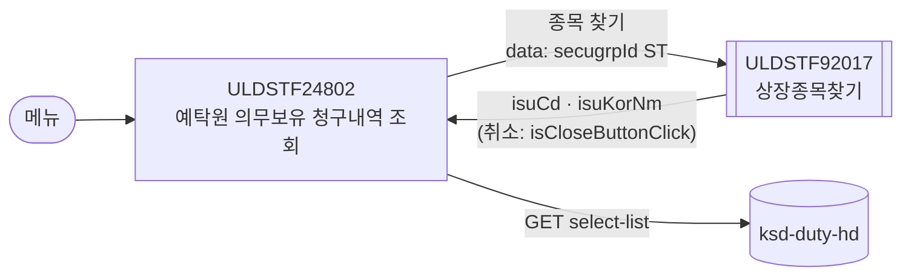
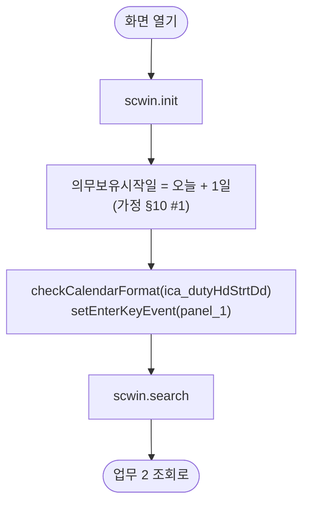
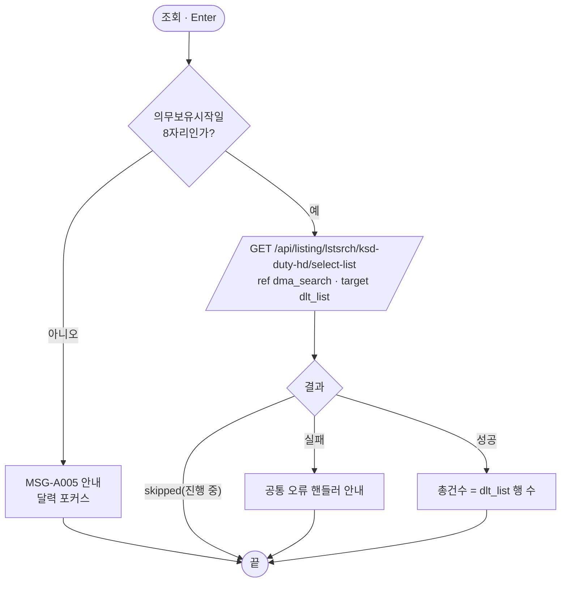
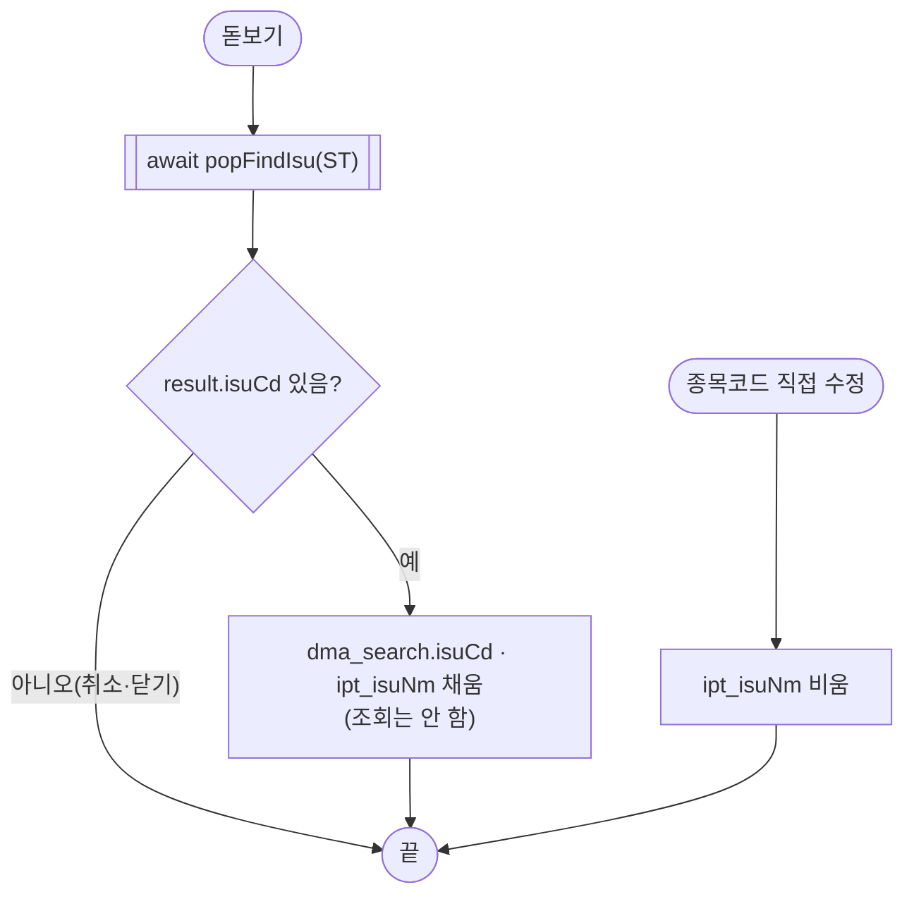
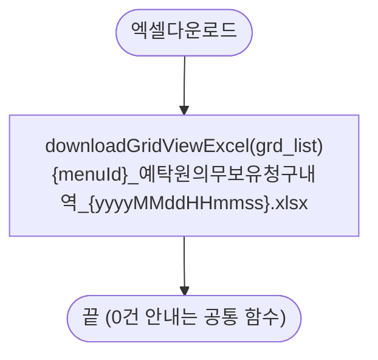

# ULDSTF24802 예탁원 의무보유 청구내역 조회 — 업무 분석 및 전환 내역

| 항목 | 내용 |
|---|---|
| AS-IS 원본 | **없음(신규 화면)** — 사용자 고지(2026-10-30). gfm·JSP 원본이 없어 업무·화면 구성은 퍼블리싱 목업과 API 명세에서 도출했다. 원본과 대조할 수 없으므로 근거가 약한 동작은 가정으로 두고 §10 에 올렸다 |
| 신규 API 명세 | `ULDSTF24802_API.md` — 블록 1종: 목록 조회 `GET /api/listing/lstsrch/ksd-duty-hd/select-list` (AS-IS 함수 칸 비어 있음 — 신규 API). 요청 `{ dutyHdStrtDd, isuCd }`, 응답 `dlt_list` 13키. §2.2·§5 는 명세 원문 기준(가이드 §0.3·§5) |
| TO-BE | `conversion/conversion-front/ui-tobe/ULDSTF24802.xml` (배포 경로 미정 — §10 #6). **2026-10-30 전환** — 1단계: 목업 기준 퍼블리싱 정비(마크업 전용, 사본 `$CLAUDE_JOB_DIR/tmp/ULDSTF24802_stage1.xml`), 2단계: 이 결과서대로 스크립트 작성. 게이트: `gate_screen --pcc stf`·`scan_mixed_compare`·`publish_gate --pcc stf --before {1단계} --allow P20`·`api_spec_check`·`init_binding_check`·`wsxml_lint` 0/0 통과, `convert.py` 고정점 |
| 퍼블리셔 XML | 화면 폴더의 `ULDSTF24802.xml`(스크립트는 빈 `onpageload` 뿐, 그리드에 예시 데이터 1행 + 빈 행 2개). `conversion/publish/상장/상장처리(대내)/ULDSTF24802.xml` 과 같은 계열. 본화면(`sub_contents`) 꼴 — 페이지 타이틀·breadcrumb 목업, 조회조건 2행(의무보유시작일·종목코드), 총건수·[엑셀다운로드], 그리드 7열, 안내 문구, 하단 [닫기] |
| 화면 캡처 | 없음 → 가이드 §13.2 의 캡처 기준 대신 선례 ULDBNS30400 처럼 퍼블리셔 목업을 정비해 1단계본을 만들었다 |
| 업무공통 | pcc(`cm/pcc/stf`): `$c.lc`(`popFindIsu`·`glb.SECUGRP_ID_ST`), `$c.stf.getMessageParam`. gcc: `$c.date`(`getServerDateTime`·`addDate`·`checkCalendarFormat`)·`$c.win`(`setEnterKeyEvent`·`alert`·`getProgramId`)·`$c.data.downloadGridViewExcel`·`$c.util.isEmpty`·`$c.sbm.executeDynamic`·`$c.exception.handleError`. 게이트는 `--pcc stf` |
| 작성 | Inswave / 2026-10-30 |

참고 양식: [websquare_gfm_conversion.md](../../../md/websquare_gfm_conversion.md) — AS-IS 가 없으므로 §3~§6 은 TO-BE 설계로, §9 는 「목업 → TO-BE」 대응으로 썼다. 조회 화면 골격(조회 영역 Enter·건수·엑셀 파일명)은 선례 [ULDSTF15900.md](../completed/ULDSTF15900/ULDSTF15900.md), 종목 팝업은 [ULDSTF05807.md](../completed/ULDSTF05807/ULDSTF05807.md)를 따랐다.

---

## 1. 화면 개요

상장 담당자가 **한국예탁결제원(예탁원)에 의무보유가 청구된 내역**을 확인하는 조회 전용 메인 화면이다. 안내 문구에 따르면 데이터는 "예탁원에 의무보유 청구되어 다음날부터 의무보유 시작되는 내역이 합산되어 제공되며, 매일 4회(15:00, 16:00, 17:00, 17:30)에 걸쳐 업데이트" 된다.

1. 화면을 열면 의무보유시작일을 **다음날**로 두고 바로 조회한다(가정 — §10 #1).
2. 의무보유시작일(필수)·종목코드(선택)로 [조회](또는 조회 영역 Enter)하면 청구내역(구분·종목코드·종목명·청구일·의무보유시작일·의무보유수량·의무보유사유)과 총건수를 보여 준다.
3. 종목 찾기(돋보기)로 종목을 고르면 종목코드·종목명을 채운다(조회는 하지 않음).
4. [엑셀다운로드]로 목록을 내려받는다.

### 1.1 호출 화면 (0본)

- 이 화면을 여는 화면은 저장소에 없다(`grep -rl ULDSTF24802` — 이 폴더와 퍼블리셔 XML 2본뿐). 메뉴에서 바로 여는 **메인 화면**으로 본다. 진입 파라미터는 없다.

### 1.2 호출 규약 (부모 → 이 화면) / 반환 규약

- 해당 없음 — 메뉴 화면이라 받는 파라미터·돌려주는 값이 없다.

### 1.3 이 화면이 여는 하위 팝업

| 팝업 | AS-IS 호출 | 넘기는 `data` (TO-BE) | 받는 결과 (`closePopup`) / 취소 판정 |
|---|---|---|---|
| `ULDSTF92017` 상장종목찾기 (750×800) | 없음(신규) — 목업의 종목코드 칸 [Search] 버튼 | pcc `$c.lc.popFindIsu($c.lc.glb.SECUGRP_ID_ST)` → `{ secugrpId : "ST" }` (주권으로 둔 것은 가정 — §10 #3) | 선택 행 JSON(`isuCd`·`isuKorNm`). 취소·닫기는 `{ isCloseButtonClick }` → **`result.isuCd` 가 비면 그대로 둔다** |

### 1.4 업무 프로세스 흐름

| # | 업무 | 시작 | TO-BE 함수 순서 |
|---|---|---|---|
| 1 | 진입·로딩 | 화면 열기 | `scwin.onpageload` → `scwin.init` → `scwin.search` |
| 2 | 조회 | [조회] · 조회 영역 Enter | `scwin.btn_search_onclick` → `scwin.search` → `scwin.validateSearch` → `scwin.selectList` |
| 3 | 종목 찾기 | 종목코드 돋보기 | `scwin.btn_isuSearch_onclick` → `scwin.openIsuPopup` |
| 4 | 종목코드 직접 수정 | 종목코드 입력 변경 | `scwin.ipt_isuCd_onviewchange` |
| 5 | 엑셀 | [엑셀다운로드] | `scwin.btn_excel_onclick` → `scwin.excelDown` |

#### 화면 간 흐름

#### 업무 1: 진입·로딩

| 단계 | 처리 | 근거 |
|---|---|---|
| 1 | `dma_search.dutyHdStrtDd` = `addDate(서버 오늘, 1)` | 안내 문구 "다음날부터 의무보유 시작되는 내역" — 가정 §10 #1 |
| 2 | 단일 달력 형식 검사(규칙 37), 조회 영역 Enter 키(규칙 22) | 전환 규칙 |
| 3 | 첫 조회 | 메인 조회 화면 선례(15900) — 가정 §10 #1 |

#### 업무 2: 조회

| 단계 | 처리 | 근거 |
|---|---|---|
| 1 | 의무보유시작일이 8자리가 아니면 `MSG-A005` "[의무보유시작일] 을(를) 입력하셔야 합니다." | 필수 여부는 가정 §10 #2 |
| 2 | 종목코드는 비어도 된다(전 종목) | 가정 §10 #2 |
| 3 | 명세 API 호출, 응답을 `dlt_list` 에, 그리드 `grd_list` | 명세 §1 |
| 4 | 총건수 `spn_totCnt` | 목업 count 영역 |

#### 업무 3~4: 종목 찾기 · 종목코드 직접 수정

#### 업무 5: 엑셀

#### 화면 모드 상태 전이

- 해당 없음 — 조회 전용 화면이라 신규·수정 모드가 없다.

---

## 2. 화면 구성 및 데이터 정의

### 2.1 화면 구성 (목업 요소 → TO-BE 컴포넌트)

| 영역 | 목업 요소 | TO-BE 컴포넌트 | 바인딩 / 비고 |
|---|---|---|---|
| 머리 | `pgtbox`(타이틀 `pgt_tit`·breadcrumb·`btn_fav` 목업) | `w2:pageFrame pfmContentHeader`(`/cm/xml/contentHeader.xml`) | 본화면 표준 머리(contentHeader 규칙) — 타이틀·경로는 공통 머리가 그린다 |
| 조회 | `schbox`(id 없음) | `panel_1` | 조회 영역 Enter 키 대상 |
| 조회 | 「의무보유시작일」 textbox | `lbl_dutyHdStrtDd` | |
| 조회 | `w2:inputCalendar`(id 없음, 120px) | `ica_dutyHdStrtDd` | `dma_search.dutyHdStrtDd`, 형식 검사 바인딩 |
| 조회 | 「종목코드」 textbox | `lbl_isuCd` | |
| 조회 | `xf:input`(80px) | `ipt_isuCd` (100px, maxlength 12) | `dma_search.isuCd`, `ev:onviewchange` |
| 조회 | `xf:input`(200px) | `ipt_isuNm` (readOnly) | 표시 전용 종목명(서버에 보내지 않음) |
| 조회 | `btn_cm search icon` [Search] | `btn_isuSearch` | 종목 찾기 |
| 조회 | `btn_cm sch` [조회] (`disabled=""`·`escape` 목업 속성) | `btn_search` | 목업 속성 제거 |
| 목록 머리 | count `num` span | `spn_totCnt` | 조회 후 행 수 |
| 목록 머리 | `btn_cm download` [엑셀다운로드] | `btn_excel` | |
| 목록 | `w2:gridView`(id 없음, `dataList1`, 153px, 캡션 "this is a grid caption.") | `grd_list`(`dlt_list`, readOnly, 400px) | 캡션 "예탁원 의무보유 청구내역 목록", 머리 id `h_` 접두 |
| 목록 열 | 구분 `col1` | `seqNo` | 가운데 |
| 목록 열 | 종목코드 `col2` | `isuCd` | 가운데 |
| 목록 열 | 종목명 `col3` | `isuKorNm` | 왼쪽, 폭 150 |
| 목록 열 | 청구일 `col4` | `dutyHdStrtPrevdd` | `dataType="date"` `yyyy-MM-dd`(규칙 46 — `…Prevdd` 는 명세 name "의무보유시작전일자(청구일, YYYYMMDD)" 로 날짜 열) |
| 목록 열 | 의무보유시작일 `col5` | `dutyHdStrtDd` | `dataType="date"` `yyyy-MM-dd`(규칙 46) |
| 목록 열 | 의무보유수량 `col6` | `ksdRcvDutyHdCnt` | `number` `#,##0`, 오른쪽 |
| 목록 열 | 의무보유사유 `col7` | `ksdDutyHdRsnNm` | 왼쪽 |
| 안내 | `txt_info` textbox(id 없음) | `txt_info` | 문구 그대로 |
| 하단 | `btnbox` [닫기] | (옮기지 않음) | 본화면(메뉴 탭)이라 닫기 버튼이 필요 없다 — 선례 05100 과 같음 |

### 2.2 데이터 정의 (DataCollection)

| id | 종류 | 키 (명세 원문) | 용도 |
|---|---|---|---|
| `dma_search` | dataMap | `dutyHdStrtDd`(의무보유시작일자 YYYYMMDD), `isuCd`(종목코드) | 조회조건 — 명세 requestData |
| `dlt_list` | dataList | `seqNo`(number), `rcvDd`, `rcvSeq`(number), `lstStatYn`, `isuCd`, `isuKorNm`, `ksdDutyHdCallTpCd`(02 확정상장전일 / 03 확정상장당일), `ksdDutyHdCallTpNm`, `ksdDutyHdRsnCd`, `ksdDutyHdRsnNm`, `dutyHdStrtPrevdd`(청구일), `dutyHdStrtDd`, `ksdRcvDutyHdCnt`(number) | 명세 응답 원문(id·name·dataType) 그대로. 그리드에 보이는 것은 7열, 나머지 6키(`rcvDd`·`rcvSeq`·`lstStatYn`·`ksdDutyHdCallTpCd/Nm`·`ksdDutyHdRsnCd`)는 받기만 한다(§10 #4) |

- 목업 `dataList1`(`col1`~`col7`, 예시 데이터 3행)은 지웠다.
- 그리드 구조 id: 캡션 `caption1`, 머리 `header1`/`row1`(열 `h_seqNo`·`h_isuCd`·`h_isuKorNm`·`h_dutyHdStrtPrevdd`·`h_dutyHdStrtDd`·`h_ksdRcvDutyHdCnt`·`h_ksdDutyHdRsnNm`), 본문 `gBody1`/`row2`.

---

## 3. 로딩 (`scwin.onpageload` → `scwin.init`) — 2구역

- `scwin.onpageload` 는 `scwin.init()` 호출만 갖고 try/catch + `$c.exception.handleError`.
- `scwin.init` 순서:
  1. `dma_search.dutyHdStrtDd` = `$c.date.addDate($c.date.getServerDateTime("yyyyMMdd"), 1)` — 가정 §10 #1.
  2. `$c.date.checkCalendarFormat(ica_dutyHdStrtDd, "yyyyMMdd", "의무보유시작일")`(규칙 37 — 단일 달력), `$c.win.setEnterKeyEvent(panel_1, scwin.btn_search_onclick)`(규칙 22).
  3. `await scwin.search()` — 기본값으로 첫 조회(가정 §10 #1).

## 4. 컴포넌트 이벤트 — 3구역

| 컴포넌트 | 이벤트 | TO-BE 핸들러 | 동작 |
|---|---|---|---|
| `btn_search` (+ `panel_1` Enter) | onclick | `scwin.btn_search_onclick` | `scwin.search` |
| `btn_isuSearch` | onclick | `scwin.btn_isuSearch_onclick` | `scwin.openIsuPopup` |
| `ipt_isuCd` | onviewchange | `scwin.ipt_isuCd_onviewchange` | 종목명 칸 비움(코드·명 어긋남 방지) |
| `btn_excel` | onclick | `scwin.btn_excel_onclick` | `scwin.excelDown` |

- 핸들러는 모두 try/catch + `handleError`(규칙 26).

## 5. 서버 통신 — 4구역

| 명세 블록 | AS-IS | TO-BE 함수 | method · action | ref → target |
|---|---|---|---|---|
| §1 목록 조회 | 없음(신규) | `scwin.selectList` | `GET /api/listing/lstsrch/ksd-duty-hd/select-list` | `dma_search` → `dlt_list=body` |

### 5.1 의무보유 청구내역 조회 (`scwin.selectList`)

- `$c.sbm.executeDynamic({ id : "sbm_selectList", method : "get", action : "/api/listing/lstsrch/ksd-duty-hd/select-list", ref : "dma_search", target : "dlt_list=body", gridview : "grd_list", isProcessMsg : false })` — action 은 전체 경로 리터럴(규칙 38), `getContextPath()` 없음(규칙 39), gridview 는 id 만(규칙 44).
- `result.skipped`(진행 중 중복 호출)면 아무것도 하지 않는다. `responseJSON.success` 가 아니면 공통 오류 핸들러가 안내한다.
- 성공하면 `spn_totCnt` 에 `dlt_list.getRowCount()`.
- 0건일 때 별도 안내는 하지 않는다(총건수 0 으로 보임 — 가정 §10 #5).

## 6. 일반 함수 — 5구역

### 6.1 조회 (`scwin.search` · `scwin.validateSearch`)

- `validateSearch`: `dma_search.dutyHdStrtDd` 가 8자리가 아니면 `$c.stf.getMessageParam("MSG-A005", "의무보유시작일")` 안내 후 달력 포커스, `false`. 종목코드는 검사하지 않는다(선택 조건).
- `search`: 검사 통과 시 `await scwin.selectList()`.

### 6.2 종목 찾기 (`scwin.openIsuPopup`)

- `const result = await $c.lc.popFindIsu($c.lc.glb.SECUGRP_ID_ST)`.
- `result?.isuCd` 가 비면(취소·X 닫기 `{ isCloseButtonClick }`) 그대로 둔다.
- 고르면 `dma_search.isuCd` = `result.isuCd`, `ipt_isuNm` = `result.isuKorNm`. 조회는 하지 않는다(15900 선례와 같음).

### 6.3 엑셀 (`scwin.excelDown`)

- `$c.data.downloadGridViewExcel(grd_list, { fileName : $c.win.getProgramId() + "_예탁원의무보유청구내역_" + yyyyMMddHHmmss + ".xlsx", sheetName : "sheet1" })` — 파일명 규칙 42. 0건 안내는 공통 함수.

### 6.4 부모 ↔ 팝업 파라미터 전달 (getPar/setPar → `$c.win.openPopup` + `await`)

- 신규 화면이라 getPar/setPar 가 없다. 종목 팝업은 처음부터 pcc `popFindIsu`(내부 `$c.win.openPopup` + `await` 반환)로 연다.

## 7. 업무 코드 · 메시지 목록

| 구분 | 값 | 의미 / 쓰는 곳 |
|---|---|---|
| 증권그룹 | `ST` (`$c.lc.glb.SECUGRP_ID_ST`) | 종목 팝업 대상 — 주권(가정 §10 #3) |
| 예탁원의무보유호출구분코드 | `02` 확정상장전일, `03` 확정상장당일 | 명세 응답 `ksdDutyHdCallTpCd` — 화면에서는 쓰지 않음(§10 #4) |
| 메시지 | `MSG-A005` "[^] 을(를) 입력하셔야 합니다." | 의무보유시작일 미입력 |
| 안내 문구 | "예탁원에 의무보유 청구되어 다음날부터 … 17:30)에 걸쳐 업데이트 됩니다." | `txt_info` |

## 8. 원본 특이사항 · 결함

AS-IS 가 없으므로 **목업의 결함·잔재**만 적는다.

| # | 내용 | 결정 |
|---|---|---|
| 1 | 컴포넌트 id 가 모두 빈 값(`id=""`) | 고침 — §2.1 TO-BE id 부여 |
| 2 | 그리드 열 id `col1`~`col7`·dataList `dataList1` 에 예시 데이터(○○전자 등) | 고침 — 명세 응답 키로 바꾸고 예시 데이터 삭제 |
| 3 | 페이지 타이틀·breadcrumb(1Depth/2Depth/3Depth Menu)·즐겨찾기 버튼 목업 | 고침 — 표준 `pfmContentHeader` 로 대체 |
| 4 | [조회] 버튼의 `disabled=""`·`escape="false"`, 스니펫 메타 속성(`meta_snippet*`) | 고침 — 제거 |
| 5 | 그리드 캡션 "this is a grid caption.", 높이 153px | 고침 — 업무 캡션, 400px |
| 6 | 본화면 하단 [닫기] | 옮기지 않음 — 메뉴 화면이라 불필요(05100 선례) |
| 7 | 종목코드 칸 폭 80px | 고침 — 100px·maxlength 12(표준코드 12자리 수용, §10 #3) |

## 9. 전환 내역 (목업 → TO-BE)

| 목업 | TO-BE |
|---|---|
| `scwin.onpageload`(빈 함수) | `scwin.onpageload` → `scwin.init` |
| (없음) 조회 버튼 | `scwin.btn_search_onclick` → `scwin.search` → `scwin.validateSearch` → `scwin.selectList` |
| (없음) 종목 [Search] | `scwin.btn_isuSearch_onclick` → `scwin.openIsuPopup` |
| (없음) 종목코드 입력 | `scwin.ipt_isuCd_onviewchange` |
| (없음) [엑셀다운로드] | `scwin.btn_excel_onclick` → `scwin.excelDown` |
| `dataList1` | `dma_search`·`dlt_list`(명세 원문) |
| `pgtbox` 목업 | `pfmContentHeader` |
| 하단 [닫기] | 삭제(§8 #6) |
| 상수 | `scwin.EXCEL_NAME` (엑셀 파일명 이름 부분) |

## 10. 남은 작업 (TODO)

| # | 내용 | 확인 대상 |
|---|---|---|
| 1 | **초기값·자동 조회** — 의무보유시작일을 다음날(달력일 +1)로 두고 진입 즉시 조회한다. 안내 문구 근거의 가정이며, 휴일 다음 영업일이어야 하는지·오늘이어야 하는지·자동 조회가 맞는지 확인 필요 | 업무 담당 |
| 2 | **조회조건 필수 여부** — 의무보유시작일 필수, 종목코드 선택으로 두었다. 서버가 빈 시작일(전체)을 허용하는지 확인 필요 | 업무 담당·서버 |
| 3 | **종목 팝업 범위** — `popFindIsu(ST)`(주권, ULDSTF92017). 의무보유 대상에 DR·ETF 등 다른 증권그룹이 포함되는지, 요청 `isuCd` 가 표준코드(12)인지 단축코드인지 확인 필요 | 업무 담당·서버 |
| 4 | **응답 미사용 키** — `rcvDd`·`rcvSeq`·`lstStatYn`·`ksdDutyHdCallTpCd/Nm`·`ksdDutyHdRsnCd` 는 받기만 한다. 호출구분(확정상장전일/당일)·최종상태 표시가 필요한지 확인 | 퍼블리싱·업무 |
| 5 | **0건 안내** — 별도 안내 없이 총건수 0. 안내 메시지가 필요하면 추가 | 업무 담당 |
| 6 | **배포 경로·메뉴** — 미정(`/ui/lst/…` 계열로 추정) | 메뉴 담당 |
| 7 | **캡처 없음** — 레이아웃은 퍼블리셔 목업 기준. 화면 캡처가 오면 §13.2 대조 필요 | 퍼블리싱 |

## 11. 화면 함수 목록 (TO-BE)

| 구역 | 함수 |
|---|---|
| 2 초기화 | `scwin.onpageload`, `scwin.init` |
| 3 이벤트 | `scwin.btn_search_onclick`, `scwin.btn_isuSearch_onclick`, `scwin.ipt_isuCd_onviewchange`, `scwin.btn_excel_onclick` |
| 4 서브미션 | `scwin.selectList` |
| 5 일반 | `scwin.search`, `scwin.validateSearch`, `scwin.openIsuPopup`, `scwin.excelDown` |
