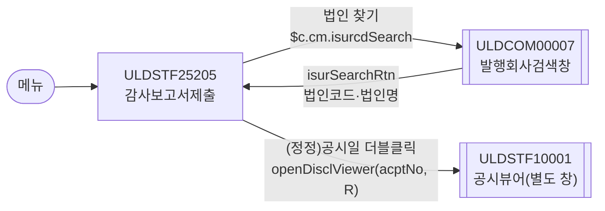
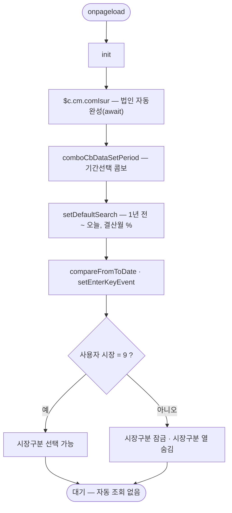
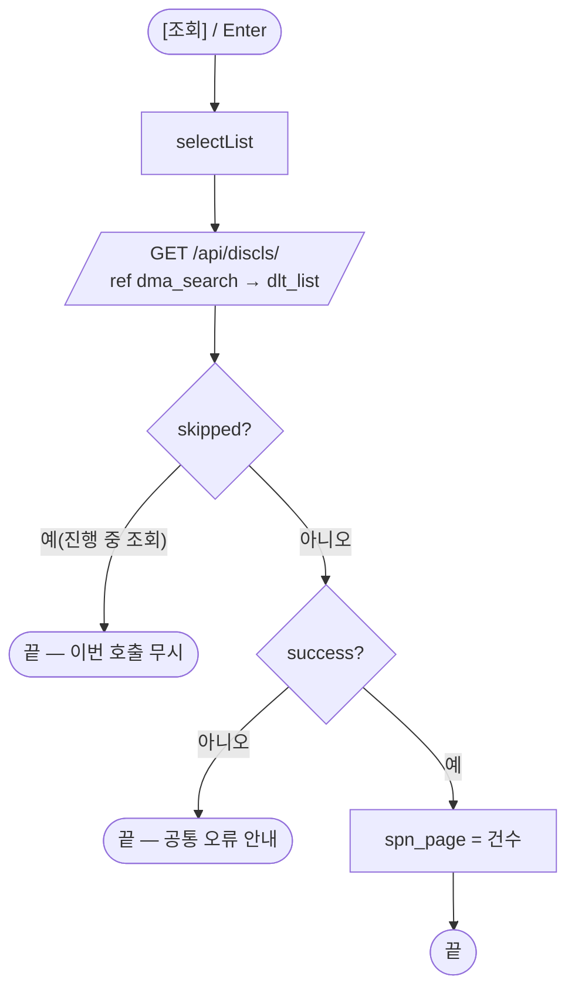
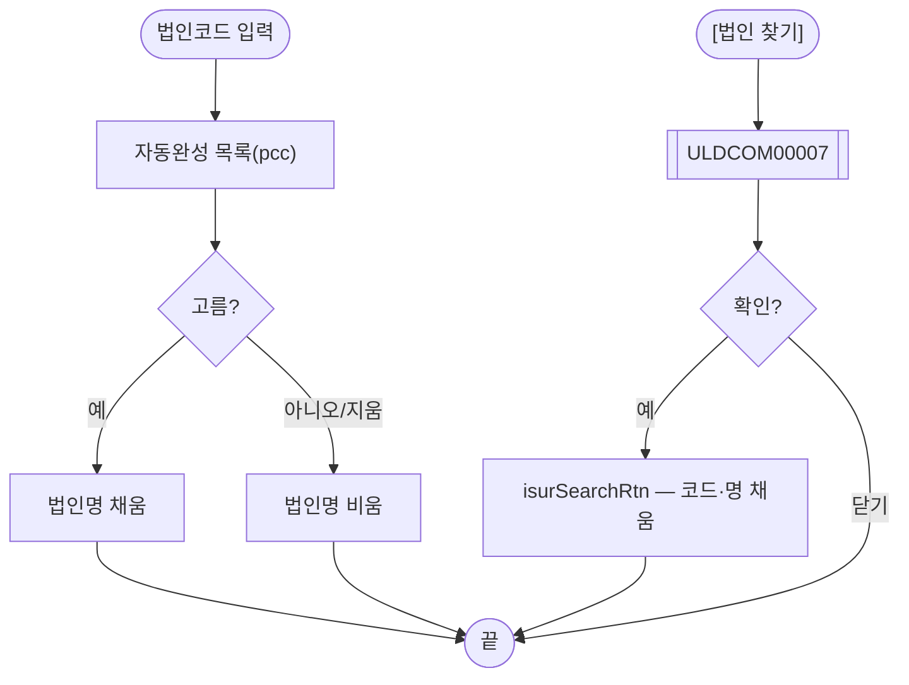
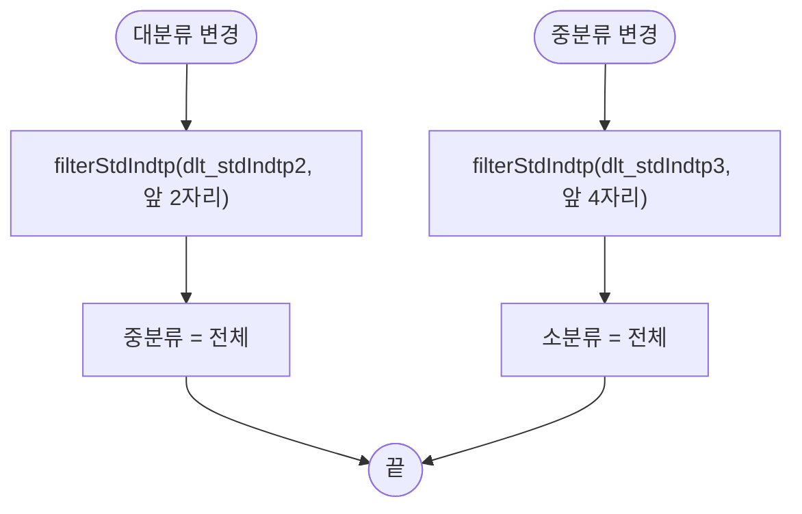
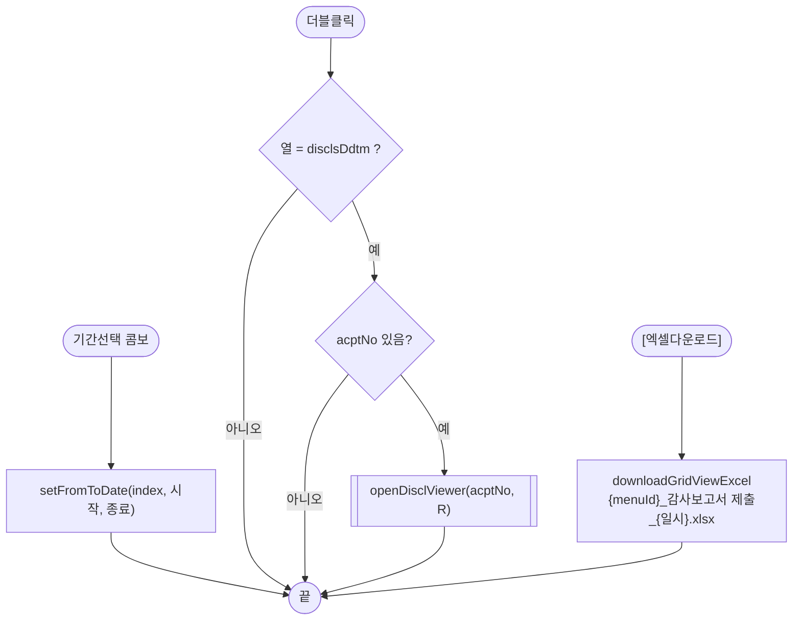

# ULDSTF25205 감사보고서제출 — 업무 분석 및 전환 내역

| 항목 | 내용 |
|---|---|
| AS-IS | `/dsclproc/ULDSTF25205.gfm` (Gauce/X-Internet, 1270×750 메인 화면 — 공시 통계) — 반입 `conversion/conversion-front/ui/ULDSTF25205/ULDSTF25205.gfm` |
| 신규 API 명세 | `ULDSTF25205_API.md` — 블록 1종 `[ULDSTF25205][공시][감사보고서제출] 목록 조회`: AS-IS `/DisclosureStatistics.do?method=listAuditReport` → TO-BE **`GET /api/discls/`**(끝 경로가 잘려 있음 — 원문 그대로 사용, §10 #1). 요청 8키, 응답 `dlt_list` 5키(그리드는 60열 — 나머지는 가정, §10 #3). §2.2·§5 는 명세 기준(가이드 §0.3·§5) |
| TO-BE | `conversion/conversion-front/ui-tobe/ULDSTF25205.xml`. **2026-10-30 전환** — 1단계: 캡처 + 퍼블리셔 XML 기준 퍼블리싱(마크업 전용, 사본 `$CLAUDE_JOB_DIR/tmp/ULDSTF25205_stage1.xml`), 2단계: 이 결과서대로 스크립트 전환. 게이트: `gate_screen --pcc stf`·`scan_mixed_compare`(A 0·B 0)·`publish_gate --pcc stf --before {1단계} --allow P20`·`api_spec_check`(명세 1종 사용)·`init_binding_check`·`wsxml_lint` 0/0 통과, `convert.py` 고정점 |
| 퍼블리셔 XML | 화면 폴더에 없음 → `conversion/publish/공시/공시처리(대내)/ULDSTF25205.xml`(W-Craft 1차 스크립트 내장, 읽기 전용)을 기준으로 썼다 — `sub_contents` 본화면, `schbox` 3행 표(시장구분 / 법인코드(명)·검색일자 / 표준산업업종·결산월), `titbox` 총건수·[엑셀다운로드], `gvwbox` 그리드. 법인코드는 `w2:autoComplete`. 컴포넌트 id 는 AS-IS 와 같다 |
| 화면 캡처 | `ULDSTF25205.png` (빈 화면 — 조회 전, 그리드 머리글 일부와 하단 [엑셀저장]) → TO-BE 는 가이드 §13.2 퍼블리싱본부터 만들었다. 영역 순서·조건 배치는 캡처와 퍼블리셔 XML 이 같다. [엑셀저장]·건수 위치만 다르다(아래 §2.1) |
| 업무공통 | pcc(`cm/pcc/stf`): `$c.cm`(`comIsur`·`isurcdSearch`), `$c.stf`(`setFromToDate`·`openDisclViewer`). gcc: `$c.data`(`comboCbDataSetPeriod`·`downloadGridViewExcel`)·`$c.date`(`compareFromToDate`·`getServerDateTime`·`addYear`)·`$c.win`(`setEnterKeyEvent`·`getProgramId`)·`$c.session`·`$c.util.isEmpty`·`$c.sbm.executeDynamic`·`$c.exception.handleError`. 게이트는 `--pcc stf` 로 돌린다 |
| 작성 | Inswave / 2026-10-30 |

참고 양식: [websquare_gfm_conversion.md](../../../md/websquare_gfm_conversion.md) — 특히 §1.4 업무 프로세스 흐름, §5 「API 명세 적용」, §6.5 getPar/setPar 전환. Gauce 대응은 [gfm_business_analysis_guide.md](../../../md/gfm_business_analysis_guide.md) §5·§6 을 함께 따랐다. 목록 조회 화면 골격(조회조건·기간선택·총건수·엑셀)은 선례 [ULDSTF05100.md](../completed/ULDSTF05100/ULDSTF05100.md) 의 구성과 결정을 따랐다.

---

## 1. 화면 개요

공시 담당자가 **상장법인의 감사보고서 제출 현황**을 통계로 보는 조회 전용 메인 화면이다. 회사마다 원공시일·(정정)공시일, 외부감사인, 연결재무제표 제출대상 여부, 감사보고서 수령일, 당해·직전년도 감사의견(개별·연결)과 자본잠식여부, 당해·직전년도 재무 요약(개별·연결 각 11항목)을 한 줄로 보여 준다.

1. 시장구분·법인코드(명)·검색일자 기간·표준산업업종(대·중·소)·결산월을 정하고 [조회]한다. 진입할 때는 조회하지 않는다.
2. 상장여부와 회사명은 상장상태에 따라 글자색이 다르다(폐지 빨강, 비상장 초록).
3. (정정)공시일 칸을 더블클릭하면 그 공시를 공시뷰어로 연다.
4. [엑셀다운로드]로 목록을 내려받는다.

### 1.1 호출 화면 (0본)

- 이 화면을 여는 화면은 저장소에 없다(`git grep ULDSTF25205` — 이 폴더와 퍼블리셔 XML 2본, 파이프라인 보고서뿐). 메뉴에서 바로 여는 **메인 화면**으로 본다(퍼블리셔 XML 도 본화면 꼴). 진입 파라미터는 없다.

### 1.2 호출 규약 (부모 → 이 화면) / 반환 규약

- 해당 없음 — 메뉴 화면이라 받는 파라미터·돌려주는 값이 없다. 원본 전역 `gDepCd`(`js_dep_cd`)·`gEmpNo`(`js_emp_no`)·`gLdMktTp`(`js_market`)는 세션 값이고, 쓰는 곳은 `js_market` 하나뿐이다(§3).

### 1.3 이 화면이 여는 하위 팝업

| 팝업 | AS-IS 호출 (getPar/setPar) | 넘기는 `data` (TO-BE) | 받는 결과 / 취소 판정 |
|---|---|---|---|
| `ULDCOM00007` 발행회사검색창 (618×730) | `IsurcdSearch(txb_ISUR_CD, txb_COM_NM)`(`common.js`) — 고른 회사코드·명을 두 칸에 직접 넣는다 | pcc `$c.cm.isurcdSearch(txb_ISUR_CD, txb_COM_NM)` 그대로 — pcc 가 두 컴포넌트를 기억하고 팝업을 연다(`data` 없음) | 팝업 [확인]이 `$c.cm.isurSearchRtn` 으로 두 칸을 채운다(반환값 없음). 취소면 아무것도 바뀌지 않는다 — pcc 계약이라 화면에서 판정하지 않는다(§6.2) |
| `ULDSTF10001` 공시뷰어 (`browserPopup` 1000×800) | `fn_OpenDisclViewer(gAcptNo, "R")`(`stf.js`) | pcc `$c.stf.openDisclViewer(acptNo, "R")` — 접수번호·조회 모드를 URL 쿼리로 넘긴다 | 반환 없음(별도 창) |

- getPar/setPar 를 쓰는 팝업은 없다(§6.5 해당 없음).

### 1.4 업무 프로세스 흐름

| 업무 | 시작 | 함수 순서 | 끝 |
|---|---|---|---|
| 1. 진입·로딩 | 메뉴 진입 | `onpageload` → `init` → `comIsur` · `comboCbDataSetPeriod` · `setDefaultSearch` · `compareFromToDate` · `setEnterKeyEvent` · `applyUserMarket` | 조회조건 기본값 상태(목록 비어 있음) |
| 2. 목록 조회 | [조회]·조회 영역 Enter | `btn_Search_onclick` → `selectList` | 목록·건수 표시 / 실패면 공통 오류 안내 |
| 3. 법인 선택 | 법인코드 입력 또는 [법인 찾기] | 자동완성(`comIsur` 가 묶은 이벤트) / `btn_ISUR_CD_onclick` → `$c.cm.isurcdSearch` | 법인코드·법인명 채움 |
| 4. 표준산업업종 단계 선택 | 대·중분류 변경 | `cmb_STD_INDTP1_onviewchange`·`cmb_STD_INDTP2_onviewchange` → `filterStdIndtp` | 하위 목록이 상위 코드로 걸러짐(목록 API 부재 — §10 #2) |
| 5. 기간 선택 | 기간선택 콤보 | `cmb_PeriodTp_onviewchange` → `$c.stf.setFromToDate` | 시작·종료일 채움 |
| 6. 공시 보기 | (정정)공시일 더블클릭 | `grd_Grid_oncelldblclick` → `openViewer` → `$c.stf.openDisclViewer` | 공시뷰어 창 |
| 7. 엑셀 다운로드 | [엑셀다운로드] | `btn_Excel_onclick` → `excelDown` | 엑셀 파일 |

#### 화면 간 흐름

#### 업무 1: 진입·로딩

| 단계 | 처리 | 근거 |
|---|---|---|
| 1 | 법인 자동완성 준비 — pcc 가 회사 목록을 받아 자동완성 그리드를 만들고 고르면 법인명을 채우는 이벤트를 묶는다 | 원본 `fn_com_isur(txb_ISUR_CD, txb_COM_NM)` + `Grd_com_isur` 이벤트 묶음 (§3) |
| 2 | 기간선택 콤보·기본 기간·결산월 전체 | 원본 `fn_SetCode` |
| 3 | 달력 선후 검사·Enter 키 | 규칙 37·22 |
| 4 | 시장구분 | 원본 `fn_Init` |

#### 업무 2: 목록 조회

| 단계 | 처리 | 근거 |
|---|---|---|
| 1 | 조회조건은 컴포넌트가 `dma_search` 에 바인딩돼 있어 따로 모으지 않는다 | 원본 URL 조립(`getObjectValue` ×8) |
| 2 | `executeDynamic`(GET, `ref : "dma_search"`, `target : "dlt_list=body"`, `gridview : "grd_Grid"`) | 명세 §1 |
| 3 | 건수를 `spn_page` 에 | 원본 `dts_Grid_OnLoadCompleted` → `FillGridHeaderTotalCnt(rowcount, panel_page)` |
| 4 | 실패는 공통 오류 핸들러 | 원본 `dts_Grid_OnLoadError` → `alert_error` |

#### 업무 3: 법인 선택

#### 업무 4: 표준산업업종 단계 선택

- 상위가 「전체」(빈 값)면 거르지 않는다. 하위 목록의 빈 값 행은 늘 남긴다(원본 `OnFilter` 와 같음).
- **목록 API 가 없어 세 콤보는 「전체」만 있다**(§10 #2) — 거르기 로직은 목록이 채워지면 그대로 동작한다.

#### 업무 5~7

#### 화면 모드 상태 전이

해당 없음 — 조회 전용 화면이라 모드 전환이 없다. 시장구분 잠금은 로딩 때 한 번 정한다.

---

## 2. 화면 구성 및 데이터 정의

### 2.1 화면 구성 (AS-IS 요소 → TO-BE 컴포넌트)

| AS-IS 요소 | AS-IS 종류 | TO-BE 컴포넌트 | 바인딩 / 비고 |
|---|---|---|---|
| `panel_1` | panel(조회 영역, `PanelToGroupBox`) | `xf:group.schbox#panel_1` | `setEnterKeyEvent` 대상 |
| `label_29` 시장구분 | label | `w2:textbox#label_29` | |
| `rdo_MKT_ID` | mxradio `9^전체,1^유가,2^코스닥`, `enable=False` | `xf:select1#rdo_MKT_ID` radiogroup, `disabled="true"` | `dma_search.ldMktTpCd`. 사용자 시장 9 이면 `setDisabled(false)` |
| `label_4` 법인코드(명) | label | `w2:textbox#label_4` | |
| `txb_ISUR_CD` | textbox(자동완성 키 입력) | `w2:autoComplete#txb_ISUR_CD` | `dma_search.isurCd`. 목록·이벤트는 pcc `comIsur` |
| `txb_COM_NM` | textbox readonly | `xf:input#txb_COM_NM` readOnly | 바인딩 없음(표시용 — 명세 요청 키 아님) |
| `btn_ISUR_CD` | image(돋보기) | `xf:trigger#btn_ISUR_CD.btn_cm icon search` | `scwin.btn_ISUR_CD_onclick` |
| `Grd_com_isur` (`SPOT_ISU_TRD_MKT_TP_CD`·`COM_ABBRV`·`ISUR_CD`·`LIST_STAT_CD`), `MxDataSet_com_isur` | 자동완성용 숨김 그리드·데이터셋 | **(옮기지 않음)** — `w2:autoComplete` 의 내장 목록(pcc `searchIsurCode` 가 만드는 `dlt_isurCd_txb_ISUR_CD`)으로 대체 | |
| `label_7` 검색일자, `label_5` ~ | label | `w2:textbox#label_7`, `w2:span#label_5` | |
| `edt_SDATE`·`edt_EDATE` | mxmaskedit `YYYY-MM-DD` | `w2:inputCalendar` | `dma_search.dateS`·`dateE`. 기간 쌍 `compareFromToDate`(규칙 37) |
| `btn_SDATE`·`btn_EDATE` | image(달력 버튼, `popUpCalendar2`) | **(옮기지 않음)** — `inputCalendar` 내장 달력 버튼 | |
| `cmb_PeriodTp` | mxcombo `1주일^1 … 2년^6`, `defaultstring=기간선택` | `xf:select1#cmb_PeriodTp` | 항목은 `$c.data.comboCbDataSetPeriod`(0 기간선택 ~ 6 2년). 바인딩 없음 |
| `label_1` 표준산업업종 | label | `w2:textbox#label_1` | |
| `cmb_STD_INDTP1`·`2`·`3` | mxcombo(`dts_STD_INDTP1/2/3`) | `xf:select1` `chooseOption` 「전체」 + itemset `dlt_stdIndtp1/2/3` | `dma_search.stdIndtp1/2/3` |
| `label_2` 결산월 | label | `w2:textbox#label_2` | |
| `cmb_f_mm_1` | mxcombo `%^전체,12^12월 … 01^01월` | `xf:select1#cmb_f_mm_1` (같은 13항목) | `dma_search.acntclsMm` |
| `btn_Search` | image(조회) | `xf:trigger#btn_Search.btn_cm sch` | `scwin.btn_Search_onclick` |
| `image_11` | image(구분선) | **(옮기지 않음)** — `schbox` 레이아웃이 대신함 | |
| `grd_Grid` | mxgrid(`dts_Grid`) | `w2:gridView#grd_Grid` `dataList="data:dlt_list"`, `rowNumVisible`, 머리글 2행(개별·연결 묶음 4개 `colSpan="11"`) | `scwin.grd_Grid_oncelldblclick` — 열은 §2.2 |
| `panel_page` | panel(총건수) | `w2:span#spn_page` (`titbox > count`) | 퍼블리셔 XML 의 `panel_page`(빈 span 그룹)를 선례 05100 의 `spn_page` 꼴로 |
| `btn_Excel` | image(엑셀저장, 그리드 아래 오른쪽) | `xf:trigger#btn_Excel.btn_cm download` 「엑셀다운로드」 — **`titbox` 오른쪽**(건수 옆) | 캡처는 그리드 아래, 퍼블리셔 XML·선례(05100·05700)는 그리드 위 `titbox` — 표준 꼴을 따랐다(§10 #6) |
| — | — | `w2:pageFrame#pfmContentHeader` | 본화면 contentHeader 필수(퍼블리싱 규칙) |

### 2.2 데이터 정의 (DataCollection)

| AS-IS | TO-BE | 종류 | 키 | 비고 |
|---|---|---|---|---|
| URL 쿼리 조립(`fn_Search`) | `dma_search` | dataMap | 명세 요청 8키(아래) | 조회조건 컴포넌트가 바인딩 |
| `dts_Grid` | `dlt_list` | dataList | 명세 응답 5키 + 가정 키(아래 표) | 명세 target `dlt_list=body` |
| `dts_STD_INDTP1`·`2`·`3` | `dlt_stdIndtp1`·`2`·`3` | dataList | `value`·`text`(원본 `cbdatacolumns="value,text"`) | 목록 API 없음 — 비어 있다(§10 #2) |
| `MxDataSet_com_isur` | (pcc 동적 `dlt_isurCd_txb_ISUR_CD`) | dataList | — | pcc `searchIsurCode` 가 만든다 |

**요청 `dma_search` (명세 requestData 그대로)**

| AS-IS 쿼리 | TO-BE 키 | 값 출처 | 비고 |
|---|---|---|---|
| `MKT_ID` | `ldMktTpCd` | `rdo_MKT_ID` (9·1·2) | 로딩 때 사용자 시장 |
| `ISUR_CD` | `isurCd` | `txb_ISUR_CD` | |
| `SDATE` | `dateS` | `edt_SDATE` (yyyyMMdd) | 기본 1년 전 |
| `EDATE` | `dateE` | `edt_EDATE` (yyyyMMdd) | 기본 오늘 |
| `STD_INDTP1`~`3` | `stdIndtp1`~`3` | `cmb_STD_INDTP1`~`3` | 지금은 늘 빈 값(§10 #2) |
| `ACNTCLS_MMDD1` | `acntclsMm` | `cmb_f_mm_1` | 전체는 원본 값 `%` 그대로(§10 #5) |
| `SCREN_ID`·`SCREN_PROCES_TP_CD` | (보내지 않음) | — | 명세에 없음 — 화면 로그용 원본 인자(§10 #4) |

**응답 `dlt_list` — 그리드 열 대응** (근거: 「명세」 = 명세 응답 키, 「가정」 = 명세에 없어 AS-IS 열 id 를 camelCase 로 옮김 — §10 #3)

| AS-IS 열 id | AS-IS 명칭 | TO-BE 키 | 근거 | 비고 |
|---|---|---|---|---|
| `NO` | 번호 | (rowNum) | — | 그리드 `rowNumVisible` 순번(`{CurRow}`) |
| `MKT_NM` | 시장구분 | `ldMktTpNm` | 명세 |  |
| `LIST_STAT_NM` | 상장여부 | `listStatNm` | 명세 | 글자색 `Decode(LIST_STAT_CD,'Y','#000000','D','#FF0033','N','#009933')` → `scwin.fmtListStat`(D `red`·N `green`, 규칙 40·43) |
| `COM_ABBRV` | 회사명 | `comAbbrv` | 명세 | 글자색 `Decode(LIST_STAT_CD,'Y','#000000','D','#FF0033','N','#009933')` → `scwin.fmtListStat`(D `red`·N `green`, 규칙 40·43) |
| `ISU_SRT_CD` | 종목코드 | `isuSrtCd` | 명세 |  |
| `STD_IND_NM` | 표준산업업종 | `stdIndNm` | 가정 |  |
| `ORGN_DISCLS_DDTM` | 원공시일 | `orgnDisclsDdtm` | 가정 | AS-IS 마스크 `XXXX-XX-XX` → `dataType="date" displayFormat="yyyy-MM-dd"`(규칙 46) |
| `DISCLS_DDTM` | (정정)공시일 | `disclsDdtm` | 가정 | AS-IS 마스크 `XXXX-XX-XX` → `dataType="date" displayFormat="yyyy-MM-dd"`(규칙 46); 배경 `#ffff99`·`cursor=hand` → `scwin.fmtDisclsDdtm`(`bg_orange`) — 더블클릭 공시뷰어 칸 |
| `EXT_AUDTR_NM` | 외부감사인 | `extAudtrNm` | 가정 |  |
| `CONSFS_SUBMIT_OBJ_YN` | 연결재무제표;제출대상 | `consfsSubmitObjYn` | 가정 |  |
| `AUDT_WRTRPT_ACPT_DD` | 감사보고서;수령일 | `audtWrtrptAcptDd` | 가정 | AS-IS 마스크 `XXXX-XX-XX` → `dataType="date" displayFormat="yyyy-MM-dd"`(규칙 46); 글자색 `#343434`·홀짝 배경 decode → 기본색·그리드 기본 줄무늬(class 없음) |
| `THSBZYY_AUDT_OPIN_TP_NM` | 당해년도;감사의견;(개별) | `thsbzyyAudtOpinTpNm` | 가정 |  |
| `LSTBZYY_AUDT_OPIN_TP_NM` | 직전년도;감사의견;(개별) | `lstbzyyAudtOpinTpNm` | 가정 |  |
| `L_THSBZYY_AUDT_OPIN_TP_NM` | 당해년도;감사의견;(연결) | `lThsbzyyAudtOpinTpNm` | 가정 |  |
| `L_LSTBZYY_AUDT_OPIN_TP_NM` | 직전년도;감사의견;(연결) | `lLstbzyyAudtOpinTpNm` | 가정 |  |
| `THSBZYY_IMPCAP_TP_NM` | 당해년도;자본잠식여부 | `thsbzyyImpcapTpNm` | 가정 |  |
| `LSTBZYY_IMPCAP_TP_NM` | 직전년도;자본잠식여부 | `lstbzyyImpcapTpNm` | 가정 |  |
| `CURTRM_TOT_ASST_AMT` | 자산총계 | `curtrmTotAsstAmt` | 가정 | 묶음 `당해년도;(개별)`; 오른쪽 정렬 |
| `CURTRM_TOT_DEBT_AMT` | 부채총계 | `curtrmTotDebtAmt` | 가정 | 묶음 `당해년도;(개별)`; 오른쪽 정렬 |
| `CURTRM_CAP` | 자본금 | `curtrmCap` | 가정 | 묶음 `당해년도;(개별)`; 오른쪽 정렬 |
| `CURTRM_TOT_CAP` | 자본총계 | `curtrmTotCap` | 가정 | 묶음 `당해년도;(개별)`; 오른쪽 정렬 |
| `CURTRM_SALES` | 매출액 | `curtrmSales` | 가정 | 묶음 `당해년도;(개별)`; 오른쪽 정렬 |
| `CURTRM_OPERPROFT_AMT` | 영업이익 | `curtrmOperproftAmt` | 가정 | 묶음 `당해년도;(개별)`; 오른쪽 정렬 |
| `CURTRM_ORDNINCM_AMT` | 경상이익 | `curtrmOrdnincmAmt` | 가정 | 묶음 `당해년도;(개별)`; 오른쪽 정렬 |
| `CURTRM_NETINCM_AMT` | 당기순이익 | `curtrmNetincmAmt` | 가정 | 묶음 `당해년도;(개별)`; 오른쪽 정렬 |
| `CURTRM_BFTAX_NETPL_AMT` | 법인세비용차감전;순손익및계속사업손익금액 | `curtrmBftaxNetplAmt` | 가정 | 묶음 `당해년도;(개별)`; 오른쪽 정렬 |
| `CURTRM_CMPCAP_TOT_CAP_RTO` | 자본총계/자본금(%) | `curtrmCmpcapTotCapRto` | 가정 | 묶음 `당해년도;(개별)`; 오른쪽 정렬 |
| `CURTRM_IMPCAP_RTO` | 자본잠식율 | `curtrmImpcapRto` | 가정 | 묶음 `당해년도;(개별)`; 오른쪽 정렬 |
| `FSTTRM_TOT_ASST_AMT` | 자산총계 | `fsttrmTotAsstAmt` | 가정 | 묶음 `직전년도;(개별)`; 오른쪽 정렬 |
| `FSTTRM_TOT_DEBT_AMT` | 부채총계 | `fsttrmTotDebtAmt` | 가정 | 묶음 `직전년도;(개별)`; 오른쪽 정렬 |
| `FSTTRM_CAP` | 자본금 | `fsttrmCap` | 가정 | 묶음 `직전년도;(개별)`; 오른쪽 정렬 |
| `FSTTRM_TOT_CAP` | 자본총계 | `fsttrmTotCap` | 가정 | 묶음 `직전년도;(개별)`; 오른쪽 정렬 |
| `FSTTRM_SALES` | 매출액 | `fsttrmSales` | 가정 | 묶음 `직전년도;(개별)`; 오른쪽 정렬 |
| `FSTTRM_OPERPROFT_AMT` | 영업이익 | `fsttrmOperproftAmt` | 가정 | 묶음 `직전년도;(개별)`; 오른쪽 정렬 |
| `FSTTRM_ORDNINCM_AMT` | 경상이익 | `fsttrmOrdnincmAmt` | 가정 | 묶음 `직전년도;(개별)`; 오른쪽 정렬 |
| `FSTTRM_NETINCM_AMT` | 당기순이익 | `fsttrmNetincmAmt` | 가정 | 묶음 `직전년도;(개별)`; 오른쪽 정렬 |
| `BFFSTTRMTAX_NETPL_AMT` | 법인세비용차감전;순손익및계속사업손익금액 | `bffsttrmtaxNetplAmt` | 가정 | 묶음 `직전년도;(개별)`; 오른쪽 정렬 |
| `CMPEQTY_TOT_CAP_RTO` | 자본총계/자본금(%) | `cmpeqtyTotCapRto` | 가정 | 묶음 `직전년도;(개별)`; 오른쪽 정렬 |
| `FSTTRM_IMPCAP_RTO` | 자본잠식율 | `fsttrmImpcapRto` | 가정 | 묶음 `직전년도;(개별)`; 오른쪽 정렬 |
| `L_CURTRM_TOT_ASST_AMT` | 자산총계 | `lCurtrmTotAsstAmt` | 가정 | 묶음 `당해년도;(연결)`; 오른쪽 정렬 |
| `L_CURTRM_TOT_DEBT_AMT` | 부채총계 | `lCurtrmTotDebtAmt` | 가정 | 묶음 `당해년도;(연결)`; 오른쪽 정렬 |
| `L_CURTRM_CAP` | 자본금 | `lCurtrmCap` | 가정 | 묶음 `당해년도;(연결)`; 오른쪽 정렬 |
| `L_CURTRM_TOT_CAP` | 자본총계 | `lCurtrmTotCap` | 가정 | 묶음 `당해년도;(연결)`; 오른쪽 정렬 |
| `L_CURTRM_SALES` | 매출액 | `lCurtrmSales` | 가정 | 묶음 `당해년도;(연결)`; 오른쪽 정렬 |
| `L_CURTRM_OPERPROFT_AMT` | 영업이익 | `lCurtrmOperproftAmt` | 가정 | 묶음 `당해년도;(연결)`; 오른쪽 정렬 |
| `L_CURTRM_ORDNINCM_AMT` | 경상이익 | `lCurtrmOrdnincmAmt` | 가정 | 묶음 `당해년도;(연결)`; 오른쪽 정렬 |
| `L_CURTRM_NETINCM_AMT` | 당기순이익 | `lCurtrmNetincmAmt` | 가정 | 묶음 `당해년도;(연결)`; 오른쪽 정렬 |
| `L_CURTRM_BFTAX_NETPL_AMT` | 법인세비용차감전;순손익및계속사업손익금액 | `lCurtrmBftaxNetplAmt` | 가정 | 묶음 `당해년도;(연결)`; 오른쪽 정렬 |
| `L_CURTRM_CMPCAP_TOT_CAP_RTO` | 자본총계/자본금(%) | `lCurtrmCmpcapTotCapRto` | 가정 | 묶음 `당해년도;(연결)`; 오른쪽 정렬 |
| `L_CURTRM_IMPCAP_RTO` | 자본잠식율 | `lCurtrmImpcapRto` | 가정 | 묶음 `당해년도;(연결)`; 오른쪽 정렬 |
| `L_FSTTRM_TOT_ASST_AMT` | 자산총계 | `lFsttrmTotAsstAmt` | 가정 | 묶음 `직전년도;(연결)`; 오른쪽 정렬 |
| `L_FSTTRM_TOT_DEBT_AMT` | 부채총계 | `lFsttrmTotDebtAmt` | 가정 | 묶음 `직전년도;(연결)`; 오른쪽 정렬 |
| `L_FSTTRM_CAP` | 자본금 | `lFsttrmCap` | 가정 | 묶음 `직전년도;(연결)`; 오른쪽 정렬 |
| `L_FSTTRM_TOT_CAP` | 자본총계 | `lFsttrmTotCap` | 가정 | 묶음 `직전년도;(연결)`; 오른쪽 정렬 |
| `L_FSTTRM_SALES` | 매출액 | `lFsttrmSales` | 가정 | 묶음 `직전년도;(연결)`; 오른쪽 정렬 |
| `L_FSTTRM_OPERPROFT_AMT` | 영업이익 | `lFsttrmOperproftAmt` | 가정 | 묶음 `직전년도;(연결)`; 오른쪽 정렬 |
| `L_FSTTRM_ORDNINCM_AMT` | 경상이익 | `lFsttrmOrdnincmAmt` | 가정 | 묶음 `직전년도;(연결)`; 오른쪽 정렬 |
| `L_FSTTRM_NETINCM_AMT` | 당기순이익 | `lFsttrmNetincmAmt` | 가정 | 묶음 `직전년도;(연결)`; 오른쪽 정렬 |
| `L_BFFSTTRMTAX_NETPL_AMT` | 법인세비용차감전;순손익및계속사업손익금액 | `lBffsttrmtaxNetplAmt` | 가정 | 묶음 `직전년도;(연결)`; 오른쪽 정렬 |
| `L_CMPEQTY_TOT_CAP_RTO` | 자본총계/자본금(%) | `lCmpeqtyTotCapRto` | 가정 | 묶음 `직전년도;(연결)`; 오른쪽 정렬 |
| `L_FSTTRM_IMPCAP_RTO` | 자본잠식율 | `lFsttrmImpcapRto` | 가정 | 묶음 `직전년도;(연결)`; 오른쪽 정렬 |
| `MISC_CONTN` | 기타 | `remk` | 명세 |  |
| (그리드 밖) `LIST_STAT_CD` | 상장상태코드 | `listStatCd` | 가정 | 글자색 판정용 숨김 열(원본 `Decode(LIST_STAT_CD, …)` 가 읽음) |
| (그리드 밖) `ACPT_NO` | 접수번호 | `acptNo` | 가정 | 공시뷰어용 숨김 열(원본 `fn_setContnId` 가 `NameString(row, "ACPT_NO")`) |

- 명세 응답의 `ldMktTpNm`(시장구분)은 AS-IS `MKT_NM`, `remk`(기타)는 AS-IS `MISC_CONTN` 자리다(명칭 일치).
- 재무 44열은 AS-IS 에 형식(마스크·소수)이 없어 원시 값을 오른쪽 정렬로 둔다(`dataType` 은 text). 금액·비율 형식은 서버 값이 정해지면 정한다(§10 #3).
- 날짜 3열(`orgnDisclsDdtm`·`disclsDdtm`·`audtWrtrptAcptDd`)은 AS-IS 마스크 `XXXX-XX-XX` 대상이라 규칙 46 형태다. `…Ddtm` 이 14자리 일시로 오면 엔진이 원시 값을 그대로 보인다 — 서버 값 길이 확인(§10 #7).
- 원본 그리드 머리글의 `;` 는 줄바꿈이다 → TO-BE 머리글은 ` `. 묶음 `당해년도;(개별)` 등은 2행 머리글의 `colSpan="11"` 묶음 칸 「당해년도(개별)」로 옮겼다.

---

## 3. 로딩 (`scwin.onpageload` → `scwin.init`) — 2구역

원본 `gform_onload`: `fn_HideDebugCtrls()`(빈 함수) → `fn_com_isur(txb_ISUR_CD, txb_COM_NM)` → `Grd_com_isur.style.zIndex = 30` → `PanelToGroupBox(panel_1)` → `fn_SetCode()` → `fn_Init()`.

`scwin.onpageload` 는 `scwin.init()` 호출만 갖고(try/catch + `handleError`), `scwin.init` 이 아래 순서로 처리한다.

1. **법인 자동완성** — `await $c.cm.comIsur(txb_ISUR_CD, txb_COM_NM)`. pcc 가 회사 목록(`/api/discls/common/popup/select-list-isur-cd-value` — pcc 내부 호출)을 받아 자동완성 그리드를 만들고, 고르면 법인명을 채우고 코드를 지우면 법인명도 지우는 이벤트를 묶는다. 원본의 `txb_ISUR_CD` `onkeyup`(두 벌)·`onfocus`(두 벌)·`onblur`, `Grd_com_isur` `OnKeyPress`·`OnDblClick`·`OnClick`·`OnSetFocus`·`OnKillFocus`, `MxDataSet_com_isur` `OnFilter`(`skw`·`foColum`·`stFocusGrid` 전역)와 `fn_com_isur_nm`·`fn_com_Confirm_set` 이 모두 이 한 줄로 대체된다. 목록 조회가 비동기라 `await` 한다.
2. **기간선택 콤보·기본 조회조건** — `$c.data.comboCbDataSetPeriod(cmb_PeriodTp)`, `scwin.setDefaultSearch()`(검색일자 `addYear(오늘, -1)` ~ 오늘 = 원본 `cGetMinusYear(vCurDate, 1)`·`cGetToday`, 결산월 `%`).
   - 원본 `fn_SetCode` 의 표준산업업종 코드 조회 3건(`/CodeAction.do?method=listStdIndtp&For=R&Flag=1·2·3`, 코스닥 Flag 6 분기는 2009 년에 주석 처리됨)은 **명세에 API 가 없어 옮기지 못했다** — `// TODO:` 로 남김(§10 #2).
3. **달력·Enter 키** — `$c.date.compareFromToDate(edt_SDATE, edt_EDATE, ["검색 시작일", "검색 종료일"])`(규칙 37 — 쌍에는 이것만), `$c.win.setEnterKeyEvent(panel_1, scwin.btn_Search_onclick)`(규칙 22).
4. **사용자 시장구분** — `scwin.applyUserMarket()`(원본 `fn_Init`): 시장구분을 `$c.session.getUserInfo("market")` 로 두고, 9(전체)면 라디오를 연다. 그 밖이면 라디오는 잠긴 채 시장구분 열(`ldMktTpNm`, 원본 `MKT_NM`)을 숨긴다. 원본의 `rdo_MKT_ID.ClassName = "TopCondition_Blue"` 는 스타일이라 옮기지 않는다.
5. 원본처럼 **자동 조회는 하지 않는다**.

- 원본 `#include` 7종(`common.js`·`utils.js`·`stf.js`·`session.js`·`PopupCalendar.js`·`libRoundPanel.js`·`controlResize.js`)은 pcc·gcc 로 대체 — 화면 리사이징(`controlResize`)·`PanelToGroupBox`·`Grd_com_isur.style.zIndex` 는 레이아웃·CSS 몫이라 옮기지 않는다.
- 원본 전역 `vScrenID = 'ULDSTF25205.gfm'` 은 조회 URL 의 `SCREN_ID` 와 `doLogSave` 에만 쓰여 둘 다 옮기지 않으므로 없앤다. `gAcptNo` 는 `openViewer` 의 지역 변수로 바꿨다. `gDepCd`·`gEmpNo`·`gLdMktTp` 는 쓰는 곳이 없어 없앤다.

## 4. 컴포넌트 이벤트 — 3구역

| AS-IS 이벤트 | TO-BE 핸들러 | 처리 |
|---|---|---|
| `btn_Search` `onclick` | `scwin.btn_Search_onclick` | `scwin.selectList()` |
| (조회 영역 Enter) | 같은 핸들러 | `setEnterKeyEvent(panel_1, …)` (규칙 22) |
| `btn_ISUR_CD` `onclick` | `scwin.btn_ISUR_CD_onclick` | `$c.cm.isurcdSearch(txb_ISUR_CD, txb_COM_NM)` |
| `cmb_PeriodTp` `OnSelChange()` | `scwin.cmb_PeriodTp_onviewchange` | `$c.stf.setFromToDate(getSelectedIndex(), edt_SDATE, edt_EDATE)` — 원본 `fn_setFromToDate(vTp, …)`. 공통 함수가 숫자 `===` 로 비교하므로 index 를 넘긴다 |
| `cmb_STD_INDTP1` `OnSelChange()` + `dts_STD_INDTP2` `OnFilter(row)` | `scwin.cmb_STD_INDTP1_onviewchange` | `filterStdIndtp(dlt_stdIndtp2, cmb_STD_INDTP2, 새 값, 2)` |
| `cmb_STD_INDTP2` `OnSelChange()` + `dts_STD_INDTP3` `OnFilter(row)` | `scwin.cmb_STD_INDTP2_onviewchange` | `filterStdIndtp(dlt_stdIndtp3, cmb_STD_INDTP3, 새 값, 4)` |
| `grd_Grid` `OnDblClick(row, colid)` | `scwin.grd_Grid_oncelldblclick` | 열이 `disclsDdtm`(원본 `DISCLS_DDTM`)이면 `openViewer(rowIndex)` |
| `btn_Excel` `onclick` | `scwin.btn_Excel_onclick` | `scwin.excelDown()` |
| `btn_SDATE`·`btn_EDATE` `onclick` (`popUpCalendar2`) | (없음) | `inputCalendar` 내장 달력 |
| `dts_Grid` `OnLoadCompleted(rowcount)` | (`selectList` 안) | `CloseWin` → `executeDynamic` 진행 표시, `FillGridHeaderTotalCnt` → `spn_page` |
| `dts_Grid` `OnLoadError()` | (공통 오류 핸들러) | `alert_error(dts_Grid)` |
| `txb_ISUR_CD` `onkeyup` ×2·`onfocus` ×2·`onblur`, `Grd_com_isur` `OnKeyPress(kcode)`·`OnDblClick(row, colid)`·`OnClick(row, colid)`·`OnSetFocus()`·`OnKillFocus()`, `MxDataSet_com_isur` `OnFilter(row)` | (없음) | `w2:autoComplete` + pcc `comIsur` 가 묶는 `onviewchange`·`oneditend`·`oneditenter` 로 대체(§3 1) |
| `gform` `onload` | `scwin.onpageload` → `scwin.init` | §3 |

## 5. 서버 통신 — 4구역

| AS-IS | 명세 TO-BE | TO-BE 함수 |
|---|---|---|
| `/DisclosureStatistics.do?method=listAuditReport` (`dts_Grid.DataID` + `Reset`) | `GET /api/discls/` | `scwin.selectList` |
| `/CodeAction.do?method=listStdIndtp&For=R&Flag=1·2·3` | **(명세에 없음)** | (옮기지 않음 — §10 #2) |

### 5.1 감사보고서 제출 목록 조회 (`scwin.selectList`)

- **요청**: 명세 [REQUEST] `{ target : "dlt_list=body" }` + requestData 8키 → `{ id : "sbm_selectList", method : "get", action : "/api/discls/", ref : "dma_search", target : "dlt_list=body", gridview : "grd_Grid" }`. GET 이라 공통이 `dma_search` 를 쿼리로 만든다(원본 `encodeURI(url)` 대응).
- **경로**: 명세 원문이 `get /api/discls/` 로 끝이 잘려 있다 — 임의로 끝 경로를 붙이지 않고 원문 그대로 쓴다(규칙 38 전체 경로 리터럴, `api_spec_check` 명세 대조 통과). **실제 끝 경로 확인 필요(§10 #1)**.
- **후처리**: `result.skipped` 면 그만(진행 중 조회), `success` 가 아니면 그만(공통 오류 안내), 성공이면 `spn_page` 에 건수.
- **중복 실행**: 공통 `executeDynamic` 의 진행 중 건너뛰기(`skipped`)를 따른다. 원본 `ShowWin`/`CloseWin` 진행 창은 공통 진행 표시(`isProcessMsg` 기본값)로 대체.
- **AS-IS ↔ 명세 차이**: 요청에서 `SCREN_ID`·`SCREN_PROCES_TP_CD` 를 뺐고(§10 #4), 응답 키는 명세 5키 외 55열(+숨김 2열)이 명세에 없다(§10 #3).

## 6. 일반 함수 — 5구역

### 6.1 기본 조회조건·사용자 시장 (`scwin.setDefaultSearch`·`scwin.applyUserMarket`)

- `setDefaultSearch`: `dateS = addYear(오늘, -1)`, `dateE = 오늘`(서버 시각 `getServerDateTime("yyyyMMdd")`), `acntclsMm = "%"`(`scwin.ACNTCLS_MM_ALL`). 원본 `fn_SetCode` 의 `edt_SDATE.text`·`edt_EDATE.text` 대입.
- `applyUserMarket`: 원본 `fn_Init` — `setObjectValue(rdo_MKT_ID, js_market)` → `dma_search.set("ldMktTpCd", market)`, `js_market == "9"` → `rdo_MKT_ID.setDisabled(false)`, 그 밖 → `grd_Grid.setColumnVisible("ldMktTpNm", false)`(원본 `ColumnProp("MKT_NM", "Show") = false`, 라디오는 마크업 `disabled="true"` 그대로).

### 6.2 법인 찾기 (`scwin.btn_ISUR_CD_onclick`)

- `$c.cm.isurcdSearch(txb_ISUR_CD, txb_COM_NM)` — pcc 계약: 두 컴포넌트를 `$c.cm.js_com_Isurcd`·`js_com_Isurnm` 에 기억하고 `ULDCOM00007` 을 연다. 팝업 [확인]이 `$c.cm.isurSearchRtn(코드, 명, 시장)` 으로 두 칸을 채운다. 반환값·`await` 대상이 없는 pcc 함수라 화면은 결과를 판정하지 않는다(sample-front `ULDSTF05239`·`05962`·`07242`·`07245`·`40003` 과 같은 쓰임).

### 6.3 공시뷰어 (`scwin.openViewer`)

- 원본 `fn_setContnId(row)` 가 전역 `gAcptNo` 에 `ACPT_NO` 를 넣고 `fn_OpenDisclViewer(gAcptNo, "R")`. TO-BE 는 `dlt_list.getCellData(rowIndex, "acptNo")` 를 지역 변수로 받아, 비면 열지 않고(원본은 빈 번호로도 뷰어를 열었다 — §8 #4), 있으면 `await $c.stf.openDisclViewer(acptNo, "R")`.
- `acptNo` 는 명세 응답에 없다(§10 #3). 원본 `eval(obj)` 로 행 번호를 바꾸던 부분은 없앴다(§8 #5).

### 6.4 표준산업업종 거르기 (`scwin.filterStdIndtp`)

- `dataList.clearFilter()` 후, 상위 값이 있으면 `setColumnFilter({ type : "func", colIndex : "value", key : 빈 값이거나 앞 len 자리가 같은 행 })`. 마지막에 하위 콤보를 「전체」(index 0)로 돌린다 — 원본은 하위 선택을 두었는데, 걸러져 목록에서 사라진 코드가 조회조건에 남는 것을 막기 위해서다(§8 #3).
- 원본 `OnFilter` 의 비교: 중분류는 대분류 값 `substring(0, 2)`, 소분류는 중분류 값 `substring(0, 4)` — 같다.

### 6.5 부모 ↔ 팝업 파라미터 전달 (getPar/setPar → `$c.win.openPopup` + `await`)

해당 없음 — 이 화면은 getPar/setPar 를 쓰지 않는다. 하위 팝업 2종은 pcc 함수 계약을 그대로 쓴다(§1.3).

### 6.6 엑셀 다운로드 (`scwin.excelDown`)

- 원본 `doLogSave(vScrenID, SCREN_PROCS_TP_CD_07)` + `grd_Grid.GridToExcel("감사보고서 제출", "", "8")`.
- TO-BE `$c.data.downloadGridViewExcel(grd_Grid, { fileName : $c.win.getProgramId() + "_감사보고서 제출_" + 서버일시 + ".xlsx" })` — 규칙 42. 작업 로그 `doLogSave` 는 옮기지 않는다(jsp-front V28 과 같은 결정 — 공통 로그 정책). 원본처럼 0건 확인은 하지 않는다.

### 6.7 셀 표시 (`scwin.fmtListStat`·`scwin.fmtDisclsDdtm`)

- `fmtListStat`(상장여부·회사명 열 `customFormatter`): 같은 행의 `listStatCd` 가 `D` 면 `red`, `N` 이면 `green`, 그 밖(`Y`)이면 class 를 뗀다. 반환은 표시 값 그대로(규칙 40·43 — HTML 없음).
- `fmtDisclsDdtm`((정정)공시일 열): `bg_orange` 를 붙이고 날짜 형식 값을 그대로 돌려준다(원본 `bgcolor="#ffff99"` — 노랑 계열 → `bg_orange`, 규칙 40).

## 7. 업무 코드 · 메시지 목록

| 구분 | 값 | 의미 / 쓰는 곳 |
|---|---|---|
| 시장구분 `ldMktTpCd` | `9` 전체 · `1` 유가 · `2` 코스닥 | 라디오 값, 사용자 시장이 9 일 때만 선택 가능 |
| 상장상태 `listStatCd` | `Y` 상장(기본색) · `D` 폐지(`red`) · `N` 비상장(`green`) | 상장여부·회사명 글자색 |
| 결산월 `acntclsMm` | `%` 전체 · `12`~`01` | 콤보 값 |
| 기간선택 | `0` 기간선택 · `1` 1주일 · `2` 1개월 · `3` 3개월 · `4` 6개월 · `5` 1년 · `6` 2년 | `setFromToDate` 인자(index) |
| 공시뷰어 모드 | `R` | 조회 모드 |
| 원본 화면처리구분 | `SCREN_PROCS_TP_CD_01`(조회)·`SCREN_PROCS_TP_CD_07`(엑셀) | 로그용 — 옮기지 않음 |

- TO-BE 1구역 상수: `scwin.MKT_ALL = "9"`(시장구분 전체), `scwin.ACNTCLS_MM_ALL = "%"`(결산월 전체), `scwin.LIST_STAT_CLASS = { D : "red", N : "green" }`(상장상태 → 글자색 class).
- 화면 고유 메시지는 없다. 날짜 선후 검사 메시지는 `compareFromToDate` 공통 메시지(명칭 「검색 시작일」·「검색 종료일」).

## 8. 원본 특이사항 · 결함

| # | 내용 | 결정 |
|---|---|---|
| 1 | `txb_ISUR_CD` 의 `onkeyup`·`onfocus` 가 **두 번씩** 정의돼 있다(뒤 정의가 앞을 덮음 — `onfocus` 는 자동완성 그리드를 보였다가 바로 숨기는 꼴) | 옮기지 않음 — 자동완성 이벤트는 pcc `comIsur` 가 한 벌만 묶는다 |
| 2 | `fn_HideDebugCtrls` 는 빈 함수 | 옮기지 않음(삭제) |
| 3 | 대·중분류를 바꿔도 하위 콤보 선택이 그대로라, 걸러져 목록에 없는 코드가 조회조건으로 나갈 수 있다 | **고침** — 거른 뒤 하위를 「전체」로 |
| 4 | 공시뷰어를 접수번호가 빈 채로도 연다 | **고침** — 비면 열지 않음 |
| 5 | `fn_setContnId(obj)` 가 `eval(obj)` 로 행 번호를 만든다 | 고침 — `eval` 없이 `rowIndex` 그대로 |
| 6 | 조회 URL 을 문자열로 이어 붙이고 `encodeURI` 한다(값 안의 `&` 등은 깨짐) | 고침 — `ref : "dma_search"` 로 공통이 인코딩 |
| 7 | 코스닥용 업종코드(Flag 6) 분기는 2009-03-20 주석 처리 | 유지(옮길 코드 없음) |

## 9. 전환 내역 (AS-IS → TO-BE)

| AS-IS 함수·이벤트 | TO-BE |
|---|---|
| `gform` `onload` | `scwin.onpageload` → `scwin.init` |
| `fn_HideDebugCtrls` | 삭제(빈 함수 — §8 #2) |
| `fn_SetCode` | `scwin.init` 2) — `$c.data.comboCbDataSetPeriod` + `scwin.setDefaultSearch`. 업종 코드 조회는 옮기지 못함(§10 #2) |
| `fn_Init` | `scwin.applyUserMarket` |
| `fn_Search` | `scwin.selectList` |
| `fn_setContnId` | `scwin.openViewer` 안의 지역 변수(`acptNo`) |
| `fn_com_isur`(`common.js`) + `txb_ISUR_CD`·`Grd_com_isur`·`MxDataSet_com_isur` 이벤트 | `await $c.cm.comIsur(txb_ISUR_CD, txb_COM_NM)` |
| `IsurcdSearch` | `$c.cm.isurcdSearch` (`scwin.btn_ISUR_CD_onclick`) |
| `fn_setFromToDate` | `$c.stf.setFromToDate` (`scwin.cmb_PeriodTp_onviewchange`) |
| `dts_STD_INDTP2`·`3` `OnFilter` + 콤보 `OnSelChange` | `scwin.cmb_STD_INDTP1_onviewchange`·`scwin.cmb_STD_INDTP2_onviewchange` → `scwin.filterStdIndtp` |
| `fn_OpenDisclViewer` | `$c.stf.openDisclViewer` (`scwin.openViewer`) |
| `grd_Grid` `OnDblClick` | `scwin.grd_Grid_oncelldblclick` |
| `btn_Excel` `onclick` (`doLogSave` + `GridToExcel`) | `scwin.btn_Excel_onclick` → `scwin.excelDown` (`doLogSave` 삭제) |
| `dts_Grid` `OnLoadCompleted` / `OnLoadError` | `scwin.selectList` 후처리 / 공통 오류 핸들러 |
| 그리드 `Decode(LIST_STAT_CD, …)` 글자색, `DISCLS_DDTM` 배경 | `scwin.fmtListStat`·`scwin.fmtDisclsDdtm` (규칙 40·43) |
| `btn_SDATE`·`btn_EDATE` → `popUpCalendar2` | 삭제(`inputCalendar` 내장) |
| 전역 `gDepCd`·`gEmpNo`·`gLdMktTp`·`vScrenID`·`gAcptNo` | 삭제(§3) |

## 10. 남은 작업 (TODO)

1. **조회 API 끝 경로** — 명세 TO-BE 가 `get /api/discls/` 로 잘려 있다. 원문 그대로 `action : "/api/discls/"` 로 두었다(`// TODO:` 표시). 실제 경로를 받으면 action 한 줄과 명세를 함께 고친다.
2. **표준산업업종 코드 목록 API 없음** — 원본 `/CodeAction.do?method=listStdIndtp&For=R&Flag=1·2·3`(대·중·소, `value`·`text`)에 대응하는 API 가 명세에 없다. 명세에 없는 경로는 `api_spec_check` A01 로 막히므로 세 콤보는 「전체」만 둔다(조회 요청은 늘 빈 값 = 전체). API 가 오면 `scwin.init` 2) 에서 `dlt_stdIndtp1/2/3` 을 채우면 거르기(`filterStdIndtp`)는 그대로 동작한다.
3. **응답 키 대부분이 명세에 없음** — 명세 응답 `dlt_list` 는 5키(`ldMktTpNm`·`listStatNm`·`comAbbrv`·`isuSrtCd`·`remk`)뿐이다(닫는 태그도 `</w2:dataMap>` 로 어긋남). 그리드 55열과 숨김 `listStatCd`(글자색)·`acptNo`(공시뷰어)는 AS-IS 열 id 를 camelCase 로 옮긴 **가정**이다(dataList `name` 에 「(가정)」 표시). 서버 응답 키 확인 필요 — 특히 `acptNo` 가 없으면 공시뷰어가 열리지 않고, `listStatCd` 가 없으면 글자색이 나오지 않는다. 재무 44열의 금액·비율 표시 형식도 함께 정한다.
4. **원본 인자 `SCREN_ID`·`SCREN_PROCES_TP_CD`** 는 명세에 없어 보내지 않는다 — 서버가 화면 로그를 따로 요구하는지 확인.
5. **결산월 「전체」 값** — 원본 값 `%` 를 그대로 보낸다. 명세 requestData 기본값은 `''` 이라 서버가 `%` 와 빈 값 중 무엇을 「전체」로 받는지 확인.
6. **[엑셀저장] 위치·라벨** — 캡처는 그리드 아래 오른쪽 「엑셀저장」, TO-BE 는 퍼블리셔 XML·선례대로 그리드 위 `titbox` 「엑셀다운로드」(건수 옆). 캡처대로 옮겨야 하면 퍼블리싱 1단계에서 바꾼다.
7. **날짜 열 값 길이** — `orgnDisclsDdtm`·`disclsDdtm`(이름이 `…Ddtm`)이 8자리가 아니라 일시(14자리)로 오면 규칙 46 형태로는 원시 값이 보인다. 서버 값 길이를 확인해 `ioFormat` 을 정한다(규칙 46 `ioFormat` 조항).
8. **공시뷰어 경로** — pcc `$c.stf.openDisclViewer` 는 아직 `/dsclproc/ULDSTF10001.gfm?…` 를 `browserPopup` 으로 연다(pcc 몫 — 이 화면은 수정하지 않음).

## 11. 화면 함수 목록 (TO-BE)

| 구역 | 함수 | 설명 |
|---|---|---|
| 2 | `scwin.onpageload` | `scwin.init` 호출 |
| 2 | `scwin.init` | 로딩(§3) |
| 3 | `scwin.btn_Search_onclick` | 조회 |
| 3 | `scwin.btn_ISUR_CD_onclick` | 법인 찾기 |
| 3 | `scwin.cmb_PeriodTp_onviewchange` | 기간선택 |
| 3 | `scwin.cmb_STD_INDTP1_onviewchange` | 대분류 → 중분류 거르기 |
| 3 | `scwin.cmb_STD_INDTP2_onviewchange` | 중분류 → 소분류 거르기 |
| 3 | `scwin.grd_Grid_oncelldblclick` | 공시뷰어 |
| 3 | `scwin.btn_Excel_onclick` | 엑셀 다운로드 |
| 4 | `scwin.selectList` | 목록 조회 |
| 5 | `scwin.setDefaultSearch` | 기본 조회조건 |
| 5 | `scwin.applyUserMarket` | 사용자 시장구분 |
| 5 | `scwin.filterStdIndtp` | 업종 하위 목록 거르기 |
| 5 | `scwin.openViewer` | 공시뷰어 열기 |
| 5 | `scwin.excelDown` | 엑셀 다운로드 |
| 5 | `scwin.fmtListStat` | 상장여부·회사명 글자색 |
| 5 | `scwin.fmtDisclsDdtm` | (정정)공시일 배경 |
