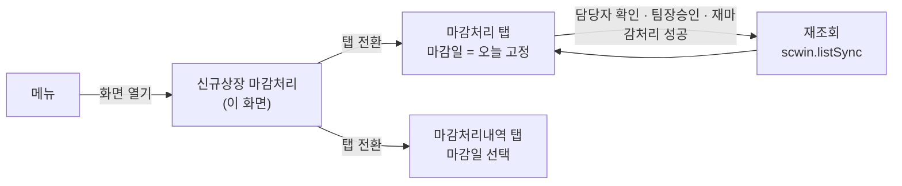
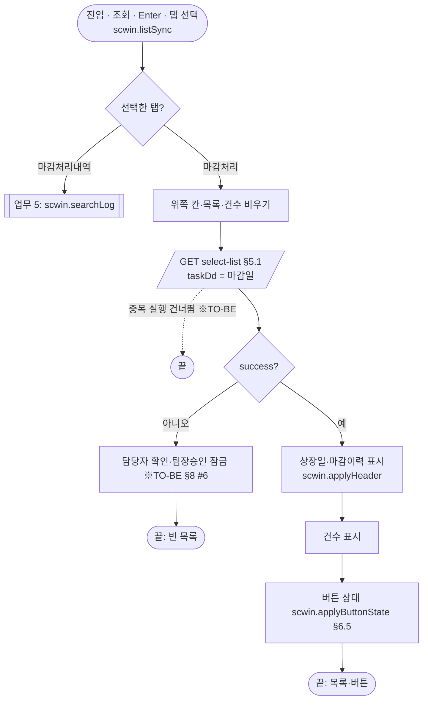
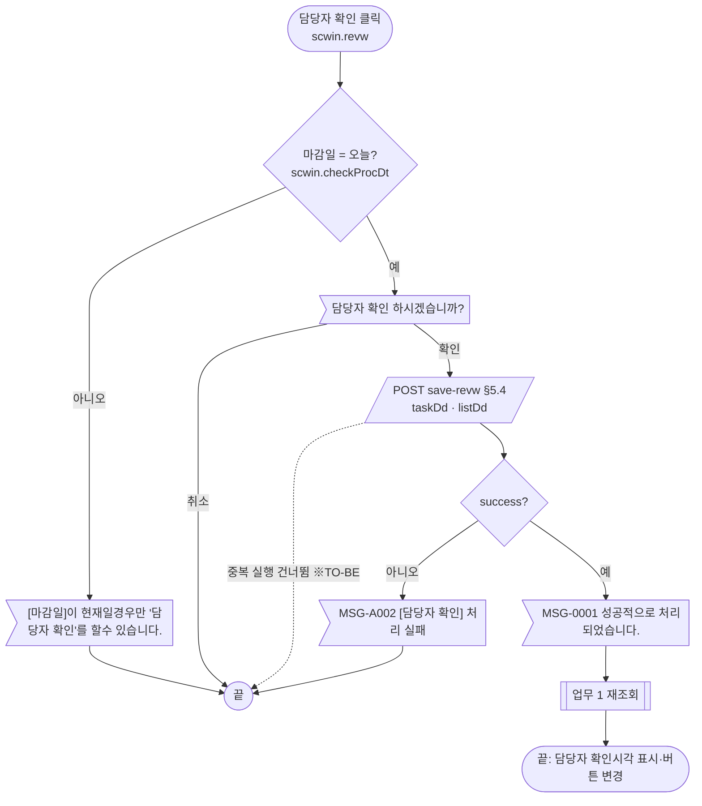
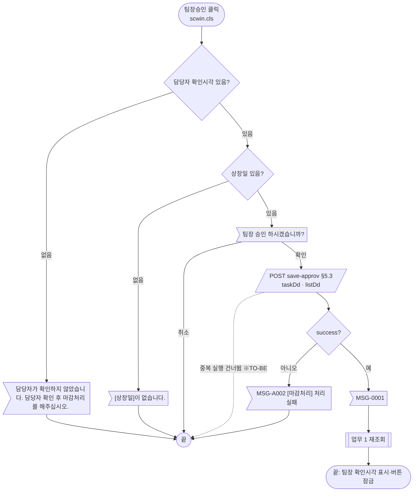
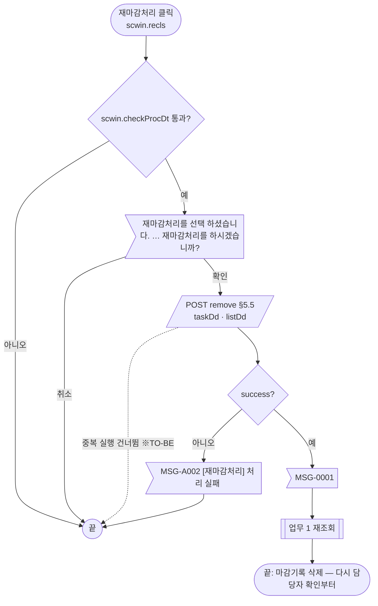
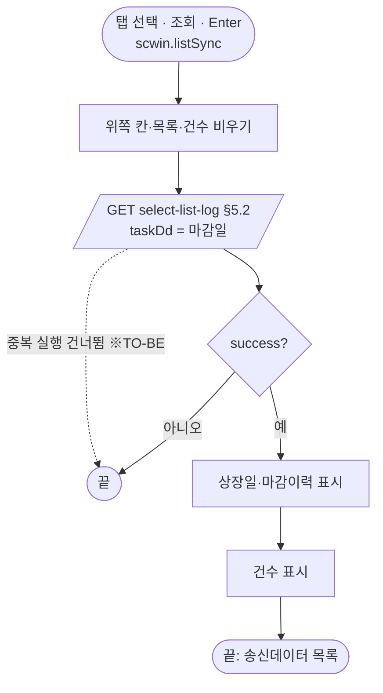
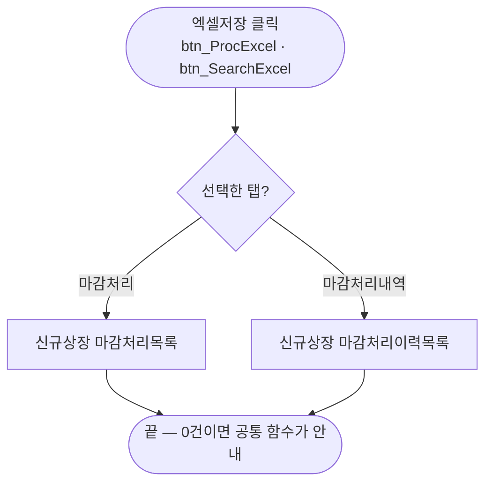
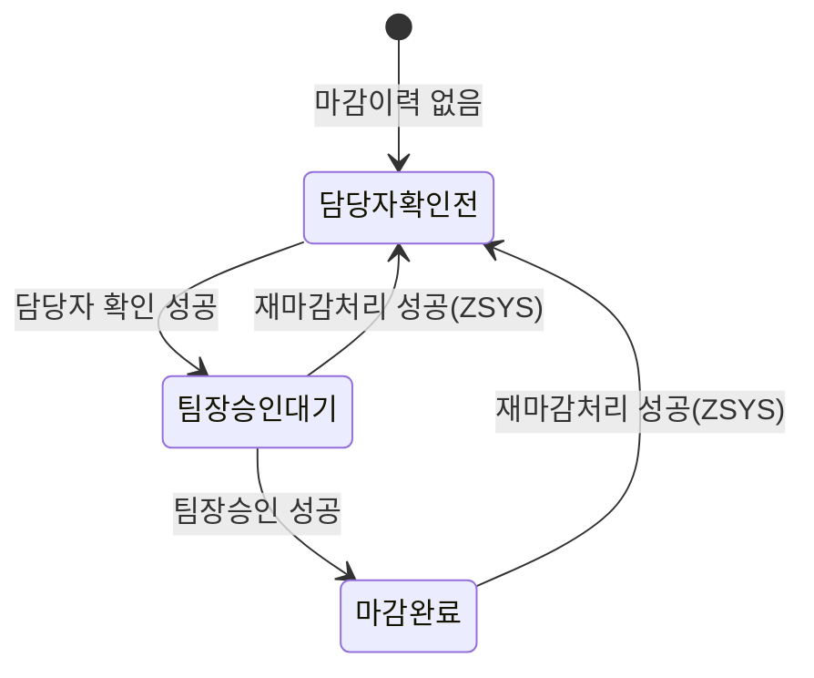

# ULDSTF70016 신규상장 마감처리 — 업무 분석 및 전환 내역

| 항목 | 내용 |
|---|---|
| AS-IS | `/lstproc/ULDSTF70016.gfm` (Gauce/X-Internet, 1270×750 메인 화면, 탭 2개 「마감처리」·「마감처리내역」) — 반입 `conversion/conversion-front/ui/completed/ULDSTF70016/ULDSTF70016.gfm`. 화면명 「(탭)마감처리」 는 **이 화면이 탭을 가진 화면**이라는 뜻이다(부모 화면에 끼워지는 탭 본문이 아니다 — `frame.CloseFrame()` 으로 닫는 메인 화면, §1.1) |
| 신규 API 명세 | `conversion/conversion-front/ui/completed/ULDSTF70016/ULDSTF70016_API.md` — 블록 5종(머리 `[ULDSTF70016]`, 전부 이 화면): 조회 2종(`select-list`·`select-list-log`) + 처리 3종(`save-revw`·`save-approv`·`remove`). §2.2·§5 는 명세 기준(가이드 §0.3·§5) |
| TO-BE | `conversion/conversion-front/ui-tobe/ULDSTF70016.xml` (배포 경로 `/ui/lst/lstproc/ULDSTF70016.xml` — 가정, §10 #9) |
| 퍼블리싱 | 화면 폴더의 `ULDSTF70016.xml`(W-Craft 1차 변환본, `meta_convertType="Craft"`) — 컴포넌트 종류·id 참고. 레이아웃은 캡처를 따랐다(차이는 §2.1 끝, §10 #12) |
| 화면 캡처 | `ULDSTF70016_1.png`(「마감처리」 탭, 0건) · `ULDSTF70016_2.png`(「마감처리내역」 탭, 0건) — 창 제목 「신규상장 마감처리_STF70016」. TO-BE 는 캡처 기준 퍼블리싱본(1단계)부터 만들었다(가이드 §13.2) |
| 업무공통 | `$c.stf`(`getMessageParam`·`fillGridHeaderTotalCnt`) — `cm/pcc/stf`. 게이트는 `--pcc stf` 로 돌린다 |
| 선례 | `ULDSTF08200`(ETN 마감 — 같은 마감 업무·탭 2개·버튼 규칙). 함수 구성과 버튼 상태 규칙을 그대로 따랐다 |
| 작성 | Inswave / 2026-10-30 |

참고 양식: [websquare_gfm_conversion.md](../../../md/websquare_gfm_conversion.md) — §1.4 업무 프로세스 흐름, §5 API 명세 적용. Gauce 대응은 [gfm_business_analysis_guide.md](../../../md/gfm_business_analysis_guide.md) §5·§6 을 함께 따랐다.

---

## 1. 화면 개요

상장 담당자·팀장이 **신종증권(디지털) 신규상장 종목의 당일 마감**(매매시스템으로 보낼 상장종목 데이터 확정)을 처리하고, 지난 마감일의 **마감처리내역(송신데이터)** 을 확인하는 메인 화면이다.

1. 화면을 열면 마감일 = 오늘로 「마감처리」 탭을 조회한다. 마감일의 다음 영업일이 상장일이 되고, 그날 상장하는 신규상장 마감대상이 나온다. 위쪽에는 마감이력(담당자·팀장 확인시각, 상장종목전송시각)이 보인다.
2. 담당자가 [담당자 확인] → 팀장이 [팀장승인](= 마감처리) 순서로 마감한다. 처리하면 다시 조회해 버튼 상태가 바뀐다. 시스템관리자(부서 `ZSYS`)만 [재마감처리]로 이전 마감기록을 지우고 다시 마감할 수 있다.
3. 「마감처리내역」 탭에서는 마감일을 골라 그날의 송신데이터 목록을 본다.
4. 두 탭 모두 [엑셀저장]으로 그리드를 파일로 받는다.

### 1.1 호출 화면 (0본)

메뉴에서 직접 여는 메인 화면이다. `conversion/publish`·`cm/as-is`·`conversion/sample-front` 에서 이 화면ID 를 부르는 화면은 없다(퍼블리싱 사본 `conversion/publish/상장/상장처리(대내)/ULDSTF70016.xml` 자기 자신 제외). AS-IS 의 [닫기]가 `frame.CloseFrame()`(메인 프레임 닫기)인 점도 메인 화면이라는 근거다.

### 1.2 호출 규약 (부모 → 이 화면) / 반환 규약

해당 없음 — 메인 화면이라 받는 파라미터·돌려주는 값이 없다. 탭 계약도 없다(탭은 이 화면 안의 `MaxTab_01`). 세션 값 `js_jobtitl`(직책)·`js_dep_cd`(부서)·`js_emp_no`(사번)·`js_id`(`pMngId`, 쓰이지 않음)를 쓴다(§9).

### 1.3 이 화면이 여는 하위 팝업

| 팝업 | AS-IS 호출 (getPar/setPar) | 넘기는 `data` | 받는 결과 (`closePopup`) / 취소 판정 |
|---|---|---|---|
| 달력 (`PopupCalendar.js`) | `img_TASK_DD onclick` → `popUpCalendar2(edt_TASK_DD)` | — | **(옮기지 않음)** `w2:inputCalendar` 내장 달력으로 대체 |

getPar/setPar 로 주고받는 팝업은 없다(§6 의 openPopup 전환 대상 없음).

### 1.4 업무 프로세스 흐름

| # | 업무 | 시작 (사용자 동작·진입 조건) | 끝 (결과) | 주요 함수 | 관련 절 |
|---|---|---|---|---|---|
| 1 | 조회(마감처리 대상) | 화면 진입 / [조회]·Enter / 「마감처리」 탭 선택 | 상장일·마감이력·마감대상·버튼 상태 | `scwin.listSync` → `scwin.searchList` | §3, §5.1 |
| 2 | 담당자 확인 | [담당자 확인] | 완료 안내 → 재조회 | `scwin.revw` → `scwin.postClose` | §5.4, §6.3 |
| 3 | 팀장승인(마감처리) | [팀장승인] | 완료 안내 → 재조회 | `scwin.cls` → `scwin.postClose` | §5.3, §6.4 |
| 4 | 재마감처리 | [재마감처리] (시스템관리자만 보임) | 완료 안내 → 재조회 | `scwin.recls` → `scwin.postClose` | §5.5, §6.3 |
| 5 | 마감처리내역 조회 | 「마감처리내역」 탭 선택 / [조회]·Enter | 상장일·마감이력·송신데이터 | `scwin.listSync` → `scwin.searchLog` | §5.2 |
| 6 | 엑셀저장 | 두 탭의 [엑셀저장] | 선택 탭 그리드를 파일로 | `scwin.excelDown` | §6.7 |

#### 화면 간 흐름

하위 팝업은 없다(달력은 컴포넌트 내장).

#### 업무 1: 조회 (마감처리 대상)

| # | 단계 | 주체 | 내용 | 분기 · 메시지 | 관련 절 |
|---|---|---|---|---|---|
| 1 | 비우기 | 화면 | `scwin.clearHeader()`(상장일·마감이력) + `dma_list`·`dlt_targetList`·건수 0 (원본 `Reset`) | — | §5.1 |
| 2 | 조회 | 서버 | `select-list` `{ taskDd : 마감일 }` → `dma_list`(상장일)·`dlt_targetList`(마감대상), `body.finalLog` → `dma_finalLog` | 실패면 버튼 잠금(※TO-BE) | §5.1 |
| 3 | 위쪽 칸 | 화면 | `scwin.applyHeader(listDd, finalLog)` — 상장일, 마감 전(`finalLog` null)이면 마감이력 빈 칸 | — | §6 |
| 4 | 버튼 | 화면 | 마감이력으로 [담당자 확인]·[팀장승인] 활성, [재마감처리] 보임 | §1.4 상태 표 | §6.5, §6.6 |

원본은 이 업무에서 서버를 세 번 불렀다 — 상장일(`dts_Get_ListDD`, 동기)·마감이력(`dts_Item`, 동기)·마감대상(`dts_New_Proc`, 조건 = 상장일). 명세는 한 번에 셋을 돌려준다(§5).

#### 업무 2: 담당자 확인

| # | 단계 | 주체 | 내용 | 분기 · 메시지 | 관련 절 |
|---|---|---|---|---|---|
| 1 | 마감일 | 화면 | `scwin.checkProcDt("담당자 확인")` | 실패 안내 후 끝 | §6.2 |
| 2 | 확인 | 사용자 | `await $c.win.confirm("담당자 확인 하시겠습니까?")` | 취소면 끝 | §7 |
| 3 | 전송 | 서버 | `save-revw` `{ taskDd, listDd }` (원본 `CHRG_EMP_NO = js_emp_no`) | 실패 `MSG-A002` | §5.4, §10 #3 |
| 4 | 재조회 | 화면 | `MSG-0001` 안내 → `scwin.listSync` | — | §5 |

#### 업무 3: 팀장승인 (마감처리)

| # | 단계 | 주체 | 내용 | 분기 · 메시지 | 관련 절 |
|---|---|---|---|---|---|
| 1 | 담당자 확인 여부 | 화면 | `dma_finalLog.approvTm`(담당자 확인시각) 비었으면 안내 | 끝 | §6.4 |
| 2 | (마감일 검사 없음) | — | 원본 `fn_cls` 는 `fn_checkProcDt` 를 부르지 않는다 — 그대로 | — | §8 #9 |
| 3 | 상장일 | 화면 | `dma_search.listDd` 비었으면 안내 + `edt_LIST_DD` 포커스 | 끝 | §6.4 |
| 4 | 확인·전송 | 사용자·서버 | `confirm` → `save-approv` `{ taskDd, listDd }` | 실패 `MSG-A002` | §5.3 |
| 5 | 재조회 | 화면 | `MSG-0001` → `scwin.listSync` | — | §5 |

#### 업무 4: 재마감처리 (시스템관리자)

| # | 단계 | 주체 | 내용 | 분기 · 메시지 | 관련 절 |
|---|---|---|---|---|---|
| 1 | 검사 | 화면 | `scwin.checkProcDt("재마감처리")` | 실패 안내 후 끝 | §6.2 |
| 2 | 확인 | 사용자 | 4줄 경고 확인창 | 취소면 끝 | §7 |
| 3 | 전송 | 서버 | `remove` `{ taskDd, listDd }` (원본 빈 `DIGITAL_FINAL_LOG_EMP` 1행, `SCREN_PROCS_TP_CD_04`) | 실패 `MSG-A002` | §5.5, §10 #3 |
| 4 | 재조회 | 화면 | `MSG-0001` → `scwin.listSync` | — | §5 |

#### 업무 5: 마감처리내역 조회

| # | 단계 | 주체 | 내용 | 분기 · 메시지 | 관련 절 |
|---|---|---|---|---|---|
| 1 | 비우기 | 화면 | `scwin.clearHeader()` + `dma_log`·`dlt_sndList`·건수 0 | — | §5.2 |
| 2 | 조회 | 서버 | `select-list-log` `{ taskDd : 마감일 }` → `dma_log`·`dlt_sndList`, `body.finalLog` → `dma_finalLog` | 실패면 0건 | §5.2 |
| 3 | 위쪽 칸 | 화면 | `scwin.applyHeader` — 원본도 탭과 무관하게 상장일·마감이력을 그 마감일로 다시 읽었다 | — | §6 |

#### 업무 6: 엑셀저장

| # | 단계 | 주체 | 내용 | 분기 · 메시지 | 관련 절 |
|---|---|---|---|---|---|
| 1 | 내려받기 | 화면 | `$c.data.downloadGridViewExcel`, 파일명 `{menuId}_{원본 이름}_{yyyyMMddHHmmss}.xlsx`(규칙 42) | 0건이면 공통 안내 | §6.7 |

#### 화면 모드 상태 전이 (「마감처리」 탭 버튼)

| 상태 (판정: `dma_finalLog`) | [담당자 확인] | [팀장승인] — 팀장 | [팀장승인] — 담당자(직책 03) |
|---|---|---|---|
| 담당자확인전 (`approvEmpNm` 빈 값, `bzClsTm` 빈 값) | 활성 | 잠금 | 잠금 |
| 팀장승인대기 (`approvEmpNm` 있음, `bzClsTm` 빈 값) | 잠금 | 활성 | 잠금 |
| 마감완료 (`bzClsTm` 있음) | 잠금 | 잠금 | 잠금 |

[재마감처리]는 상태와 무관하게 부서 `ZSYS` 면 보이고 활성, 아니면 숨김. 마감일이 오늘이 아니어도 버튼 상태는 위 표대로이고, 누르면 `scwin.checkProcDt` 가 막는다(원본 그대로 — [팀장승인]은 그 검사도 없음, §8 #9).

---

## 2. 화면 구성 및 데이터 정의

### 2.1 화면 구성

| 영역 | AS-IS 요소 | TO-BE 컴포넌트 (바인딩) | 설명 |
|---|---|---|---|
| (머리) | — | `pfmContentHeader` (`/cm/xml/contentHeader.xml`) | 본화면 필수. 퍼블리싱본의 `pgtbox`(제목·breadcrumb·즐겨찾기)는 contentHeader 로 대체 |
| 조회조건 | `panel_Top` (`PanelToGroupBox`) | `xf:group.schbox` `panel_Top` | 캡처대로 **탭 위**(두 탭 공통). Enter 키 → `btn_Search_onclick` |
| 조회조건 | `label_2` 「마감일」 + `edt_TASK_DD` (`mxmaskedit` YYYY-MM-DD) + `img_TASK_DD`(달력 이미지) | `label_2` + `edt_TASK_DD` `w2:inputCalendar` (`ref="data:dma_search.taskDd"`) | 「마감처리」 탭에서는 오늘로 고정·읽기전용(§6.1). `img_TASK_DD` 는 **(옮기지 않음)** 달력 내장 |
| 조회조건 | `label_1` 「상장일」 + `edt_LIST_DD` (읽기전용 `mxmaskedit`, `bnd_LIST_DD` ← `dts_Get_ListDD.LIST_DD`) | `label_1` + `edt_LIST_DD` `xf:input` 읽기전용 `displayFormat="####-##-##"` (`ref="data:dma_search.listDd"`) | 캡처에 달력 아이콘이 없어 입력칸. 값은 조회 응답 `listDd` 를 옮겨 넣는다(§6) |
| 조회조건 | `label_6` 「담당자명」 + `txb_APPROV_EMP_NM` | `label_6` + `txb_APPROV_EMP_NM` 읽기전용 (`ref="data:dma_finalLog.approvEmpNm"`) | 원본 `bnd_Item`(`APPROV_EMP_NM`) |
| 조회조건 | `label_7` 「담당자 확인시각」 + `txb_APPROV_TM` | `label_7` + `txb_APPROV_TM` (`dma_finalLog.approvTm`) | [팀장승인] 전 담당자 확인 판정(§6.4) |
| 조회조건 | `label_8` 「팀장명」 + `txb_TEAMLEADR_EMP_NM` (`APPROV_TEAMLEADR_EMP_NM`) | `label_8` + `txb_TEAMLEADR_EMP_NM` (`dma_finalLog.approvTeamleadrEmpNm`) | |
| 조회조건 | `label_9` 「팀장 확인시각」 + `txb_BZ_CLS_TM` | `label_9` + `txb_BZ_CLS_TM` (`dma_finalLog.bzClsTm`, `colspan 3`) | 마감완료 판정(§6.5) |
| 조회조건 | `label_3` 「상장종목전송시각」 + `txb_LIST_TRNSM_END_TM` | `label_3` + `txb_LIST_TRNSM_END_TM` (`dma_finalLog.listTrnsmEndTm`) | 원본 textbox 의 굵은 파랑 글자·배경색(`#b9d4f7`)·`maxlength="5"` 는 옮기지 않음(읽기전용 공통 스타일) |
| 조회조건 | `bnd_Item` 의 `REDMPT_TRNSM_END_TM` → `txb_REDMPT_TRNSM_END_TM` | **(옮기지 않음)** | 바인딩만 있고 컴포넌트가 없다(§8 #1). 명세 `finalLog` 에도 없음 |
| 조회조건 | `img_tmp_11` (구분선 이미지) | **(옮기지 않음)** | 장식 |
| 조회조건 | `btn_Search` (이미지 버튼) | `btn_Search` `btn_cm sch` (`ev:onclick`) | `btn_schbox` |
| 탭 | `MaxTab_01` (`mxtab`, `activeindex="1"`, 탭 `panel_1`「마감처리」·`panel_2`「마감처리내역」) | `tbcbox` > `MaxTab_01` `w2:tabControl` (`ev:onchange`, `selectedIndex="0"`), 탭 `panel_1`·`panel_2`, 본문 `panel_1_01`·`panel_2_01`(`alwaysDraw="true"`) | 탭 본문이라 contentHeader 없음. `alwaysDraw="true"` 라 탭 안 버튼을 `scwin.init` 에서 제어한다(규칙 45 예외 — 선례 ULDSTF08200) |
| 탭1 목록 | `edt_New_Proc_TotalCnt` (`총 n 건` 문자열, 그리드와 겹친 자리) | `titbox` > `count` > `edt_New_Proc_TotalCnt` `w2:span.num` | 건수는 `$c.stf.fillGridHeaderTotalCnt`(§8 #11) |
| 탭1 목록 | `grd_New_Proc` (`dts_New_Proc`) | `grd_New_Proc` `gvw row25` (`dataList="data:dlt_targetList"`, 정렬 가능, 2줄 머리글) | 컬럼 §2.3. 번호 열(`NO` `{CurRow}`)은 `rowNumVisible` |
| 탭1 (빈) | `edt_Add_Proc_TotalCnt` | **(옮기지 않음)** | 값을 넣는 곳이 없다(추가상장 그리드 잔재 — §8 #11) |
| 탭1 버튼 | `btn_Recls`·`btn_Revw`·`btn_Cls`·`btn_ProcClose`·`btn_ProcExcel` (이미지, 활성 이미지 교체로 상태 표시) | `btnbox` `grpBtnBox` > `rt` > `btn_Recls`「재마감처리」·`btn_Revw`「담당자 확인」·`btn_Cls`「팀장승인」·`btn_ProcExcel`「엑셀저장」(`btn_cm download`) | 캡처 순서. 주요 버튼 5종(규칙 41) 해당 없음. **`btn_ProcClose`「닫기」는 (옮기지 않음)** — 본화면은 창 탭으로 닫는다(§8 #3, §10 #10) |
| 탭2 목록 | `edt_New_Search_TotalCnt` + `grd_New_ProcLog` (`dts_New_Search`) | `titbox` > `edt_New_Search_TotalCnt` + `grd_New_ProcLog` `gvw row25` (`data:dlt_sndList`, 2줄 머리글) | 컬럼 §2.3 |
| 탭2 (빈) | `edt_Add_Search_TotalCnt` | **(옮기지 않음)** | 탭1 과 같음 |
| 탭2 버튼 | `btn_SearchClose`·`btn_SearchExcel` | `btnbox` > `btn_SearchExcel`「엑셀저장」 | `btn_SearchClose` **(옮기지 않음)** |
| (숨김) | `bnd_Item`·`bnd_LIST_DD` (`mxbinder`) | 컴포넌트 `ref` 바인딩 | |

* 캡처와 퍼블리싱본의 차이: 퍼블리싱본은 엑셀다운로드 하나를 탭 오른쪽 위(`tbc_btnbox`)에 두고 건수(`panel_page`)를 두 탭이 같이 쓰며, 탭 본문에 [닫기]가 있다. 캡처는 탭마다 아래쪽에 [엑셀저장]이 있다 — 캡처를 따랐다(§10 #12).

### 2.2 데이터 정의

| TO-BE | 종류 | 키(컬럼) | 출처 / 용도 |
|---|---|---|---|
| `dma_search` | dataMap | `taskDd`, `listDd` | **화면 전용(명세 외)** — 마감일(`edt_TASK_DD`, 요청 값)·상장일(`edt_LIST_DD`, 조회 응답 `listDd` 를 옮겨 표시하고 처리 요청에 씀) |
| `dma_list` | dataMap | `listDd`, `finalLog`(json), `targetList`(text) | 명세 `select-list` 응답 body — 상장일 |
| `dma_finalLog` | dataMap | `listTrnsmEndTm`, `approvEmpNm`, `approvTeamleadrEmpNm`, `approvTm`, `bzClsTm` | 명세 두 조회 공통 `body.finalLog` — 위쪽 5칸, 버튼 상태. 마감 전이면 null(§5 차이) |
| `dlt_targetList` | dataList | 명세 `select-list` `body.targetList` 44열(`bzProcsNo`·`isuCd`·`isuNm`·`isuAbbrv`·`isuEngNm`·`isuEngAbbrv`·`isuSrtCd`·`pubofrYn`·`pubofrDd`·`listQty`·`pubofrAmt`·`secugrpId`·`secugrp`·`listApplntIsurCd/Nm`·`listApplntIsuCd`·`trstInstIsurCd/Nm`·`lpMbrNo/Nm`·`lpMbrNo2/Nm2`·`lpMbrNo3/Nm3`·`distrPayBasDd`~`distrPayBasDd12`·`basExpYn`·`expDd`·`taxTpCd/Nm`·`lsttrdDd`·`listDd`·`listProcsSeq`(number)) | 「마감처리」 그리드(36열 표시) |
| `dma_log` | dataMap | `listDd`, `finalLog`(json), `sndList`(text) | 명세 `select-list-log` 응답 body — 상장일 |
| `dlt_sndList` | dataList | 명세 `select-list-log` `body.sndList` 41열(`taskDd`·`secugrpId`·`secugrp`·`listDd`·`isuCd`·`isuSrtCd`·`isuNm`·`isuAbbrv`·`isuEngNm`·`isuEngAbbrv`·`listQty`·`pubofrAmt`·`listApplntIsurCd/Nm`·`listApplntIsuCd`·`trstInstIsurCd/Nm`·`basExpYn`·`expDd`·`taxTpCd/Nm`·`lsttrdDd`·`lpMbrNo1/Nm1`·`lpMbrNo2/Nm2`·`lpMbrNo3/Nm3`·`distrPayBasDd`~`distrPayBasDd12`) | 「마감처리내역」 그리드(37열 표시) |

* id·name·dataType 은 명세 원문 그대로 옮겼다(가이드 §5 ④). 명세에 두 번 나오는 `dma_finalLog` 는 같은 정의라 한 번만 둔다.
* POST 3종(`save-revw`·`save-approv`·`remove`)은 요청이 키 2개라 dataMap 을 두지 않고 요청 객체를 바로 만든다(§5.3~§5.5).
* 원본 dataset → TO-BE:

  | 원본 | TO-BE | 내용 |
  |---|---|---|
  | `dts_Get_ListDD` (동기) | `dma_list.listDd`·`dma_log.listDd` → `dma_search.listDd` | `ELW_LISTING_TR_SEND_LOG_INOUT` 의 `LIST_DD` → `listDd`. 별도 호출 없이 목록 조회 응답에 포함 |
  | `dts_Item` (동기) | `dma_finalLog` | `DIGITAL_FINAL_LOG` — `LIST_TRNSM_END_TM`·`APPROV_EMP_NM`·`APPROV_TM`·`APPROV_TEAMLEADR_EMP_NM`·`BZ_CLS_TM` → camelCase. `REDMPT_TRNSM_END_TM` 은 명세에 없음(§8 #1) |
  | `dts_New_Proc` | `dlt_targetList` | `DIGITAL_NEWLISTING_SEARCH_OUT` |
  | `dts_New_Search` | `dlt_sndList` | `DIGITAL_NEWLISTING_SEARCH_RV_OUT` |
  | `dts_Cls` (동기, `getGauceDataHeader` `DIGITAL_FINAL_LOG_EMP`) | (삭제) 요청 객체 | 원본은 머리만 받아 1행 추가 후 `CHRG_EMP_NO`·`LIST_DD` 를 채워 보냄 → 명세 요청 키 `{ taskDd, listDd }` 로(§5.3~§5.5) |
  | `trs_Save` (`mxlogicaltr`) | (삭제) | 정의와 `OnSuccess`·`OnFail` 만 있고 `Post` 하는 곳 없음(§8 #2) |

### 2.3 그리드 컬럼 대응 (AS-IS `id` / 머리글 `name` → TO-BE)

번호 `NO`(`번호`, `{CurRow},{ToString}`)는 두 그리드 모두 `rowNumVisible="true"` + `rowNumHeaderValue="번호"`. AS-IS `group`(상장신청인·신탁기관·LP회원1~3)은 2줄 머리글(`colSpan`, 나머지 열 `rowSpan="2"`)로 옮겼다. 날짜(`mask="XXXX-XX-XX"`)는 `dataType="date" displayFormat="yyyy-MM-dd"`(규칙 46), 숫자(`displayformat="#,##0"`)는 `dataType="number" displayFormat="#,##0"`.

**`grd_New_Proc` (탭1 마감대상, `dlt_targetList`)**

| AS-IS id | AS-IS name | TO-BE 열 | 표시 |
|---|---|---|---|
| `BZ_PROCS_NO` | 신청일련번호 | `bzProcsNo` | 가운데 |
| `SECUGRP` | 증권구분 | `secugrp` | 가운데 (원본 `headcheckshow` 는 옮기지 않음 — 체크 동작 없음) |
| `LIST_DD` | 상장일자 | `listDd` | 날짜 |
| `ISU_CD` | 종목코드 | `isuCd` | 가운데 |
| `ISU_SRT_CD` | 단축코드 | `isuSrtCd` | 가운데 |
| `ISU_NM` | 종목 한글명 | `isuNm` | 왼쪽 |
| `ISU_ABBRV` | 종목 한글약명 | `isuAbbrv` | 왼쪽 |
| `ISU_ENG_NM` | 종목 영문명 | `isuEngNm` | 왼쪽 |
| `ISU_ENG_ABBRV` | 종목 영문약명 | `isuEngAbbrv` | 왼쪽 |
| `LIST_QTY` | 상장증권수 | `listQty` | `#,##0` |
| `PUBOFR_AMT` | 공모(발행)가액 | `pubofrAmt` | `#,##0` |
| (group 상장신청인) `LIST_APPLNT_ISUR_CD` / `LIST_APPLNT_ISU_CD` / `LIST_APPLNT_ISUR_NM` | 발행기관코드 / 주권 ISIN 코드 / 명 | `listApplntIsurCd` / `listApplntIsuCd` / `listApplntIsurNm` | |
| (group 신탁기관) `TRST_INST_ISUR_CD` / `TRST_INST_ISUR_NM` | 발행기관코드 / 명 | `trstInstIsurCd` / `trstInstIsurNm` | |
| `BAS_EXP_YN` | 만기일유무 | `basExpYn` | 가운데 |
| `EXP_DD` | 만기일 | `expDd` | 날짜 |
| `TAX_TP_NM` | 과세유형 | `taxTpNm` | 왼쪽 |
| `LSTTRD_DD` | 최종거래일 | `lsttrdDd` | 날짜 |
| (group LP회원1) `LP_MBR_NO` / `LP_MBR_NM` | 회원사번호 / 명 | `lpMbrNo` / `lpMbrNm` | |
| (group LP회원2) `LP_MBR_NO2` / `LP_MBR_NM2` | 회원사번호 / 명 | `lpMbrNo2` / `lpMbrNm2` | |
| (group LP회원3) `LP_MBR_NO3` / `LP_MBR_NM3` | 회원사번호 / 명 | `lpMbrNo3` / `lpMbrNm3` | |
| `DISTR_PAY_BAS_DD` | 분배기준일1 (`mask="XX-XX"`) | `distrPayBasDd` | 날짜(규칙 46 확장 — 명세 `(YYYYMMDD)`), §10 #5 |
| `DISTR_PAY_BAS_DD2` | 분배기준일2 | `distrPayBasDd2` | 같음 |
| `DISTR_PAY_BAS_DD3` | 분배기준일3 | `distrPayBasDd3` | 같음 |
| `DISTR_PAY_BAS_DD4` | 분배기준일4 | `distrPayBasDd4` | 같음 |
| `DISTR_PAY_BAS_DD5` | 분배기준일5 | `distrPayBasDd5` | 같음 |
| `DISTR_PAY_BAS_DD6` | 분배기준일6 | `distrPayBasDd6` | 같음 |
| `DISTR_PAY_BAS_DD7` | 분배기준일7 | `distrPayBasDd7` | 같음 |
| `DISTR_PAY_BAS_DD8` | 분배기준일8 | `distrPayBasDd8` | 같음 |
| `DISTR_PAY_BAS_DD9` | 분배기준일9 | `distrPayBasDd9` | 같음 |
| `DISTR_PAY_BAS_DD10` | 분배기준일10 | `distrPayBasDd10` | 같음 |
| `DISTR_PAY_BAS_DD11` | 분배기준일11 | `distrPayBasDd11` | 같음 |
| `DISTR_PAY_BAS_DD12` | 분배기준일12 | `distrPayBasDd12` | 같음 |

**`grd_New_ProcLog` (탭2 송신데이터, `dlt_sndList`)** — 위와 같은 열은 같은 이름. 다른 열만:

| AS-IS id | AS-IS name | TO-BE 열 | 표시 |
|---|---|---|---|
| `TASK_DD` | 작업일자 | `taskDd` | 날짜 |
| (`BZ_PROCS_NO` 없음) | — | — | 탭2 그리드에는 신청일련번호 열이 없다(원본 그대로) |
| (group LP회원1) `LP_MBR_NO1` / `LP_MBR_NM1` | 회원사번호 / 명 | `lpMbrNo1` / `lpMbrNm1` | 명세 `sndList` 키(탭1 은 `lpMbrNo`) |

---

## 3. 로딩 (`gform onload` → `scwin.onpageload` → `scwin.init`)

`scwin.onpageload` 는 `scwin.init()` 만 부른다(try/catch + `handleError`). `scwin.init` 의 단계:

1. **세션·서버 날짜** — `scwin.jobTitl = $c.session.getUserInfo("jobtitl")`, `scwin.depCd = …("depCd")`, `scwin.todayDd = $c.date.getServerDateTime("yyyyMMdd")` (원본 `js_jobtitl`(`pJobTitl`)·`js_dep_cd`·`cGetToday("yyyymmdd")` 클라이언트 날짜 — §8 #7)
2. **init 바인딩** (규칙 22·37)

   | 대상 | 적용 |
   |---|---|
   | 단일 달력 `edt_TASK_DD` (마감일) | `$c.date.checkCalendarFormat(edt_TASK_DD, "yyyyMMdd")` |
   | 기간 달력 | 없음 (`edt_LIST_DD` 는 읽기전용 `xf:input`) |
   | 조회 영역 `panel_Top`(schbox) → 조회 버튼 `btn_Search` | `$c.win.setEnterKeyEvent(panel_Top, scwin.btn_Search_onclick)` |

3. **버튼 초기 상태** — §6.6 `scwin.applyReclsButton()`(ZSYS 만 [재마감처리]), `$c.util.setButtonState("grpBtnBox", "disabled", scwin.BTN_MAP)`(마감이력을 읽기 전까지 [담당자 확인]·[팀장승인] 잠금 — 원본 onload 의 `_d` 이미지·`disabled = true`). 탭 본문이 `alwaysDraw="true"` 라 탭 안 버튼이 이 시점에 있다(규칙 45 예외)
4. **탭 상태** — §6.1 `scwin.applyTabMode(scwin.TAB_PROC)`: 마감일 = 오늘, 읽기전용. 원본 onload 는 `setObjectValue(edt_TASK_DD, 오늘)` 후 `MaxTab_01.ActiveIndex = 1`. `PanelToGroupBox(panel_Top)` 은 옮기지 않음(마크업 schbox)
5. **조회** — `await scwin.listSync()` (§5). 탭은 마크업 `selectedIndex="0"` 이라 `setSelectedTabIndex` 를 부르지 않는다(onchange 이중 발화 회피)

---

## 4. 컴포넌트 이벤트

| TO-BE 컴포넌트 | 이벤트 | TO-BE 핸들러 | 동작 (호출 함수) | AS-IS |
|---|---|---|---|---|
| `MaxTab_01` | `onchange` | `scwin.MaxTab_01_onchange` | `scwin.applyTabMode(선택 탭)` → `scwin.listSync()` | `MaxTab_01` `OnSelChanged(nIndex)` (nIndex "1"/"2" → TO-BE 0/1) |
| `btn_Search` | `onclick` | `scwin.btn_Search_onclick` | `scwin.listSync()` | `btn_Search` `onclick` → `fn_list_sync()` |
| `panel_Top` | Enter 키 | — | `setEnterKeyEvent` 로 `btn_Search_onclick` (§3) | 없음(신규) |
| `edt_TASK_DD` | 달력 | — | 내장 달력 | `img_TASK_DD` `onclick` → `popUpCalendar2(edt_TASK_DD)` |
| `btn_Recls` | `onclick` | `scwin.btn_Recls_onclick` | `scwin.recls()` | `fn_recls()` |
| `btn_Revw` | `onclick` | `scwin.btn_Revw_onclick` | `scwin.revw()` | `fn_revw()` |
| `btn_Cls` | `onclick` | `scwin.btn_Cls_onclick` | `scwin.cls()` | `fn_cls()` |
| `btn_ProcExcel` | `onclick` | `scwin.btn_ProcExcel_onclick` | `scwin.excelDown()` | `doLogSave(vScrenID, SCREN_PROCS_TP_CD_07)` + `fn_ExcelDown()` |
| `btn_SearchExcel` | `onclick` | `scwin.btn_SearchExcel_onclick` | `scwin.excelDown()` | 같음 |
| (없음) | — | — | — | `btn_ProcClose` `onclick` ×2·`btn_SearchClose` `onclick` → `frame.CloseFrame()` — 옮기지 않음(§8 #3) |
| (없음) | — | — | — | `grd_New_Proc` `OnClick(row, colid)` — 빈 핸들러, 옮기지 않음(§8 #4) |
| (없음) | — | — | 공통 오류 핸들러 | `dts_Get_ListDD`·`dts_New_Proc`·`dts_New_Search` `OnLoadError()` → `alert(getMessageParam("MSG-0002", ""))`, `dts_Item` `OnLoadError()` → `alert_error(dts_Item)` |
| (없음) | — | — | `await` 직후 후처리(§5) | `dts_New_Proc`·`dts_New_Search` `OnLoadCompleted(rowcount)` |
| (없음) | — | — | `scwin.postClose` 안에서 판정 | `trs_revw`·`trs_Cls` `OnSuccess()`·`OnFail()`, `trs_Save` `OnSuccess()`·`OnFail()`(쓰이지 않음 §8 #2) |
| (없음) | — | — | `scwin.init` | `gform` `onload` |

버튼 활성 규칙은 §1.4 「화면 모드 상태 전이」 표. `$c.util.setButtonState("grpBtnBox", { enable : [...] }, scwin.BTN_MAP)`(`BTN_MAP = { revw : "btn_Revw", cls : "btn_Cls" }`).

---

## 5. 서버 통신

공통 방침: 모든 통신은 `await $c.sbm.executeDynamic`, `action` 은 명세 전체 경로 리터럴(규칙 38·39), `submitDoneHandler` 없음, 응답을 쓰기 전에 `result?.skipped` 확인. 원본이 URL 에 붙이던 `SCREN_ID`·`SCREN_PROCES_TP_CD`·`service`·`queryId`·`outputMessageId`·`inputMessageId` 는 명세에 없어 보내지 않는다. 세션 사번(`js_emp_no` → `CHRG_EMP_NO`)도 명세 요청에 없어 서버 세션 처리로 가정한다(§10 #3).

#### API 명세 대응 (`ULDSTF70016_API.md`)

| # | 용도 | AS-IS | TO-BE (명세) | TO-BE 함수 |
|---|---|---|---|---|
| 5.1 | [마감처리] 조회 | ① `dts_Get_ListDD` `/ElwListedReceive.do?method=getElwListingListDd&inputMessageId=ELW_LISTING_TR_SEND_LOG_INOUT&TASK_DD=` (동기) ② `dts_Item` `/digital/DigitalListinvstg.do?method=searchDigitalFinalLog&inputMessageId=DIGITAL_FINAL_LOG&TASK_DD=` (동기) ③ `dts_New_Proc` `/listingCommon.do?method=listGeneral` `queryId=lds.stf.digital.newlst.select.list.condition` `{P}param01=LIST_DD` | `GET /api/listing/lstproc/digital/cls-procs/select-list` (명세 2) — 세 조회를 한 API 로 | `scwin.searchList` |
| 5.2 | [마감처리내역] 조회 | ①·② 같음 ③ `dts_New_Search` `listGeneral` `…digital.newlst.select.log.condition` `{P}param01=TASK_DD` | `GET /api/listing/lstproc/digital/cls-procs/select-list-log` (명세 1) | `scwin.searchLog` |
| 5.3 | 팀장승인(마감처리) | `trs_Cls` `/digital/DigitalListinvstg.do?…&SCREN_PROCES_TP_CD=SCREN_PROCS_TP_CD_02&method=DigitalClsProcsSave` `KeyValue="JSP(I:pInput=dts_Cls)"` | `POST /api/listing/lstproc/digital/cls-procs/save-approv` (명세 3) | `scwin.cls` → `scwin.postClose` |
| 5.4 | 담당자 확인 | `trs_revw` `…&SCREN_PROCS_TP_CD_02&method=DigitalRevwProcsSave` | `POST /api/listing/lstproc/digital/cls-procs/save-revw` (명세 4) | `scwin.revw` → `scwin.postClose` |
| 5.5 | 재마감처리 | `trs_Cls` `…&SCREN_PROCS_TP_CD_04&method=DigitalReClsProcsSave` | `POST /api/listing/lstproc/digital/cls-procs/remove` (명세 5) | `scwin.recls` → `scwin.postClose` |
| — | 머리 정의 | `dts_Cls` `/gauceSystemierAdaptor.do?method=getGauceDataHeader&messageId=DIGITAL_FINAL_LOG_EMP` (동기, `fn_trSetHeader`) | (없음) — 요청 객체로 대체 | — |

#### 명세 ↔ AS-IS 차이 (→ §10)

* **마감이력 target** — 명세 target 은 `"dma_list=body, dma_finalLog=body.finalLog, dlt_targetList=body.targetList"`(내역은 `dma_log`·`dlt_sndList`). 명세 설명대로 **마감 전이면 `finalLog` 가 null** 인데, 공통 `$c.sbm` 바인딩(`_bindResponseToTargets`)은 `undefined` 만 건너뛰고 null 은 그대로 `setJSON` 에 넘긴다 — 매일 첫 조회가 그 상태라 TO-BE 는 `dma_finalLog=body.finalLog` 를 target 에서 빼고, 응답 `body.finalLog` 가 객체일 때만 `scwin.applyHeader` 가 `dma_finalLog.setJSON` 한다(§10 #1).
* **조회 조건** — 원본 마감대상 조회는 **상장일**(`{P}param01 = edt_LIST_DD`)로 걸렀고, 상장일은 앞서 마감일로 따로 읽었다. 명세 요청은 `taskDd`(마감일) 하나이고 상장일(`listDd`, "마감일의 다음 영업일")을 응답으로 돌려준다 — 마감일을 보낸다(§10 #2).
* **처리 요청** — 명세 3종 모두 `{ taskDd, listDd }`. 원본은 `DIGITAL_FINAL_LOG_EMP` 1행: 담당자 확인은 `CHRG_EMP_NO` 만, 팀장승인은 `LIST_DD`·`CHRG_EMP_NO`, 재마감처리는 빈 행(§10 #3). 응답 정의가 없어 성공은 `success` 로만 판정한다(§10 #4).
* `dma_list.targetList`·`dma_log.sndList` 는 명세 dataType 이 `text` 지만 실제로는 목록이다 — 명세 원문 그대로 두고 목록은 `dlt_*` 로 받는다(§10 #8).

### 5.1 [마감처리] 조회 (`scwin.searchList`)

| 항목 | 내용 |
|---|---|
| `id` | `sbm_searchList` |
| `method` / `action` | `get` / `/api/listing/lstproc/digital/cls-procs/select-list` *(AS-IS `dts_Get_ListDD` + `dts_Item` + `dts_New_Proc`)* |
| `ref` / `requestData` | `{ taskDd : dma_search.taskDd }` |
| `target` / `gridview` | `dma_list=body, dlt_targetList=body.targetList` / `grd_New_Proc` (명세의 `dma_finalLog=body.finalLog` 는 후처리로 — 위 「차이」) |
| 선행 / 순서 | `scwin.listSync` 가 「마감처리」 탭이면 부른다. 요청 전 `scwin.clearHeader()`(상장일·마감이력), `dma_list`·`dlt_targetList` 비우고 건수 0 |
| 후처리 | `scwin.applyHeader(dma_list.listDd, body.finalLog)` → 건수(`$c.stf.fillGridHeaderTotalCnt`) → §6.5 버튼 상태 (원본 `OnLoadCompleted` 의 `"총 n 건"`·`CloseWin`·`buttonSetDis`) |
| 실패 처리 | `success:false` 면 [담당자 확인]·[팀장승인] 잠금 후 끝(§8 #6). 통신 오류 안내는 공통 핸들러 |
| 중복 실행 | 기본(건너뜀) |

### 5.2 [마감처리내역] 조회 (`scwin.searchLog`)

| 항목 | 내용 |
|---|---|
| `id` | `sbm_searchLog` |
| `method` / `action` | `get` / `/api/listing/lstproc/digital/cls-procs/select-list-log` *(AS-IS `dts_Get_ListDD` + `dts_Item` + `dts_New_Search`)* |
| `ref` / `requestData` | `{ taskDd : dma_search.taskDd }` |
| `target` / `gridview` | `dma_log=body, dlt_sndList=body.sndList` / `grd_New_ProcLog` |
| 선행 / 순서 | `scwin.listSync` 가 「마감처리내역」 탭이면 부른다. 요청 전 `scwin.clearHeader()`, `dma_log`·`dlt_sndList` 비우고 건수 0 |
| 후처리 | `scwin.applyHeader(dma_log.listDd, body.finalLog)` → 건수 |
| 실패 처리 | `success:false` 면 0건으로 끝 |
| 중복 실행 | 기본(건너뜀) |

### 5.3 팀장승인 (`scwin.cls` → `scwin.postClose`)

| 항목 | 내용 |
|---|---|
| `id` | `sbm_saveApprov` |
| `method` / `action` | `post` / `/api/listing/lstproc/digital/cls-procs/save-approv` *(AS-IS `trs_Cls` `DigitalClsProcsSave`)*, `mediatype : "application/json"` |
| `ref` / `requestData` | `{ taskDd : dma_search.taskDd, listDd : dma_search.listDd }` (원본 `LIST_DD`·`CHRG_EMP_NO`) |
| `target` | 없음 |
| 후처리 | 성공 `MSG-0001`(`procJob` 「마감처리」) → `scwin.listSync()` (원본 `trs_Cls OnSuccess`) |
| 실패 처리 | `success:false` → `MSG-A002` (원본 `OnFail`) |
| 중복 실행 | 기본(건너뜀) |

### 5.4 담당자 확인 (`scwin.revw` → `scwin.postClose`)

| 항목 | 내용 |
|---|---|
| `id` | `sbm_saveRevw` |
| `method` / `action` | `post` / `/api/listing/lstproc/digital/cls-procs/save-revw` *(AS-IS `trs_revw` `DigitalRevwProcsSave`)* |
| `ref` / `requestData` | `{ taskDd, listDd }` (원본 `CHRG_EMP_NO` 만) |
| 후처리 · 실패 · 중복 | §5.3 과 같음 (`procJob` 「담당자 확인」, 원본 `trs_revw OnSuccess`·`OnFail`) |

### 5.5 재마감처리 (`scwin.recls` → `scwin.postClose`)

| 항목 | 내용 |
|---|---|
| `id` | `sbm_remove` |
| `method` / `action` | `post` / `/api/listing/lstproc/digital/cls-procs/remove` *(AS-IS `trs_Cls` `DigitalReClsProcsSave`)* |
| `ref` / `requestData` | `{ taskDd, listDd }` (원본 빈 1행) |
| 후처리 · 실패 · 중복 | §5.3 과 같음 (`procJob` 「재마감처리」) |

---

## 6. 일반 함수

| TO-BE 함수 | 역할 | AS-IS |
|---|---|---|
| `scwin.listSync` | 선택 탭에 따라 §5.1/§5.2 | `fn_list_sync` |
| `scwin.applyTabMode` | §6.1 | `MaxTab_01 OnSelChanged` 의 입력 상태 |
| `scwin.clearHeader` | 조회 전 상장일·마감이력 비우기 | `dts_Get_ListDD`·`dts_Item` `Reset` |
| `scwin.applyHeader` | 응답 상장일 → `dma_search.listDd`, `finalLog` 객체면 `dma_finalLog` | `bnd_LIST_DD`·`bnd_Item` 바인딩 |
| `scwin.checkProcDt` | §6.2 | `fn_checkProcDt` |
| `scwin.recls` / `scwin.revw` / `scwin.cls` | §6.3 / §6.3 / §6.4 | `fn_recls` / `fn_revw`+`fn_trs_revw` / `fn_cls`+`fn_trs` |
| `scwin.applyButtonState` | §6.5 | `buttonSetDis` |
| `scwin.applyReclsButton` | §6.6 | onload·`buttonSetDis` 의 `showObj(btn_Recls)` |
| `scwin.excelDown` | §6.7 | `fn_ExcelDown` |

### 6.1 탭 상태 (`scwin.applyTabMode`)

「마감처리」(index 0) → `dma_search.taskDd = scwin.todayDd`, `edt_TASK_DD.setReadOnly(true)`. 「마감처리내역」(index 1) → `setReadOnly(false)`. 원본은 `ReadOnly`·`img_TASK_DD.disabled`·`ReadOnlyBackColor` 를 따로 바꿨다 — `inputCalendar` 는 읽기전용이면 달력 버튼도 잠긴다. 「마감처리내역」으로 옮길 때 마감일은 앞 값(오늘)을 그대로 둔다(원본 그대로).

### 6.2 마감 처리 전 확인 (`scwin.checkProcDt`)

마감일(`dma_search.taskDd`)이 서버 현재일과 다르면 「[마감일]이 현재일경우만 '{처리명}'를 할수 있습니다.」 후 `false`. 원본의 시장참가자번호(`ISU_MKTPARTC_NO`) 검사는 원본에서 주석 처리돼 있어 옮기지 않는다(§8 #12).

### 6.3 담당자 확인·재마감처리 (`scwin.revw`·`scwin.recls`)

`procJob` 설정 → `checkProcDt` → `await $c.win.confirm(…)` → §5.4/§5.5. 원본 `fn_revw` 의 `res = window.confirm(...)` 은 선언 없는 전역이었다 — TO-BE 는 `await` 결과로 바로 판정(§8 #10).

### 6.4 팀장승인 (`scwin.cls`)

담당자 확인시각(`dma_finalLog.approvTm`) 없으면 안내 후 끝 → `procJob = "마감처리"` → 상장일(`dma_search.listDd`) 없으면 「[상장일]이 없습니다.」 + `edt_LIST_DD.focus()` → `confirm("팀장 승인 하시겠습니까?")` → §5.3. 원본 `fn_cls` 는 안내 뒤 `return true` 였다(반환값을 쓰는 곳 없음 — §8 #8).

### 6.5 버튼 상태 (`scwin.applyButtonState`)

§1.4 상태 표대로 `enable` 목록을 만들어 `setButtonState("grpBtnBox", { enable }, scwin.BTN_MAP)`, 이어서 `applyReclsButton`. 원본은 담당자·팀장 분기마다 이미지(`_d.gif`)와 `disabled` 를 바꿨다.

### 6.6 재마감처리 버튼 (`scwin.applyReclsButton`)

부서 `ZSYS` → `setDisabled(false)`·`show("")`, 아니면 `hide()`.

### 6.7 엑셀저장 (`scwin.excelDown`)

「마감처리」 → `grd_New_Proc`, 「마감처리내역」 → `grd_New_ProcLog` 를 `$c.data.downloadGridViewExcel(grid, { fileName : $c.win.getProgramId() + "_" + 원본 이름 + "_" + yyyyMMddHHmmss + ".xlsx" })`. 원본 이름 「신규상장 마감처리목록」·「신규상장 마감처리이력목록」(`GridToExcel(…, "", "8")`). `doLogSave` 는 선례대로 옮기지 않는다(§8 #15).

---

## 7. 업무 코드 · 메시지 목록

| 구분 | 값 | 쓰는 곳 |
|---|---|---|
| 직책코드 | `03` 담당자 (그 밖 = 팀장) | §6.5 |
| 부서코드 | `ZSYS` 시스템관리자 | §6.6 |
| 탭 | 0 「마감처리」 / 1 「마감처리내역」 (원본 ActiveIndex 1/2) | §6.1 |
| 메시지 | `MSG-0001` 성공적으로 처리되었습니다(`procJob`) | §5.3~§5.5 성공 |
| 메시지 | `MSG-A002` [`procJob`] 처리 실패 | §5.3~§5.5 실패 |
| 메시지 | `MSG-0002` (조회 오류) | 원본 `OnLoadError` — TO-BE 공통 핸들러 |
| 문구 | 「[마감일]이 현재일경우만 '{처리명}'를 할수 있습니다.」 | §6.2 |
| 문구 | 「담당자가 확인하지 않았습니다. 담당자 확인 후 마감처리를 해주십시오.」 | §6.4 |
| 문구 | 「[상장일]이 없습니다.」 | §6.4 |
| 확인창 | 「담당자 확인 하시겠습니까?」 / 「팀장 승인 하시겠습니까?」 / 재마감처리 4줄 경고 | §6.3, §6.4 |
| `procJob` | 「담당자 확인」·「마감처리」·「재마감처리」 | 메시지 인자 |

---

## 8. 원본 특이사항 · 결함

| # | 내용 | 결정 |
|---|---|---|
| 1 | `bnd_Item` 이 `REDMPT_TRNSM_END_TM` → `txb_REDMPT_TRNSM_END_TM` 을 바인딩하지만 그 컴포넌트가 화면에 없다(ETN 화면 복사 잔재) | 옮기지 않음 |
| 2 | `trs_Save` 와 그 `OnSuccess`·`OnFail` 은 `Post` 하는 곳이 없다. `dts_New_Proc OnLoadCompleted` 의 `vBzProcsNo = NameValue(0, …)`(0행)·`vIsuCd`·`pMngId`·`vScrenID` 는 쓰이지 않고, 주석 `//dts_Add_Proc.ClearData()` 는 없는 데이터셋(추가상장 그리드 잔재)을 가리킨다 | 옮기지 않음 |
| 3 | [닫기] `btn_ProcClose onclick` 이 두 번 등록돼 있다. 본화면 [닫기]는 `frame.CloseFrame()` | 옮기지 않음 — 창 탭으로 닫는다(§10 #10) |
| 4 | `grd_New_Proc OnClick` 은 빈 핸들러 | 옮기지 않음 |
| 5 | 처리 버튼 연속 클릭 시 중복 전송 가능 | 고침 — `executeDynamic` 중복 실행 건너뜀 |
| 6 | 목록 조회가 실패해도 앞 마감이력으로 버튼이 켜진 채 남을 수 있다 | 고침 — 실패면 [담당자 확인]·[팀장승인] 잠금(※TO-BE) |
| 7 | 마감일 기본값·당일 검사가 클라이언트 날짜(`cGetToday`) | 고침 — 서버 날짜(`$c.date.getServerDateTime`) |
| 8 | `fn_cls` 가 안내 뒤 `return true` | 무관(반환값 미사용) — `return` |
| 9 | [팀장승인]은 마감일 = 오늘 검사(`fn_checkProcDt`)를 하지 않는다 | 유지 |
| 10 | `fn_revw` 의 `res` 는 선언 없는 전역 | 고침 — `await confirm` 결과로 판정 |
| 11 | 건수 textbox(`edt_New_Proc_TotalCnt`·`edt_New_Search_TotalCnt`)가 그리드와 같은 자리(top 4)에 있어 가려진다. `edt_Add_*_TotalCnt` 는 값을 넣는 곳이 없다 | 고침 — 탭별 `titbox` 건수, `edt_Add_*` 는 옮기지 않음 |
| 12 | `fn_checkProcDt` 의 시장참가자번호 검사는 주석 처리돼 있다 | 유지(옮기지 않음) |
| 13 | `OnSelChanged` 의 `nIndex == "1"` — 1-base 문자열 비교 | TO-BE 0-base 숫자(`scwin.TAB_PROC`/`TAB_SEARCH`) |
| 14 | `dts_Item OnLoadError` 는 `alert_error`, 나머지는 `MSG-0002` — 오류 안내가 제각각 | 공통 오류 핸들러로 통일 |
| 15 | 엑셀저장 전 `doLogSave(vScrenID, SCREN_PROCS_TP_CD_07)` | 옮기지 않음(선례 — doLogSave 제거 확정) |
| 16 | `PanelToGroupBox(panel_Top)`·`ShowWin`/`CloseWin`(로딩 표시)·`#include` 공통 js | 옮기지 않음 — 마크업 schbox, 공통 로딩 처리 |

---

## 9. 전환 내역 (AS-IS → TO-BE)

| AS-IS | TO-BE | 비고 |
|---|---|---|
| 전역 `vScrenID`·`pMngId`(`js_id`)·`vBzProcsNo`·`vIsuCd` | (삭제) | 쓰이지 않음(§8 #2) |
| 전역 `procJob` | `scwin.procJob` | |
| (없음) | `scwin.screenId`, 상수 `scwin.TAB_PROC`·`scwin.TAB_SEARCH`(탭 순번)·`scwin.JOBTITL_CHRG`("03")·`scwin.DEP_CD_SYS`("ZSYS")·`scwin.BTN_MAP` | 1구역 — 원본 리터럴을 이름 붙인 상수로(§7) |
| 전역 `pJobTitl`(`js_jobtitl`)·`js_dep_cd`·`js_emp_no` | `scwin.jobTitl`·`scwin.depCd` (`$c.session.getUserInfo`), 사번은 보내지 않음 | §3, §10 #3·#13 |
| `gform onload` | `scwin.onpageload` → `scwin.init` | §3 |
| `MaxTab_01 OnSelChanged(nIndex)` | `scwin.MaxTab_01_onchange` | §4 |
| `btn_Search onclick` | `scwin.btn_Search_onclick` | |
| `fn_list_sync` | `scwin.listSync` → `scwin.searchList` / `scwin.searchLog` | §5.1, §5.2 |
| `dts_New_Proc OnLoadCompleted` / `dts_New_Search OnLoadCompleted` | `scwin.searchList` / `scwin.searchLog` 후처리 | |
| `dts_*` `OnLoadError` | 공통 오류 핸들러 | §8 #14 |
| `fn_recls` | `scwin.btn_Recls_onclick` → `scwin.recls` | §6.3 |
| `fn_trSetHeader` | (삭제) — 요청 객체 | §5 |
| `fn_revw` + `fn_trs_revw` | `scwin.btn_Revw_onclick` → `scwin.revw` → `scwin.postClose` | §6.3 |
| `fn_cls` + `fn_trs` | `scwin.btn_Cls_onclick` → `scwin.cls` → `scwin.postClose` | §6.4 |
| `trs_revw`·`trs_Cls` `OnSuccess`·`OnFail` | `scwin.postClose` | §5.3 |
| `trs_Save` `OnSuccess`·`OnFail` | (삭제) | §8 #2 |
| `buttonSetDis` | `scwin.applyButtonState` + `scwin.applyReclsButton` | §6.5, §6.6 |
| `fn_checkProcDt` (지역 `vCurDate`·`pCheck`) | `scwin.checkProcDt` (`scwin.todayDd` 비교, 바로 `return`) | §6.2 |
| `fn_ExcelDown` + `btn_ProcExcel`·`btn_SearchExcel` `onclick` | `scwin.excelDown` + `scwin.btn_ProcExcel_onclick`·`scwin.btn_SearchExcel_onclick` | §6.7 |
| `img_TASK_DD onclick` (`popUpCalendar2`) | (삭제) — `inputCalendar` 내장 | |
| `btn_ProcClose`·`btn_SearchClose` `onclick` (`frame.CloseFrame`) | (삭제) | §8 #3 |
| `grd_New_Proc OnClick` | (삭제) | §8 #4 |
| (없음) | `scwin.applyTabMode`·`scwin.clearHeader`·`scwin.applyHeader` | 원본 이벤트·바인딩 안의 처리를 함수로 |
| `getObjectValue`·`setObjectValue`·`cGetToday`·`showObj`·`.src`·`.disabled` | 바인딩(`dma_search`·`dma_finalLog`)·`$c.date.getServerDateTime`·`show`/`hide`·`setButtonState`·`setDisabled` | |

---

## 10. 남은 작업 (TODO)

1. **마감이력 target** — 명세 target `dma_finalLog=body.finalLog` 를 빼고 후처리로 적재했다(§5 차이). 서버가 마감 전에도 `finalLog` 를 빈 객체(`{}`)로 준다면 명세 target 으로 되돌려도 된다 — 응답 확인.
2. **조회 조건** — 명세대로 마감일(`taskDd`)을 보내고 상장일(다음 영업일)은 서버가 정한다고 봤다. 원본은 상장일로 마감대상을 걸렀다 — 서버가 같은 조건으로 거르는지 확인.
3. **처리 요청 키** — 3종 모두 `{ taskDd, listDd }`. 원본이 보내던 담당자 사번(`CHRG_EMP_NO = js_emp_no`)은 서버 세션 처리로 가정. 재마감처리도 같은 두 키를 보낸다(원본은 빈 행).
4. **처리 응답** — 명세에 응답 정의가 없어 성공은 `success` 로만 판정한다. 업무 결과 코드가 따로 오는지 확인.
5. **분배기준일 표시** — AS-IS `mask="XX-XX"`(월-일 4자리)인데 명세 이름은 `(YYYYMMDD)`. 규칙 46 확장으로 `yyyy-MM-dd` 를 붙였다 — 8자리면 형식이 붙고, 4자리로 오면 엔진이 원시 값을 그대로 보여 준다. 실제 값 길이 확인 후 4자리면 표시 형식을 정한다.
6. **날짜 열 값** — 상장일자·만기일·최종거래일·작업일자가 8자리 `yyyyMMdd` 인지 확인(규칙 46).
7. **숫자 열** — `listQty`·`pubofrAmt` 는 명세 dataType 이 `text`. 그리드 열만 `dataType="number" displayFormat="#,##0"` 로 표시한다.
8. **명세 정의** — `dma_list.targetList`·`dma_log.sndList` dataType `text`(실제는 목록), `dma_finalLog` 가 두 블록에 중복 정의 — 명세 원문 그대로 둠.
9. **배포 경로** — `/ui/lst/lstproc/ULDSTF70016.xml` 는 원본 `/lstproc/` 를 따른 가정(메뉴 등록 경로 확인).
10. **[닫기]** — 본화면이라 옮기지 않았다(선례 ULDSTF08200). 캡처에는 두 탭 모두 [닫기]가 있다.
11. **화면명** — 원본 `meta_screenName` 「(탭)마감처리」 대신 캡처 창 제목 「신규상장 마감처리」 로 두었다. 메뉴 등록명 확인.
12. **퍼블리싱본과 차이** — 엑셀 버튼 위치(탭 위 공용 → 탭별 하단), 건수(공용 `panel_page` → 탭별), `pgtbox` → contentHeader, [닫기] 제거, `userData2`·`hierarchy`·`orgid` 등 W-Craft 잔재 제거. 퍼블리싱 쪽 확인.
13. **세션 키** — `$c.session.getUserInfo("jobtitl")`·`("depCd")` 는 선례 ULDSTF08200 과 같은 가정.
14. **실화면 확인** — 2줄 머리글(그룹 5개) 표시, 「마감처리내역」 탭에서 위쪽 마감이력이 그 마감일 기준으로 바뀌는지(원본과 같음), `alwaysDraw="true"` 탭에서 `grpBtnBox` 버튼 상태가 init 시점에 적용되는지.
