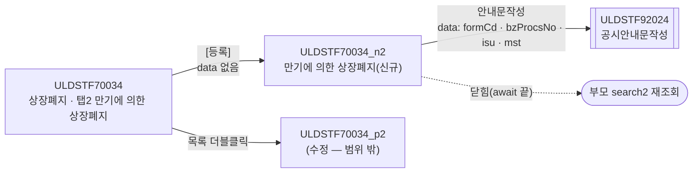
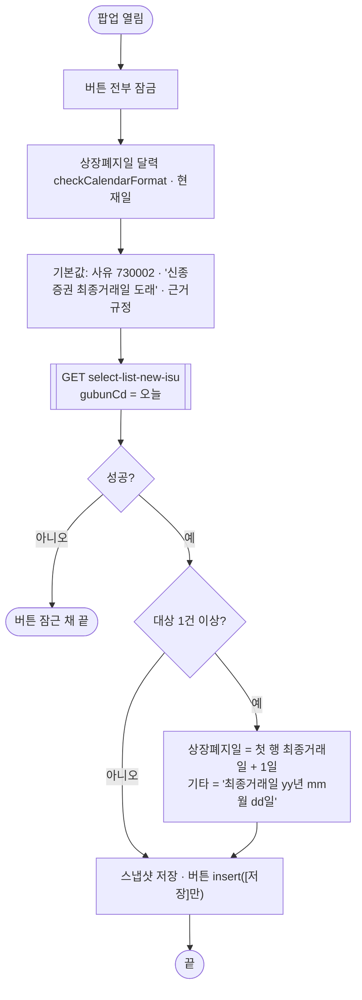
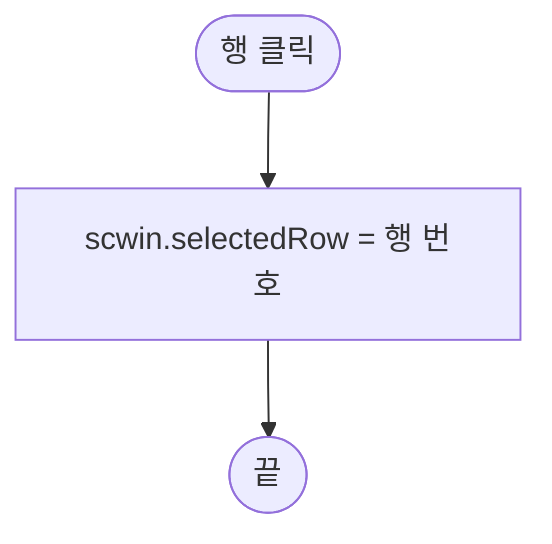
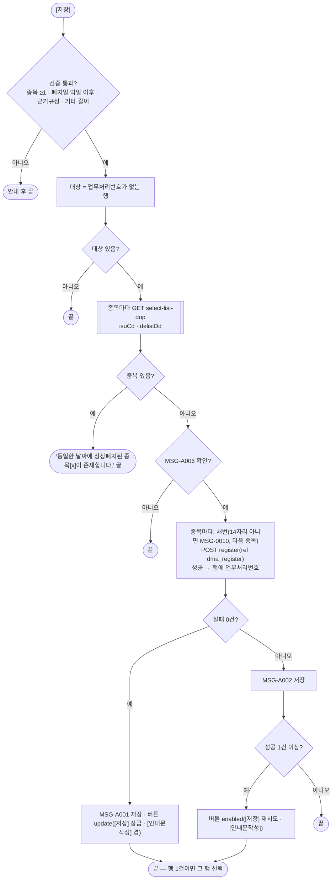
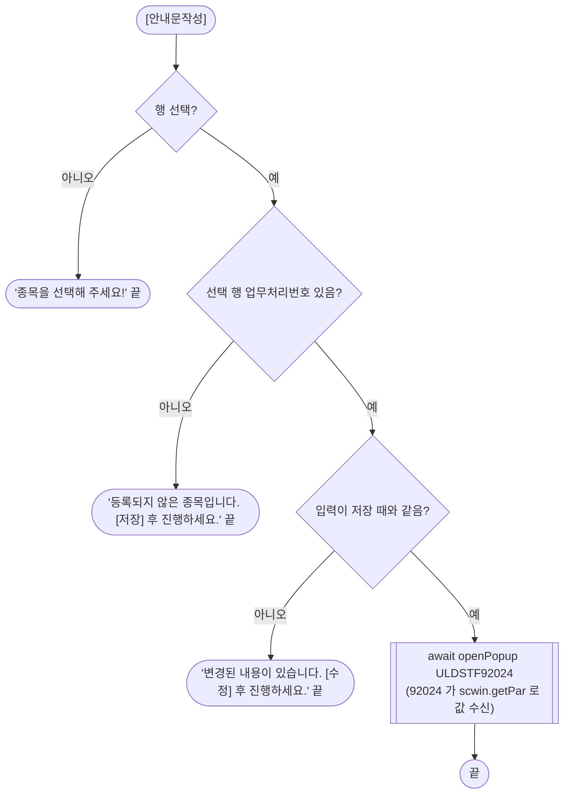
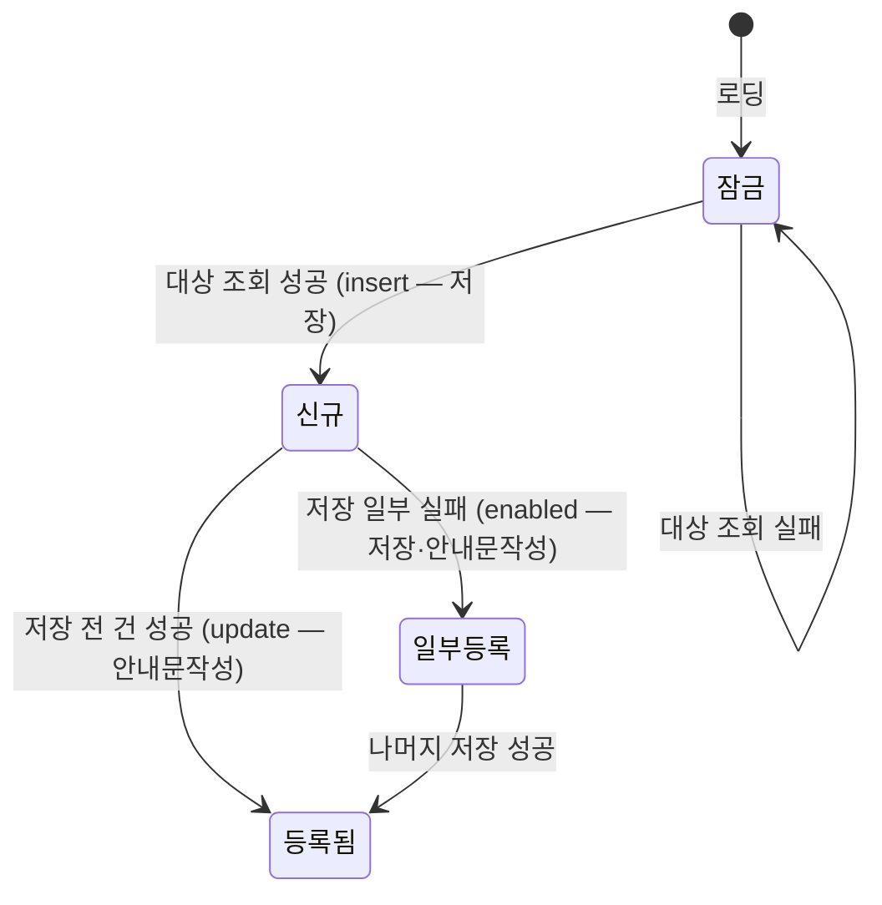

# ULDSTF70034_n2 (팝업)만기에 의한 상장폐지 — 업무 분석 및 전환 내역

| 항목 | 내용 |
|---|---|
| AS-IS | `/digital/ULDSTF70034_n2.gfm` (Gauce/X-Internet, 760×410 — 부모가 770×470 `window` 로 연다) — 반입 `conversion/conversion-front/ui/ULDSTF70034_n2/ULDSTF70034_n2.gfm` |
| 신규 API 명세 | `ULDSTF70034_n2_API.md` — 블록 3종, 모두 이 화면 대상(`[ULDSTF70034_n2/p2]` 중복 조회 1 + `[ULDSTF70034_n2]` 2). §2.2·§5 는 명세 기준(가이드 §0.3·§5). `api_spec_check` 는 `_n2` 이름에서도 명세를 찾는다(`find_spec` 의 화면ID 정규식이 꼬리 `_n2` 를 포함) |
| TO-BE | `conversion/conversion-front/ui-tobe/ULDSTF70034_n2.xml` (배포 경로 `/ui/lst/digital/ULDSTF70034_n2.xml` — 가정, §10 #7) |
| 퍼블리싱 | `ULDSTF70034_n2.xml` (W-Craft 1차 스크립트 포함, `sub_contents`) — 컴포넌트 id 는 AS-IS 와 같음(`MxGrid_2` 그리드, `edt_DelistDd` `inputCalendar`, `txb_Rsn_Cd`·`txb_GrndRegulNm` 읽기 전용 `xf:input`, `txa_Remk` `xf:textarea`, 버튼 5개 `xf:trigger`). 그리드 컬럼 id 는 대문자, 숨김 `ISUR_CD` 열 머리글이 `BZ_PROCS_NO` |
| 화면 캡처 | `ULDSTF70034_n2.png` — 신규 상태(대상 0건, 사유 「신종증권 최종거래일 도래」, 근거규정 「신종증권시장운영규정 제00조 제00호」, 하단 [저장]만 활성, 나머지 회색) |
| 업무공통 | `$c.stf`(`getMessageParam`·`getNewBzProcNo`)·`$c.lc`(`isProcess`) — `cm/pcc/stf`. 게이트는 `--pcc stf` |
| 작성 | Inswave / 2026-10-30 |

참고 양식: [websquare_gfm_conversion.md](../../../../md/websquare_gfm_conversion.md) — 특히 §1.4 업무 프로세스 흐름, §6.5 getPar/setPar 전환. Gauce 대응은 [gfm_business_analysis_guide.md](../../../../md/gfm_business_analysis_guide.md) §5·§6 을 함께 따랐다. 같은 계열 선례는 ELW 상장폐지 팝업 ULDSTF05918·05919(92024 호환용 `scwin.getPar`).

> **"(탭)" 이름이지만 팝업이다.** 화면명이 「(탭)만기에 의한 상장폐지」인 것은 부모 ULDSTF70034 의 「만기에 의한 상장폐지」 **탭(Tab2) 목록에서 여는 화면**이라는 뜻이다. 부모는 이 화면을 `frame.CreateDialogFrame("ULDSTF70034_n2", …, 770, 470, "window")` 로 **모달 창**으로 연다(캡처에도 창 제목·X 버튼이 있다). 그래서 TO-BE 는 탭 본문 규칙(contentHeader 없음)이 아니라 **팝업 규칙**(`pop_contents` + contentHeader 필수, 하단 [닫기] 금지)을 따른다.

---

## 1. 화면 개요

디지털증권 상장 담당자가 **상장폐지 화면(ULDSTF70034)** 의 「만기에 의한 상장폐지」 탭에서 [등록]으로 여는 팝업이다. **투자계약증권·신탁수익증권** 중 최종거래일이 도래한 종목을 한꺼번에 상장폐지로 등록하고 공시안내문을 작성한다.

1. 열리면 오늘을 기준으로 최종거래일이 도래한 대상 종목을 조회해 그리드에 담는다. 첫 종목의 최종거래일 **익일**을 상장폐지일로, 「최종거래일 yy년 mm월 dd일」을 기타로 채운다. 사유·근거규정은 고정 기본값이고 읽기 전용이다.
2. [저장]은 입력을 검증하고, 종목마다 같은 상장폐지일에 이미 상장폐지된 건이 있는지 확인한 뒤 **종목마다 업무처리번호를 새로 받아 하나씩** 등록한다.
3. 등록되면 [저장]이 잠기고 [안내문작성]이 켜진다. 행을 골라 [안내문작성]을 누르면 공시안내문작성 팝업(ULDSTF92024)이 열린다.
4. [수정]·[삭제]는 이 화면 명세에 API 가 없어 잠가 둔다. 부모는 등록된 건의 수정을 **ULDSTF70034_p2** 로 연다(§1.1, §10 #1).

### 1.1 호출 화면 (1본)

- `ULDSTF70034` 상장폐지(디지털증권) — 퍼블리싱본 `conversion/publish/상장/상장처리(대내)/ULDSTF70034.xml`(W-Craft 1차 스크립트, 아직 TO-BE 전환 전). 탭 1 「상장폐지」(N1/p1), 탭 2 「만기에 의한 상장폐지」(**n2**/p2).
  - 탭 2 [등록] `img_Regist_onclick` → `fn_GetPar = fn_GetParNew2` → `fn_new_create_frame2()` → **이 화면(신규)**.
  - 탭 2 목록 더블클릭 `grd2_OnDblClick` → `fn_GetParUpdate2` → `fn_newpre_create_frame2()` → **ULDSTF70034_p2**(수정 — 이 화면이 아님).
  - 창 제목 「 만기에 의한 상장폐지」, 770×470. 닫히면 `fn_search2()` 로 탭 2 목록을 다시 조회한다(모달 대기 전제).

### 1.2 호출 규약 (부모 → 이 화면) / 반환 규약

AS-IS 는 부모가 `fn_GetPar` 를 `fn_GetParNew2` 로 바꿔 두면, 팝업이 로딩 때 `frame.Provider("../").fn_GetPar(arrPar)` 로 배열을 받는다.

| arr | 신규 `fn_GetParNew2` | AS-IS 변수 | 이 화면에서의 쓰임 | TO-BE |
|---|---|---|---|---|
| `arr[0]` | `""` | `Isur_cd` | 행 선택·종목 복사 때 행 값으로 덮어씀 | 받지 않음 |
| `arr[1]` | `""` | `Isur_nm` | 종목 복사 때 행 값으로 덮어씀 | 받지 않음 |
| `arr[2]` | 증권그룹ID | `Secugrp_id` | 쓰지 않음 | 받지 않음 |
| `arr[3]` | 시장구분 | `Mkt_id` | 쓰지 않음 | 받지 않음 |
| `arr[4]` | `""` (신규) | `fr_bz_procs_no` | 비면 신규 분기 — 부모가 늘 `""` 를 넘김 | 받지 않음(신규 전용) |
| `arr[5]` | `""` | `gubun` | 쓰지 않음 | 받지 않음 |
| `arr[6]` | `"3"` | `select_gubun` | 쓰지 않음(`fn_SetIsuCdBtnShow` 주석 처리) | 받지 않음 |
| `arr[7]` | (없음) | `dscYn` | 수정 분기의 `setButtonSetWithDate2` 에만 — 신규에선 미사용 | 받지 않음 |

- **TO-BE** (가이드 §6.5): 이 화면이 실제로 쓰는 부모 값이 없다. 부모는 `data` 없이 열고 `await` 뒤 다시 조회하면 된다. 부모(70034)가 전환 전이라 TODO(§10 #8).

  ```javascript
  // 부모 ULDSTF70034 탭 2 [등록]
  await $c.win.openPopup("/ui/lst/digital/ULDSTF70034_n2.xml",
      { id : "ULDSTF70034_n2", popupName : "만기에 의한 상장폐지", width : 770, height : 470, type : "pageFramePopup" });
  await scwin.search2();   // AS-IS: CreateDialogFrame(…) 뒤 fn_search2()
  ```

- **반환**: 없음. 원본은 저장 성공 때마다 부모 `fn_search2` 를 직접 불렀고(`fn_parentRefresh`), 삭제 성공 때 `frame.CloseFrame()` 했다. TO-BE 는 부모 함수를 직접 부르지 않고, 부모가 팝업이 닫힌 뒤 다시 조회한다(§9).

### 1.3 이 화면이 여는 하위 팝업

| 팝업 | AS-IS 호출 (getPar/setPar) | 넘기는 `data` (TO-BE) | 받는 결과 / 취소 판정 |
|---|---|---|---|
| `ULDSTF92024` 공시안내문작성 (745×825) | `fn_dscl` 이 `fn_GetPar` 를 임시 함수로 바꿔 `frame.CreateDialogFrame(…, "window")` 로 연 뒤 되돌림 | `{ formCd, bzProcsNo, isurCd, mktId, msg, title, isu, mst }` — §6.4 (+ 92024 호환용 `scwin.getPar`) | 반환 없음(닫힐 때까지 `await`) |
| (달력) `popUpCalendar2` | `img_DelistDd` 클릭 | — | `inputCalendar` 내장 달력으로 대체 |

### 1.4 업무 프로세스 흐름

| 업무 | 시작 | 2~5구역 함수 순서 |
|---|---|---|
| 1. 진입·로딩 | 팝업 열림 | `onpageload` → `init` → `initNewForm` → `selectNewIsu` → `applyNewIsuDefault` |
| 2. 행 선택 | 그리드 행 클릭 | `grd_isu_oncellclick` |
| 3. 저장 | [저장] | `btn_Save_onclick` → `save` → `validate` → `checkDup` → `$c.lc.isProcess` → (종목마다) `getNewBzProcsNo` → `registerTrs` |
| 4. 안내문작성 | [안내문작성] | `btn_Dscl_onclick` → `writeDscl` → `getDsclData` → 92024 (→ `getPar` → `fillDataList`) |

#### 화면 간 흐름



#### 업무 1: 진입·로딩



| 단계 | 처리 | 근거 |
|---|---|---|
| 1 | 로딩 중 버튼 잠금 | 예외 시 XML 기본(전부 활성)으로 남지 않게 |
| 2 | 달력 형식 검사·현재일 | 규칙 22·37 |
| 3 | 기본 사유·근거규정 | 원본 `dts_Mst` OnLoadCompleted 신규 분기 |
| 4 | 대상 종목 조회 | 원본 `fn_new_onload` `dts_Isu_Temp` (NEWSEL, `GUBUN_CD`=오늘) — §5.1 |
| 5 | 상장폐지일·기타 기본값 | 원본 `dts_Isu_Temp` OnLoadCompleted (`cGetPlusDate2(LSTTRD_DD,1)`·`dateForm`) |
| 6 | [저장] 활성 | 원본 `buttonSet.setInsertStatus()` |

#### 업무 2: 행 선택



| 단계 | 처리 | 근거 |
|---|---|---|
| 1 | 안내문작성 대상 행 기억 | 원본 `fn_SelectGridRow` (`selectedGrdNum`·`Isur_cd`·`fr_bz_procs_no`) — TO-BE 는 행 번호만 두고 값은 쓸 때 행에서 읽는다 |

#### 업무 3: 저장



| 단계 | 처리 | 근거 |
|---|---|---|
| 1 | 입력 검증 | 원본 `fn_CheckForm` — §6.1 |
| 2 | 업무처리번호 없는 행만 대상 | 일부 실패 뒤 다시 저장할 때 중복 등록 방지(§8 #3) |
| 3 | 종목별 중복 확인 | 원본 `fn_dupCheck()` — §5.2 |
| 4 | 처리 확인 | 원본 `fn_isProcess('I')` → `$c.lc.isProcess("I")` |
| 5 | 종목별 채번·등록 | 원본 `fn_save` 루프 + `fn_copy_dts` + `fn_save_trs` — §5.3 |
| 6 | 결과 안내·버튼 | 원본 `trs` OnSuccess/OnFail(`fn_alertMsg('S'|'F')`, `buttonSet.setUpdateStatus()`) |

#### 업무 4: 안내문작성



| 단계 | 처리 | 근거 |
|---|---|---|
| 1 | 행 선택 확인 | 원본 `selectedGrdNum == 0` |
| 2 | 등록된 행인지 | TO-BE 추가(§8 #4) |
| 3 | 변경 확인 | 원본 `fn_checkModifyDts`(`dts_Mst.IsUpdated`) → 스냅샷 비교 |
| 4 | 공시안내문작성 열기 | 원본 `fn_dscl` — §6.4 |

#### 화면 모드 상태 전이



---

## 2. 화면 구성 및 데이터 정의

### 2.1 화면 구성

| AS-IS 요소 | 종류 | TO-BE 컴포넌트 | 비고 |
|---|---|---|---|
| `panel_3` | panel(`TopCondition_01`) | `xf:group.tblbox#panel_3` | 검증 범위 |
| `label_10`·`label_12`·`label_5`·`label_3` (「*」) | label | (옮기지 않음) | 필수 표시는 `textbox class="req"` |
| `label_2` 「1. 상장폐지종목」 | label | `w2:textbox#label_2.req` | |
| `MxGrid_2` (ref `dts_Isu_Temp`) | mxgrid | `w2:gridView#grd_isu` (dataList `dlt_newIsu`) | 컬럼 §2.2 |
| `label_1` 「2. 상장폐지일」 | label | `w2:textbox#label_1.req` | |
| `edt_DelistDd` | mxmaskedit | `w2:inputCalendar#edt_DelistDd` (`dma_register.delistDd`) | |
| `img_DelistDd` | image(달력) | (옮기지 않음) | `inputCalendar` 내장 달력 |
| `label_11` 「3. 상장폐지사유」 | label | `w2:textbox#label_11.req` | |
| `txb_Rsn_Cd` | textbox(readonly) | `xf:input#txb_Rsn_Cd` readOnly (`dma_register.delistRsnDsc`) | 원본 바인딩 `DELIST_RSN_DSC` |
| `label_6` 「4. 근거규정」 | label | `w2:textbox#label_6.req` | |
| `txb_GrndRegulNm` | textbox(readonly) | `xf:input#txb_GrndRegulNm` readOnly (`dma_register.grndRegulNm`) | |
| `label_7` 「5. 기타」 | label | `w2:textbox#label_7` | |
| `txa_Remk` | mxtextarea | `xf:textarea#txa_Remk` (`dma_register.remk`) | |
| `btn_Save` | image | `xf:trigger#btn_Save.btn_cm.pt` | 규칙 41 |
| `btn_Update` | image | `xf:trigger#btn_Update.btn_cm.pt` disabled | 명세 API 없음 §10 #1 |
| `btn_Delete` | image | `xf:trigger#btn_Delete.btn_cm.pt` disabled | 명세 API 없음 §10 #1 |
| `btn_Dscl` | image | `xf:trigger#btn_Dscl.btn_cm` | |
| `btn_Close` | image | (옮기지 않음) | 팝업 하단 [닫기] 금지 — 창 X 로 닫는다 |
| (없음) | — | `w2:pageFrame#pfmContentHeader` | 팝업 contentHeader 필수 |

- 버튼 영역은 `xf:group.btnbox#grpBtnBox > .rt` — [안내문작성] [삭제 pt] [수정 pt] [저장 pt] (규칙 41 고정 순서).
- 퍼블리싱 파일의 `sub_contents` 는 팝업이라 `pop_contents` 로 바꿨다.

### 2.2 데이터 정의

| AS-IS | TO-BE | 종류 | 키 (명세 기준) | 비고 |
|---|---|---|---|---|
| `dts_Isu_Temp` | `dlt_newIsu` | dataList | 명세 `select-list-new-isu` 응답 12키 — `bzProcsNo`, `isuCd`, `isuNm`, `isurCd`, `isurNm`, `comNm`, `lsttrdDd`, `exerEndDd`, `isuPrc`(number), `isuShrs`(number), `secugrpId`, `secugrpIdNm` | 그리드. 등록 성공 행에 `bzProcsNo` 를 채운다 |
| `dts_DupIsu` | `dlt_dup` | dataList | 명세 `select-list-dup` 응답 `isuCd` | 중복 확인 |
| `dts_Mst` + `dts_Isu` (+ `bnd_TrdSsp`) | `dma_register` | dataMap | 명세 `register` 요청 7키 — `bzProcsNo`, `isuCd`, `delistDd`, `delistRsnCd`, `delistRsnDsc`, `grndRegulNm`, `remk` | 입력 폼 바인딩 겸 요청(ref). 종목마다 `bzProcsNo`·`isuCd` 만 바꿔 보낸다 |
| `dts_BzProcsNo` | (없음) | — | — | 채번은 pcc `$c.stf.getNewBzProcNo` 응답을 바로 쓴다 |
| `dts_Rsn`·`dts_Isu_before` | (옮기지 않음) | — | — | 원본에서도 읽지 않는 데이터셋 |
| `trs` | (없음) | — | — | `$c.sbm.executeDynamic` 으로 대체 |

- 그리드 컬럼 AS-IS → TO-BE: `ISU_CD→isuCd`, `SECUGRP_ID_NM→secugrpIdNm`, `ISUR_NM→isurNm`, `ISU_NM→isuNm`, `LSTTRD_DD→lsttrdDd`(규칙 46 `yyyy-MM-dd`), `BZ_PROCS_NO→bzProcsNo`. 숨김 `ISUR_CD` 열(머리글 「BZ_PROCS_NO」)은 화면에 보이지 않아 옮기지 않았다(값은 `dlt_newIsu.isurCd` 에 있음).
- 원본 바인더 `bnd_TrdSsp`: `DELIST_DD→delistDd`, `GRND_REGUL_NM→grndRegulNm`, `REMK→remk`, `DELIST_RSN_DSC→delistRsnDsc`(`txb_Rsn_Cd`).

---

## 3. 로딩 (`gform onload` → `scwin.onpageload` → `scwin.init`)

1. **버튼 잠금** — `$c.util.setButtonState("grpBtnBox", "disabled", scwin.BTN_MAP)`. `BTN_MAP` 은 `save`(`btn_Save`)·`guide`(`btn_Dscl`) 두 역할만이다. [수정]·[삭제]는 마크업 `disabled="true"` 로 잠근다(§10 #1).
2. **파라미터** — 받지 않는다(§1.2). 원본 `buttonSet.setSaveInfo/UpdateInfo/DeleteInfo/DsclInfo` 버튼 등록은 `ev:onclick` 과 `BTN_MAP` 으로 대체.
3. **달력 바인딩** — `$c.date.checkCalendarFormat(edt_DelistDd, "yyyyMMdd")`(규칙 37). 조회 영역(`schbox`·`tbl_search`)이 없어 `setEnterKeyEvent` 는 없다(규칙 22).
4. **현재일** — `scwin.curDate = $c.date.getServerDateTime("yyyyMMdd")`.
5. **신규 준비** `scwin.initNewForm` — 기본 사유(`730002`·「신종증권 최종거래일 도래」)·근거규정(「신종증권시장운영규정 제00조 제00호」) → `await scwin.selectNewIsu()`(실패면 버튼 잠근 채 끝) → `scwin.applyNewIsuDefault()` → 스냅샷 → 버튼 `insert`.
   - await 근거: 기본 상장폐지일·기타는 조회 결과 첫 행으로 정하므로 조회를 기다린다.
   - 원본 `PanelToGroupBox(panel_3)`(라운드 패널 장식)는 옮기지 않음.

---

## 4. 컴포넌트 이벤트

| AS-IS 바인딩 | TO-BE 핸들러 | 처리 |
|---|---|---|
| `gform` onload | `scwin.onpageload` → `scwin.init` | §3 |
| `MxGrid_2` OnClick(row, colid) | `scwin.grd_isu_oncellclick` | `scwin.selectedRow` 기억(원본 `fn_SelectGridRow`) |
| `btn_Save` (buttonSet `fn_save`) | `scwin.btn_Save_onclick` → `scwin.save` | §6.2 |
| `btn_Dscl` (buttonSet `fn_dscl`) | `scwin.btn_Dscl_onclick` → `scwin.writeDscl` | §6.4 |
| `btn_Update` (buttonSet `fn_update`) | (없음 — 잠금) | 명세 API 없음 §10 #1 |
| `btn_Delete` (buttonSet `fn_delete`) | (없음 — 잠금) | 명세 API 없음 §10 #1 |
| `btn_Close` onclick `frame.CloseFrame()` | (없음) | 팝업 하단 [닫기] 금지 — 창 X |
| `img_DelistDd` onclick `popUpCalendar2` | (없음) | `inputCalendar` 내장 달력 |
| `edt_DelistDd` OnKillFocus (본문 주석뿐) | (없음) | 원본도 동작 없음 |
| `trs` OnSuccess / OnFail | `scwin.save` 루프 안 처리 | §6.2 |
| `dts_Isu_Temp` OnLoadCompleted | `scwin.applyNewIsuDefault` | §3 |
| `dts_Mst` OnLoadCompleted | `scwin.initNewForm` | 기본값·버튼 insert |
| `dts_Isu` OnLoadCompleted (`AddRow`) | (없음) | `dma_register` 는 한 건 |
| `dts_Isu`·`dts_Isu_Temp` OnLoadError (`alert_error`) | (없음) | 공통 통신 오류 처리(`$c.sbm`) |

---

## 5. 서버 통신

#### API 명세 대응 (`ULDSTF70034_n2_API.md`)

| # | AS-IS | TO-BE (명세) | 요청 | 응답 | TO-BE 함수 |
|---|---|---|---|---|---|
| 1 | `fn_new_onload` `dts_Isu_Temp` — `/digital/DigitalListinvstg.do?method=selectDigitalDelist&DIV_IDX=DIGITAL_DELLIST_DTL&TRS_IDX=NEWSEL&GUBUN_CD=오늘` | `GET /api/listing/lstproc/digital/delisting/select-list-new-isu` | `{ gubunCd }` | `dlt_newIsu=body` | `scwin.selectNewIsu` |
| 2 | `fn_dupCheck` — `searchDigitalDupDelist&ISU_CD&DELIST_DD[&BZ_PROCS_NO]` | `GET /api/listing/lstproc/digital/delisting/select-list-dup` | `{ isuCd, delistDd, bzProcsNo }` | `dlt_dup=body` | `scwin.checkDup` |
| 3 | `fn_save_trs` — `saveDigitalDelist` `TRS_IDX=1`(insert) | `POST /api/listing/lstproc/digital/delisting/register` | ref `dma_register` | (정의 없음) | `scwin.registerTrs` |
| — | `fn_new_onload` `dts_Mst`·`dts_Isu` — `getGauceDataHeader&messageId=DIGITAL_DELLIST_MST_INOUT / DIGITAL_CODE_OUT` | (없음) | — | — | 헤더(빈 데이터셋) 조회라 dataCollection 정의로 대체 |
| — | `fn_getNewBzProcNo(dts_BzProcsNo)` | pcc `$c.stf.getNewBzProcNo` | — | — | `scwin.getNewBzProcsNo` |
| — | `fn_save_trs` `TRS_IDX=2`(update)·`fn_delete` `TRS_IDX=3`(delete) | **(명세 없음)** | — | — | 옮기지 않음 §10 #1 |
| — | `fn_check_delete_discls(dts_BzProcsNo, …)` (삭제 전 공시 확인) | (삭제 없음) | — | — | 옮기지 않음 |

#### 명세 ↔ AS-IS 차이 (→ §10)

| # | 내용 | 결정 | TODO |
|---|---|---|---|
| 1 | 수정·삭제(`TRS_IDX=2·3`) API 가 명세에 없다. `register` 의 `bzProcsNo` 주석은 「수정: 목록 선택값」이라 수정에도 쓰는 듯하나 요청에 처리 구분 키가 없다 | [수정]·[삭제] 잠금 — 부모는 수정을 p2 로 연다 | #1 |
| 2 | `register.bzProcsNo` 주석은 채번 `/api/listing/common/bzprocsno/create` 인데 pcc `getNewBzProcNo` 는 `/api/listing/lstproc/stock/chglisting/new-bzprocsno` | pcc 재사용(명세에 없는 경로는 화면에서 부를 수 없음 — A01) | #2 |
| 3 | `delistRsnDsc` 주석의 「AS-IS 신규 기본값」은 「투자계약증권/신탁수익증권 최종거래일 도래」인데 원본 gfm·캡처는 「신종증권 최종거래일 도래」 | 원본·캡처 값 | #3 |
| 4 | 원본이 보내던 `ISUR_CD "99999"`·`MKTACT_APPL_OBJ_TP_CD "1"`·`LIST_BZ_TP_CD "794"`·`SCREN_ID`·`SCREN_PROCES_TP_CD`·`DIV_IDX`·`COUNT` 는 명세 요청에 없다 | 보내지 않음 | #4 |
| 5 | `register` 응답 정의가 없다 | 통신 `success` 만으로 판정 | #5 |
| 6 | 중복 조회 응답은 종목코드만이다(원본도 `ISU_CD` 만 읽음) | 그대로 | — |
| 7 | `select-list-new-isu` 응답의 원본 `EXP_DD`(만기일) 는 명세에서 `exerEndDd`(만기일자 — n2 만) | 공시 원천 자료 `isu[0].expDd` 에 `exerEndDd` 를 넣는다 | #6 |

### 5.1 대상 종목 조회 (`scwin.selectNewIsu`)

- `GET select-list-new-isu`, `{ gubunCd : scwin.curDate }`, `target : "dlt_newIsu=body"`, `gridview : "grd_isu"`, `isProcessMsg : false`.
- 결과 `responseJSON.success` 를 돌려준다. `skipped`(진행 중 조회) 면 false.
- 실패 시 `initNewForm` 이 버튼을 잠근 채 끝낸다(대상이 없는 상태로 저장 방지).

### 5.2 중복 확인 (`scwin.checkDup(rows)`)

- 대상 행마다 `GET select-list-dup`, `{ isuCd, delistDd, bzProcsNo : "" }`(신규라 원본도 업무처리번호를 붙이지 않음), `target : "dlt_dup=body"`.
- 매 호출 전 `dlt_dup.removeAll()`. 행이 있으면 `"동일한 날짜에 상장폐지된 종목[" + dlt_dup 첫 행 isuCd + "]이 존재합니다."` 안내 후 false. 통신 실패도 false.

### 5.3 등록 (`scwin.registerTrs(bzProcsNo, isuCd)`)

- `dma_register` 에 이 종목의 `bzProcsNo`·`isuCd` 를 넣고 `POST register`, `ref : "dma_register"`(명세), `isProcessMsg : false`.
- 판정: `responseJSON.success === true`(§10 #5).
- 원본 차이: 원본은 종목마다 `trs.Post()` 를 연달아 던지고 OnSuccess/OnFail 의 카운터(`trsCnt`)로 끝을 셌다(비동기 응답 순서에 따라 행 번호가 어긋날 수 있는 구조). TO-BE 는 종목마다 `await` 로 차례로 보낸다.

---

## 6. 일반 함수

### 6.1 입력 검증 (`scwin.validate`) — 원본 `fn_CheckForm`

| 순서 | 검사 | 실패 시 | 구분 |
|---|---|---|---|
| 1 | 대상 종목 0건 | 「[상장폐지종목] 만기에 의한 상장폐지 종목이 존재하지 않습니다.」 | 업무 |
| 2 | 상장폐지일 필수·날짜 형식 | `validateDataCollect`(`required`·`format : "date"`) | 공통 |
| 3 | 상장폐지일 ≤ 현재일 | 「[상장폐지일]을 익일 이후로 입력하세요.」 | 업무(원본 `checkDdTm("DD", …, false)` — pcc 는 Gauce `.text` 를 읽어 쓰지 않음) |
| 4 | 근거규정 필수·200 byte | `validateDataCollect`(`required`·`maxLengthB : 200`) | 공통 |
| 5 | 기타 2000 byte | `validateDataCollect`(`maxLengthB : 2000`) | 공통 |

### 6.2 저장 (`scwin.save`) — 원본 `fn_save`

1. `validate` → 업무처리번호가 없는 행만 대상(`targets`) → 없으면 끝.
2. `checkDup(targets)` → `$c.lc.isProcess("I")`(MSG-A006).
3. 대상마다 `getNewBzProcsNo` — 14자리가 아니면 MSG-0010 안내 후 **다음 종목**(원본과 같음) → `registerTrs` 성공이면 행에 `bzProcsNo` 반영.
4. 끝나면 `dma_register` 의 `bzProcsNo`·`isuCd` 를 비우고, 실패 0건이면 MSG-A001 「저장」, 아니면 MSG-A002 「저장」.
5. 성공 1건 이상이면 스냅샷 갱신, 행이 1건이면 그 행 선택(§8 #2), 버튼은 전 건 성공 `update`([저장] 잠금·[안내문작성]), 일부 실패 `enabled`([저장] 재시도·[안내문작성]).
6. 원본 `fn_parentRefresh()`(부모 `fn_search2` 직접 호출)는 옮기지 않는다 — 부모가 팝업 `await` 뒤 다시 조회(§1.2).

### 6.3 기본값 (`scwin.applyNewIsuDefault` · `scwin.formatRemkDate`)

- 대상이 있으면 첫 행 `lsttrdDd` 로 `delistDd = $c.date.addDate(lsttrdDd, 1)`(원본 `cGetPlusDate2` — 달력일 더하기), `remk = "최종거래일 " + formatRemkDate(lsttrdDd)`.
- `formatRemkDate`(원본 `dateForm`): `yyyyMMdd` → `"yy년 mm월 dd일"`, 빈 값 → `"★★년★★월★★일"`.

### 6.4 공시안내문작성 (`scwin.writeDscl` · `scwin.getDsclData`) — 원본 `fn_dscl`

- 확인 순서: 행 선택 → 등록된 행(업무처리번호 있음) → 변경 여부(`getEditState() !== savedState`).
- data (원본 임시 `fn_GetPar` → `openPopup` data) — 선택 행 기준:

  | AS-IS | TO-BE 키 | 값 |
  |---|---|---|
  | `arr[0]` | `formCd` | `"69544"` |
  | `arr[1]` | `bzProcsNo` | 선택 행 `bzProcsNo` |
  | `arr[2]` | `isurCd` | 선택 행 `isurCd` |
  | `arr[3]` | `mktId` | `"1"` |
  | `arr[4]` | `msg` | `""` (원본은 비워 두고 `arr[5]` 를 채워 길이 6 — 92024 는 길이 ≥5 로 본문 미생성을 판정) |
  | `arr[5]` | `title` | 선택 행 `isuNm` |
  | `CopyDataSet(dts_Isu, param_dts_isu)` | `isu` | 선택 행 한 건 `{ bzProcsNo, isuCd, isuNm, isurCd, isurNm, comNm, lsttrdDd, expDd(=exerEndDd) }` (원본 `fn_copy_dts`) |
  | `CopyDataSet(dts_Mst, param_dts_mst)` + `DELIST_RSN_NM = DELIST_RSN_DSC`, `ISU_NM` | `mst` | `[{ ...dma_register, bzProcsNo, isuCd, delistRsnNm : delistRsnDsc, isuNm }]` |

- `await $c.win.openPopup("/ui/listingcommon/ULDSTF92024.xml", { id : "ULDSTF92024", popupName : "공시안내문작성", width : 745, height : 825, type : "pageFramePopup" }, data)` — 원본 크기 (730+15)×(785+40). 닫힌 뒤 재조회 없음(원본과 같음).
- **호환용 `scwin.getPar(arr, dltIsu, dltMst)`·`scwin.fillDataList`** — 92024 전환본(sample-front)은 아직 부모의 `scwin.getPar` 를 이름으로 불러 값을 받으므로(가이드 §6.5 예외), 선례 05232·08303·05918·05919 처럼 `getDsclData()` 를 `arr[0..5]` 와 원천 dataList 2개에 채우는 임시 함수를 둔다. 92024 가 `$c.data.getParameter()` 수신으로 바뀌면 지운다.

### 6.5 부모 ↔ 팝업 파라미터 전달 — getPar/setPar → `openPopup` + `await`

- 부모 → 이 화면: 원본 `frame.Provider("../").fn_GetPar(arrPar)` — 이 화면이 쓰는 값이 없어 TO-BE 는 `data` 를 받지 않는다(§1.2).
- 이 화면 → 92024: 원본은 `fn_GetPar`/`fn_SetPar` 를 임시 함수로 바꿔 끼우고 `CreateDialogFrame` 뒤 되돌렸다 → TO-BE `openPopup` data + `await`(§6.4), 92024 미전환 동안만 호환용 `scwin.getPar`.

### 6.6 기타 보조 함수

| TO-BE | 설명 |
|---|---|
| `scwin.getEditState` | 입력 폼(상장폐지일·사유코드·사유설명·근거규정·기타) 스냅샷 JSON — 종목별 `bzProcsNo`·`isuCd` 제외 |
| `scwin.getNewBzProcsNo` | pcc `$c.stf.getNewBzProcNo` 응답(문자열 / `{ body }` / `{ body : { bzProcsNo } }`)을 문자열로 |

---

## 7. 업무 코드 · 메시지 목록

### 7.1 코드

| 값 | 뜻 | 쓰는 곳 |
|---|---|---|
| `730002` | 상장폐지사유코드 — 신종증권 최종거래일 도래 | 신규 기본값 |
| `69544` | 공시안내문 서식코드 | 92024 `arr[0]` |
| `"1"` | 공시안내문 시장구분 | 92024 `arr[3]` |
| `794` | 상장업무유형 — 디지털증권 상장폐지(원본 `listBzTpCd`) | 명세에 없어 보내지 않음(§10 #4) |
| `99999` | 발행기관코드 고정값(원본 `ISUR_CD`) | 명세에 없어 보내지 않음(§10 #4) |
| `"1"` | 시장조치적용대상 — 종목별(원본 `MKTACT_APPL_OBJ_TP_CD`) | 명세에 없어 보내지 않음(§10 #4) |
| 14 | 업무처리번호 자릿수 | MSG-0010 판정 |

### 7.2 메시지

| 메시지 | 출처 | 상황 |
|---|---|---|
| 「[상장폐지종목] 만기에 의한 상장폐지 종목이 존재하지 않습니다.」 | 원본 리터럴 | 검증 1 |
| 「[상장폐지일]을 익일 이후로 입력하세요.」 | 원본 `checkDdTm` 문구 | 검증 3 |
| 「동일한 날짜에 상장폐지된 종목[x]이 존재합니다.」 | 원본 리터럴 | 중복 |
| MSG-A006 「[저장] 처리를 하시겠습니까?」 | pcc `$c.lc.isProcess("I")` | 저장 확인 |
| MSG-0010 | 원본 `getMessageParam("MSG-0010", "")` | 채번 14자리 아님 |
| MSG-A001 / MSG-A002 「저장」 | 원본 `fn_alertMsg('S'|'F')` 대체(선례 05919) | 저장 결과 |
| 「종목을 선택해 주세요!」 | 원본 리터럴 | 안내문작성 — 미선택 |
| 「등록되지 않은 종목입니다. [저장] 후 진행하세요.」 | TO-BE 추가 | 안내문작성 — 미등록 행 |
| 「변경된 내용이 있습니다. [수정] 후 진행하세요.」 | 원본 리터럴(`fn_checkModifyDts`) | 안내문작성 — 변경 |

---

## 8. 원본 특이사항 · 결함

| # | 내용 | 결정 |
|---|---|---|
| 1 | 수정 분기(`fr_bz_procs_no` 있음)는 `dts_Mst` 를 헤더만 받고 행을 만들지 않아 입력란이 비고, 대상 종목도 여전히 오늘 기준 신규 대상을 조회한다 — 부모가 늘 신규로만 여니 실제로는 쓰이지 않는 분기 | 옮기지 않음(신규 전용) |
| 2 | 저장 성공 뒤 `if(CountRow==1) fn_SelectGridRow(1)` 직후 `selectedGrdNum = 0` 으로 지워, 1건이어도 [안내문작성]을 누르면 「종목을 선택해 주세요!」가 뜬다 | 고침 — 1건이면 그 행 선택 유지 |
| 3 | 일부 종목 등록이 실패해도 버튼이 insert 로 남아, 다시 [저장]하면 성공한 종목까지 다시 채번·등록을 시도한다(중복 확인에 막혀 전체가 저장되지 않음) | 고침 — 업무처리번호가 없는 행만 대상 |
| 4 | [안내문작성]은 선택 행의 업무처리번호가 비어도 연다 | 고침 — 미등록 행은 안내 |
| 5 | `trs.Post()` 를 종목마다 연달아 던지고 OnSuccess 의 `trsCnt`(마지막 값)로 행을 찾아, 응답 순서에 따라 엉뚱한 행에 업무처리번호가 들어갈 수 있다 | 고침 — 종목마다 `await` 순차 |
| 6 | 근거규정 기본값이 자리표시 「제00조 제00호」 | 유지(원본·캡처) — §10 #3 |
| 7 | 사유·근거규정이 읽기 전용인데 검증에 필수·200 byte 검사가 있다 | 유지(원본 순서) |
| 8 | `fn_drft`·`fn_makt` 빈 함수 | 옮기지 않음 |

---

## 9. 전환 내역 (AS-IS → TO-BE)

| AS-IS | TO-BE |
|---|---|
| `gform` onload | `scwin.onpageload` → `scwin.init` |
| `fn_new_onload` | `scwin.initNewForm` + `scwin.selectNewIsu` |
| `dts_Isu_Temp` OnLoadCompleted | `scwin.applyNewIsuDefault` |
| `dts_Mst` OnLoadCompleted | `scwin.initNewForm`(기본값·버튼 insert) |
| `dts_Isu` OnLoadCompleted / OnLoadError, `dts_Isu_Temp` OnLoadError | 삭제(공통 통신 처리) |
| `fn_CheckForm` | `scwin.validate` |
| `fn_dupCheck` | `scwin.checkDup` |
| `fn_copy_dts` | `scwin.registerTrs`(종목 값 주입) · `scwin.getDsclData`(공시 원천 자료) |
| `fn_save_trs` + `trs` OnSuccess/OnFail | `scwin.registerTrs` + `scwin.save` 루프 |
| `fn_save` | `scwin.btn_Save_onclick` → `scwin.save` |
| `fn_update` | 삭제(명세 API 없음 — §10 #1) |
| `fn_delete` | 삭제(명세 API 없음 — §10 #1) |
| `fn_checkModifyDts` | `scwin.getEditState` 스냅샷 비교(`scwin.writeDscl` 안) |
| `fn_dscl` (임시 `fn_GetPar` + `CreateDialogFrame`) | `scwin.btn_Dscl_onclick` → `scwin.writeDscl` + `scwin.getDsclData` (+ 92024 호환용 `scwin.getPar`·`scwin.fillDataList`) |
| `fn_drft`·`fn_makt` | 삭제(빈 함수) |
| `fn_parentRefresh` | 삭제 — 부모가 `await` 뒤 재조회(§1.2) |
| `fn_SelectGridRow` | `scwin.grd_isu_oncellclick`(`scwin.selectedRow`) |
| `dateForm` | `scwin.formatRemkDate` |
| `fn_getNewBzProcNo` | `scwin.getNewBzProcsNo`(pcc `$c.stf.getNewBzProcNo`) |
| `fn_isProcess` | `$c.lc.isProcess` |
| `fn_alertMsg` | `$c.stf.getMessageParam("MSG-A001"|"MSG-A002", "저장")` |
| `buttonSet.*` | `$c.util.setButtonState("grpBtnBox", …, scwin.BTN_MAP)` |
| `btn_Close` onclick `frame.CloseFrame()` | 삭제(팝업 하단 [닫기] 금지) |
| `img_DelistDd` onclick `popUpCalendar2` | 삭제(`inputCalendar`) |
| `edt_DelistDd` OnKillFocus | 삭제(본문 주석뿐) |
| 전역 `Isur_cd`·`Isur_nm`·`Secugrp_id`·`Mkt_id`·`fr_bz_procs_no`·`gubun`·`select_gubun`·`dscYn`·`trsCnt`·`trsTotalCnt`·`trsErrCnt`·`trsIdx`·`listBzTpCd`·`vScrenID` | 삭제(받지 않거나 지역 변수·행 값으로 대체) · `selectedGrdNum` → `scwin.selectedRow` |

- **퍼블리싱 파일의 W-Craft 1차 함수명** → TO-BE: `newOnload`→`scwin.initNewForm`, `checkForm`→`scwin.validate`, `dupCheck`→`scwin.checkDup`, `copyDts`·`saveTrs`→`scwin.registerTrs`, `save`→`scwin.save`, `update`·`delete`·`drft`·`makt`·`parentRefresh`·`popupCallback`·`onpageunload`→삭제, `checkModifyDts`→`scwin.getEditState`, `dscl`→`scwin.writeDscl`, `selectGridRow`·`MxGrid_2_OnClick`→`scwin.grd_isu_oncellclick`, `dateForm`→`scwin.formatRemkDate`, `trs_OnSuccess`·`trs_OnFail`→`scwin.save` 루프, `dts_Isu_Temp_OnLoadCompleted`→`scwin.applyNewIsuDefault`, `dts_Mst_OnLoadCompleted`→`scwin.initNewForm`, `dts_Isu_OnLoadCompleted`·`dts_Isu_OnLoadError`·`dts_Isu_Temp_OnLoadError`·`edt_DelistDd_OnKillFocus`·`img_DelistDd_onclick`·`btn_Close_onclick`→삭제(§4).
- **퍼블리싱 그리드 id** → TO-BE: `MxGrid_2`→`grd_isu`, 머리글 `ISU_CD_H`·`SECUGRP_ID_NM_H`·`ISUR_NM_H`·`ISU_NM_H`·`LSTTRD_DD_H`·`BZ_PROCS_NO_H`→`h_isuCd`·`h_secugrpIdNm`·`h_isurNm`·`h_isuNm`·`h_lsttrdDd`·`h_bzProcsNo`, 숨김 `ISUR_CD_H`/`ISUR_CD`→삭제, `caption1`·`header1`·`gBody1`→`grd_isu_cap`·`grd_isu_hd`·`grd_isu_bd`.
- **TO-BE 1구역 상수·상태값**: `scwin.screenId`, `scwin.curDate`, `scwin.selectedRow`, `scwin.savedState`(안내문작성 전 변경 판정 스냅샷), `scwin.DEFAULT_RSN_CD`(`730002`)·`scwin.DEFAULT_RSN_DSC`·`scwin.DEFAULT_GRND_REGUL_NM`(신규 기본값), `scwin.BZ_PROCS_NO_LEN`(14), `scwin.DSCL_FORM_CD`(`69544`)·`scwin.DSCL_MKT_ID`(`"1"`), `scwin.BTN_MAP`(`save`·`guide`).
- 게이트(2026-10-30): `gate_screen --pcc stf` OK · `scan_mixed_compare` A 7(숫자 비교 — 의도) / B 0 · `publish_gate --before 1단계 --allow P20` OK(P22·P24 경고는 스크립트 전환분) · `api_spec_check` OK(명세 3종 모두 사용) · `init_binding_check` OK · `wsxml_lint` 0/0 · `convert.py` 고정점.

---

## 10. 남은 작업 (TODO)

1. **수정·삭제 API** — 명세에 없다. [수정]·[삭제]는 잠가 두었다. 부모는 등록 건 수정을 `ULDSTF70034_p2` 로 열므로 이 화면에 필요 없는지, 아니면 `register` 를 수정에도 쓰는지(주석 「수정: 목록 선택값」) 확인한다. 필요하면 명세를 받아 원본 `fn_update`·`fn_delete`(삭제 전 `fn_check_delete_discls` 공시 확인 포함)를 옮긴다.
2. **채번 경로** — 명세 주석 `/api/listing/common/bzprocsno/create` vs pcc `getNewBzProcNo` 의 `/api/listing/lstproc/stock/chglisting/new-bzprocsno`. 응답 모양(문자열/객체)도 확인(둘 다 받게 해 둠). 공용 pcc 수정이 필요하면 보고 대상.
3. **기본 사유·근거규정 문구** — 명세 주석은 「투자계약증권/신탁수익증권 최종거래일 도래」, 원본·캡처는 「신종증권 최종거래일 도래」. 근거규정 「신종증권시장운영규정 제00조 제00호」는 자리표시 — 실제 조문을 확인한다.
4. **명세에 없는 원본 전송값** — `ISUR_CD "99999"`·`MKTACT_APPL_OBJ_TP_CD "1"`·`LIST_BZ_TP_CD "794"`·`SCREN_ID`·`SCREN_PROCES_TP_CD`·`DIV_IDX` 를 보내지 않아도 되는지.
5. **등록 응답 판정** — 응답 정의가 없어 `success` 만으로 판정한다. `completeYn` 등 처리 결과 필드가 오면 판정에 넣는다.
6. **공시안내문작성(ULDSTF92024) 계약** — 경로 `/ui/listingcommon/ULDSTF92024.xml` 은 가정, 92024 는 아직 getPar 계약이라 수신부 전환 시 호환용 `scwin.getPar`·`scwin.fillDataList` 를 지운다. 원천 자료 키(camelCase, `isu[0].expDd`=`exerEndDd`, `mst[0].delistRsnNm`)가 92024 서식 69544 가 읽는 키와 맞는지 확인.
7. **배포 경로** — `/ui/lst/digital/ULDSTF70034_n2.xml` 은 원본 `../digital/` 기준 가정.
8. **부모 ULDSTF70034 전환** — 탭 2 [등록]에서 `data` 없이 `await openPopup` 후 `search2` 재조회(§1.2), 더블클릭은 p2.
9. **대상 조회 기준일** — 원본처럼 오늘(`gubunCd`)로 조회한다. 응답의 `lsttrdDd` 가 8자리인지(규칙 46 `yyyy-MM-dd` 표시·익일 계산 전제) 확인.
