# ULDBNS30400 채권처리현황 — 업무 분석 및 전환 내역

| 항목 | 내용 |
|---|---|
| AS-IS | `ULDBNS30400.gfm` (Gauce/X-Internet, 1250×774 메인 화면 — 채권 마감관리 메뉴에서 진입, 원 배포 경로 미상: `../js/*.js`·`../img/bns/*` 상대 참조) — 반입 `conversion/gfm-front/ui/ULDBNS30400/ULDBNS30400.gfm` |
| 신규 API 명세 | `conversion/gfm-front/ui/ULDBNS30400/ULDBNS30400_API.md` — 블록 4종(이 화면 4종, 다른 화면 0종), 모두 `GET /api/bonds/clsAdm/procsStat/…`. §2.2·§5 는 명세 기준(가이드 §0.3·§5). 명세의 `[REQUEST]` 옵션 표기가 프로젝트 샘플 형식과 다르다(따옴표 없음·`=body` 없음·`ref: dma_search` + `requestData` 병기) — §5 「명세 표기와 TO-BE 표기」, §10 #1·#2. **월별등록현황(일괄 목록 상세) 조회 블록은 없다**(§10 #3) |
| TO-BE | `conversion/gfm-front/ui-tobe/ULDBNS30400.xml` (배포 경로 `/ui/bns/bnscls/ULDBNS30400.xml` — 가정, §10 #15). **전환 완료(2026-10-27)** — 출발점은 publish-tobe 파이프라인 사본(`conversion/publish-tobe/채권/채권처리(대내)/ULDBNS30400.xml`, 퍼블리싱 마크업 + W-Craft 1차 스크립트 — §9 「W-Craft 1차본 대비」). **1단계** 마크업 기준본: 캡처가 없어 기존 ui-tobe 마크업을 기준으로 보강(§2.1·§10 #16 — ESG `onclick` 제거는 `publish_gate --allow P11`). **2단계** 스크립트: 이 문서와 `ULDBNS30400_API.md` 대로 다시 씀. 게이트: `gate_screen --pcc stf` 통과, `publish_gate`(1단계 사본 대비, `--allow P20`) 통과, `api_spec_check --allow-unused /api/bonds/clsAdm/procsStat/prevBzDd-select` 통과, `init_binding_check` 통과, `wsxml_lint` 0/0, `convert.py` 고정점 |
| 퍼블리싱 | `conversion/publish/채권/채권처리(대내)/ULDBNS30400.xml` — 컴포넌트 id 는 AS-IS 와 같음. 날짜는 `w2:inputCalendar`(달력 이미지 `btn_SDate`·`btn_EDate` 없음), 콤보·라디오는 `xf:select1`, ESG 체크는 `xf:select`(checkboxgroup), 발행기관코드 `txb_ISUR_CD` 는 `w2:autoComplete`, 탭은 `w2:tabControl`(`panel_2`·`panel_3`·`panel_4`, 본문 `panel_2_01`…), 건수는 `w2:span#panel_page1~4`. 그리드 컬럼 id 는 대문자 그대로 |
| 화면 캡처 | 없음 — 가이드 §13.2 1단계는 **기존 ui-tobe 마크업을 기준본**으로 삼았다(마크업 보강 항목은 §2.1·§10 #16 완료, 남은 퍼블리셔 잔재는 §10 #20) |
| 업무공통 | `$c.stf`(`getMessageParam`·`fillGridHeaderTotalCnt`)·`$c.bns`(`popClsProcesStatIsuInfo` — `cm/pcc/stf/bns_common.xml`) — `cm/pcc/stf`. 게이트는 `--pcc stf` 로 돌린다 |
| 작성 | Inswave / 2026-10-27 |

참고 양식: [websquare_gfm_conversion.md](../../../md/websquare_gfm_conversion.md) — 특히 §1.4 업무 프로세스 흐름, §5 「API 명세 적용」, §6.5 getPar/setPar 전환. Gauce 대응은 [gfm_business_analysis_guide.md](../../../md/gfm_business_analysis_guide.md) §5·§6 을 함께 따랐다. 전환 규칙은 [conversion_rules.md](../../../md/conversion_rules.md) 규칙 1·13·17·20·22·26·29·37·38·39.

---

## 1. 화면 개요

채권 상장 담당자(대내)가 **채권 마감관리 > 채권처리현황** 메뉴에서, 발행기관이 신청한 채권 시장조치(신규·추가·일괄상장, 변경, 상환 등)의 **처리 진행 현황**(미처리·처리중·처리완료·반송)을 기간·발행기관·종목·처리자·시장조치·ESG채권 조건으로 조회하는 조회 전용 화면이다. 등록·수정·삭제는 없다.

1. 조회 조건을 입력한다. 기간은 기본 "오늘 ~ 오늘"이고, 신청일 기준 / 적용희망일 기준을 고른다. 발행기관·종목은 찾기 팝업으로 고를 수 있다.
2. 탭(전체 / 개별종목 / 일괄상장종목)을 고르고 [조회]하면 그 탭의 목록만 조회한다. 화면을 열면 전체 탭을 바로 조회한다.
3. 일괄상장종목 탭은 행을 옮길 때마다 아래 **월별등록현황** 목록을 조회한다.
4. 목록 행을 더블클릭하면 그 시장조치의 **종목 상세 팝업**(시장조치 구분별 화면)이 열린다.
5. 목록·월별등록현황을 엑셀로 내려받는다.

### 1.1 호출 화면 (0본)

- 메뉴로 진입하는 메인 화면이다. 저장소(`conversion/**`)에서 이 화면을 여는 화면은 없다(grep `ULDBNS30400` — 자기 사본만).

### 1.2 호출 규약 (부모 → 이 화면) / 반환 규약

해당 없음 — 진입 파라미터를 받지 않고(AS-IS 에 `fn_GetPar` 수신 없음) 돌려주는 값도 없다.

### 1.3 이 화면이 여는 하위 팝업

AS-IS 는 모두 `fn_GetPar`/`fn_SetPar` 를 바꿔 끼운 뒤 `bns_common.js` 의 팝업 함수를 부르고, 팝업이 `frame.Provider("../").fn_GetPar(arr)` 로 값을 받아 `fn_SetPar(arr)` 로 이 화면 입력란을 직접 채웠다. TO-BE 는 가이드 §6.5 대로 `await $c.win.openPopup(url, options, data)` 의 반환값으로 처리한다.

| 팝업 | AS-IS 호출 (getPar/setPar) | 넘기는 `data` (TO-BE) | 받는 결과 (`closePopup`) / 취소 판정 |
|---|---|---|---|
| `ULDBNS25001` 발행기관 검색 (400×485) | `fn_ShowIsur(img_CoSearch)` — `fn_GetPar = fn_GetParIsurCd` (`arr[0] = { ISUR_CD : txb_ISUR_CD }`), `fn_SetPar = fn_SetParIsurCd` → `fn_PopIsurSearch(img_CoSearch)` | 25001 전환본은 `data` 대신 **부모의 `scwin.param1`(검색어 = 발행기관코드 입력값)·`scwin.param2`(발행기관명)** 를 읽는다 → 열기 전에 두 값을 채우고, 25001 이 `getParameter()` 로 바뀔 때를 위해 `{ isurCd : txb_ISUR_CD.getValue() }` 도 함께 넘김 — §6.4 | `{ isurCd, isurNm }` — 25001 전환본(`conversion/next-krx-lds-stf-front/ui-tobe/bns/bnslistsrchl/ULDBNS25001.xml`)의 `closePopup` 반환(호출 선례 `ULDBNS25100`). 취소: `$c.util.isEmpty(result?.isurCd)` 이면 그대로 둠 |
| `ULDBNS25101` 상장채권종목 검색 (650×510) | `btn_ISU_CD_SEARCH onclick` — `fn_GetPar = fn_GetParListBndIsu` (`arr[0] = { LIST_TYPE_CD : '2', ISUR_NM : txb_ISUR_CD, ISU_NM : txb_ISU_CD }`), `fn_SetPar = fn_SetParListBndIsu` → `fn_PopListBndIsuSearch(btn_ISU_CD_SEARCH)` | `{ listTypeCd : "2", isurNm : txb_ISUR_CD.getValue(), isuNm : txb_ISU_CD.getValue() }` — §6.5 | `{ stdCd, isuNm, isurNm }` (가정 — AS-IS `STD_CD`·`ISU_NM`·`ISUR_NM`). 취소: `$c.util.isEmpty(result?.stdCd)`. **25101 전환본이 저장소에 없다**(publish/publish-tobe 1차본만 — `fn_GetPar`/`fn_SetPar`) → 25101 을 `getParameter()` + `closePopup({ stdCd, isuNm, isurNm })` 로 전환하기 전에는 업무 10 이 동작하지 않음 — **배포 전 차단**(§10 #11) |
| 종목 상세 — 시장조치 구분별 (`ULDBNS90006` 개별상장 · `ULDBNS90007` 일괄상장 · `ULDBNS05202` 일괄(월별) · `ULDBNS90008`~`90030` 변경·상환 등, 1260×340~775) | 그리드 `OnDblClick` — 행 값을 `vs_G_*` 전역에 담고 `fn_GetPar = fn_GetCommonKey` (`arr[0] = { BND_APPL_ID, BND_MKTACT_TP_CD, BND_MKTACT_TP_NM, BKBND_TP_CD, STRT_DD, STD_CD, ISUR_CD }`) → `fn_PopClsProcesStatIsuInfo(시장조치코드)` (`fn_SetPar` 없음) | `{ bndApplId, bndMktactTpCd, bndMktactTpNm, bkbndTpCd, strtDd, stdCd, isurCd }` — §6.6 | 없음(조회 팝업). `await` 뒤 처리 없음. pcc 가 `data` 를 넘기지 않고 하위 화면도 1차본(`fn_GetPar`)이라 지금은 빈 화면·오류로 열림 — **배포 전 차단**(§10 #12) |

- pcc `$c.bns.popIsurSearch`·`popListBndIsuSearch` 는 `pageFramePopup` 이지만 **`data` 를 받지 않는다** → 화면에서 `$c.win.openPopup` 을 직접 부른다(가이드 §6.5 예외, URL·크기는 pcc 와 같게).
- pcc `$c.bns.popClsProcesStatIsuInfo(mktGbCd)`(`cm/pcc/stf/bns_common.xml`)는 시장조치코드별로 URL·크기를 고르는 표(약 30갈래)를 갖고 있어 화면에 복제하지 않는다. 다만 `data` 를 넘길 인자가 없고, 하위 상세 화면(`ULDBNS90006` …)은 아직 1차본(`fn_GetPar` 수신)이다 → pcc 에 `data` 인자 추가(권장) + 하위 화면 `getParameter()` 전환 전에는 상세 팝업이 빈 화면으로 열리거나 오류 — **배포 전 차단**(§6.6, §10 #12).

### 1.4 업무 프로세스 흐름

흐름은 AS-IS 동작을 기준으로 그렸다. 점선과 `※TO-BE` 는 전환본에서 바뀌는 곳이다(근거는 §8).

| # | 업무 | 시작 (사용자 동작·진입 조건) | 끝 (결과) | 주요 함수 | 관련 절 |
|---|---|---|---|---|---|
| 1 | 진입·로딩 | 메뉴로 화면을 엶 | 조건 기본값 + 전체 탭 목록 표시 | `scwin.onpageload` → `scwin.init` → `scwin.search` | §3, §5.1 |
| 2 | 조회 (탭 분기) | [조회] `btn_Search` / 조회 영역 Enter | 선택한 탭의 목록 조회 | `scwin.btn_Search_onclick` → `validateSearch` → `search` | §4, §6.1 |
| 3 | 전체 탭 조회 | 업무 2 에서 전체 탭 | 전체 목록·건수·처리결과 색 | `scwin.searchTotList` | §5.1 |
| 4 | 개별종목 탭 조회 | 업무 2 에서 개별종목 탭 | 개별종목 목록·건수 | `scwin.searchIndvdlIsuList` | §5.2 |
| 5 | 일괄상장종목 탭 조회 | 업무 2 에서 일괄상장종목 탭 | 일괄 목록·건수 + 첫 행 월별등록현황 | `scwin.searchPackListIsuList` | §5.3, §5.5 |
| 6 | 월별등록현황 조회 | 일괄 목록 행 이동 | **현재 TO-BE: 서버 호출 없이 빈 목록 · 건수 0**(명세 없음 §10 #3). 명세 후: 선택 행의 월별등록현황 목록·건수 | `scwin.grd_List3_onrowindexchange` → `searchPackListIsuDtl` | §5.5 |
| 7 | 탭 전환 | 탭 클릭 `tab_Main` | 탭별 처리구분 항목·종목/기준구분 잠금 | `scwin.tab_Main_onchange` → `applyTabCondition` | §4, §6.2 |
| 8 | ESG채권 체크 | `chk_SRI_BND_TP_CD` 클릭 | 기준구분 신청일 고정·잠금 (전체 탭만 허용) | `scwin.chk_SRI_BND_TP_CD_onviewchange` → `applyDdTpLock` | §4, §6.3 |
| 9 | 발행기관 찾기 | 돋보기 `img_CoSearch` / 코드 비우기 | 발행기관 코드·명 채움 / 명 비움 | `scwin.openIsurPopup`, `txb_ISUR_CD_onblur` | §6.4 |
| 10 | 종목 찾기 | 돋보기 `btn_ISU_CD_SEARCH` / 코드 비우기 | 표준코드·종목명 채움 / 명 비움 | `scwin.openListBndIsuPopup`, `txb_ISU_CD_onblur` | §6.5 |
| 11 | 종목 상세 보기 | 목록 행 더블클릭 (3탭) | 시장조치 구분별 상세 팝업 | `scwin.grd_List*_oncelldblclick` → `openIsuInfoPopup` | §6.6 |
| 12 | 목록 엑셀 다운로드 | [엑셀다운로드] `btn_Excel` | 선택 탭 목록 엑셀 파일 | `scwin.excelDown` | §6.7 |
| 13 | 월별등록현황 엑셀 다운로드 | [엑셀다운로드] `btn_Excel3` (일괄 탭) | 월별등록현황 엑셀 파일 | `scwin.excelDownDtl` | §6.8 |

- 화면 리셋(초기화 버튼)은 AS-IS 에 없다 — 해당 없음.

#### 화면 간 흐름

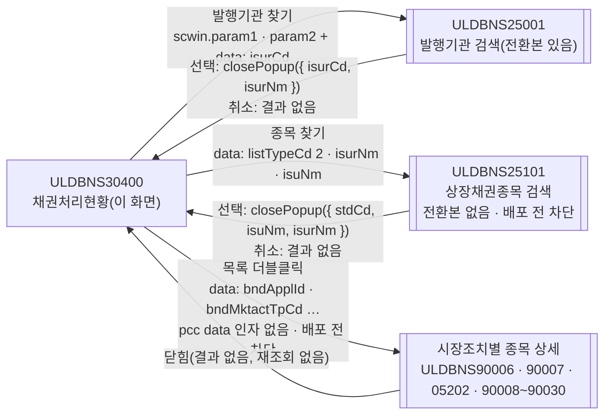

AS-IS 는 `fn_GetPar`/`fn_SetPar` 를 바꿔 끼우고(되돌리지 않음) 팝업이 이 화면 입력란을 직접 채웠다. TO-BE 는 모든 화살표가 `await $c.win.openPopup(url, options, data)` 이고, 찾기 팝업 두 개만 결과를 돌려받는다(가이드 §6.5). 단 25001 전환본은 `data` 대신 부모 `scwin.param1`/`param2` 를 읽으므로 열기 전에 채운다(§6.4). 25101·상세 팝업은 상대 화면(또는 pcc)이 아직 전환되지 않아 **배포 전 차단**(§10 #11·#12).

#### 업무 1: 진입·로딩

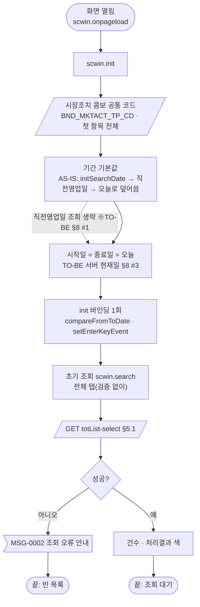

| # | 단계 | 주체 | 내용 | 분기 · 메시지 | 관련 절 |
|---|---|---|---|---|---|
| 1 | (장식) | 화면 | AS-IS `BnsPanelToGroupBox(panel_Top)` | 삭제 — 퍼블리싱 `schbox` 가 대신함 | §2.1 |
| 2 | 공통 코드 | 서버 | 시장조치 `03057`(`BND_MKTACT_TP_CD`) → `cmb_MktStsGb`, 첫 항목 "전체"(값 빈 문자열), 104·105·999·313·321 제외. AS-IS `fn_SetBnsComboToCode2(…, dts_Temp, …)` 는 **동기** | `await $c.data.setCommonCode` | §3, §7.1 |
| 3 | 기간 기본값 | 화면 | AS-IS: `fn_initSearchDate`(1900-01-01 ~ +60일) → `fn_getDate()`(**동기**) 3행 `CALND_DD` 를 시작일에 → 곧바로 시작·종료일 모두 `cGetToday`(클라이언트 오늘)로 덮어씀. 결과는 언제나 "오늘 ~ 오늘" | TO-BE 는 최종값만 둔다(직전영업일 조회 생략, §8 #1·#2) | §3, §5.4 |
| 4 | init 바인딩 | 화면 | 기간 쌍 `compareFromToDate`, 조회 영역 Enter | — | §3 |
| 5 | 초기 조회 | 서버 | `fn_Search()` — 탭 기본값이 전체(AS-IS `activeindex=1`)라 `fn_Search1`. [조회] 와 달리 기간 검사를 하지 않음 | 실패 시 `MSG-0002` | §5.1, §8 #14 |

#### 업무 2: 조회 (탭 분기)

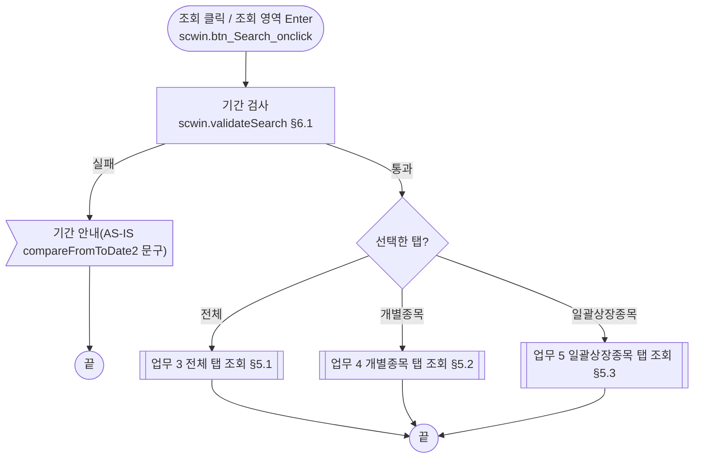

| # | 단계 | 주체 | 내용 | 분기 · 메시지 | 관련 절 |
|---|---|---|---|---|---|
| 1 | 기간 검사 | 화면 | AS-IS `compareFromToDate2(edt_SDate, edt_EDate)` — true 일 때만 조회. pcc/gcc 에 같은 함수 없음 → `scwin.validateSearch`(필수·날짜·선후) | 문구는 §10 #13 | §6.1 |
| 2 | 탭 분기 | 화면 | AS-IS `tab_Main.ActiveIndex` `"1"`/`"2"`/`"3"`(1-base) → TO-BE `getSelectedTabIndex()` 0/1/2 | 해당 탭 하나만 조회, 다른 탭 목록은 그대로 | §6.2 |

#### 업무 3: 전체 탭 조회

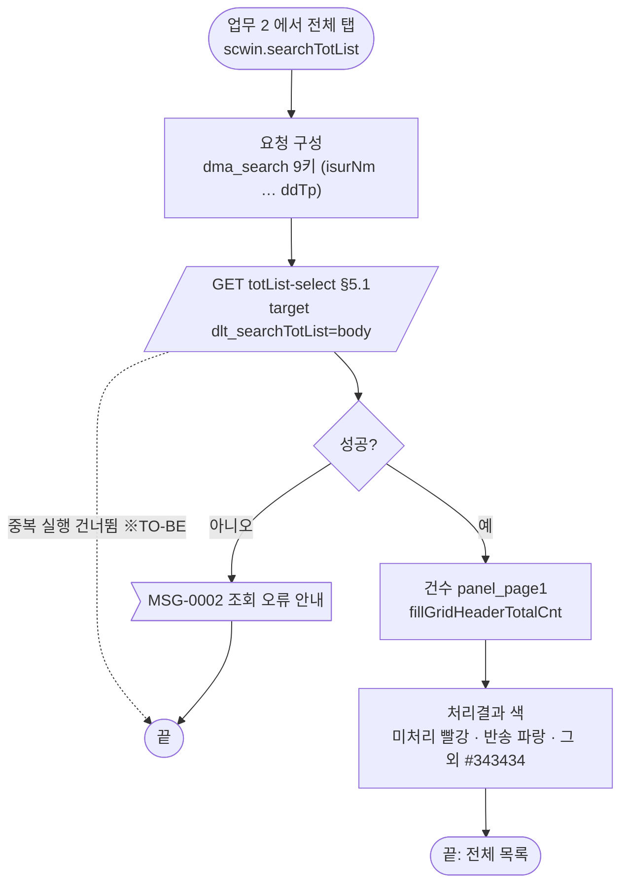

| # | 단계 | 주체 | 내용 | 분기 · 메시지 | 관련 절 |
|---|---|---|---|---|---|
| 1 | 요청 | 서버 | AS-IS `fn_Search1` — `/listingCommon.do?method=listGeneralForDynamicName` `queryId=…select.list1` + `{P}V_*` 9개(ESG `V_SRI_BND_TP_CD`·기준 `V_DD_TP` 포함) | — | §5.1 |
| 2 | 결과 | 화면 | AS-IS `dts_List1 OnLoadCompleted(rowcount)` — `FillGridHeaderTotalCnt(rowcount, panel_page1)`, `CloseWin`, `PROC_STATE` 색 decode | 0건이어도 안내 없음(건수 0) | §5.1, §6.9 |
| 3 | 실패 | 화면 | AS-IS `dts_List1 OnLoadError()` → `alert(getMessageParam("MSG-0002"))` | 목록은 비운 채 | §7.2 |

#### 업무 4: 개별종목 탭 조회

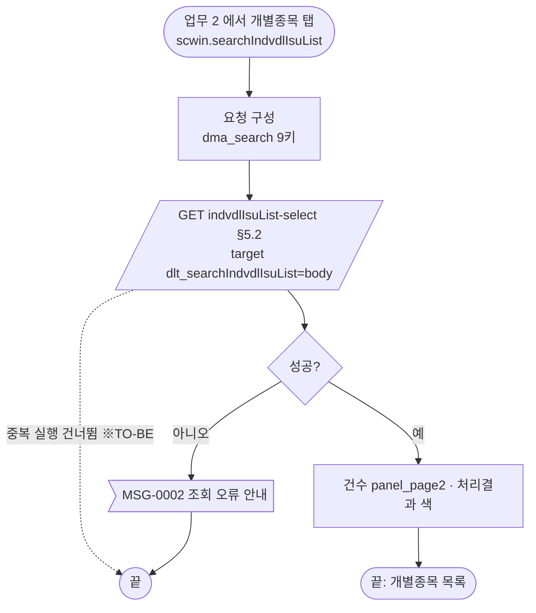

| # | 단계 | 주체 | 내용 | 분기 · 메시지 | 관련 절 |
|---|---|---|---|---|---|
| 1 | 요청 | 서버 | AS-IS `fn_Search2` — `queryId=…select.list2`, `{P}V_*` 8개(**ESG `V_SRI_BND_TP_CD` 는 보내지 않음** — 이 탭은 ESG 체크가 막혀 있음). 명세는 9키 모두 → 체크 해제 값이 감 | §10 #7 | §5.2 |
| 2 | 결과 | 화면 | `dts_List2 OnLoadCompleted` — 건수 `panel_page2`, 색 decode | — | §5.2 |

#### 업무 5: 일괄상장종목 탭 조회

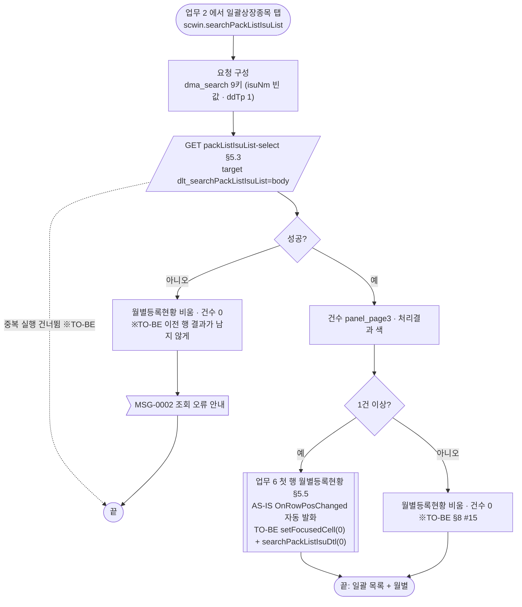

| # | 단계 | 주체 | 내용 | 분기 · 메시지 | 관련 절 |
|---|---|---|---|---|---|
| 1 | 요청 | 서버 | AS-IS `fn_Search3` — `queryId=…select.list3`, `{P}V_*` 6개(종목 `V_ISU_NM` 은 주석 처리, ESG·기준구분 없음). 명세는 9키 — 이 탭에서 종목은 비워 잠겨 있고 기준구분은 "1" 고정이라 값 차이는 없다 | §10 #7 | §5.3 |
| 2 | 결과 | 화면 | `dts_List3 OnLoadCompleted` — 건수 `panel_page3`, 색 decode | 실패면 ※TO-BE 월별등록현황을 비우고 건수 0 → `MSG-0002` | §5.3 |
| 3 | 첫 행 상세 | 화면→서버 | AS-IS 는 데이터셋 로드 때 행 위치가 정해지며 `OnRowPosChanged(row)` 가 발화해 첫 행 월별등록현황을 조회 → TO-BE 는 gridView 행 이벤트가 로드 때 발화하지 않으므로 조회 뒤 `grd_List3.setFocusedCell(0, "procState")` 후 직접 `scwin.searchPackListIsuDtl(0)`(지금은 서버 호출 없이 빈 목록 — 업무 6) | 0건이면 상세를 비움(※TO-BE). `setFocusedCell` 이 행 이벤트를 발화해 두 번 부르는지 실측(§10 #19) | §5.5 |

#### 업무 6: 월별등록현황 조회 (일괄 목록 행 이동)

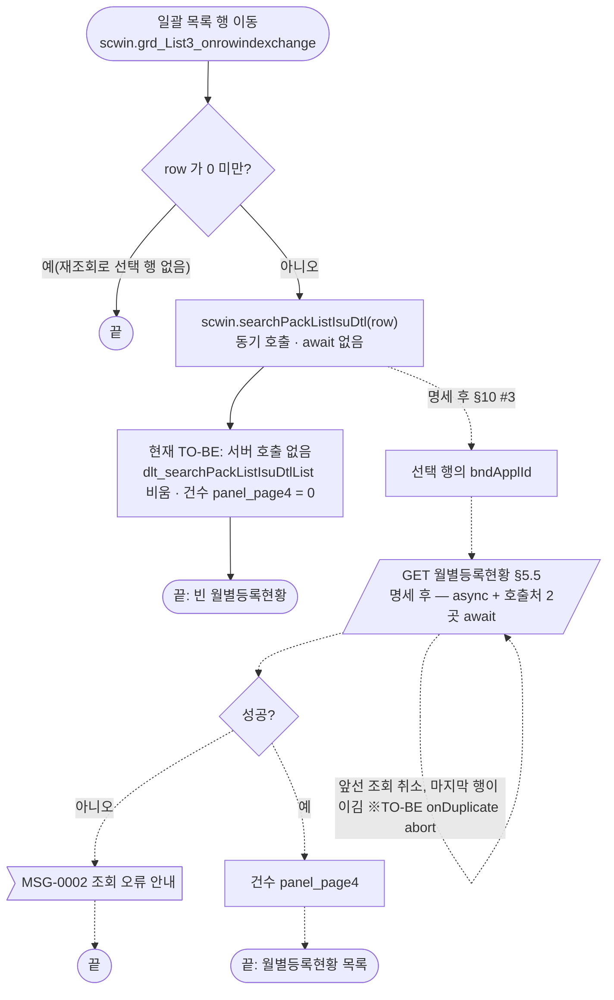

| # | 단계 | 주체 | 내용 | 분기 · 메시지 | 관련 절 |
|---|---|---|---|---|---|
| 1 | 요청 | 서버 | AS-IS `fn_SearchDetail(row)` — `outputMessageId=BNS_CLS_PROCES_STAT_LIST_DETAIL`, `queryId=…select.list3detail`, `{P}V_BND_APPL_ID = dts_List3.NameString(row, 'BND_APPL_ID')`. **명세에 블록 없음** → **현재 TO-BE 는 서버를 부르지 않고** `dlt_searchPackListIsuDtlList.removeAll()` + 건수 0 만 한다(점선은 명세 후 흐름) | §10 #3 | §5.5 |
| 2 | 결과 | 화면 | `dts_ListDet OnLoadCompleted(rowcount)` — 건수 `panel_page4` | 명세 후: 실패 `MSG-0002` | §5.5 |

#### 업무 7: 탭 전환

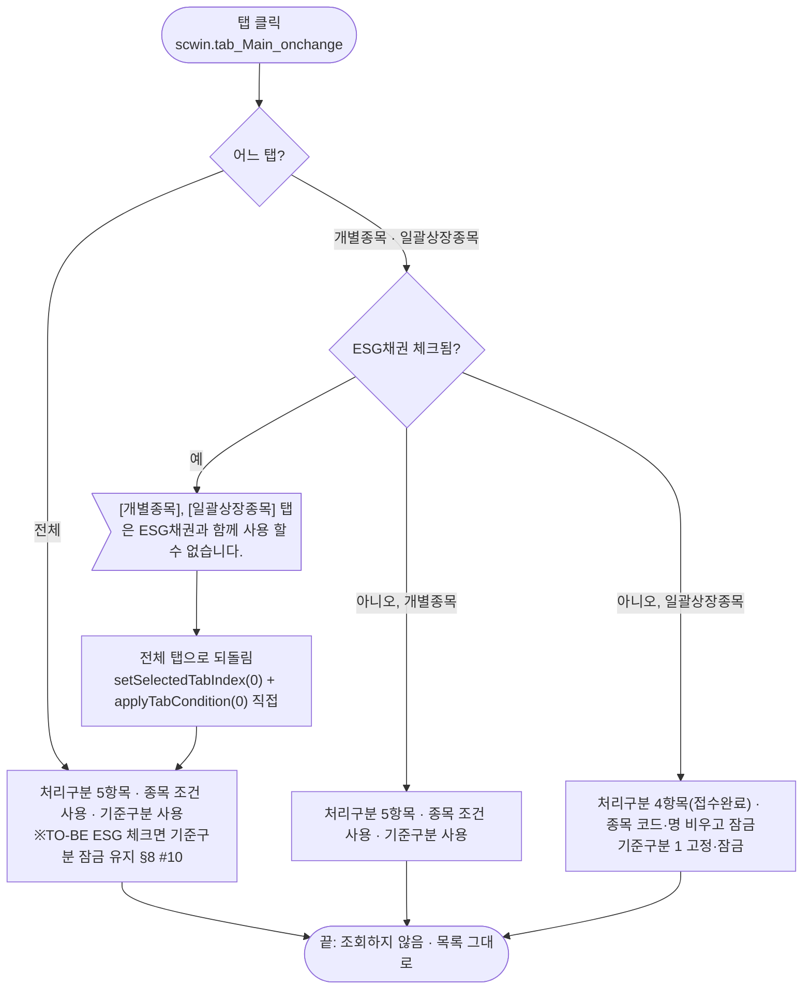

| # | 단계 | 주체 | 내용 | 분기 · 메시지 | 관련 절 |
|---|---|---|---|---|---|
| 1 | ESG 차단 | 화면 | `getObjectValue(chk_SRI_BND_TP_CD) == "Y"` 이고 개별·일괄 탭이면 안내 후 `tab_Main.ActiveIndex = 1`(전체) | 원문 그대로 §7.2. TO-BE 는 `setSelectedTabIndex(0)` 뒤 언제나 `applyTabCondition(0)` 을 직접 부른다(onchange 가 다시 발화하면 두 번 돌지만 결과가 같아 무해 — §10 #18) | §6.2 |
| 2 | 처리구분 항목 | 화면 | `cmb_BndStsGb.CBData` 교체 + `ResetData()`(선택이 첫 항목 "전체"로 돌아감) — 전체·개별 `0^전체,1^미처리,2^처리중,3^처리완료,4^반송`, 일괄 `0^전체,1^미처리,3^접수완료,4^반송` | TO-BE `removeAll` → `addItem` → `setSelectedIndex(0)`(§10 #19) | §6.2, §7.1 |
| 3 | 종목 조건 | 화면 | 일괄: `txb_ISU_CD`·`txb_ISU_NM` 비움, `txb_ISU_CD.blur()`, `txb_ISU_CD`·`btn_ISU_CD_SEARCH` 잠금(이미지 `btn_search_d.gif`). 전체·개별: 해제(`btn_search.gif`) | 이미지 교체는 `setDisabled` 로 대신. TO-BE 는 `dma_search.set("isuNm", "")` + `txb_ISU_NM.setValue("")` — `blur()` 는 값을 바로 비워 onblur 처리가 필요 없어 뺐다 | §6.2 |
| 4 | 기준구분 | 화면 | 일괄: `rdo_DD_TP` = "1" + 잠금. 전체·개별: 해제 | AS-IS 는 전체로 돌아올 때 ESG 체크 상태를 보지 않고 푼다(§8 #10 — TO-BE `applyDdTpLock` 이 고침) | §6.3 |
| 5 | 조회 | — | 탭 전환은 조회하지 않는다. 각 탭 목록은 마지막 조회 결과가 남는다 | §8 #9 | — |

#### 업무 8: ESG채권 체크

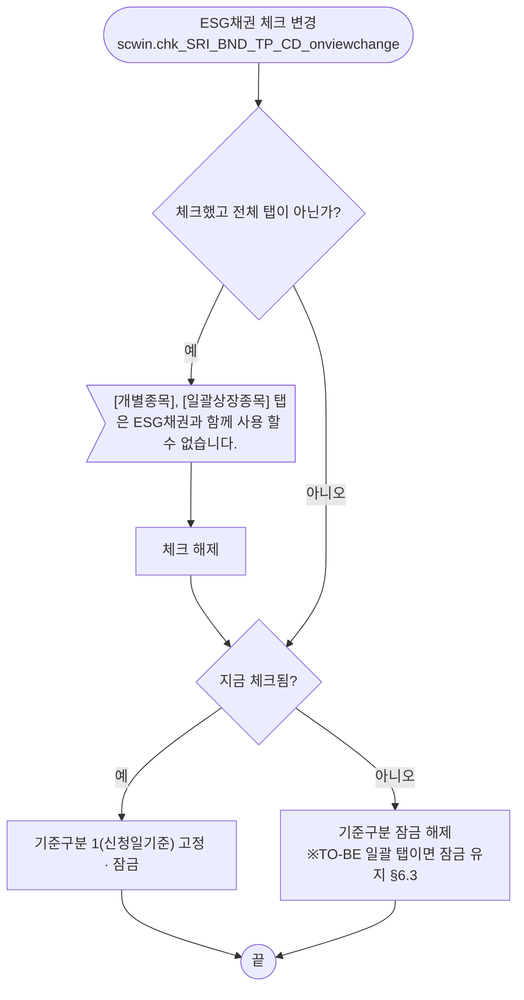

- 원본 순서 그대로(안내 → 해제 → 잠금 판정). 개별·일괄 탭에서는 체크가 바로 풀리므로 결국 잠금 해제 분기로 간다 — 일괄 탭에서는 이 때문에 기준구분 잠금이 풀린다(AS-IS 결함, §8 #10 에서 함께 고침).

#### 업무 9: 발행기관 찾기

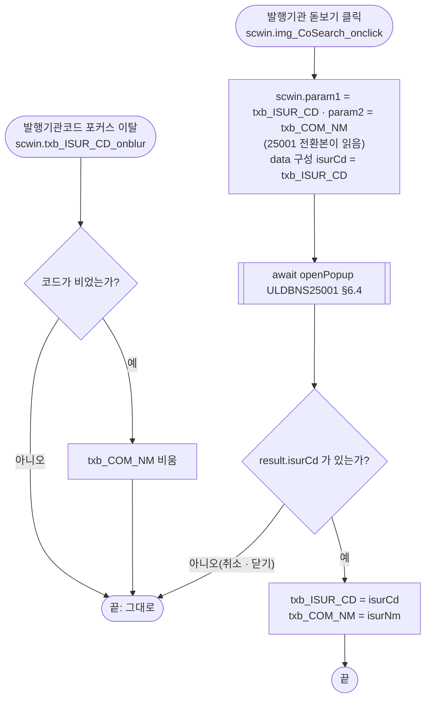

#### 업무 10: 종목 찾기

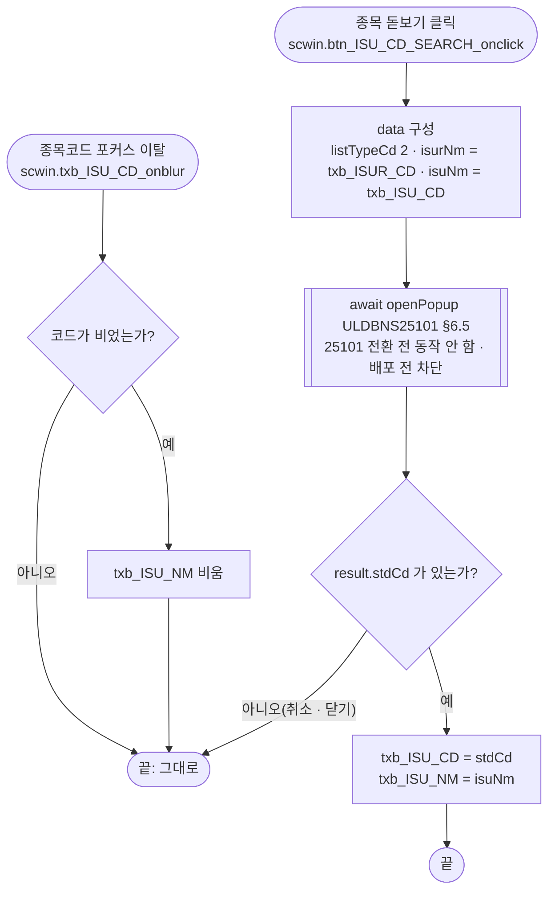

- **배포 전 차단**: 저장소에 25101 전환본이 없다(publish/publish-tobe 1차본은 `fn_GetPar`/`fn_SetPar`). 25101 을 `getParameter()` + `closePopup({ stdCd, isuNm, isurNm })` 로 전환해야 이 업무가 동작한다(§10 #11).
- 일괄상장종목 탭에서는 돋보기·코드 입력란이 잠겨 있어 이 업무가 시작되지 않는다(업무 7).
- AS-IS 는 발행기관 **코드** 입력란 값을 `ISUR_NM`(발행기관명) 키로 넘긴다 — 그대로 옮기고 확인한다(§8 #6, §10 #5).

#### 업무 11: 종목 상세 보기 (목록 더블클릭)

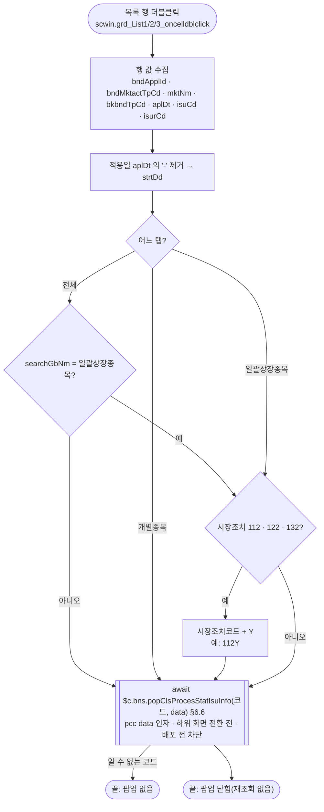

| # | 단계 | 주체 | 내용 | 분기 · 메시지 | 관련 절 |
|---|---|---|---|---|---|
| 1 | 머리글 가드 | 화면 | AS-IS `if (row == 0) return;`(Gauce 0행 = 머리글) | TO-BE `oncelldblclick` 은 본문 행만 발화 → 가드 없음(§8 #20) | §4 |
| 2 | 값 수집 | 화면 | AS-IS 는 `vs_G_*` 전역 7개에 담아 두고 팝업이 `fn_GetCommonKey` 로 읽음. 일괄 탭은 `vs_G_ISUR_CD` 를 채우지 않음 | TO-BE 는 행에서 `data` 를 바로 만듦(§8 #4) | §6.6 |
| 3 | 일괄 코드 | 화면 | 전체 탭은 `SEARCH_GB_NM == "일괄상장종목"` 인 행만, 일괄 탭은 항상 112·122·132 에 `Y` 를 붙임(개별 탭은 붙이지 않음) | `112Y`·`122Y`·`132Y` → `ULDBNS05202` | §7.1 |
| 4 | 팝업 | 화면 | `fn_PopClsProcesStatIsuInfo(코드)` — 코드별 상세 화면 | pcc 기준 표에 없는 코드는 아무것도 열지 않음(§8 #22) | §6.6 |

#### 업무 12: 목록 엑셀 다운로드

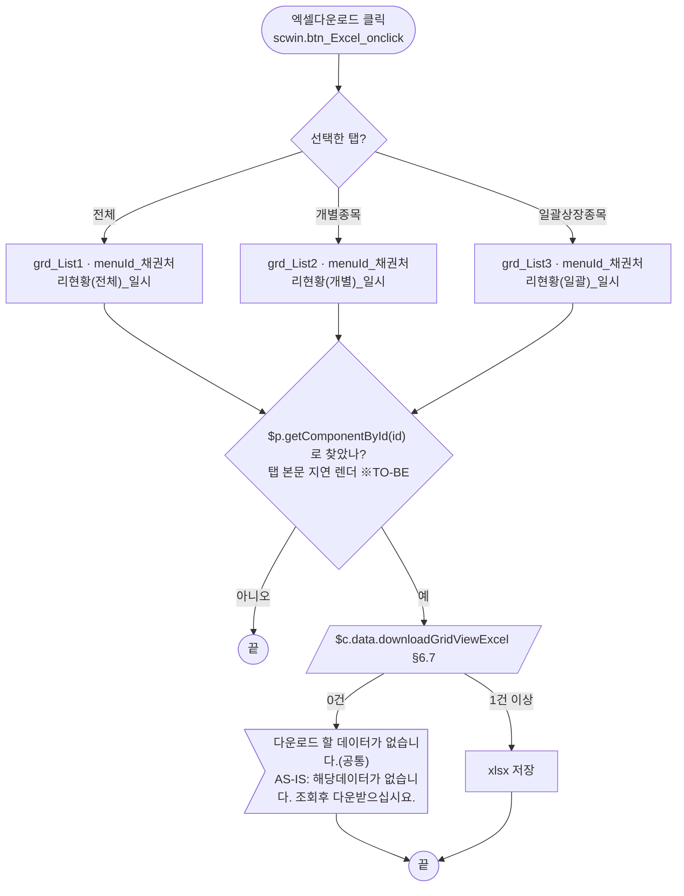

- AS-IS 는 1건 이상일 때 `doLogSave(vScrenID, SCREN_PROCS_TP_CD_07)` 로 화면 이력을 남긴 뒤 `GridToOffice("sheet1", 경로, 8, 0)` → TO-BE 는 `doLogSave` 삭제(2026-10-26 결정, §8 #18).
- 일괄상장종목 탭에서도 이 버튼은 일괄 목록(`grd_List3`)만 내려받는다. 월별등록현황은 업무 13.

#### 업무 13: 월별등록현황 엑셀 다운로드

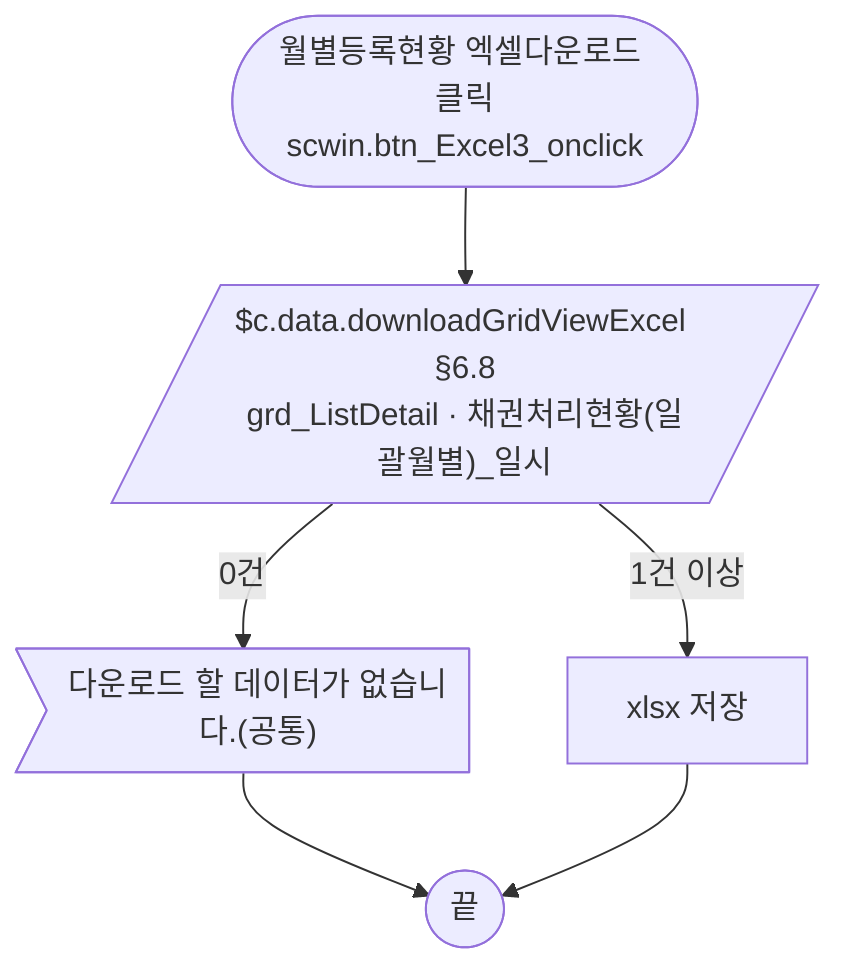

---

## 2. 화면 구성 및 데이터 정의

### 2.1 화면 구성

영역은 위→아래 순서다. TO-BE id 는 퍼블리싱본 기준이고, 1단계(마크업 기준본 보강, 2026-10-27)에서 아래 **보강** 표시한 곳을 고쳤다.

| 영역 | AS-IS 요소 | TO-BE 컴포넌트 (바인딩) | 설명 |
|---|---|---|---|
| (화면 머리) | (없음) | **보강** — `sub_contents` 첫 자식으로 `w2:pageFrame#pfmContentHeader`(`/cm/xml/contentHeader.xml`) 추가 — 메인 화면이라 필수(탭 본문에는 넣지 않음) | §10 #16 ⑤ |
| 조회 영역 | `panel_Top` (`TopCondition_01`, `BnsPanelToGroupBox`) | `xf:group.schbox` > 안쪽 표 그룹 **`id="tbl_search"`**(보강 — 규칙 22) | `BnsPanelToGroupBox` 는 **(옮기지 않음)** |
| 발행기관명(코드) | `label_5` "발행기관명(코드)" · `txb_ISUR_CD`(코드, 80자) · `txb_COM_NM`(명, readonly, 1000자) · `img_CoSearch`(돋보기) | `txb_ISUR_CD` (`dma_search.isurNm` — 명세 키, §10 #5) — 퍼블리셔 `w2:autoComplete`(itemset 없음)는 값이 안 보일 수 있어 **`xf:input` 으로 바꿈**(보강, 선례 ULDSTF05621) · `txb_COM_NM` (`xf:input` readOnly, 바인딩 없음 — 표시 전용) · `img_CoSearch` (`xf:trigger`) | §6.4. 코드를 비우고 나가면 명을 지움 |
| 시장조치 | `label_1` "시장조치" · `cmb_MktStsGb` (공통 코드 03057, `index=0`) | `cmb_MktStsGb` (`xf:select1`, `dma_search.mktRsnCd`) | 첫 항목 "전체"(값 "") — §3 |
| 종목명(코드) | `label_2` "종목명(코드)" · `txb_ISU_CD`(표준코드, 80자) · `txb_ISU_NM`(명, readonly, **maxlength 5**) · `btn_ISU_CD_SEARCH`(돋보기) | `txb_ISU_CD` (`dma_search.isuNm` — 명세 키) · `txb_ISU_NM` (표시 전용, maxlength 삭제 — §8 #7) · `btn_ISU_CD_SEARCH` (`xf:trigger`) | §6.5. 일괄 탭에서는 비우고 잠금 |
| 기간 | `label_6` "기간" · `edt_SDate` ~(`label_3` "~") `edt_EDate` (`YYYY-MM-DD` maskedit) + `btn_SDate`·`btn_EDate`(달력 이미지) | `edt_SDate` (`inputCalendar`, `dma_search.strtDd`) · `edt_EDate` (`dma_search.endDd`) | 달력 이미지 **(옮기지 않음)** — inputCalendar 내장. 기간 쌍 `compareFromToDate`(§3) |
| 기준구분 | `rdo_DD_TP` `1^신청일기준,2^적용희망일기준` (`codevalue=1`) | `rdo_DD_TP` (`xf:select1` radiogroup, `dma_search.ddTp`) | 일괄 탭·ESG 체크 때 "1" 고정·잠금 |
| 처리구분 | `label_4` "처리구분" · `cmb_BndStsGb` (`0^전체,1^미처리,2^처리중,3^처리완료,4^반송`) | `cmb_BndStsGb` (`xf:select1`, `dma_search.state`) | 탭별 항목 교체 — §6.2 |
| 처리자 | `label_7` "처리자" · `txb_EmpNm` (5자) | `txb_EmpNm` (`xf:input`, `dma_search.empNm`) | |
| ESG채권 | `label_9` "ESG채권" · `chk_SRI_BND_TP_CD` (`value="Y"`, **panel_Top 밖에 겹쳐 놓인 체크박스**) | `chk_SRI_BND_TP_CD` (`xf:select` checkboxgroup `item="Y^"`, `dma_search.sriBndTpCd`) — 퍼블리싱본은 조회 표 안에 넣음 | `onclick` → `ev:onviewchange`(1단계에서 퍼블리셔 `onclick` 제거 — `publish_gate --allow P11`). 값 형식 §10 #6 |
| 조회 버튼 | `btn_Search` (이미지) | `btn_Search` (`xf:trigger.btn_cm.sch`, `scwin.btn_Search_onclick`) | 조회 영역 Enter 키도 이 핸들러 |
| 엑셀 | `btn_Excel` (이미지, 조회 영역 안) | `btn_Excel` (`titbox > rt`, `xf:trigger.btn_cm.download`) | 선택 탭 목록 — §6.7 |
| 탭 | `tab_Main` (`activeindex=1`) — `panel_2` "전체" / `panel_3` "개별종목" / `panel_4` "일괄상장종목" (각 `visibility:hidden` 패널) | `tab_Main` (`w2:tabControl.tbc`, `selectedIndex="0"`) — 탭 `panel_2`·`panel_3`·`panel_4`, 본문 `panel_2_01`·`panel_3_01`·`panel_4_01` | `OnSelChanged(nIndex)` → `onchange`. 탭 본문은 contentHeader 금지(그대로) |
| 전체 목록 | `grd_List1` (`dts_List1`) + 건수 `panel_page1` | `grd_List1` (`dataList="data:dlt_searchTotList"`) + `w2:span#panel_page1` | 아래 컬럼 표 |
| 개별종목 목록 | `grd_List2` (`dts_List2`) + `panel_page2` | `grd_List2` (`data:dlt_searchIndvdlIsuList`) + `panel_page2` | `한글종목명` 열 파란 글자 `class="blue"`(더블클릭 안내 표시) |
| 일괄상장종목 목록 | `grd_List3` (`dts_List3`) + `panel_page3` | `grd_List3` (`data:dlt_searchPackListIsuList`) + `panel_page3` | `시장조치구분` 열 파란 글자 `class="blue"`. 행 이동 → 월별등록현황 |
| 월별등록현황 | `label_8` "월별등록현황" · `btn_Excel3` · `grd_ListDetail` (`dts_ListDet`) + `panel_page4` | `label_8` (`h3`) · `btn_Excel3` · `grd_ListDetail` (`data:dlt_searchPackListIsuDtlList` — **가정**, §10 #3) + `panel_page4` | 일괄 탭 본문 아래쪽 |
| (진행 표시) | `ShowWin(grd)`/`CloseWin(rowcount, grd)` | **(옮기지 않음)** — `executeDynamic` 의 `gridview` 스피너 | |
| (숨김 데이터셋) | `dts_Temp`(콤보 코드), `dts_getDate`(직전영업일) | **(옮기지 않음)** — `setCommonCode` / `dma_searchPrevBzDd` | §2.2 |

**1단계 마크업 보강 (완료, §10 #16)** — 위 표의 보강 외에: W-Craft 잔재 속성 `hierarchy`·`orgid`·`userData2` 삭제. 그리드 4종(`grd_List1`·`grd_List2`·`grd_List3`·`grd_ListDetail`)은 `dataList="data:dlt_*"`, 컬럼 id camelCase·머리글 `h_` 접두, 번호 열 `inputType="expression" expression="rowIndex()+1"`, 전 열 `readOnly="true"`, 숨김 2열은 `gBody` 에도 `hidden="true"`, 금액 열 `dataType="number"` + `displayFormat="#,##0"`, 파란 글자 열은 `class="blue"`, `w2:caption` 문구 정리, **4종 모두 `sortable="true"`**(AS-IS `sort="True"`).

**남은 퍼블리셔 잔재 (Minor, 미수정 — §10 #20)**: ① 기간 칸 `td` 에 `flex flex_no` 래퍼가 없고 "~" 를 `w2:textbox`(`label_3`)로 둠 ② 그리드 높이를 `rowN`/`visibleRowNum` 대신 인라인 `style="height:153px;"` 로 둠 ③ `xf:trigger` 의 `src`·`cursor` 속성, `xf:select1` 의 `item=` 속성(choices 와 중복)이 남아 있음. 동작에는 영향이 없다.

**목록 그리드 컬럼** (AS-IS 머리글 원문 → TO-BE 컬럼 id = 명세 키 camelCase, 머리글 id 는 `h_` 접두. 모든 열 `readOnly="true"`, §8 #21)

| AS-IS 컬럼 (머리글) | TO-BE 컬럼 | `grd_List1` 전체 | `grd_List2` 개별 | `grd_List3` 일괄 |
|---|---|---|---|---|
| `NO` "번호" (`{CurRow},{ToString}`) | `no` — `inputType="expression" expression="rowIndex()+1"` | O | O | O |
| `PROC_STATE` "처리결과" | `procState` (처리결과 색, §6.9) | O | O | O |
| `MKT_NM` "시장조치구분" | `mktNm` | O | O | O (파란 글자) |
| `ISU_NM` "한글종목명" | `isuNm` | O | O (파란 글자) | — |
| `CTNT` "신청내용 (단위: 발행통화 참조)" | `ctnt` | O | O | — |
| `ISU_CD` "표준코드" | `isuCd` | O | O | — |
| `BND_APPL_ID` "접수번호" | `bndApplId` | O | O | O |
| `CO_NM` "발행기관명" | `coNm` | O | O | O |
| `REQ_DT` "신청일" | `reqDt` | O | O | O |
| `RECV_DT` "접수처리일" | `recvDt` | O | O | O |
| `PROC_DT` "처리완료일" | `procDt` | O | O | — |
| `BOSS_PROC_DT` "팀장확인일" | `bossProcDt` | O | O | — |
| `PROC_REQ_DT` "적용희망일" | `procReqDt` (명세 name "처리요구일" — §10 #9) | O | O | — |
| `APL_DT` "적용일" | `aplDt` | O | O | — |
| `ACPT_TRANSTR_NM` "접수처리자" | `acptTranstrNm` | O | O | O |
| `PROCS_COMPLT_CHRG_NM` "처리완료자" | `procsCompltChrgNm` | O | O | — |
| `TEAMLEADR_NM` "팀장확인자" | `teamleadrNm` | O | — | — |
| `RET_CHRG_NM` "반송자" | `retChrgNm` | O | O | O |
| `RET_RSN` "반송사유" | `retRsn` | O | O | O |
| `REQ_PRSN_CD` "신청자구분" (`show="False"`) | `reqPrsnCd` (숨김 유지) | O | O | O |
| `BANK_BND_CD` "은행채구분" (`show="False"`) | `bankBndNm` (숨김 유지 — 명세는 이름 키, §10 #9) | O | O | O |

- 열 순서·폭·정렬은 AS-IS(=퍼블리싱본) 그대로다(탭마다 다름 — 개별 탭은 `접수번호`·`발행기관명` 이 앞, 숨김 2열이 `적용일` 뒤).
- 더블클릭에만 쓰고 그리드에 없는 키: `bndMktactTpCd`·`bkbndTpCd`·`searchGbNm`·`isurCd` — dataList 에만 있다.

**월별등록현황 그리드 `grd_ListDetail`** (명세 없음 — 키는 AS-IS 컬럼의 camelCase 가정, §10 #3)

| AS-IS 컬럼 (머리글) | TO-BE 컬럼 | 비고 |
|---|---|---|
| `NO` "번호" | `no` (expression `rowIndex()+1`) | |
| `PROCS_YN` "월별등록여부" | `procsYn` | |
| `PACK_LIST_APPL_MM` "발행월" | `packListApplMm` | |
| `APPL_ISU_NM` "한글종목명" | `applIsuNm` | |
| `APPL_ISU_ENG_NM` "영문종목명" | `applIsuEngNm` | |
| `ISU_SCHDL_AMT` "발행(예정)금액" (`mask="XXX,XXX,XXX,XXX,XXX"`) | `isuSchdlAmt` — `dataType="number"` + `displayFormat="#,##0"`, 오른쪽 정렬 | |
| `ISU_DD` "발행일" | `isuDd` | |
| `REDMPT_DD` "상환일" | `redmptDd` | |

### 2.2 데이터 정의

| AS-IS | TO-BE | 종류 | 키(컬럼) | 출처 / 용도 |
|---|---|---|---|---|
| (없음 — 입력란을 직접 읽어 URL 에 붙임) | `dma_search` (**화면 조건 — 명세 키 그대로**) | dataMap | `isurNm`, `isuNm`, `empNm`, `mktRsnCd`, `state`, `strtDd`, `endDd`, `sriBndTpCd`, `ddTp` (모두 text) | 명세 블록 1~3 `requestData` 의 9키. 조회 요청은 `dma_search.getJSON()` 을 `requestData` 로 보냄(§5) |
| `dts_List1` | `dlt_searchTotList` | dataList | 명세 블록 1 응답 24열(아래) | `grd_List1` |
| `dts_List2` | `dlt_searchIndvdlIsuList` | dataList | 명세 블록 2 응답 24열(블록 1 과 같음) | `grd_List2` |
| `dts_List3` | `dlt_searchPackListIsuList` | dataList | 명세 블록 3 응답 24열(블록 1 과 같음) | `grd_List3` |
| `dts_getDate` (`syncload=True`) | `dma_searchPrevBzDd` | dataMap | `calndDd` | 명세 블록 4 응답. TO-BE 는 지금 호출하지 않음(§5.4, §8 #1) — 정의만 둔다 |
| `dts_ListDet` | `dlt_searchPackListIsuDtlList` (**가정 — 명세 없음**) | dataList | `procsYn`, `packListApplMm`, `applIsuNm`, `applIsuEngNm`, `isuSchdlAmt`(number), `isuDd`, `redmptDd` | `grd_ListDetail`. 명세가 오면 id·키를 명세대로 바꿈(§10 #3) |
| `dts_Temp` | (삭제) | — | — | 시장조치 콤보는 `$c.data.setCommonCode` 가 자체 dataList 를 만든다 |

**명세 정의 원문** (`ULDBNS30400_API.md` — id·name·dataType 그대로. 블록 1·2·3 의 `columnInfo` 는 줄 단위로 같음을 대조했다)

```xml
<w2:dataList id="dlt_searchTotList" baseNode="list" saveRemovedData="true" repeatNode="map">
	<w2:columnInfo>
		<w2:column id="procState" name="채권처리구분" dataType="text"></w2:column>
		<w2:column id="bndApplId" name="채권신청ID" dataType="text"></w2:column>
		<w2:column id="coNm" name="발행기관명" dataType="text"></w2:column>
		<w2:column id="mktNm" name="시장조치구분" dataType="text"></w2:column>
		<w2:column id="isuNm" name="종목명" dataType="text"></w2:column>
		<w2:column id="isuCd" name="종목 코드" dataType="text"></w2:column>
		<w2:column id="reqDt" name="채권신청일" dataType="text"></w2:column>
		<w2:column id="recvDt" name="접수처리일" dataType="text"></w2:column>
		<w2:column id="procDt" name="처리완료일" dataType="text"></w2:column>
		<w2:column id="bossProcDt" name="팀장확인일" dataType="text"></w2:column>
		<w2:column id="procReqDt" name="처리요구일" dataType="text"></w2:column>
		<w2:column id="aplDt" name="적용일" dataType="text"></w2:column>
		<w2:column id="reqPrsnCd" name="신청자구분" dataType="text"></w2:column>
		<w2:column id="bankBndNm" name="은행채구분" dataType="text"></w2:column>
		<w2:column id="bkbndTpCd" name="은행채구분코드" dataType="text"></w2:column>
		<w2:column id="retRsn" name="반송사유" dataType="text"></w2:column>
		<w2:column id="acptTranstrNm" name="접수처리자명" dataType="text"></w2:column>
		<w2:column id="procsCompltChrgNm" name="처리완료자명" dataType="text"></w2:column>
		<w2:column id="retChrgNm" name="반송자" dataType="text"></w2:column>
		<w2:column id="ctnt" name="신청내용" dataType="text"></w2:column>
		<w2:column id="bndMktactTpCd" name="채권시장조치구분코드" dataType="text"></w2:column>
		<w2:column id="searchGbNm" name="검색구분명" dataType="text"></w2:column>
		<w2:column id="teamleadrNm" name="팀장명" dataType="text"></w2:column>
		<w2:column id="isurCd" name="발행기관코드" dataType="text"></w2:column>
	</w2:columnInfo>
</w2:dataList>

<!-- 블록 2 · 3: 위와 같은 24열 columnInfo, id 만 다름 -->
<w2:dataList id="dlt_searchIndvdlIsuList" baseNode="list" saveRemovedData="true" repeatNode="map"> … </w2:dataList>
<w2:dataList id="dlt_searchPackListIsuList" baseNode="list" saveRemovedData="true" repeatNode="map"> … </w2:dataList>

<!-- 블록 4 -->
<w2:dataMap id="dma_searchPrevBzDd" baseNode="map">
	<w2:keyInfo>
		<w2:key id="calndDd" name="달력일자" dataType="text"></w2:key>
	</w2:keyInfo>
</w2:dataMap>
```

- TO-BE `<w2:dataCollection>` 에는 블록 2·3 도 위 24열을 펼쳐 그대로 넣는다(`…` 생략은 이 결과서 지면 때문).
- `dma_search` 는 명세가 dataMap 으로 정의하지 않고 `requestData` 키 목록만 준다 → 같은 9키(text)로 화면 정의를 만든다. 요청 키 설명(`isurNm: 발행기관명`, `isuNm: 종목명`, `sriBndTpCd: SRI채권구분코드`, `ddTp: 기준구분` …)은 §5 표.
- **AS-IS 컬럼 → 명세 키**: `PROC_STATE→procState`, `BND_APPL_ID→bndApplId`, `CO_NM→coNm`, `MKT_NM→mktNm`, `ISU_NM→isuNm`, `ISU_CD→isuCd`, `REQ_DT→reqDt`, `RECV_DT→recvDt`, `PROC_DT→procDt`, `BOSS_PROC_DT→bossProcDt`, `PROC_REQ_DT→procReqDt`, `APL_DT→aplDt`, `REQ_PRSN_CD→reqPrsnCd`, `BANK_BND_CD→bankBndNm`(코드→이름 키, §10 #9), `BKBND_TP_CD→bkbndTpCd`, `RET_RSN→retRsn`, `ACPT_TRANSTR_NM→acptTranstrNm`, `PROCS_COMPLT_CHRG_NM→procsCompltChrgNm`, `RET_CHRG_NM→retChrgNm`, `CTNT→ctnt`, `BND_MKTACT_TP_CD→bndMktactTpCd`, `SEARCH_GB_NM→searchGbNm`, `TEAMLEADR_NM→teamleadrNm`, `ISUR_CD→isurCd`.
- **조건 → 요청 키**: `txb_ISUR_CD`(`{P}V_CO_NM`)→`isurNm`, `txb_ISU_CD`(`{P}V_ISU_NM`)→`isuNm`, `txb_EmpNm`(`V_EMP_NM`)→`empNm`, `cmb_MktStsGb`(`V_MKT_RSN_CD`)→`mktRsnCd`, `cmb_BndStsGb`(`V_STATE`)→`state`, `edt_SDate`(`V_STRT_DD`)→`strtDd`, `edt_EDate`(`V_END_DD`)→`endDd`, `chk_SRI_BND_TP_CD`(`V_SRI_BND_TP_CD`)→`sriBndTpCd`, `rdo_DD_TP`(`V_DD_TP`)→`ddTp`.
- 명세에만 있고 화면에 안 보이는 키는 없다(`bkbndTpCd`·`bndMktactTpCd`·`searchGbNm`·`isurCd` 는 더블클릭 팝업 `data` 에 쓴다). 명세에 없는 AS-IS 컬럼도 없다(월별등록현황 제외).

---

## 3. 로딩 (`gform onload` → `scwin.onpageload` → `scwin.init`)

원본 `gform onload` 순서: `BnsPanelToGroupBox(panel_Top)` → 시장조치 콤보(`fn_SetBnsComboToCode2(vScrenID, dts_Temp, [{cid:'03057', cnm:'cmb_MktStsGb'}], '전체')`, 동기) → `fn_initSearchDate(edt_SDate, edt_EDate)` → `var vCurDate = cGetToday("yyyymmdd")`(미사용) → `fn_getDate()`(동기) → `setObjectValue(edt_SDate, dts_getDate.NameString(3, "CALND_DD"))` → `edt_EDate.text = cGetMinusDate2(cGetToday("yyyymmdd"), 0)` → `edt_SDate.text = cGetMinusDate2(cGetToday("yyyymmdd"), 0)` → `fn_Search()`.

`scwin.init` 의 단계:

1. **시장조치 공통 코드** — `await $c.data.setCommonCode([{ code : "BND_MKTACT_TP_CD", compID : "cmb_MktStsGb", firstRow : ["", "전체"], filter : ["cdVal!=104,105,999,313,321"] }]);`
   - AS-IS `fn_SetBnsComboToCode2` 는 `03057` → `BND_MKTACT_TP_CD` 로 바꿔 `/CodeAction.do` 로 동기 조회, 104·105·999·313·321(210528 신용평가등급변경/수신 제거) 제외, 항목 "코드 코드명", 첫 항목 `^전체`(값 빈 문자열).
   - pcc `$c.bns.setBnsComboToCode`(신규 API 판)는 313·321 을 빼지 않고 첫 항목이 빈 라벨이라 쓰지 않는다. 필터 열 이름(`cdVal`)·"코드 코드명" 라벨 형식은 §10 #10.
2. **조건 기본값** — 컴포넌트 `setValue` 가 아니라 바인딩 dataMap 에 넣는다: `const today = $c.date.getServerDateTime("yyyyMMdd");` → `dma_search.set("strtDd", today)`·`dma_search.set("endDd", today)`·`dma_search.set("state", "0")`(처리구분 전체)·`dma_search.set("ddTp", "1")`(신청일기준)·`dma_search.set("sriBndTpCd", "")`(ESG 해제). AS-IS 최종값("오늘 ~ 오늘")만 옮긴다. `fn_initSearchDate`·직전영업일(`fn_getDate`) 값은 곧바로 덮여 화면에 남지 않으므로 옮기지 않는다(§8 #1·#2) — 코드에 `// TODO:` 로 남김(§10 #4). 날짜 기준은 클라이언트 `cGetToday` → 서버 현재일(§8 #3).
3. **init 바인딩**(규칙 22·37 — `scwin.init` 에서 1회)

   | 대상 | 적용 |
   |---|---|
   | 기간 쌍 `edt_SDate` ~ `edt_EDate` (같은 칸, 라벨 「기간」) | `$c.date.compareFromToDate(edt_SDate, edt_EDate, ["기간 시작일", "기간 종료일"]);` — 쌍에는 `checkCalendarFormat` 을 겹쳐 걸지 않음 |
   | 단일 달력 | 없음 |
   | 조회 영역 `schbox` > 안쪽 표 `tbl_search`(id 부여) — 조회 버튼 `btn_Search` | `$c.win.setEnterKeyEvent(tbl_search, scwin.btn_Search_onclick);` |

   달력에 마크업 `ev:onviewchange` 는 없다(충돌 없음).
4. **초기 조회** — `await scwin.search();` (탭 기본 전체 → §5.1). AS-IS 와 같이 기간 검사 없이 부른다.

```javascript
scwin.onpageload = async function () {
    try {
        await scwin.init();
    } catch (ex) {
        await $c.exception.handleError(ex, { context : "ULDBNS30400.onpageload" });
    }
};

scwin.onpageunload = function () {
};

scwin.init = async function () {
    // 1) 시장조치 공통 코드 (원본 fn_SetBnsComboToCode2 — 03057 = BND_MKTACT_TP_CD, 104·105·999·313·321 제외, 첫 항목 "전체")
    // TODO: 필터 열 이름(cdVal)·원본 라벨 "코드 코드명" 형식 확인 (§10 #10)
    await $c.data.setCommonCode([{
        code : "BND_MKTACT_TP_CD",
        compID : "cmb_MktStsGb",
        firstRow : ["", "전체"],
        filter : ["cdVal!=104,105,999,313,321"]
    }]);

    // 2) 조건 기본값 — 원본 최종값: 시작일 = 종료일 = 오늘(서버 현재일 §8 #3). 처리구분 전체, 기준구분 신청일기준, ESG 해제
    // TODO: 원본은 직전영업일(fn_getDate)을 시작일에 넣은 직후 오늘로 덮어써 결과는 늘 오늘 ~ 오늘이다.
    //       직전영업일 조회(scwin.searchPrevBzDd)는 부르지 않는다 — 의도가 직전영업일이면 여기서 await scwin.searchPrevBzDd() (§5.4, §8 #1, §10 #4)
    const today = $c.date.getServerDateTime("yyyyMMdd");
    dma_search.set("strtDd", today);
    dma_search.set("endDd", today);
    dma_search.set("state", "0");
    dma_search.set("ddTp", "1");
    dma_search.set("sriBndTpCd", "");

    // 3) init 바인딩 (1회) — 기간 쌍은 compareFromToDate 만(규칙 37), 조회 영역 Enter 키(규칙 22)
    $c.date.compareFromToDate(edt_SDate, edt_EDate, ["기간 시작일", "기간 종료일"]);
    $c.win.setEnterKeyEvent(tbl_search, scwin.btn_Search_onclick);

    // 4) 초기 조회 — 전체 탭(원본과 같이 기간 검사 없이)
    await scwin.search();
};
```

`onpageload` 는 `scwin.init()` 만 호출하고, 로딩 로직은 `scwin.init` 하나에 둔다(`init_*` 분리 없음, code-convention 초기화 절 2026-10-26). `scwin.onpageunload` 는 정리할 자원이 없지만(원본에도 없음) body 의 `ev:onpageunload="scwin.onpageunload"` 가 보존 대상 핸들러라 빈 함수로 둔다.

---

## 4. 컴포넌트 이벤트

| TO-BE 컴포넌트 | 이벤트 | TO-BE 핸들러 | 동작 (호출 함수) | AS-IS |
|---|---|---|---|---|
| `btn_Search` (조회) | `onclick` | `scwin.btn_Search_onclick` | `if (!await scwin.validateSearch()) return;` → `await scwin.search()` — §6.1 | `btn_Search` `onclick`: `if (compareFromToDate2(edt_SDate, edt_EDate)) fn_Search();` |
| `tbl_search` (조회 영역) | Enter 키 | — | `$c.win.setEnterKeyEvent` 로 `btn_Search_onclick` (§3) | (없음 — TO-BE 신설, 규칙 22) |
| `img_CoSearch` (발행기관 찾기) | `onclick` | `scwin.img_CoSearch_onclick` | `await scwin.openIsurPopup()` — §6.4 | `img_CoSearch` `onclick` → `fn_ShowIsur(img_CoSearch)` |
| `btn_ISU_CD_SEARCH` (종목 찾기) | `onclick` | `scwin.btn_ISU_CD_SEARCH_onclick` | `await scwin.openListBndIsuPopup()` — §6.5 | `btn_ISU_CD_SEARCH` `onclick`: `fn_GetPar = fn_GetParListBndIsu; fn_SetPar = fn_SetParListBndIsu; fn_PopListBndIsuSearch(btn_ISU_CD_SEARCH);` |
| `txb_ISUR_CD` (발행기관코드) | `onblur` | `scwin.txb_ISUR_CD_onblur` | 값이 비면 `txb_COM_NM.setValue("")` | `txb_ISUR_CD` `onblur` |
| `txb_ISU_CD` (종목코드) | `onblur` | `scwin.txb_ISU_CD_onblur` | 값이 비면 `txb_ISU_NM.setValue("")` | `txb_ISU_CD` `onblur` |
| `btn_SDate`·`btn_EDate` (달력 이미지) | `onclick` | **(옮기지 않음)** | inputCalendar 내장 달력 | `popUpCalendar2(edt_SDate)` / `popUpCalendar2(edt_EDate)` |
| `btn_Excel` (엑셀다운로드) | `onclick` | `scwin.btn_Excel_onclick` | `scwin.excelDown()` — §6.7 | `btn_Excel` `onclick` → `fn_ExcelDown()` |
| `btn_Excel3` (월별 엑셀다운로드) | `onclick` | `scwin.btn_Excel3_onclick` | `scwin.excelDownDtl()` — §6.8 | `btn_Excel3` `onclick` → `fn_ExcelDown3()` |
| `tab_Main` (탭) | `onchange` | `scwin.tab_Main_onchange` | `await scwin.applyTabCondition(Number(tab_Main.getSelectedTabIndex()))` — §6.2 (인자 `tabId`·`index` 는 쓰지 않고 선택 index 를 숫자로 다시 읽음) | `tab_Main` `OnSelChanged(nIndex)` |
| `chk_SRI_BND_TP_CD` (ESG채권) | `onviewchange` | `scwin.chk_SRI_BND_TP_CD_onviewchange` | `chk_SRI_BND_TP_CD.getValue() === "Y"` 이고 `Number(tab_Main.getSelectedTabIndex()) !== 0` 이면 안내 후 해제 → `scwin.applyDdTpLock()` — §6.3. 마크업 `onclick` 은 1단계에서 제거(`ev:onviewchange` 만) | `chk_SRI_BND_TP_CD` `onclick` |
| `grd_List1` (전체 목록) | `oncelldblclick` | `scwin.grd_List1_oncelldblclick` | `await scwin.openIsuInfoPopup(dlt_searchTotList, rowIndex, 0)` — §6.6 | `grd_List1` `OnDblClick(row, colid)` |
| `grd_List2` (개별 목록) | `oncelldblclick` | `scwin.grd_List2_oncelldblclick` | `openIsuInfoPopup(dlt_searchIndvdlIsuList, rowIndex, 1)` | `grd_List2` `OnDblClick(row, colid)` |
| `grd_List3` (일괄 목록) | `oncelldblclick` | `scwin.grd_List3_oncelldblclick` | `openIsuInfoPopup(dlt_searchPackListIsuList, rowIndex, 2)` | `grd_List3` `OnDblClick(row, colid)` |
| `grd_List3` (일괄 목록) | `onrowindexchange` | `scwin.grd_List3_onrowindexchange` | `if (row < 0) return;`(재조회로 선택 행 없음) → `scwin.searchPackListIsuDtl(row)` — **동기 호출(await 없음)**, 지금은 빈 목록·건수 0(§5.5). 월별등록현황 API 가 생기면 `searchPackListIsuDtl` 을 async 로 바꾸고 호출처 2곳(이 핸들러·§5.3 첫 행)에 `await` 를 붙인다 | `dts_List3` `OnRowPosChanged(row)` |
| (데이터셋 이벤트) | — | (핸들러 없음 — 통신 함수의 `await` 뒤 처리) | §5 후처리·실패 처리 | `dts_List1`·`dts_List2`·`dts_List3`·`dts_ListDet` 의 `OnLoadCompleted(rowcount)` / `OnLoadError()` |

- 모든 핸들러는 try/catch + `$c.exception.handleError`(규칙 26)이고, 위임 대상이 async 면 `await` 한다.
- 버튼 상태(모드 × 버튼) 표는 해당 없음 — 조회 화면이라 `buttonSet` 이 없다. 탭·ESG 에 따른 조건 잠금은 §6.2·§6.3.

---

## 5. 서버 통신

공통: AS-IS 는 모두 `/listingCommon.do?method=listGeneralForDynamicName&service=krx.lds.stf.listingcommon.services.ListingCommonApp` 에 `outputMessageId`·`queryId`·`SCREN_ID=ULDBNS30400.gfm`·`SCREN_PROCES_TP_CD=SCREN_PROCS_TP_CD_01`(조회) 과 `{P}V_*` 조건을 붙여 `dts_X.DataID = encodeURI(url); dts_X.Reset();` 으로 조회한다(목록 3종·상세는 `syncload=False` 비동기, 결과는 `OnLoadCompleted` 이벤트). `DIV_IDX`·`TRS_IDX` 파라미터는 이 화면에 없다. 명세에 `SCREN_ID`·`SCREN_PROCES_TP_CD` 가 없으므로 **TO-BE 는 넘기지 않는다**(§10 #8). 모든 통신은 `method : "get"`, `action` 은 명세 경로 전체 리터럴(규칙 38), `$c.sbm.getContextPath()` 없음(규칙 39), 응답을 쓰기 전에 `if (result?.skipped) return;` 을 둔다.

| # | 용도 | AS-IS | TO-BE (API 명세) |
|---|---|---|---|
| 5.1 | 전체 탭 목록 | `fn_Search1` — `outputMessageId=BNS_CLS_PROCES_STAT_LIST` `queryId=lds.stf.bnscls_proces_stat.select.list1` + `{P}V_*` 9개 → `dts_List1` | `GET /api/bonds/clsAdm/procsStat/totList-select` |
| 5.2 | 개별종목 탭 목록 | `fn_Search2` — 같은 출력 전문 `queryId=…select.list2` + `{P}V_*` 8개(ESG 없음) → `dts_List2` | `GET /api/bonds/clsAdm/procsStat/indvdlIsuList-select` |
| 5.3 | 일괄상장종목 탭 목록 | `fn_Search3` — 같은 출력 전문 `queryId=…select.list3` + `{P}V_*` 6개(종목·ESG·기준구분 없음) → `dts_List3` | `GET /api/bonds/clsAdm/procsStat/packListIsuList-select` |
| 5.4 | 직전영업일 | `fn_getDate` — `/listingCommon.do?method=listGeneral&outputMessageId=ULDSTF41001_INOUT&service=…ListingCommonApp&queryId=lds.stf.lstmgt.elwko.select.getPrevBusiDt` (조건 없음, `syncload=True`) → `dts_getDate` 3행 `CALND_DD` | `GET /api/bonds/clsAdm/procsStat/prevBzDd-select` — **TO-BE 미호출**(§8 #1) |
| 5.5 | 월별등록현황 | `fn_SearchDetail(row)` — `outputMessageId=BNS_CLS_PROCES_STAT_LIST_DETAIL` `queryId=…select.list3detail` + `{P}V_BND_APPL_ID` → `dts_ListDet` | **명세 없음 — 현재 미호출**(빈 목록·건수 0). 명세 후 가정 `GET /api/bonds/clsAdm/procsStat/packListIsuDtlList-select`(§10 #3) |

#### API 명세 대응 (`ULDBNS30400_API.md`)

| # | 명세 블록 | method · 경로 | 요청 (명세 정의) | 응답 (명세 정의) | AS-IS 대응 | TO-BE 함수 |
|---|---|---|---|---|---|---|
| 1 | [ULDBNS30400][마감관리][채권처리현황] 전체탭 조회 | `GET …/totList-select` | `isurNm, isuNm, empNm, mktRsnCd, state, strtDd, endDd, sriBndTpCd, ddTp` | `dlt_searchTotList` (24열) | `fn_Search1` (`select.list1`) | `scwin.searchTotList` |
| 2 | [ULDBNS30400][마감관리][채권처리현황] 개별종목탭 조회 | `GET …/indvdlIsuList-select` | (같은 9키) | `dlt_searchIndvdlIsuList` (24열) | `fn_Search2` (`select.list2`) | `scwin.searchIndvdlIsuList` |
| 3 | [ULDBNS30400][마감관리][채권처리현황] 일괄상장종목탭 조회 | `GET …/packListIsuList-select` | (같은 9키) | `dlt_searchPackListIsuList` (24열) | `fn_Search3` (`select.list3`) | `scwin.searchPackListIsuList` |
| 4 | [ULDBNS30400][마감관리][채권처리현황] 직전영업일조회 | `GET …/prevBzDd-select` | (없음 — `target` 만) | `dma_searchPrevBzDd` (`calndDd`) | `fn_getDate` (`getPrevBusiDt`) | `scwin.searchPrevBzDd` (정의만, 미호출 — `api_spec_check --allow-unused /api/bonds/clsAdm/procsStat/prevBzDd-select`) |

(`…` = `/api/bonds/clsAdm/procsStat`)

명세에 없는 AS-IS 통신: **월별등록현황 `fn_SearchDetail`(`select.list3detail`)** — 업무공통 대체 함수도 없다 → §5.5 가정 + §10 #3. 시장조치 콤보 코드(`fn_SetBnsComboToCode2` 의 `/CodeAction.do`) — gcc `$c.data.setCommonCode` 가 대신한다(§3).

#### 명세 표기와 TO-BE 표기 (→ §10 #1·#2)

명세 블록 1~3 의 `[REQUEST]` 는 옵션과 요청 객체를 한 코드 블록에 함께 적었다.

```javascript
// 명세 원문 (블록 1 — 블록 2·3 은 target 만 dlt_searchIndvdlIsuList / dlt_searchPackListIsuList)
{
	ref: dma_search,
	target: dlt_searchTotList
}

const requestData = {
    isurNm: 발행기관명,
    isuNm: 종목명,
    empNm: 처리자,
    mktRsnCd: 시장조치코드,
	state: 처리구분,
	strtDd: 시작일,
	endDd: 종료일,
	sriBndTpCd: SRI채권구분코드,
	ddTp: 기준구분
};
```

블록 4 는 `{ target: dma_searchPrevBzDd }` 이고, 각 블록 끝의 `* **submission target**` 줄은 `"dlt_searchTotList=body"`·`"dlt_searchIndvdlisuList=body"`(대소문자 오타 — 정의 id 는 `dlt_searchIndvdlIsuList`)·`"dlt_searchPackListIsuList=body"`·`"dma_searchPrevBzDd=body"` 이다.

| # | 명세 표기 | 프로젝트 표준 (가이드 §5 샘플·gfm-front 3본) | TO-BE 결정 |
|---|---|---|---|
| 1 | `ref`·`target` 값에 따옴표가 없음(`ref: dma_search`) | 문자열 리터럴(`ref: ""`, `target: "dma_x=body"`) | 문자열로 쓴다 |
| 2 | `target: dlt_searchTotList` 에 `=body` 없음(블록 끝 submission target 줄에는 있음) | `"<id>=body"` | `target : "dlt_searchTotList=body"` 등 `"<id>=body"` 꼴 |
| 3 | `ref: dma_search` 와 `const requestData = {…}` 를 함께 적음 — 어느 쪽으로 보낼지 모호 | 기존 gfm-front 3본(ULDSTF05621·05911·ULDBNF45000)은 `ref` 를 쓰지 않고 `requestData` 로만 보냄 | **가정: `ref : ""` + `requestData = scwin.getSearchData()`(= `dma_search` 9키 JSON)**. `dma_search` 는 화면 조건 DataCollection 으로 둔다. GET 이라 `requestData` 가 쿼리 문자열로 붙는 것도 기존 3본과 같다 — 확인 §10 #1 |
| 4 | 블록 2 submission target `dlt_searchIndvdlisuList` (소문자 `i`) | — | 정의 id `dlt_searchIndvdlIsuList` 로 맞춘다 — §10 #2 |

### 5.1 전체 탭 목록 조회 (`scwin.searchTotList`) — AS-IS `fn_Search1`

| 항목 | 내용 |
|---|---|
| `id` | `sbm_searchTotList` |
| `method` / `action` | `get` / `"/api/bonds/clsAdm/procsStat/totList-select"` *(AS-IS `/listingCommon.do?method=listGeneralForDynamicName … queryId=lds.stf.bnscls_proces_stat.select.list1`)* |
| `ref` / `requestData` | `ref : ""` / `scwin.getSearchData()` — `dma_search` 9키(§6.10). AS-IS `{P}V_CO_NM=txb_ISUR_CD.value`, `V_ISU_NM=txb_ISU_CD.value`, `V_EMP_NM`, `V_MKT_RSN_CD`, `V_STATE`, `V_STRT_DD`, `V_END_DD`, `V_SRI_BND_TP_CD`, `V_DD_TP` |
| `target` / `gridview` | `"dlt_searchTotList=body"` / `grd_List1` |
| 선행 / 순서 | 로딩 마지막 단계(§3) 또는 `validateSearch` 통과 뒤 |
| 후처리 | `$c.stf.fillGridHeaderTotalCnt(dlt_searchTotList.getRowCount(), panel_page1)`. 처리결과 색은 컬럼 customFormatter(§6.9)가 그릴 때 처리 — 후처리 반복문 없음. 0건 안내 없음(원본과 같음) |
| 실패 처리 | `success:false` → `await $c.win.alert($c.stf.getMessageParam("MSG-0002"))` (AS-IS `dts_List1 OnLoadError`). 통신 오류는 공통 오류 핸들러 |
| 중복 실행 | 기본(건너뜀) |

```javascript
scwin.searchTotList = async function () {
    const sbmOptions = {
        id : "sbm_searchTotList",
        method : "get",
        action : "/api/bonds/clsAdm/procsStat/totList-select",
        ref : "",
        target : "dlt_searchTotList=body",
        gridview : "grd_List1",
        isProcessMsg : false
    };
    // TODO: 명세는 ref: dma_search 와 requestData 를 함께 적음 — requestData 로 보낸다고 가정 (§10 #1)
    // TODO: AS-IS SCREN_ID·SCREN_PROCES_TP_CD 는 명세에 없어 보내지 않음 (§10 #8)
    const result = await $c.sbm.executeDynamic(sbmOptions, scwin.getSearchData());
    if (result?.skipped) return;    // 진행 중 조회가 있어 이번 호출은 건너뜀
    if (!result.responseJSON?.success) {
        await $c.win.alert($c.stf.getMessageParam("MSG-0002"));
        return;
    }
    $c.stf.fillGridHeaderTotalCnt(dlt_searchTotList.getRowCount(), panel_page1);
};
```

### 5.2 개별종목 탭 목록 조회 (`scwin.searchIndvdlIsuList`) — AS-IS `fn_Search2`

| 항목 | 내용 |
|---|---|
| `id` | `sbm_searchIndvdlIsuList` |
| `method` / `action` | `get` / `"/api/bonds/clsAdm/procsStat/indvdlIsuList-select"` *(AS-IS `queryId=…select.list2`)* |
| `ref` / `requestData` | `ref : ""` / `scwin.getSearchData()` (9키). AS-IS 는 `V_SRI_BND_TP_CD` 를 보내지 않았다 — 이 탭은 ESG 체크가 막혀 늘 미체크 값이 간다(§10 #7) |
| `target` / `gridview` | `"dlt_searchIndvdlIsuList=body"` / `grd_List2` (명세 submission target 의 `dlt_searchIndvdlisuList` 오타는 정의 id 로 맞춤 — §10 #2) |
| 후처리 | 건수 `panel_page2` (처리결과 색은 customFormatter — §6.9) |
| 실패 처리 | `MSG-0002` (AS-IS `dts_List2 OnLoadError`) |
| 중복 실행 | 기본(건너뜀) |

### 5.3 일괄상장종목 탭 목록 조회 (`scwin.searchPackListIsuList`) — AS-IS `fn_Search3`

| 항목 | 내용 |
|---|---|
| `id` | `sbm_searchPackListIsuList` |
| `method` / `action` | `get` / `"/api/bonds/clsAdm/procsStat/packListIsuList-select"` *(AS-IS `queryId=…select.list3`)* |
| `ref` / `requestData` | `ref : ""` / `scwin.getSearchData()` (9키). AS-IS 는 `V_ISU_NM`(주석 처리)·`V_SRI_BND_TP_CD`·`V_DD_TP` 를 보내지 않았다 — 이 탭에서 종목은 빈 값, ESG 미체크, 기준구분 "1" 로 잠겨 있어 값은 사실상 고정(§10 #7) |
| `target` / `gridview` | `"dlt_searchPackListIsuList=body"` / `grd_List3` |
| 후처리 | 건수 `panel_page3`(처리결과 색은 customFormatter — §6.9) → 1건 이상이면 `grd_List3.setFocusedCell(0, "procState")` 후 `scwin.searchPackListIsuDtl(0)`(동기 호출 — 지금은 서버 호출 없이 빈 목록·건수 0, §5.5 — AS-IS `OnRowPosChanged` 자동 발화 대체. `setFocusedCell` 이 `onrowindexchange` 를 발화해 두 번 부르는지 실측 §10 #19), 0건이면 `dlt_searchPackListIsuDtlList.removeAll()` + `fillGridHeaderTotalCnt(0, panel_page4)`(§8 #15) |
| 실패 처리 | 이전 행 기준 월별등록현황이 남지 않게 **먼저** `dlt_searchPackListIsuDtlList.removeAll()` + `$c.stf.fillGridHeaderTotalCnt(0, panel_page4)` → `MSG-0002` 안내 (AS-IS `dts_List3 OnLoadError`) |
| 중복 실행 | 기본(건너뜀) |

### 5.4 직전영업일 조회 (`scwin.searchPrevBzDd`) — AS-IS `fn_getDate` — **현재 미호출**

| 항목 | 내용 |
|---|---|
| `id` | `sbm_searchPrevBzDd` |
| `method` / `action` | `get` / `"/api/bonds/clsAdm/procsStat/prevBzDd-select"` *(AS-IS `/listingCommon.do?method=listGeneral … queryId=lds.stf.lstmgt.elwko.select.getPrevBusiDt`, `outputMessageId=ULDSTF41001_INOUT`)* |
| `ref` / `requestData` | `ref : ""` / 없음(명세 REQUEST 는 `target` 만, AS-IS 도 조건 없음) |
| `target` | `"dma_searchPrevBzDd=body"` — 명세는 1건 dataMap(`calndDd`). AS-IS 는 여러 행 중 **3행**(`NameString(3, "CALND_DD")`)을 썼다 → 서버가 어느 날을 주는지 확인(§10 #4) |
| 선행 / 순서 | AS-IS 는 로딩 중 **동기**(`syncload=True`) — 결과를 바로 다음 줄에서 읽음. 쓰게 되면 `await scwin.searchPrevBzDd()` — 함수 안에서 성공·값 있음일 때 `dma_search.set("strtDd", dma_searchPrevBzDd.get("calndDd"))` |
| 후처리 | AS-IS 는 시작일에 넣었다가 두 줄 뒤 오늘 날짜로 덮어써 결과가 화면에 남지 않는다(§8 #1). **TO-BE 는 원본 최종값(오늘 ~ 오늘)을 유지하고 이 조회를 부르지 않는다.** 함수는 명세 대응으로 정의만 두고, 게이트는 `--allow-unused /api/bonds/clsAdm/procsStat/prevBzDd-select` 로 A03 을 낮춘다. 의도가 "시작일 = 직전영업일"로 확인되면 §3 단계 2 에서 `await scwin.searchPrevBzDd()` 로 바꾼다(§10 #4) |
| 실패 처리 | 쓰게 되면 `success:false` 시 시작일을 오늘로 둔다 |
| 중복 실행 | 기본 |

### 5.5 월별등록현황 조회 (`scwin.searchPackListIsuDtl(rowIndex)`) — AS-IS `fn_SearchDetail(row)` — **명세 없음(가정) · 현재 서버 호출 없음**

**현재 TO-BE 동작**: `scwin.searchPackListIsuDtl` 은 동기 함수로, 서버를 부르지 않고 `dlt_searchPackListIsuDtlList.removeAll()` → `$c.stf.fillGridHeaderTotalCnt(dlt_searchPackListIsuDtlList.getRowCount(), panel_page4)`(= 0) 만 한다. 아래 표는 **명세 후** 넣을 통신이며 코드에는 `// TODO:` 주석으로만 있다(§10 #3). 명세를 받으면 함수를 async 로 바꾸고 호출처 2곳(`grd_List3_onrowindexchange`, §5.3 첫 행)에 `await` 를 붙인다.

| 항목 | 내용 (명세 후) |
|---|---|
| `id` | `sbm_searchPackListIsuDtl` |
| `method` / `action` | `get` / **가정** `"/api/bonds/clsAdm/procsStat/packListIsuDtlList-select"` *(AS-IS `outputMessageId=BNS_CLS_PROCES_STAT_LIST_DETAIL` `queryId=lds.stf.bnscls_proces_stat.select.list3detail`)* — 명세에 없는 경로라 지금 넣으면 `api_spec_check` A01 FAIL. **명세를 받을 때까지 TO-BE 는 이 통신을 `// TODO:` 주석 + 빈 목록 처리로 두고 AS-IS URL 은 남기지 않는다**(A04) — §10 #3 |
| `ref` / `requestData` | `ref : ""` / `{ bndApplId : dlt_searchPackListIsuList.getCellData(rowIndex, "bndApplId") }` (AS-IS `{P}V_BND_APPL_ID`, 키 이름 가정) |
| `target` / `gridview` | `"dlt_searchPackListIsuDtlList=body"` (가정) / `grd_ListDetail` |
| 선행 / 순서 | §5.3 성공 뒤 첫 행, 이후 `grd_List3` 행 이동마다 |
| 후처리 | 건수 `panel_page4` (AS-IS `dts_ListDet OnLoadCompleted`) |
| 실패 처리 | `MSG-0002` (AS-IS `dts_ListDet OnLoadError`) |
| 중복 실행 | **`{ onDuplicate : "abort" }`** — 행을 빠르게 옮길 때 마지막 행이 이겨야 한다(AS-IS 는 비동기 `syncload` 미지정이라 늦게 온 응답이 이길 수 있었음 — §8 #15) |

---

## 6. 일반 함수

### 6.1 조회 조건 검증 (`scwin.validateSearch`) — AS-IS `compareFromToDate2(edt_SDate, edt_EDate)`

- **Return:** `Promise<Boolean>`
- AS-IS `compareFromToDate2` 는 `list_common.js`/`utils.js`(미반입)의 함수로 pcc/gcc 에 같은 것이 없다(substitution_map 기준 대응 `$c.date.dateCompare`). 기간 두 값을 검사하고 안내한 뒤 boolean 을 돌려주는 것으로 본다(문구 미상 — §10 #13).
- **공통 검증** (`$c.validate.validateDataCollect`, 규칙 24): `edt_SDate : { required : true, format : "date", name : "기간 시작일" }`, `edt_EDate : { required : true, format : "date", name : "기간 종료일" }` (영역 `tbl_search`).
- **업무 검증**: `dma_search.get("strtDd") > dma_search.get("endDd")` 이면 "[기간] 시작일이 종료일보다 늦습니다." 류 안내(문구 확정 §10 #13) 후 `edt_SDate.focus()`, false. (입력 중 선후는 init 의 `compareFromToDate` 가 이미 막지만, 값을 코드로 넣은 경우까지 조회 시점에 한 번 더 본다.)
- 초기 조회(§3)에서는 부르지 않는다(원본과 같음).

### 6.2 탭 전환 조건 (`scwin.applyTabCondition(idx)`) — AS-IS `tab_Main OnSelChanged(nIndex)`

- **파라미터:** `idx` — TO-BE 0-base 탭 번호(0 전체, 1 개별종목, 2 일괄상장종목). AS-IS `nIndex`·`ActiveIndex` 는 1-base(1·2·3).
- **로직** (원본 순서):
  1. `idx !== 0` 이고 `chk_SRI_BND_TP_CD.getValue() === "Y"` 이면 `await $c.win.alert("[개별종목], [일괄상장종목] 탭은 ESG채권과 함께 사용 할 수 없습니다.")` → `tab_Main.setSelectedTabIndex(0)` → **언제나 `await scwin.applyTabCondition(0)` 을 직접 부름** → 끝. `setSelectedTabIndex` 가 `onchange` 를 다시 발화하면 전체 탭 조건이 두 번 적용되지만 결과가 같아 무해하다(실측 §10 #18).
  2. 처리구분 항목 교체: 전체·개별 `scwin.BND_STS_ITEMS.normal`, 일괄 `scwin.BND_STS_ITEMS.pack` (§7.1) → `cmb_BndStsGb.removeAll()` → 항목마다 `cmb_BndStsGb.addItem(value, label)` → `cmb_BndStsGb.setSelectedIndex(0)`(AS-IS `CBData` + `ResetData()` — 선택이 "전체"로 돌아감). 엔진 동작은 실측(§10 #19).
  3. 종목 조건: 일괄이면 `dma_search.set("isuNm", "")`(= `txb_ISU_CD` 바인딩)·`txb_ISU_NM.setValue("")` 후, 탭과 관계없이 `txb_ISU_CD.setDisabled(isPack)`·`btn_ISU_CD_SEARCH.setDisabled(isPack)`. AS-IS 의 `txb_ISU_CD.blur()` 는 **일부러 뺐다** — 값을 바로 비우므로 onblur(명 지우기)를 태울 필요가 없다. AS-IS 의 이미지 교체(`btn_search.gif`↔`btn_search_d.gif`)는 `setDisabled` 의 비활성 스타일로 대신한다.
  4. `scwin.applyDdTpLock()` (§6.3) — 일괄이면 기준구분 "1" 고정·잠금.
- 조회는 하지 않는다(§8 #9).

### 6.3 기준구분 잠금 (`scwin.applyDdTpLock()`) — AS-IS `chk_SRI_BND_TP_CD onclick` · `tab_Main OnSelChanged` 의 `rdo_DD_TP` 처리

- **로직:** `const lock = (chk_SRI_BND_TP_CD.getValue() === "Y") || (Number(tab_Main.getSelectedTabIndex()) === 2);` → `lock` 이면 `dma_search.set("ddTp", "1")`(= `rdo_DD_TP` 바인딩) → `rdo_DD_TP.setDisabled(lock)`(잠금이 아니면 해제).
- AS-IS 는 두 이벤트가 따로 잠금을 풀어, ESG 체크 상태에서 전체 탭으로 돌아오거나(탭 이벤트가 `Enable = true`) 일괄 탭에서 ESG 체크를 시도하면(체크가 풀리며 `Enable = true`) 기준구분 잠금이 풀린다 → 한 함수에서 두 조건을 함께 본다(§8 #10, 고침).
- ESG 이벤트 핸들러 순서: ① 체크됐고 전체 탭이 아니면 안내(문구 §7.2) 후 `chk_SRI_BND_TP_CD.setValue("")`(해제) ② `scwin.applyDdTpLock()`.

### 6.4 발행기관 찾기 (`scwin.openIsurPopup`) — AS-IS `fn_ShowIsur` + `fn_GetParIsurCd` + `fn_SetParIsurCd`

- getPar/setPar → `openPopup` data + `await`(가이드 §6.5). pcc `$c.bns.popIsurSearch` 는 `data` 를 넘기지 않아 화면에서 직접 연다(URL·크기는 pcc 와 같게).

  ```javascript
  scwin.openIsurPopup = async function () {
      const data = { isurCd : txb_ISUR_CD.getValue() };        // AS-IS fn_GetParIsurCd: arrPar[0].ISUR_CD
      const options = { id : "ULDBNS25001", type : "pageFramePopup", popupName : "발행기관 검색", modal : true, width : 400, height : 485 };

      // 25001 전환본(stf-front)은 data 대신 부모의 scwin.param1/param2 를 읽고 { isurCd, isurNm } 를 돌려준다(호출 선례 ULDBNS25100).
      // data 는 25001 이 getParameter() 로 바뀌면 쓰도록 함께 넘긴다(§10 #11).
      scwin.param1 = txb_ISUR_CD.getValue();
      scwin.param2 = txb_COM_NM.getValue();
      const result = await $c.win.openPopup("/ui/bns/bnslistsrchl/ULDBNS25001.xml", options, data);

      // 취소·닫기(X)도 객체가 오므로 필요한 필드로 판정한다.
      if ($c.util.isEmpty(result?.isurCd)) return;

      // AS-IS fn_SetParIsurCd: txb_ISUR_CD ← ISUR_CD, txb_COM_NM ← ISUR_NM
      dma_search.set("isurNm", result.isurCd);    // txb_ISUR_CD 바인딩 키 (명세 키 이름이 isurNm — §10 #5)
      txb_COM_NM.setValue(result.isurNm);
  };
  ```

- `scwin.param1`·`scwin.param2` 는 1구역(변수 및 선언)에 `""` 로 선언한다.
- **25001 전환본이 있다** — `conversion/next-krx-lds-stf-front/ui-tobe/bns/bnslistsrchl/ULDBNS25001.xml`. 이 팝업은 `getParameter()` 가 아니라 `$p.parent().scwin.param1`(검색어)·`param2` 를 읽어 검색어 입력란에 넣고, 선택 시 `$c.win.closePopup({ isurCd, isurNm })` 로 돌려준다(호출 선례 `ULDBNS25100`). 그래서 TO-BE 는 `param1` = 발행기관코드 입력값, `param2` = 발행기관명을 열기 직전에 채운다. 25001 이 `getParameter()` 수신으로 바뀌면 `data { isurCd }` 만으로 동작하고 `param1`/`param2` 는 지운다(§10 #11).
- `scwin.txb_ISUR_CD_onblur`: `if ($c.util.isEmpty(txb_ISUR_CD.getValue())) txb_COM_NM.setValue("");` (원본 그대로 — 코드를 고쳐 쓰면 명은 남는다, §8 #24).

### 6.5 종목 찾기 (`scwin.openListBndIsuPopup`) — AS-IS `btn_ISU_CD_SEARCH onclick` + `fn_GetParListBndIsu` + `fn_SetParListBndIsu`

  ```javascript
  scwin.openListBndIsuPopup = async function () {
      const data = {
          listTypeCd : "2",                      // AS-IS LIST_TYPE_CD '2'
          isurNm : txb_ISUR_CD.getValue(),       // AS-IS ISUR_NM ← 발행기관 "코드" 입력란 (§8 #6)
          isuNm : txb_ISU_CD.getValue()          // AS-IS ISU_NM ← 종목 "코드" 입력란
      };
      const options = { id : "ULDBNS25101", type : "pageFramePopup", popupName : "상장채권종목 검색", modal : true, width : 650, height : 510 };

      // TODO: 25101 은 아직 fn_GetPar 수신 — getParameter()/closePopup({ stdCd, isuNm, isurNm }) 전환 때 키 확정 (§10 #11)
      const result = await $c.win.openPopup("/ui/bns/bnslistsrchl/ULDBNS25101.xml", options, data);
      if ($c.util.isEmpty(result?.stdCd)) return;

      // AS-IS fn_SetParListBndIsu: txb_ISU_CD ← STD_CD, txb_ISU_NM ← ISU_NM (ISUR_NM 은 쓰지 않음)
      dma_search.set("isuNm", result.stdCd);
      txb_ISU_NM.setValue(result.isuNm);
  };
  ```

- 팝업 25101 은 **저장소에 전환본이 없다** — publish/publish-tobe 1차본만 있고, 그것은 `LIST_TYPE_CD`·`ISUR_NM`·`ISU_NM` 을 `fn_GetPar` 로 받아 검색 조건에 넣고 선택 행의 `STD_CD`·`ISU_NM`·`ISUR_NM` 을 `fn_SetPar` 로 돌려준다(`setParam`·`setParReturn`). 따라서 25101 을 `$c.data.getParameter()` + `$c.win.closePopup({ stdCd, isuNm, isurNm })` 로 전환하기 전에는 업무 10 이 동작하지 않는다 — **배포 전 차단**(반환 키는 가정, §10 #11).
- `scwin.txb_ISU_CD_onblur`: 코드가 비면 `txb_ISU_NM.setValue("")`.
- AS-IS `fn_SetParForIsuCd`(`ISU_CD`·`ISU_NM` 으로 채우는 같은 용도 함수)는 호출처가 없다 → **(옮기지 않음)**(§8 #8).

### 6.6 종목 상세 팝업 (`scwin.openIsuInfoPopup(dlt, rowIndex, tabIdx)`) — AS-IS 그리드 `OnDblClick` 3종 + `fn_GetCommonKey`

- **파라미터:** `dlt` 목록 dataList, `rowIndex`(0-base), `tabIdx` 0/1/2. **Return:** 없음.
- **로직:**
  1. `let mktCd = String(dlt.getCellData(rowIndex, "bndMktactTpCd") ?? "");`
  2. 일괄 코드 보정: `tabIdx === 2` 이거나(`grd_List3`), `tabIdx === 0` 이고 `searchGbNm === "일괄상장종목"` 이면, `scwin.PACK_MKTACT_CDS`(`["112", "122", "132"]`)에 들면 `mktCd += "Y"`. 개별종목 탭은 보정하지 않는다(원본 그대로).
  3. `data` 구성 — AS-IS `vs_G_*` 전역 + `fn_GetCommonKey` 의 `arrPar[0]` 를 키 이름 객체로:

     | AS-IS `arrPar[0]` (전역) | TO-BE `data` 키 | 값 |
     |---|---|---|
     | `BND_APPL_ID` (`vs_G_BND_APPL_ID`) | `bndApplId` | 행 `bndApplId` |
     | `BND_MKTACT_TP_CD` (`vs_G_BND_MKTACT_TP_CD`) | `bndMktactTpCd` | 2 의 보정 코드(`112Y` 등) |
     | `BND_MKTACT_TP_NM` (`vs_G_BND_MKTACT_TP_NM`) | `bndMktactTpNm` | 행 `mktNm` |
     | `BKBND_TP_CD` (`vs_G_BKBND_TP_CD`) | `bkbndTpCd` | 행 `bkbndTpCd` |
     | `STRT_DD` (`vs_G_STRT_DD`) | `strtDd` | 행 `aplDt` 에서 `-` 제거 |
     | `STD_CD` (`vs_G_STD_CD`) | `stdCd` | 행 `isuCd` |
     | `ISUR_CD` (`vs_G_ISUR_CD`, 미선언 전역) | `isurCd` | 행 `isurCd` — **일괄 탭도 행 값**(AS-IS 는 채우지 않음, §8 #4) |

  4. `await $c.bns.popClsProcesStatIsuInfo(mktCd, data);` — 시장조치코드별 상세 화면(아래). **pcc 함수에 `data` 인자가 없어** 지금은 `data` 가 팝업에 가지 않는다 → pcc 에 두 번째 인자 `data` 를 받아 `$c.win.openPopup(url, options, data)` 로 넘기도록 수정을 요청한다(§10 #12). 시장조치코드 표를 화면에 복제하지 않기 위한 선택이다.
- **시장조치코드 → 상세 화면** (pcc `popClsProcesStatIsuInfo` 기준): `111`·`121`·`131`·`141`·`151`·`113` → `ULDBNS90006`(개별상장·WIT종목지정), `112`·`122`·`132` → `ULDBNS90007`(일괄상장), `112Y`·`122Y`·`132Y` → `ULDBNS05202`(일괄상장 월별), `320` 90008, `301` 90009, `401` 90010, `402` 90011, `305` 90012, `303` 90013, `304` 90014, `302` 90015, `205` 90016, `201` 90017, `202` 90018, `314` 90019, `308` 90020, `309` 90021, `306` 90022, `311` 90023, `316` 90024, `307` 90026, `315` 90027, `203` 90028, `330` 90030. 표에 없는 코드는 아무 팝업도 열지 않는다(§8 #22).
- 하위 상세 화면(90006 등)은 publish-tobe 1차본이 `$c.frame.path("../").scwin.fn_GetPar(arrPar)` 로 받는다 → 그 화면들도 `$c.data.getParameter()` 로 함께 바꿔야 한다(가이드 §6.5 예외, §10 #12).
- **배포 전 차단**: pcc `cm/pcc/stf/bns_common.xml` `popClsProcesStatIsuInfo(mktGbCd)` 는 `data` 를 넘기지 않고(두 번째 인자는 무시됨) 하위 화면은 1차본 `fn_GetPar` 수신이라, 지금은 상세 팝업이 빈 화면으로 열리거나 오류가 난다. 권장: pcc 에 `data` 인자 추가 + 하위 화면 `getParameter()` 전환.
- 반환값 없음, 닫힌 뒤 재조회 없음(원본과 같음).

### 6.7 목록 엑셀 다운로드 (`scwin.excelDown`) — AS-IS `fn_ExcelDown`

- 탭별 대상: 0 → `grd_List1`·"채권처리현황(전체)", 1 → `grd_List2`·"채권처리현황(개별)", 2 → `grd_List3`·"채권처리현황(일괄)" — `{ id, name }` 표에서 `Number(tab_Main.getSelectedTabIndex())` 번째를 고른다(없으면 끝).
- 탭 본문은 처음 선택될 때 그려질 수 있어(`w2:tabControl` `alwaysDraw` 기본 false) 그리드 전역 변수를 바로 쓰지 않고, **선택한 탭의 그리드만 `$p.getComponentById(target.id)` 로 찾는다** — 찾지 못하면(`$c.util.isEmpty(grd)`) 아무것도 하지 않고 끝.
- `$c.data.downloadGridViewExcel(grd, { fileName : $c.win.getProgramId() + "_" + 이름 + "_" + $c.date.getServerDateTime("yyyyMMddHHmmss") + ".xlsx", sheetName : "sheet1" });` — 파일명 `{menuId}_{이름}_{yyyyMMddHHmmss}.xlsx`(전환 규칙 42, 2026-10-27)` (규칙 20). 0건 확인·안내는 공통 함수가 한다("다운로드 할 데이터가 없습니다." — AS-IS 문구와 다름, §8 #19).
- AS-IS: `cGetToday("yyyymmddhhmmss")`(클라이언트 시각), `getExcelDownPath()` + 파일명(로컬 저장 경로), `voDtsList.countrow > 0` 이면 `doLogSave(vScrenID, SCREN_PROCS_TP_CD_07)` 후 `voGrid.GridToOffice("sheet1", xls_path, 8, 0)`, 0건이면 `alert("해당데이터가 없습니다. 조회후 다운받으십시요.")`. 미사용 지역 변수 `excelSheet`. `getExcelDownPath`·`doLogSave` 는 TO-BE 에서 쓰지 않는다(브라우저 다운로드, 이력 삭제 결정 2026-10-26). `GridToOffice` 옵션 `8, 0` 의미(숨김 열 포함 여부 등)는 §10 #17.

### 6.8 월별등록현황 엑셀 다운로드 (`scwin.excelDownDtl`) — AS-IS `fn_ExcelDown3`

- `$c.data.downloadGridViewExcel(grd_ListDetail, { fileName : $c.win.getProgramId() + "_채권처리현황(일괄월별)_" + 일시 + ".xlsx", sheetName : "sheet1" });` (규칙 42) — 그 밖은 §6.7 과 같다(AS-IS `dts_ListDet.countrow > 0` 확인 → `doLogSave` → `grd_ListDetail.GridToOffice("sheet1", xls_path, 8, 0)`).

### 6.9 처리결과 색 (컬럼 customFormatter `scwin.fmtProcState`) — AS-IS `OnLoadCompleted` 의 `ColumnProp('PROC_STATE', 'color')`

- AS-IS: `grd.ColumnProp('PROC_STATE', 'color') = "{decode(PROC_STATE,'처리중','#343434','처리완료','#343434','미처리','#FF0000','반송','#0000FF')}"` — 조회가 끝날 때마다 다시 건다(3탭 같음, 월별 그리드 제외).
- TO-BE: 1구역 `scwin.PROC_STATE_CLASS = { "미처리" : "red", "반송" : "blue" }`(처리중·처리완료 `#343434` 는 기본 글자색이라 class 없음). 그리드 3개(`grd_List1~3`)의 `procState` 컬럼에 `customFormatter="scwin.fmtProcState"` 를 두고, 동기 함수 `scwin.fmtProcState(data, formattedData, rowIndex, colIndex)` 가 값은 그대로(순수 데이터, HTML 없음) 돌려주고 class 가 있으면 `this.setCellClass(rowIndex, colIndex, cls)`, 없으면 `this.removeCellClass(rowIndex, colIndex)` 를 부른다(전환 규칙 43 개정·40, 2026-10-27). 엔진이 셀을 그릴 때마다(조회·정렬·필터·스크롤) 부르므로 조회 후처리 반복문(종전 `scwin.applyProcStateColor`)이 없고, 셀 class 는 실제 행 기준이라 정렬 뒤에도 행을 따라간다. formatter 안에서 붙인 class 가 셀 다시 그리기 뒤에도 남는지는 실화면 확인(규칙 43 지킬 것 5).
- W-Craft 1차본의 `$c.cm.setColumnProp(…)` 는 Gauce 표현식 문자열을 넘겨 동작하지 않는다(§9).

### 6.10 요청 데이터 (`scwin.getSearchData()`)

- **Return:** 명세 9키 객체. `const data = dma_search.getJSON();` 에서 `sriBndTpCd` 만 정규화 — checkboxgroup 은 미체크 때 `""` 를 주는데 AS-IS `getObjectValue(chk_SRI_BND_TP_CD)` 는 `"Y"`/`"N"`(원본 `setObjectValue(chk, "N")`) → **가정: `data.sriBndTpCd = data.sriBndTpCd === "Y" ? "Y" : "N";`** (§10 #6).
- 다른 키는 입력값 그대로(빈 값은 빈 문자열). `isurNm`·`isuNm` 에는 코드 입력란 값이 들어간다(AS-IS `V_CO_NM`·`V_ISU_NM` 과 같음, §10 #5).

---

## 7. 업무 코드 · 메시지 목록

### 7.1 코드

| 용도 | 값 | 출처 |
|---|---|---|
| 탭 | AS-IS `ActiveIndex` 1 전체, 2 개별종목, 3 일괄상장종목 → TO-BE `getSelectedTabIndex()` 0·1·2 | `tab_Main` |
| 처리구분 `state` (전체·개별 탭) | `0` 전체, `1` 미처리, `2` 처리중, `3` 처리완료, `4` 반송 | `cmb_BndStsGb` `cbdata` — TO-BE `scwin.BND_STS_ITEMS.normal` |
| 처리구분 `state` (일괄 탭) | `0` 전체, `1` 미처리, `3` 접수완료, `4` 반송 | `OnSelChanged` 의 `CBData` — TO-BE `scwin.BND_STS_ITEMS.pack` |
| 기준구분 `ddTp` | `1` 신청일기준, `2` 적용희망일기준 | `rdo_DD_TP` `format` |
| ESG채권 `sriBndTpCd` | 체크 `Y` / 미체크 `N`(가정) | `chk_SRI_BND_TP_CD` `value="Y"` |
| 시장조치 `mktRsnCd` | 공통 코드 `03057` = `BND_MKTACT_TP_CD`, 제외 `104`·`105`·`999`·`313`·`321`, 첫 항목 "전체"(빈 값) | `fn_SetBnsComboToCode2` |
| 일괄상장 시장조치 | `112`·`122`·`132`(국채·지방채·특수채 일괄상장) → 상세 팝업 코드에 `Y` 붙임 | 그리드 `OnDblClick` — TO-BE `scwin.PACK_MKTACT_CDS` |
| 검색구분명 `searchGbNm` | `"일괄상장종목"` 이면 전체 탭에서도 `Y` 보정 | `grd_List1 OnDblClick` |
| 처리결과 색 | 처리중·처리완료 `#343434`, 미처리 `#FF0000`, 반송 `#0000FF` | `ColumnProp` decode — TO-BE `scwin.PROC_STATE_CLASS`(`red`·`blue`, 규칙 40) |
| 상장채권종목 검색 유형 `listTypeCd` | `'2'` | `fn_GetParListBndIsu` |
| 화면처리구분 | `SCREN_PROCS_TP_CD_01` 조회, `SCREN_PROCS_TP_CD_07` 엑셀 | TO-BE 미전송·미사용 |
| 엑셀 파일명 | "채권처리현황(전체)_"·"채권처리현황(개별)_"·"채권처리현황(일괄)_"·"채권처리현황(일괄월별)_" + `yyyyMMddHHmmss` + `.xlsx`, 시트 `sheet1` | `fn_ExcelDown`·`fn_ExcelDown3` — TO-BE 는 앞에 menuId(`$c.win.getProgramId()`)를 붙인다(규칙 42) |

### 7.2 메시지

| 코드 / 문구 | 등장 위치 | TO-BE |
|---|---|---|
| `MSG-0002` (조회 오류 — 문구는 메시지 테이블) | `dts_List1/2/3`·`dts_ListDet` `OnLoadError()` | `await $c.win.alert($c.stf.getMessageParam("MSG-0002"))` — `success:false` 일 때(§10 #14) |
| "[개별종목], [일괄상장종목] 탭은 ESG채권과 함께 사용 할 수 없습니다." | 탭 전환(개별·일괄), ESG 체크(전체 탭 아님) | `await $c.win.alert(…)` 그대로 |
| "해당데이터가 없습니다. 조회후 다운받으십시요." | 엑셀 0건 (`fn_ExcelDown`·`fn_ExcelDown3`) | 공통 `com_file_0107` "다운로드 할 데이터가 없습니다." (`downloadGridViewExcel`) — §8 #19 |
| `compareFromToDate2` 안내 (문구 미상) | [조회] 기간 검사 | `validateDataCollect` 필수·날짜 문구 + 선후 안내(§6.1, §10 #13) |
| `compareFromToDate` 바인딩 안내 | 기간 입력 중(TO-BE 신설) | gcc 기본 문구, 명칭 "기간 시작일"·"기간 종료일" |

---

## 8. 원본 특이사항 · 결함

| # | 원본에서 실제로 일어나는 일 (근거) | 전환본 처리 |
|---|---|---|
| 1 | 로딩 때 직전영업일을 **동기**로 조회(`fn_getDate`)해 시작일에 넣지만, 두 줄 뒤 `edt_SDate.text = cGetMinusDate2(cGetToday(…), 0)` 로 덮어써 화면에는 언제나 오늘이 남는다 | **유지**(최종값 "오늘 ~ 오늘") — 조회는 부르지 않음(`--allow-unused`), 의도 확인 §10 #4 |
| 2 | `fn_initSearchDate(edt_SDate, edt_EDate)`(1900-01-01 ~ +60일)도 바로 덮인다. `vCurDate` 는 선언만 하고 쓰지 않는다 | **옮기지 않음** |
| 3 | 기본 날짜·엑셀 일시가 클라이언트 시각(`cGetToday`) | **고침** — `$c.date.getServerDateTime` |
| 4 | `vs_G_ISUR_CD` 는 미선언 전역이고 일괄 탭 더블클릭은 값을 넣지 않는다 → 일괄 탭에서는 앞서 다른 탭에서 더블클릭한 행의 발행기관코드가 가거나, 한 번도 넣지 않았으면 팝업이 `fn_GetCommonKey` 를 부를 때 ReferenceError | **고침** — 모든 탭에서 그 행의 `isurCd` 를 `data` 로 넘김(명세 응답에 `isurCd` 있음). 하위 화면이 일괄 건에 발행기관코드를 쓰는지 §10 #12 에서 확인 |
| 5 | `fn_GetCommonKey`·`fn_GetParIsurCd`·`fn_GetParListBndIsu` 가 `return arrPar, length;`(쉼표 연산자 — 전역 `window.length` 를 돌려줌). 호출하는 쪽은 반환값을 쓰지 않는다 | **옮기지 않음** — `data` 객체로 대체(W-Craft 1차본의 `return` 뒤 줄바꿈 잔재도 삭제) |
| 6 | 발행기관 **코드** 입력란 값을 조회 `{P}V_CO_NM` 과 종목 팝업 `ISUR_NM`(명) 키로 보낸다. 종목 **코드** 입력란 값을 `{P}V_ISU_NM` 으로 보낸다 — 서버가 코드·명을 함께 LIKE 검색하는 것으로 보임 | **유지** — 명세 키 `isurNm`·`isuNm` 에 같은 입력란 값, §10 #5 |
| 7 | 종목명 표시란 `txb_ISU_NM` 이 readonly 인데 `maxlength="5"`(퍼블리싱본도 그대로) | **고침** — maxlength 삭제(표시 전용, 업무 영향 없음) |
| 8 | 쓰지 않는 것: `fn_SetParForIsuCd`(호출처 없음), 전역 `clickBzProcsNo`·`vScrenID`(규칙 1), `vs_G_*` 6개 + `fn_GetPar`/`fn_SetPar` 전역, `fn_ExcelDown` 의 `excelSheet`, `#include` 9종 | **옮기지 않음** (규칙 0·1·11, 가이드 §6.5) |
| 9 | 탭을 바꿔도 조회하지 않고 다른 탭 목록을 지우지 않는다 — 조건을 바꾼 뒤 탭만 바꾸면 옛 조건의 목록이 보이고, 엑셀도 그 목록을 내려받는다 | **유지** |
| 10 | 기준구분 잠금이 두 이벤트에서 따로 풀린다 — ESG 체크 상태로 다른 탭을 눌러 전체로 되돌아오면 탭 이벤트가 `rdo_DD_TP.Enable = true`, 일괄 탭에서 ESG 를 누르면(체크가 바로 풀리며) `Enable = true` 가 되어 고정 조건이 풀린다 | **고침** — `scwin.applyDdTpLock` 이 ESG·일괄 탭 두 조건을 함께 봄(§6.3) |
| 11 | ESG 체크는 탭을 바꿀 때만 막는다 — 전체 탭에서 체크 → 다른 탭 클릭은 안내 후 전체로 되돌림, 다른 탭에서 체크는 안내 후 해제 | **유지** |
| 12 | 조회 실패 때 안내만 하고 목록·건수를 그대로 둔다(`OnLoadError` 는 데이터셋을 비우지 않음 — 실제로는 빈 상태일 가능성 큼) | **유지** — 실패 시 목록 후처리 없이 안내만. 단 일괄 탭 실패 때는 이전 행 기준 월별등록현황이 남지 않게 월별 목록을 비우고 건수 0 으로 한 뒤 안내(§5.3) |
| 13 | 탭마다 보내는 조건이 다르다 — 개별 탭은 ESG 없음, 일괄 탭은 종목(주석 처리)·ESG·기준구분 없음 | 명세대로 9키 모두 — 값은 탭 상태상 같은 결과(§10 #7) |
| 14 | 초기 조회는 기간 검사(`compareFromToDate2`) 없이 한다 | **유지** (기본값이 언제나 유효) |
| 15 | 일괄 목록은 `dts_List3 OnRowPosChanged` 로 행이 바뀔 때마다 상세를 비동기 조회한다 — 빠르게 옮기면 늦게 온 응답이 이길 수 있다. 0건이면 빈 키로 상세를 조회한다(추정) | **고침** — 0건이면 조회 없이 상세 비움, 조회 직후 첫 행 상세는 명시 호출(§5.3·§5.5). 월별 API 가 없어 지금은 서버 호출 자체가 없고(빈 목록), 명세 후 `onDuplicate : "abort"` 로 마지막 행이 이기게 한다(§10 #3) |
| 16 | 원본 목록 조회는 비동기라 [조회] 연속 클릭 때 조회가 겹친다 | **고침** — `executeDynamic` 중복 실행 건너뜀 + `skipped` 확인 |
| 17 | 일괄 탭의 상단 [엑셀다운로드] 는 일괄 목록만, 월별등록현황은 별도 버튼 | **유지** |
| 18 | 엑셀 다운로드 전에 `doLogSave(vScrenID, SCREN_PROCS_TP_CD_07)` 로 화면 이력을 남긴다 | **옮기지 않음** — `doLogSave` 삭제(2026-10-26 결정) |
| 19 | 엑셀 0건 안내 문구가 화면 하드코딩 | **바뀜** — 공통 `downloadGridViewExcel` 안내(문구 다름, 선례 ULDSTF05911) |
| 20 | 더블클릭 `if (row == 0) return;` 은 Gauce 머리글(0행) 가드 | **옮기지 않음** — `oncelldblclick` 은 본문 행만 발화(W-Craft 1차본 `row === 0` 은 0-base 첫 행을 막는 결함) |
| 21 | 그리드가 `editable="True"` 이고 `접수처리자`·`처리완료자`·`팀장확인자`·`반송자`(전체 탭)·`반송사유`(개별·일괄) 열은 `edit="none"` 이 없어 셀을 고칠 수 있다(저장 수단은 없음) | **고침** — 모든 열 `readOnly="true"` |
| 22 | 상세 팝업은 시장조치코드 표에 없는 코드면 아무것도 열지 않는다(pcc `popClsProcesStatIsuInfo` 기준 — AS-IS `bns_common.js` 원본은 미반입) | **유지** + §10 #12 확인 |
| 23 | 탭을 바꿀 때마다 처리구분 선택이 "전체"로 돌아간다(`ResetData`) | **유지** |
| 24 | 발행기관·종목 코드를 고쳐 써도(빈 값이 아니면) 표시된 명은 그대로 남는다 | **유지** |
| 25 | ESG 체크박스가 조회 패널(`panel_Top`) 밖에 좌표로 겹쳐 놓여 있다 | **바뀜** — 퍼블리싱본처럼 조회 표 안(`label_9` 옆) — 화면 배치만 |
| 26 | (퍼블리싱본) 기간 칸에 `flex flex_no` 래퍼 없음·"~" 를 `w2:textbox` 로 둠, 그리드 높이 인라인 `height:153px`, `xf:trigger` `src`/`cursor`·`xf:select1` `item=` 속성 잔재 | **유지(Minor)** — 동작 영향 없음, 퍼블리싱 정비 때 정리(§2.1, §10 #20) |

---

## 9. 전환 내역 (AS-IS → TO-BE)

| AS-IS | TO-BE |
|---|---|
| `gform onload` | `scwin.onpageload` → `scwin.init`(공통 코드 → 기본값 오늘~오늘 → init 바인딩 → 초기 조회) |
| `BnsPanelToGroupBox(panel_Top)` | 삭제 — 퍼블리싱 `schbox` |
| `fn_SetBnsComboToCode2(vScrenID, dts_Temp, arrCid, '전체')` | `await $c.data.setCommonCode([{ code : "BND_MKTACT_TP_CD", compID : "cmb_MktStsGb", firstRow : ["", "전체"], filter : […] }])` |
| `fn_initSearchDate` · `fn_getDate` + `NameString(3, "CALND_DD")` · `cGetMinusDate2(cGetToday(…), 0)` | `$c.date.getServerDateTime("yyyyMMdd")` 를 시작·종료일에. `fn_getDate` → `scwin.searchPrevBzDd`(정의만, 미호출 — §5.4) |
| (없음) | `$c.date.compareFromToDate(edt_SDate, edt_EDate, ["기간 시작일", "기간 종료일"])`, `$c.win.setEnterKeyEvent(tbl_search, scwin.btn_Search_onclick)` (규칙 22·37) |
| `btn_Search onclick` + `compareFromToDate2` | `scwin.btn_Search_onclick` → `scwin.validateSearch`(`validateDataCollect` + 선후) → `scwin.search` |
| `fn_Search` (`ActiveIndex` 1·2·3) | `scwin.search` (`getSelectedTabIndex()` 0·1·2) |
| `fn_Search1` / `fn_Search2` / `fn_Search3` + `DataID`·`Reset()` | `scwin.searchTotList` / `scwin.searchIndvdlIsuList` / `scwin.searchPackListIsuList` — `await $c.sbm.executeDynamic` (GET 명세 경로, 규칙 16·38·39) |
| `fn_SearchDetail(row)` + `dts_List3 OnRowPosChanged` | `scwin.searchPackListIsuDtl(rowIndex)`(동기 — 지금은 서버 호출 없이 빈 목록·건수 0) + `grd_List3` `onrowindexchange` → `scwin.grd_List3_onrowindexchange` (명세 없음 — §5.5, §10 #3) |
| `dts_* OnLoadCompleted(rowcount)` (`FillGridHeaderTotalCnt`·`CloseWin`·`ColumnProp` 색) | 통신 함수 `await` 뒤: `$c.stf.fillGridHeaderTotalCnt(getRowCount(), panel_pageN)` — `ColumnProp` 색은 컬럼 customFormatter `scwin.fmtProcState`(규칙 43) |
| `dts_* OnLoadError()` → `alert(getMessageParam("MSG-0002"))` | `success:false` → `await $c.win.alert($c.stf.getMessageParam("MSG-0002"))` |
| `ShowWin(grd)` / `CloseWin(rowcount, grd)` | 삭제 — `gridview` 옵션 스피너 |
| `tab_Main OnSelChanged(nIndex)` | `scwin.tab_Main_onchange` → `scwin.applyTabCondition(idx)` (§6.2) |
| `cmb_BndStsGb.CBData = …; ResetData()` | `scwin.BND_STS_ITEMS` 로 `cmb_BndStsGb.removeAll()` → `addItem(value, label)` → `setSelectedIndex(0)` (§10 #19) |
| `txb_ISU_CD.disabled` · `btn_ISU_CD_SEARCH.disabled` · `.src = "../img/btn_search(_d).gif"` · `rdo_DD_TP.Enable` | `setDisabled(true/false)` (이미지 교체 삭제), 기준구분은 `scwin.applyDdTpLock` |
| `chk_SRI_BND_TP_CD onclick` | `ev:onviewchange` → `scwin.chk_SRI_BND_TP_CD_onviewchange` → `scwin.applyDdTpLock` |
| `getObjectValue(x)` / `setObjectValue(x, v)` / `.value` / `.text` | `x.getValue()` / `x.setValue(v)` 또는 `dma_search.get/set` (규칙 14) |
| `fn_ShowIsur` + `fn_GetParIsurCd` + `fn_SetParIsurCd` + `fn_PopIsurSearch(img_CoSearch)` | `scwin.openIsurPopup` — `scwin.param1`·`scwin.param2` 설정(25001 전환본 계약) 후 `await $c.win.openPopup("/ui/bns/bnslistsrchl/ULDBNS25001.xml", options, { isurCd })` → `result.isurCd`·`isurNm` (§6.4) |
| `btn_ISU_CD_SEARCH onclick` + `fn_GetParListBndIsu` + `fn_SetParListBndIsu` + `fn_PopListBndIsuSearch` | `scwin.openListBndIsuPopup` — `await $c.win.openPopup("/ui/bns/bnslistsrchl/ULDBNS25101.xml", options, { listTypeCd, isurNm, isuNm })` → `result.stdCd`·`isuNm` (§6.5) |
| `grd_List1/2/3 OnDblClick(row, colid)` + `vs_G_*` + `fn_GetCommonKey` + `fn_PopClsProcesStatIsuInfo` | `scwin.grd_List1/2/3_oncelldblclick` → `scwin.openIsuInfoPopup(dlt, rowIndex, tabIdx)` → `await $c.bns.popClsProcesStatIsuInfo(mktCd, data)` (pcc `data` 인자 추가 전제 — §6.6, §10 #12) |
| `fn_GetPar`/`fn_SetPar` 전역·바꿔 끼우기 | 삭제 — `openPopup` 의 `data` / 반환값 (가이드 §6.5) |
| `txb_ISUR_CD onblur` / `txb_ISU_CD onblur` | `scwin.txb_ISUR_CD_onblur` / `scwin.txb_ISU_CD_onblur` (`ev:onblur`) |
| `btn_SDate`·`btn_EDate onclick` → `popUpCalendar2` | 삭제 (inputCalendar 내장) |
| `fn_ExcelDown` / `fn_ExcelDown3` (`getExcelDownPath`·`doLogSave`·`GridToOffice`) | `scwin.excelDown` / `scwin.excelDownDtl` — `$c.data.downloadGridViewExcel(grd, { fileName, sheetName })` (규칙 20), `doLogSave` 삭제 |
| `btn_Excel` / `btn_Excel3 onclick` | `scwin.btn_Excel_onclick` / `scwin.btn_Excel3_onclick` |
| `{CurRow},{ToString}` 번호 열 | `inputType="expression" expression="rowIndex()+1"` |
| 그리드 대문자 컬럼 id(`PROC_STATE` …) | 명세 camelCase 키(`procState` …), 머리글 `h_` 접두 (§2.1) |
| `alert(...)` | `await $c.win.alert(...)` |
| `fn_SetParForIsuCd`, `clickBzProcsNo`, `vScrenID`, `vCurDate`, `excelSheet`, `#include(...)` 9종 | 삭제 (§8 #2·#8, 규칙 1·11) |
| (없음 — 화면 보조) | `scwin.validateSearch`, `scwin.getSearchData`, `scwin.applyTabCondition`, `scwin.applyDdTpLock`, `scwin.fmtProcState`(customFormatter), 상수 `scwin.BND_STS_ITEMS`·`scwin.PROC_STATE_CLASS`·`scwin.PACK_MKTACT_CDS` |

**W-Craft 1차본(전환 전 ui-tobe 스크립트 = publish-tobe 사본) 대비** — 2단계 전환(2026-10-27)에서 아래를 모두 바꿨다(1차본은 그대로 동작하지 않았음).

| 1차본 | 문제 | TO-BE |
|---|---|---|
| `scwin.search` 의 `vsTabSel === "1"` | `getSelectedTabIndex()` 는 0-base 숫자 → 어떤 분기도 타지 않아 조회가 안 됨 | 0·1·2 숫자 비교 |
| `scwin.search1/2/3`·`searchDetail` 의 `url += …`, `action : "/listingCommon.do"`, `target : "dts_X=body.content"` | `url` 미선언(ReferenceError), AS-IS URL 잔존(A04), 없는 DataCollection | §5 명세 경로·`dlt_*=body` |
| `scwin.getDate` + `dts_getDate.getCellData(3, …)` | AS-IS 동기 조회 잔재 | §5.4 (미호출) |
| `scwin.getCommonKey`·`getParIsurCd`·`getParListBndIsu` 의 `return` + 줄바꿈 + `arrPar, length;` | ASI 로 `return;` — 뒤 줄은 죽은 코드 | 삭제(§6.4~§6.6) |
| `vs_G_ISUR_CD = …` (scwin 접두 없음) | 미선언 전역 대입 | 행 값으로 `data.isurCd` |
| `grd_List*_OnDblClick` 의 `row === 0` | 0-base 첫 행 더블클릭이 무시됨 | 가드 삭제 |
| `cmb_BndStsGb.CBData`·`ResetData()`, `btn_ISU_CD_SEARCH.setBackgroundImage(…)` | Gauce API·이미지 교체 잔재 | §6.2 |
| `$c.cm.setColumnProp(grd, 'PROC_STATE', 'color', "{decode(…)}")` | Gauce 표현식 | §6.9 |
| `$c.bns.BnsPanelToGroupBox`, `$c.bns.fn_SetBnsComboToCode2`, `$c.pre_newlisting.fn_initSearchDate`, `$c.ut.cGetToday`/`cGetMinusDate2`, `$c.stf.compareFromToDate2`, `$c.session.getExcelDownPath`, `$c.stf.doLogSave`, `popUpCalendar2`, `GridToOffice`, `$c.data.downloadGridViewOffice` | 정의되지 않았거나(pcc/gcc 에 없음) 쓰지 않을 함수 | §3·§6 대응 |
| `scwin.btn_SDate_onclick`·`btn_EDate_onclick` | 마크업에 해당 컴포넌트 없음 | 삭제 |
| `<w2:publicInfo>` 의 레거시 이벤트명(`dts_List1_OnLoadError` …) 40개 | 함수 목록이 바뀜 | 정의된 함수만 |
| head `<w2:dataCollection>` 비어 있음 | — | §2.2 |

---

## 10. 남은 작업 (TODO)

1. **요청 방식 — `ref` vs `requestData` (가정)** — 명세 블록 1~3 은 `{ ref: dma_search, target: … }` 와 `const requestData = {…}` 를 함께 적었다. TO-BE 는 기존 gfm-front 3본 관행대로 **`ref : ""` + `requestData = scwin.getSearchData()`(`dma_search` 9키)** 로 보낸다고 가정했다(GET 쿼리 문자열). `ref : "dma_search"` 로 보내야 하는지(서버가 본문/쿼리 중 어디서 읽는지) 확인하고, `ref` 이면 `sbmOptions.ref` 만 바꾼다(§5).
2. **명세 표기 차이** — `[REQUEST]` 옵션 값에 따옴표가 없고 `target` 에 `=body` 가 없다(프로젝트 샘플 형식은 `{ ref: "", target: "dma_x=body" }`). 블록 2 submission target 은 `dlt_searchIndvdlisuList=body`(소문자 `i`)로 정의 id `dlt_searchIndvdlIsuList` 와 다르다. TO-BE 는 `"<정의 id>=body"` 로 썼다 — 명세 정정 요청(§5 「명세 표기와 TO-BE 표기」).
3. **월별등록현황 API 없음** — AS-IS `fn_SearchDetail`(`select.list3detail`, `V_BND_APPL_ID`)에 대응하는 블록이 명세에 없다. 경로·요청 키(`bndApplId` 가정)·응답 정의(`dlt_searchPackListIsuDtlList` 7열 가정, §2.2)를 받아 §5.5 를 확정한다. 받기 전까지 TO-BE 는 `// TODO:` + 빈 목록(가정 경로를 넣으면 A01 FAIL, AS-IS URL 은 A04 FAIL) — **현재 월별등록현황은 늘 빈 목록·건수 0** 이다(업무 6). 명세를 받으면 `scwin.searchPackListIsuDtl` 을 async 로 바꾸고 호출처 2곳(`grd_List3_onrowindexchange`·`searchPackListIsuList` 첫 행)에 `await` 를 붙인다.
4. **직전영업일 조회의 의도** — 원본은 조회 결과(3행 `CALND_DD`)를 시작일에 넣은 직후 오늘로 덮는다. 명세 블록 4 는 1건 dataMap(`calndDd`)이다. ① 원본 최종값(오늘~오늘)이 맞는지, 시작일을 직전영업일(또는 3영업일 전)로 하려던 것인지 ② 서버가 주는 날이 AS-IS 3행과 같은 날인지 확인한다. 지금은 미호출 + `--allow-unused /api/bonds/clsAdm/procsStat/prevBzDd-select`. 의도가 직전영업일이면 §3 단계 2 를 `await scwin.searchPrevBzDd()` 로 바꾸고 게이트 예외를 지운다(§5.4, §8 #1).
5. **발행기관·종목 조건 값** — 요청 `isurNm`(발행기관명)·`isuNm`(종목명)에 AS-IS 처럼 **코드 입력란** 값(`txb_ISUR_CD`·`txb_ISU_CD`)을 넣는다. 서버가 코드·명 어느 쪽으로 검색하는지 확인하고, 명으로만 검색하면 표시란(`txb_COM_NM`·`txb_ISU_NM`) 값을 보낼지 정한다. 종목 찾기 팝업에 `isurNm` 키로 코드를 넘기는 것도 같다(§8 #6).
6. **`sriBndTpCd` 값 형식** — checkboxgroup 미체크 값은 `""`, AS-IS 는 `"N"` 으로 보였다(`setObjectValue(chk, "N")`). TO-BE 는 `Y`/`N` 으로 정규화(§6.10) — 서버가 `""` 를 기대하는지 확인.
7. **탭별 요청 키** — AS-IS 는 개별 탭에서 ESG, 일괄 탭에서 종목·ESG·기준구분을 보내지 않았다. 명세는 세 탭 모두 9키다. 탭 잠금 때문에 값은 사실상 고정(빈 값/`N`/`1`)이지만, 서버가 이 키를 무시하는지 확인한다.
8. **화면 이력 파라미터** — AS-IS `SCREN_ID=ULDBNS30400.gfm`·`SCREN_PROCES_TP_CD=01` 이 명세에 없어 보내지 않는다. 서버가 화면 이력을 따로 남기는지 확인(엑셀 `doLogSave` 삭제와 같은 방침).
9. **응답 열 이름·의미** — `procReqDt` 의 명세 name 은 "처리요구일", 그리드 머리글은 "적용희망일"; 숨김 열 `BANK_BND_CD`(코드)는 명세 `bankBndNm`(이름)과 `bkbndTpCd`(코드)로 나뉜다 — 숨김 열에 어느 키를 둘지, 같은 값인지 확인. 그리드에 없는 `bndMktactTpCd`·`searchGbNm`·`isurCd`·`bkbndTpCd` 가 세 탭 응답 모두에 오는지 확인(더블클릭 팝업에 필요).
10. **시장조치 콤보** — `setCommonCode` 필터 열 이름(`cdVal` — pcc `setBnsComboToCode` 표기), AS-IS 라벨 "코드 코드명"(예: "111 국채 개별상장") 형식을 공통 코드 응답으로 낼 수 있는지(`filedArr` 재정의 또는 서버 라벨) 확인. pcc `$c.bns.setBnsComboToCode` 를 313·321 제외·"전체" 첫 항목까지 맞추도록 고치면 그것으로 바꾼다.
11. **찾기 팝업 계약** — ① ~~`ULDBNS25001` 은 아직 `fn_GetPar` 수신~~ — 정정: 25001 은 **전환본이 있다**(`conversion/next-krx-lds-stf-front/ui-tobe/bns/bnslistsrchl/ULDBNS25001.xml`). 부모의 `scwin.param1`·`param2` 를 읽고 `$c.win.closePopup({ isurCd, isurNm })` 로 돌려준다(호출 선례 `ULDBNS25100`) → TO-BE 는 `param1` = 발행기관코드 입력값, `param2` = 발행기관명을 1구역에 선언해 열기 전에 채우고, `data { isurCd }` 도 함께 넘긴다 — 완료(2026-10-27). 25001 이 `getParameter()` 수신으로 바뀌면 `param1`/`param2` 를 지운다. ② **`ULDBNS25101` — 배포 전 차단**: 저장소에 전환본이 없다(publish/publish-tobe 1차본만 — `$c.frame.path("../").scwin.fn_GetPar` 수신, `fn_SetPar` 반환). 25101 을 `$c.data.getParameter()`(`listTypeCd`·`isurNm`·`isuNm`) + `$c.win.closePopup({ stdCd, isuNm, isurNm })` 로 전환하기 전에는 업무 10(종목 찾기)이 동작하지 않는다. 전환 때 키 이름을 확정한다(가이드 §6.5). pcc `popIsurSearch`·`popListBndIsuSearch` 에 `data` 인자를 두면 화면 직접 호출을 그것으로 바꾼다.
12. **종목 상세 팝업 `data` 전달 — 배포 전 차단** — 지금은 업무 11(목록 더블클릭)의 상세 팝업이 빈 화면으로 열리거나 오류가 난다(pcc 가 `data` 를 넘기지 않고 하위 화면이 1차본 `fn_GetPar` 수신). 권장: pcc `cm/pcc/stf/bns_common.xml` 에 `data` 인자 추가. pcc `$c.bns.popClsProcesStatIsuInfo(mktGbCd)` 가 `data` 를 받지 않는다. 두 번째 인자 `data` 를 받아 각 `$c.win.openPopup(url, options, data)` 에 넘기도록 pcc 수정을 요청한다(이 화면은 그것을 전제로 `data` 를 넘김). 하위 화면 약 25종(`ULDBNS90006`·`90007`·`05202`·`90008`~`90030`)이 `fn_GetPar` 대신 `getParameter()` 로 `bndApplId`·`bndMktactTpCd`·`bndMktactTpNm`·`bkbndTpCd`·`strtDd`·`stdCd`·`isurCd` 를 받도록 바뀌어야 한다. 표에 없는 시장조치코드의 처리(안내 여부)와 일괄 건의 `isurCd` 사용 여부(§8 #4)도 확인.
13. **조회 기간 검사 문구** — AS-IS `compareFromToDate2` 의 검사 항목(빈 값 허용 여부·최대 기간)과 안내 문구를 확인해 `scwin.validateSearch` 에 반영한다(§6.1).
14. **조회 실패 판정** — `responseJSON.success` 만으로 실패를 판정하고 `MSG-0002` 를 띄운다. `MSG-0002` 문구·실패 응답 형식을 확인한다(통신 오류는 공통 핸들러가 이미 안내하므로 중복 안내가 없는지).
15. **TO-BE 배포 경로** — `/ui/bns/bnscls/ULDBNS30400.xml`(가정, queryId `bnscls_proces_stat`·pcc 팝업 경로 `/ui/bns/…` 근거). head `meta_desc` 끝에 `(원본 ULDBNS30400.gfm, 업무 분석 ULDBNS30400.md)`.
16. ~~**퍼블리싱 기준본 보강** (캡처 없음 — 기존 ui-tobe 마크업이 기준) — ① `schbox` 안쪽 표 그룹 `id="tbl_search"`(규칙 22) ② `txb_ISUR_CD` `w2:autoComplete` → `xf:input` ③ 그리드 컬럼 id camelCase·머리글 `h_`·번호 열 expression·전 열 `readOnly` ④ `txb_ISU_NM` maxlength 삭제 ⑤ 본화면 `contentHeader`(pageFrame) ⑥ `w2:caption` "this is a grid caption." 기본 문구 정리~~ — 완료(2026-10-27): ①~⑥ 모두 반영(⑤ `sub_contents` 첫 자식 `w2:pageFrame#pfmContentHeader` — 메인 화면이라 필수, 탭 본문에는 넣지 않음). 그 밖에 W-Craft 잔재 `hierarchy`·`orgid`·`userData2` 삭제, `dataList` `dlt_*`, 숨김 2열 `gBody` 도 hidden, 금액 열 `#,##0`, 파란 글자 `class="blue"`, 그리드 4종 `sortable="true"`(AS-IS `sort="True"`), ESG 퍼블리셔 `onclick` 제거(1단계 `publish_gate --allow P11`). 2단계는 `publish_gate.py --pcc stf --before {1단계 사본} --allow P20` 통과. 남은 잔재는 #20.
17. **엑셀 옵션** — AS-IS `GridToOffice("sheet1", 경로, 8, 0)` 의 `8, 0` 이 숨김 열(`신청자구분`·`은행채구분`) 포함 여부·서식 중 무엇인지 확인해 `downloadGridViewExcel` 옵션(`type`·숨김 열)을 맞춘다.
18. **탭 되돌림 이벤트 순서** — TO-BE 는 `tab_Main.setSelectedTabIndex(0)` 뒤 **언제나 `applyTabCondition(0)` 을 직접 부른다**. `onchange` 가 다시 발화하면 전체 탭 조건이 두 번 적용되지만 결과가 같아 무해하다. ESG 안내 중 탭이 이미 바뀌어 보이는지 실화면으로 확인하고, 탭 전환을 미리 막는 `onbeforeselect` 를 쓸지도 함께 정한다(§6.2).
19. **엔진 API 실측** — ① 처리구분 항목 교체: TO-BE 는 `cmb_BndStsGb.removeAll()` → `addItem(value, label)` → `setSelectedIndex(0)` — 바인딩 `dma_search.state` 가 "0" 으로 따라오는지 ② ~~처리결과 셀 색 class 가 정렬·필터 뒤에도 행을 따라가는지~~ — 해소: customFormatter 로 바꿔 그릴 때마다 계산(규칙 43) — 4종 모두 `sortable="true"` 라 정렬 후 확인 필수 ③ gridView 기본 `focus` 가 false 라 행 이벤트는 화면 코드의 `setFocusedCell` 로만 시작된다 — 조회 직후 `setFocusedCell(0, …)` 이 `onrowindexchange` 를 발화해 `searchPackListIsuDtl` 이 두 번 불리는지(명세 후 통신이 생기면 중복 조회) ④ 탭 본문 지연 렌더(`alwaysDraw` 기본 false) 시점 — 처음 고르기 전의 탭 그리드에 조회·`setFocusedCell` 이 안전한지(엑셀은 `$p.getComponentById` 로 막음, §6.7)(§5.3·§6.2·§6.9).
20. **퍼블리셔 마크업 잔재 (Minor)** — 1단계에서 고치지 않은 것: ① 기간 칸 `td` 에 `flex flex_no` 래퍼가 없고 "~" 를 `w2:textbox`(`label_3`)로 둠 ② 그리드 높이를 `rowN`/`visibleRowNum` 대신 인라인 `style="height:153px;"` ③ `xf:trigger` 의 `src`·`cursor` 속성, `xf:select1` 의 `item=` 속성. 동작 영향은 없다 — 퍼블리싱 정비 때 표준 마크업으로 정리(§2.1, §8 #26).
