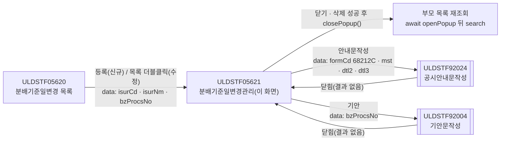
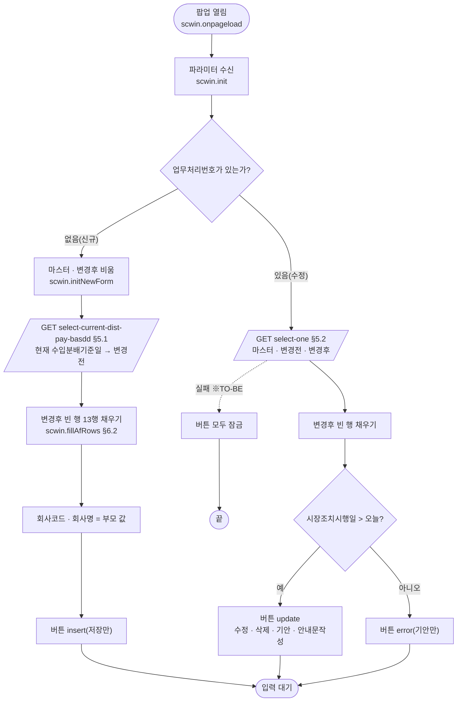
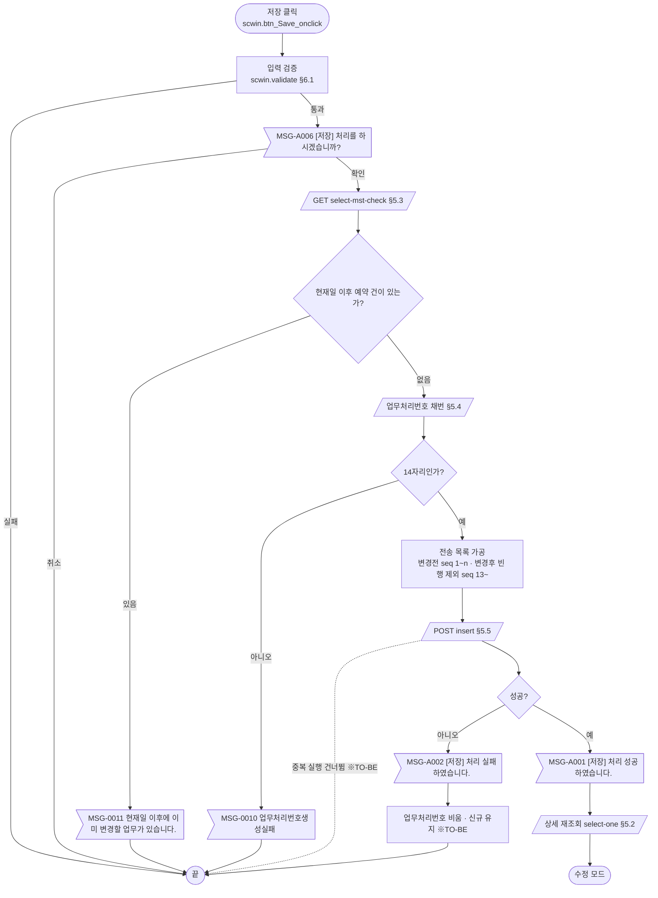
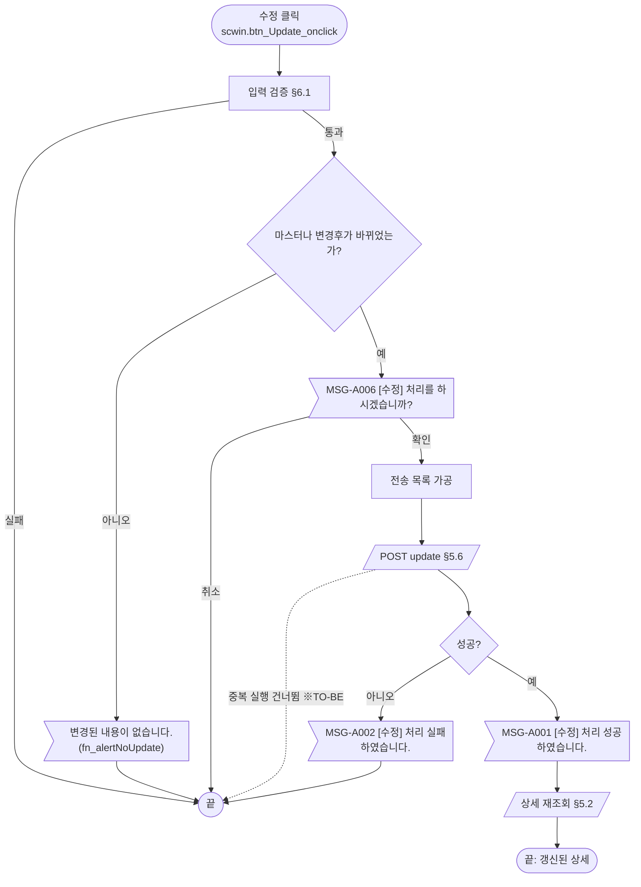
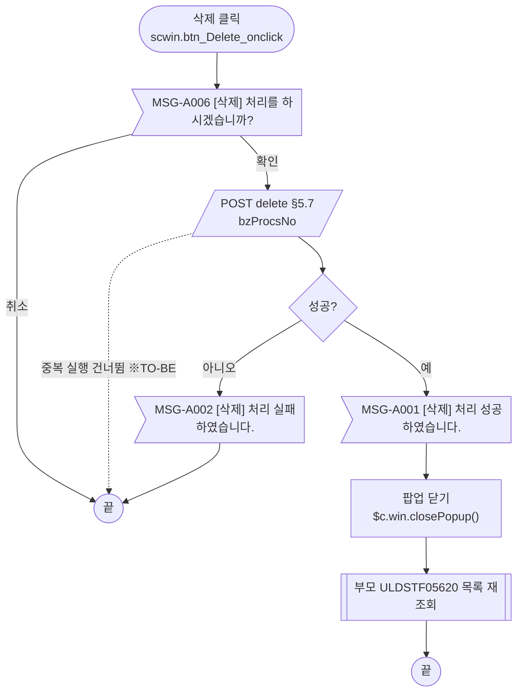
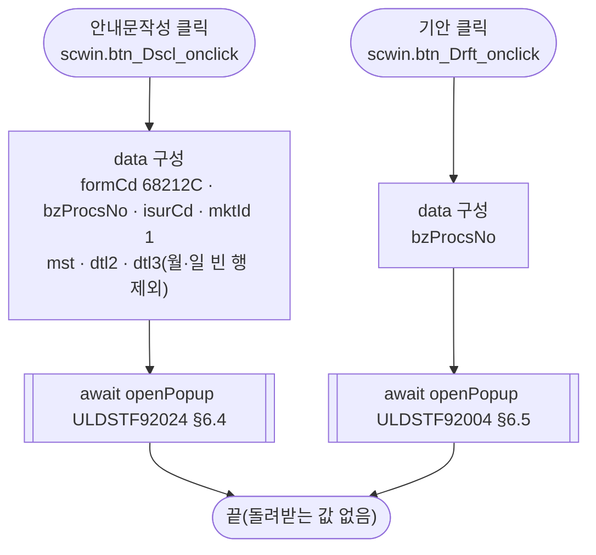
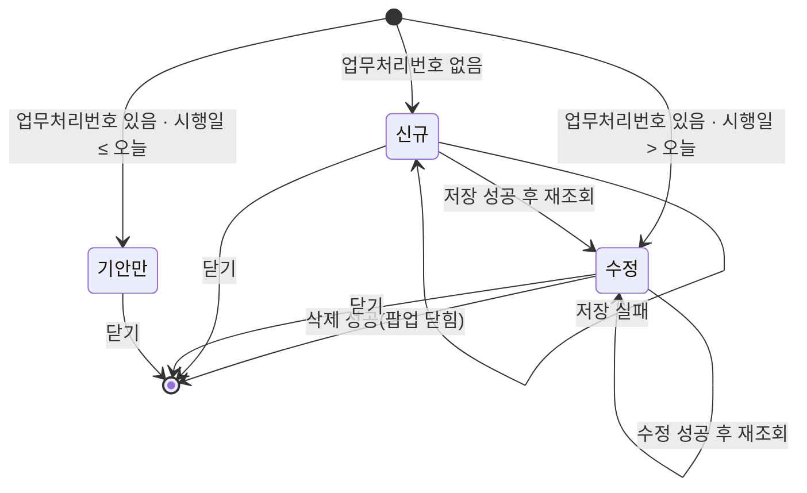

# ULDSTF05621 (팝업)분배기준일변경관리 — 업무 분석 및 전환 내역

| 항목 | 내용 |
|---|---|
| AS-IS | `/lstproc/ULDSTF05621.gfm` (Gauce/X-Internet, 610×680 모달 창 — 부모가 615×710 `window` 로 연다) — 반입 `conversion/gfm-front/ui/ULDSTF05621/ULDSTF05621.gfm` |
| 신규 API 명세 | `conversion/gfm-front/ui/ULDSTF05621/ULDSTF05621_API.md` — 블록 7종(이 화면 6종, 다른 화면 1종: ULDSTF05620 목록 조회). §2.2·§5 는 명세 기준(가이드 §0.3·§5). **2026-10-27 명세 갱신**(txt → md): 저장 요청을 상세 데이터 합본으로, 저장·삭제 응답 신설, 상세 목록 id `dlt_detail_dtl*List`, `select-one` 응답은 개요만. 같은 날 2차 수정으로 블록마다 AS-IS 가 **AS-IS 함수·인덱스 표기**(`fn_save_trs(TRS_IDX_INSERT)` 등)로 바뀌고 파일 감싸기(```` ```markdown ````)가 없어짐 — 변경 대조는 §5 「명세 갱신(2026-10-27)」 |
| TO-BE | `conversion/gfm-front/ui-tobe/ULDSTF05621.xml` (배포 경로 `/ui/lst/lstproc/ULDSTF05621.xml` — 가정, §10). 가이드 §13.2 대로 퍼블리싱본(마크업 전용)을 먼저 만들고 그 위에 스크립트를 전환함 (2026-10-26). 2026-10-27 갱신 명세(md) 기준으로 재전환 완료(§10 #15) |
| 퍼블리싱 | `conversion/publish/상장/상장처리(대내)/ULDSTF05621.xml` — 컴포넌트 id 는 AS-IS 와 같고, 날짜는 `w2:inputCalendar`, 사유는 `xf:select1`, 달력 이미지 버튼은 없음 |
| 화면 캡처 | `ULDSTF05621.png` (신규 빈 입력 상태) — TO-BE 퍼블리싱 기준 |
| 업무공통 | `$c.stf`(`getNewBzProcNo`·`getMessageParam`·`setButtonSetWithDate`)·`$c.lc`(`isProcess`·`getSecuGrpNm`·`glb.*` 상수) — `cm/pcc/stf`. 게이트는 `--pcc stf` 로 돌린다 |
| 작성 | Inswave / 2026-10-26 |

참고 양식: [websquare_gfm_conversion.md](../../../md/websquare_gfm_conversion.md). Gauce 대응은 [gfm_business_analysis_guide.md](../../../md/gfm_business_analysis_guide.md) §5·§6 을 함께 따랐다.

---

## 1. 화면 개요

상장 담당자가 **분배기준일변경 목록(ULDSTF05620)** 에서 회사를 고른 뒤, 선박투자회사 등 집합투자형 상장법인의 **수입분배기준일(월·일) 변경**을 신규 등록하거나, 등록한 건을 수정·삭제하는 팝업이다. 공시안내문을 작성하고 기안문을 띄우는 일도 이 화면에서 한다.

1. 부모가 회사(발행기관)와 업무처리번호를 넘겨 팝업을 연다. 업무처리번호가 없으면 신규, 있으면 수정이다.
2. 신규이면 그 회사의 **현재 수입분배기준일 목록**을 "변경전"에 채운다. "변경후" 그리드에는 입력할 빈 행을 깔아 둔다.
3. 변경후 월·일, 변경일, 시장조치시행일, 변경 후 최초 사업연도, 변경사유, 기타를 입력해 저장한다. 저장하기 전에 확인을 받고, 현재일 이후의 예약 건이 있는지 확인하고, 업무처리번호를 새로 받는다.
4. 수정이면 업무처리번호로 마스터와 변경전·변경후 목록을 조회한다. 시장조치시행일이 이미 지났으면 기안만 할 수 있다.
5. 저장·수정에 성공하면 다시 조회하고, 삭제에 성공하면 팝업을 닫는다. 부모는 팝업이 닫히면 스스로 목록을 다시 조회한다.

### 1.1 호출 화면 (1본)

- `ULDSTF05620` 분배기준일변경 목록 — 퍼블리싱본 `conversion/publish/상장/상장처리(대내)/ULDSTF05620.xml`(W-Craft 1차 스크립트 포함, 아직 TO-BE 전환 전).
  - [등록] 버튼(`img_Regist_onclick`) → 신규. 회사를 먼저 고르지 않으면 `MSG-0013` 안내.
  - 목록 더블클릭(`grd_List_OnDblClick`) → 수정.
  - 창 제목: `$c.lc.getSecuGrpNm(증권그룹ID) + " 분배기준일변경관리"`. 예: 증권그룹 `SC` 이면 "선박투자 분배기준일변경관리".
  - 팝업이 닫히면 부모가 `fn_search()` 로 다시 조회한다(모달 대기 전제).

### 1.2 호출 규약 (부모 → 이 화면) / 반환 규약

AS-IS 는 부모가 `fn_GetPar` 를 자기 함수로 바꿔 두면, 팝업이 로딩 때 `frame.Provider("../").fn_GetPar(arrPar)` 로 부모 함수를 불러 배열을 채워 받는다.

| arr | TO-BE 키 (제안) | 의미 | 빈 값일 때 / 분기 |
|---|---|---|---|
| `arr[0]` | `isurCd` | 발행기관코드 | 신규 시 현재 기준일 조회 조건, 저장 전문 회사코드 |
| `arr[1]` | `isurNm` | 발행기관명 | 회사명 표시 |
| `arr[2]` | `secugrpId` | 증권그룹ID | 이 화면에서는 쓰지 않음 |
| `arr[3]` | `mktId` | 시장구분코드 | 이 화면에서는 쓰지 않음(안내문은 `'1'` 고정 — §8 #11) |
| `arr[4]` | `bzProcsNo` | 업무처리번호 | **비면 신규**, 있으면 수정 |
| `arr[5]` | `fiscyyDistrBasddTpCd` | 결산기분배기준일구분코드 (1 결산기 / 2 분배기준일) | 부모는 항상 `"2"`. 화면은 이 값을 읽지 않고 저장 때 `"2"` 를 직접 넣음(원본 변수명 `haltTpCd`) |

- **TO-BE** ([가이드 §6.5](../../../md/websquare_gfm_conversion.md) — getPar/setPar → `openPopup` + `await`): 부모는 `fn_GetParNew`/`fn_GetParUpdate` 를 바꿔 끼우지 않고, 위 키 이름의 객체를 `data` 로 넘긴다. 이 화면은 `$c.data.getParameter()` 로 받는다. 부모(05620)가 아직 전환 전이라 키 이름은 제안이다(§10 #6).

  ```javascript
  // 부모 ULDSTF05620 (신규: bzProcsNo "", 수정: 목록 선택 행의 업무처리번호)
  const data = { isurCd, isurNm, secugrpId, mktId, bzProcsNo, fiscyyDistrBasddTpCd : "2" };
  await $c.win.openPopup("/ui/lst/lstproc/ULDSTF05621.xml",
      { id : "DLG_FSCCHG", popupName : $c.lc.getSecuGrpNm(secugrpId) + " 분배기준일변경관리", width : 615, height : 710, type : "pageFramePopup" }, data);
  await scwin.search();   // AS-IS: CreateDialogFrame(…) 뒤 fn_search() — 닫힌 뒤 재조회
  ```

- **반환**: 없음. 원본은 `frame.CloseFrame()` 만 하고 값을 돌려주지 않는다 → TO-BE 는 `$c.win.closePopup()`(인자 없음). 부모는 `await` 가 끝나면(저장·수정·삭제·닫기 어느 경우든) 다시 조회하므로 결과 값을 볼 필요가 없다.

### 1.3 이 화면이 여는 하위 팝업

| 팝업 | AS-IS 호출 (getPar/setPar) | 넘기는 `data` (TO-BE) | 받는 결과 (`closePopup`) / 취소 판정 |
|---|---|---|---|
| `ULDSTF92024` 공시안내문작성 (735×815) | `fn_GetPar` 바꿔 끼우기 → `arr[0..3]` + `CopyDataSet(dts_Mst/DtlBf/DtlAf → param_dts_mst/dts2/dts3)` → `frame.CreateDialogFrame(…, "window")` | `{ formCd : "68212C", bzProcsNo, isurCd, mktId : "1", mst : [dma_resultDetail], dtl2 : 변경전, dtl3 : 변경후(빈 행 제외) }` — §6.4 | 없음(원본 `fn_SetPar` 는 빈 함수). `await` 뒤 처리 없음 |
| `ULDSTF92004` 기안문작성 (888×730) | `fn_GetPar` 바꿔 끼우기 → `arr[0]` = 업무처리번호 → `fn_PopFindDraft()` | `{ bzProcsNo }` — §6.5 | 없음. `await` 뒤 처리 없음 |

### 1.4 업무 프로세스 흐름

흐름은 AS-IS 동작을 기준으로 그렸다. 점선과 `※TO-BE` 는 전환본에서 바뀌는 곳이다(근거는 §8).

| # | 업무 | 시작 (사용자 동작·진입 조건) | 끝 (결과) | 주요 함수 | 관련 절 |
|---|---|---|---|---|---|
| 1 | 진입·로딩 | 부모가 팝업을 엶 (업무처리번호 유무로 신규/수정) | 입력 대기 (모드별 버튼) | `scwin.onpageload` → `scwin.init` → `scwin.initNewForm` / `scwin.selectOne` | §3, §5.1, §5.2 |
| 2 | 신규 저장 | [저장] (신규 모드) | 저장 성공 안내 후 수정 모드로 재조회 | `scwin.save` → `checkMst` → 채번 → `saveTrs("I")` | §5.3~5.5, §6.1, §6.6 |
| 3 | 수정 | [수정] (수정 모드, 시행일 > 오늘) | 수정 성공 안내 후 재조회 | `scwin.update` → `saveTrs("U")` | §5.6, §6.7 |
| 4 | 삭제 | [삭제] (수정 모드, 시행일 > 오늘) | 삭제 성공 안내 후 팝업 닫힘 → 부모 재조회 | `scwin.remove` → `deleteTrs` | §5.7, §6.8 |
| 5 | 공시안내문작성 | [안내문작성] (수정 모드, 시행일 > 오늘) | 92024 팝업에서 작성·전송 후 닫힘 | `scwin.writeDscl` | §6.4 |
| 6 | 기안 | [기안] (수정 모드 — 시행일이 지나도 가능) | 92004 팝업에서 기안 후 닫힘 | `scwin.writeDraft` | §6.5 |

#### 화면 간 흐름



AS-IS 는 `fn_GetPar` 를 바꿔 끼우고 모달 창이 닫힐 때까지 기다리는 방식이었다. TO-BE 는 모든 화살표가 `await $c.win.openPopup(url, options, data)` 이고, 결과를 돌려받는 팝업은 없다(가이드 §6.5).

#### 업무 1: 진입·로딩



| # | 단계 | 주체 | 내용 | 분기 · 메시지 | 관련 절 |
|---|---|---|---|---|---|
| 1 | 파라미터 수신 | 화면 | `$c.data.getParameter()` → `isurCd`·`isurNm`·`bzProcsNo` | `bzProcsNo` 가 비면 신규 | §1.2, §3 |
| 2a | 신규 준비 | 화면·서버 | 마스터 빈 값, 현재 기준일 조회(**동기** — 다음 단계 전에 끝나야 함), 변경후 13행 | 조회 실패는 공통 오류 핸들러 | §5.1, §6.2 |
| 2b | 수정 조회 | 서버 | AS-IS 는 같은 URL 을 `DIV_IDX` 0·3·4 로 **동기** 3회, TO-BE 는 `select-one` 1회(세 조회가 항상 함께 호출되고 단독 호출 지점이 없어 명세가 하나로 통합) | 실패 시 버튼 잠금(※TO-BE) | §5.2 |
| 3 | 버튼 상태 | 화면 | 신규 `insert`, 수정은 `setButtonSetWithDate(edt_MKTACT_ENFORCE_DD, false, …)` | 시행일 ≤ 오늘이면 `error`(기안만) | §4 |
| 4 | 회사 정보 | 화면 | AS-IS 는 모드와 관계없이 부모 값으로 덮어씀 → TO-BE 는 신규만 | — | §8 #8 |

#### 업무 2: 신규 저장



| # | 단계 | 주체 | 내용 | 분기 · 메시지 | 관련 절 |
|---|---|---|---|---|---|
| 1 | 입력 검증 | 화면 | 변경후 월·일 4자리, 변경일 8자리, 시장조치시행일 익일 이후, 변경사유 필수, 기타 2000 byte | 각 안내 + 포커스 후 끝 | §6.1, §7.2 |
| 2 | 저장 확인 | 사용자 | `await $c.lc.isProcess("I")` | 취소면 끝 | §6.6 |
| 3 | 예약 건 확인 | 서버 | `select-mst-check` (AS-IS `fn_mst_check(dts_Mst_Check, "2")`) | 있으면 `MSG-0011` 후 끝. boolean 의미 확인 필요 | §5.3, §10 #4 |
| 4 | 채번 | 서버 | `$c.stf.getNewBzProcNo()` → `body` 를 꺼내 문자열로 | 14자리 아니면 `MSG-0010` 후 끝. 채번 주체 확인 필요 | §5.4, §10 #2 |
| 5 | 전문 구성 | 화면 | 마스터(`dma_resultDetail`)에 `bzProcsNo`·`isurCd` 를 넣고 `{ ...마스터, dtlBfList, dtlAfList }` 합본(2026-10-27 명세), 목록은 복사본으로 가공 | 그리드는 건드리지 않음(※TO-BE) | §5.5, §8 #5 |
| 6 | 저장 | 서버 | `POST insert` | `skipped` 면 안내 없이 끝, 실패 `MSG-A002` + 신규 유지 | §5.5, §8 #7·#14 |
| 7 | 결과 반영 | 화면 | `MSG-A001` → 상세 재조회 → 수정 모드 버튼 | — | §5.2 |

#### 업무 3: 수정



- 순서는 원본과 같다(검증 → 변경 여부 → 확인 → 전송). 수정은 예약 건 확인과 채번을 하지 않는다.
- 변경 여부는 변경전 목록을 보지 않는다(읽기 전용). TO-BE 판정 방법은 §6.7.

#### 업무 4: 삭제



- 삭제는 입력 검증을 하지 않는다. AS-IS 는 데이터셋 3개를 그대로 보냈고, TO-BE 는 업무처리번호만 보낸다.

#### 업무 5·6: 공시안내문작성 · 기안



- AS-IS 는 두 업무 모두 `fn_GetPar` 를 바꿔 끼우고, 모달이 닫힐 때까지 기다린 뒤 되돌렸다(§8 #12). TO-BE 는 `data` 로 넘기므로 되돌릴 것이 없다.
- 안내문작성은 확인 메시지 없이 바로 연다(원본에 `fn_isProcess('DSCL')` 없음).
- 92024 가 `getParameter` 수신으로 바뀌기 전까지는 호환용 `scwin.getPar` 가 필요하다(§6.4, §10 #7).

#### 화면 모드 상태 전이



| 상태 | 활성 버튼 | 근거 |
|---|---|---|
| 신규 | 저장 | `insert` |
| 수정 | 수정 · 삭제 · 기안 · 안내문작성 | `update` (저장만 제외) |
| 기안만 | 기안 | `error` |

- 신규 저장 검증이 "시장조치시행일 익일 이후"를 요구하므로, 저장에 성공하면 언제나 `수정` 상태가 된다.

---

## 2. 화면 구성 및 데이터 정의

### 2.1 화면 구성

| 영역 | AS-IS 요소 | TO-BE 컴포넌트 (바인딩) | 설명 |
|---|---|---|---|
| 1. 회사코드(명) | `txb_ISUR_CD`·`txb_COM_NM` (readonly) | `txb_ISUR_CD` (`xf:input` readOnly, `dma_resultDetail.isurCd` — 퍼블리셔 XML 의 itemset 없는 `w2:autoComplete` 는 값이 안 보일 수 있어 바꿈) · `txb_COM_NM` (`xf:input`, `dma_resultDetail.isurNm`) | 읽기 전용 |
| 2. 수입분배기준일 가. 변경전 | `grd_DIST_PAY_BF` (편집 불가, 월·일) | `grd_DIST_PAY_BF` (`dlt_detail_dtlBfList`, `readOnly="true"`) | 신규: 현재 기준일, 수정: 등록된 변경전 |
| 2. 나. 변경후 (*) | `grd_DIST_PAY_AF` (편집, 월·일) | `grd_DIST_PAY_AF` (`dlt_detail_dtlAfList`) | 빈 행을 깔아 두고 입력 — §3 |
| 3. 변경일 (*) | `edt_CHG_DD` + `img_CHG_DD` | `edt_CHG_DD` (`inputCalendar`, `dma_resultDetail.chgDd`) | 달력 이미지 **(옮기지 않음)** — inputCalendar 내장 달력 |
| 4. 시장조치시행일 (*) | `edt_MKTACT_ENFORCE_DD` + `img_MKTACT_ENFORCE_DD` | `edt_MKTACT_ENFORCE_DD` (`dma_resultDetail.mktactEnforceDd`) | "(시스템 반영일자를 입력)" 안내 라벨 유지. 수정 모드 버튼 상태의 기준일 |
| 5. 변경 후 최초 사업연도 (*) | `edt_ChgStatDd`·`edt_ChgEndDd` + `img_ChgStatDd`·`img_ChgEndDd` | `edt_ChgStatDd` (`dma_resultDetail.fiscyyChgStrtDd`) · `edt_ChgEndDd` (`dma_resultDetail.fiscyyChgEndDd`) | 필수 표시가 있으나 원본은 검증하지 않음 — §8 #9 |
| 6. 변경사유 (*) | `cmb_FISCYY_CHG_RSN_CD` (고정 목록) | `cmb_FISCYY_CHG_RSN_CD` (`xf:select1`, `dma_resultDetail.fiscyyChgRsnCd`) | 1 임시주주총회에서 결의 / 2 정기주주총회에서 결의 / 9 기타 — §7 |
| 7. 기타 | `txa_REMK` | `txa_REMK` (`dma_resultDetail.remk`) | 2000 byte 제한 |
| 버튼 | `btn_Save`·`btn_Update`·`btn_Delete`·`btn_Drft`·`btn_Dscl`·`btn_Close` (이미지) | `btn_Drft`(기안)·`btn_Dscl`(안내문작성) · `btn_Delete`(삭제, pt)·`btn_Update`(수정, pt)·`btn_Save`(저장, pt) `xf:trigger` (`btnbox#grpBtnBox` 의 `rt` — 규칙 41: 일반 버튼 → 주요 버튼 5종(취소·삭제·수정·저장·신규, `pt`) 순, 2026-10-27). `btn_Close` 는 **옮기지 않음** — 팝업 하단 닫기 금지(퍼블리싱 규칙, 팝업 창의 닫기 사용) | 활성 상태는 `buttonSet` → `$c.util.setButtonState` — §4 |
| (장식) | `panel_3` + `PanelToGroupBox` | **(옮기지 않음)** | 퍼블리싱 마크업이 대신함 |

### 2.2 데이터 정의

| AS-IS | TO-BE | 종류 | 키(컬럼) | 출처 / 용도 |
|---|---|---|---|---|
| `dts_Mst` (1행) | `dma_resultDetail` | dataMap | `select-one` 응답 마스터(`target` `dma_resultDetail=body`). 갱신 명세는 `bzProcsNo, isurCd, fiscyyDistrBasddTpCd, ...` 개요만 적어 **키 정의는 이전 명세(2026-10-26 txt)의 keyInfo 20개를 유지** — `bzProcsNo`, `isurCd`, `fiscyyDistrBasddTpCd`, `isurNm`, `comNm`, `chgDd`, `mktactEnforceDd`, `fiscyyChgRsnCd`, `fiscyyChgRsnNm`, `remk`, `fiscyyChgStrtDd`, `fiscyyChgEndDd`, `fiscyyStrt/End(Yy·Mm·Dd)`, `disclsYn`, `draftYn` | 화면 바인딩 대상. 상세 조회 응답, 신규는 빈 값 + 부모 회사. **저장·수정 요청의 머리**이기도 하다(`...dma_resultDetail.getJSON()`, §5.5) |
| `dts_DtlBf` | `dlt_detail_dtlBfList` | dataList | `select-one` 응답 `body.dtlBfList`(갱신 명세의 target id — 종전 `dlt_resultDetail_dtlBfList`). 열은 갱신 명세 개요 `{ bzProcsNo, bybzprocsSeq, isurCd, ... }` + 이전 명세 정의 — `bzProcsNo`, `bybzprocsSeq`(number), `isurCd`, `chgBfafTpCd`, `basMmdd`, `basMm`, `basDd` | 신규: `select-current-dist-pay-basdd` 응답(명세상 `dma_std` dataMap — §10 #1) / 수정: `select-one` 변경전 |
| `dts_DtlAf` | `dlt_detail_dtlAfList` | dataList | (위와 같음, `body.dtlAfList`) | 수정: `select-one` 변경후 + 빈 행 보충 |
| (응답 전용) | `dma_std` | dataMap | 명세 `select-current-dist-pay-basdd` 응답 — `bzProcsNo`·`bybzprocsSeq`·`isurCd`·`chgBfafTpCd`·`basMmdd`·`basMm`·`basDd` (target `dma_std=body`) | 화면은 여러 행이라 변경전 목록으로 받는다 — §5.1, §10 #1 |
| (응답 전용) | `dma_resultSave` | dataMap | 명세 `insert`·`update` 응답 — `bzProcsNo`·`result`·`resultMessage` (target `dma_resultSave=body`) | 저장 결과 판정·신규 번호(§5.5) |
| (응답 전용) | `dma_resultDelete` | dataMap | 명세 `delete` 응답 — `bzProcsNo`·`result`·`resultMessage` (target `dma_resultDelete=body`) | 삭제 결과 판정(§5.7) |
| (`trs` 전송 dataset) | (없음 — 2026-10-27 명세 갱신으로 삭제) | — | 종전 명세의 요청 전용 정의 `dma_reqSave`·`dlt_reqSave_*`·`dma_reqUpdate`·`dlt_reqUpdate_*` 는 쓰지 않는다. 요청은 `{ ...dma_resultDetail.getJSON(), dtlBfList, dtlAfList }` 합본(§5.5) | — |
| `dts_BzProcsNo` | (삭제) | — | — | 채번 결과는 `$c.stf.getNewBzProcNo()` 반환값을 바로 쓴다 |
| `dts_Mst_Check` | (삭제) | — | — | 예약 건 확인 응답은 boolean 하나 — 응답 값을 바로 쓴다(§5.3) |
| `trs` | (삭제) | — | — | 저장·수정·삭제 통신 → `executeDynamic` |

- **TO-BE DataCollection 은 API 명세의 정의 블록 원문(id·name·dataType)을 그대로 옮긴다**(가이드 §5 「API 명세 적용」). 갱신 명세(2026-10-27 md)에 정의가 있으면 그것을, 개요만 있는 `select-one` 응답은 이전 명세(2026-10-26 txt) 정의를 쓴다. 부모용 `dlt_std`(ULDSTF05620 목록)는 넣지 않는다.

- AS-IS 컬럼은 대문자(`ISUR_CD`·`BAS_MM`…)이다. TO-BE 키는 API 명세의 camelCase 를 쓴다. 매핑: `ISUR_CD→isurCd`, `ISUR_NM→isurNm`, `MKTACT_ENFORCE_DD→mktactEnforceDd`, `CHG_DD→chgDd`, `REMK→remk`, `FISCYY_CHG_RSN_CD→fiscyyChgRsnCd`, `FISCYY_CHG_STRT_DD→fiscyyChgStrtDd`, `FISCYY_CHG_END_DD→fiscyyChgEndDd`, `BAS_MM/BAS_DD/BAS_MMDD→basMm/basDd/basMmdd`, `BYBZPROCS_SEQ→bybzprocsSeq`, `CHG_BFAF_TP_CD→chgBfafTpCd`, `FISCYY_DISTR_BASDD_TP_CD→fiscyyDistrBasddTpCd`.
- 그리드 컬럼 id 는 `basMm`(월)·`basDd`(일) 두 개다. 퍼블리싱본의 대문자 컬럼 id(`BAS_MM`/`BAS_DD`, 헤더 `h_BAS_MM`/`h_BAS_DD`)는 dataList 키에 맞춰 바꾼다.

---

## 3. 로딩 (`gform onload` → `scwin.onpageload` → `scwin.init`)

원본 `gform onload` 순서(모든 조회는 **동기**):

1. **파라미터 수신** (`scwin.init`)
   - AS-IS: `frame.Provider("../").fn_GetPar(arrPar)` → `Isur_cd`·`Isur_nm`·`Secugrp_id`·`Mkt_id`·`fr_bz_procs_no`·`haltTpCd`.
   - TO-BE: `const param = $c.data.getParameter() ?? {};` → `scwin.isurCd`·`scwin.isurNm`·`scwin.bzProcsNo` (§1.2). 쓰지 않는 `secugrpId`·`mktId` 는 받지 않아도 된다.
2. **버튼 매핑** — AS-IS `buttonSet.setSaveInfo(btn_Save, fn_save)` 등 5종. TO-BE 는 `ev:onclick` 바인딩(§4) + 역할 매핑:
   `scwin.BTN_MAP = { save : "btn_Save", modify : "btn_Update", "delete" : "btn_Delete", draft : "btn_Drft", guide : "btn_Dscl" }`.
3. **신규·수정 분기**
   - 업무처리번호 있음 → **수정 조회** `await scwin.selectOne()` (§5.2).
   - 없음 → **신규 준비** `await scwin.initNewForm()`:
     1. `dma_resultDetail.setEmptyValue()` (원본: 헤더만 받은 뒤 `OnLoadCompleted` 에서 `AddRow`), `dlt_detail_dtlAfList.removeAll()`.
     2. 현재 수입분배기준일 조회 → `dlt_detail_dtlBfList` (§5.1, 원본 `TRS_IDX_NEWSEL2`).
     3. 변경후 빈 행 채우기(§6.2 `scwin.fillAfRows`).
     4. 버튼 상태 `insert` (원본 `buttonSet.setInsertStatus()`).
4. **회사코드·명 설정** — AS-IS 는 조회 뒤 `dts_Mst` 에 `ISUR_CD`·`ISUR_NM` 을 부모 값으로 덮어쓴다(수정 모드도). TO-BE 는 신규일 때만 부모 값을 넣고, 수정은 조회 응답(`isurCd`·`isurNm`)을 그대로 쓴다(§8 #8).
5. `PanelToGroupBox(panel_3)` — 삭제(퍼블리싱 마크업).
6. **달력 검사 바인딩** (TO-BE 신설, 전환 규칙 37 — `scwin.init` 에서 1회) — 단일 달력 `edt_CHG_DD`·`edt_MKTACT_ENFORCE_DD` 는 `$c.date.checkCalendarFormat(…, "yyyyMMdd")`, 기간 쌍 「5. 변경 후 최초 사업연도」 `edt_ChgStatDd`~`edt_ChgEndDd` 는 `$c.date.compareFromToDate(edt_ChgStatDd, edt_ChgEndDd, ["최초 사업연도 시작일", "최초 사업연도 종료일"])`. AS-IS 는 시작·종료일 선후를 검사하지 않았다(종료일이 시작일보다 앞서면 안내 후 원복하는 동작이 TO-BE 에서 생긴다).

```javascript
scwin.onpageload = async function () {
    try {
        await scwin.init();
    } catch (ex) {
        await $c.exception.handleError(ex, { context : "ULDSTF05621.onpageload" });
    }
};

scwin.init = async function () {
    // 1) 로딩 동안 버튼 잠금(조회가 예외로 끝나도 XML 기본값으로 남지 않게)
    $c.util.setButtonState("grpBtnBox", "disabled", scwin.BTN_MAP);
    // 2) 파라미터 수신 — $c.data.getParameter() (§1.2) · 날짜 형식 · 서버 현재일
    // 3) 업무처리번호 유무로 신규 준비 또는 수정 조회
    if ($c.util.isEmpty(scwin.bzProcsNo)) {
        await scwin.initNewForm();
    } else {
        await scwin.selectOne();
    }
};
```

`onpageload` 는 `scwin.init()` 만 호출하고, 로딩 로직은 `scwin.init` 하나에 둔다(code-convention 초기화 절, 2026-10-26). 신규 준비는 5구역 `scwin.initNewForm`.

---

## 4. 컴포넌트 이벤트

| TO-BE 컴포넌트 | 이벤트 | TO-BE 핸들러 | 동작 (호출 함수) | AS-IS |
|---|---|---|---|---|
| `btn_Save` (저장) | `onclick` | `scwin.btn_Save_onclick` | `scwin.save()` — §6.6 | `buttonSet.setSaveInfo(btn_Save, fn_save)` |
| `btn_Update` (수정) | `onclick` | `scwin.btn_Update_onclick` | `scwin.update()` — §6.7 | `fn_update` |
| `btn_Delete` (삭제) | `onclick` | `scwin.btn_Delete_onclick` | `scwin.remove()` — §6.8 | `fn_delete` |
| `btn_Dscl` (안내문작성) | `onclick` | `scwin.btn_Dscl_onclick` | `scwin.writeDscl()` — §6.4 | `fn_dscl` |
| `btn_Drft` (기안) | `onclick` | `scwin.btn_Drft_onclick` | `scwin.writeDraft()` — §6.5 | `fn_drft` |
| `btn_Close` (닫기) | — | **(옮기지 않음)** | 팝업 창의 닫기(X)를 쓴다(팝업 하단 닫기 금지) | `frame.CloseFrame()` |
| `grd_DIST_PAY_AF` (변경후) | `onafteredit` | `scwin.grd_DIST_PAY_AF_onafteredit` | 월 > 12, 일 > 31 이면 "입력월을 확인하세요." / "입력일을 확인하세요." 안내 후 그 칸을 비움 — §6.3 | `OnExit(row, colid, olddata)` |
| `img_*` 달력 4종 | `onclick` | **(옮기지 않음)** | inputCalendar 내장 달력 | `popUpCalendar2(edt_…)` |
| `grd_DIST_PAY_AF` | — | **(옮기지 않음)** | 항상 `true` 를 돌려줄 뿐이라 동작 없음 | `CanColumnPosChange` |

**버튼 상태 (모드 × 버튼)** — 원본 `buttonSet` 은 이미지 버튼의 활성을 바꾼다.

| 상태 | 저장 | 수정 | 삭제 | 기안 | 안내문작성 | TO-BE |
|---|---|---|---|---|---|---|
| 신규 | O | | | | | `setButtonState("grpBtnBox", "insert", BTN_MAP)` |
| 수정 (시장조치시행일 > 오늘) | | O | O | O | O | `$c.stf.setButtonSetWithDate(edt_MKTACT_ENFORCE_DD, false, "grpBtnBox", BTN_MAP)` → `update` |
| 수정 (시장조치시행일 ≤ 오늘) | | | | O | | 같은 함수 → `error`(기안만) |

- 닫기 버튼은 `BTN_MAP` 에 넣지 않는다(항상 활성).
- `insert` 상태의 활성 목록은 `["new", "save"]` 이다. 이 화면에 `new` 버튼은 없으므로 결과적으로 [저장]만 켜진다.

---

## 5. 서버 통신

공통: AS-IS 는 모든 URL 에 `SCREN_ID=ULDSTF05621.gfm`·`SCREN_PROCES_TP_CD`(01 조회 / 02 입력 / 03 수정 / 04 삭제)를 붙이고, 저장 `trs.Action` 은 `fn_encodeNSession` 으로 세션 정보를 붙인다. 신규 API 명세에는 이 파라미터가 없으므로 **TO-BE 는 넘기지 않는다**(화면 이력·세션은 서버 처리 전제 — §10 #10). 모든 통신은 응답을 쓰기 전에 `if (result?.skipped) return;` 을 둔다. 통신 함수는 4구역이다.

| # | 용도 | AS-IS | TO-BE |
|---|---|---|---|
| 5.1 | 신규: 현재 수입분배기준일 | `/fiscalYearChange.do?method=searchFiscalYearChange&DIV_IDX=3(DTL_DIST_BF)&TRS_IDX=5(NEWSEL2)&ISUR_CD=` → `dts_DtlBf` | `GET …/select-current-dist-pay-basdd` (`isurCd`) |
| 5.2 | 수정: 상세 조회 | `fn_search` — 같은 URL `DIV_IDX` 0(FSC_MST)·3(DTL_DIST_BF)·4(DTL_DIST_AF) 로 3번 → `dts_Mst`·`dts_DtlBf`·`dts_DtlAf` | `GET …/select-one` (`bzProcsNo`) 1번 — 세 조회가 항상 함께 호출되고 단독 호출 지점이 없어 하나의 API 로 통합(명세) |
| 5.3 | 예약(미래일자) 중복 확인 | `fn_mst_check(dts_Mst_Check, "2")` (공통, `DIV_IDX=0&TRS_IDX=NEWSEL&GUBUN_CD=2`) | `GET …/select-mst-check` (`isurCd`) → boolean |
| 5.4 | 채번 | `fn_getNewBzProcNo(dts_BzProcsNo)` | `$c.stf.getNewBzProcNo()` (`GET /api/listing/lstproc/stock/chglisting/new-bzprocsno`) — §10 #2 |
| 5.5 | 신규 저장 | `trs` `/fiscalYearChange.do?method=saveFiscalYearChange` `TRS_IDX=1` `KeyValue: dtsParm1=dts_Mst, dtsParm2=dts_DtlAf, dtsParm3=dts_DtlBf` | `POST …/insert` |
| 5.6 | 수정 | 같은 `trs` `TRS_IDX=2` | `POST …/update` |
| 5.7 | 삭제 | 같은 `trs` `TRS_IDX=3` (데이터셋 3개를 그대로 전송) | `POST …/delete` (`bzProcsNo`) |

(`…` = `/api/listing/lstproc/fund/dist-pay-basdd-change`)

#### API 명세 대응 (`ULDSTF05621_API.md`, 2026-10-27 갱신)

| # | 명세 블록 | method · 경로 | 요청 (명세 정의) | 응답 (명세 정의) | AS-IS 대응 | TO-BE 함수 |
|---|---|---|---|---|---|---|
| 1 | [ULDSTF05621] 신규 등록 시 현재 수입분배기준일 조회 | `GET …/select-current-dist-pay-basdd` | `isurCd` | `dma_std` (dataMap — `bzProcsNo`·`bybzprocsSeq`·`isurCd`·`chgBfafTpCd`·`basMmdd`·`basMm`·`basDd`) | `fn_new_onload` → `searchFiscalYearChange(DIV_IDX_DTL_DIST_BF, TRS_IDX_NEWSEL2)` (`DIV_IDX=3`·`TRS_IDX=5`) → `dts_DtlBf` | `scwin.selectCurrentBasdd` → `dlt_detail_dtlBfList` (명세 target 은 `dma_std=body` — §10 #1) |
| 2 | [ULDSTF05621] 예약(미래일자) 등록 중복 체크 | `GET …/select-mst-check` | `isurCd` | `boolean` | `fn_mst_check(dts_Mst_Check, "2")` (`GUBUN_CD=2`) | `scwin.checkMst` |
| 3 | [ULDSTF05621] 상세 조회(마스터 + 변경전/후) | `GET …/select-one` | `bzProcsNo` | JSON 개요 `body { 마스터…, dtlBfList : [ … ], dtlAfList : [ … ] }` — target `dma_resultDetail=body, dlt_detail_dtlBfList=body.dtlBfList, dlt_detail_dtlAfList=body.dtlAfList` | `fn_search(DIV_IDX_FSC_MST + DIV_IDX_DTL_DIST_BF + DIV_IDX_DTL_DIST_AF)` — 같은 URL `DIV_IDX` 0·3·4 로 3회 → `dts_Mst`·`dts_DtlBf`·`dts_DtlAf` (항상 함께 호출 → 1 API 통합) | `scwin.selectOne` |
| 4 | [ULDSTF05621] 삭제 | `POST …/delete` | `{ bzProcsNo }` | `dma_resultDelete` (`bzProcsNo`·`result`·`resultMessage`) | `fn_save_trs(TRS_IDX_DELETE)` — `trs` `TRS_IDX=3` (dataset 3개 전송) | `scwin.deleteTrs` |
| 5 | [ULDSTF05621] 신규 저장 | `POST …/insert` | `{ ...dma_resultDetail.getJSON(), dtlBfList : dlt_detail_dtlBfList.getAllJSON(), dtlAfList : dlt_detail_dtlAfList.getAllJSON() }` | `dma_resultSave` (`bzProcsNo`·`result`·`resultMessage`) | `fn_save_trs(TRS_IDX_INSERT)` — `trs` `TRS_IDX=1` `dtsParm1=dts_Mst, dtsParm2=dts_DtlAf, dtsParm3=dts_DtlBf` | `scwin.saveTrs("I")` |
| 6 | [ULDSTF05621] 수정 | `POST …/update` | (insert 와 같은 합본) | `dma_resultSave` (insert 와 같음) | `fn_save_trs(TRS_IDX_UPDATE)` — `trs` `TRS_IDX=2` | `scwin.saveTrs("U")` |
| 7 | [ULDSTF05620] 목록 조회 | `GET …/select-list` | `isurCd` | `dlt_std` | 부모 ULDSTF05620 `fn_search` | **이 화면 대상 아님** — 부모 전환 때 사용(§1.1) |

명세에 없는 AS-IS 통신: 채번(`fn_getNewBzProcNo`) → 업무공통 `$c.stf.getNewBzProcNo()`(§5.4).

#### 명세 갱신 (2026-10-27, `ULDSTF05621_API.txt` → `ULDSTF05621_API.md`)

| # | API | 종전(txt) | 갱신(md) | 결과서·TO-BE 영향 |
|---|---|---|---|---|
| 1 | 공통 | 경로·요청·응답 | 블록마다 AS-IS 와 `target`(`[REQUEST]` 아래 `{ ref, target }` 옵션 — 처음엔 `submission target` 줄, 2026-10-27 형식 정리) 추가. AS-IS 는 1차에 `TO-BE 경로 + .do` 표기였다가 2차 수정에서 **AS-IS 함수·인덱스 표기**로 바뀜(`searchFiscalYearChange(DIV_IDX_DTL_DIST_BF, TRS_IDX_NEWSEL2)`, `fn_search(…)`, `fn_mst_check`, `fn_save_trs(TRS_IDX_INSERT·UPDATE·DELETE)`) | 원본 `.gfm` 의 함수·상수 이름과 일치함을 확인 — §5 API 명세 대응표의 AS-IS 대응 열에 함께 적었다. 실제 호출 URL(`/fiscalYearChange.do?method=…`)은 §5 표 |
| 2 | `select-current-dist-pay-basdd` | 응답 `dma_std` | 같음 + target `dma_std=body` | 화면은 여러 행 → 변경전 목록으로 받는 가정 유지(§5.1, §10 #1) |
| 3 | `select-one` | 응답 정의 3개(`dma_resultDetail` 20키, `dlt_resultDetail_dtlBfList`·`…AfList` 7열) | JSON 개요만, target `dma_resultDetail=body, dlt_detail_dtlBfList=body.dtlBfList, dlt_detail_dtlAfList=body.dtlAfList` | 목록 JSON 키(`dtlBfList`·`dtlAfList`)가 **확정**(종전 가정 해제). 목록 id 를 `dlt_detail_dtl*List` 로 바꾼다. 키 정의는 이전 명세 유지(§2.2) |
| 4 | `delete` | 요청 `bzProcsNo`, 응답 빈칸 | 요청 `{ bzProcsNo }`, 응답 `dma_resultDelete`(`bzProcsNo`·`result`·`resultMessage`) | 결과 판정에 `result` 를 쓴다(§5.7, §10 #5) |
| 5 | `insert` | 요청 `dma_reqSave`(8키) + `dlt_reqSave_dtlBfList`·`…AfList`, 응답 빈칸 | 요청 `{ ...dma_resultDetail.getJSON(), dtlBfList, dtlAfList }`, 응답 `dma_resultSave`(`bzProcsNo`·`result`·`resultMessage`) | 요청 전용 정의 6개를 쓰지 않는다. 마스터 20키를 모두 보낸다(명세에 없던 `fiscyyDistrBasddTpCd` 등도 전송 — §10 #3). 응답 `bzProcsNo` 로 서버 채번도 가능(§10 #2) |
| 6 | `update` | 요청 `dma_reqUpdate` + `dlt_reqUpdate_*`, 응답 빈칸 | insert 와 같은 합본, 응답 `dma_resultSave` | 5 와 같음 |
| 7 | `select-list`(ULDSTF05620) | `mktactEnforceDd` "변경일" | "변경일(시장조치시행일)" | 부모 화면 소관 — 이 화면 영향 없음 |
| 8 | `select-mst-check` | `boolean` | 같음 | 없음 |

#### 명세 ↔ AS-IS 차이 (→ §10)

| # | 차이 | 처리 | §10 |
|---|---|---|---|
| 1 | `select-current-dist-pay-basdd` 응답이 dataMap(`dma_std`)으로 적혀 있으나 변경전 기준일은 여러 행 | 변경전 목록(`dlt_detail_dtlBfList`)으로 받음 | #1 |
| 2 | ~~`select-one`·`insert`/`update` 의 목록 JSON 키 이름이 명세에 없음~~ — 2026-10-27 명세가 `dtlBfList`·`dtlAfList` 로 확정 | 명세대로 | — |
| 3 | AS-IS 는 화면이 채번해 보냄. 갱신 명세는 요청이 마스터 합본(`bzProcsNo` 포함)이고 응답 `dma_resultSave.bzProcsNo` 가 있어 서버 채번도 가능 | 화면 채번 유지 + TODO | #2 |
| 4 | AS-IS 가 보내던 `LIST_BZ_TP_CD=232`·`DIV_IDX`·`COUNT` 는 요청에 없음. `fiscyyDistrBasddTpCd` 는 갱신 명세의 합본 요청(`dma_resultDetail`)에 들어간다 — AS-IS 값 `"2"`, 명세 응답의 TO-BE 컬럼 기준 값 `'14'` | 신규는 값을 채울지 서버에 맡길지 확인 | #3 |
| 5 | `select-mst-check` 응답 boolean 의 뜻이 없음, AS-IS 의 `GUBUN_CD=2` 없음 | `true` = 예약 건 있음으로 가정 | #4 |
| 6 | 갱신 명세에 `insert`·`update`(`dma_resultSave`)·`delete`(`dma_resultDelete`) 응답 `result`·`resultMessage` 가 생김 — 값의 뜻(성공 코드)은 적혀 있지 않음 | `success` + `body.result` 로 판정, 실패면 `resultMessage` 안내(성공 코드 가정) | #5 |
| 7 | AS-IS 공통 파라미터 `SCREN_ID`·`SCREN_PROCES_TP_CD`·세션(`fn_encodeNSession`) 이 명세에 없음 | 보내지 않음 | #10 |
| 8 | 명세 응답에만 있는 키(`comNm`·`fiscyyChgRsnNm`·`fiscyyStrt/End(Yy·Mm·Dd)`·`disclsYn`·`draftYn`) | 정의에 두되 화면에 표시하지 않음(AS-IS 도 미표시). 갱신 명세의 합본 요청으로 저장 때 함께 전송된다 | — |
| 9 | 갱신 명세의 저장 요청 예시는 그리드 dataList 를 그대로(`getAllJSON()`) 보낸다 — AS-IS `fn_save_trs` 는 일련번호·변경전후 구분을 채우고 변경후 빈 행을 뺀다 | AS-IS 가공 유지 — 그리드 복사본(`scwin.buildDtlList`)을 `dtlBfList`·`dtlAfList` 로 보낸다 | #1 |

AS-IS `trs.Parameters`: `TRS_IDX`, `BZ_PROCS_NO`, `COUNT=3`, `LIST_BZ_TP_CD=232`(분배기준일변경), `DIV_IDX[0]=0`·`DIV_IDX[1]=4`·`DIV_IDX[2]=3`. TO-BE 는 API 마다 경로가 나뉘므로 `TRS_IDX`·`DIV_IDX`·`COUNT` 는 필요 없다. `LIST_BZ_TP_CD` 는 요청 명세에 없으므로 서버가 정하는 것으로 본다(§10 #3).

### 5.1 현재 수입분배기준일 조회 (`scwin.selectCurrentBasdd`)

| 항목 | 내용 |
|---|---|
| `id` | `sbm_selectCurrentBasdd` |
| `method` / `action` | `get` / `…/select-current-dist-pay-basdd` |
| `requestData` | `{ isurCd : scwin.isurCd }` |
| `target` / `gridview` | `dlt_detail_dtlBfList=body` / `grd_DIST_PAY_BF` — 명세는 응답을 `dma_std`(dataMap), target 을 `dma_std=body` 로 적었으나 그리드는 여러 행이다 → 목록인지 확인(§10 #1) |
| 선행 / 순서 | 신규 로딩 중. 빈 행 채우기(§6.2)보다 먼저 |
| 후처리 | 없음 (원본 `dts_DtlBf OnLoadCompleted` 는 빈 함수) |
| 실패 처리 | `skipped` 면 끝, `success:false` 면 "현재 수입분배기준일을 조회하지 못했습니다." 안내(※TO-BE) 후 `false` 반환 — `scwin.initNewForm` 은 신규 준비를 멈추고 버튼을 잠근다(변경전이 빈 채로 저장되지 않게). 통신 오류는 공통 오류 핸들러 |
| 중복 실행 | 기본(건너뜀) |

### 5.2 상세 조회 (`scwin.selectOne`)

| 항목 | 내용 |
|---|---|
| `id` | `sbm_selectOne` |
| `method` / `action` | `get` / `…/select-one` |
| `requestData` | `{ bzProcsNo : scwin.bzProcsNo }` |
| `target` | `dma_resultDetail=body`, `dlt_detail_dtlBfList=body.dtlBfList`, `dlt_detail_dtlAfList=body.dtlAfList` — 갱신 명세(2026-10-27) `[REQUEST]` 옵션의 `target` 그대로(종전 가정 해제) |
| 후처리 | ① 변경후 빈 행 채우기(§6.2) ② 버튼 상태 `$c.stf.setButtonSetWithDate(edt_MKTACT_ENFORCE_DD, false, "grpBtnBox", scwin.BTN_MAP)` (원본 `dts_Mst OnLoadCompleted`) |
| 실패 처리 | `success:false` 이면 버튼을 모두 잠근다(`disabled`, 명시 호출) — 첫 로딩은 XML 기본값(전부 활성)이 남지 않게, 저장 뒤 재조회 실패는 신규 상태([저장] 활성)가 남아 같은 건을 다시 저장하지 않게 |
| 중복 실행 | 기본(건너뜀) |

### 5.3 예약(미래일자) 중복 확인 (`scwin.checkMst`)

| 항목 | 내용 |
|---|---|
| `id` / `method` / `action` | `sbm_checkMst` / `get` / `…/select-mst-check` |
| `requestData` | `{ isurCd : scwin.isurCd }` — 원본의 `GUBUN_CD=2`(분배기준일)는 명세에 없음 |
| Return | `Promise<Boolean>` — 진행해도 되면 true |
| 후처리 | 이미 예약 건이 있으면 `MSG-0011` "현재일 이후에 이미 변경할 업무가 있습니다." 안내 후 false. 판정은 `body === true || body === "true"`(서버가 문자열로 줄 때도 막도록). **boolean 의 뜻(true = 중복 있음?)은 명세에 없다** → §10 #4 |
| 비고 | pcc `$c.lc.mstCheck` 는 AS-IS URL·미선언 전역 `Isur_cd`·1-base `getCellData(1, …)` 를 쓰므로 쓰지 않는다(§8 #13) |

### 5.4 업무처리번호 채번

- `const res = await $c.stf.getNewBzProcNo();` — 이 함수는 응답 봉투(`responseJSON`)를 그대로 돌려줄 수 있다. 화면에서 `res?.body ?? res` 를 꺼내 `String()` 으로 바꾼 뒤 14자리인지 본다. 아니면 `MSG-0010` "업무처리번호생성실패" 안내 후 중단.
- 2026-10-27 명세는 신규 저장 요청을 마스터 합본(`bzProcsNo` 포함)으로 보내고 응답 `dma_resultSave.bzProcsNo` 를 둔다(종전 명세의 "수정 시에만 전달" 문구는 없어짐). 서버가 채번하는지, 화면 채번값을 그대로 쓰는지 확인이 필요하다(§10 #2).

### 5.5 / 5.6 신규 저장·수정 (`scwin.saveTrs(trJob)`)

| 항목 | 내용 |
|---|---|
| `id` | `sbm_saveTrs` |
| `method` / `action` | `post` / `…/insert` (I) · `…/update` (U), `mediatype : "application/json"` |
| `requestData` | 갱신 명세(2026-10-27) 합본 — `{ ...dma_resultDetail.getJSON(), dtlBfList : 변경전 복사본, dtlAfList : 변경후 복사본 }`. 머리는 화면 마스터 그대로(20키 — 신규는 채번한 `bzProcsNo`·`isurCd` 를 먼저 넣는다), 목록은 명세 예시의 `getAllJSON()` 대신 아래 가공을 거친 `scwin.buildDtlList` 결과(§5 차이 #9). 요청 전용 정의(`dma_reqSave` 등)는 쓰지 않는다 |
| `target` | `dma_resultSave=body` — 응답 `bzProcsNo`·`result`·`resultMessage` |
| 목록 가공 (원본 `fn_save_trs`) | 변경전: 각 행에 `bzProcsNo`·`bybzprocsSeq = 행번호(1부터)`·`isurCd`·`chgBfafTpCd = "1"`. 변경후: `basMmdd` 가 빈 행을 빼고, 각 행에 `bzProcsNo`·`bybzprocsSeq = 행번호 + 12`·`isurCd`·`chgBfafTpCd = "2"`. **그리드의 dataList 는 고치지 않고 복사본으로 만든다**(§8 #5) |
| 후처리 | 성공: `MSG-A001` "[저장/수정] 처리 성공하였습니다." → `await scwin.selectOne()` 다시 조회(신규는 이때 수정 모드가 됨) |
| 실패 처리 | 판정은 `scwin.checkResult`: `success` 이고 `dma_resultSave.result` 가 비었거나 성공 코드(`scwin.RESULT_OK`, "S" 가정)면 성공. 그 밖의 값이라도 실패 코드(`scwin.RESULT_FAIL`, "F"·"E" 가정)가 아니고 응답 `bzProcsNo` 가 있으면 처리된 것으로 본다(성공 코드 값이 달라 처리된 신규 건을 실패로 안내하면 재저장 때 중복 등록되므로). 실패면 `resultMessage` 가 있으면 그 문구, 없으면 `MSG-A002` "[…] 처리 실패하였습니다."(§10 #5). 신규 실패면 `scwin.bzProcsNo` 를 확정하지 않아 신규 상태를 유지한다 |
| 중복 실행 | 기본(건너뜀) — 결과가 `skipped` 이면 안내 없이 끝 |

### 5.7 삭제 (`scwin.deleteTrs`)

| 항목 | 내용 |
|---|---|
| `id` / `method` / `action` | `sbm_deleteTrs` / `post` / `…/delete` |
| `requestData` | `{ bzProcsNo : scwin.bzProcsNo }` |
| `target` | `dma_resultDelete=body` — 응답 `bzProcsNo`·`result`·`resultMessage`(2026-10-27 명세 신설) |
| 후처리 | 성공: `MSG-A001` "[삭제] 처리 성공하였습니다." → `$c.win.closePopup()` (원본 `buttonSet.status == "D"` 분기) |
| 실패 처리 | `success:false` 또는 `result` 가 성공 코드가 아님: `resultMessage` 또는 `MSG-A002` "[삭제] 처리 실패하였습니다." (§10 #5) |
| 중복 실행 | 기본(건너뜀) |

---

## 6. 일반 함수

### 6.1 입력 검증 (`scwin.validate`) — 원본 `fn_CheckForm`

- **Return:** `Promise<Boolean>`
- **순서 (원본 그대로):**
  1. 변경후 각 행 `basMmdd = basMm + basDd`. 값이 있는데 4자리가 아니면 "입력한 항목중 [변경후(월,일)]을 정확히 입력해주세요.\n\n예 : 5월1일 -> 0501" 안내 후 false. 월·일을 두 자리씩 입력해야 한다.
  2. 변경일 8자리 아니면 "[변경일]을 정확히 입력하세요." + 포커스.
  3. 시장조치시행일: 8자리 아니면 "[시장조치시행일]을 정확히 입력하세요.", **서버 현재일 이하이면 "[시장조치시행일]을 익일 이후로 입력하세요."** (원본 `checkDdTm("DD", …, "시장조치시행", false)`).
  4. 변경사유 미선택이면 "[변경사유]를  선택해주세요" + 포커스.
  5. 기타 2000 byte 초과면 안내 — 원본 `checkMaxLength(txa_REMK, 2000, "기타")`, TO-BE 는 `validateDataCollect` 의 `txa_REMK : { maxLengthB : 2000 }`.
- **공통 검증으로 옮길 항목** (`$c.validate.validateDataCollect`, 규칙 24): 변경일(필수·날짜), 시장조치시행일(필수·날짜), 변경사유(필수), 기타(최대 2000 byte). 이름은 화면 라벨과 같게 적는다.
- **업무 검증으로 남길 항목**: 1(그리드 행 단위 4자리), 3 의 "익일 이후"(서버 현재일 비교).
- pcc `$c.lc.checkDdTm` 은 Gauce 속성 `obj.text` 를 읽으므로 그대로 부르면 inputCalendar 에서 길이 검사가 깨진다 → 화면에서 `getValue()` 로 비교한다(§8 #13).

### 6.2 변경후 빈 행 채우기 (`scwin.fillAfRows`)

- 원본 `dts_DtlAf OnLoadCompleted`: `for (i = CountRow; i < 13; i++) AddRow()` — 주석은 "항상 12개"지만 **실제로는 13행**이 된다(§8 #1).
- TO-BE: `while (dlt_detail_dtlAfList.getRowCount() < 13) dlt_detail_dtlAfList.insertRow();` — 행 수는 원본 동작(13)을 유지하고 §10 #11 에서 확인한다. 반복 안에서 행을 넣으므로 `setBroadcast(false)` … `setBroadcast(true, true)` 로 감싼다(규칙 28).

### 6.3 변경후 월·일 즉시 검사 (`grd_DIST_PAY_AF_onafteredit` 안)

- `basMm` 칸: `Number(값) > 12` 이면 "입력월을 확인하세요." 후 비움. `basDd` 칸: `Number(값) > 31` 이면 "입력일을 확인하세요." 후 비움.
- 원본은 `eval(문자열) > 12` 로 비교한다. 월별 말일(예: 0231) 검사는 없다 — 원본 동작 유지(§8 #4).

### 6.4 공시안내문작성 (`scwin.writeDscl`) — getPar → `openPopup` data + `await`

- 원본 `fn_dscl`: `fn_GetPar` 를 잠깐 바꿔 끼우고 `CreateDialogFrame("ULDSTF92024", "/listingcommon/ULDSTF92024.gfm", "공시안내문작성", 중앙, 735, 815, "window")` 로 연 다음, 바로 원래 함수로 되돌린다(모달 대기 전제). 바꿔 끼운 `fn_GetPar(arr, param_dts_isu, param_dts_mst, param_dts2, param_dts3)` 는:
  - `arr[0] = "68212C"` (서식코드 — 분배기준일변경 안내공시), `arr[1] = 업무처리번호`, `arr[2] = 발행기관코드`, `arr[3] = '1'` (시장구분 유가 고정).
  - `CopyDataSet(dts_Mst → param_dts_mst)`, `CopyDataSet(dts_DtlBf → param_dts2)`, `CopyDataSet(dts_DtlAf → param_dts3)` 뒤 `param_dts3` 에서 월·일이 모두 빈 행을 지운다. `dts_isu` 는 주석 처리돼 넘기지 않는다.
  - `return arr.length;` (4 — 92024 의 `isNoGen` 조건 "길이 5 이상"에 걸리지 않음).
- **TO-BE** ([가이드 §6.5](../../../md/websquare_gfm_conversion.md)): 함수를 바꿔 끼우거나 이름으로 부르게 두지 않고, 같은 값을 **`data` 객체**로 넘긴 뒤 `await` 한다. 92024 의 `fn_SetPar` 는 빈 함수라 돌려받을 값은 없다.

  ```javascript
  scwin.writeDscl = async function () {
      const data = {
          formCd : "68212C",                     // AS-IS arr[0]
          bzProcsNo : scwin.bzProcsNo,           // AS-IS arr[1]
          isurCd : scwin.isurCd,                 // AS-IS arr[2]
          mktId : "1",                           // AS-IS arr[3] — 유가 고정(§8 #11)
          mst : [dma_resultDetail.getJSON()],             // AS-IS CopyDataSet(dts_Mst, param_dts_mst)
          dtl2 : dlt_detail_dtlBfList.getAllJSON(),         // AS-IS CopyDataSet(dts_DtlBf, param_dts2)
          dtl3 : dlt_detail_dtlAfList.getAllJSON()          // AS-IS CopyDataSet(dts_DtlAf, param_dts3) + 빈 행 삭제
              .filter(row => !($c.util.isEmpty(row.basMm) && $c.util.isEmpty(row.basDd)))
      };
      const options = { id : "ULDSTF92024", popupName : "공시안내문작성", width : 735, height : 815, type : "pageFramePopup" };

      await $c.win.openPopup("/ui/listingcommon/ULDSTF92024.xml", options, data);
      // 돌려받는 값 없음 — 원본도 닫힌 뒤 하는 일이 없다.
  };
  ```

- **92024 쪽 변경 필요** — 현재 전환본(`sample-front/ui/ULDSTF92024.xml` `scwin.init`)은 `$c.win.getParent()?.scwin.getPar(arr, dlt_Isu, dlt_Mst, dlt_2, dlt_3, …)` 로 부모 함수를 이름으로 부른다. 위 `data` 를 받으려면 92024 의 수신부를 `$c.data.getParameter()` 로 바꿔야 한다(`formCd`→`keyFrm`, `bzProcsNo`→`keyBiz`, `isurCd`→`keyIsurCd`, `mktId`→`keyMktId`, `mst/dtl2/dtl3`→`dlt_Mst/dlt_2/dlt_3.setJSON`, 길이 5 이상 `isNoGen` 은 `noGenMsg` 키 유무로). 92024 는 다른 화면도 함께 쓰는 공통 팝업이므로 **이 화면 전환 범위 밖** → §10 #7.
  - 92024 가 바뀌기 전에 이 화면을 먼저 전환해야 하면, 가이드 §6.5 예외대로 **호환용 `scwin.getPar(arr, dlt_Isu, dlt_Mst, dlt_2, dlt_3)` 를 임시로 두고** 위 `data` 와 같은 값을 채운다(이유·제거 시점을 §9·§10 에 기록). 92024 의 원천 자료 dataList 는 **컬럼 정의가 비어 있어** `setJSON` 이 0행이 되므로, 첫 행의 키로 `insertColumn` 한 뒤 채운다(`scwin.fillDataList` — TO-BE 리뷰에서 발견).
- 경로·크기: `/ui/listingcommon/ULDSTF92024.xml` 은 **가정**이다(§10 #7). 원본 `fn_getModalCenterPos` 중앙 배치는 openPopup 기본 동작에 맡긴다. 92024 가 받는 dataset 컬럼 이름(대문자 AS-IS vs camelCase)은 서식 `68212C` 서버 계약에 달려 있다(§10 #7).

### 6.5 기안 (`scwin.writeDraft`) — getPar → `openPopup` data + `await`

- 원본 `fn_drft`: `fn_GetPar` 를 `arr[0] = 업무처리번호` 로 바꿔 끼우고 공통 `fn_PopFindDraft()` 를 부른 다음 되돌린다.
- pcc `$c.lc.popFindDraft()` 는 `ULDSTF92004.gfm` 을 `browserPopup` + 콜백(`scwin.popupCallback`)으로 열고 **업무처리번호를 넘기지 않으며 `await` 할 수 없다**. 그래서 가이드 §6.5 의 예외대로 공통 함수를 쓰지 않고 화면에서 `openPopup` 을 직접 부른다.

  ```javascript
  scwin.writeDraft = async function () {
      const options = { id : "ULDSTF92004", popupName : "기안문작성", width : 888, height : 730, type : "pageFramePopup" };
      await $c.win.openPopup("/ui/listingcommon/ULDSTF92004.xml", options, { bzProcsNo : scwin.bzProcsNo });   // AS-IS arr[0]
  };
  ```

- 기안 팝업(ULDSTF92004)의 TO-BE 전환본이 아직 없어 경로와 수신 키(`bzProcsNo`)는 **가정**이다(§10 #8).

### 6.6 저장 (`scwin.save`) — 원본 `fn_save`

1. `await scwin.validate()` 실패면 끝.
2. `await $c.lc.isProcess("I")` — `MSG-A006` "[저장] 처리를 하시겠습니까?" 확인. 취소면 끝.
3. `await scwin.checkMst()` (§5.3) — 예약 건이 있으면 끝.
4. 채번(§5.4). 실패면 `MSG-0010` 후 끝.
5. `dma_resultDetail` 에 `bzProcsNo`·`isurCd` 를 넣는다. 원본은 `FISCYY_DISTR_BASDD_TP_CD = "2"`(1 결산기 / 2 수입분배기준일)도 넣는다. 갱신 명세(2026-10-27)는 마스터 전체를 보내므로 `fiscyyDistrBasddTpCd` 도 전송된다 — 신규에 값을 채울지(`"2"` 또는 TO-BE 기준 `'14'`) 서버에 맡길지 확인(§10 #3).
6. `await scwin.saveTrs("I")`.

- 순서(확인 → 중복 확인 → 채번)는 원본을 유지한다. 채번이 확인보다 뒤라서 취소한 건에는 번호가 소비되지 않는다.

### 6.7 수정 (`scwin.update`) — 원본 `fn_update`

1. `await scwin.validate()` 실패면 끝.
2. 마스터나 변경후 목록이 바뀌었는지 확인한다(원본 `dts_Mst.IsUpdated || dts_DtlAf.IsUpdated`). 바뀌지 않았으면 원본 `fn_alertNoUpdate()` 안내 후 끝. pcc/stf 에는 대응 함수가 없으므로 문구 리터럴을 쓴다(§7.2). TO-BE 는 조회 직후 **마스터 `getJSON()` 과 변경후 목록의 월·일 값**을 문자열로 묶어 두고(`scwin.getEditState` → `scwin.savedState`) 수정 클릭 때 비교한다. 변경후 그리드는 빈 행을 채워 넣어(§6.2) 그 행들이 '추가(C)' 상태가 되므로 `getModifiedIndex()` 로는 판정할 수 없다. `validate` 가 쓰는 `basMmdd` 는 비교에서 뺀다.
3. `await $c.lc.isProcess("U")` 확인.
4. `await scwin.saveTrs("U")`.

### 6.8 삭제 (`scwin.remove`) — 원본 `fn_delete`

1. `await $c.lc.isProcess("D")` 확인.
2. `await scwin.deleteTrs()` (§5.7). 원본의 `buttonSet.setDeleteStatus()` 는 응답 이벤트에서 삭제 여부를 가르기 위한 것이다. TO-BE 는 함수가 나뉘므로 필요 없다.

---

## 7. 업무 코드 · 메시지 목록

### 7.1 코드

| 용도 | 값 | 출처 |
|---|---|---|
| 결산기분배기준일구분 | `1` 결산기, `2` 수입분배기준일 (이 화면은 항상 `2`) | 원본 저장, 부모 `arr[5]`. API 명세 `select-one` 은 TO-BE 컬럼 `CHG_LIST_MKTACT_TP_CD`, 분배기준일 = `'14'` |
| 변경전후구분 `chgBfafTpCd` | `1` 변경전, `2` 변경후 | 저장 가공 |
| 업무처리별일련번호 | 변경전 1~n, 변경후 13~(12+n) | 저장 가공(`i`, `i + 12`) |
| 변경사유 `fiscyyChgRsnCd` | `1` 임시주주총회에서 결의, `2` 정기주주총회에서 결의, `9` 기타 | 원본 콤보 `cbdata` (API 명세 주석도 같음). TO-BE 사유명은 `TBLD_LIST_BZ_RSN_C`(`LIST_BZ_RSN_TP_CD='03'`) |
| 상장업무유형 | `LIST_BZ_TP_CD_232` = `"232"` 분배기준일변경 | `$c.lc.glb` |
| 안내공시 서식 | `68212C` | `fn_dscl` |
| 화면처리구분 | `01` 조회, `02` 입력, `03` 수정, `04` 삭제 | `SCREN_PROCS_TP_CD_0x` (TO-BE 미전송) |
| 처리구분 `TRS_IDX` | `1` 입력, `2` 수정, `3` 삭제, `5` 신규조회2 | `$c.lc.glb` (TO-BE 는 API 경로로 대체) |

### 7.2 메시지

| 코드 / 문구 | 등장 위치 | TO-BE |
|---|---|---|
| `MSG-A006` "[^] 처리를 하시겠습니까?" | 저장·수정·삭제 확인 (`fn_isProcess`) | `$c.lc.isProcess("I"/"U"/"D")` |
| `MSG-0011` "현재일 이후에 이미 변경할 업무가 있습니다." | 예약 건 확인 (`fn_mst_check`) | `$c.stf.getMessageParam("MSG-0011", "")` |
| `MSG-0010` "업무처리번호생성실패" | 채번 실패 | `$c.stf.getMessageParam("MSG-0010", "")` |
| `fn_alertMsg('S'/'F')` | `trs OnSuccess`/`OnFail` | pcc/stf 에 없음 → `$c.stf.getMessageParam("MSG-A001"/"MSG-A002", 처리명)` 로 대체 |
| `fn_alertNoUpdate()` | 수정할 내용 없음 | pcc/stf 에 없음 → 문구 리터럴 "변경된 내용이 없습니다."(**가정**, §10 #12) |
| "입력한 항목중 [변경후(월,일)]을 정확히 입력해주세요.\n\n예 : 5월1일 -> 0501" | 검증 1 | 그대로 |
| "[변경일]을 정확히 입력하세요." | 검증 2 | 그대로 |
| "[시장조치시행일]을 정확히 입력하세요." / "[시장조치시행일]을 익일 이후로 입력하세요." | 검증 3 (`checkDdTm` 문구) | 그대로 |
| "[변경사유]를  선택해주세요" | 검증 4 | 그대로(공통 검증으로 옮기면 공통 문구) |
| "[ 기타 ] 항목의 최대입력은 [ 2000 ] byte 입니다. …" | 검증 5 | `validateDataCollect` 의 최대 byte 문구(`maxLengthB`, 원본 `checkMaxLength` 문구와 다를 수 있음) |
| "입력월을 확인하세요." / "입력일을 확인하세요." | 그리드 편집 | 그대로 |

---

## 8. 원본 특이사항 · 결함

| # | 원본에서 실제로 일어나는 일 (근거) | 전환본 처리 |
|---|---|---|
| 1 | 변경후 빈 행 루프 `for (i = CountRow; i < 13; i++) AddRow()` 는 주석("항상 12개")과 달리 13행을 만든다 | 그대로 유지(13행) + §10 #11 확인 |
| 2 | `fn_CheckForm` 과 `fn_save_trs` 첫 루프의 `i` 가 선언 없이 쓰인다(암묵 전역) | 고침 — `let` 지역 변수 |
| 3 | 모든 행 루프가 1-base(`i = 1; i <= CountRow`) | 고침 — `0 ≤ i < getRowCount()` (규칙 29) |
| 4 | 월·일 검사가 `eval(문자열) > 12` / `> 31` 뿐이라 0월·0일·월별 말일(0231)은 통과한다 | 그대로 유지(`Number()` 비교로만 바꿈) |
| 5 | `fn_save_trs` 가 전송 전에 빈 변경후 행을 **그리드 dataset 에서 지운다** → 저장이 실패하면 그리드에 빈 입력 행이 사라진 채 남는다 | 고침 — 요청 목록은 복사본으로 만들고 dataList 는 건드리지 않음 |
| 6 | 수정 판정은 `dts_Mst`·`dts_DtlAf` 의 `IsUpdated` 만 본다(변경전은 읽기 전용이라 맞음) | 그대로 유지 |
| 7 | 신규 저장이 실패해도 채번한 `fr_bz_procs_no` 가 남아, 다시 [저장]하면 새로 채번하지만 다른 분기(안내문 등)는 실패한 번호를 쓴다 | 고침 — 성공한 뒤에만 `scwin.bzProcsNo` 확정 |
| 8 | 로딩 끝에 수정 모드에서도 `ISUR_CD`·`ISUR_NM` 을 부모 값으로 덮어쓴다 | 고침 — 신규만 부모 값, 수정은 조회 응답 |
| 9 | "5. 변경 후 최초 사업연도" 시작·종료일, "변경후(월,일)" 에 필수 표시(*)가 있지만 검증하지 않는다(변경후 0건도 저장됨) | 그대로 유지 + §10 #9 확인 |
| 10 | 쓰지 않는 것: 전역 `Secugrp_id`·`Mkt_id`·`haltTpCd`·`vScrenID`, 빈 함수 `fn_makt`, 빈 이벤트 `dts_DtlBf OnLoadCompleted`, 항상 `true` 인 `CanColumnPosChange`, 주석 처리된 `CHG_DD = MKTACT_ENFORCE_DD` 대입 | 옮기지 않음 (`vScrenID` 규칙 1, 주석 코드 규칙 0) |
| 11 | 안내문 시장구분이 부모의 `Mkt_id` 와 무관하게 `'1'`(유가) 고정 | 그대로 유지 + §10 #7 |
| 12 | `fn_dscl`·`fn_drft` 가 `fn_GetPar` 를 바꿔 끼웠다가 `CreateDialogFrame` 바로 뒤에 되돌린다 — 모달 대기를 전제한다 | 고침 — 바꿔 끼우기를 없애고 `openPopup` 의 `data` 로 넘긴 뒤 `await`(가이드 §6.5, §6.4·§6.5). 92024 가 아직 getPar 계약이라 수신부 변경은 §10 #7 |
| 13 | pcc 대응 함수에 Gauce 잔재: `$c.lc.mstCheck` 는 AS-IS URL·미선언 `Isur_cd`·`getCellData(1, …)`, `$c.lc.checkDdTm` 은 `obj.text` | 쓰지 않음 — 신규 API 직접 호출(§5.3), 날짜 비교는 화면에서 `getValue()` |
| 14 | 원본은 동기 처리라 연속 클릭이 막혔다. 비동기 전환본은 저장이 두 번 나갈 수 있다 | 고침 — `executeDynamic` 중복 실행 건너뜀 + `skipped` 확인 |

---

## 9. 전환 내역 (AS-IS → TO-BE)

| AS-IS | TO-BE |
|---|---|
| `gform onload` | `scwin.onpageload` → `scwin.init`(버튼 잠금 → 파라미터 수신 → `scwin.initNewForm` 또는 `scwin.selectOne`) |
| `frame.Provider("../").fn_GetPar(arrPar)` | `$c.data.getParameter()` (§1.2) |
| 전역 `Isur_cd`·`Isur_nm`·`fr_bz_procs_no`·`trsIdx`·`vScrenTpCD` | `scwin.isurCd`·`scwin.isurNm`·`scwin.bzProcsNo`·`scwin.trJob` (`vScrenTpCD` 삭제) |
| `fn_new_onload` | `scwin.initNewForm` + `scwin.selectCurrentBasdd` |
| `fn_search` (동기 3회) | `scwin.selectOne` (`select-one` 1회) |
| `dts_Mst OnLoadCompleted` | `scwin.selectOne` / `initNewForm` 의 후처리(버튼 상태) |
| `dts_DtlAf OnLoadCompleted` | `scwin.fillAfRows` |
| `fn_CheckForm` | `scwin.validate` (+ `validateDataCollect`) |
| `fn_save` / `fn_update` / `fn_delete` | `scwin.save` / `scwin.update` / `scwin.remove` |
| `fn_save_trs` + `trs.Post()` + `OnSuccess`/`OnFail` | `scwin.saveTrs(trJob)` / `scwin.deleteTrs` — `await $c.sbm.executeDynamic` + await 뒤 후처리 (규칙 16) |
| `fn_mst_check(dts_Mst_Check, "2")` | `scwin.checkMst` (신규 API) |
| `fn_getNewBzProcNo(dts_BzProcsNo)` | `$c.stf.getNewBzProcNo()` + 봉투 `body` 추출 |
| `fn_isProcess('I'/'U'/'D')` | `await $c.lc.isProcess(...)` |
| `fn_alertMsg('S'/'F')` | `$c.win.alert($c.stf.getMessageParam("MSG-A001"/"MSG-A002", 처리명))` |
| `fn_alertNoUpdate()` | `$c.win.alert("변경된 내용이 없습니다.")` (가정) |
| `checkDdTm("DD", edt, "시장조치시행", false)` | 화면 업무 검증 (`getValue()` 와 서버 현재일 비교) |
| `checkMaxLength(txa_REMK, 2000, "기타")` | `validateDataCollect` 의 `maxLengthB : 2000` (`txa_REMK`) |
| `buttonSet.set*Info` / `setInsertStatus` | `ev:onclick` + `$c.util.setButtonState("grpBtnBox", "insert", scwin.BTN_MAP)` |
| `setButtonSetWithDate(edt_MKTACT_ENFORCE_DD, false)` | `$c.stf.setButtonSetWithDate(edt_MKTACT_ENFORCE_DD, false, "grpBtnBox", scwin.BTN_MAP)` |
| `fn_dscl` + `fn_GetPar` 바꿔 끼우기 + `CopyDataSet` + `CreateDialogFrame` | `scwin.writeDscl` — `await $c.win.openPopup(url, options, { formCd, bzProcsNo, isurCd, mktId, mst, dtl2, dtl3 })` (규칙 17, 가이드 §6.5). 92024 수신부 변경 전까지만 호환용 `scwin.getPar` 임시 허용(§10 #7) |
| `fn_drft` + `fn_GetPar` 바꿔 끼우기 + `fn_PopFindDraft` | `scwin.writeDraft` — `await $c.win.openPopup(…ULDSTF92004…, options, { bzProcsNo })` (pcc `popFindDraft` 는 콜백형이라 쓰지 않음, §10 #8) |
| `CopyDataSet(a, b)` (팝업 dataset 채우기) | `data` 의 키로 JSON 전달(`getJSON()`/`getAllJSON()`) |
| `grd_DIST_PAY_AF OnExit` | `scwin.grd_DIST_PAY_AF_onafteredit` |
| `btn_Close onclick` → `frame.CloseFrame()` | 삭제 — 팝업 창의 닫기(X) 사용(팝업 하단 닫기 금지). 삭제 성공 시 닫기는 `$c.win.closePopup()` |
| `popUpCalendar2(...)` 4종, `img_*` 달력 | 삭제 (inputCalendar 내장) |
| `alert(...)` | `await $c.win.alert(...)` |
| `ds.NameString(i, "COL")` / `CountRow` / `AddRow` / `DeleteRow` | `getCellData`·`setCellData` / `getRowCount` / `insertRow` / `removeRow` (규칙 29) |
| `grd_DIST_PAY_AF OnExit` 의 범위 검사 | 핸들러는 `scwin.checkAfMmDd(row, colId)` 호출만, 검사는 5구역(Thin Event) |
| `#include(...)` 7종, `PanelToGroupBox`, `vScrenID` | 삭제 (규칙 11·1) |
| `fn_makt`, `CanColumnPosChange`, `dts_DtlBf OnLoadCompleted` | 삭제 (동작 없음) |
| (없음 — 화면 보조) | `scwin.getEditState`(수정 여부 판정), `scwin.buildDtlList`(전송 목록 복사본·일련번호), `scwin.checkResult`(저장·삭제 응답 `result`·`resultMessage` 판정, 2026-10-27 명세), `scwin.getNewBzProcsNo`(채번 봉투에서 body 추출), `scwin.getDsclData`(92024 data), `scwin.getIsurCd`(조회 값 우선 회사코드), `scwin.fillDataList`(컬럼 정의가 빈 dataList 채우기) |

---

## 10. 남은 작업 (TODO)

1. **응답·요청 구조 확정** — `select-current-dist-pay-basdd` 응답이 명세에는 `dma_std`(dataMap, target `dma_std=body`)로 적혀 있지만 그리드는 여러 행이다. 목록인지 확인하고 §5.1 target 을 정한다. 목록 키 `dtlBfList`/`dtlAfList` 는 2026-10-27 명세로 확정됐다. 저장 목록을 명세 예시처럼 그리드 그대로 보낼지, AS-IS 가공(일련번호·변경전후 구분·빈 행 제외)을 거쳐 보낼지 확인한다(§5 차이 #9 — 결과서는 가공 유지).
2. **업무처리번호 채번 주체** — 원본은 화면이 채번해 보낸다(§5.4). 종전 명세는 `bzProcsNo` 를 "수정 시에만 전달"이라 적었고, 2026-10-27 명세는 `insert` 응답에 `bzProcsNo` 를 둔다. 서버가 채번하면 화면 채번(§5.4)을 빼고 응답 번호로 다시 조회한다(§5.5 후처리).
3. **서버가 정하는 값** — `fiscyyDistrBasddTpCd`(원본 `"2"`, TO-BE 컬럼은 `'14'`)와 `LIST_BZ_TP_CD 232` 는 요청 명세에 없다. 서버에서 넣는지 확인한다(§6.6 5).
4. **`select-mst-check` boolean 의 뜻** — true 가 "예약 건 있음"인지 "진행 가능"인지 확인한다. 원본의 `GUBUN_CD=2` 를 서버가 쓰는지도 확인한다(§5.3).
5. **저장·삭제 성공 판정** — 2026-10-27 명세에 응답 `result`·`resultMessage`(`dma_resultSave`·`dma_resultDelete`)가 생겼다. 성공·실패 코드 값(지금은 성공 `"S"`, 실패 `"F"`·`"E"` 가정)과 `resultMessage` 를 그대로 안내할지 확인한다(§5.5~5.7). **위험**: 서버의 성공 코드가 가정과 다르고 응답 `bzProcsNo` 도 비면 처리된 신규 건을 실패로 안내하고 번호를 확정하지 않아, 다시 저장하면 같은 건이 한 번 더 등록된다 — 응답 `bzProcsNo` 를 처리 완료 근거로 함께 보도록 했지만 코드 값 확정이 우선이다.
6. **부모(ULDSTF05620) 계약** — 부모 전환 때 `fn_GetPar`/`fn_GetParNew`/`fn_GetParUpdate` 바꿔 끼우기를 없애고 §1.2 의 `data` 객체로 넘긴다(가이드 §6.5). 팝업이 닫힌 뒤 다시 조회하는 흐름은 `await openPopup` 바로 뒤 `search` 로 맞춘다.
7. **공시안내문(ULDSTF92024) 연동** — ① 92024 전환본의 수신부를 부모 `scwin.getPar` 호출에서 `$c.data.getParameter()`(`formCd`·`bzProcsNo`·`isurCd`·`mktId`·`mst`·`dtl2`·`dtl3` …)로 바꾼다. 92024 를 여는 다른 화면도 같은 `data` 계약으로 함께 바꿔야 하므로 공통 팝업 단위로 진행한다. 바뀌기 전에 이 화면을 먼저 전환하면 호환용 `scwin.getPar` 를 임시로 두고, 92024 변경 때 지운다. ② TO-BE 경로(`/ui/listingcommon/ULDSTF92024.xml` 가정). ③ 서식 `68212C` 가 받는 dataset 컬럼 이름(대문자 AS-IS / camelCase). ④ 시장구분 `'1'` 고정 유지 여부(§6.4, §8 #11).
8. **기안(ULDSTF92004) 연동** — pcc `popFindDraft` 는 업무처리번호를 넘기지 않는 콜백형이라 화면에서 `openPopup` 을 직접 부른다(§6.5). 기안 팝업 전환본의 경로·수신 키(`bzProcsNo` 가정)가 정해지면 확정한다.
9. **필수 표시와 검증 불일치** — 변경 후 최초 사업연도 시작·종료일과 변경후 기준일(0건)을 필수로 검증할지 업무 확인. 결정되면 §6.1 에 추가한다(§8 #9).
10. **화면 이력·세션 파라미터** — AS-IS 의 `SCREN_ID`·`SCREN_PROCES_TP_CD`·`fn_encodeNSession` 을 서버가 대신 처리하는지 확인한다(§5 공통).
11. **변경후 빈 행 수** — 원본은 13행이다(주석은 12). 업무상 몇 행이 맞는지 확인한다(§6.2, §8 #1).
12. **"수정할 내용 없음" 문구** — 원본 공통 `fn_alertNoUpdate` 의 정확한 문구를 확인해 §7.2 를 고친다.
13. **변경사유 목록 출처** — 고정 3종(1·2·9)을 유지할지, 상장업무사유코드(`LIST_BZ_RSN_TP_CD='03'`) 공통코드로 받을지 정한다.
14. **TO-BE 배포 경로·창 크기** — `/ui/lst/lstproc/ULDSTF05621.xml`(가정), 부모가 여는 크기 615×710.
15. ~~**TO-BE 재전환(2026-10-27 명세)**~~ — 완료(2026-10-27): ① 요청 전용 정의 6개 삭제, `scwin.saveTrs` 요청을 `{ ...dma_resultDetail.getJSON(), bzProcsNo, isurCd, dtlBfList, dtlAfList }` 합본으로(목록은 `scwin.buildDtlList` 복사본) ② 목록 id `dlt_detail_dtl*List`(정의·그리드·스크립트 29곳) ③ 응답 `dma_resultSave`·`dma_resultDelete` 정의·target 추가, 판정은 5구역 `scwin.checkResult`(통신 성공 + `result` 가 비었거나 `scwin.RESULT_OK`("S" 가정, #5) — 아니면 `resultMessage` 또는 MSG-A002) ④ 머리 주석 `_API.md`.
