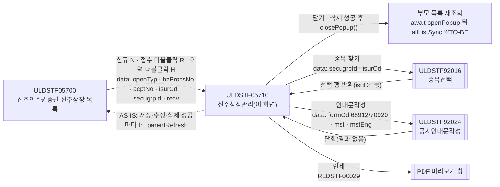
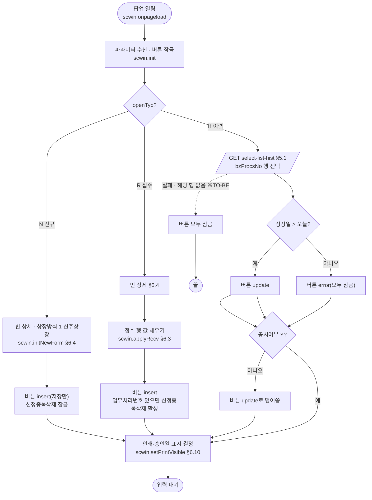
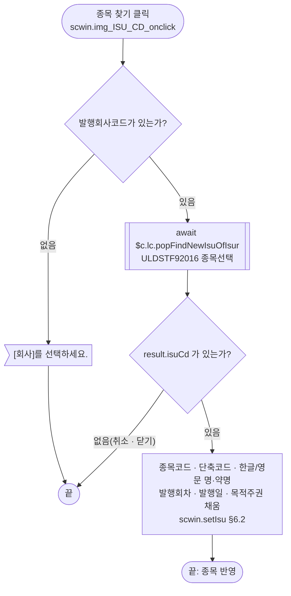
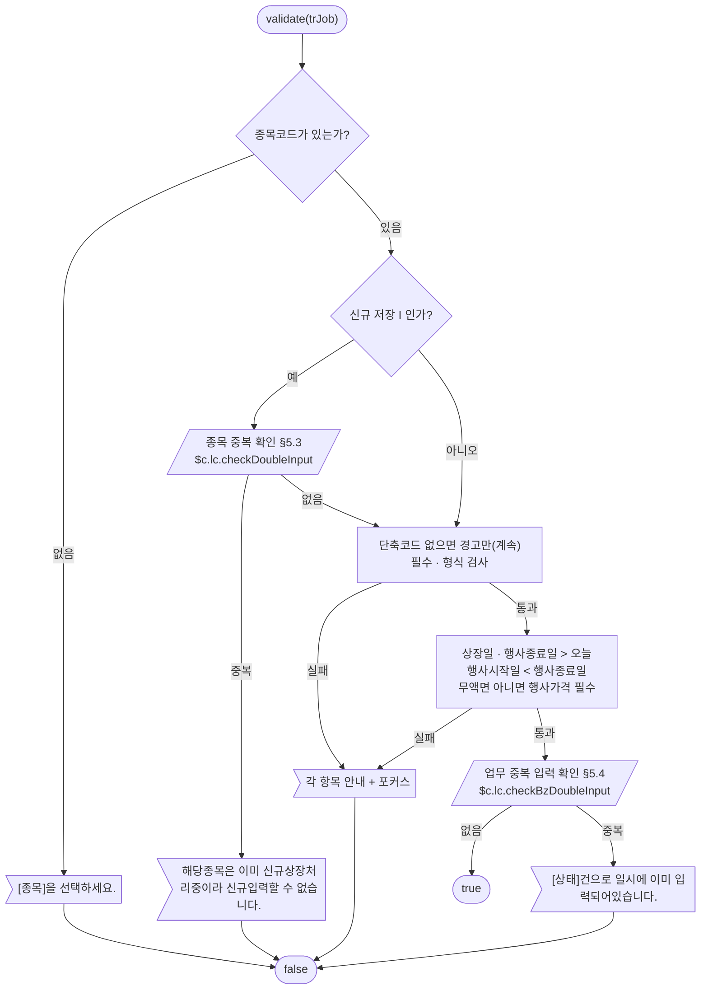
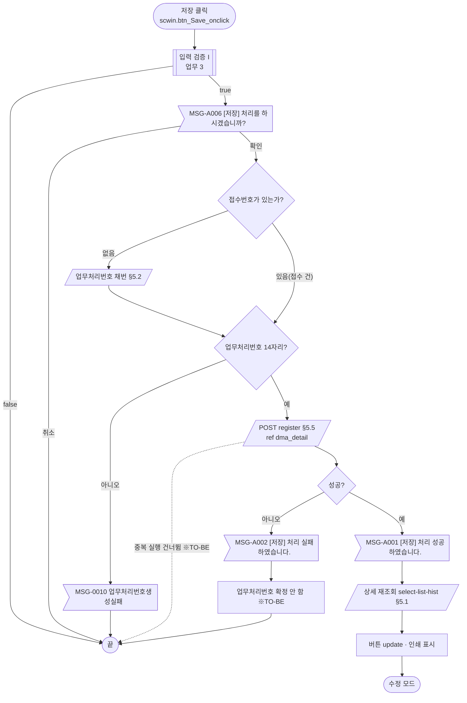
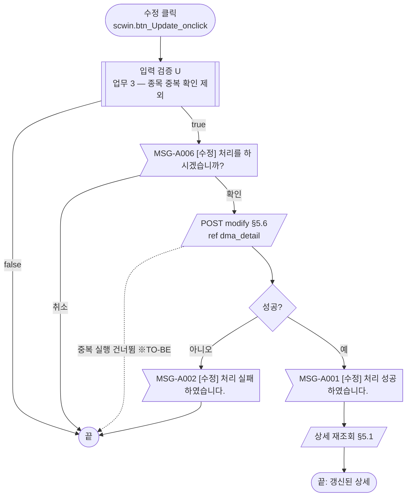
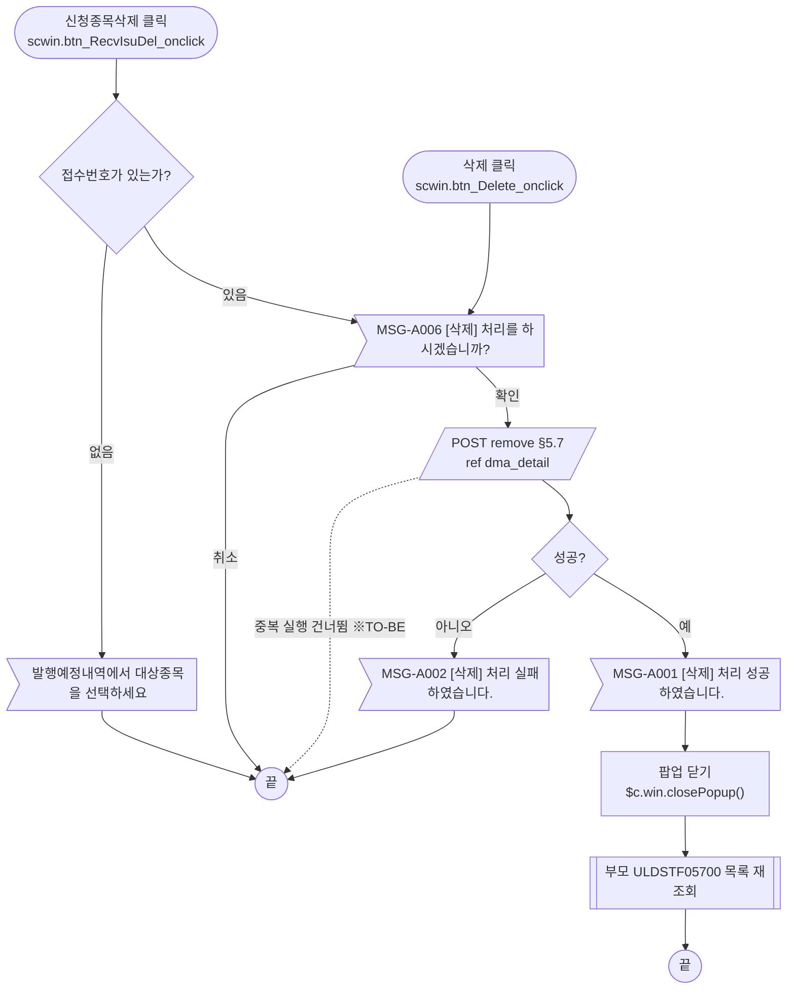
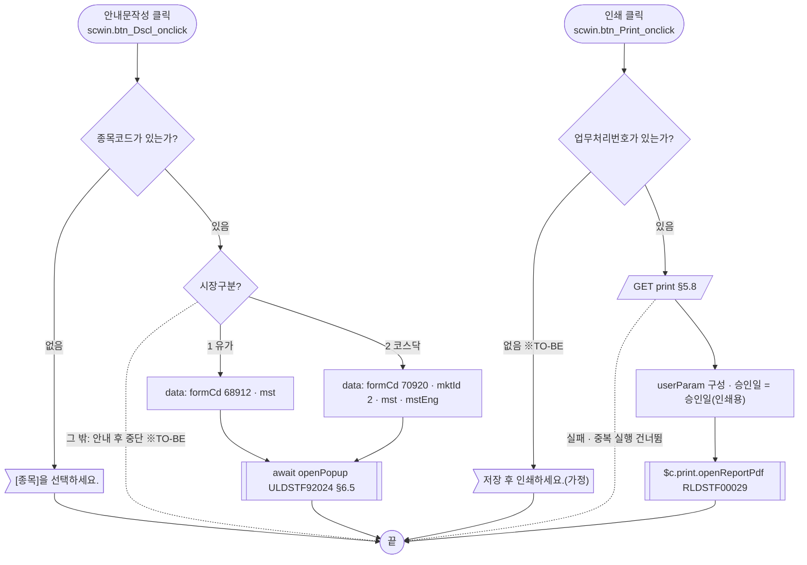
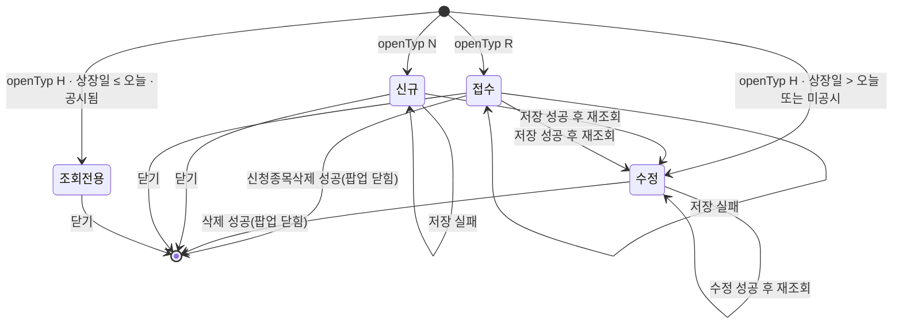

# ULDSTF05710 (팝업)신주인수권증권 신주상장관리 — 업무 분석 및 전환 내역

| 항목 | 내용 |
|---|---|
| AS-IS | `/lstproc/ULDSTF05710.gfm` (Gauce/X-Internet, 850×455 모달 창 — 부모 ULDSTF05700 이 860×490 `window` 로 연다) — 반입 `conversion/gfm-front/ui/ULDSTF05710/ULDSTF05710.gfm` |
| 신규 API 명세 | `conversion/gfm-front/ui/ULDSTF05710/ULDSTF05710_API.md` — 블록 5종(`/api/listing/lstproc/warrant/listing/` 아래 `GET print`·`GET select-list-hist`·`POST modify`·`POST register`·`POST remove`). 블록 머리가 **화면ID 결합형**(`[ULDSTF05710/ULDSTF05801]` 4종, `[ULDSTF05700/ULDSTF05710]` 1종)이고 5종 모두 이 화면ID 를 포함하므로 **전부 이 화면의 API** 다(형제 화면 ULDSTF05801 신주인수권증서·부모 ULDSTF05700 과 공유). 블록마다 `* **AS-IS** :` 줄이 빈칸(``)이라 AS-IS 대응은 이 결과서 §5 에서 `.gfm` 기준으로 채웠다. §2.2·§5 는 명세 기준(가이드 §0.3·§5) |
| TO-BE | `conversion/gfm-front/ui-tobe/ULDSTF05710.xml` (배포 경로 `/ui/lst/lstproc/ULDSTF05710.xml` — 가정, §10 #15). **현재 파일은 publish-tobe 파이프라인 산출 사본**(W-Craft 1차 스크립트 — `/gauceSystemierAdaptor.do`·`/Listing.do` 를 그대로 부르고 `$c.frame.path`·`buttonSet`·`$c.lc.fn_*` 등 정의되지 않은 함수를 씀). 가이드 §13.2 대로 캡처 기준 퍼블리싱본(1단계)부터 다시 만들고 그 위에 이 결과서대로 스크립트를 전환한다 |
| 퍼블리셔 XML | `conversion/publish/상장/상장처리(대내)/ULDSTF05710.xml` — 컴포넌트 id 는 AS-IS 와 같음(날짜 4종 `w2:inputCalendar`, 상장방식 `xf:select1`, 무액면 `xf:select` checkboxgroup, 이미지 버튼 → `xf:trigger`, 달력 이미지 `img_*_DD` 는 없음) |
| 화면 캡처 | `ULDSTF05710.png` (빈 입력 상태 — 신규, [저장]만 활성, 인쇄·승인일 숨김) → **TO-BE 는 가이드 §13.2 퍼블리싱본부터 만든다**. 캡처 하단 [닫기] 버튼은 **(옮기지 않음)** — 팝업 하단 닫기 금지(퍼블리싱 규칙) |
| 업무공통 | `$c.stf`(`getNewBzProcNo`·`getMessageParam`·`setButtonSetWithDate`·`setButtonSetWithDate2`·`formatDateEx`·`glb.SCREN_PROCS_TP_CD_*`)·`$c.lc`(`isProcess`·`popFindNewIsuOfIsur`·`checkDoubleInput`·`checkBzDoubleInput`·`glb.LIST_BZ_TP_CD_121`·`LIST_METHD_TP_CD_1`·`DIV_IDX_NEW_ISS_SWR_*`)·`$c.print`(`openReportPdf`) — `cm/pcc/stf`. 게이트는 `--pcc stf` 로 돌린다 |
| 작성 | Inswave / 2026-10-27 |

참고 양식: [websquare_gfm_conversion.md](../../../md/websquare_gfm_conversion.md) — 특히 §1.4 업무 프로세스 흐름, §5 「API 명세 적용」, §6.5 getPar/setPar 전환. Gauce 대응은 [gfm_business_analysis_guide.md](../../../md/gfm_business_analysis_guide.md) §5·§6 을 함께 따랐다. 같은 모듈 정답지 [ULDSTF05621.md](../ULDSTF05621/ULDSTF05621.md) 의 구성을 따랐다.

---

## 1. 화면 개요

상장 담당자가 **신주인수권증권 신주상장 화면(ULDSTF05700)** 에서 회사를 고른 뒤, 그 회사가 발행한 **신주인수권증권(SW)의 신주상장 내역**(종목·명칭·발행일·상장일·행사기간·행사가격·수량·발행가액·발행사유 등)을 신규 등록하거나, 등록한 건을 수정·삭제하는 팝업이다. 전자공시 접수 건을 받아 등록하거나(접수), 공시안내문을 작성하고, 코스닥이면 증권발행내역을 인쇄(PDF)하는 일도 이 화면에서 한다.

1. 부모가 여는 방식(`vOpenTyp`)으로 모드가 정해진다 — **N 신규**([신규] 버튼), **R 접수**(접수 목록 더블클릭 — 접수 행 값을 미리 채움), **H 이력**(발행내역 목록 더블클릭 — 업무처리번호로 상세 조회).
2. 신규·접수는 [종목 찾기] 로 발행기관의 미상장 종목을 골라 종목코드·명칭·발행회차·발행일·목적주권을 채운다.
3. 필수 항목을 입력해 [저장] 한다. 저장 전에 종목 중복(신규상장 처리 중) 확인, 입력 검증, 업무 중복 입력 확인, 저장 확인을 거치고, 접수 건이 아니면 업무처리번호를 새로 받는다.
4. 저장·수정에 성공하면 부모 목록을 다시 조회하고 상세를 다시 읽어 수정 모드가 된다. 삭제에 성공하면 팝업을 닫는다.
5. 수정 모드는 상장일이 지나지 않았거나 아직 공시되지 않은 건만 [수정]·[삭제]·[안내문작성] 할 수 있다. 접수 건은 [신청종목삭제] 로 지울 수 있다.

### 1.1 호출 화면 (1본)

- `ULDSTF05700` 신주인수권증권 신주상장(목록) — 퍼블리셔 XML `conversion/publish/상장/상장처리(대내)/ULDSTF05700.xml`(W-Craft 1차 스크립트 포함, 아직 TO-BE 전환 전). 명세 블록 2 머리 `[ULDSTF05700/ULDSTF05710]` 이 이 관계를 보여 준다.
  - [신규] 버튼(`btn_New_onclick` → `fn_OpenDetailMng(-1)`) → `vOpenTyp = "N"`, `clickBzProcsNo = ""`. 회사를 먼저 고르지 않으면 "[회사]를 선택하세요."
  - 접수 목록 더블클릭(`grd_Recv_OnDblClick` → `fn_OpenDetailRecv(row)`) → `vOpenTyp = "R"`, `clickBzProcsNo`·`vAcptNo` = 접수 행 값. **접수번호가 있을 때만** 연다.
  - 발행내역 목록 더블클릭(`grd_List_OnDblClick` → `fn_OpenDetailMng(row)`) → `vOpenTyp = "H"`, `clickBzProcsNo` = 목록 행 값, `vAcptNo = ""`.
  - 열기: `CreateDialogFrame("ULDSTF05711.gfm", "/lstproc/ULDSTF05710.gfm", "신주인수권증권 신주상장 관리", 200, 200, 860, 490, "window")` — 프레임 id 가 `ULDSTF05711.gfm` 인 것은 원본 그대로(§10 #15).
  - 부모는 팝업이 닫힌 뒤 다시 조회하지 않는다. 대신 **팝업이 저장·수정·삭제에 성공할 때마다 부모의 `fn_all_list_sync()` 를 직접 부른다**(`fn_parentRefresh`).
- 형제 화면 `ULDSTF05801`(신주인수권증서 신주상장관리, 부모 `ULDSTF05800`)이 같은 API 4종(print·modify·register·remove)을 쓴다 — 요청 `secugrpId`(SW/SR)로 서버가 `LIST_BZ_TP_CD` 121/122 를 가른다(명세 주석).

### 1.2 호출 규약 (부모 → 이 화면) / 반환 규약

AS-IS 는 `fn_GetPar` 배열이 아니라 **부모 창의 전역 변수를 직접 읽는다**(`gform onload` 의 `var parentWin = frame.Provider("../")`). `fn_GetPar`/`fn_SetPar` 는 이 화면이 **하위 팝업(종목 찾기·공시안내문)에 값을 넘길 때** 쓰는 전역이다(§1.3).

| AS-IS (부모 전역) | TO-BE 키 (제안) | 의미 | 빈 값일 때 / 분기 |
|---|---|---|---|
| `parentWin.vOpenTyp` | `openTyp` | 여는 방식 `R` 접수 / `H` 이력 / `N` 신규 | 로딩 분기(§3) |
| `parentWin.clickBzProcsNo` | `bzProcsNo` | 업무처리번호 (R: 접수 행, H: 목록 행, N: "") | R 인데 비면 인쇄 숨김·신청종목삭제 잠금. 저장 때 접수 건(접수번호 있음)은 이 번호를 그대로 쓴다 |
| `parentWin.vAcptNo` | `acptNo` | 접수번호 (R 만, 그 밖은 "") | 비면 저장 때 채번, 있으면 채번하지 않음. 비면 [신청종목삭제] 안내 |
| `getObjectValue(parentWin.txb_ISUR_CD)` | `isurCd` | 발행회사코드 | 비면 종목 찾기 불가("[회사]를 선택하세요.") |
| `parentWin.pSecuGrpId` | `secugrpId` | 증권그룹ID — 부모 상수 `SECUGRP_ID_SW` | 종목 찾기 조건, 명세 `dma_detail.secugrpId`(SW/SR → 121/122) |
| `parentWin.vSPOT_ISU_TRD_MKT_TP_CD` | `spotIsuTrdMktTpCd` | 시장구분 `1` 유가 / `2` 코스닥 | 1 이면 인쇄 숨김, 안내문 서식코드 분기, 접수 시 상장일 복사 여부 |
| `parentWin.dts_Recv` + `RowPosition` | `recv` (객체 — 접수 목록 선택 행) | 접수 내역 1행 | R 만. §6.3 에서 화면에 채운다. 키 이름은 부모 접수 목록 TO-BE 정의를 따름(가정, §10 #6) |

- **TO-BE** ([가이드 §6.5](../../../md/websquare_gfm_conversion.md)): 부모가 위 키 이름의 객체를 `openPopup` 세 번째 인자 `data` 로 넘기고, 이 화면은 `$c.data.getParameter()` 로 받는다. 부모(05700)가 아직 전환 전이라 키 이름은 제안이다(§10 #6).

  ```javascript
  // 부모 ULDSTF05700 (N: bzProcsNo·acptNo "", R: 접수 행, H: 목록 행)
  const data = { openTyp, bzProcsNo, acptNo, isurCd, secugrpId, spotIsuTrdMktTpCd, recv : (openTyp === "R") ? dlt_recv.getRowJSON(row) : null };
  await $c.win.openPopup("/ui/lst/lstproc/ULDSTF05710.xml",
      { id : "ULDSTF05710", popupName : "신주인수권증권 신주상장 관리", width : 860, height : 490, type : "pageFramePopup" }, data);
  await scwin.allListSync();   // AS-IS: 팝업이 성공 때마다 parent.fn_all_list_sync() — TO-BE 는 닫힌 뒤 부모가 재조회(§8 #12)
  ```

- **반환**: 없음. 원본은 `frame.CloseFrame()` 만 한다 → TO-BE 는 `$c.win.closePopup()`(인자 없음). 부모는 `await` 가 끝나면(저장·수정·삭제·닫기 어느 경우든) 목록을 다시 조회하므로 결과 값을 볼 필요가 없다. AS-IS 의 `fn_parentRefresh`(팝업이 부모 함수를 이름으로 부름)는 없앤다.

### 1.3 이 화면이 여는 하위 팝업

| 팝업 | AS-IS 호출 (getPar/setPar) | 넘기는 `data` (TO-BE) | 받는 결과 (`closePopup`) / 취소 판정 |
|---|---|---|---|
| `ULDSTF92016` 종목선택(발행기관의 미상장종목, 385×250) | `img_ISU_CD onclick` → `fn_GetPar = fn_GetParIsuCd`(`arr[0]` 증권그룹ID, `arr[1]` 발행회사코드, `arr[2] = "S"`), `fn_SetPar = fn_SetParIsuCd` → `fn_PopFindNewIsuOfIsur()` (`CreateDialogFrame("DLG_NEW_ISU_ISUR_CD", "../listingcommon/ULDSTF92016.gfm", …, "window")`) | `$c.lc.popFindNewIsuOfIsur(secugrpId, isurCd)` — pcc 가 `{ secugrpId, isurCd }` 로 `pageFramePopup`(기본 타입) 을 열고 결과를 돌려준다. `arr[2] = "S"` 는 넘기지 않음(§10 #9) | 선택 행 객체(`isuCd`·`isuSrtCd`·`isuNm`·`isuSnm`·`isuEngNm`·`isuEngSnm`·`isuRnd`·`isuDd`·`tarstkIsuCd`·`tarstkIsuNm` — 전환본 `sample-front/ui/stf/lst/common/ULDSTF92016.xml`). **`isuCd` 가 비면 취소**로 본다(원본 `if (arrPar[0].ISU_CD != "")`) — §6.2 |
| `ULDSTF92024` 공시안내문작성 (750×825) | `fn_dscl` — `fn_GetPar` 바꿔 끼우기: 유가 `arr = ["68912", 업무처리번호, 발행회사코드]` + `CopyDataSet(dts_Isu → param_dts_mst)`, 코스닥 `arr = ["70920", 업무처리번호, 발행회사코드, 시장구분]` + `CopyDataSet(dts_Isu → param_dts_mst)`·`CopyDataSet(dts_Eng_Isu → param_dts_mst_eng)` → `frame.CreateDialogFrame("ULDSTF92024", "/listingcommon/ULDSTF92024.gfm", "공시안내문작성", 중앙, 750, 825, "window")` | `{ formCd : "68912"/"70920", bzProcsNo, isurCd, mktId(코스닥만 "2"), mst : [상세], mstEng : [상세](코스닥만) }` — §6.5 | 없음(원본 `fn_SetPar` 는 빈 함수). `await` 뒤 처리 없음 |
| (기안 `ULDSTF92004`) | `fn_drft` → `fn_PopFindDraft()` — 하지만 기안 버튼 `btn_Drft` 가 없고 `buttonSet.setDrftInfo` 도 주석 처리라 **진입점 없음** | **(옮기지 않음)** — §8 #10 | — |
| (인쇄 PDF 창) | `fn_print` → `fn_open_report_pdf("RLDSTF00029", userParam)` (숨은 form POST → 새 창) | `$c.print.openReportPdf("RLDSTF00029", userParam)` — 팝업 화면이 아니라 브라우저 창(§6.6) | 없음 |

### 1.4 업무 프로세스 흐름

흐름은 AS-IS 동작을 기준으로 그렸다. 점선과 `※TO-BE` 는 전환본에서 바뀌는 곳이다(근거는 §8).

| # | 업무 | 시작 (사용자 동작·진입 조건) | 끝 (결과) | 주요 함수 | 관련 절 |
|---|---|---|---|---|---|
| 1 | 진입·로딩 | 부모가 팝업을 엶 (`openTyp` R/H/N) | 입력 대기 (모드별 버튼·인쇄 표시) | `scwin.onpageload` → `scwin.init` → `scwin.initNewForm` / `scwin.applyRecv` / `scwin.selectDetail` | §3, §5.1, §6.3·§6.4 |
| 2 | 종목 찾기 | [종목 찾기](돋보기) | 종목코드·명칭·발행회차·발행일·목적주권 채움 | `scwin.img_ISU_CD_onclick` → `scwin.openIsuPopup` | §6.2 |
| 3 | 입력 검증 (공통 흐름) | 저장·수정 안에서 | 통과 / 안내 후 중단 | `scwin.validate` | §6.1, §5.3·§5.4 |
| 4 | 신규 저장 | [저장] (신규·접수 모드) | 저장 성공 안내 → 부모 재조회 → 수정 모드로 재조회 | `scwin.save` → `validate` → 채번 → `scwin.saveTrs("I")` | §5.2, §5.5, §6.7 |
| 5 | 수정 | [수정] (수정 모드) | 수정 성공 안내 → 재조회 | `scwin.update` → `validate` → `scwin.saveTrs("U")` | §5.6, §6.8 |
| 6 | 삭제 | [삭제] (수정 모드) | 삭제 성공 안내 → 팝업 닫힘 → 부모 재조회 | `scwin.remove` → `scwin.removeTrs` | §5.7, §6.9 |
| 7 | 신청종목삭제 | [신청종목삭제] (접수 모드 + 업무처리번호 있음) | 삭제와 같음 | `scwin.removeRecvIsu` → `scwin.remove` | §5.7, §6.9 |
| 8 | 공시안내문작성 | [안내문작성] (수정 모드) | 92024 팝업에서 작성·전송 후 닫힘 | `scwin.writeDscl` | §6.5 |
| 9 | 인쇄 | [인쇄] (코스닥, 접수 미처리 건 제외) | PDF 미리보기 창 | `scwin.print` → `scwin.selectPrint` | §5.8, §6.6 |

#### 화면 간 흐름



AS-IS 는 하위 팝업에 `fn_GetPar`/`fn_SetPar` 를 바꿔 끼우고 모달 창이 닫힐 때까지 기다리는 방식이었다. TO-BE 는 하위 팝업 화살표가 모두 `await $c.win.openPopup(url, options, data)`(종목 찾기는 pcc `popFindNewIsuOfIsur` 가 내부에서 부름)이고, 결과를 돌려받는 팝업은 종목 찾기 하나다(가이드 §6.5).

#### 업무 1: 진입·로딩



| # | 단계 | 주체 | 내용 | 분기 · 메시지 | 관련 절 |
|---|---|---|---|---|---|
| 1 | 파라미터 수신 | 화면 | `$c.data.getParameter()` → `openTyp`·`bzProcsNo`·`acptNo`·`isurCd`·`secugrpId`·`spotIsuTrdMktTpCd`·`recv` | — | §1.2, §3 |
| 2 | 승인일 기본값 | 화면 | `edt_APPROV_DD` = 서버 현재일 (AS-IS 클라이언트 `cGetToday("yyyymmdd")`) | — | §3 |
| 3a | 신규(N) | 화면 | AS-IS `fn_SetHeader`(헤더 전용 서버 조회 + `AddRow`) → TO-BE 통신 없이 `dma_detail.setEmptyValue()`. `fn_initItem` 으로 상장방식 `1` | 버튼 `insert`, 신청종목삭제 잠금 | §6.4, §5.9 |
| 3b | 접수(R) | 화면 | 빈 상세 뒤 접수 행 값 복사(`fn_recv_read_sync`) — 업무처리번호·접수번호·발행일·상장증권수량·무액면·행사가격·발행주식수·발행가액총액·행사시작/종료일·비고, **코스닥이면 상장일도** | 버튼 `insert`, 업무처리번호가 있으면 신청종목삭제 활성 | §6.3 |
| 3c | 이력(H) | 서버 | AS-IS `fn_read_sync`(**동기** 2회 — `dts_Isu`·`dts_Eng_Isu` 같은 URL) → TO-BE `select-list-hist` 1회 후 `bzProcsNo` 행을 상세로 | 실패·0행이면 버튼 잠금(※TO-BE) | §5.1, §8 #4 |
| 4 | 버튼 상태 | 화면 | AS-IS `dts_Isu OnLoadCompleted`: 신규 또는 업무처리번호 없는 접수 → `insert`, 그 밖 → `setButtonSetWithDate(edt_LIST_DD, false)` 후 `setButtonSetWithDate2(DISCLS_YN)` | 상장일 ≤ 오늘이면 `error`, 단 미공시면 다시 `update` | §4, §6.11 |
| 5 | 인쇄 표시 | 화면 | 유가(1)면 인쇄·승인일 숨김, 코스닥이면 업무처리번호 없는 접수만 숨김 | — | §6.10 |

#### 업무 2: 종목 찾기



| # | 단계 | 주체 | 내용 | 분기 · 메시지 | 관련 절 |
|---|---|---|---|---|---|
| 1 | 회사 확인 | 화면 | `scwin.isurCd` 가 비었는지 | 비면 "[회사]를 선택하세요." 후 끝 | §7.2 |
| 2 | 팝업 | 사용자 | `await $c.lc.popFindNewIsuOfIsur(scwin.secugrpId, scwin.isurCd)` | 취소·닫기(X)는 `{ isCloseButtonClick }` → `isuCd` 없음으로 판정 | §6.2 |
| 3 | 반영 | 화면 | `dma_detail` 의 `isuCd`·`isuSrtCd`·`isuKorNm`·`isuKorAbbrv`·`isuEngNm`·`isuEngAbbrv`·`isuRnd`·`isuDd`·`tarstkIsuCd`, `dma_view.tarstkIsuNm` | 원본은 업무 확인 없이 덮어씀 | §6.2 |

#### 업무 3: 입력 검증 (저장·수정 공통 — `scwin.validate`)



| # | 단계 | 주체 | 내용 | 분기 · 메시지 | 관련 절 |
|---|---|---|---|---|---|
| 1 | 종목 | 화면 | `isuCd` 필수 | "[종목]을 선택하세요." + 종목 찾기 버튼 포커스 | §6.1 |
| 2 | 종목 중복(신규만) | 서버 | AS-IS `fn_checkDoubleInput(dts_DoubleChk, 종목코드)` (**동기**) | 중복이면 안내 후 false. 명세에 없음 — §5.3, §10 #4 | §5.3 |
| 3 | 단축코드 | 화면 | 비면 "[종목단축코드]항목값이  없습니다." 안내만 하고 **계속**(원본 `return` 이 주석) | — | §8 #6 |
| 4 | 필수·형식 | 화면 | 한글/영문 종목(약)명, 발행일, 상장일, 행사종료일, 상장방식, 상장증권수량, 발행주식수, 발행가액총액, 발행사유, 신주인수권의 내용, 신주의 납입방법 | 각 안내 + 포커스 | §6.1 |
| 5 | 업무 날짜 | 화면 | 상장일 > 오늘, 행사종료일 > 오늘, 행사시작일 < 행사종료일(같으면 실패) | §7.2 문구 | §6.1 |
| 6 | 행사가격 조건부 필수 | 화면 | 무액면이 아니면 행사가격 필수 | AS-IS 는 체크박스가 아닌 조회 값으로 판정(§8 #5) | §6.1 |
| 7 | 업무 중복 | 서버 | `fn_check_bz_doubleinput(dts_BZ_CHECK, 종목코드, 상장일, 업무처리번호, 121)` (**동기**) | 이미 입력된 건이면 안내 후 false | §5.4 |

#### 업무 4: 신규 저장



| # | 단계 | 주체 | 내용 | 분기 · 메시지 | 관련 절 |
|---|---|---|---|---|---|
| 1 | 입력 검증 | 화면·서버 | 업무 3 (`trJob = "I"`) | false 면 끝 | §6.1 |
| 2 | 저장 확인 | 사용자 | `await $c.lc.isProcess("I")` | 취소면 끝 | §6.7 |
| 3 | 채번 | 서버 | 접수번호가 없을 때만 `$c.stf.getNewBzProcNo()` → 봉투에서 `body` 추출 | 14자리 아니면 `MSG-0010`. 접수 건은 받은 업무처리번호를 그대로 검사(비면 `MSG-0010` — §8 #3) | §5.2 |
| 4 | 전문 구성 | 화면 | `dma_detail` 에 `bzProcsNo`·`acptNo`·`isurCd`·`secugrpId`·`nparvalstkYn`(체크 Y / "") | AS-IS 의 `LIST_BZ_TP_CD=121` 은 `secugrpId=SW` 로 대신(명세) | §5.5 |
| 5 | 저장 | 서버 | `POST register` (`ref : "dma_detail"`) | `skipped` 면 안내 없이 끝, 실패 `MSG-A002` | §5.5 |
| 6 | 결과 반영 | 화면 | `MSG-A001` → 상세 재조회 → `update` 버튼 → 인쇄 표시. 부모 재조회는 닫힌 뒤(※TO-BE) | — | §5.1, §8 #12 |

#### 업무 5: 수정



- 원본은 "변경된 내용 없음" 확인을 하지 않는다(05621 과 다름) — 그대로 유지.
- 수정은 채번·종목 중복 확인을 하지 않지만 업무 중복 확인(§5.4)은 한다.

#### 업무 6·7: 삭제 · 신청종목삭제



| # | 단계 | 주체 | 내용 | 분기 · 메시지 | 관련 절 |
|---|---|---|---|---|---|
| 1 | (신청종목삭제만) 접수 확인 | 화면 | `scwin.acptNo` 가 비었는지 | 비면 안내 후 끝. 버튼 자체가 접수 모드 + 업무처리번호 있음일 때만 활성 | §6.9 |
| 2 | 삭제 확인 | 사용자 | `await $c.lc.isProcess("D")` | 취소면 끝 | §6.9 |
| 3 | 삭제 | 서버 | `POST remove` (`ref : "dma_detail"`) — 입력 검증 없음 | 실패 `MSG-A002` | §5.7 |
| 4 | 결과 | 화면 | `MSG-A001` → `$c.win.closePopup()` → 부모가 재조회 | AS-IS 는 닫기 전에 `fn_parentRefresh` | §8 #12 |

#### 업무 8·9: 공시안내문작성 · 인쇄



- 안내문작성은 확인 메시지 없이 바로 연다(원본에 `fn_isProcess('DSCL')` 없음). 수정 중인 미저장 값 확인(`IsUpdated`)은 원본에서 주석 처리돼 하지 않는다.
- 인쇄는 원본에서 `doLogSave(vScrenID, SCREN_PROCS_TP_CD_05)`(화면 이력)를 먼저 남긴다 → TO-BE 는 삭제(2026-10-26 결정, §8 #14). 조회(`await`) 뒤 `window.open` 이라 팝업 차단 가능성은 §10 #12.

#### 화면 모드 상태 전이



| 상태 | 활성 버튼 | 근거 |
|---|---|---|
| 신규 | 저장 | `insert` · 신청종목삭제 잠금 |
| 접수 | 저장 (+ 업무처리번호가 있으면 신청종목삭제) | `insert` + `fn_setBtnRecvIsuDel` |
| 수정 | 수정 · 삭제 · 안내문작성 | `update` (저장만 제외) |
| 조회전용 | 없음(닫기만) | `error` — 이 화면에 기안 버튼이 없어 모두 잠김 |

- 저장 직후 재조회에서 원본은 `vOpenTyp` 가 N 이면 `dts_Isu OnLoadCompleted` 가 먼저 `insert` 로 두지만, 바로 뒤 `OnSuccess` 의 `buttonSet.setUpdateStatus()` 가 `update` 로 덮는다 → 결과는 언제나 `수정`. TO-BE 는 재조회 뒤 `update` 를 바로 건다(§5.5 후처리).

---

## 2. 화면 구성 및 데이터 정의

### 2.1 화면 구성

캡처(`ULDSTF05710.png`) 기준 위→아래, 왼→오른. TO-BE id 는 AS-IS·퍼블리셔 XML 과 같은 id 를 쓰고(현재 ui-tobe 사본과도 같음), 바인딩은 §2.2 의 `dma_detail` camelCase 키다. 필수 표시(*)는 AS-IS 의 별도 라벨(`label_29`~`label_42` 등)을 TO-BE 라벨의 `class="req"` 로 옮긴다.

| 영역 | AS-IS 요소 | TO-BE 컴포넌트 (바인딩) | 설명 |
|---|---|---|---|
| (외곽) | `panel_Item` (`PanelToGroupBox`, 배경 `#d9e9fc`) | `panel_Item` (`tblbox` 그룹) | `PanelToGroupBox` **(옮기지 않음)** — 퍼블리싱 마크업이 대신함. 인라인 배경색 금지(규칙 40) |
| 종목코드 (*) | `label_14` + `label_33`(*) · `txb_ISU_CD` (readonly) · `img_ISU_CD`(돋보기) | `label_14`(req) · `txb_ISU_CD` (`xf:input` readOnly, `dma_detail.isuCd`) · `img_ISU_CD` (`xf:trigger` 검색 아이콘, `ev:onclick`) | 종목 찾기(§6.2). 읽기 전용 배경 `#b9d4f7` 은 readOnly 기본 스타일로(인라인 색 금지, 규칙 40) |
| 종목단축코드 (*) | `label_17` + `label_34`(*) · `txb_ISU_SRT_CD` (readonly) | `label_17`(req) · `txb_ISU_SRT_CD` (readOnly, `dma_detail.isuSrtCd`) | 종목 찾기로만 채움 |
| 한글종목명 (*) | `label_2` + `label_32`(*) · `txb_ISU_KOR_NM` (maxlength 40) · `label_44` "(한글:30자)" | `label_2`(req) · `txb_ISU_KOR_NM` (`dma_detail.isuKorNm`) · `label_44` | 글자 수 안내와 maxlength 불일치 §8 #9 |
| 한글종목약명 (*) | `label_16` + `label_31`(*) · `txb_ISU_KOR_ABBRV` (20) · `label_43` "(한글:15자)" | `label_16`(req) · `txb_ISU_KOR_ABBRV` (`dma_detail.isuKorAbbrv`) · `label_43` | |
| 영문종목명 (*) | `label_3` + `label_30`(*) · `txb_ISU_ENG_NM` (80) · `label_45` "(영문:60자)" | `label_3`(req) · `txb_ISU_ENG_NM` (`dma_detail.isuEngNm`) · `label_45` | |
| 영문종목약명 (*) | `label_8` + `label_29`(*) · `txb_ISU_ENG_ABBRV` (40) · `label_46` "(영문:30자)" | `label_8`(req) · `txb_ISU_ENG_ABBRV` (`dma_detail.isuEngAbbrv`) · `label_46` | |
| 목적주권명 / 발행회차 | `label_18` · `txb_TARSTK_ISU_NM` (readonly) / `label_4` · `edt_ISU_RND` (readonly, 숫자) | `txb_TARSTK_ISU_NM` (readOnly, `dma_view.tarstkIsuNm` — 명세 `dma_detail` 에 이름 키가 없어 화면 전용, §2.2) / `edt_ISU_RND` (readOnly, `dma_detail.isuRnd`) | 종목 찾기·상세 조회로 채움. 목적주권 코드는 `dma_detail.tarstkIsuCd`(숨은 값 — AS-IS `dts_Isu.TARSTK_ISU_CD`) |
| 발행사유 (*) / 상장방식 (*) | `label_5` + `label_22`(*) · `txb_ISU_RSN_CONTN` (100) / `label_9` + `label_38`(*) · `cmb_LIST_METHD_TP_CD` (`enable2=False`, `1^신주상장,3^변경상장`) | `txb_ISU_RSN_CONTN` (`dma_detail.isuRsnContn`) / `cmb_LIST_METHD_TP_CD` (`xf:select1` disabled, `dma_detail.listMethdTpCd`) | 상장방식은 잠긴 콤보 — 신규·접수는 `1` 고정(§6.4), 이력은 조회 값 |
| 발행일 (*) / 행사시작일 | `label_6` + `label_28`(*) · `edt_ISU_DD` + `img_ISU_DD` / `label_19` · `edt_EXER_STRT_DD` + `img_EXER_STRT_DD` | `edt_ISU_DD` (`w2:inputCalendar`, `dma_detail.isuDd`) / `edt_EXER_STRT_DD` (`dma_detail.exerStrtDd`) | 달력 이미지 **(옮기지 않음)** — inputCalendar 내장 달력. 행사시작일은 필수 표시 없음(원본 검사도 주석) |
| 상장일 (*) / 행사종료일 (*) | `label_13` + `label_27`(*) · `edt_LIST_DD` + `img_LIST_DD` / `label_20` + `label_36`(*) · `edt_EXER_END_DD` + `img_EXER_END_DD` | `edt_LIST_DD` (`dma_detail.listDd`) / `edt_EXER_END_DD` (`dma_detail.exerEndDd`) | 상장일은 수정 모드 버튼 상태의 기준일(§6.11) |
| 상장증권수량 (*) / 행사가격(원) (*) / 무액면주식 여부 | `label_10` + `label_39`(*) · `edt_LIST_SHRS` (숫자) / `label_25` + `label_41`(*) · `edt_EXER_PRC` (숫자, maxlength 8) / `label_50` · `chk_NPARVALSTK_YN` (value Y) | `edt_LIST_SHRS` (`dataType="number"`, `displayFormat="#,##0"`, `dma_detail.listShrs`) / `edt_EXER_PRC` (`dma_detail.exerPrc`) / `chk_NPARVALSTK_YN` (`xf:select` checkboxgroup `Y`, `dma_detail.nparvalstkYn`) | 체크박스를 바인딩해 검증·전송 값과 화면을 일치시킨다(※TO-BE, §8 #5). AS-IS binder 의 `edt_NPARVALSTK_YN` 은 화면에 없는 컨트롤 — **(옮기지 않음)** |
| 발행주식수(주) (*) / 발행가액총액(원) (*) | `label_21` + `label_40`(*) · `edt_ISU_SHRS` / `label_7` + `label_42`(*) · `edt_TOT_ISU_PRC` | `edt_ISU_SHRS` (`dma_detail.isuShrs`) / `edt_TOT_ISU_PRC` (`dma_detail.totIsuPrc`) | 숫자 `#,##0` |
| 신주인수권의 내용 (*) | `label_23` + `label_12`(*) · `txb_SUBSRGHT_CONTN` (200) | `txb_SUBSRGHT_CONTN` (`dma_detail.subsrghtContn`) | |
| 신주의 납입방법 (*) | `label_24` + `label_37`(*) · `txb_SUBSRGHT_EXERTM_PAYMETHD_CONTN` (200) | `txb_SUBSRGHT_EXERTM_PAYMETHD_CONTN` (`dma_detail.subsrghtExertmPaymethdContn`) | |
| 비고 | `label_15` · `txa_REMK` (`mxtextarea`) | `txa_REMK` (`xf:textarea`, `dma_detail.remk`) | 검증 없음 |
| 하단 왼쪽 (인쇄) | `btn_Print` · `label_26` "승인일(인쇄용):" · `edt_APPROV_DD` + `img_APPROV_DD` | `btn_Print` (`xf:trigger`) · `label_26` · `edt_APPROV_DD` (`inputCalendar`, 바인딩 없음 — 인쇄 파라미터 전용) | 캡처에는 숨김 상태(유가 또는 미처리 접수). 표시 규칙 §6.10. `img_APPROV_DD` **(옮기지 않음)** — 내장 달력 |
| 하단 오른쪽 (버튼) | `btn_RecvIsuDel`(신청종목삭제) · `btn_Save` · `btn_Update` · `btn_Delete` · `btn_Dscl`(안내문작성) · `btn_Close` (이미지) | `btn_RecvIsuDel` · `btn_Save`(pt) · `btn_Update` · `btn_Delete` · `btn_Dscl` (`xf:trigger`, `btnbox#grpBtnBox`) — 캡처 순서: 신청종목삭제 \| 저장 · 수정 · 삭제 · 안내문작성 | `btn_Close` 는 **(옮기지 않음)** — 팝업 하단 닫기 금지(퍼블리싱 규칙), 팝업 창의 닫기(X) 사용. 활성 상태는 `buttonSet` → `$c.util.setButtonState` (§4) |
| (데이터 장식) | `bnd_Isu` (`mxbinder`) | 컴포넌트 `ref="data:dma_detail.*"` | |

- 퍼블리싱 1단계(§13.2)는 캡처 기준으로 다시 만든다: 팝업이므로 contentHeader 필수, 하단 닫기 버튼 금지, colgroup 칸 수 일치, `readOnly` 대소문자. 현재 ui-tobe 사본의 `pop_contents` 구조·`userData2` 잔재는 1단계에서 정리한다.

### 2.2 데이터 정의

| AS-IS | TO-BE | 종류 | 키(컬럼) | 출처 / 용도 |
|---|---|---|---|---|
| `dts_Isu` (1행, `bnd_Isu` 로 바인딩) | `dma_detail` | dataMap | 명세 `modify`·`register` REQUEST 정의 원문 28키(아래) | 화면 바인딩 대상 + **저장·수정·삭제 요청**(`ref : "dma_detail"`). 상세 조회는 `dlt_list` 의 해당 행에서 같은 이름 키를 옮겨 담는다(§5.1) |
| `dts_Eng_Isu` | (없음 — `dma_detail` 로 대체) | — | AS-IS 는 `dts_Isu` 와 **같은 URL** 을 한 번 더 읽어 둔 사본 | 코스닥 안내문의 `param_dts_mst_eng` 로만 쓰임 → `mstEng : [dma_detail 상세]`(§6.5, §8 #4) |
| (응답 전용) | `dlt_list` | dataList | 명세 `select-list-hist` RESPONSE 원문 34열(아래) | 상세 조회 응답(`target "dlt_list=body"`). 부모 목록과 같은 API — 이 화면은 `bzProcsNo` 행 하나만 쓴다 |
| `dts_Report` | `dma_print` | dataMap | 명세 `print` RESPONSE 원문 24키(아래) | 인쇄 자료(§5.8) |
| (응답 전용) | `dma_result` | dataMap | 명세 `modify`·`register`·`remove` RESPONSE 원문 — `bzProcsNo`·`completeYn` | 저장·수정·삭제 결과 판정(§5.5~5.7) |
| (화면 전용) | `dma_view` | dataMap | `tarstkIsuNm`(목적주권명), `disclsYn`(공시검토 여부) | **명세에 없는 화면 전용** — `dma_detail` 에 이름·공시여부 키가 없어 표시·버튼 판정용으로 둔다(요청에 섞이지 않게 분리, §10 #5) |
| `dts_BzProcsNo` | (삭제) | — | — | 채번 결과는 `$c.stf.getNewBzProcNo()` 반환값을 바로 쓴다(§5.2) |
| `dts_DoubleChk` | (삭제) | — | — | 종목 중복 확인 응답을 pcc 함수가 바로 판정(§5.3) |
| `dts_BZ_CHECK` | (삭제) | — | — | 업무 중복 확인 응답을 pcc 함수가 바로 판정(§5.4) |
| `dts_Bf_Isu` | (삭제) | — | — | 선언만 있고 쓰지 않음(§8 #10) |
| `dts_Print` | (삭제) | — | — | `fn_print` 에서 빈 헤더(`TEST:STRING(80)`)+1행만 만들고 쓰지 않음(Rexpert 시절 `fn_print_old` 의 CSV 용) |
| `trs_Save` | (삭제) | — | — | 저장·수정·삭제 통신 → `executeDynamic` |

**명세 원문 (가이드 §5 「API 명세 적용」 — id·name·dataType 그대로 옮긴다)**

`register`·`modify` 요청 (`ref : "dma_detail"`, `remove` 도 같은 ref):

```xml
<w2:dataMap id="dma_detail" baseNode="map">
	<w2:keyInfo>
		<w2:key id="bzProcsNo" name="업무처리번호" dataType="text"></w2:key>
		<w2:key id="isuCd" name="종목코드" dataType="text"></w2:key>
		<w2:key id="listDd" name="상장일" dataType="text"></w2:key>
		<w2:key id="isuSrtCd" name="종목단축코드" dataType="text"></w2:key>
		<w2:key id="isuKorNm" name="종목한글명" dataType="text"></w2:key>
		<w2:key id="isuKorAbbrv" name="종목약어명" dataType="text"></w2:key>
		<w2:key id="isuEngNm" name="종목영문명" dataType="text"></w2:key>
		<w2:key id="isuEngAbbrv" name="종목영문약어" dataType="text"></w2:key>
		<w2:key id="isurCd" name="발행회사코드" dataType="text"></w2:key>
		<w2:key id="acptNo" name="접수번호" dataType="text"></w2:key>
		<w2:key id="tarstkIsuCd" name="목적주권종목코드" dataType="text"></w2:key>
		<w2:key id="delistDd" name="상장폐지일" dataType="text"></w2:key>
		<w2:key id="isuShrs" name="발행증권수" dataType="number"></w2:key>
		<w2:key id="exerPrc" name="행사가격" dataType="number"></w2:key>
		<w2:key id="totIsuPrc" name="발행가액총액(원)" dataType="number"></w2:key>
		<w2:key id="exerStrtDd" name="행사시작일" dataType="text"></w2:key>
		<w2:key id="exerEndDd" name="행사종료일" dataType="text"></w2:key>
		<w2:key id="subsrghtContn" name="신주인수권의내용" dataType="text"></w2:key>
		<w2:key id="subsrghtExertmPaymethdContn" name="신주인수권행사시납입방법내용" dataType="text"></w2:key>
		<w2:key id="nparvalstkYn" name="무액면여부" dataType="text"></w2:key>
		<w2:key id="listMethdTpCd" name="상장방식유형코드" dataType="text"></w2:key>
		<w2:key id="incdecListShrs" name="증감증권수" dataType="number"></w2:key>
		<w2:key id="listShrs" name="상장주식수" dataType="number"></w2:key>
		<w2:key id="isuRsnContn" name="발행사유" dataType="text"></w2:key>
		<w2:key id="isuDd" name="발행일" dataType="text"></w2:key>
		<w2:key id="isuRnd" name="발행회차" dataType="text"></w2:key>
		<w2:key id="remk" name="비고" dataType="text"></w2:key>
		<w2:key id="secugrpId" name="증권그룹코드 SW(신주인수권증권)/SR(신주인수권증서) - LIST_BZ_TP_CD 121/122 분기용" dataType="text"></w2:key>
	</w2:keyInfo>
</w2:dataMap>
```

`modify`·`register`·`remove` 응답 (`target : "dma_result=body"`):

```xml
<w2:dataMap id="dma_result" baseNode="map">
	<w2:keyInfo>
		<w2:key id="bzProcsNo" name="업무처리번호" dataType="text"></w2:key>
		<w2:key id="completeYn" name="처리결과" dataType="text"></w2:key>
	</w2:keyInfo>
</w2:dataMap>
```

`select-list-hist` 응답 (`target : "dlt_list=body"`):

```xml
<w2:dataList id="dlt_list" baseNode="list" saveRemovedData="true" repeatNode="map">
	<w2:columnInfo>
		<w2:column id="bzProcsNo" name="업무처리번호" dataType="text"></w2:column>
		<w2:column id="acptNo" name="접수번호" dataType="text"></w2:column>
		<w2:column id="disclsAcptTpNm" name="제출유형" dataType="text"></w2:column>
		<w2:column id="isurCd" name="발행회사코드" dataType="text"></w2:column>
		<w2:column id="comNm" name="회사명" dataType="text"></w2:column>
		<w2:column id="isuCd" name="종목코드" dataType="text"></w2:column>
		<w2:column id="tarstkIsuCd" name="대상주식종목코드" dataType="text"></w2:column>
		<w2:column id="tarstkIsuNm" name="대상주식종목코드명" dataType="text"></w2:column>
		<w2:column id="listMethdTpCd" name="상장방식유형코드" dataType="text"></w2:column>
		<w2:column id="listMethdTpNm" name="상장방식유형" dataType="text"></w2:column>
		<w2:column id="isuRnd" name="발행회차" dataType="number"></w2:column>
		<w2:column id="listDd" name="상장일" dataType="text"></w2:column>
		<w2:column id="delistDd" name="상장폐지 지정일" dataType="text"></w2:column>
		<w2:column id="isuDd" name="발행일" dataType="text"></w2:column>
		<w2:column id="isuRsnContn" name="변경사유" dataType="text"></w2:column>
		<w2:column id="bfListShrs" name="변경전 수량" dataType="text"></w2:column>
		<w2:column id="incdecListShrs" name="발행주식수(증감증권수)" dataType="number"></w2:column>
		<w2:column id="listShrs" name="상장주식수" dataType="number"></w2:column>
		<w2:column id="isuShrs" name="증감주식수" dataType="number"></w2:column>
		<w2:column id="nparvalstkYn" name="무액면주식여부" dataType="text"></w2:column>
		<w2:column id="exerPrc" name="행사가격" dataType="number"></w2:column>
		<w2:column id="totIsuPrc" name="발행가액총액(원)" dataType="number"></w2:column>
		<w2:column id="exerStrtDd" name="행사시작일" dataType="text"></w2:column>
		<w2:column id="exerEndDd" name="행사종료일" dataType="text"></w2:column>
		<w2:column id="subsrghtContn" name="신주인수권의내용" dataType="text"></w2:column>
		<w2:column id="subsrghtExertmPaymethdContn" name="신주의납입방법" dataType="text"></w2:column>
		<w2:column id="remk" name="기타" dataType="text"></w2:column>
		<w2:column id="isuSrtCd" name="종목약어코드" dataType="text"></w2:column>
		<w2:column id="isuKorNm" name="종목한글명" dataType="text"></w2:column>
		<w2:column id="isuKorAbbrv" name="종목약어명" dataType="text"></w2:column>
		<w2:column id="isuEngNm" name="종목영문명" dataType="text"></w2:column>
		<w2:column id="isuEngAbbrv" name="종목영문약어" dataType="text"></w2:column>
		<w2:column id="disclsYn" name="공시검토 여부" dataType="text"></w2:column>
		<w2:column id="fnlEmpNm" name="최종처리자" dataType="text"></w2:column>
	</w2:columnInfo>
</w2:dataList>
```

`print` 응답 (`target : "dma_print=body"`):

```xml
<w2:dataMap id="dma_print" baseNode="map">
	<w2:keyInfo>
		<w2:key id="bzProcsNo" name="업무처리번호" dataType="text"></w2:key>
		<w2:key id="acptNo" name="접수번호" dataType="text"></w2:key>
		<w2:key id="isurCd" name="발행회사코드" dataType="text"></w2:key>
		<w2:key id="comNm" name="회사명" dataType="text"></w2:key>
		<w2:key id="isuCd" name="종목코드" dataType="text"></w2:key>
		<w2:key id="tarstkIsuNm" name="대상주식종목코드명" dataType="text"></w2:key>
		<w2:key id="isuRnd" name="발행회차" dataType="text"></w2:key>
		<w2:key id="listDd" name="상장일" dataType="text"></w2:key>
		<w2:key id="delistDd" name="상장폐지 지정일" dataType="text"></w2:key>
		<w2:key id="isuDd" name="발행일" dataType="text"></w2:key>
		<w2:key id="isuRsnContn" name="변경사유" dataType="text"></w2:key>
		<w2:key id="listShrs" name="상장주식수" dataType="number"></w2:key>
		<w2:key id="isuShrs" name="증감주식수" dataType="number"></w2:key>
		<w2:key id="exerPrc" name="행사가격" dataType="number"></w2:key>
		<w2:key id="totIsuPrc" name="발행가액총액(원)" dataType="number"></w2:key>
		<w2:key id="exerStrtDd" name="행사시작일" dataType="text"></w2:key>
		<w2:key id="exerEndDd" name="행사종료일" dataType="text"></w2:key>
		<w2:key id="isuSrtCd" name="종목약어코드" dataType="text"></w2:key>
		<w2:key id="isuKorNm" name="종목한글명" dataType="text"></w2:key>
		<w2:key id="isuKorAbbrv" name="종목약어명" dataType="text"></w2:key>
		<w2:key id="isuEngNm" name="종목영문명" dataType="text"></w2:key>
		<w2:key id="isuEngAbbrv" name="종목영문약어" dataType="text"></w2:key>
		<w2:key id="subsrghtEpContn" name="신주의 납입방법" dataType="text"></w2:key>
		<w2:key id="commitDd" name="승인일" dataType="text"></w2:key>
	</w2:keyInfo>
</w2:dataMap>
```

- **AS-IS 대문자 → 명세 키**: `ISU_CD→isuCd`, `ISU_SRT_CD→isuSrtCd`, `ISU_KOR_NM→isuKorNm`, `ISU_KOR_ABBRV→isuKorAbbrv`, `ISU_ENG_NM→isuEngNm`, `ISU_ENG_ABBRV→isuEngAbbrv`, `SUBSRGHT_EXERTM_PAYMETHD_CONTN→subsrghtExertmPaymethdContn`, `SUBSRGHT_CONTN→subsrghtContn`, `ISU_RSN_CONTN→isuRsnContn`, `TARSTK_ISU_NM→tarstkIsuNm`(`dma_view`), `TARSTK_ISU_CD→tarstkIsuCd`, `LIST_METHD_TP_CD→listMethdTpCd`, `ISU_RND→isuRnd`, `LIST_DD→listDd`, `ISU_DD→isuDd`, `LIST_SHRS→listShrs`, `ISU_SHRS→isuShrs`, `TOT_ISU_PRC→totIsuPrc`, `EXER_PRC→exerPrc`, `EXER_STRT_DD→exerStrtDd`, `EXER_END_DD→exerEndDd`, `REMK→remk`, `NPARVALSTK_YN→nparvalstkYn`, `BZ_PROCS_NO→bzProcsNo`, `ACPT_NO→acptNo`, `ISUR_CD→isurCd`, `DISCLS_YN→disclsYn`(`dma_view`). `LIST_BZ_TP_CD`(=121) 은 명세에 없고 `secugrpId`(SW) 가 대신한다.
- **명세에만 있는 키**: `dma_detail.delistDd`·`incdecListShrs` (화면 입력 없음 — 상세 조회 값을 그대로 돌려보냄, 신규는 빈 값 → §10 #5), `dlt_list` 의 `disclsAcptTpNm`·`comNm`·`listMethdTpNm`·`bfListShrs`·`fnlEmpNm`(부모 목록용 — 이 화면 미표시).
- **dataType 차이**: `isuRnd` 가 `dlt_list` 에서는 `number`, `dma_detail`·`dma_print` 에서는 `text` — 행을 옮길 때 `String()` 으로 맞춘다(§10 #5).
- 인쇄 `dma_print` 에는 `subsrghtContn`(신주인수권의 내용)이 없고 `subsrghtEpContn`(신주의 납입방법)만 있다 — AS-IS 리포트 파라미터 `SUBSRGHT_EP_CONTN` 과 같다(그대로).

---

## 3. 로딩 (`gform onload` → `scwin.onpageload` → `scwin.init`)

원본 `gform onload` 순서(조회는 모두 **동기**):

1. **파라미터 수신** — AS-IS `var parentWin = frame.Provider("../")` 후 `dts_Recv`·`clickBzProcsNo`·`vAcptNo`·`txb_ISUR_CD`·`pSecuGrpId`·`vSPOT_ISU_TRD_MKT_TP_CD`·`vOpenTyp` 를 부모 전역에서 직접 읽음. TO-BE: `const param = $c.data.getParameter() ?? {};` → `scwin.openTyp`·`scwin.bzProcsNo`·`scwin.acptNo`·`scwin.isurCd`·`scwin.secugrpId`·`scwin.mktTpCd`·`scwin.recv` (§1.2).
2. **승인일 기본값** — `edt_APPROV_DD` = 서버 현재일 `$c.date.getServerDateTime().substring(0, 8)` (AS-IS 클라이언트 `cGetToday("yyyymmdd")`).
3. `PanelToGroupBox(panel_Item)` — 삭제(퍼블리싱 마크업).
4. **버튼 매핑** — AS-IS `buttonSet.setSaveInfo(btn_Save, fn_save)`·`setUpdateInfo(btn_Update, fn_update)`·`setDeleteInfo(btn_Delete, fn_delete)`·`setDsclInfo(btn_Dscl, fn_dscl)`(기안 `setDrftInfo` 는 주석). TO-BE 는 `ev:onclick` 바인딩(§4) + 역할 매핑 `scwin.BTN_MAP = { save : "btn_Save", modify : "btn_Update", "delete" : "btn_Delete", guide : "btn_Dscl" }`. 로딩 시작에 `$c.util.setButtonState("grpBtnBox", "disabled", scwin.BTN_MAP)` 와 `btn_RecvIsuDel.setDisabled(true)` 로 잠가 둔다(조회 예외 때 XML 기본값이 남지 않게).
5. **모드 분기**
   - `R` 접수: §6.4 `scwin.initNewForm()` (AS-IS `fn_SetHeader`) → §6.3 `scwin.applyRecv(scwin.recv)` (AS-IS `fn_recv_read_sync(dts_Recv.RowPosition)`) → 버튼 `insert` → §6.12 `scwin.setBtnRecvIsuDel()`.
   - `H` 이력: `await scwin.selectDetail()` (§5.1, AS-IS `fn_read_sync`) — 후처리에서 §6.11 버튼 상태·신청종목삭제 잠금.
   - `N` 신규: `scwin.initNewForm()` (AS-IS `fn_SetHeader` + `fn_initItem`) → 버튼 `insert` → `scwin.setBtnRecvIsuDel()`.
   - AS-IS 의 R/N 버튼 상태는 `fn_SetHeader` 의 `dts_Isu.reset()` 이 일으킨 `OnLoadCompleted` 에서 한 번, onload 끝에서 `setInsertStatus()` 로 또 한 번 정해진다(결과는 같음 — §8 #11). TO-BE 는 한 번만 건다.
6. **인쇄 표시** — §6.10 `scwin.setPrintVisible()` (AS-IS onload 끝의 `showObj(btn_Print·label_26·edt_APPROV_DD·img_APPROV_DD, …)`).
7. **달력 검사 바인딩** (TO-BE 신설, 전환 규칙 37 — `scwin.init` 에서 1회)

   | 대상 | 적용 |
   |---|---|
   | 단일 달력 `edt_ISU_DD`(발행일)·`edt_LIST_DD`(상장일)·`edt_APPROV_DD`(승인일(인쇄용)) | `$c.date.checkCalendarFormat(edt_ISU_DD, "yyyyMMdd");` 등 3건 |
   | 기간 쌍 `edt_EXER_STRT_DD` ~ `edt_EXER_END_DD` | `$c.date.compareFromToDate(edt_EXER_STRT_DD, edt_EXER_END_DD, ["행사시작일", "행사종료일"]);` — 쌍에는 `checkCalendarFormat` 을 겹쳐 걸지 않음 |

   AS-IS 는 입력 순간 선후를 검사하지 않고 저장 검증(`parseInt` 비교)에서만 막았다. TO-BE 는 입력 즉시 안내·원복도 생긴다(저장 검증의 "같으면 실패" 는 업무 검증으로 유지 — §6.1). 달력에 마크업 `ev:onviewchange` 업무 로직은 없다.
8. **조회 Enter 키**(규칙 22) — 해당 없음(조회 영역 `schbox`·`tbl_search` 와 조회 버튼이 없는 입력 팝업).

```javascript
scwin.onpageload = async function () {
    try {
        await scwin.init();
    } catch (ex) {
        await $c.exception.handleError(ex, { context : "ULDSTF05710.onpageload" });
    }
};

scwin.init = async function () {
    // 1) 로딩 동안 버튼 잠금
    $c.util.setButtonState("grpBtnBox", "disabled", scwin.BTN_MAP);
    btn_RecvIsuDel.setDisabled(true);
    // 2) 파라미터 수신 — $c.data.getParameter() (§1.2) · 승인일 = 서버 현재일
    // 3) 달력 검사 바인딩(규칙 37)
    // 4) 모드 분기
    if (scwin.openTyp === "H") {
        await scwin.selectDetail();
    } else {
        scwin.initNewForm();
        if (scwin.openTyp === "R") scwin.applyRecv(scwin.recv);
        $c.util.setButtonState("grpBtnBox", "insert", scwin.BTN_MAP);
        scwin.setBtnRecvIsuDel();
    }
    // 5) 인쇄 표시
    scwin.setPrintVisible();
};
```

`onpageload` 는 `scwin.init()` 만 호출하고 로딩 로직은 `scwin.init` 하나에 둔다(`init_*` 분리 없음, 2026-10-26). 다시 부르는 로직(빈 상세 준비·접수 반영·버튼 상태)은 5구역 함수다. AS-IS `openTyp` 가 R/H/N 이 아니면 아무 분기도 타지 않는다 — TO-BE 도 같다(버튼은 잠긴 채).

---

## 4. 컴포넌트 이벤트

| TO-BE 컴포넌트 | 이벤트 | TO-BE 핸들러 | 동작 (호출 함수) | AS-IS |
|---|---|---|---|---|
| `img_ISU_CD` (종목 찾기) | `onclick` | `scwin.img_ISU_CD_onclick` | 회사 확인 → `scwin.openIsuPopup()` — §6.2 | `img_ISU_CD onclick` (`fn_GetPar = fn_GetParIsuCd`, `fn_SetPar = fn_SetParIsuCd`, `fn_PopFindNewIsuOfIsur()`) |
| `btn_Save` (저장) | `onclick` | `scwin.btn_Save_onclick` | `scwin.save()` — §6.7 | `buttonSet.setSaveInfo(btn_Save, fn_save)` |
| `btn_Update` (수정) | `onclick` | `scwin.btn_Update_onclick` | `scwin.update()` — §6.8 | `fn_update` |
| `btn_Delete` (삭제) | `onclick` | `scwin.btn_Delete_onclick` | `scwin.remove()` — §6.9 | `fn_delete` |
| `btn_RecvIsuDel` (신청종목삭제) | `onclick` | `scwin.btn_RecvIsuDel_onclick` | `scwin.removeRecvIsu()` — §6.9 | `btn_RecvIsuDel onclick` → `fn_RecvtIsuDel()` |
| `btn_Dscl` (안내문작성) | `onclick` | `scwin.btn_Dscl_onclick` | `scwin.writeDscl()` — §6.5 | `buttonSet.setDsclInfo(btn_Dscl, fn_dscl)` |
| `btn_Print` (인쇄) | `onclick` | `scwin.btn_Print_onclick` | `scwin.print()` — §6.6 | `btn_Print onclick` → `fn_print()` |
| `btn_Close` (닫기) | — | **(옮기지 않음)** | 팝업 창의 닫기(X)를 쓴다(팝업 하단 닫기 금지) | `frame.CloseFrame()` |
| `img_ISU_DD`·`img_LIST_DD`·`img_EXER_STRT_DD`·`img_EXER_END_DD`·`img_APPROV_DD` (달력) | `onclick` | **(옮기지 않음)** | inputCalendar 내장 달력 + init 바인딩(§3 단계 7) | `popUpCalendar2(edt_…)` 5종 |
| `dts_Isu` | `OnLoadCompleted(rowcount)` | (핸들러 없음) | `scwin.selectDetail` 후처리 → §6.11 `scwin.applyButtonState()` + §6.12 `scwin.setBtnRecvIsuDel()` | 모드별 `buttonSet` + `fn_setBtnRecvIsuDel` |
| `dts_Isu`·`dts_BZ_CHECK` | `OnLoadError()` | (핸들러 없음) | 공통 오류 핸들러(`executeDynamic` 실패 처리) | `alert_error(dts_…)` |
| `trs_Save` | `OnSuccess()` / `OnFail()` | (핸들러 없음) | `await` 뒤 후처리(§5.5~5.7) | `fn_alertMsg('S')` + `fn_parentRefresh` + 삭제면 닫기, 아니면 `fn_read_sync` + `setUpdateStatus` + 인쇄 표시 / `fn_alertMsg('F')` |
| `chk_NPARVALSTK_YN` (무액면) | — | — | 바인딩(`dma_detail.nparvalstkYn`)만 — 이벤트 없음 | 이벤트 없음(저장 때 `fn_getCheckboxData` 로 읽음) |

모든 핸들러는 try/catch + `$c.exception.handleError`(규칙 26)이고, 위임 대상이 async 라 `await` 한다(Thin Event — 로직은 5구역).

**버튼 상태 (모드 × 버튼)** — 원본 `buttonSet` 은 이미지 버튼의 활성을 바꾼다. `btn_RecvIsuDel`·`btn_Print` 는 `buttonSet` 에 넣지 않은 버튼이라 따로 다룬다.

| 상태 | 저장 | 수정 | 삭제 | 안내문작성 | 신청종목삭제 | 인쇄·승인일 | TO-BE |
|---|---|---|---|---|---|---|---|
| 신규(N) | O | | | | | 코스닥이면 표시(§8 #8) | `setButtonState("grpBtnBox", "insert", BTN_MAP)` |
| 접수(R), 업무처리번호 없음 | O | | | | | 숨김 | `insert` |
| 접수(R), 업무처리번호 있음 | O | | | | O | 코스닥이면 표시 | `insert` + `btn_RecvIsuDel.setDisabled(false)` |
| 수정 (상장일 > 오늘, 또는 미공시) | | O | O | O | | 코스닥이면 표시 | `$c.stf.setButtonSetWithDate(edt_LIST_DD, false, "grpBtnBox", BTN_MAP)` → `update`, 이어 `$c.stf.setButtonSetWithDate2(disclsYn, "grpBtnBox", BTN_MAP)` |
| 조회전용 (상장일 ≤ 오늘 + 공시됨) | | | | | | 코스닥이면 표시 | 위 함수 → `error`(`enable: ["draft"]` — 기안 버튼이 없어 모두 잠김) |

- 닫기는 `BTN_MAP` 에 넣지 않는다(팝업 X 버튼).
- `insert` 상태의 활성 목록은 `["new", "save"]` 이다. 이 화면에 `new` 버튼은 없으므로 [저장]만 켜진다.
- 원본 이미지 교체(`btn_RcvdocDel.gif` ↔ `btn_RcvdocDel_d.gif`) 는 `setDisabled` 로 대체한다.

---

## 5. 서버 통신

공통: AS-IS 는 URL 에 `SCREN_ID=ULDSTF05710.gfm`·`SCREN_PROCES_TP_CD`(01 조회 / 02 입력 / 03 수정 / 04 삭제)를 붙이고, 저장 `trs_Save.Action` 은 `fn_encodeNSession` 으로 세션 정보를 붙인다. 신규 API 명세에는 이 파라미터가 없으므로 **TO-BE 는 넘기지 않는다**(화면 이력·세션은 서버 처리 전제 — §10 #11). 모든 통신은 응답을 쓰기 전에 `if (result?.skipped) return;` 을 둔다. `action` 은 명세 경로 **전체 리터럴**(규칙 38), `$c.sbm.getContextPath()` 는 붙이지 않는다(규칙 39). 통신 함수는 4구역이다.

| # | 용도 | AS-IS | TO-BE |
|---|---|---|---|
| 5.1 | 상세 조회 (이력·저장 후 재조회) | `fn_read_sync` — `/Listing.do?SCREN_ID=…&SCREN_PROCES_TP_CD=01&method=searchIsuIssChgList&DIV_IDX=4(NEW_ISS_SWR_HIST)&TRS_IDX=NEWSEL&BZ_PROCS_NO=` → `dts_Isu` + 같은 URL → `dts_Eng_Isu` (동기 2회) | `GET /api/listing/lstproc/warrant/listing/select-list-hist` (`isurCd`·`secugrpId`) → `dlt_list` 에서 `bzProcsNo` 행 |
| 5.2 | 업무처리번호 채번 | `fn_getNewBzProcNo(dts_BzProcsNo)` | `$c.stf.getNewBzProcNo()` (`GET /api/listing/lstproc/stock/chglisting/new-bzprocsno`) — **명세에 없음**, §10 #3 |
| 5.3 | 종목 중복(신규상장 처리 중) 확인 | `fn_checkDoubleInput(dts_DoubleChk, 종목코드)` — `/Newlisting.do?method=selectManagement&DIV_IDX=DIV_R_CHK_DOUBLE_INPUT&P_KEY=` | `$c.lc.checkDoubleInput(…)` (`GET /api/listing/lstproc/stock/newlisting/select-check-duplicate`) — **명세에 없음**, 요청 키 불일치 §10 #4 |
| 5.4 | 업무 중복 입력 확인 | `fn_check_bz_doubleinput(dts_BZ_CHECK, 종목코드, 상장일, 업무처리번호, 121)` — `/listingCommon.do?method=listGeneral&queryId=…bzprocsno.doublinputchek…` | `$c.lc.checkBzDoubleInput(isuCd, listDd, bzProcsNo, "121")` (`GET /api/listing/lstproc/stock/chglisting/check-double-input`) — **명세에 없음**, §10 #4 |
| 5.5 | 신규 저장 | `fn_trs(TRS_IDX_INSERT)` — `trs_Save` `/Listing.do?SCREN_ID=…&SCREN_PROCES_TP_CD=02&method=saveIsuIssChgList` `KeyValue: JSP(I:pInput=dts_Isu)` | `POST /api/listing/lstproc/warrant/listing/register` |
| 5.6 | 수정 | 같은 `trs_Save` `TRS_IDX_UPDATE`, `SCREN_PROCES_TP_CD=03` | `POST /api/listing/lstproc/warrant/listing/modify` |
| 5.7 | 삭제·신청종목삭제 | 같은 `trs_Save` `TRS_IDX_DELETE`, `SCREN_PROCES_TP_CD=04` (`dts_Isu` 그대로 전송) | `POST /api/listing/lstproc/warrant/listing/remove` |
| 5.8 | 인쇄 자료 | `fn_report_read_sync(vBzProcsNo, DIV_IDX_NEW_ISS_SWR_REPORT)` — `/Listing.do?method=searchIssReport&DIV_IDX=5&BZ_PROCS_NO=` → `dts_Report` (동기) | `GET /api/listing/lstproc/warrant/listing/print` (`bzProcsNo`) |
| 5.9 | 빈 상세 헤더 | `fn_SetHeader` — `dts_Isu.DataID = "/gauceSystemierAdaptor.do?method=getGauceDataHeader&messageId=SW_LIST_LISTING_INOUT"` + `reset()` + `AddRow()` | **통신 없음** — `dma_detail.setEmptyValue()`(dataMap 정의가 헤더를 대신함) |

#### API 명세 대응 (`ULDSTF05710_API.md`, 블록 5종 — 모두 이 화면ID 포함)

| # | 명세 블록 (머리 화면ID) | method · 경로 | 요청 (명세) | 응답 (명세) | AS-IS 대응 (명세 AS-IS 줄은 빈칸 → `.gfm` 기준) | TO-BE 함수 |
|---|---|---|---|---|---|---|
| 1 | [ULDSTF05710/ULDSTF05801] 증권발행내역 인쇄 | `GET …/print` | `target "dma_print=body"`, `requestData { bzProcsNo : dma_detail.getJSON().bzProcsNo }` | `dma_print` (24키) | `fn_report_read_sync(vBzProcsNo, DIV_IDX_NEW_ISS_SWR_REPORT)` — `method=searchIssReport&DIV_IDX=5` → `dts_Report` (`fn_print` 안) | `scwin.selectPrint` |
| 2 | [ULDSTF05700/ULDSTF05710] 증권발행내역 목록/상세 조회 | `GET …/select-list-hist` | `target "dlt_list=body"`, `requestData { isurCd, secugrpId }` | `dlt_list` (34열) | 이 화면: `fn_read_sync` — `method=searchIsuIssChgList&DIV_IDX=4&TRS_IDX=NEWSEL&BZ_PROCS_NO=` → `dts_Isu`·`dts_Eng_Isu`. 부모: `fn_list_sync` — 같은 `method`·`DIV_IDX=4` + `ISUR_CD`·`SECUGRP_ID` → `dts_List` | `scwin.selectDetail` (부모는 목록 조회로) |
| 3 | [ULDSTF05710/ULDSTF05801] 증권발행내역 수정 | `POST …/modify` | `dma_detail` (28키), `{ ref : "dma_detail", target : "dma_result=body" }` | `dma_result` (`bzProcsNo`·`completeYn`) | `fn_trs(TRS_IDX_UPDATE)` — `saveIsuIssChgList`, `TRS_IDX`·`ACPT_NO`·`BZ_PROCS_NO`·`COUNT=1`·`LIST_BZ_TP_CD=121`·`DIV_IDX[0]=4`, `pInput=dts_Isu` | `scwin.saveTrs("U")` |
| 4 | [ULDSTF05710/ULDSTF05801] 증권발행내역 저장 | `POST …/register` | `dma_detail` (28키), `{ ref : "dma_detail", target : "dma_result=body" }` + `requestData { isurCd : 조회 영역의 isurCd 값 }` | `dma_result` | `fn_trs(TRS_IDX_INSERT)` (위와 같은 파라미터) | `scwin.saveTrs("I")` |
| 5 | [ULDSTF05710/ULDSTF05801] 증권발행내역 삭제 | `POST …/remove` | `{ ref : "dma_detail", target : "dma_result=body" }` | `dma_result` | `fn_trs(TRS_IDX_DELETE)` (`fn_delete`·`fn_RecvtIsuDel` 공통) | `scwin.removeTrs` |

(`…` = `/api/listing/lstproc/warrant/listing`)

명세에 없는 AS-IS 통신: 채번(§5.2) → 업무공통 `$c.stf.getNewBzProcNo()`, 종목 중복(§5.3) → `$c.lc.checkDoubleInput`, 업무 중복(§5.4) → `$c.lc.checkBzDoubleInput`, 헤더 조회(`gauceSystemierAdaptor`, §5.9) → 통신 없앰. 세 업무공통 함수는 다른 업무(주식 신규·변경상장) 경로를 부르므로 신주인수권증권에 맞는지 §10 #3·#4 에서 확인한다.

#### 명세 ↔ AS-IS 차이 (→ §10)

| # | 차이 | 처리 | §10 |
|---|---|---|---|
| 1 | 블록 5종 모두 `* **AS-IS** :` 줄이 빈칸 | `.gfm` 에서 찾아 위 대응표에 채움 | #2 |
| 2 | 블록 머리가 결합형(`[ULDSTF05710/ULDSTF05801]`·`[ULDSTF05700/ULDSTF05710]`) — 형제·부모와 같은 API | 이 화면 대상 5종 전부 사용. `secugrpId` 로 SW/SR 구분 | #1 |
| 3 | 상세 조회용 API 가 따로 없음 — `select-list-hist` 요청은 `isurCd`·`secugrpId` 뿐, AS-IS 의 `BZ_PROCS_NO` 조건 없음 | 회사 전체 이력을 받아 `bzProcsNo` 행을 고름(명세 준수). `bzProcsNo` 조건을 추가할지 확인 | #5 |
| 4 | `modify`·`register`·`remove` 가 **`ref : "dma_detail"`** 로 보냄(종전 gfm-front 화면들은 `requestData` 로만 보냄) | 명세대로 `ref` 사용. `register` 는 `requestData { isurCd }` 를 같이 적었으나 `executeDynamic` 은 requestData 가 있으면 **ref 를 무시**하므로(gcc `sbm.execute` 규약) `isurCd` 를 `dma_detail` 에 넣고 `ref` 만 보낸다 | #1 |
| 5 | AS-IS `LIST_BZ_TP_CD=121`·`TRS_IDX`·`DIV_IDX[0]=4`·`COUNT=1`·`SCREN_*` 가 요청에 없음 | 보내지 않음. 121 은 `secugrpId=SW` 로 서버가 정함(명세 주석) | #11 |
| 6 | `dma_detail` 에 목적주권명·공시여부 키가 없음, `delistDd`·`incdecListShrs` 는 화면 입력이 없음 | 화면 전용 `dma_view`, 두 키는 조회 값 유지·신규 빈 값 | #5 |
| 7 | 저장 응답 `completeYn`·`bzProcsNo` 의 값 의미(성공 코드)가 없음 | `success` + `completeYn === "Y"`(가정) 로 판정 | #7 |
| 8 | 저장 요청에 `bzProcsNo` 가 있고 응답에도 `bzProcsNo` 가 있음 — 채번 주체 불명 | 화면 채번 유지(AS-IS) | #3 |
| 9 | `print` 요청의 `bzProcsNo` 를 `dma_detail.getJSON().bzProcsNo` 로 적음 | 그대로(`dma_detail.get("bzProcsNo")`) | — |

### 5.1 상세 조회 (`scwin.selectDetail`)

| 항목 | 내용 |
|---|---|
| `id` | `sbm_selectDetail` |
| `method` / `action` | `get` / `"/api/listing/lstproc/warrant/listing/select-list-hist"` *(AS-IS `/Listing.do?method=searchIsuIssChgList&DIV_IDX=4&TRS_IDX=NEWSEL&BZ_PROCS_NO=` 2회)* |
| `ref` / `requestData` | `ref : ""` / `{ isurCd : scwin.isurCd, secugrpId : scwin.secugrpId }` (명세 그대로 — `bzProcsNo` 조건 없음, §10 #5) |
| `target` | `dlt_list=body` |
| 선행 / 순서 | 로딩(H)·저장/수정 성공 뒤. AS-IS 는 동기 — 뒤의 버튼 상태·체크박스가 결과에 의존하므로 `await` |
| 후처리 | ① `dlt_list` 에서 `bzProcsNo === scwin.bzProcsNo` 행을 찾아 `dma_detail` 28키 중 같은 이름 키를 옮기고(`isuRnd` 는 `String()`), `dma_view.tarstkIsuNm`·`disclsYn` 을 채운다(`scwin.setDetailFromList`) ② 버튼 상태 §6.11 ③ 신청종목삭제 §6.12. 체크박스는 바인딩이라 따로 맞추지 않는다(AS-IS 는 `'Y'` 일 때만 `checked=true`) |
| 실패 처리 | `success:false` 이거나 해당 행이 없으면 "상세 내역을 찾을 수 없습니다."(가정 문구) 안내 후 버튼을 모두 잠근다(※TO-BE — 저장 뒤 재조회 실패에서 `insert` 가 남아 같은 건을 다시 저장하지 않게) |
| 중복 실행 | 기본(건너뜀) |

### 5.2 업무처리번호 채번

- `const res = await $c.stf.getNewBzProcNo();` — pcc 함수는 응답 봉투(`responseJSON`)를 그대로 돌려준다. 화면에서 `String(res?.body ?? "")` 로 꺼내(`scwin.getNewBzProcsNo`) 14자리인지 본다. 아니면 `MSG-0010` "업무처리번호생성실패" 안내 후 중단.
- **접수번호가 있으면(접수 건) 채번하지 않는다** — 받은 업무처리번호(`scwin.bzProcsNo`)를 그대로 14자리 검사한다(원본 `if (vAcptNo == "")`).
- 채번 API 는 주식 변경상장 경로(`stock/chglisting/new-bzprocsno`)다. 명세 `register` 응답에 `bzProcsNo` 가 있어 서버 채번일 수도 있다 → §10 #3.

### 5.3 종목 중복 확인 (신규 저장 검증 안)

- AS-IS `fn_checkDoubleInput(dts_DoubleChk, getObjectValue(txb_ISU_CD))` — `P_KEY` 에 **종목코드**를 넣어 `DBINPUT_YN` 이 `Y` 면 "[해당종목은 이미 신규상장처리중이라 신규입력할 수 없습니다.]" 후 `true`(중복).
- pcc `$c.lc.checkDoubleInput(vIsurCd)` 는 같은 판정·문구지만 요청 키가 `isurCd`(회사코드)이고 경로가 주식 신규상장(`stock/newlisting/select-check-duplicate`)이다. 종목코드를 넣어 불러도 되는지 확인 전까지 **화면에서 `await $c.lc.checkDoubleInput(dma_detail.get("isuCd"))` 로 부르고 `// TODO:`** 를 단다(§10 #4). pcc 함수는 `$c.win.alert` 를 `await` 하지 않는다(안내 직후 흐름이 끝나 실제 영향은 없음).

### 5.4 업무 중복 입력 확인 (저장·수정 검증 끝)

- AS-IS `fn_check_bz_doubleinput(dts_BZ_CHECK, 종목코드, 상장일, 업무처리번호, LIST_BZ_TP_CD_121)` — 응답 `DISCLS_PROCS_DDTM` 이 비면 통과, 있으면 "[`DISCLS_PROCS_STAT_CD`]건으로 `DISCLS_PROCS_DDTM`에  이미 입력되어있습니다." 후 false. 원본 함수의 `CNT` 검사("상장(변경/조치)일자가 동일한 시장안내정보가 이미 입력되었습니다")는 `return` 뒤라 **도달하지 않는다**.
- TO-BE: `if (!(await $c.lc.checkBzDoubleInput(isuCd, listDd, scwin.bzProcsNo, $c.lc.glb.LIST_BZ_TP_CD_121))) return false;` — pcc 는 `{ isuCd, mktactEnforceDd, bzProcsNo, listBzTpCd }` 로 `stock/chglisting/check-double-input` 을 부른다(명세 외, §10 #4).

### 5.5 / 5.6 신규 저장·수정 (`scwin.saveTrs(trJob)`)

| 항목 | 내용 |
|---|---|
| `id` | `sbm_saveTrs` |
| `method` / `action` | `post` / `(trJob === "I") ? "/api/listing/lstproc/warrant/listing/register" : "/api/listing/lstproc/warrant/listing/modify"` (가지마다 전체 경로, 규칙 38), `mediatype : "application/json"` |
| `ref` / `requestData` | `ref : "dma_detail"` / **없음** — 명세 `register` 의 `requestData { isurCd }` 는 `dma_detail.isurCd` 에 넣어 함께 보낸다(requestData 를 주면 ref 가 무시됨, §5 차이 #4) |
| 전문 준비 | `dma_detail` 에 `bzProcsNo`(I: 채번·접수 번호), `acptNo`, `isurCd`, `secugrpId`(SW), `nparvalstkYn`(체크 `"Y"` / 해제 `""` — AS-IS `fn_getCheckboxData == "Y" ? "Y" : ''`) |
| `target` | `dma_result=body` — `bzProcsNo`·`completeYn` |
| 후처리 | 성공: `MSG-A001` "[저장/수정] 처리 성공하였습니다." → (I 면 `scwin.bzProcsNo` 확정 — 응답 `bzProcsNo` 가 있으면 그 값) → `await scwin.selectDetail()` → 버튼 `update`(원본 `setUpdateStatus`) → 인쇄 표시 §6.10(원본은 `btn_Print` 만 토글 — §8 #8). 부모 재조회는 팝업이 닫힌 뒤 부모가 한다(§8 #12) |
| 실패 처리 | `success:false` 또는 `completeYn !== "Y"`(가정, §10 #7) → `MSG-A002` "[…] 처리 실패하였습니다.". 신규 실패면 채번한 번호를 `scwin.bzProcsNo` 로 확정하지 않는다(§8 #7) |
| 중복 실행 | 기본(건너뜀) — 결과가 `skipped` 이면 안내 없이 끝 |

### 5.7 삭제 (`scwin.removeTrs`)

| 항목 | 내용 |
|---|---|
| `id` / `method` / `action` | `sbm_removeTrs` / `post` / `"/api/listing/lstproc/warrant/listing/remove"` |
| `ref` / `requestData` | `ref : "dma_detail"` (명세) / 없음. AS-IS 도 `dts_Isu` 전체를 보냈다 |
| `target` | `dma_result=body` |
| 후처리 | 성공: `MSG-A001` "[삭제] 처리 성공하였습니다." → `$c.win.closePopup()` (원본 `TR_JOB == 'D'` 분기 — `fn_parentRefresh` 후 `frame.CloseFrame()`) |
| 실패 처리 | `success:false` 또는 `completeYn !== "Y"` → `MSG-A002` "[삭제] 처리 실패하였습니다." |
| 중복 실행 | 기본(건너뜀) |

### 5.8 인쇄 자료 조회 (`scwin.selectPrint`)

| 항목 | 내용 |
|---|---|
| `id` / `method` / `action` | `sbm_selectPrint` / `get` / `"/api/listing/lstproc/warrant/listing/print"` *(AS-IS `/Listing.do?method=searchIssReport&DIV_IDX=5&BZ_PROCS_NO=`)* |
| `ref` / `requestData` | `ref : ""` / `{ bzProcsNo : dma_detail.get("bzProcsNo") }` (명세 `dma_detail.getJSON().bzProcsNo`) |
| `target` | `dma_print=body` |
| 후처리 | `true` 반환 → §6.6 이 리포트 파라미터를 만든다 |
| 실패 처리 | `skipped`·`success:false` 면 `false` 반환(인쇄 중단). 통신 오류는 공통 핸들러 |
| 중복 실행 | 기본(건너뜀) |

### 5.9 빈 상세 헤더 (`fn_SetHeader`) — 통신 없앰

- 원본은 Gauce 데이터셋 헤더만 받으려고 `gauceSystemierAdaptor.do?method=getGauceDataHeader&messageId=SW_LIST_LISTING_INOUT` 을 부르고 1행을 추가한다. TO-BE 는 `dma_detail` 정의가 키를 갖고 있으므로 `setEmptyValue()` 로 대신한다(§6.4). 이 `reset()` 이 일으키던 `dts_Isu OnLoadCompleted` 버튼 처리도 없앤다(§8 #11).

---

## 6. 일반 함수

### 6.1 입력 검증 (`scwin.validate(trJob)`) — 원본 `fn_CheckForm`

- **파라미터:** `trJob` (`"I"`/`"U"`) / **Return:** `Promise<Boolean>`
- **순서 (원본 그대로):**
  1. 종목코드 없으면 "[종목]을 선택하세요." + `img_ISU_CD` 포커스, false.
  2. `trJob === "I"` 면 종목 중복 확인(§5.3) — 중복이면 false.
  3. 종목단축코드 없으면 "[종목단축코드]항목값이  없습니다." **안내만** 하고 계속(원본 `return` 주석 — §8 #6).
  4. 한글종목명·한글종목약명·영문종목명·영문종목약명 필수 — "[한글종목명]을 입력하세요." 등 + 포커스.
  5. 발행일 필수 "[발행일]을 입력하세요.", 상장일 필수 "[상장일]을 입력하세요.", **상장일 ≤ 오늘이면 "[상장일]을 현재일이후로 입력하세요."**.
  6. (행사시작일 필수·현재일 이후 검사는 원본에서 주석 — 2009.09.24 "행사 시작일을 이전도 입력할 수 있게") → 하지 않음.
  7. 행사종료일 필수 "[행사종료일]을 입력하세요.", **행사종료일 ≤ 오늘이면 "[행사종료일]을 현재일이후로 입력하세요."**.
  8. **행사시작일 ≥ 행사종료일이면** "[행사시작일]은 [행사종료일]보다 작아야 합니다. 다시 입력해주세요" (포커스 없음). 원본은 `parseInt` 비교라 행사시작일이 비면(NaN) 통과한다 → TO-BE 도 시작일이 비면 건너뛴다(유지).
  9. 상장방식 미선택 "[상장방식]을 선택하세요."
  10. 상장증권수량 "[상장증권수량]을 입력하세요.", 발행주식수 "[발행주식수]을 입력하세요."
  11. **무액면이 아니고**(`nparvalstkYn !== "Y"`) 행사가격이 비면 "[행사가격]을 입력하세요." — TO-BE 는 체크박스 바인딩 값으로 판정(§8 #5).
  12. 발행가액총액 "[발행가액총액]을 입력하세요.", 발행사유 "[발행사유]를 입력하세요.", 신주인수권의 내용 "[신주인수권의 내용]를 입력하세요.", 신주의 납입방법 "[신주의 납입방법]를 입력하세요."
  13. 업무 중복 입력 확인(§5.4) — 중복이면 false.
- **공통 검증으로 옮길 항목** (`$c.validate.validateDataCollect`, 규칙 24 — 이름은 화면 라벨): 한글종목명·한글종목약명·영문종목명·영문종목약명(필수), 발행일·상장일·행사종료일(필수·날짜), 상장방식(필수), 상장증권수량·발행주식수·발행가액총액(필수), 발행사유·신주인수권의 내용·신주의 납입방법(필수). 공통 검증은 한 번에 앞에서 돌므로 **안내 순서와 문구가 원본과 달라진다**(원본은 날짜 업무 검사가 필수 검사 사이에 끼어 있음) — 순서를 원본과 똑같이 지켜야 하면 화면 검증으로 남긴다(§10 #13).
- **업무 검증으로 남길 항목**: 1(종목 — 버튼 포커스), 2·13(서버 중복 확인), 3(경고만), 5·7(서버 현재일 비교 — `$c.date.getServerDateTime().substring(0, 8)`, AS-IS 클라이언트 `cGetToday`), 8(선후, 같으면 실패), 11(조건부 필수).
- 숫자 하한 검사 `fn_checkNumber`(100 이하 경고)는 원본에서 호출이 모두 주석 → **(옮기지 않음)**(§8 #10).

### 6.2 종목 찾기 (`scwin.openIsuPopup` / `scwin.setIsu`) — 원본 `img_ISU_CD onclick` + `fn_GetParIsuCd` + `fn_SetParIsuCd`

- 원본: 회사코드(`vIsurCd`)가 비면 "[회사]를 선택하세요." 후 끝. 아니면 `fn_GetPar = fn_GetParIsuCd`(`arr[0] = fr_SecuGrpId`, `arr[1] = vIsurCd`, `arr[2] = "S"`, `return arrPar, length;` — §8 #2), `fn_SetPar = fn_SetParIsuCd` 로 바꿔 끼우고 `fn_PopFindNewIsuOfIsur()`(ULDSTF92016) 를 연다. 되돌리지 않는다(§8 #13).
- `fn_SetParIsuCd(arrPar)`: `arrPar[0].ISU_CD` 가 있으면 `txb_ISU_CD`·`txb_ISU_KOR_NM`·`txb_ISU_KOR_ABBRV`·`txb_ISU_ENG_NM`·`txb_ISU_ENG_ABBRV`·`txb_ISU_SRT_CD`·`edt_ISU_RND`·`edt_ISU_DD`·`txb_TARSTK_ISU_NM` 와 `dts_Isu.TARSTK_ISU_CD` 를 채운다.
- **TO-BE** (가이드 §6.5):

  ```javascript
  scwin.openIsuPopup = async function () {
      const result = await $c.lc.popFindNewIsuOfIsur(scwin.secugrpId, scwin.isurCd);   // AS-IS arr[0]·arr[1]
      if (result?.isCloseButtonClick === true || $c.util.isEmpty(result?.isuCd)) return; // 취소·닫기
      scwin.setIsu(result);
  };
  // scwin.setIsu — AS-IS fn_SetParIsuCd 대응 (92016 반환 키 → 명세 키)
  //   isuCd→isuCd, isuSrtCd→isuSrtCd, isuNm→isuKorNm, isuSnm→isuKorAbbrv, isuEngNm→isuEngNm,
  //   isuEngSnm→isuEngAbbrv, isuRnd→isuRnd, isuDd→isuDd, tarstkIsuCd→tarstkIsuCd, tarstkIsuNm→dma_view.tarstkIsuNm
  ```

- 반환 키는 전환본 `sample-front/ui/stf/lst/common/ULDSTF92016.xml`(`closePopup(rowData)`) 기준 — 가정(§10 #9). pcc 는 `/ui/lst/common/ULDSTF92016.xml` 을 연다(전환본 위치 `ui/stf/lst/common` 과 다름 — §10 #9). `arr[2] = "S"`(구분)는 pcc·92016 전환본 모두 받지 않는다.

### 6.3 접수 내역 반영 (`scwin.applyRecv(recv)`) — 원본 `fn_recv_read_sync(row)`

- **파라미터:** `recv` — 부모가 넘긴 접수 목록 선택 행(§1.2). 없으면 아무것도 하지 않는다.
- 원본: `dts_Recv` 의 `row` 에서 `BZ_PROCS_NO`·`ACPT_NO`·`ISU_DD`·`LIST_SHRS`·`NPARVALSTK_YN`·`EXER_PRC`·`ISU_SHRS`·`TOT_ISU_PRC`·`EXER_STRT_DD`·`EXER_END_DD`·`REMK` 를 `dts_Isu` 1행에 복사, **코스닥(`vSPOT_ISU_TRD_MKT_TP_CD == "2"`)이면 `LIST_DD` 도** 복사, 무액면이 `Y` 면 체크, 끝에 `fn_initItem()`(상장방식 1). 상장방식 복사는 주석.
- TO-BE: 같은 키를 camelCase 로 `dma_detail.set(…)` (체크박스는 `nparvalstkYn` 바인딩으로 자동), `listMethdTpCd = $c.lc.glb.LIST_METHD_TP_CD_1`. `recv` 의 키 이름은 부모 접수 목록 API 정의(이 명세 밖)에 달렸다 → §10 #6.

### 6.4 빈 상세 준비 (`scwin.initNewForm`) — 원본 `fn_SetHeader` + `fn_initItem`

- `dma_detail.setEmptyValue()`, `dma_view.setEmptyValue()`, `dma_detail.set("listMethdTpCd", $c.lc.glb.LIST_METHD_TP_CD_1)`("1" 신주상장 — 원본 `setObjectValue(cmb_LIST_METHD_TP_CD, LIST_METHD_TP_CD_1)`), `dma_detail.set("isurCd", scwin.isurCd)`, `dma_detail.set("secugrpId", scwin.secugrpId)`.
- 신규(N)·접수(R) 공통. 통신 없음(§5.9).

### 6.5 공시안내문작성 (`scwin.writeDscl`) — getPar → `openPopup` data + `await`

- 원본 `fn_dscl`: 종목코드가 없으면 "[종목]을 선택하세요." + 종목 찾기 포커스, `return false`. `OldGet`/`OldSet` 으로 `fn_GetPar`·`fn_SetPar` 를 잠깐 바꿔 끼우고 `CreateDialogFrame("ULDSTF92024", "/listingcommon/ULDSTF92024.gfm", "공시안내문작성", 중앙(fn_getModalCenterPos), 750, 825, "window")` 로 연 다음 되돌린다(모달 대기 전제).
  - 유가(`"1"`): `fn_GetPar(arr, param_dts_isu, param_dts_mst, param_dts2, param_dts3)` — `arr[0] = "68912"`(서식코드), `arr[1] = 업무처리번호`, `arr[2] = 발행회사코드`, `CopyDataSet(dts_Isu, param_dts_mst)`, `return arr.length`(3).
  - 코스닥(`"2"`): `fn_GetPar(arr, param_dts_isu, param_dts_mst, param_dts2, param_dts3, param_dts4, param_dts_isu_eng, param_dts_mst_eng, param_dts_dtl_eng, param_dts_rel_eng, param_dts_dtl_all_eng)` — `arr[0] = "70920"`, `arr[1]`·`arr[2]` 같음, `arr[3] = 시장구분`, `CopyDataSet(dts_Isu, param_dts_mst)`, `CopyDataSet(dts_Eng_Isu, param_dts_mst_eng)`, `return arr.length`(4).
  - 그 밖의 시장: `fn_GetPar` 를 바꾸지 않아 92024 가 직전 값(미정의 또는 `fn_GetParIsuCd`)을 부른다(§8 #13).
  - `fn_SetPar = function(arr) { }` (빈 함수).
- **TO-BE** ([가이드 §6.5](../../../md/websquare_gfm_conversion.md)):

  ```javascript
  scwin.writeDscl = async function () {
      if ($c.util.isEmpty(dma_detail.get("isuCd"))) { await $c.win.alert("[종목]을 선택하세요."); img_ISU_CD.focus(); return; }
      const mst = [{ ...dma_detail.getJSON(), ...dma_view.getJSON() }];          // AS-IS CopyDataSet(dts_Isu, param_dts_mst)
      let data;
      if (scwin.mktTpCd === "1") {                                                  // 유가
          data = { formCd : "68912", bzProcsNo : scwin.bzProcsNo, isurCd : scwin.isurCd, mst };
      } else if (scwin.mktTpCd === "2") {                                           // 코스닥
          data = { formCd : "70920", bzProcsNo : scwin.bzProcsNo, isurCd : scwin.isurCd, mktId : scwin.mktTpCd,
                   mst, mstEng : mst };                                             // AS-IS dts_Eng_Isu = 같은 조회 결과
      } else {
          await $c.win.alert("안내문을 작성할 수 없는 시장구분입니다.");             // 가정 문구 — §8 #13, §10 #8
          return;
      }
      const options = { id : "ULDSTF92024", popupName : "공시안내문작성", width : 750, height : 825, type : "pageFramePopup" };
      await $c.win.openPopup("/ui/listingcommon/ULDSTF92024.xml", options, data);
      // 돌려받는 값 없음 — 원본도 닫힌 뒤 하는 일이 없다.
  };
  ```

- **92024 쪽 변경 필요** — 현재 전환본(`sample-front/ui/ULDSTF92024.xml`)은 `$c.win.getParent()?.scwin.getPar(arr, dlt_Isu, dlt_Mst, …, dlt_MstEng, …)` 로 부모 함수를 이름으로 부른다. 위 `data` 를 받으려면 92024 수신부를 `$c.data.getParameter()` 로 바꿔야 한다(`formCd`→`keyFrm`, `bzProcsNo`→`keyBiz`, `isurCd`→`keyIsurCd`, `mktId`→`keyMktId`, `mst`→`dlt_Mst`, `mstEng`→`dlt_MstEng`). 92024 는 공통 팝업이라 **이 화면 전환 범위 밖** → §10 #8. 그 전에 이 화면을 먼저 전환하면 가이드 §6.5 예외대로 **호환용 `scwin.getPar(arr, dlt_Isu, dlt_Mst, dlt_2, dlt_3, dlt_4, dlt_IsuEng, dlt_MstEng)` 를 임시로 두고** 같은 값을 채운다(§9·§10 #8, 컬럼 정의가 빈 dataList 는 첫 행 키로 `insertColumn` 후 채움 — 05621 선례).
- 서식 `68912`/`70920` 서버 생성이 읽는 dataset 컬럼 이름(AS-IS 대문자 `ISU_CD` 등 vs camelCase)은 92024 서버 계약에 달렸다(§10 #8). 경로 `/ui/listingcommon/ULDSTF92024.xml` 은 가정.

### 6.6 인쇄 (`scwin.print`) — 원본 `fn_print`

- 원본 순서: `dts_Print` 빈 헤더·1행(쓰지 않음) → `fn_report_read_sync(vBzProcsNo, DIV_IDX_NEW_ISS_SWR_REPORT)`(동기) → `userParam` 19개 → `doLogSave(vScrenID, SCREN_PROCS_TP_CD_05)` → `fn_open_report_pdf("RLDSTF00029", userParam)`.
- TO-BE:
  1. `scwin.bzProcsNo` 가 비면 "저장 후 인쇄하세요."(가정 문구) 안내 후 끝(※TO-BE — §8 #8).
  2. `if (!(await scwin.selectPrint())) return;` (§5.8)
  3. `userParam` (리포트 `uid` 는 AS-IS 그대로, 값은 `dma_print`):

     | uid | 값 | 형식 |
     |---|---|---|
     | `COM_NM` | `comNm` | — |
     | `ISU_INFO` | `isuCd + " / " + isuSrtCd` | — |
     | `ISU_KOR_NM`·`ISU_KOR_ABBRV`·`ISU_ENG_NM`·`ISU_ENG_ABBRV` | 같은 이름 키 | — |
     | `ISU_RSN_CONTN`·`TARSTK_ISU_NM`·`SUBSRGHT_EP_CONTN` | `isuRsnContn`·`tarstkIsuNm`·`subsrghtEpContn` | — |
     | `LIST_SHRS`·`EXER_PRC`·`ISU_SHRS`·`TOT_ISU_PRC` | 같은 이름 키 | 천 단위 콤마 — AS-IS `FormatNumberEx` → `$c.print.dataFormatValue("FormatNumberEx", v)` |
     | `EXER_STRT_DD`·`EXER_END_DD`·`ISU_DD`·`LIST_DD` | 같은 이름 키 | `YYYY-MM-DD` — AS-IS `FormatDateEx` → `$c.stf.formatDateEx(v)` |
     | `COMMIT_DD` | **`edt_APPROV_DD.getValue()`**(승인일(인쇄용) 입력값 — 응답 `commitDd` 가 아님, 원본 그대로) | `formatDateEx` |
     | `ISU_DD_INFO` | `isuDd + " / 제" + isuRnd + "회"` (발행일은 형식 없이 원문) | — |

  4. `doLogSave` 는 삭제(2026-10-26 결정, §8 #14).
  5. `$c.print.openReportPdf("RLDSTF00029", userParam)` — 숨은 form 을 만들어 `/filePdfload.do?method=getPdfInfo` 로 새 창에 POST 한다. `await` 조회 뒤 `window.open` 이라 팝업 차단 여부를 실화면에서 확인(§10 #12).
- 원본 `fn_print_old`(Rexpert, 2018-04-03 백업)는 호출이 없다 → **(옮기지 않음)**.

### 6.7 저장 (`scwin.save`) — 원본 `fn_save`

1. `scwin.trJob = "I"`; `if (!(await scwin.validate("I"))) return;`
2. `if (!(await $c.lc.isProcess("I"))) return;` — `MSG-A006` "[저장] 처리를 하시겠습니까?".
3. 접수번호가 없으면 채번(§5.2), 있으면 `scwin.bzProcsNo`. 14자리 아니면 `MSG-0010` 후 끝.
4. `dma_detail` 에 `bzProcsNo` 를 넣고(원본 `dts_Isu.NameValue(1, "BZ_PROCS_NO")`) `await scwin.saveTrs("I")`.

- 순서(검증 → 확인 → 채번)는 원본을 유지한다. 채번이 확인보다 뒤라서 취소한 건에는 번호가 소비되지 않는다.

### 6.8 수정 (`scwin.update`) — 원본 `fn_update`

1. `scwin.trJob = "U"`; `await scwin.validate("U")` 실패면 끝.
2. `await $c.lc.isProcess("U")` 확인.
3. `await scwin.saveTrs("U")`.

### 6.9 삭제 (`scwin.remove`) · 신청종목삭제 (`scwin.removeRecvIsu`) — 원본 `fn_delete` · `fn_RecvtIsuDel`

- `scwin.remove`: `scwin.trJob = "D"` → `await $c.lc.isProcess("D")` → `await scwin.removeTrs()` (§5.7). 원본 `buttonSet.setDeleteStatus()` 는 응답 이벤트에서 삭제 여부를 가르기 위한 것 — TO-BE 는 함수가 나뉘므로 필요 없다.
- `scwin.removeRecvIsu`: `scwin.acptNo` 가 비면 "발행예정내역에서 대상종목을 선택하세요" 후 끝, 아니면 `await scwin.remove()`.

### 6.10 인쇄 표시 (`scwin.setPrintVisible`) — 원본 onload 끝 + `trs_Save OnSuccess` 의 `showObj`

- 유가(`"1"`) → `btn_Print`·`label_26`·`edt_APPROV_DD` 숨김(`hide()`).
- 코스닥 등 그 밖 → 접수(R)이고 업무처리번호가 비면 숨김, 아니면 표시(`show("")`).
- 원본 저장 성공 처리(`OnSuccess`)는 `btn_Print` 만 토글하고 승인일 라벨·입력은 그대로 둔다 → TO-BE 는 같은 함수로 넷을 함께 맞춘다(§8 #8). 달력 이미지 `img_APPROV_DD` 는 TO-BE 에 없다.

### 6.11 수정 모드 버튼 상태 (`scwin.applyButtonState`) — 원본 `dts_Isu OnLoadCompleted`

```javascript
scwin.applyButtonState = function () {
    if (scwin.openTyp === "N" || (scwin.openTyp === "R" && $c.util.isEmpty(scwin.bzProcsNo))) {
        $c.util.setButtonState("grpBtnBox", "insert", scwin.BTN_MAP);
        return;
    }
    $c.stf.setButtonSetWithDate(edt_LIST_DD, false, "grpBtnBox", scwin.BTN_MAP);    // 상장일 ≤ 오늘 → error
    $c.stf.setButtonSetWithDate2(dma_view.get("disclsYn"), "grpBtnBox", scwin.BTN_MAP); // 미공시 → update 로 덮어씀
};
```

- 원본 `setButtonSetWithDate(edt_LIST_DD, false)` 는 서버 현재일 ≥ 상장일이면 `error`, 아니면 `update`(상장일이 비면 `update`). 이어 `setButtonSetWithDate2(DISCLS_YN)` 가 `'Y'` 가 아니면 `update` 로 덮는다 — 결과적으로 **공시된 건만** 상장일이 지나면 잠긴다(유지).
- 저장·수정 성공 뒤 재조회에서는 이 함수 다음에 `update` 를 다시 건다(원본 `OnSuccess` 의 `setUpdateStatus`, §1.4 상태 전이 주석).

### 6.12 신청종목삭제 버튼 (`scwin.setBtnRecvIsuDel`) — 원본 `fn_setBtnRecvIsuDel`

- 접수(R)이고 업무처리번호가 있으면 `btn_RecvIsuDel.setDisabled(false)`, 아니면 `setDisabled(true)`. 원본은 이미지(`btn_RcvdocDel.gif` / `_d.gif`)와 `disabled` 를 함께 바꿨다.

---

## 7. 업무 코드 · 메시지 목록

### 7.1 코드

| 용도 | 값 | 출처 |
|---|---|---|
| 여는 방식 `vOpenTyp` | `R` 접수, `H` 이력, `N` 신규 | 부모 05700 주석 "R=접수, H = 이력, N : 신규" |
| 시장구분 `vSPOT_ISU_TRD_MKT_TP_CD` | `1` 유가, `2` 코스닥 | 인쇄 표시·안내문 서식·접수 상장일 복사 분기 |
| 상장업무유형 | `LIST_BZ_TP_CD_121` = `"121"` 신주인수권증권 신주상장 (증서 122) | `$c.lc.glb` — TO-BE 요청은 `secugrpId` 로 대체(명세) |
| 증권그룹ID | `SECUGRP_ID_SW`(신주인수권증권) / `SR`(신주인수권증서, 형제 화면) | 부모 `pSecuGrpId`, 명세 `secugrpId` 주석 |
| 상장방식 `LIST_METHD_TP_CD` | `1` 신주상장, `3` 변경상장 (콤보 고정, 잠김) — 신규·접수는 `LIST_METHD_TP_CD_1` | 원본 `cbdata`, `$c.lc.glb.LIST_METHD_TP_CD_1` |
| 무액면주식여부 | `Y` / `""`(원본 저장 값 — `N` 이 아님) | `fn_trs` |
| 안내공시 서식 | 유가 `68912`, 코스닥 `70920` | `fn_dscl` |
| 리포트 | `RLDSTF00029` (PDF) | `fn_print` |
| 조회 구분 `DIV_IDX` | `DIV_IDX_NEW_ISS_SWR_HIST` = `4` (이력/상세), `DIV_IDX_NEW_ISS_SWR_REPORT` = `5` (인쇄) | `$c.lc.glb` (TO-BE 는 API 경로로 대체) |
| 화면처리구분 | `01` 조회, `02` 입력, `03` 수정, `04` 삭제, `05` 인쇄 | `SCREN_PROCS_TP_CD_0x` (TO-BE 미전송) |
| 처리구분 `TRS_IDX` | `TRS_IDX_INSERT`·`TRS_IDX_UPDATE`·`TRS_IDX_DELETE`·`TRS_IDX_NEWSEL` | `$c.lc.glb` (TO-BE 는 API 경로로 대체) |
| 업무처리번호 | 14자리 | 채번 검사 |

### 7.2 메시지

| 코드 / 문구 | 등장 위치 | TO-BE |
|---|---|---|
| `MSG-A006` "[^] 처리를 하시겠습니까?" | 저장·수정·삭제 확인 (`fn_isProcess`) | `await $c.lc.isProcess("I"/"U"/"D")` |
| `MSG-A001` / `MSG-A002` (`fn_alertMsg('S'/'F')`) | `trs_Save OnSuccess` / `OnFail` | pcc/stf 에 `fn_alertMsg` 없음 → `await $c.win.alert($c.stf.getMessageParam("MSG-A001"/"MSG-A002", "저장"/"수정"/"삭제"))` |
| `MSG-0010` "업무처리번호생성실패" | 채번 실패 | `$c.stf.getMessageParam("MSG-0010", "")` |
| "[회사]를 선택하세요." | 종목 찾기 | 그대로 |
| "[종목]을 선택하세요." | 검증 1, 안내문작성 | 그대로 |
| "[해당종목은 이미 신규상장처리중이라 신규입력할 수 없습니다.]" | 종목 중복 (`fn_checkDoubleInput`) | pcc `checkDoubleInput` 안 문구(같음) |
| "[종목단축코드]항목값이  없습니다." | 검증 3 (경고만) | 그대로 |
| "[한글종목명]을 입력하세요." / "[한글종목약명]을 입력하세요." / "[영문종목명]을 입력하세요." / "[영문종목약명]을 입력하세요." | 검증 4 | 공통 검증으로 옮기면 공통 문구 |
| "[발행일]을 입력하세요." / "[상장일]을 입력하세요." / "[상장일]을 현재일이후로 입력하세요." | 검증 5 | 필수는 공통, 현재일 비교는 그대로 |
| "[행사종료일]을 입력하세요." / "[행사종료일]을 현재일이후로 입력하세요." | 검증 7 | 위와 같음 |
| "[행사시작일]은 [행사종료일]보다 작아야 합니다. 다시 입력해주세요" | 검증 8 | 그대로 (입력 시 `compareFromToDate` 공통 문구도 추가로 나옴) |
| "[상장방식]을 선택하세요." / "[상장증권수량]을 입력하세요." / "[발행주식수]을 입력하세요." / "[행사가격]을 입력하세요." / "[발행가액총액]을 입력하세요." | 검증 9~12 | 행사가격(조건부)은 그대로, 나머지는 공통 |
| "[발행사유]를 입력하세요." / "[신주인수권의 내용]를 입력하세요." / "[신주의 납입방법]를 입력하세요." | 검증 12 | 공통 |
| "[{상태}]건으로 {일시}에  이미 입력되어있습니다." | 업무 중복 (`fn_check_bz_doubleinput`) | pcc `checkBzDoubleInput` 안 문구(같음) |
| "발행예정내역에서 대상종목을 선택하세요" | 신청종목삭제 | 그대로 |
| "[{항목}]를 '{값}'으로 입력하셨습니다. 확인 후 재입력바랍니다." | `fn_checkNumber` (호출 없음) | (옮기지 않음) |
| "상세 내역을 찾을 수 없습니다." / "안내문을 작성할 수 없는 시장구분입니다." / "저장 후 인쇄하세요." | (TO-BE 신설) | **가정 문구** — §10 #14 |

---

## 8. 원본 특이사항 · 결함

| # | 원본에서 실제로 일어나는 일 (근거) | 전환본 처리 |
|---|---|---|
| 1 | 팝업이 부모 전역(`clickBzProcsNo`·`vAcptNo`·`vOpenTyp`·`dts_Recv`…)을 `frame.Provider("../")` 로 직접 읽는다 — 부모 변수 이름이 계약 | 고침 — `openPopup` `data` + `$c.data.getParameter()` (§1.2) |
| 2 | `fn_GetParIsuCd` 가 `return arrPar, length;` — 쉼표 연산자로 **전역 `length`(window.length)** 를 돌려준다 | 옮기지 않음 — 반환 길이에 기대는 분기가 92016 에 없음(pcc 호출로 대체) |
| 3 | 접수(R) 건은 채번하지 않고 부모가 준 업무처리번호를 쓴다 — 접수 행에 업무처리번호가 없으면 저장이 항상 `MSG-0010` 으로 실패 | 그대로 유지 + §10 #6 확인 |
| 4 | `fn_read_sync` 가 같은 URL 을 `dts_Isu`·`dts_Eng_Isu` 로 **두 번** 조회(영문 안내문용 사본) | 고침 — 1회 조회, 안내문 `mstEng` 은 같은 상세 |
| 5 | 행사가격 조건부 필수 판정이 체크박스가 아니라 `dts_Isu.NPARVALSTK_YN`(조회·접수 값)을 본다 — binder 가 화면에 없는 `edt_NPARVALSTK_YN` 에 묶여 체크 변경이 저장 직전(`fn_trs`)까지 반영되지 않음 | 고침 — 체크박스를 `dma_detail.nparvalstkYn` 에 바인딩해 현재 값으로 판정 |
| 6 | "[종목단축코드]항목값이  없습니다." 뒤 `return false` 가 주석 — 안내만 하고 저장이 계속된다 | 그대로 유지(경고만) |
| 7 | 신규 저장이 실패해도 채번한 `vBzProcsNo` 가 남는다 | 고침 — 성공한 뒤에만 `scwin.bzProcsNo` 확정 |
| 8 | 인쇄 표시: 신규(N) 코스닥은 업무처리번호가 없는데도 [인쇄] 가 보여 빈 리포트가 나간다. 저장 성공 뒤에는 `btn_Print` 만 토글되고 승인일 라벨·입력은 그대로 | 고침 — 업무처리번호가 없으면 안내 후 중단(§6.6), 표시는 네 요소를 함께(§6.10) |
| 9 | 글자 수 안내 "(한글:30자)"·"(한글:15자)"·"(영문:60자)"·"(영문:30자)" 와 `maxlength` 40·20·80·40 이 맞지 않음(Gauce byte 기준 추정) | 그대로 유지(maxlength 값) + §10 #10 확인 |
| 10 | 쓰지 않는 것: `dts_Bf_Isu`, `dts_Print`(새 `fn_print`), `fn_checkNumber`(호출 모두 주석), `fn_drft`(기안 버튼·`setDrftInfo` 주석 — 진입점 없음), `fn_print_old`(호출 없음), `vScrenID`·`vScrenTpCD`·`TR_JOB` 전역의 화면 이력 용도 | 옮기지 않음 (`vScrenID` 규칙 1, 주석 코드 규칙 0) |
| 11 | R/N 로딩에서 버튼 상태가 두 번 정해진다 — `fn_SetHeader` 의 `reset()` 이 `OnLoadCompleted` 를 일으키고, onload 끝에서 `setInsertStatus()` 를 또 부른다 | 고침 — `scwin.init` 에서 한 번 |
| 12 | 저장·수정·삭제 성공마다 팝업이 부모의 `fn_all_list_sync()` 를 이름으로 부른다(`fn_parentRefresh`). 부모는 닫힌 뒤 재조회하지 않는다 | 고침 — 부모가 `await openPopup` 뒤 재조회(모달이라 사용자가 보는 결과는 같음, 가이드 §6.5) |
| 13 | `img_ISU_CD` 가 `fn_GetPar`·`fn_SetPar` 를 바꿔 끼우고 **되돌리지 않는다**. 안내문작성은 시장구분이 1·2 가 아니면 `fn_GetPar` 를 바꾸지 않아, 92024 가 미정의 함수 또는 종목 찾기용 `fn_GetParIsuCd` 를 부른다 | 고침 — 바꿔 끼우기 제거(`data` 전달). 1·2 외 시장은 안내 후 중단(가정, §10 #8) |
| 14 | 인쇄 전에 `doLogSave(vScrenID, SCREN_PROCS_TP_CD_05)` 로 화면 이력을 남긴다 | 옮기지 않음 — `doLogSave` 삭제(2026-10-26 결정) |
| 15 | `fn_check_bz_doubleinput`(list_common.js)의 `CNT` 검사가 `return` 뒤라 도달하지 않는다 | 그대로(pcc 함수도 같음) |
| 16 | 원본은 동기 처리라 연속 클릭이 막혔다. 비동기 전환본은 저장이 두 번 나갈 수 있다 | 고침 — `executeDynamic` 중복 실행 건너뜀 + `skipped` 확인 |
| 17 | 날짜 비교(상장일·행사종료일 > 오늘)와 승인일 기본값이 클라이언트 시각(`cGetToday`) | 고침 — 서버 현재일(`$c.date.getServerDateTime`) |
| 18 | 느슨한 비교(`==`) — `vOpenTyp == "R"`, `vSPOT_ISU_TRD_MKT_TP_CD == "1"`, `NPARVALSTK_YN == 'Y'` 모두 문자열끼리 | `===` 로 바꿔도 결과 같음(부모가 문자열로 넘김 — `String()` 정규화) |

---

## 9. 전환 내역 (AS-IS → TO-BE)

| AS-IS | TO-BE |
|---|---|
| `gform onload` | `scwin.onpageload` → `scwin.init`(버튼 잠금 → 파라미터 → 달력 바인딩 → 모드 분기 → 인쇄 표시) |
| `frame.Provider("../")` 의 `dts_Recv`·`clickBzProcsNo`·`vAcptNo`·`txb_ISUR_CD`·`pSecuGrpId`·`vSPOT_ISU_TRD_MKT_TP_CD`·`vOpenTyp` | `$c.data.getParameter()` → `scwin.recv`·`bzProcsNo`·`acptNo`·`isurCd`·`secugrpId`·`mktTpCd`·`openTyp` (§1.2) |
| 전역 `vBzProcsNo`·`vAcptNo`·`vIsurCd`·`vOpenTyp`·`fr_SecuGrpId`·`vSPOT_ISU_TRD_MKT_TP_CD`·`TR_JOB`·`dts_Recv` | `scwin.bzProcsNo`·`acptNo`·`isurCd`·`openTyp`·`secugrpId`·`mktTpCd`·`trJob`·`recv` |
| `VListBzTpCd = LIST_BZ_TP_CD_121` | 삭제 — 요청은 `secugrpId`(명세). 업무 중복 확인 인자로만 `$c.lc.glb.LIST_BZ_TP_CD_121` |
| `vScrenID`·`vScrenTpCD` | 삭제 (규칙 1, 명세에 화면 이력 파라미터 없음) |
| `var fn_GetPar, fn_SetPar` + `fn_GetParIsuCd` / `fn_SetParIsuCd` + `fn_PopFindNewIsuOfIsur()` | `scwin.openIsuPopup` — `await $c.lc.popFindNewIsuOfIsur(secugrpId, isurCd)` → `scwin.setIsu(result)` (가이드 §6.5) |
| `fn_SetHeader` (`gauceSystemierAdaptor.do` 헤더 조회 + `AddRow`) | `scwin.initNewForm` — `dma_detail.setEmptyValue()` (통신 없음) |
| `fn_initItem` | `scwin.initNewForm` 안 `listMethdTpCd = $c.lc.glb.LIST_METHD_TP_CD_1` |
| `fn_recv_read_sync(row)` | `scwin.applyRecv(recv)` |
| `fn_read_sync` (동기 2회 — `dts_Isu`·`dts_Eng_Isu`) | `scwin.selectDetail` (`select-list-hist` 1회 + `scwin.setDetailFromList`) |
| `dts_Isu OnLoadCompleted` | `scwin.applyButtonState` + `scwin.setBtnRecvIsuDel` (`selectDetail` 후처리) |
| `dts_Isu`·`dts_BZ_CHECK OnLoadError` (`alert_error`) | 삭제 — 공통 오류 핸들러 |
| `fn_CheckForm` | `scwin.validate(trJob)` (+ `validateDataCollect`) |
| `fn_checkDoubleInput(dts_DoubleChk, 종목코드)` | `await $c.lc.checkDoubleInput(isuCd)` + `// TODO:` (§5.3) |
| `fn_check_bz_doubleinput(dts_BZ_CHECK, …, LIST_BZ_TP_CD_121)` | `await $c.lc.checkBzDoubleInput(isuCd, listDd, bzProcsNo, "121")` (§5.4) |
| `fn_checkNumber` | 삭제 (호출 모두 주석) |
| `fn_save` / `fn_update` / `fn_delete` | `scwin.save` / `scwin.update` / `scwin.remove` |
| `fn_RecvtIsuDel` | `scwin.removeRecvIsu` |
| `fn_trs(trsIdx)` + `trs_Save.Post()` + `OnSuccess`/`OnFail` | `scwin.saveTrs(trJob)` (register·modify) / `scwin.removeTrs` (remove) — `await $c.sbm.executeDynamic` + `ref : "dma_detail"` + await 뒤 후처리 (규칙 16) |
| `fn_getCheckboxData(chk_NPARVALSTK_YN)` | 삭제 — 체크박스 바인딩 `dma_detail.nparvalstkYn` (`"Y"`/`""`) |
| `fn_getNewBzProcNo(dts_BzProcsNo)` | `$c.stf.getNewBzProcNo()` + 봉투 `body` 추출 `scwin.getNewBzProcsNo` |
| `fn_isProcess('I'/'U'/'D')` | `await $c.lc.isProcess(...)` |
| `fn_alertMsg('S'/'F')` | `await $c.win.alert($c.stf.getMessageParam("MSG-A001"/"MSG-A002", 처리명))` |
| `fn_dscl` + `fn_GetPar` 바꿔 끼우기 + `CopyDataSet` + `fn_getModalCenterPos` + `CreateDialogFrame` | `scwin.writeDscl` — `await $c.win.openPopup(…ULDSTF92024…, options, { formCd, bzProcsNo, isurCd, mktId, mst, mstEng })` (규칙 17, 가이드 §6.5). 92024 수신부 변경 전까지만 호환용 `scwin.getPar` 임시 허용(§10 #8) |
| `fn_drft` (+ `fn_PopFindDraft`) | 삭제 — 진입점 없음(§8 #10) |
| `fn_parentRefresh` (`frame.Provider("../").fn_all_list_sync`) | 삭제 — 부모가 `await openPopup` 뒤 재조회(§8 #12) |
| `fn_setBtnRecvIsuDel` | `scwin.setBtnRecvIsuDel` (`setDisabled`) |
| `fn_report_read_sync` | `scwin.selectPrint` (`GET print`) |
| `fn_print` (+ `FormatNumberEx`·`FormatDateEx`·`doLogSave`·`fn_open_report_pdf`) | `scwin.print` — `$c.print.dataFormatValue`·`$c.stf.formatDateEx`·`$c.print.openReportPdf` (`doLogSave` 삭제) |
| `fn_print_old` (Rexpert) | 삭제 (호출 없음) |
| `showObj(btn_Print·label_26·edt_APPROV_DD·img_APPROV_DD, …)` | `scwin.setPrintVisible` (`show("")`/`hide()`) |
| `buttonSet.set*Info` / `setInsertStatus` / `setUpdateStatus` / `setDeleteStatus` | `ev:onclick` + `$c.util.setButtonState("grpBtnBox", "insert"/"update", scwin.BTN_MAP)` (`setDeleteStatus` 삭제) |
| `setButtonSetWithDate(edt_LIST_DD, false)` / `setButtonSetWithDate2(DISCLS_YN)` | `$c.stf.setButtonSetWithDate(edt_LIST_DD, false, "grpBtnBox", BTN_MAP)` / `$c.stf.setButtonSetWithDate2(disclsYn, "grpBtnBox", BTN_MAP)` |
| `btn_Close onclick` → `frame.CloseFrame()` | 삭제 — 팝업 창의 닫기(X)(팝업 하단 닫기 금지). 삭제 성공 시 닫기는 `$c.win.closePopup()` |
| `popUpCalendar2(...)` 5종, `img_*_DD` 달력 | 삭제 (inputCalendar 내장) + 달력 init 바인딩(규칙 37) |
| `cGetToday("yyyymmdd")` | `$c.date.getServerDateTime().substring(0, 8)` |
| `alert(...)` | `await $c.win.alert(...)` |
| `dts_Isu.NameString(1, "COL")` / `NameValue` / `setObjectValue` / `getObjectValue` | `dma_detail.get/set("col")` / 컴포넌트 `getValue`·`setValue` (규칙 29) |
| `#include(...)` 10종, `PanelToGroupBox` | 삭제 (규칙 11) |
| (없음 — 화면 보조) | `scwin.setDetailFromList`(목록 행 → `dma_detail`·`dma_view`), `scwin.getNewBzProcsNo`(채번 봉투 추출), `scwin.checkResult`(`success` + `completeYn` 판정), `scwin.setIsu`(92016 결과 반영) |
| W-Craft 1차본(ui-tobe 현재 사본)의 `$c.frame.path`·`buttonSet`·`$c.lc.fn_PopFindNewIsuOfIsur`·`$c.lc.fn_isProcess`·`$c.stf.copyDataSet`·`$c.stf.fn_getModalCenterPos`·`$c.rpt.fn_open_report_pdf`·`$c.libRoundPanel`·`$c.ut.cGetToday`·`scwin.popupCallback` | 모두 쓰지 않음(pcc/gcc 에 없거나 Gauce 잔재) — 위 행들로 대체 |

---

## 10. 남은 작업 (TODO)

1. **`ref : "dma_detail"` 사용 확인** — 명세 `modify`·`register`·`remove` 는 `ref : "dma_detail"` 로 보내도록 적었다(종전 gfm-front 화면들은 `requestData` 만 씀). TO-BE 는 명세대로 `ref` 를 쓴다. `register` 블록은 `requestData { isurCd : 조회 영역의 isurCd 값 }` 도 함께 적었는데 `$c.sbm.executeDynamic` 은 requestData 를 주면 ref 를 무시하므로, `isurCd` 를 `dma_detail` 에 넣고 ref 만 보낸다고 가정했다 — 서버가 `isurCd` 를 본문 외(쿼리 등)로 따로 받아야 하는지 확인한다(§5.5). 블록 머리가 결합형(`[ULDSTF05710/ULDSTF05801]`)이라 형제 화면 ULDSTF05801 과 요청 형태를 함께 맞춘다.
2. **명세 AS-IS 줄 빈칸** — 5개 블록 모두 `* **AS-IS** :` 가 `` 이다. 이 결과서 §5 대응표(AS-IS 함수·URL·파라미터)로 명세를 채워 달라고 회신한다.
3. **업무처리번호 채번 주체** — 원본은 화면이 채번(`fn_getNewBzProcNo`)해 보낸다. 명세에는 채번 API 가 없고 `register` 요청·응답에 `bzProcsNo` 가 모두 있다. 업무공통 `$c.stf.getNewBzProcNo()` 는 주식 변경상장 경로(`stock/chglisting/new-bzprocsno`)를 부른다. 서버 채번이면 §5.2 를 빼고 응답 `bzProcsNo` 로 재조회한다.
4. **중복 확인 2종(명세 외)** — ① 종목 중복: AS-IS 는 `P_KEY` 에 **종목코드**를 넣지만 pcc `$c.lc.checkDoubleInput` 은 요청 키 `isurCd` 로 주식 신규상장 경로를 부른다 → 신주인수권증권 종목에 맞는 API·키 확인. ② 업무 중복: pcc `checkBzDoubleInput` 은 `stock/chglisting/check-double-input`(`isuCd`·`mktactEnforceDd`=상장일·`bzProcsNo`·`listBzTpCd`=121) — 121 업무에서도 맞는지 확인. 결정 전까지 코드에 `// TODO:` (§5.3·§5.4).
5. **상세 조회·요청 키 구성** — ① 상세 전용 API 가 없어 `select-list-hist`(`isurCd`·`secugrpId`) 결과에서 `bzProcsNo` 행을 고른다 — `bzProcsNo` 조건(또는 상세 API) 추가 여부 확인. ② `dma_detail` 에 목적주권명(`tarstkIsuNm`)·공시여부(`disclsYn`)가 없어 화면 전용 `dma_view` 를 뒀다. ③ `delistDd`·`incdecListShrs` 는 화면 입력이 없다(신규는 빈 값). ④ `isuRnd` dataType(`dlt_list` number ↔ `dma_detail` text) 정리.
6. **부모(ULDSTF05700) 계약** — 부모 전환 때 전역 직접 참조를 없애고 §1.2 `data` 객체(`openTyp`·`bzProcsNo`·`acptNo`·`isurCd`·`secugrpId`·`spotIsuTrdMktTpCd`·`recv`)로 넘기며, `await openPopup` 뒤 `fn_all_list_sync` 대응 재조회를 둔다. 접수 행(`recv`) 키 이름은 부모 접수 목록 API(이 명세 밖, AS-IS `DIV_IDX_NEW_ISS_SW_RECV_S/K`) 정의를 따른다. 접수 행에 업무처리번호가 비는 경우가 있는지(§8 #3)도 확인.
7. **저장·삭제 성공 판정** — 응답 `dma_result.completeYn` 의 값(성공 `"Y"` 가정)과 실패 시 안내 문구 출처를 확인한다(§5.5~5.7).
8. **공시안내문(ULDSTF92024) 연동** — ① 92024 전환본의 수신부를 `scwin.getPar` 호출에서 `$c.data.getParameter()`(`formCd`·`bzProcsNo`·`isurCd`·`mktId`·`mst`·`mstEng`)로 바꾼다(공통 팝업 단위로 다른 호출 화면과 함께). 바뀌기 전에 이 화면을 먼저 전환하면 호환용 `scwin.getPar` 를 임시로 두고 92024 변경 때 지운다. ② 서식 `68912`/`70920` 서버 생성이 읽는 컬럼 이름(대문자/camelCase). ③ 유가는 `mktId` 를 넘기지 않음(원본 `arr` 길이 3) — 유지 여부. ④ 시장구분 1·2 외(코넥스 등)의 처리(TO-BE 는 안내 후 중단 가정). ⑤ 경로 `/ui/listingcommon/ULDSTF92024.xml`(가정).
9. **종목선택(ULDSTF92016) 연동** — pcc `popFindNewIsuOfIsur` 가 여는 경로(`/ui/lst/common/ULDSTF92016.xml`)와 전환본 위치(`sample-front/ui/stf/lst/common/ULDSTF92016.xml`)가 다르다. 반환 키(`isuNm`→한글종목명, `isuSnm`→한글약명, `isuEngSnm`→영문약명 등)와 원본 `arr[2] = "S"` 구분값의 필요 여부 확인(§6.2).
10. **입력 길이** — 안내 라벨(한글 30자 등)과 `maxlength`(40 등)가 다르다. TO-BE `maxlength` 는 글자 수라 Gauce(byte 추정)와 의미가 다르다 — byte 제한(`maxByteLength`, KOR_BYTE 2)으로 할지 확인(§8 #9).
11. **화면 이력·세션·업무유형 파라미터** — AS-IS `SCREN_ID`·`SCREN_PROCES_TP_CD`·`fn_encodeNSession`·`LIST_BZ_TP_CD=121`·`TRS_IDX`·`DIV_IDX[0]`·`COUNT` 를 보내지 않는다. 서버가 `secugrpId` 로 121/122 를 정하고 이력·세션을 처리하는지 확인(§5).
12. **인쇄 창 팝업 차단** — `GET print` 를 `await` 한 뒤 `openReportPdf` 가 `window.open` 하므로 브라우저 팝업 차단 여부를 실화면에서 확인한다(§6.6). 승인일을 응답 `commitDd` 가 아닌 화면 입력값으로 쓰는 원본 동작 유지 여부도 확인.
13. **검증 순서·문구** — 필수 검사를 `validateDataCollect` 로 옮기면 안내 순서·문구가 원본과 달라진다(§6.1). 원본 순서를 지킬지 결정.
14. **TO-BE 신설 문구** — "상세 내역을 찾을 수 없습니다."·"안내문을 작성할 수 없는 시장구분입니다."·"저장 후 인쇄하세요." 는 가정 문구다(§7.2) — 업무 확정.
15. **TO-BE 배포 경로·창 크기·프레임 id** — `/ui/lst/lstproc/ULDSTF05710.xml`(가정), 부모가 여는 크기 860×490, 원본 프레임 id `ULDSTF05711.gfm` 은 TO-BE 에서 `ULDSTF05710` 으로(§1.1).
16. **TO-BE 1단계(퍼블리싱) 재작성** — 현재 ui-tobe 는 publish-tobe 파이프라인 사본(W-Craft 1차)이다. 캡처 기준으로 마크업을 다시 만들고(팝업 contentHeader 필수, 하단 [닫기] 제외, 인라인 배경색 제거 — 규칙 40) `publish_gate.py --pcc stf` 통과 후 2단계 스크립트 전환(§13.2·§13.3, `api_spec_check.py` 로 명세 5종 대조).
