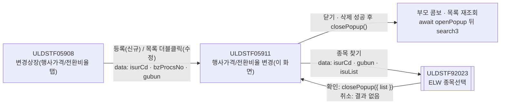
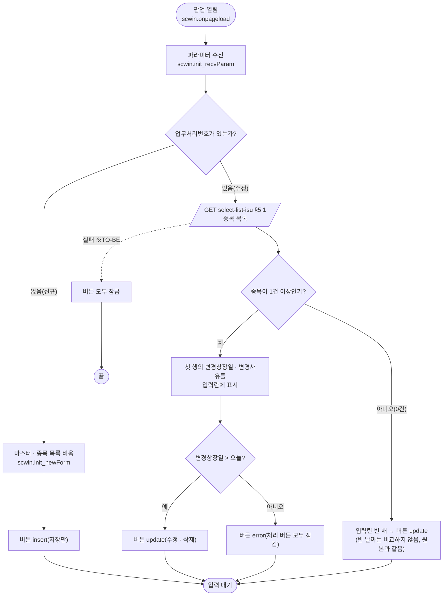
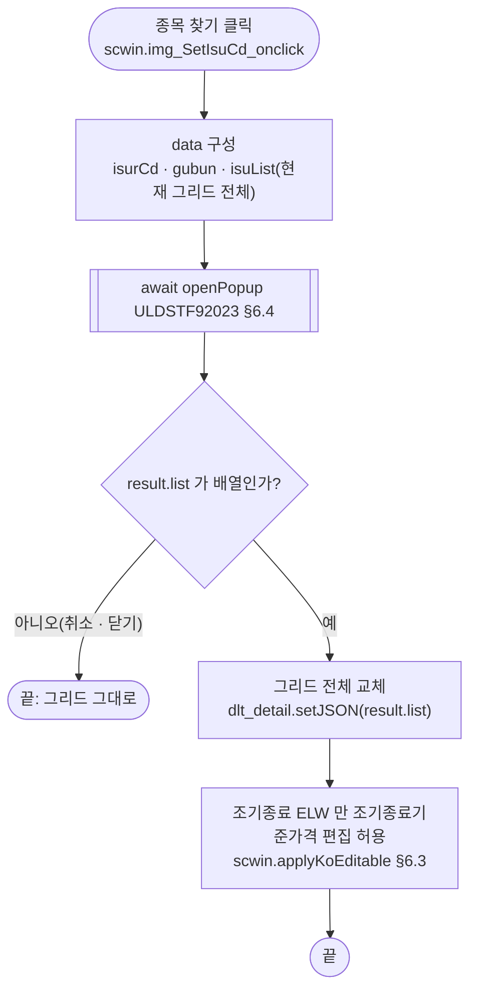
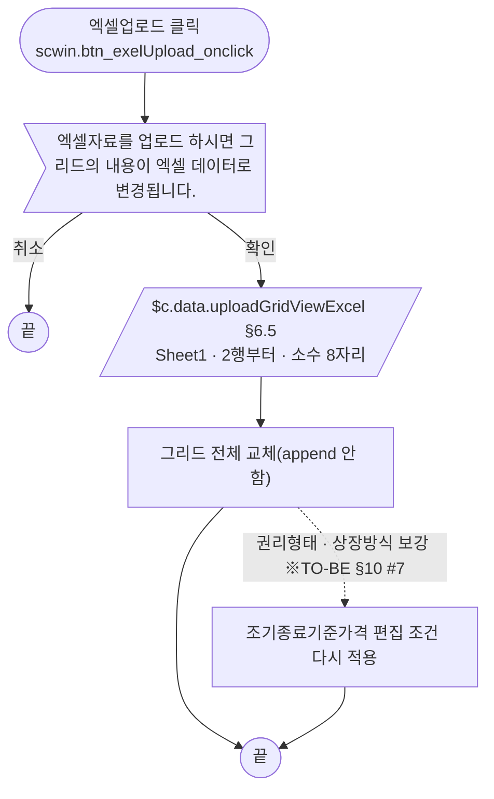
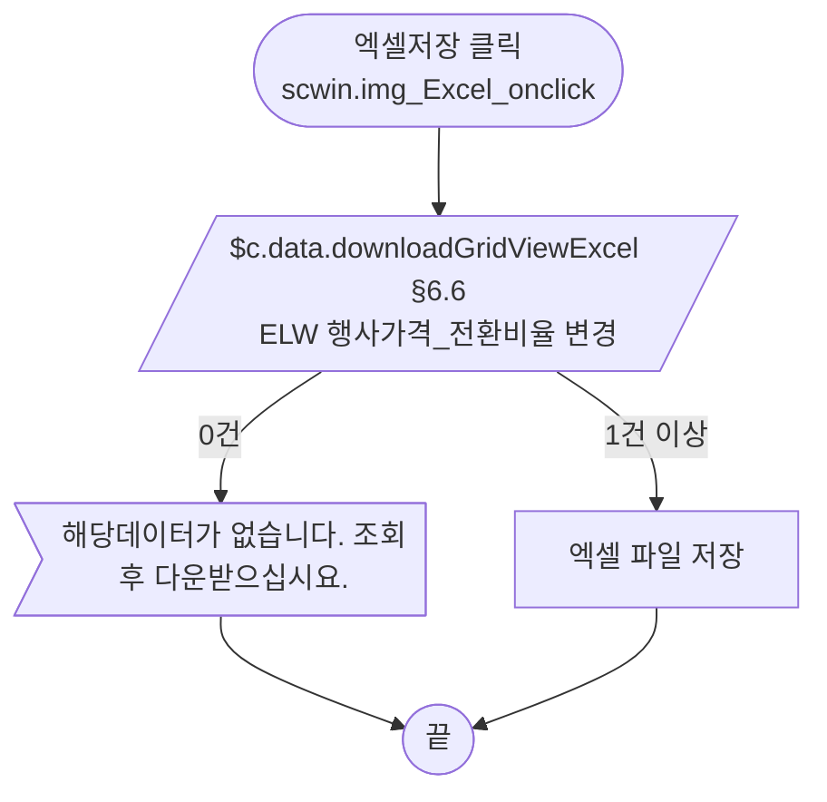
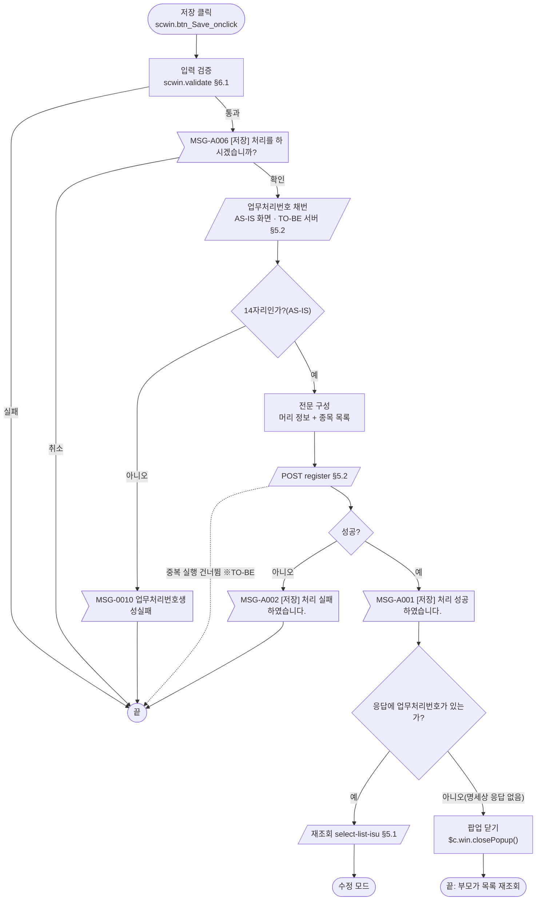
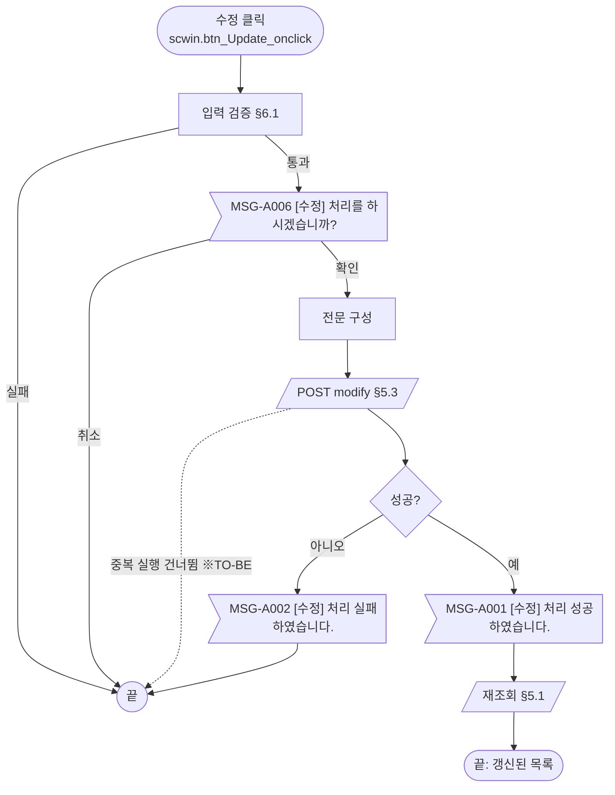
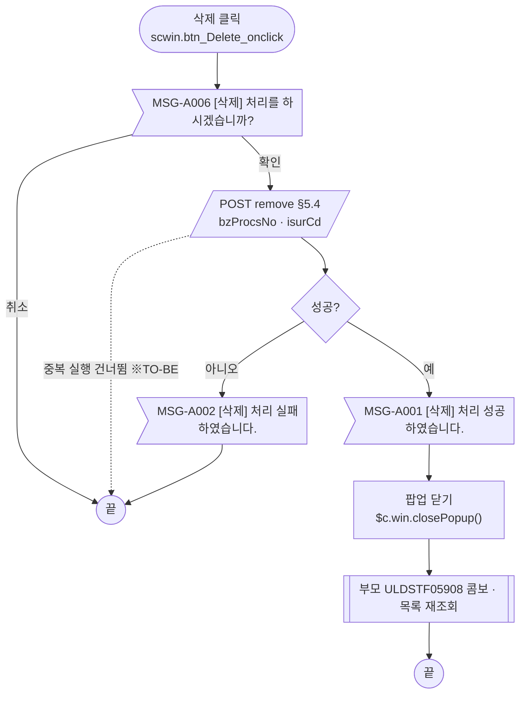
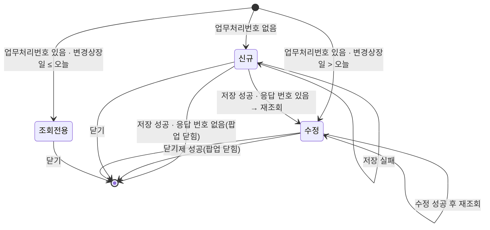

# ULDSTF05911 (팝업)ELW 행사가격/전환비율 변경 — 업무 분석 및 전환 내역

| 항목 | 내용 |
|---|---|
| AS-IS | `/lstproc/ULDSTF05911.gfm` (Gauce/X-Internet, 980×480 모달 창 — 부모가 1000×490 `window` 로 연다) — 반입 `conversion/gfm-front/ui/ULDSTF05911/ULDSTF05911.gfm` |
| 신규 API 명세 | `conversion/gfm-front/ui/ULDSTF05911/ULDSTF05911_API.txt` — 블록 4종(이 화면 4종, 다른 화면 0종). §2.2·§5 는 명세 기준(가이드 §0.3·§5) |
| TO-BE | `conversion/gfm-front/ui-tobe/ULDSTF05911.xml` (배포 경로 `/ui/lst/lstproc/ULDSTF05911.xml` — 가정, §10) |
| 퍼블리싱 | `conversion/publish/상장/상장처리(대내)/ULDSTF05911.xml` — 컴포넌트 id 는 AS-IS 와 같음(`edt_MktactEnforceDd` `inputCalendar`, `txb_ChgRsnContn` `xf:input`, 버튼·`img_SetIsuCd`·`img_Excel`·`btn_exelUpload` 는 `xf:trigger`). 그리드 컬럼 id 는 대문자·한글(`번호`) 그대로 |
| 화면 캡처 | 없음 |
| 업무공통 | `$c.stf`(`getMessageParam`·`checkMaxLength`·`setButtonSetWithDate`)·`$c.lc`(`isProcess`·`getSecuGrpNm`·`glb.*` 상수) — `cm/pcc/stf`. 게이트는 `--pcc stf` 로 돌린다 |
| 작성 | Inswave / 2026-10-26 |

참고 양식: [websquare_gfm_conversion.md](../../../md/websquare_gfm_conversion.md) — 특히 §1.4 업무 프로세스 흐름, §6.5 getPar/setPar 전환. Gauce 대응은 [gfm_business_analysis_guide.md](../../../md/gfm_business_analysis_guide.md) §5·§6 을 함께 따랐다.

---

## 1. 화면 개요

상장 담당자가 **변경상장 화면(ULDSTF05908)** 의 "행사가격/전환비율 변경" 탭에서 발행사(또는 기초자산)를 고른 뒤, 그 ELW 종목들의 **행사가격·조기종료발생기준가격·전환비율 변경**을 여러 종목 한꺼번에 등록하거나, 등록한 건을 수정·삭제하는 팝업이다.

1. 부모가 발행기관과 업무처리번호, 발행사/기초자산 구분을 넘겨 팝업을 연다. 업무처리번호가 없으면 신규, 있으면 수정이다.
2. 변경상장일과 변경사유를 입력한다.
3. [종목 찾기]로 ELW 종목을 골라 그리드에 담는다(변경전 값은 선택 팝업이 채움). 엑셀 업로드로 그리드를 통째로 바꿀 수도 있다.
4. 종목마다 변경후 행사가격·전환비율(조기종료 ELW 는 조기종료발생기준가격도)을 입력해 저장한다. 저장하기 전에 확인을 받고 업무처리번호를 새로 받는다.
5. 수정이면 업무처리번호로 종목 목록을 조회한다. 변경상장일이 이미 지났으면 모든 처리 버튼이 잠긴다. 수정에 성공하면 다시 조회한다. 등록은 서버가 업무처리번호를 매기므로, 응답에 번호가 있으면 수정 모드로 다시 조회하고 없으면 팝업을 닫는다(부모가 다시 조회). 삭제에 성공하면 팝업을 닫는다.

### 1.1 호출 화면 (1본)

- `ULDSTF05908` 변경상장 — 퍼블리싱본 `conversion/publish/상장/상장처리(대내)/ULDSTF05908.xml`(W-Craft 1차 스크립트 포함, 아직 TO-BE 전환 전). 상호변경(05909)·흡수합병(05910)·행사가격/전환비율 변경(05911) 탭 중 세 번째.
  - [등록] 버튼(`img_Regist3_onclick`) → 신규. 발행사를 고르지 않으면 `MSG-0016` 안내.
  - 목록 더블클릭(`grd3_OnDblClick`) → 수정.
  - 창 제목: `$c.lc.getSecuGrpNm(증권그룹ID) + " 행사가격/전환비율 변경"`.
  - 팝업이 닫히면 부모가 (유효 대상만 보기가 꺼져 있으면) 발행사·기초자산 콤보 목록을 다시 읽고, `fn_search3()` 로 목록을 다시 조회한다(모달 대기 전제).

### 1.2 호출 규약 (부모 → 이 화면) / 반환 규약

AS-IS 는 부모가 `fn_GetPar` 를 `fn_GetParNew3`/`fn_GetParUpdate3` 로 바꿔 두면, 팝업이 로딩 때 `frame.Provider("../").fn_GetPar(arrPar)` 로 부모 함수를 불러 배열을 채워 받는다.

| arr | TO-BE 키 (제안) | 의미 | 빈 값일 때 / 분기 |
|---|---|---|---|
| `arr[0]` | `isurCd` | 발행기관코드 (`cmb_ISUR_CD3`) | 종목 선택 팝업 조회 조건, 저장 전문 |
| `arr[1]` | `isurNm` | 발행기관명 | 이 화면에서는 쓰지 않음 |
| `arr[2]` | `secugrpId` | 증권그룹ID | 이 화면에서는 쓰지 않음 |
| `arr[3]` | `mktId` | 시장구분코드 | 이 화면에서는 쓰지 않음 |
| `arr[4]` | `bzProcsNo` | 업무처리번호 | **비면 신규**, 있으면 수정 |
| `arr[5]` | `gubun` | 발행사/기초자산 구분 (`rdo_ISUR_CD3` — `1` 발행사, `2` 기초자산) | 종목 선택 팝업에 그대로 넘김 |

- **TO-BE** (가이드 §6.5): 부모는 함수를 바꿔 끼우지 않고 위 키의 객체를 `data` 로 넘긴다. 이 화면은 `$c.data.getParameter()` 로 받는다. 부모(05908)가 아직 전환 전이라 키 이름은 제안이다(§10 #6).

  ```javascript
  // 부모 ULDSTF05908 (신규: bzProcsNo "", 수정: 목록 선택 행의 업무처리번호)
  const data = { isurCd, isurNm, secugrpId, mktId, bzProcsNo, gubun : rdo_ISUR_CD3.getValue() };
  await $c.win.openPopup("/ui/lst/lstproc/ULDSTF05911.xml",
      { id : "DLG_DELLIST", popupName : $c.lc.getSecuGrpNm(secugrpId) + " 행사가격/전환비율 변경", width : 1000, height : 490, type : "pageFramePopup" }, data);
  await scwin.search3();   // AS-IS: CreateDialogFrame(…) 뒤 콤보 재조회 + fn_search3()
  ```

- **반환**: 없음. 원본은 `frame.CloseFrame()` 만 한다 → TO-BE `$c.win.closePopup()`(인자 없음). 부모는 `await` 가 끝나면 다시 조회한다.

### 1.3 이 화면이 여는 하위 팝업

| 팝업 | AS-IS 호출 (getPar/setPar) | 넘기는 `data` (TO-BE) | 받는 결과 (`closePopup`) / 취소 판정 |
|---|---|---|---|
| `ULDSTF92023` ELW 종목선택 (510×430) | `fn_GetPar = fn_GetParIsu; fn_SetPar = fn_SetParIsu;` → `fn_PopFindElwCode()`. 팝업이 `fn_GetParIsu(arrPar, param_dts)` 로 `arr[0]=발행기관코드`, `arr[1]=구분` 과 **현재 그리드 전체**(`CopyDataSet(dts_Isu → param_dts)`)를 받고, 확인 때 `fn_SetParIsu(param_dts)` 로 **선택 결과 전체를 그리드에 덮어쓴다** | `{ isurCd, gubun, isuList : dlt_detail.getAllJSON() }` — §6.4 | `{ list : [종목 행 …] }` (가정 — 92023 전환본 없음, §10 #5). 취소 판정: `!Array.isArray(result.list)` 이면 그대로 둠 |

- pcc `$c.lc.popFindElwCode()` 는 `ULDSTF92023.gfm` 을 `browserPopup` + 콜백(`scwin.popupCallback`)으로 열고 값을 넘기지 않는다 → `await` 할 수 없으므로 쓰지 않는다(가이드 §6.5 예외).

### 1.4 업무 프로세스 흐름

흐름은 AS-IS 동작을 기준으로 그렸다. 점선과 `※TO-BE` 는 전환본에서 바뀌는 곳이다(근거는 §8).

| # | 업무 | 시작 (사용자 동작·진입 조건) | 끝 (결과) | 주요 함수 | 관련 절 |
|---|---|---|---|---|---|
| 1 | 진입·로딩 | 부모가 팝업을 엶 (업무처리번호 유무로 신규/수정) | 입력 대기 (모드별 버튼) | `scwin.onpageload` → `init_recvParam` → `init_newForm` / `selectList` | §3, §5.1 |
| 2 | 종목 선택 | [종목 찾기] `img_SetIsuCd` | 선택 결과로 그리드 전체 교체 | `scwin.img_SetIsuCd_onclick` → `openIsuPopup` | §6.4 |
| 3 | 엑셀 업로드 | [엑셀업로드] `btn_exelUpload` | 엑셀 자료로 그리드 전체 교체 | `scwin.btn_exelUpload_onclick` | §6.5 |
| 4 | 엑셀 다운로드 | [엑셀저장] `img_Excel` | 그리드를 엑셀 파일로 저장 | `scwin.img_Excel_onclick` | §6.6 |
| 5 | 신규 저장 | [저장] (신규 모드) | 저장 성공 안내 후 수정 모드로 재조회 | `scwin.save` → `saveTrs("I")` | §5.2, §6.1, §6.7 |
| 6 | 수정 | [수정] (수정 모드, 변경상장일 > 오늘) | 수정 성공 안내 후 재조회 | `scwin.update` → `saveTrs("U")` | §5.3, §6.8 |
| 7 | 삭제 | [삭제] (수정 모드, 변경상장일 > 오늘) | 삭제 성공 안내 후 팝업 닫힘 → 부모 재조회 | `scwin.remove` → `deleteTrs` | §5.4, §6.9 |

#### 화면 간 흐름



AS-IS 는 `fn_GetPar`/`fn_SetPar` 를 바꿔 끼우고, 92023 이 `fn_SetPar(param_dts)` 로 이 화면의 그리드를 직접 덮어썼다. TO-BE 는 `await $c.win.openPopup(url, options, data)` 의 반환값으로 그리드를 바꾼다(가이드 §6.5).

#### 업무 1: 진입·로딩



| # | 단계 | 주체 | 내용 | 분기 · 메시지 | 관련 절 |
|---|---|---|---|---|---|
| 1 | 파라미터 수신 | 화면 | `$c.data.getParameter()` → `isurCd`·`bzProcsNo`·`gubun` | `bzProcsNo` 가 비면 신규 | §1.2, §3 |
| 2a | 신규 준비 | 화면 | AS-IS 는 `CHGLIST_PRC_INOUT` 헤더만 받아 빈 그리드 → TO-BE 는 `dlt_detail.removeAll()` | — | §3 |
| 2b | 수정 조회 | 서버 | `select-list-isu` (AS-IS `searchChgList` `DIV_IDX=3`, **비동기** `syncload=False` — 결과는 `OnLoadCompleted` 에서 처리) | 실패 시 버튼 잠금(※TO-BE) | §5.1 |
| 3 | 머리 정보 | 화면 | 첫 행의 `chgDd`·`chgRsnContn` → 입력란 | 행이 없으면 비운 채 | §8 #13 |
| 4 | 버튼 상태 | 화면 | 신규 `insert`, 수정은 `setButtonSetWithDate(edt_MktactEnforceDd, false, …)` | 변경상장일 ≤ 오늘이면 `error` | §4 |

#### 업무 2: 종목 선택



- 원본은 현재 그리드를 팝업에 복사해 넘기고, 팝업이 선택 결과로 **그리드 전체를 덮어쓴다**. 이미 입력한 변경후 값이 결과에 남는지는 92023 의 처리에 달려 있다(§10 #5).

#### 업무 3: 엑셀 업로드



- 원본 확인창은 브라우저 `window.confirm`(동기) → `await $c.win.confirm(...)`.
- 원본 업로드 머리글에는 `ELW_RGHT_TP_KIND_CD`·`LIST_METHD_TP_CD` 가 없다 → 업로드한 행은 조기종료기준가격을 편집할 수 없고, 전송할 `listMethdTpCd` 도 비어 있다(§8 #4).

#### 업무 4: 엑셀 다운로드



- 원본은 0건 확인보다 먼저 `doLogSave(…, SCREN_PROCS_TP_CD_07)` 로 화면 이력을 남긴다 → TO-BE 는 삭제(2026-10-26 결정, §8 #6). 0건 안내는 `downloadGridViewExcel` 이 한다.

#### 업무 5: 신규 저장



| # | 단계 | 주체 | 내용 | 분기 · 메시지 | 관련 절 |
|---|---|---|---|---|---|
| 1 | 입력 검증 | 화면 | 변경상장일 익일 이후, 변경사유 필수·2000 byte, 종목 1건 이상, 종목마다 변경후 행사가격·전환비율 입력(0 불가) | 각 안내 후 끝 (`MSG-0019`) | §6.1, §7.2 |
| 2 | 저장 확인 | 사용자 | `await $c.lc.isProcess("I")` | 취소면 끝 | §6.7 |
| 3 | 채번 | 화면→서버 | AS-IS `fn_getNewBzProcNo` (14자리 아니면 `MSG-0010`). **신규 API 는 "등록 시 서버채번"** → TO-BE 는 화면 채번 생략 | 응답으로 번호를 받아야 재조회 가능 | §5.2, §10 #2 |
| 4 | 전문 구성 | 화면 | 머리(`isurCd`·`chgDd`·`chgRsnContn`) + 종목 목록(`isuCd`·변경전후 값·`listMethdTpCd`). AS-IS 는 머리 정보를 그리드 모든 행에 써 넣었음 | 그리드는 건드리지 않음(※TO-BE) | §5.2, §8 #8 |
| 5 | 저장 | 서버 | `POST register` | `skipped` 면 안내 없이 끝, 실패 `MSG-A002` | §5.2 |
| 6 | 결과 반영 | 화면 | `MSG-A001` → 응답에 `bzProcsNo` 가 있으면 재조회·수정 모드, 없으면 팝업 닫기(부모 재조회) | 명세상 응답이 비어 지금은 항상 닫힘 | §5.1, §10 #2 |

#### 업무 6: 수정



- 원본은 변경 여부를 확인하지 않고 바로 확인창을 띄운다(§8 #10).

#### 업무 7: 삭제



- 삭제는 입력 검증을 하지 않는다. AS-IS 는 그리드 전체를 보냈고(머리 정보도 행마다 써 넣음), TO-BE 는 업무처리번호·발행기관코드만 보낸다(논리삭제).

#### 화면 모드 상태 전이



| 상태 | 활성 버튼 | 근거 |
|---|---|---|
| 신규 | 저장 | `insert` |
| 수정 | 수정 · 삭제 | `update` (저장만 제외 — 이 화면에는 기안·안내문 버튼이 없음) |
| 조회전용 | 없음 | `error` (활성 목록이 `draft` 하나인데 이 화면에 기안 버튼이 없음) |

- 종목 찾기·엑셀업로드·엑셀저장·닫기는 `BTN_MAP` 에 넣지 않아 상태와 관계없이 켜져 있다(원본도 `buttonSet` 에 등록하지 않음). 조회전용에서 종목을 바꾸거나 업로드해도 저장할 수단은 없다(§8 #15).
- 신규 저장 검증이 "변경상장일 익일 이후"를 요구하므로, 저장 뒤 재조회하면 언제나 `수정` 상태가 된다. 다만 명세상 등록 응답에 번호가 없어 지금은 팝업이 닫힌다(§10 #2).

---

## 2. 화면 구성 및 데이터 정의

### 2.1 화면 구성

| 영역 | AS-IS 요소 | TO-BE 컴포넌트 (바인딩) | 설명 |
|---|---|---|---|
| 변경상장일 (*) | `edt_MktactEnforceDd` + `img_MktactEnforceDd` | `edt_MktactEnforceDd` (`inputCalendar`, `dma_mst.chgDd`) | 달력 이미지 **(옮기지 않음)** — inputCalendar 내장 달력. id 는 "시장조치시행일"이지만 값은 변경일(`CHG_DD`) |
| 변경사유 (*) | `txb_ChgRsnContn` (2000자) | `txb_ChgRsnContn` (`xf:input`, `dma_mst.chgRsnContn`) | 원본은 바인딩 없이 `.value` 로 직접 읽고 씀 → TO-BE 는 `ref` 바인딩 |
| 종목 찾기 | `img_SetIsuCd` (이미지) | `img_SetIsuCd` (`xf:trigger`) | §6.4 |
| 종목 그리드 | `grd_isu` (`dts_Isu`) | `grd_isu` (`dlt_detail`) | 번호·종목코드·종목명·변경전 3열·변경후 3열. 변경전·종목은 편집 불가, 변경후 행사가격·전환비율은 편집, 변경후 조기종료발생기준가격은 `ELW_RGHT_TP_KIND_CD='3'` 행만 편집 — §6.3. 편집 열은 `dataType="float"` + `maxLength`(정수 15 · 소수 8/3/6) + 같은 자릿수 `displayFormat[floor]` 로 자릿수 초과·`1.2.3` 입력을 막는다(SMPFMT10000 가이드) |
| 번호 열 | `{CurRow},{ToString}` | `inputType="expression" expression="rowIndex()+1"` | 퍼블리싱본의 한글 id `번호` 는 영문 id 로 바꿈 |
| (숨김) `BZ_PROCS_NO` 열 | `show="False"` | **(옮기지 않음)** | 업무처리번호는 화면 상태값(`scwin.bzProcsNo`) |
| 엑셀업로드 | `btn_exelUpload` | `btn_exelUpload` (`xf:trigger`) | §6.5 |
| 엑셀저장 | `img_Excel` | `img_Excel` (`xf:trigger`) | §6.6. 퍼블리싱본 핸들러명 `btn_toexcel_onclick` 은 규칙 3 에 맞춰 `img_Excel_onclick` 으로 |
| 안내 문구 | `label_1` "엑셀업로드 에러시 체크사항 : 확장자 xls(Excel 97/2003) 확인, 암호화 해제 확인, 쉬트명 "Sheet1" 확인" | 유지 | `uploadGridViewExcel` 은 xlsx 도 받으므로 문구 조정 여부는 §10 #7 |
| 버튼 | `btn_Save`·`btn_Update`·`btn_Delete`·`btn_Close` (이미지) | `btn_Update`·`btn_Delete`·`btn_Save`(pt) `xf:trigger` (`btnbox#grpBtnBox`). `btn_Close` 는 **옮기지 않음** — 팝업 하단 닫기 금지(팝업 창의 닫기 사용) | 활성 상태는 `buttonSet` → `$c.util.setButtonState` — §4 |
| (장식) | `panel_3` + `PanelToGroupBox` | **(옮기지 않음)** | 퍼블리싱 마크업이 대신함 |

### 2.2 데이터 정의

| AS-IS | TO-BE | 종류 | 키(컬럼) | 출처 / 용도 |
|---|---|---|---|---|
| (없음 — 입력란을 직접 읽음) | `dma_mst` (**화면 입력용 — 명세 외**) | dataMap | `bzProcsNo`, `isurCd`, `chgDd`, `chgRsnContn` | 변경상장일·변경사유 바인딩. 수정 조회 때 첫 행 값으로 채우고, 저장 때 요청 정의(`dma_register`/`dma_update`)로 옮긴다 |
| `dts_Isu` | `dlt_detail` | dataList | 명세 `select-list-isu` 응답 `dma_detail` keyInfo 17개 그대로 — `chgListMktactAdmNo`·`bfchgBybzprocsSeq`·`afchgBybzprocsSeq`(number), `bzProcsNo`, `isuCd`, `isuNm`, `chgDd`, `chgRsnContn`, `bfchgExerPrc`·`afchgExerPrc`·`bfchgConvRto`·`afchgConvRto`·`bfchgElwKoOccrBasPrc`·`afchgElwKoOccrBasPrc`(number), `listMethdTpCd`, `isurCd`, `elwRghtTpKindCd` | 그리드 바인딩. 명세는 dataMap 이나 종목 여러 건이라 목록으로 받는다(§10 #1). 종목 선택·엑셀 업로드 결과도 여기 |
| (`trs` 전송 `dts_Isu`) | `dma_register` · `dlt_register_isuList` | dataMap · dataList | 명세 `register` 요청 그대로 — 머리 `bzProcsNo`·`isurCd`·`chgDd`·`chgRsnContn` + 목록 `isuCd`·변경전후 6값(number)·`listMethdTpCd` | 신규 저장 전문 |
| (`trs` 전송 `dts_Isu`) | `dma_update` · `dlt_update_isuList` | dataMap · dataList | 명세 `modify` 요청 그대로 (register 와 같은 구성) | 수정 전문 |
| (`trs` 전송 `dts_Isu`) | `dma_remove` | dataMap | `bzProcsNo`, `isurCd` | 삭제 전문(명세 `remove`) |
| `dts_BzProcsNo` | (삭제) | — | — | 신규 API 는 서버 채번(§5.2) |
| `trs` | (삭제) | — | — | 저장·수정·삭제 통신 → `executeDynamic` |

- **TO-BE DataCollection 은 `ULDSTF05911_API.txt` 의 정의 블록(id·name·dataType)을 그대로 옮긴다**(가이드 §5 「API 명세 적용」). 예외 두 가지: 응답 `dma_detail` 은 여러 행이라 같은 keyInfo 의 목록 `dlt_detail` 로, 변경상장일·변경사유 입력은 명세에 대응 정의가 없어 화면 전용 `dma_mst` 로 둔다.
- AS-IS 는 머리 정보(`ISUR_CD`·`BZ_PROCS_NO`·`CHG_DD`·`CHG_RSN_CONTN`)를 종목 행마다 실었다(§8 #8). 명세는 머리(`dma_register` 등)와 목록(`…_isuList`)을 나누고, 목록에는 `isuNm`·`elwRghtTpKindCd`·행 PK 가 없다(§10 #3).

- AS-IS 컬럼 → TO-BE 키: `ISU_CD→isuCd`, `ISU_NM→isuNm`, `BFCHG_EXER_PRC→bfchgExerPrc`, `BFCHG_ELW_KO_OCCR_BAS_PRC→bfchgElwKoOccrBasPrc`, `BFCHG_CONV_RTO→bfchgConvRto`, `AFCHG_*→afchg*`, `ELW_RGHT_TP_KIND_CD→elwRghtTpKindCd`, `LIST_METHD_TP_CD→listMethdTpCd`, `CHG_DD→chgDd`, `CHG_RSN_CONTN→chgRsnContn`, `ISUR_CD→isurCd`, `BZ_PROCS_NO→bzProcsNo`.
- 숫자 열 표시: 원본 소수 자릿수 `decao` — 행사가격 8, 조기종료발생기준가격 3, 전환비율 6 → 그리드 `dataType="number"` + `displayFormat` 으로 같은 자릿수.
- 그리드 컬럼 id 는 dataList 키(camelCase)에 맞추고, 머리글 id 는 `h_` 접두로 따로 둔다(퍼블리싱본은 머리글·본문이 같은 대문자 id).

---

## 3. 로딩 (`gform onload` → `scwin.onpageload` → `scwin.init_*`)

원본 `gform onload` 순서:

1. **파라미터 수신** (`scwin.init_recvParam`)
   - AS-IS: `frame.Provider("../").fn_GetPar(arrPar)` → `Isur_cd`·`Isur_nm`·`Secugrp_id`·`Mkt_id`·`fr_bz_procs_no`·`gubun`.
   - TO-BE: `const param = $c.data.getParameter() ?? {};` → `scwin.isurCd`·`scwin.bzProcsNo`·`scwin.gubun` (§1.2).
2. **버튼 매핑** — AS-IS `buttonSet.setSaveInfo/UpdateInfo/DeleteInfo` 3종(안내문작성은 주석). TO-BE 는 `ev:onclick` + `scwin.BTN_MAP = { save : "btn_Save", modify : "btn_Update", "delete" : "btn_Delete" }`.
3. **신규·수정 분기**
   - 업무처리번호 있음 → `await scwin.selectList()` (§5.1) → 후처리(첫 행 머리 정보, 버튼 상태 — 원본 `dts_Isu OnLoadCompleted`).
   - 없음 → `scwin.init_newForm()`: `dma_mst.setEmptyValue()`, `dma_mst.set("isurCd", scwin.isurCd)`, `dlt_detail.removeAll()`, 버튼 `insert`. 원본은 `CHGLIST_PRC_INOUT` 헤더만 받는 조회를 보냈다(빈 dataset 구조용) → TO-BE 는 dataList 정의로 대신한다.
4. `PanelToGroupBox(panel_3)` — 삭제.

```javascript
scwin.onpageload = async function () {
    try {
        scwin.init_recvParam();
        if ($c.util.isEmpty(scwin.bzProcsNo)) {
            scwin.init_newForm();
        } else {
            await scwin.selectList();
        }
    } catch (ex) {
        await $c.exception.handleError(ex, { context : "ULDSTF05911.onpageload" });
    }
};
```

---

## 4. 컴포넌트 이벤트

| TO-BE 컴포넌트 | 이벤트 | TO-BE 핸들러 | 동작 (호출 함수) | AS-IS |
|---|---|---|---|---|
| `btn_Save` (저장) | `onclick` | `scwin.btn_Save_onclick` | `scwin.save()` — §6.7 | `buttonSet.setSaveInfo(btn_Save, fn_save)` |
| `btn_Update` (수정) | `onclick` | `scwin.btn_Update_onclick` | `scwin.update()` — §6.8 | `fn_update` |
| `btn_Delete` (삭제) | `onclick` | `scwin.btn_Delete_onclick` | `scwin.remove()` — §6.9 | `fn_delete` |
| `btn_Close` (닫기) | — | **(옮기지 않음)** | 팝업 창의 닫기(X) 사용(팝업 하단 닫기 금지) | `frame.CloseFrame()` |
| `grd_isu` (그리드) | `onfilereadend` | `scwin.grd_isu_onfilereadend` | 엑셀 업로드가 끝나면 조기종료기준가격 편집 조건 재적용 — §6.5 | (원본은 업로드 뒤 처리 없음) |
| `img_SetIsuCd` (종목 찾기) | `onclick` | `scwin.img_SetIsuCd_onclick` | `scwin.openIsuPopup()` — §6.4 | `fn_GetPar`/`fn_SetPar` 바꿔 끼우기 + `fn_PopFindElwCode()` |
| `btn_exelUpload` (엑셀업로드) | `onclick` | `scwin.btn_exelUpload_onclick` | §6.5 | `window.confirm` + `LoadExcelData` |
| `img_Excel` (엑셀저장) | `onclick` | `scwin.img_Excel_onclick` | §6.6 | `doLogSave` + `GridToExcel` |
| `img_MktactEnforceDd` | `onclick` | **(옮기지 않음)** | inputCalendar 내장 달력 | `popUpCalendar2(edt_MktactEnforceDd)` |

**버튼 상태 (모드 × 버튼)**

| 상태 | 저장 | 수정 | 삭제 | TO-BE |
|---|---|---|---|---|
| 신규 | O | | | `setButtonState("grpBtnBox", "insert", BTN_MAP)` |
| 수정 (변경상장일 > 오늘) | | O | O | `$c.stf.setButtonSetWithDate(edt_MktactEnforceDd, false, "grpBtnBox", BTN_MAP)` → `update` |
| 수정 (변경상장일 ≤ 오늘) | | | | 같은 함수 → `error` |

- 원본 `setButtonSetWithDate(edt, false)` 는 입력란의 날짜와 오늘을 비교한다. 입력란은 조회 직후 첫 행의 `CHG_DD` 로 채워지므로 결국 저장된 변경상장일 기준이다.

---

## 5. 서버 통신

공통: AS-IS 는 URL 에 `SCREN_ID=ULDSTF05911.gfm`·`SCREN_PROCES_TP_CD`(01 조회 / 02 입력 / 03 수정 / 04 삭제)를 붙이고, 저장 `trs.Action` 은 `fn_encodeNSession` 으로 세션 정보를 붙인다. 신규 API 명세에는 이 파라미터가 없으므로 **TO-BE 는 넘기지 않는다**(§10 #9). 모든 통신은 응답을 쓰기 전에 `if (result?.skipped) return;` 을 둔다.

| # | 용도 | AS-IS | TO-BE |
|---|---|---|---|
| 5.1 | 수정: 종목 목록 조회 | `/Listing.do?method=searchChgList&DIV_IDX=3(CHGLIST_PRC)&BZ_PROCS_NO=` → `dts_Isu` | `GET …/select-list-isu` (`bzProcsNo`) |
| 5.2 | 신규 저장 | `fn_getNewBzProcNo` 채번 → `trs` `/Listing.do?method=saveChgList` `TRS_IDX=1` `KeyValue: dtsParm1=dts_Isu` | `POST …/register` (서버 채번) |
| 5.3 | 수정 | 같은 `trs` `TRS_IDX=2` | `POST …/modify` |
| 5.4 | 삭제 | 같은 `trs` `TRS_IDX=3` (그리드 전체 전송) | `POST …/remove` (논리삭제) |

(`…` = `/api/listing/lstproc/elw/chg-listing-prc`)

#### API 명세 대응 (`ULDSTF05911_API.txt`)

| # | 명세 블록 | method · 경로 | 요청 (명세 정의) | 응답 (명세 정의) | AS-IS 대응 | TO-BE 함수 |
|---|---|---|---|---|---|---|
| 1 | [ULDSTF05911] 종목별 상세 조회 | `GET …/select-list-isu` | `bzProcsNo` | `dma_detail` (dataMap, 17키) | `/Listing.do?method=searchChgList&DIV_IDX=3` → `dts_Isu` | `scwin.selectList` → `dlt_detail` |
| 2 | [ULDSTF05911] 수정 | `POST …/modify` | `dma_update` + `dlt_update_isuList` | (없음) | `trs` `TRS_IDX=2` `dtsParm1=dts_Isu` | `scwin.saveTrs("U")` |
| 3 | [ULDSTF05911] 등록 | `POST …/register` | `dma_register` + `dlt_register_isuList` | (없음) | `fn_getNewBzProcNo` + `trs` `TRS_IDX=1` | `scwin.saveTrs("I")` |
| 4 | [ULDSTF05911] 삭제(논리삭제) | `POST …/remove` | `dma_remove` (`bzProcsNo`·`isurCd`) | (없음) | `trs` `TRS_IDX=3` (그리드 전체 전송) | `scwin.deleteTrs` |

명세에 없는 AS-IS 통신: 채번(`fn_getNewBzProcNo`) — 명세상 서버 채번이라 쓰지 않음, 종목 선택 팝업(ULDSTF92023)의 조회 — 팝업 소관(§6.4).

#### 명세 ↔ AS-IS 차이 (→ §10)

| # | 차이 | 처리 | §10 |
|---|---|---|---|
| 1 | `select-list-isu` 응답이 dataMap(`dma_detail`)으로 적혀 있으나 종목 여러 건, 머리 정보(`chgDd`·`chgRsnContn`)도 행마다 옴 | 같은 keyInfo 의 목록 `dlt_detail` 로 받고 첫 행에서 머리 정보 표시 | #1 |
| 2 | 요청 목록의 JSON 키 이름이 명세에 없음(정의 이름 `…_isuList` 에서 `isuList` 추정) | 가정으로 사용 | #1 |
| 3 | `register` 는 "등록 시 서버채번", 응답 없음 — AS-IS 는 화면이 채번 | 화면 채번 삭제, 저장 뒤 재조회 키 미확보 | #2 |
| 4 | 응답 설명은 행 PK(`chgListMktactAdmNo`·`bfchg/afchgBybzprocsSeq`)를 "수정/삭제 시 그대로 전달" 이라 하나 `modify` 요청 목록에 없음 | 요청 정의대로(보내지 않음) | #3 |
| 5 | 요청 목록의 `listMethdTpCd` 출처(조회 응답·종목 선택 결과)가 명세에 없음, 엑셀 업로드 행에는 없음 | 조회·선택 결과 값을 사용 | #4·#7 |
| 6 | AS-IS 가 보내던 `LIST_BZ_TP_CD=147`·`DIV_IDX`·`COUNT`·`SCREN_ID`·세션이 명세에 없음 | 보내지 않음 | #9 |
| 7 | `modify`·`remove` 응답이 비어 있음 | `responseJSON.success` 로 판정 | #11 |
| 8 | AS-IS 는 머리 정보를 행마다 실음, 명세는 머리·목록 분리 | 머리는 요청 정의 dataMap, 목록은 `…_isuList` | — |

AS-IS `trs.Parameters`: `TRS_IDX`, `BZ_PROCS_NO`, `COUNT=1`, `LIST_BZ_TP_CD=147`(ELW 행사가격/전환비율 변경), `DIV_IDX[0]=3`. TO-BE 는 API 경로로 나뉘므로 필요 없다. `LIST_BZ_TP_CD` 는 요청 명세에 없으므로 서버가 정하는 것으로 본다(§10 #9).

### 5.1 종목 목록 조회 (`scwin.selectList`)

| 항목 | 내용 |
|---|---|
| `id` / `method` / `action` | `sbm_selectList` / `get` / `…/select-list-isu` |
| `requestData` | `{ bzProcsNo : scwin.bzProcsNo }` |
| `target` / `gridview` | `dlt_detail=body` / `grd_isu` — 명세의 응답은 `dma_detail`(dataMap)로 적혀 있으나 종목 여러 건이다 → 목록인지 확인(§10 #1) |
| 후처리 | ① 1건 이상이면 첫 행의 `chgDd`·`chgRsnContn` 을 `dma_mst` 에, `dma_mst.bzProcsNo`·`isurCd` 도 채움 ② 조기종료기준가격 편집 조건(§6.3) ③ 버튼 상태 `$c.stf.setButtonSetWithDate(edt_MktactEnforceDd, false, "grpBtnBox", scwin.BTN_MAP)` |
| 실패 처리 | `success:false` 이면 버튼을 모두 잠근다(`disabled`) |
| 중복 실행 | 기본(건너뜀) |

### 5.2 / 5.3 신규 저장·수정 (`scwin.saveTrs(trJob)`)

| 항목 | 내용 |
|---|---|
| `id` | `sbm_saveTrs` |
| `method` / `action` | `post` / `…/register` (I) · `…/modify` (U), `mediatype : "application/json"` |
| `requestData` | 명세 요청 정의에 담아 보낸다 — register 는 `dma_register` + `dlt_register_isuList`, modify 는 `dma_update` + `dlt_update_isuList`. `{ ...머리.getJSON(), isuList : 목록.getAllJSON() }` — 목록 키 이름 `isuList` 는 정의 이름(`…_isuList`)에서 추정한 **가정**(§10 #1). `setJSON` 이 정의된 키만 남기므로 `isuNm`·`elwRghtTpKindCd` 등 명세 밖 열은 보내지 않는다. 수정 시 행 PK(`chgListMktactAdmNo`·`bfchgBybzprocsSeq`·`afchgBybzprocsSeq`)는 요청 정의에 없어 §10 #3 |
| 채번 | 원본은 화면이 채번(`fn_getNewBzProcNo`, 14자리 아니면 `MSG-0010`). 신규 API 명세는 "**등록 시 서버채번**" → TO-BE 는 채번하지 않는다. 다만 `register` 응답이 비어 있어 저장 뒤 재조회할 번호를 받을 수 없다(§10 #2) |
| 후처리 | 성공: `MSG-A001` "[저장/수정] 처리 성공하였습니다." → 수정은 재조회 `await scwin.selectList()`. 등록은 응답 `body.bzProcsNo` 가 있으면 그 번호로 재조회, 없으면 `$c.win.closePopup()`(부모가 `await` 뒤 재조회 — §1.2 반환 규약) |
| 실패 처리 | `success:false`: `MSG-A002` "[…] 처리 실패하였습니다." 신규 실패면 `scwin.bzProcsNo` 를 비운 채 신규 상태를 유지 |
| 중복 실행 | 기본(건너뜀) |

### 5.4 삭제 (`scwin.deleteTrs`)

| 항목 | 내용 |
|---|---|
| `id` / `method` / `action` | `sbm_deleteTrs` / `post` / `…/remove` |
| `requestData` | 명세 `dma_remove` 정의에 담아 보낸다 — `{ bzProcsNo, isurCd }` |
| 후처리 | 성공: `MSG-A001` "[삭제] 처리 성공하였습니다." → `$c.win.closePopup()` (원본 `buttonSet.status == "D"` 분기) |
| 실패 처리 | `MSG-A002` "[삭제] 처리 실패하였습니다." |

---

## 6. 일반 함수

### 6.1 입력 검증 (`scwin.validate`) — 원본 `fn_CheckForm`

- **Return:** `Promise<Boolean>`
- **순서 (원본 그대로):**
  1. 변경상장일: 8자리 아니면 "[변경상장일]을 정확히 입력하세요.", **서버 현재일 이하이면 "[변경상장일]을 익일 이후로 입력하세요."** (원본 `checkDdTm("DD", edt_MktactEnforceDd, "변경상장", false)`).
  2. 변경사유 비면 안내(원본 `checkEmptyValue(txb_ChgRsnContn, "변경사유")` — pcc/stf 에 대응 함수 없음).
  3. 변경사유 2000 byte 초과면 `$c.stf.checkMaxLength(txb_ChgRsnContn, 2000, "변경사유")` 안내.
  4. 종목이 0건이면 "[종목]을 선택하세요."
  5. 종목마다 변경후 행사가격 또는 변경후 전환비율이 비었거나 0 이면 `MSG-0019`(TO-BE 는 비어 있는 열로 포커스 — 원본에 없는 동작) "[변경후 행사가격, 전환비율]은 모두 입력하셔야 합니다." (원본은 `== 0` 느슨한 비교 — 문자열 "0"·"0.00" 도 0 으로 봄 → TO-BE `Number(값) === 0`).
- **공통 검증으로 옮길 항목** (`$c.validate.validateDataCollect`, 규칙 24): 변경상장일(필수·날짜), 변경사유(필수·최대 2000 byte).
- **업무 검증으로 남길 항목**: 1 의 "익일 이후"(서버 현재일 비교), 4·5(그리드 행 단위). pcc `$c.lc.checkDdTm` 은 Gauce 속성 `obj.text` 를 읽으므로 쓰지 않는다(§8 #12).

### 6.2 머리 정보 반영 (`scwin.applyHeader`)

- 수정 조회 뒤 첫 행의 `chgDd`·`chgRsnContn` 을 `dma_mst` 에 넣는다(원본 `OnLoadCompleted` 의 `NameString(1, …)`). 0건이면 건너뛴다.

### 6.3 조기종료발생기준가격 편집 조건 (`scwin.applyKoEditable`)

- 원본 그리드 속성 `edit="{IF(ELW_RGHT_TP_KIND_CD='3', 'true','false')}"` — 권리형태종류코드가 `3`(조기종료 ELW 로 추정, §10 #8)인 행만 변경후 조기종료발생기준가격을 편집할 수 있다.
- TO-BE: 목록을 채운 뒤(조회·종목 선택·엑셀 업로드) 행마다 `grd_isu.setCellReadOnly(i, "afchgElwKoOccrBasPrc", dlt_detail.getCellData(i, "elwRghtTpKindCd") !== "3")`. 반복 안에서 화면을 바꾸므로 `setBroadcast` 가드를 쓴다(규칙 28).

### 6.4 종목 선택 (`scwin.openIsuPopup`) — getPar/setPar → `openPopup` data + `await`

- 원본: 클릭 때 `fn_GetPar = fn_GetParIsu; fn_SetPar = fn_SetParIsu;` 로 바꿔 끼우고(되돌리지 않음) `fn_PopFindElwCode()` 를 부른다.
  - `fn_GetParIsu(arrPar, param_dts)`: `arrPar[0] = 발행기관코드`, `arrPar[1] = 구분(1 발행사 / 2 기초자산)`, `CopyDataSet(dts_Isu → param_dts)` — 현재 그리드 전체를 팝업에 넘긴다.
  - `fn_SetParIsu(param_dts)`: `CopyDataSet(param_dts → dts_Isu)` — 팝업의 결과로 그리드 전체를 덮어쓴다.
- **TO-BE** (가이드 §6.5): pcc `popFindElwCode` 는 콜백형 `browserPopup` 이라 쓰지 않고 화면에서 직접 연다.

  ```javascript
  scwin.openIsuPopup = async function () {
      const data = {
          isurCd : scwin.isurCd,              // AS-IS arrPar[0]
          gubun : scwin.gubun,                // AS-IS arrPar[1] — 1 발행사 / 2 기초자산
          isuList : dlt_detail.getAllJSON()      // AS-IS CopyDataSet(dts_Isu, param_dts)
      };
      const options = { id : "ULDSTF92023", popupName : "종목선택", width : 510, height : 430, type : "pageFramePopup" };

      const result = await $c.win.openPopup("/ui/listingcommon/ULDSTF92023.xml", options, data);

      // 취소·닫기(X)도 { isCloseButtonClick } 객체가 온다 → 목록 필드로 판정한다.
      if (!Array.isArray(result.list)) return;

      // AS-IS fn_SetParIsu: 선택 결과로 그리드 전체를 바꾼다.
      dlt_detail.setJSON(result.list);
      scwin.applyKoEditable();
  };
  ```

- 92023 전환본이 저장소에 없어 경로·크기·반환 키(`list`)·행의 컬럼(변경전 값, `elwRghtTpKindCd`, `listMethdTpCd` 포함 여부)은 **가정**이다(§10 #5). 92023 이 getPar 계약으로 전환되면 가이드 §6.5 예외대로 함께 바꾼다.

### 6.5 엑셀 업로드 (`scwin.btn_exelUpload_onclick`)

- 원본: `window.confirm("엑셀자료를 업로드 하시면 그리드의 내용이 엑셀 데이터로 변경됩니다.")` → 확인이면 `dts_Isu.SetDataHeader("번호:,ISU_CD:,ISU_NM:,BFCHG_EXER_PRC:decimal,BFCHG_ELW_KO_OCCR_BAS_PRC:decimal,BFCHG_CONV_RTO:decimal,AFCHG_EXER_PRC:decimal,AFCHG_ELW_KO_OCCR_BAS_PRC:decimal,AFCHG_CONV_RTO:decimal,BZ_PROCS_NO:,ISUR_CD:,CHG_DD:,CHG_RSN_CONTN:,")` 후 `dts_Isu.Do("LoadExcelData", "'','Sheet1',2,0,2")` — 시트 `Sheet1`, 2행부터(1행 머리글 제외로 추정)를 그리드 열 순서대로 읽어 **그리드 전체를 교체**한다.
- TO-BE:
  1. `if (!await $c.win.confirm("엑셀자료를 업로드 하시면 그리드의 내용이 엑셀 데이터로 변경됩니다.")) return;`
  2. `$c.data.uploadGridViewExcel(grd_isu, { sheetNo : 0, startRowIndex : 0, headerExist : "1", append : "0", decimal : "8" })` — 엔진의 소수 자릿수 기본값이 4 라서 `decimal` 을 주지 않으면 행사가격(소수 8자리)·전환비율(6자리)이 반올림된다. **gcc `uploadGridViewExcel` 이 `decimal` 을 엔진에 넘기지 않고 `startRowIndex` 0 을 1 로 바꾸던 결함은 2026-10-26 gcc 에서 고쳤다.** 시작 행은 원본 형식(머리글 1행)·TO-BE 다운로드 형식(머리글 2행) 파일로 실측해 확정한다(§10 #7).
  3. 업로드가 끝나면 §6.3 편집 조건을 다시 적용한다. 원본 머리글에 없는 `elwRghtTpKindCd`·`listMethdTpCd` 는 비어 있다(§8 #4, §10 #7).

### 6.6 엑셀 다운로드 (`scwin.img_Excel_onclick`)

- 원본: `doLogSave(vScrenID, SCREN_PROCS_TP_CD_07)` → 0건이면 `alert(NO_EXCEL_DATA)`, 아니면 `grd_isu.GridToExcel("ELW 행사겨격/전환비율 변경", "", "8")`.
- TO-BE: `$c.data.downloadGridViewExcel(grd_isu, { fileName : "ELW 행사가격_전환비율 변경" })` (규칙 20). 파일명에 `/` 를 쓰면 저장이 실패하거나 이름이 잘릴 수 있어 `_` 로 바꾼다. 0건 안내는 공통 함수가 하므로 화면에서 따로 확인하지 않는다. `doLogSave` 는 삭제(2026-10-26 결정). 파일명 오타 "행사겨격"은 고친다(§8 #7).

### 6.7 저장 (`scwin.save`) — 원본 `fn_save`

1. `await scwin.validate()` 실패면 끝.
2. `await $c.lc.isProcess("I")` — `MSG-A006` "[저장] 처리를 하시겠습니까?" 확인.
3. (AS-IS) 채번 → 14자리 아니면 `MSG-0010` — TO-BE 는 서버 채번이라 생략(§5.2, §10 #2).
4. `await scwin.saveTrs("I")`.

### 6.8 수정 (`scwin.update`) — 원본 `fn_update`

1. `await scwin.validate()` 실패면 끝.
2. `await $c.lc.isProcess("U")` 확인.
3. `await scwin.saveTrs("U")`.
- 원본은 바뀐 내용이 없어도 전송한다(§8 #10).

### 6.9 삭제 (`scwin.remove`) — 원본 `fn_delete`

1. `await $c.lc.isProcess("D")` 확인.
2. `await scwin.deleteTrs()` (§5.4). 원본의 `buttonSet.setDeleteStatus()` 는 응답 이벤트에서 삭제를 가르기 위한 것이라 필요 없다.

---

## 7. 업무 코드 · 메시지 목록

### 7.1 코드

| 용도 | 값 | 출처 |
|---|---|---|
| 발행사/기초자산 구분 `gubun` | `1` 발행사, `2` 기초자산 | 부모 `rdo_ISUR_CD3` (`item="1^발행사,2^기초자산"`) |
| ELW 권리형태종류 `elwRghtTpKindCd` | `3` 이면 조기종료발생기준가격 편집 가능 (조기종료 ELW 로 추정) | 그리드 `edit` 조건 |
| 상장업무유형 | `LIST_BZ_TP_CD_147` = `"147"` ELW 행사가격/전환비율 변경 | `$c.lc.glb` |
| DIV_IDX | `DIV_IDX_CHGLIST_PRC` = `'3'` ELW 행사가격/전환비율 Detail | `$c.lc.glb` (TO-BE 미사용) |
| 화면처리구분 | `01` 조회, `02` 입력, `03` 수정, `04` 삭제, `07` 엑셀 | `SCREN_PROCS_TP_CD_0x` (TO-BE 미전송) |
| 처리구분 `TRS_IDX` | `1` 입력, `2` 수정, `3` 삭제 | `$c.lc.glb` (TO-BE 는 API 경로로 대체) |
| 소수 자릿수 | 행사가격 8, 조기종료발생기준가격 3, 전환비율 6 | 그리드 `decao` |

### 7.2 메시지

| 코드 / 문구 | 등장 위치 | TO-BE |
|---|---|---|
| `MSG-A006` "[^] 처리를 하시겠습니까?" | 저장·수정·삭제 확인 | `$c.lc.isProcess("I"/"U"/"D")` |
| `MSG-0010` "업무처리번호생성실패" | 채번 실패 | 서버 채번이면 쓰지 않음(§10 #2) |
| `MSG-0019` "[변경후 행사가격, 전환비율]은 모두 입력하셔야 합니다." | 검증 5 | `$c.stf.getMessageParam("MSG-0019", "")` |
| `fn_alertMsg('S'/'F')` | `trs OnSuccess`/`OnFail` | pcc/stf 에 없음 → `$c.stf.getMessageParam("MSG-A001"/"MSG-A002", 처리명)` |
| "[변경상장일]을 정확히 입력하세요." / "[변경상장일]을 익일 이후로 입력하세요." | 검증 1 (`checkDdTm` 문구) | 그대로 |
| `checkEmptyValue` 안내 (변경사유) | 검증 2 | pcc/stf 에 없음 → 공통 검증 문구 |
| "[ 변경사유 ] 항목의 최대입력은 [ 2000 ] byte 입니다. …" | 검증 3 | `$c.stf.checkMaxLength` 문구 |
| "[종목]을 선택하세요." | 검증 4 | 그대로 |
| "엑셀자료를 업로드 하시면 그리드의 내용이 엑셀 데이터로 변경됩니다." | 엑셀 업로드 확인 | `await $c.win.confirm(...)` |
| `NO_EXCEL_DATA` "해당데이터가 없습니다. 조회후 다운받으십시요." | 엑셀 다운로드 0건 | `downloadGridViewExcel` 공통 안내 |

---

## 8. 원본 특이사항 · 결함

| # | 원본에서 실제로 일어나는 일 (근거) | 전환본 처리 |
|---|---|---|
| 1 | 행 루프가 1-base(`i = 1; i <= CountRow`) | 고침 — `0 ≤ i < getRowCount()` (규칙 29) |
| 2 | 변경후 값 검사가 `== ""` / `== 0` 느슨한 비교 | 고침 — `$c.util.isEmpty(값) \|\| Number(값) === 0` |
| 3 | 조기종료 ELW 는 변경후 조기종료발생기준가격을 편집할 수 있지만 비어 있어도 저장된다 | 그대로 유지 + §10 #8 확인 |
| 4 | 엑셀 업로드 머리글에 `ELW_RGHT_TP_KIND_CD`·`LIST_METHD_TP_CD` 가 없어, 업로드한 행은 조기종료기준가격을 편집할 수 없고 상장방식도 비어 있다. 변경전 값도 엑셀에 적힌 대로 들어간다 | 그대로 유지 + §10 #7 (업로드 뒤 보강 방법 결정) |
| 5 | 엑셀 업로드 확인이 브라우저 `window.confirm`(동기) | 고침 — `await $c.win.confirm` |
| 6 | 엑셀 다운로드가 0건 확인보다 먼저 `doLogSave` 로 화면 이력을 남긴다 | 옮기지 않음 — `doLogSave` 삭제(2026-10-26 결정) |
| 7 | 엑셀 파일명 오타 "ELW 행사겨격/전환비율 변경" | 고침 — "행사가격" |
| 8 | `fn_save_trs` 가 전송 전에 그리드 **모든 행**에 `ISUR_CD`·`BZ_PROCS_NO`·`CHG_DD`·`CHG_RSN_CONTN` 을 써 넣는다(`redraw=false` 로 감춤) | 고침 — 머리 정보는 `dma_mst`, 목록은 복사본으로 전문 구성 |
| 9 | 신규 저장이 실패해도 채번한 `fr_bz_procs_no` 가 남는다 | 고침 — 성공한 뒤에만 `scwin.bzProcsNo` 확정(서버 채번이면 응답 값) |
| 10 | 수정은 바뀐 내용이 없어도 전송한다(다른 화면의 `IsUpdated` 확인이 없음) | 그대로 유지 |
| 11 | 쓰지 않는 것: 전역 `Isur_nm`·`Secugrp_id`·`Mkt_id`·`isFirstLoad`·`vScrenID`, 빈 함수 `fn_drft`·`fn_makt`, 주석 처리된 `AddRow`·`setDsclInfo` | 옮기지 않음 (규칙 0·1) |
| 12 | pcc 대응 함수에 Gauce 잔재: `$c.lc.checkDdTm` 은 `obj.text`, `$c.lc.popFindElwCode` 는 값을 넘기지 않는 콜백형 | 쓰지 않음 — 날짜는 화면에서 `getValue()` 비교, 팝업은 `openPopup` 직접 |
| 13 | 수정 조회 때 첫 행(`NameString(1, …)`)의 변경상장일·변경사유만 입력란에 보인다 — 행마다 값이 다르면 첫 행이 이긴다 | 그대로 유지 |
| 14 | 종목 선택 때 `fn_GetPar`/`fn_SetPar` 를 바꿔 끼우고 되돌리지 않는다 | 고침 — `openPopup` 의 `data`/반환값(가이드 §6.5) |
| 15 | 종목 찾기·엑셀업로드는 `buttonSet` 밖이라 조회전용(변경상장일 경과) 상태에서도 그리드를 바꿀 수 있다(저장 수단은 없음) | 그대로 유지 + §10 #10 확인 |
| 16 | 원본은 동기 처리(저장 `trs`)라 연속 클릭이 막혔다. 비동기 전환본은 저장이 두 번 나갈 수 있다 | 고침 — `executeDynamic` 중복 실행 건너뜀 + `skipped` 확인 |

---

## 9. 전환 내역 (AS-IS → TO-BE)

| AS-IS | TO-BE |
|---|---|
| `gform onload` | `scwin.onpageload` → `scwin.init_recvParam` / `scwin.init_newForm` 또는 `scwin.selectList` |
| `frame.Provider("../").fn_GetPar(arrPar)` | `$c.data.getParameter()` (§1.2) |
| 전역 `Isur_cd`·`fr_bz_procs_no`·`gubun`·`trsIdx` | `scwin.isurCd`·`scwin.bzProcsNo`·`scwin.gubun`·`scwin.trJob` |
| `fn_new_onload` (헤더만 조회) | `scwin.init_newForm` (조회 없음) |
| `fn_search` + `dts_Isu OnLoadCompleted` | `scwin.selectList` + `scwin.applyHeader` + `scwin.applyKoEditable` + 버튼 상태 |
| `fn_CheckForm` | `scwin.validate` (+ `validateDataCollect`) |
| `fn_save` / `fn_update` / `fn_delete` | `scwin.save` / `scwin.update` / `scwin.remove` |
| `fn_save_trs` + `trs.Post()` + `OnSuccess`/`OnFail` | `scwin.saveTrs(trJob)` / `scwin.deleteTrs` — `await $c.sbm.executeDynamic` + await 뒤 후처리 (규칙 16) |
| `fn_getNewBzProcNo(dts_BzProcsNo)` | 삭제 — 서버 채번(§10 #2) |
| `fn_isProcess('I'/'U'/'D')` | `await $c.lc.isProcess(...)` |
| `fn_alertMsg('S'/'F')` | `$c.win.alert($c.stf.getMessageParam("MSG-A001"/"MSG-A002", 처리명))` |
| `checkDdTm("DD", edt, "변경상장", false)` · `checkEmptyValue` | 화면 업무 검증 · `validateDataCollect` 필수 |
| `checkMaxLength(txb_ChgRsnContn, 2000, "변경사유")` | `$c.stf.checkMaxLength(...)` 또는 `validateDataCollect` 최대 byte |
| `buttonSet.set*Info` / `setInsertStatus` | `ev:onclick` + `$c.util.setButtonState("grpBtnBox", "insert", scwin.BTN_MAP)` |
| `setButtonSetWithDate(edt_MktactEnforceDd, false)` | `$c.stf.setButtonSetWithDate(edt_MktactEnforceDd, false, "grpBtnBox", scwin.BTN_MAP)` |
| `fn_GetPar = fn_GetParIsu; fn_SetPar = fn_SetParIsu; fn_PopFindElwCode()` | `scwin.openIsuPopup` — `await $c.win.openPopup(…ULDSTF92023…, options, { isurCd, gubun, isuList })` → `result.list` 로 그리드 교체 (가이드 §6.5) |
| `CopyDataSet(dts_Isu, param_dts)` / `CopyDataSet(param_dts, dts_Isu)` | `data.isuList = dlt_detail.getAllJSON()` / `dlt_detail.setJSON(result.list)` |
| 그리드 `edit="{IF(ELW_RGHT_TP_KIND_CD='3', …)}"` | `scwin.applyKoEditable` — `grd_isu.setCellReadOnly(i, "afchgElwKoOccrBasPrc", …)` |
| `{CurRow}` 번호 열 | `inputType="expression" expression="rowIndex()+1"` |
| `window.confirm` + `SetDataHeader` + `LoadExcelData` | `await $c.win.confirm` + `$c.data.uploadGridViewExcel(grd_isu, { sheetNo : 0, startRowIndex : 0, headerExist : "1", decimal : "8" })` + `ev:onfilereadend` → `scwin.grd_isu_onfilereadend` |
| `doLogSave` + `GridToExcel` | `$c.data.downloadGridViewExcel(grd_isu, { fileName })` (규칙 20), `doLogSave` 삭제 |
| `edt_MktactEnforceDd.Text` / `txb_ChgRsnContn.value` 직접 읽기·쓰기 | `dma_mst.chgDd` / `dma_mst.chgRsnContn` `ref` 바인딩 |
| `ds.NameString(i, "COL")` / `CountRow` / `grd.redraw` | `getCellData`·`setCellData` / `getRowCount` / `setBroadcast` (규칙 28·29) |
| `btn_Close onclick` → `frame.CloseFrame()` | 삭제 — 팝업 창의 닫기(X) 사용. 삭제 성공·등록 후 닫기는 `$c.win.closePopup()` |
| `popUpCalendar2(...)`, `img_MktactEnforceDd` | 삭제 (inputCalendar 내장) |
| `alert(...)` | `await $c.win.alert(...)` |
| `#include(...)` 7종, `PanelToGroupBox`, `vScrenID` | 삭제 (규칙 11·1) |
| `fn_drft`, `fn_makt` | 삭제 (빈 함수) |
| (없음 — 화면 보조) | `scwin.isEmptyOrZero`(느슨한 비교 `== "" \|\| == 0` 대체), `scwin.getIsurCd`(조회 값 우선 발행기관코드), `scwin.grd_isu_onfilereadend`(업로드 뒤 편집 조건) |

---

## 10. 남은 작업 (TODO)

1. **응답·요청 구조 확정** — `select-list-isu` 응답이 명세에는 `dma_detail`(dataMap)로 적혀 있지만 종목 여러 건이다. 목록인지, 머리 정보(`chgDd`·`chgRsnContn`)가 행마다 오는지 확인한다. `register`/`modify` 요청의 목록 키(`isuList` 가정)도 확정되면 §5.1·§5.2 를 고친다.
2. **서버 채번 후 재조회** — 신규 API 는 "등록 시 서버채번"인데 `register` 응답이 비어 있다. **결정(2026-10-26)**: 응답에 `bzProcsNo` 가 오면 그 번호로 재조회해 수정 모드로, 오지 않으면 팝업을 닫아 부모가 다시 조회한다. 응답으로 번호를 줄 수 있는지 서버에 확인한다(§1.4 업무 5).
3. **수정 시 행 PK** — 명세의 `chgListMktactAdmNo`·`bfchgBybzprocsSeq`·`afchgBybzprocsSeq` 는 "수정/삭제 시 그대로 전달"이라 적혀 있으나 `modify` 요청 목록에는 이 열이 없다. 전달 여부를 확인한다.
4. **`listMethdTpCd` 출처** — 요청에 필요한 상장방식유형코드를 종목 선택 결과·조회 응답에서 받는지 확인한다. 엑셀 업로드 행에는 없다(#7).
5. **ELW 종목선택(ULDSTF92023) 계약** — 전환본이 저장소에 없다. TO-BE 경로(`/ui/listingcommon/ULDSTF92023.xml` 가정)·크기, 받는 `data`(`isurCd`·`gubun`·`isuList`)와 돌려주는 결과(`{ list }` 가정), 결과 행에 변경전 값·`elwRghtTpKindCd`·`listMethdTpCd` 가 들어오는지, 이미 입력한 변경후 값을 유지하는지 확정한다(가이드 §6.5).
6. **부모(ULDSTF05908) 계약** — 부모 전환 때 `fn_GetParNew3`/`fn_GetParUpdate3` 바꿔 끼우기를 없애고 §1.2 의 `data` 로 넘긴다. 닫힌 뒤 콤보(`validExerPrcListWrntCd`·`validExerPrcListElwUlyCd`) 재조회와 `search3` 를 `await openPopup` 바로 뒤에 둔다.
7. **엑셀 업로드 옵션·보강** — 원본 `LoadExcelData('', 'Sheet1', 2, 0, 2)` 인자 의미(시작 행·열)를 확인하고, 원본 형식(머리글 1행)·TO-BE 다운로드 형식(머리글 2행) 파일로 `startRowIndex : 0`·`headerExist : "1"` 를 실측한다(gcc 의 `decimal` 미전달·`startRowIndex` 0 결함은 2026-10-26 수정). 업로드한 행의 `elwRghtTpKindCd`·`listMethdTpCd` 를 서버에서 보강할지(종목코드로 재조회 등) 정한다. 안내 문구의 "xls(Excel 97/2003)" 제한을 유지할지도 정한다.
8. **조기종료 ELW 규칙** — `ELW_RGHT_TP_KIND_CD` 코드 `3` 의 의미를 확인하고, 그 행의 변경후 조기종료발생기준가격을 필수로 검증할지 정한다(§8 #3).
9. **화면 이력·세션·업무유형** — AS-IS 의 `SCREN_ID`·`SCREN_PROCES_TP_CD`·`fn_encodeNSession`·`LIST_BZ_TP_CD 147` 을 서버가 대신 처리하는지 확인한다.
10. **조회전용 상태의 종목 찾기·엑셀업로드** — 변경상장일이 지난 건에서도 그리드를 바꿀 수 있다(저장은 불가). 잠글지 정한다(§8 #15).
11. **modify·remove 성공 판정** — 응답이 비어 있다. `responseJSON.success` 만으로 판정할지 확인한다.
12. **TO-BE 배포 경로·창 크기** — `/ui/lst/lstproc/ULDSTF05911.xml`(가정), 부모가 여는 크기 1000×490.
