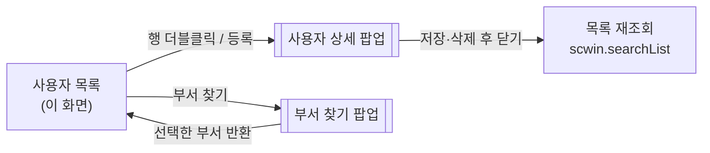
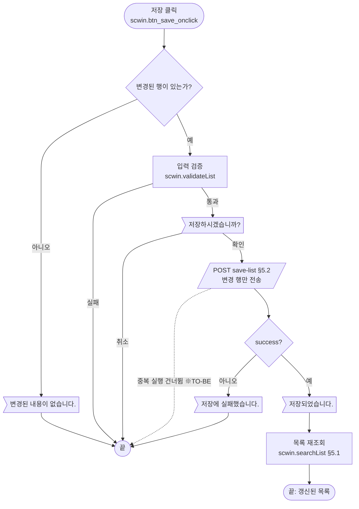
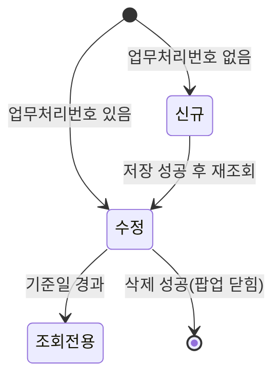
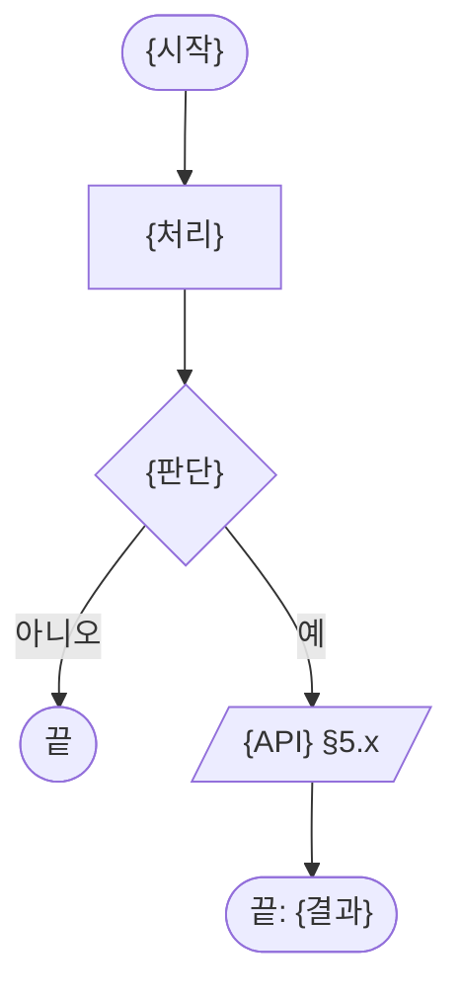
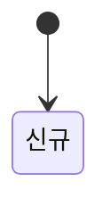

# WebSquare 전환용 AS-IS 화면 업무 분석 가이드

이 가이드는 기존(AS-IS) 화면 소스를 분석해, WebSquare(TO-BE) XML 화면을 만들 때 바로 쓸 수 있도록 업무 로직을
표준 양식으로 정리하는 방법을 안내합니다. 이 문서를 복사해 화면마다 **업무 분석 결과서(Markdown)** 를 쓰는 템플릿으로
쓰고, 결과서를 근거로 `conversion/sample-front/ui/` 샘플과 같은 꼴의 화면을 전환합니다.

| 항목 | 내용 |
|---|---|
| 대상 | JSP / jQuery / 원시 HTML 등 **Gauce 가 아닌** AS-IS 화면 (Gauce `.gfm` 은 [gfm_business_analysis_guide.md](gfm_business_analysis_guide.md)) |
| 산출 1 (이 가이드) | `conversion/sample-front/ui/{화면ID}.md` — 업무 분석 및 전환 내역 |
| 산출 2 (다음 단계) | `conversion/sample-front/ui/{화면ID}.xml` — 결과서를 근거로 전환한 화면 |
| 정답지 | `ui/ULDSTF92024.md` ↔ `ui/ULDSTF92024.xml` (원천은 Gauce 지만 장 구성·서술 수준은 같다) |
| 관련 규칙 | [conversion_rules.md](conversion_rules.md)(규칙 3·4·6·13·17·19·22·24·26) · [substitution_map.md](substitution_map.md) · [dynamic_submission_guide.md](dynamic_submission_guide.md) · [sample_templates.md](sample_templates.md) · [code-convention.md](../../cm/docs/code-convention/code-convention.md) |

> **왜 결과서를 먼저 쓰는가** — AS-IS 코드를 줄 단위로 옮기면 동기 통신·DOM 직접 조작·서버 렌더링 값(JSP EL)에 기대던
> 동작이 깨지는데, 겉보기에는 맞아 보입니다. 분기 조건·메시지·서버 계약을 사람이 읽을 수 있는 형태로 먼저 고정해 두면,
> 전환본을 검토할 때 "원본이 실제로 무엇을 했는가"를 결과서와 대조해 확인할 수 있습니다. 결과서는 전환본 head 의
> `meta_desc` 끝에 `(원본 …, 업무 분석 {화면ID}.md)` 로 연결합니다.

---

## 0. 작성 원칙

### 0.1 이름

* 함수명은 `fn_` 접두사를 빼고 동사형 camelCase 로 씁니다(규칙 13). 예: `fn_SearchList` → `scwin.searchList`.
  * **예외** — 하위 팝업이 부모의 함수를 원래 이름으로 부르는 경우(`opener.fn_GetPar()` 등)는 원래 이름을 유지하고, 그 이유를 §9 에 적습니다.
* 이벤트 핸들러는 `scwin.{컴포넌트ID}_{이벤트}` 이고 이벤트명은 소문자입니다(규칙 3). 예: `scwin.btn_search_onclick`, `scwin.grd_list_oncellclick`.
* 컴포넌트 접두는 `btn_`·`ipt_`·`sbx_`·`ica_`·`grd_`·`tbl_`, DataCollection 은 `dma_`(1건)·`dlt_`(다건) 입니다.
* **DataCollection 키는 camelCase** 입니다. AS-IS 의 `USER_ID` 같은 대문자 키는 `userId` 로 바꿔 적고, 화면이 실제로 그 키로 읽는지 확인합니다(대문자 키를 그대로 남기면 `undefined` 를 읽는 결함이 됩니다).

### 0.2 결과서 장 ↔ 전환본 스크립트 구역

전환본 스크립트는 5구역 구조입니다(규칙 4). 결과서의 장을 이 순서로 쓰면 결과서가 곧 전환본의 골격이 됩니다.

| 결과서 장 | 전환본 구역 | 비고 |
|---|---|---|
| §1 기본 정보·호출 규약 | 1. 변수 및 선언 영역 | 받은 파라미터를 담을 `scwin.*` 전역, 상수 |
| §1.4 업무 프로세스 흐름 | (구역 전체) | 업무마다 2~5구역 함수가 불리는 순서 — 전환본 흐름 검토의 기준 |
| §2 화면 구성·데이터 정의 | (head `<w2:dataCollection>` / body) | `dma_`/`dlt_` 정의와 컴포넌트 바인딩 |
| §3 로딩 | 2. 초기화 영역 | `scwin.onpageload` → `scwin.init` / `scwin.init_*` |
| §4 컴포넌트 이벤트 | 3. 컴포넌트 이벤트 영역 | body `ev:on*` 가 가리키는 핸들러 |
| §5 서버 통신 | 4. 서브미션 콜백 영역 | `$c.sbm.executeDynamic` 을 호출하는 함수 |
| §6 일반 함수 | 5. 일반/업무 함수 영역 | 검증·가공·팝업·리셋 |
| §7~§10 | — | 코드·결함·전환 내역·TODO |

해당 사항이 없는 장은 지우지 말고 "해당 없음" 한 줄을 남깁니다(빠뜨린 것인지 없는 것인지 구분하기 위해).

---

## 1. 문서 기본 정보 및 화면 개요

### 1.1 기본 정보

```markdown
# {화면ID} {화면명} — 업무 분석 및 전환 내역

| 항목 | 내용 |
|---|---|
| AS-IS | `{경로}/{파일}` (JSP/jQuery, {메인 화면 / W×H 팝업}) — 반입 `{반입 경로}` |
| TO-BE | `conversion/sample-front/ui/{화면ID}.xml` (배포 경로 `/ui/{업무}/{화면ID}.xml`) |
| 화면 캡처 | `{파일}.png`({상태}) |
| 업무공통 | `$c.{ns}`({사용 함수}) — `cm/pcc/{ns}`. 게이트는 `--pcc {ns}` 로 돌린다 |
| 작성 | {작성자} / {YYYY-MM-DD} |
```

* 업무공통 ns 는 모듈 규칙을 따릅니다 — fil 계열은 `cm/pcc/fil`, stf 는 `cm/pcc/stf`, mgt 는 `cm/pcc/mgt`, tms 는 `cm/pcc/tms` 만 참조합니다.

### 1.2 주요 기능 요약

* 첫 문단: **누가, 어느 화면에서, 무엇을 하려고** 이 화면을 쓰는지(한두 문장).
* 번호 목록: 업무 처리 단계 3~5개(조건 입력 → 조회 → 선택 → 저장/삭제 → 부가 기능). 업무별 상세 흐름은 §1.4 에 흐름도로 적습니다.

### 1.3 호출 화면 · 호출 규약 (팝업이면 필수)

* **호출 화면**: 이 화면을 여는 화면 수와 대표 화면ID(grep 결과).
* **호출 규약 (부모 → 이 화면)**: 부모가 넘기는 파라미터를 키 단위 표로 적습니다. 전환본은 `$c.data.getParameter()` 로 받습니다.

  | 키 | 의미 | 빈 값일 때 / 분기 |
  |---|---|---|
  | `bzProcsNo` | 업무처리번호 | 비면 신규, 있으면 수정 |
  | `isuCd`·`isuNm` | 부모 목록에서 고른 종목 | 신규인데 값이 있으면 그 종목을 그리드에 한 행으로 넣고 종목선택을 잠근다 |

* **반환 규약 (이 화면 → 부모)**: `$c.win.closePopup(결과)` 로 무엇을 돌려주는지(키 이름, 배열인지 객체인지), 부모가 닫힌 뒤 다시 조회하는지.
* **이 화면이 여는 하위 팝업**: 팝업 ID·AS-IS 호출·넘기는 값을 표로 적습니다(자세한 내용은 §6).

### 1.4 업무 프로세스 흐름 (업무별 flow)

이 화면이 맡은 **업무마다** 처리 흐름을 흐름도와 단계 표로 적습니다. §3~§6 이 함수 단위의 설명이라면, 이 절은 사용자가 업무 하나를 끝내기까지 화면·서버·팝업이 어떤 순서로 움직이는지를 한눈에 보여 줍니다. 전환본을 검토할 때 "업무 흐름이 원본과 같은가"를 대조하는 기준이 됩니다.

**작성 원칙:**
* **업무 단위로 나눕니다.** 버튼 하나가 아니라 사용자가 끝내려는 일 하나(조회, 신규 등록, 수정, 삭제, 안내문작성, 기안 등)가 흐름 하나입니다. 여러 업무가 같은 함수(검증·재조회)를 쓰면 각 흐름에 같은 노드로 나타냅니다.
* **순서**: ① 업무 목록 표 → ② 화면 간 흐름도 1개(부모·이 화면·하위 팝업 사이의 이동과 재조회) → ③ 업무별 흐름도 + 단계 표 → ④ 화면 모드가 바뀌는 화면이면 상태 전이도.
* **AS-IS 동작을 기준으로** 그립니다. 전환본에서 바뀌는 곳은 점선 화살표와 `※TO-BE` 표기로 구분하고, 근거가 되는 §8 결함 번호를 적습니다.
* **취소·검증 탈락·서버 실패·중복 실행 건너뜀 분기를 빠뜨리지 않습니다.** 각 분기는 끝 노드로 이어져야 합니다.
* 노드에는 TO-BE 함수명(§3~§6), API(§5 절 번호), 메시지 코드(§7)를 적어 다른 장과 연결합니다.
* 동기 조회에 기대던 순서(조회 → 결과로 분기)는 흐름도에 그대로 드러나게 그립니다. 전환본의 `await` 순서를 정하는 근거입니다.

**① 업무 목록 표:**

| # | 업무 | 시작 (사용자 동작·진입 조건) | 끝 (결과) | 주요 함수 | 관련 절 |
|---|---|---|---|---|---|
| 1 | 사용자 조회 | 화면 진입(ADMIN) / [조회] | 목록·건수 표시 | `scwin.searchList` | §3, §5.1 |
| 2 | 사용자 정보 저장 | [저장] | 저장 안내 후 목록 재조회 | `scwin.saveList` | §5.2, §6.1 |

**Mermaid 표기 규약** — 흐름도는 ` ```mermaid ` 블록으로 씁니다(GitHub·VS Code 미리보기에서 그대로 그려집니다).

| 의미 | 표기 | 예 |
|---|---|---|
| 시작·끝 | `([ ])` | `S(["저장 클릭"])` |
| 화면 처리 | `[ ]` | `A["입력 검증<br/>scwin.validate"]` |
| 판단 | `{ }` | `B{"검증 통과?"}` |
| 서버 통신 | `[/ /]` | `C[/"POST save-list §5.2"/]` |
| 사용자 확인·안내 메시지 | `> ]` | `D>"MSG-A006 저장하시겠습니까?"]` |
| 하위 팝업·다른 화면 | `[[ ]]` | `E[["ULDSTF92024 공시안내문작성"]]` |
| TO-BE 에서 바뀌는 흐름 | 점선 `-. "라벨" .->` + `※TO-BE` | `T -. "중복 실행 건너뜀 ※TO-BE" .-> E` |

* 라벨은 큰따옴표로 감쌉니다. 괄호·슬래시·`#`·`;`·`|` 가 섞이면 따옴표 없이는 그려지지 않습니다. 줄바꿈은 `<br/>` 입니다.
* 흐름도 하나는 노드 15개 안팎으로 둡니다. 길어지면 공통 부분(검증·재조회)을 따로 그리고 `[[ ]]` 노드로 참조합니다.
* 노드 id 는 영문·숫자(`S`, `V1`, `T2`)로 짓고, 한 흐름도 안에서 같은 끝 노드를 여러 분기가 함께 씁니다.

**② 작성 예시 — 화면 간 흐름:**



**③ 작성 예시 — 업무별 흐름 (업무 2: 사용자 정보 저장):**



흐름도 아래에는 같은 순서의 단계 표를 둡니다. 흐름도에 다 쓰기 어려운 조건·값·메시지 원문은 표에 적습니다.

| # | 단계 | 주체 | 내용 | 분기 · 메시지 | 관련 절 |
|---|---|---|---|---|---|
| 1 | 변경 확인 | 화면 | `dlt_userList` 의 변경 행(C/U/D) 수 | 0건이면 "변경된 내용이 없습니다." 후 끝 | §6 |
| 2 | 입력 검증 | 화면 | 필수·형식(공통) + 업무 검증 | 실패 시 공통 안내·포커스 후 끝 | §6.1 |
| 3 | 저장 확인 | 사용자 | `await $c.win.confirm(...)` | 취소면 끝 | §7 |
| 4 | 저장 | 서버 | `POST save-list`, `ref : "dlt_userList\|M"` | `skipped` 면 안내 없이 끝(※TO-BE), `success:false` 면 실패 안내 | §5.2 |
| 5 | 결과 반영 | 화면 | 저장 안내 → 목록 재조회 | — | §5.1 |

**④ 작성 예시 — 화면 모드 상태 전이 (신규·수정을 함께 쓰는 상세 팝업):**



* 상태마다 활성 버튼은 §4 의 "모드 × 버튼" 표와 맞춥니다. 상태 이름은 공백 없이 씁니다(`조회전용`).

---

## 2. 화면 구성 및 데이터 정의

### 2.1 화면 구성 (AS-IS 요소 → TO-BE 컴포넌트)

| 영역 | AS-IS 요소 | TO-BE 컴포넌트 (바인딩) | 설명 |
|---|---|---|---|
| 검색 조건 | `<input name="searchWord">` | `ipt_searchWord` (`ref="data:dma_search.searchWord"`) | Enter 로 조회 |
| 목록 | `<table id="userTable">` + `<tr>` 문자열 빌드 | `grd_userList` (`dataList="data:dlt_userList"`) | 행 클릭 시 상세 |
| (숨김) | `<input type="hidden" name="mode">` | **(옮기지 않음)** → `scwin.trJob` | 처리구분은 화면 상태값으로 |

* 영역은 화면 위→아래, 왼→오른 순서로 씁니다. 퍼블리싱 XML 이 있으면 TO-BE id 는 퍼블리싱본 기준입니다.
* 보이지 않는 요소(hidden input, 항상 숨김 버튼)도 행을 만들고 "(옮기지 않음)" 또는 대체 수단을 적습니다.
* JSP EL(`${x}`·`<c:out>`)로 서버가 렌더링 시점에 넣던 값은 문자열로 옮길 수 없습니다 — **진입 파라미터 또는 조회 응답**으로 받는 방식을 적습니다(규칙 19).

### 2.2 데이터 정의 (DataCollection)

| TO-BE | 종류 | 키(컬럼) | 출처 / 용도 |
|---|---|---|---|
| `dma_search` | dataMap | `searchType`, `searchWord`, `strtDd`, `endDd` | 검색 조건 (AS-IS 폼 필드) |
| `dlt_userList` | dataList | `userId`, `userNm`, `deptCd`, `rankCd`, `regDd` | 목록 조회 응답 `body` |
| `dma_user` | dataMap | `userId`, `userNm`, … | 상세 조회 응답 / 저장 전문 |

* 1건짜리 조건·입력은 `dma_`, 목록은 `dlt_` 입니다.
* 컬럼 출처가 여러 곳(화면 입력·응답·전송 전문)이면 합친 목록을 쓰고, 미확정이면 "컬럼 미정(…)"으로 적어 §10 에 올립니다.

---

## 3. 로딩 (`scwin.onpageload` → `scwin.init_*`) — 2구역

AS-IS 의 `$(document).ready()`·`window.onload`·JSP 상단 스크립틀릿에 해당하는 로직을 분석합니다.

**작성 원칙** (code-convention 초기화 절, 규칙 4·26):
* `scwin.onpageload` 는 초기화 단위를 **데이터 의존 순서대로 부르기만** 하고 로직을 직접 갖지 않습니다. 본문은 try/catch + `$c.exception.handleError` 입니다.
* 초기화 단위는 `scwin.init` 또는 `scwin.init_*` 로 이름 짓습니다 — 이 이름만 2구역으로 분류됩니다. 통신을 기다려야 하면 `await` 순서를 적습니다.
* 화면 리셋 함수(초기화 버튼 등)는 여기가 아니라 §6(5구역)에 적습니다. 로딩 때도 부른다면 "§6.x 를 호출" 이라고만 씁니다.

**작성 예시:**

1. **파라미터 수신** (`scwin.init_recvParam`)
   * `const param = $c.data.getParameter() ?? {};` → `scwin.menuId`, `scwin.userRole` 에 담음 (AS-IS: JSP `${param.MENU_ID}`)
2. **공통 코드 바인딩** (`scwin.init_code`)
   * `await $c.data.setCommonCode([{ code : "DEPT_CD", compID : "sbx_dept", firstRow : ["", "전체"] }, { code : "RANK_CD", compID : "sbx_rank" }]);`
3. **조건 기본값** (`scwin.init_searchCondition`)
   * 등록일 시작일 = 당월 1일, 종료일 = 서버 현재일(`$c.date.getServerDateTime()`), 기간 검사 바인딩(`$c.date.compareFromToDate` — 조회 시점 검사가 아니라 변경 이벤트 바인더이므로 1회만 호출)
   * 검색 영역 Enter 키 바인딩: `$c.win.setEnterKeyEvent(tbl_search, scwin.btn_search_onclick);` (규칙 22)
4. **버튼 상태** — `$c.util.setButtonState("grpBtnBox", "insert", scwin.BTN_MAP);` (권한·모드별 활성 정책은 표로)
5. **초기 조회** (`scwin.init_search`)
   * 권한이 `ADMIN` 이면 `await scwin.searchList();` (§5.1)

```javascript
scwin.onpageload = async function () {
    try {
        scwin.init_recvParam();
        await scwin.init_code();
        scwin.init_searchCondition();
        await scwin.init_search();
    } catch (ex) {
        await $c.exception.handleError(ex, { context : "{화면ID}.onpageload" });
    }
};
```

---

## 4. 컴포넌트 이벤트 — 3구역

사용자 조작(클릭·변경·키 입력 등)으로 실행되는 이벤트를 분석합니다.

**작성 원칙:**
* AS-IS 의 스크립트 바인딩(`$("#btn").click(fn)`, `.on("change", …)`, `onclick="…"` 속성)은 TO-BE 컴포넌트의 `ev:on*` 속성으로 옮깁니다(규칙 19).
* 핸들러는 진입점이므로 try/catch + `handleError` 로 감쌉니다(규칙 26). 위임 대상이 async 면 `await` 합니다.
* 이벤트명은 컴포넌트 기준으로 고릅니다 — 입력값 확정은 `onviewchange`(사용자 입력) / `onchange`(값 변경 전체), 그리드는 `oncellclick`·`oncelldblclick`, 탭은 `onchange`.

**작성 예시:**

| TO-BE 컴포넌트 | 이벤트 | TO-BE 핸들러 | 동작 (호출 함수) | AS-IS |
|---|---|---|---|---|
| `btn_search` (조회) | `onclick` | `scwin.btn_search_onclick` | `scwin.validateSearch()` 통과 시 `scwin.searchList()` | `$("#btnSearch").click(…)` |
| `btn_save` (저장) | `onclick` | `scwin.btn_save_onclick` | 변경 행 확인 → `await $c.win.confirm(...)` → `scwin.saveList()` | `fn_Save()` |
| `grd_userList` (목록) | `oncellclick` | `scwin.grd_userList_oncellclick` | 선택 행 `userId` 로 `scwin.selectUser(userId)` | `<tr onclick="fn_Detail('…')">` |
| `tbl_search` (검색 영역) | Enter 키 | — | `$c.win.setEnterKeyEvent` 로 `btn_search_onclick` 실행 (§3) | `onkeyup` 에서 `keyCode == 13` 검사 |

* 버튼이 상태에 따라 보이고/잠기는 규칙은 별도 표(모드 × 버튼)로 적고, 전환본은 `$c.util.setButtonState` 의 역할 매핑(`scwin.BTN_MAP`)으로 옮깁니다.

---

## 5. 서버 통신 — 4구역

AS-IS 의 Ajax(`$.ajax`·`$.post`·axios) 또는 Form Submit 을 `$c.sbm.executeDynamic` 호출로 옮기기 위한 스펙을 정의합니다(규칙 6·16·19·25).

**작성 원칙:**
* XML `<xf:submission>` 은 만들지 않습니다. 통신 함수 안에서 `sbmOptions` 를 만들고 `await $c.sbm.executeDynamic(sbmOptions, requestData)` 로 부릅니다.
* `submitDoneHandler` 콜백은 쓰지 않습니다 — 넘기면 Promise 가 끝나지 않아 `await` 할 수 없습니다. **후처리는 `await` 바로 뒤에** 씁니다.
* 동기 통신은 없습니다. AS-IS 의 `async:false` 는 "앞 통신이 끝난 뒤 실행" 으로 적고, 전환본은 `await` 순서로 보장합니다.
* 중복 실행(연속 클릭)은 기본적으로 건너뛰고 `{ skipped : true }` 로 돌아옵니다. 응답을 쓰기 전에 `if (result?.skipped) return;` 을 둡니다. 마지막 요청이 이겨야 하는 조회(행 클릭 상세 등)는 `{ onDuplicate : "abort" }`(4번째 인자)를 적습니다.
* 통신 오류는 공통 오류 핸들러가 안내하고 예외를 던집니다. 화면이 따로 처리할 것은 **응답 `success:false`·업무 결과 코드** 입니다.
* **URL 은 신규 API 경로**로 씁니다. 신규 API 매핑을 받지 못했으면 AS-IS 경로를 적고 "가정"임을 표시해 §10 에 올립니다.

**항목 (통신마다 한 절):**

| 항목 | 내용 |
|---|---|
| 함수 | `scwin.searchList` (`executeDynamic` 을 부르는 함수 = 4구역) |
| `id` | `sbm_searchList` |
| `method` / `action` | `get` / `/api/v2/user/select-list` *(AS-IS `/user/list.do` → 신규 API)* |
| `ref` / `requestData` | `dma_search` 또는 요청 객체. 변경 행만 보내면 `ref : "dlt_userList\|M"`(modified) |
| `target` | `dlt_userList=body` |
| `gridview` | `grd_userList` (target 의 dataList 를 쓰는 그리드 — 스피너) |
| 선행 / 순서 | (예: 상세 조회는 목록 조회 뒤 첫 행으로) |
| 후처리 | 건수 표시, 0건이면 안내, 첫 행 선택 등 |
| 실패 처리 | `success:false` 일 때 / 업무 결과 코드(`body.result !== "S"` 등)일 때 |
| 중복 실행 | 기본(건너뜀) / `onDuplicate:"abort"` / `allowDuplicate:true` 중 무엇 |

**작성 예시:**

#### 5.1 사용자 목록 조회 (`scwin.searchList`)
* `get` `/api/v2/user/select-list` *(AS-IS `/user/list.do`)* — 요청 `dma_search`, 응답 `dlt_userList=body`, gridview `grd_userList`
* 후처리: `txb_totalCnt.setValue(dlt_userList.getRowCount())`, 0건이면 "조회 결과가 없습니다." 안내

#### 5.2 사용자 정보 저장 (`scwin.saveList`)
* `post` `/api/v2/user/save-list` *(AS-IS `/user/save.do`)* — 요청 `ref : "dlt_userList|M"` (상태 C/U/D 행만), 응답 없음(결과 코드·메시지만)
* 선행: §6.1 검증 → `await $c.win.confirm("저장하시겠습니까?")`
* 후처리: 성공 시 "저장되었습니다." 안내 후 `await scwin.searchList()` 재조회

```javascript
scwin.searchList = async function () {
    const sbmOptions = {
        id : "sbm_searchList",
        method : "get",
        action : "/api/v2/user/select-list",
        target : "dlt_userList=body",
        gridview : "grd_userList",
        isProcessMsg : false
    };

    const result = await $c.sbm.executeDynamic(sbmOptions, dma_search.getJSON());
    if (result?.skipped) return;    // 진행 중 조회가 있어 이번 호출은 건너뜀
    if (!result.responseJSON?.success) return;

    txb_totalCnt.setValue(dlt_userList.getRowCount());
};
```

* 세션 정보(사용자ID·부서·시장구분)를 AS-IS 가 요청에 직접 붙였다면 전환본 방침을 한 번만 적습니다 — 서버 세션으로 처리하는지, `$c.session.getUserInfo(...)` 값을 넘기는지.

---

## 6. 일반 함수 — 5구역

통신이나 컴포넌트 이벤트가 아닌 비즈니스 로직·데이터 가공·검증·팝업·리셋 함수를 정의합니다.

**작성 원칙:**
* 함수마다 **파라미터 / Return / 로직 흐름**을 적고, AS-IS 에 하드코딩된 규칙(날짜 계산·자릿수·코드 값)을 빠뜨리지 않습니다.
* 공통함수로 대체할 수 있으면 대체 대상을 함께 적습니다([substitution_map.md](substitution_map.md)). 공통으로 대체되는 함수는 화면에 만들지 않습니다.

**작성 예시:**

#### 6.1 검색 조건 검증 (`scwin.validateSearch`)
* **Return:** `Promise<Boolean>` (통과하면 true)
* **공통 검증으로 옮길 항목** (`$c.validate.validateDataCollect`, 규칙 24 — 실패 시 표준 안내·포커스는 공통이 처리, async 라 `await`):

  | 컴포넌트 | 규칙 | 이름 (메시지용 — 화면 라벨과 같게) |
  |---|---|---|
  | `ica_strtDd` | 필수, 날짜 형식 | 시작일자 |
  | `ica_endDd` | 필수, 날짜 형식, `ica_strtDd` 이후 | 종료일자 |

* **업무 검증** (공통으로 옮기지 않는 것): 검색 구분을 골랐는데 검색어가 비면 "검색어를 입력하세요." 안내 후 `ipt_searchWord` 포커스, false.

#### 6.2 팝업 호출 (`scwin.openDeptPopup`)
* **파라미터:** `deptNm` (초기 검색 부서명)
* **Return:** 없음
* **로직:** `const result = await $c.win.openPopup("/ui/{업무}/{팝업ID}.xml", options, { deptNm });` (규칙 17)
  * 팝업은 콜백 함수를 지정하지 않고 **반환값으로 결과를 받습니다**. 결과가 비면 취소로 봅니다.
  * 반환 형태(키 이름, 배열인지 객체인지)와 팝업 크기·제목을 적습니다. 팝업 전환본이 아직 없으면 "가정"으로 표시해 §10 에 올립니다.
  * 받은 값으로 `dma_search.set("deptCd", result.deptCd)` 등 무엇을 채우는지.

#### 6.3 금액 표시 (`scwin.formatAmount`)
* **파라미터:** `amount` (Number/String) / **Return:** 콤마가 들어간 문자열
* **전환 방침:** 화면 표시용이면 함수를 만들지 않고 컴포넌트 속성으로 옮깁니다 — 그리드 컬럼·입력의 `dataType="number"` + `displayFormat="#,##0"`. 스크립트에서 문자열이 꼭 필요하면 `$c.num.formatNumber(amount)` 를 씁니다.

#### 6.4 화면 리셋 (`scwin.resetForm`) — 초기화 버튼
* `dma_search.setEmptyValue();` 후 §3 의 조건 기본값을 다시 채움, `dlt_userList.removeAll();`, 버튼 상태를 `insert` 로.
* AS-IS `form.reset()` 은 HTML 기본값으로 되돌리던 것이므로, 되돌릴 기본값 목록을 여기에 적습니다.

---

## 7. 업무 코드 · 메시지 목록

* **분기 조건으로 하드코딩된 값**(상태코드·구분코드·권한코드)을 용도별로 모읍니다. 예: "처리구분 I/U/D", "권한 ADMIN 이면 전체 조회".
* **메시지**는 코드 + 문구로 적습니다. 공통 메시지가 있으면 `$c.data.getMessage("{키}", 인자)` 의 키를, 업무공통 메시지면 `$c.{pcc}.getMessageParam("MSG-…")` 를, 하드코딩 문구는 그대로 인용합니다.

---

## 8. 원본 특이사항 · 결함

| # | 원본에서 실제로 일어나는 일 (근거) | 전환본 처리 |
|---|---|---|
| 1 | (예: 저장 버튼을 두 번 누르면 두 번 저장된다 — `fn_Save` 에 진행 중 가드 없음) | 고침 — `executeDynamic` 중복 실행 건너뜀 + 결과 `skipped` 확인 |

* **고칠지 유지할지는 반드시 칸에 결정으로 적습니다.** 업무 결과가 달라지는 수정은 "그대로 유지"를 기본으로 하고 §10 에 확인을 올립니다.
* 유형: 미선언 변수, 주석 처리돼 무효인 가드, 도달할 수 없는 분기, 진입점 없는 기능, 느슨한 비교(`==`)에 기댄 분기, 연속 클릭.

---

## 9. 전환 내역 (AS-IS → TO-BE)

전환하면서 채웁니다. 아래 유형을 빠짐없이 한 행씩 적습니다.

| AS-IS | TO-BE |
|---|---|
| `$(document).ready(fn)` | `scwin.onpageload` → `scwin.init_*` |
| `fn_SearchList()` | `scwin.searchList()` (규칙 13) |
| `$.ajax({ url : "/user/list.do", … success : fn })` | `await $c.sbm.executeDynamic(...)` + await 뒤 후처리 |
| `$("#searchWord").val()` | `ipt_searchWord.getValue()` 또는 `dma_search.get("searchWord")` (규칙 19) |

* 진입점, 함수 개명(원래 이름을 유지한 함수와 그 이유), 전역 변수 → `scwin.*`, 통신, 팝업(`window.open` → `$c.win.openPopup`), DOM 조작 → 컴포넌트 API, 공통함수 → `$c.*`/`$c.{pcc}.*`, `alert`/`confirm` → `await $c.win.alert`/`await $c.win.confirm`, 세션 값 → `$c.session.getUserInfo(...)`, 삭제한 것(호출 없는 함수, 디버그 코드)과 근거.

---

## 10. 남은 작업 (TODO)

번호 목록으로, 각 항목에 **무엇이 미확정인지 + 확정되면 무엇을 바꾸는지 + 관련 장**을 적습니다.
대표 항목: 신규 API 경로·응답 구조, 호출부 계약(부모가 넘기는 키·닫힌 뒤 재조회), 미전환 하위 팝업, 업무공통에 없는 함수,
실화면에서만 확인할 수 있는 동작(팝업 차단, 엔진 이벤트 순서).

---

## 11. AS-IS(JSP/jQuery) → WebSquare 대응 요약 (분석 시 참고)

상세·정본은 [conversion_rules.md](conversion_rules.md) 규칙 19 와 [substitution_map.md](substitution_map.md) 입니다.

| AS-IS | WebSquare (sample-front 꼴) | 분석 시 확인할 것 |
|---|---|---|
| `$(document).ready` / `window.onload` | `scwin.onpageload` → `scwin.init_*` | 초기화 단위와 순서 |
| JSP EL `${x}` / `<c:out>` | 진입 파라미터(`$c.data.getParameter`) 또는 조회 응답 | 서버가 넣던 값의 출처 |
| `<form>` 필드 / `document.F.X.value` | `dma_*` 바인딩 컴포넌트 `getValue`/`setValue` | 필드 → 키 이름(camelCase) |
| `<table>` + `<tr>` 문자열 빌드 | `w2:gridView` + `dlt_*` | 컬럼·표시 형식 |
| `$("#id").val()` / `.val(v)` | `id.getValue()` / `id.setValue(v)` | 셀렉터가 컴포넌트 하나로 확정되는가 |
| `.show()`/`.hide()`/`.attr("disabled")` | `show("")`/`hide()`/`setDisabled(b)`·`setReadOnly(b)` | |
| `$(sel).click/on(...)` | 컴포넌트 `ev:on*` + `scwin.{id}_{event}` | 동적으로 붙이던 이벤트 |
| `$.ajax` / `$.post` / `form.submit()` | `await $c.sbm.executeDynamic(sbmOptions, data)` | 동기 여부, 성공·실패 분기 |
| `window.open(url)` | `await $c.win.openPopup(url, options, data)` | 반환값·크기 |
| `opener.fn_X()` / `parent.fn_X()` | `$c.win.getParent()?.scwin.x()` | 부모 함수 이름 계약 |
| `alert` / `confirm` | `await $c.win.alert` / `await $c.win.confirm` | `if (confirm(...))` 은 반드시 await |
| 수기 날짜 계산(`new Date`, `substr`) | `$c.date.*` (`getServerDateTime`, `addDate`, `formatDate`) | 서버 시각인가 클라이언트 시각인가 |
| `keyCode == 13` 검사 | `$c.win.setEnterKeyEvent(tbl_search, …)` (규칙 22) | |
| `$.parseJSON(x)` | `JSON.parse(x)` / `$c.util.getJSON(x)` | |

---

## 12. 분석 함정 체크리스트

해당하면 결과서 §3~§10 중 맞는 곳에 반드시 적습니다.

| # | 함정 | 왜 문제인가 | 적는 곳 |
|---|---|---|---|
| 1 | **동기 Ajax**(`async:false`) | 전환본은 비동기 — `await` 를 빠뜨리면 다음 줄이 빈 데이터를 읽는다 | §5 선행/순서 |
| 2 | **`confirm`/`alert` 반환값 사용** | `$c.win.confirm` 은 Promise — `await` 없이 `if` 에 쓰면 항상 참 | §4, §9 |
| 3 | **연속 클릭·중복 전송** | 비동기에서 열린다 — 중복 실행 정책과 `skipped` 확인을 정한다 | §5, §8 |
| 4 | **느슨한 비교**(`==`, 숫자/문자 혼용) | 전환본 `===` 에서 분기가 바뀐다 — 값의 타입을 적는다 | §8 |
| 5 | **서버 렌더링 값**(JSP EL) | 문자열로 옮길 수 없다 — 받는 경로를 새로 정한다 | §2.1, §10 |
| 6 | **DOM 순회로 행 처리**(`$("tr").each`) | DataList 반복으로 바꿔야 한다 — 0부터, `< getRowCount()` | §6, §9 |
| 7 | **대문자 키 / 필드명 그대로 사용** | DataCollection 키는 camelCase — 그대로 두면 `undefined` | §2.2 |
| 8 | **부모·자식 창이 서로 이름으로 부르는 함수** | 한쪽만 개명하면 깨진다 | §1.3, §9 |
| 9 | **주석 처리된 코드** | 근거로 쓰지 않는다(규칙 0) — 무효가 된 가드라는 사실만 §8 에 적는다 | §8 |
| 10 | **보이지 않는 요소**(hidden, 항상 숨김) | 진입점 없는 기능을 옮기는 낭비 — 상태값으로 대체할지 정한다 | §2.1 |
| 11 | **`window.open` 앞의 통신** | `await` 뒤에 열면 팝업 차단될 수 있다 | §10 |
| 12 | **같은 이름의 공통 JS 사본** | include 한 파일마다 구현이 다를 수 있다 — 실제 include 기준 | §9 |
| 13 | **화면을 넘나드는 흐름**(모달 대기, 닫힌 뒤 부모 재조회, 함수 바꿔 끼우기) | 함수 단위 설명에는 보이지 않는다 — 순서가 바뀌면 부모가 옛 데이터를 보거나 팝업이 엉뚱한 값을 받는다 | §1.4 ②, §10 |
| 14 | **흐름의 실패·취소 분기 누락** | 정상 흐름만 옮기면 확인창 취소·서버 실패 뒤 버튼·데이터 상태가 원본과 달라진다 | §1.4 ③ |

---

## 13. 완료 기준

### 13.1 결과서 완료 체크리스트

- [ ] §1: 기본 정보 표가 채워졌고, 팝업이면 호출·반환 규약이 키 단위로 있다.
- [ ] §1.4: 업무 목록의 **모든 업무**에 흐름도와 단계 표가 있다. 취소·검증 탈락·서버 실패 분기가 끝 노드로 이어지고, 화면 간 흐름도(부모·하위 팝업)가 있다. 흐름도가 미리보기에서 그려진다.
- [ ] §2: AS-IS 의 **모든 입력·출력 요소**가 표에 있거나 "(옮기지 않음)" 사유가 있다. DataCollection 키가 camelCase 로 정리됐다.
- [ ] §3: onpageload 는 `init_*` 호출만 갖고, 각 단위의 순서와 await 근거가 있다.
- [ ] §4: AS-IS 의 **모든 이벤트 바인딩**(스크립트·속성)이 TO-BE 핸들러로 대응됐다.
- [ ] §5: 모든 Ajax/submit 이 한 절씩 있고, 신규 API 경로(또는 가정 표시)·후처리·실패 처리·중복 실행 정책이 적혔다.
- [ ] §6: 검증은 공통/업무로 나뉘었고, 팝업은 반환 형태가 적혔다.
- [ ] §7: 분기에 쓰인 코드 값과 메시지가 빠짐없이 모였다.
- [ ] §8: 각 결함에 "유지/고침/옮기지 않음" 결정이 적혔다.
- [ ] §9: 전환 후 — AS-IS 함수 전부가 TO-BE 이름 또는 "삭제(사유)"로 대응됐다.
- [ ] §10: 가정으로 둔 것(API 경로·응답 구조·하위 팝업)이 전부 TODO 로 올라갔다.

```sh
# 누락 점검 — AS-IS 의 함수·요소 id 가 결과서에 모두 언급됐는지
F={AS-IS 파일}; M=conversion/sample-front/ui/{화면ID}.md
for k in $(grep -oE 'function [A-Za-z_0-9]+' $F | cut -d' ' -f2) \
         $(grep -oE '(id|name)="[^"]+"' $F | cut -d'"' -f2 | sort -u); do
  grep -q "$k" $M || echo "결과서 미언급: $k"
done
```

### 13.2 전환으로 넘길 때

결과서 §9 대로 `ui/{화면ID}.xml` 을 쓴 뒤 아래를 통과시킵니다(샘플은 `convert.py` 고정점이 아니므로 수기 작성 + 게이트가 기준).

```sh
PYTHONUTF8=1 python conversion/tools/gate_screen.py --pcc {fil|stf|mgt|tms} conversion/sample-front/ui/{화면ID}.xml
PYTHONUTF8=1 python conversion/tools/scan_mixed_compare.py conversion/sample-front/ui/{화면ID}.xml
PYTHONUTF8=1 python conversion/tools/publish_gate.py --rev HEAD conversion/sample-front/ui/{화면ID}.xml   # 퍼블리싱본 위에 전환했으면
python -m wsxml_lint conversion/sample-front/ui/{화면ID}.xml
```

- 전환본 head: `meta_screenId`·`meta_screenName`·`meta_desc`(끝에 `(원본 …, 업무 분석 {화면ID}.md)`)·`meta_author`·`meta_date`, `<w2:publicInfo>` 에는 **정의된 함수만**(변수·상수 금지).
- 게이트가 보고하지만 의도한 것(예: 하위 팝업 호환을 위해 남긴 `fn_` 정의)은 결과서 §9 에 사유를 적어 둡니다.
- 새 샘플이면 [sample_templates.md](sample_templates.md) 샘플 목록·유형 매칭에 한 행 추가합니다.

---

## 14. 복사용 빈 템플릿

````markdown
# {화면ID} {화면명} — 업무 분석 및 전환 내역

| 항목 | 내용 |
|---|---|
| AS-IS | `{경로}/{파일}` ({JSP/jQuery}, {메인 화면 / W×H 팝업}) — 반입 `{반입 경로}` |
| TO-BE | `conversion/sample-front/ui/{화면ID}.xml` (배포 경로 `/ui/{업무}/{화면ID}.xml`) |
| 화면 캡처 | `{파일}.png`({상태}) |
| 업무공통 | `$c.{ns}`({함수}) — `cm/pcc/{ns}`. 게이트는 `--pcc {ns}` 로 돌린다 |
| 작성 | {작성자} / {YYYY-MM-DD} |

## 1. 화면 개요

{누가 어느 화면에서 무엇을 하려고 쓰는가.}

1. …

### 1.1 호출 화면 ({n}본)

### 1.2 호출 규약 (부모 → 이 화면) / 반환 규약

| 키 | 의미 | 빈 값일 때 / 분기 |
|---|---|---|

### 1.3 이 화면이 여는 하위 팝업

| 팝업 | AS-IS 호출 | 넘기는 값 |
|---|---|---|

### 1.4 업무 프로세스 흐름

| # | 업무 | 시작 (사용자 동작·진입 조건) | 끝 (결과) | 주요 함수 | 관련 절 |
|---|---|---|---|---|---|
| 1 | {업무} | | | | |

#### 화면 간 흐름


#### 업무 1: {업무명}



| # | 단계 | 주체 | 내용 | 분기 · 메시지 | 관련 절 |
|---|---|---|---|---|---|

#### 화면 모드 상태 전이 (해당 시)



## 2. 화면 구성 및 데이터 정의

### 2.1 화면 구성

| 영역 | AS-IS 요소 | TO-BE 컴포넌트 (바인딩) | 설명 |
|---|---|---|---|

### 2.2 데이터 정의

| TO-BE | 종류 | 키(컬럼) | 출처 / 용도 |
|---|---|---|---|

## 3. 로딩 (`scwin.onpageload` → `scwin.init_*`)

1. **{단위}** (`scwin.init_xxx`) — …

## 4. 컴포넌트 이벤트

| TO-BE 컴포넌트 | 이벤트 | TO-BE 핸들러 | 동작 (호출 함수) | AS-IS |
|---|---|---|---|---|

## 5. 서버 통신

### 5.1 {용도} (`scwin.xxx`)

| 항목 | 내용 |
|---|---|
| `id` | |
| `method` / `action` | *(AS-IS …)* |
| `ref` / `requestData` | |
| `target` / `gridview` | |
| 선행 / 순서 | |
| 후처리 | |
| 실패 처리 | |
| 중복 실행 | |

## 6. 일반 함수

### 6.1 {함수 설명} (`scwin.xxx`)

* **파라미터:** … / **Return:** …
* **로직:** …

## 7. 업무 코드 · 메시지 목록

## 8. 원본 특이사항 · 결함

| # | 원본에서 실제로 일어나는 일 (근거) | 전환본 처리 |
|---|---|---|

## 9. 전환 내역 (AS-IS → TO-BE)

| AS-IS | TO-BE |
|---|---|
| `$(document).ready` | `scwin.onpageload` → `scwin.init_*` |

## 10. 남은 작업 (TODO)

1. **신규 API 확정** — …
````
